# An Actor's Complete Lifecycle

From Substrate deployment to gVisor execution, checkpoint persistence, suspension, and resume.

This section is self-contained. It follows the repository's stateful counter through one complete lifecycle and explains the implementation behind each operation. The baseline is commit `0ddbf78d54bb6da2ccb01125b7e085aa14d555a6`, October 31, 2026. Sections L.1–L.15 explain the source. Sections L.16–L.22 record an actual source build and deployment on a Linux kind node, with actor operations, network and cgroup dumps, PostgreSQL records, and RustFS objects. The exact commands and observations are retained in the [experiment evidence](experiments/epc-20261031/README.md).

The main trace uses gVisor, a `MEMORY` snapshot, a `DurableDir` volume, and the kind installation's RustFS storage. A separate branch explains first activation without a golden snapshot. Linux operations are attributed to the process that performs them: the outer container runtime, atelet, the worker, or runsc. An application syscall handled by gVisor is not necessarily an identical syscall issued to host Linux.

## L.1 The complete lifecycle at a glance

There are two scheduling decisions. Kubernetes places worker Pods on nodes. Later, Substrate places actors inside those already-running workers. The second decision normally creates no Pod and does not invoke kube-scheduler. A worker may host several actors concurrently when its advertised capacity permits it. The example counter requests enough CPU to occupy the capacity advertised by its small demo worker; that particular sizing does not make one-actor-per-worker an architectural restriction.

There are also three independent questions about an actor's state. Is execution running or suspended? Where is the latest checkpoint retained? Has the checkpoint reached durable object storage? A SUSPENDED actor may have a new local checkpoint and an older durable one. A RUNNING actor can coexist with retained checkpoints and background restoration work. A successful object-store upload does not automatically detach the local copy.

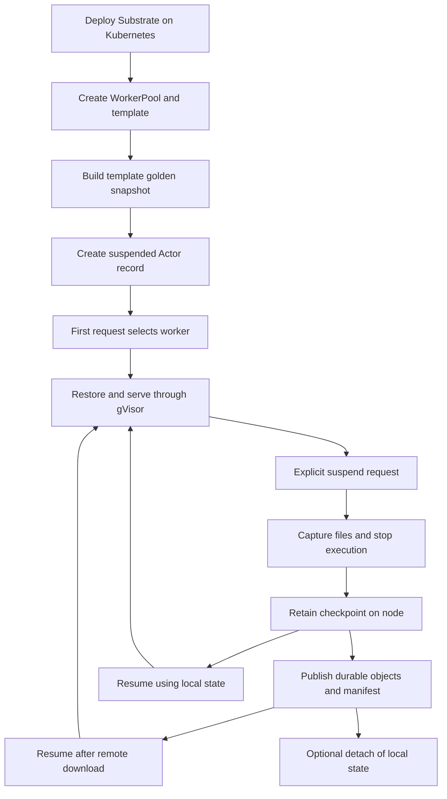

This overview shows dependencies, not a single serialized transaction. Deferred upload can overlap API finalization. The synchronous suspension branch uploads before returning its checkpoint result and can then retain a local copy. Later diagrams show those differences explicitly.

Use six identities when following logs or records:

| Identity | What it distinguishes | Why it survives in the trace |
|---|---|---|
| Actor atespace/name | The user-facing resource address | The proxy, CLI and API use it to locate the actor. |
| Actor UID | One incarnation of that resource | Recreating the same name must not inherit old files, assignments or credentials. |
| ActorTemplate UID | The workload definition associated with saved state | A changed template can require a lower-fidelity restart. |
| Worker Pod UID | The infrastructure Pod hosting an assignment | A worker name or IP alone is insufficient identity. |
| Worker epoch | One worker-process incarnation | A restarted process cannot report success for a predecessor's execution. |
| Snapshot UUID and generation | One capture and its position in the actor's history | Late reports must not replace newer state. |

The public model is in [ateapi.proto](../api/ateapi/v1/ateapi.proto). Actor and ActorTemplate are PostgreSQL-backed API resources. WorkerPool and SandboxConfig are Kubernetes CRDs. An atespace is not a Kubernetes namespace, even though the demo gives both the same spelling.

## L.2 Deploying the substrate before any user actor exists

For a local development trace, use the checked-in kind workflow from the [root quickstart](../README.md) and the [installer command reference](../cmd/ate-setup/commands.md). Go, Docker and kubectl must already work. The installer builds images from the checkout by default; this is distinct from its prebuilt-image mode.

```bash
hack/create-kind-cluster.sh
export ATE_INSTALL_KIND=true

go run ./cmd/ate-setup deploy ate-system \
  --sandbox-classes=gvisor \
  --credential-provider='{"name":"k8s.io"}' \
  --ingress-allowed-spiffe-ids=spiffe://cluster.local/ns/ate-system/sa/atenet-client

go install ./cmd/kubectl-ate
```

Ensure the Go binary installation directory is on `PATH` before using `kubectl ate`. The explicit gVisor selection avoids staging microVM assets that this trace does not use. Keep `ATE_INSTALL_KIND=true` in each shell that runs the installer. These are installation instructions, not a claim that any cluster was created for the manuscript.

`DeployAteSystem` in [deploy.go](../cmd/ate-setup/internal/steps/deploy.go) first validates choices that could otherwise fail after a partial installation. It checks the canonical namespace, credential-provider configuration, requested CSI setup, sandbox classes and snapshot location. Its worker-presence guard applies specifically to `--fake-data-plane`: it refuses replacing the real data plane while nonterminal worker Pods exist. The ordinary gVisor installation shown here does not trigger that guard merely because workers already exist.

The function then establishes the namespace, CRDs/RBAC, initial SandboxConfigs and API prerequisites. It deploys the certificate controller early so signers and trust bundles are available. Optional CSI setup and telemetry configuration precede workloads that consume them. PostgreSQL is planned and deployed before the main system bundle. The bundle supplies ateapi, atecontroller, atelet and networking components. The installer configures the credential provider and egress gateway, then waits for named Deployments and the atelet DaemonSet to roll out.

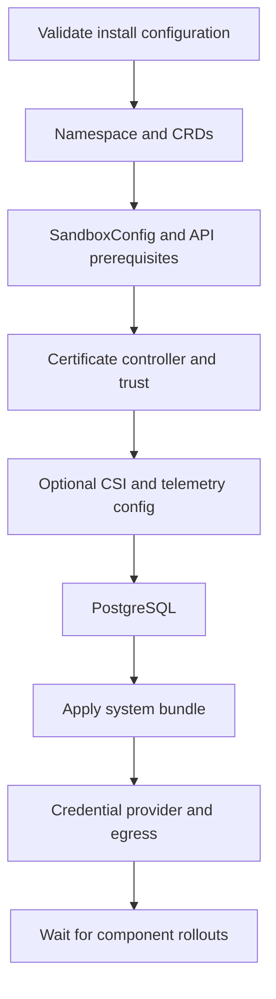

This ordering establishes dependencies, not a global readiness theorem. For example, a running API Pod needs a usable database, and a new authenticated connection needs certificates and trust. A Service object can exist before its endpoint is ready. The installer performs rollout checks; an actor lifecycle additionally needs eligible workers, runtime assets, a ready template or cold-boot path, and access to its snapshot backend.

In kind, [rustfs.yaml](../manifests/ate-install/kind/rustfs.yaml) supplies the alternate S3-compatible service. The manifest pins RustFS `1.0.3`, runs one replica, mounts a 1Gi PVC at `/data`, and exposes API port 9000 and console port 9001. A bucket-initialization Job checks or creates `ate-snapshots`. Both the [atelet overlay](../manifests/ate-install/kind/atelet/kustomization.yaml) and [API overlay](../manifests/ate-install/kind/ate-api-server/kustomization.yaml) configure their object-store sidecars with `ATE_STORAGE_BACKEND=s3`, `AWS_ENDPOINT_URL=http://rustfs.ate-system.svc:9000`, `AWS_REGION=us-east-1`, and `AWS_S3_USE_PATH_STYLE=true`.

The endpoint selects the storage service; a snapshot's `s3://bucket/prefix` identifies its data. Those are different settings. The one-replica PVC, HTTP endpoint and static development credentials describe a development failure domain. They do not establish redundant storage, encrypted transport or per-actor S3 authorization. These properties matter later when deciding what a completed snapshot survives.

At this stage the kernel work is principally Kubernetes infrastructure work. Kubelet and the outer container runtime create container processes, namespaces, cgroups and mounts. CNI configures Pod networking; the selected storage driver supplies persistent-volume behavior. The API and controllers are ordinary host processes using sockets and files through their runtime libraries. Applying a CRD or taking a PostgreSQL row lock is not a new Linux sandbox operation.

On macOS, the Linux primitives described here execute inside the Linux environment hosting kind's nodes. They are not Darwin syscalls issued by the local Go CLI. Distinguishing the client machine, Kubernetes node and actor sandbox prevents a common error when interpreting local-development traces.

## L.3 Creating execution capacity and registering a worker

Install the gVisor counter demo:

```bash
go run ./cmd/ate-setup deploy demo counter
```

The demo applies a Kubernetes namespace and WorkerPool, creates the corresponding Substrate atespace, creates its ActorTemplate, and waits for the template's golden snapshot. The source templates are [counter.yaml.tmpl](../demos/counter/counter.yaml.tmpl) and [counter-template.yaml.tmpl](../demos/counter/counter-template.yaml.tmpl). They contain installer substitutions and `ko://` image references; they are not ready-to-apply manifests until the installer renders them.

The WorkerPool requests three workers, selects the `gvisor` class and uses `ateworker-gvisor`. It follows the class-default SandboxConfig rather than fixing an explicit configuration reference. Its Pod limits advertise one CPU and 1Gi memory per worker; its smaller CPU request influences kube-scheduler's placement. Actor capacity comes from the declared limits, while Kubernetes placement uses requests. This distinction explains why Pod scheduling success and Substrate admission capacity are separate observations.

`WorkerPoolReconciler` resolves the SandboxConfig and renders the worker Deployment in [workerpool_controller.go](../cmd/atecontroller/internal/controllers/workerpool_controller.go) and [workerpool_apply.go](../cmd/atecontroller/internal/controllers/workerpool_apply.go). Configuration selection and protection use claims/finalizers so a referenced runtime configuration is not casually deleted during adoption. Other reconcilers maintain network policy and trust material. Kubernetes' Deployment controller, scheduler and kubelet then create the worker Pods.

The generated worker security context is part of the trusted runtime boundary. It sets `privileged: false`, drops defaults and adds explicit capabilities for required mount, network and runtime setup. It explicitly sets seccomp and AppArmor to Unconfined at the outer worker boundary. The inner gVisor sandbox has separate confinement. Neither “nonprivileged Pod” nor “gVisor application” describes the whole privilege chain by itself.

The controller's worker synchronization path turns observed Pods into Worker records in ateapi. A worker process must then obtain and register its epoch through atelet and WorkerService, publish its runtime capabilities and advertise usable capacity. The [registration implementation](../cmd/ateapi/internal/workerservice/register.go) distinguishes issued, registered and later observed epochs. A Pod existing in Kubernetes does not prove that its current worker process has completed this protocol.

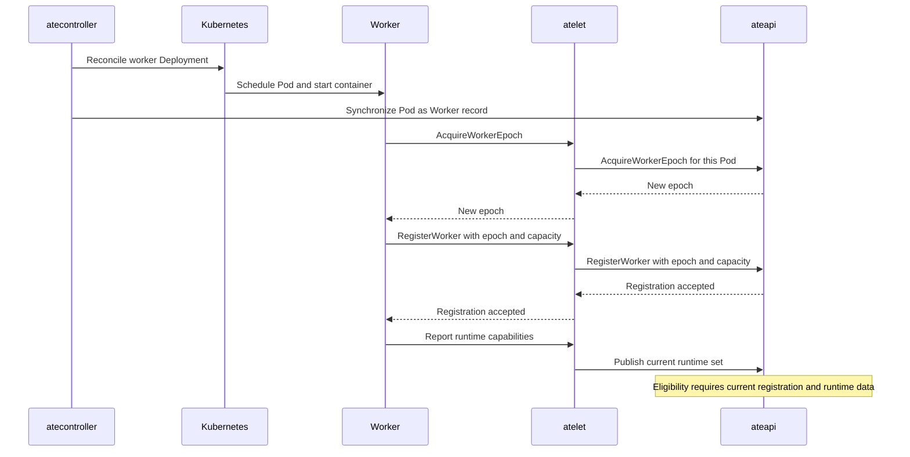

The startup protocol is retried; the diagram is a dependency trace rather than a promise that Kubernetes observation always arrives before the first worker attempt. A replacement process clears or refreshes the runtime information associated with the previous incarnation. Scheduling cannot safely keep using a predecessor's advertised runsc version while the replacement is still discovering its assets.

The executable is selected through SandboxConfig's digest-addressed assets. The audited default gVisor configuration pins release `20261026.0` in [sandboxconfig-gvisor.yaml](../manifests/ate-install/sandboxconfig-gvisor.yaml). Atelet stages and verifies assets through its cache and asset-provider path. The worker receives the selected executable path through its internal protocol. Actor input and snapshot contents do not get to nominate an arbitrary host executable.

The worker image also contains a PID 1 shim. If launched as container PID 1, [pid1.RunIfPID1](../internal/ateworker/pid1/pid1.go) re-executes the real worker as a child. The shim reaps orphaned runtime descendants using `wait4(WNOHANG)` and forwards termination signals. Keeping this reaper outside the ordinary worker avoids stealing child exit statuses from Go's `os/exec`. `PR_SET_CHILD_SUBREAPER` supports the same supervision mechanism when exercised outside PID 1.

## L.4 The template and the actor's initial state

The counter template has one application container, a `/readyz` wakeup probe, a `DurableDir` mounted at `/home/counter`, limits of 1000 millicores and 512MiB, and preferred fidelity `SNAPSHOT_FIDELITY_MEMORY`. The executable maintains three observable counters in [counter.go](../demos/counter/counter.go): an atomic variable in process memory, a file in the durable directory, and a file in the writable root filesystem.

These three counters let the same application distinguish state layers. MEMORY restoration can preserve all three. ROOTFS restoration preserves rootfs and durable-directory contents while restarting process memory. VOLUMES restoration preserves the durable directory while starting fresh processes and rootfs. This is a state-fidelity distinction, not a storage-backend distinction: RustFS and GCS transport the files selected by the runtime and supervisor.

An ActorTemplate is accepted into the Substrate API store before its golden snapshot necessarily exists. `ActorTemplateReconciler`, running inside ateapi, creates a temporary golden actor, resumes it, lets it initialize, suspends it synchronously and creates a Tag owning the completed starting snapshot. It then deletes the temporary actor before recording the golden tag on the template as terminal success. This order lets a retry rediscover the completed tag when cleanup or the template-status write fails. [template_reconciler.go](../cmd/ateapi/internal/controlapi/template_reconciler.go) implements this workflow. The default warmup is twenty seconds; it can be zero when all containers provide wakeup probes. The counter's probe allows initialization readiness to govern this wait.

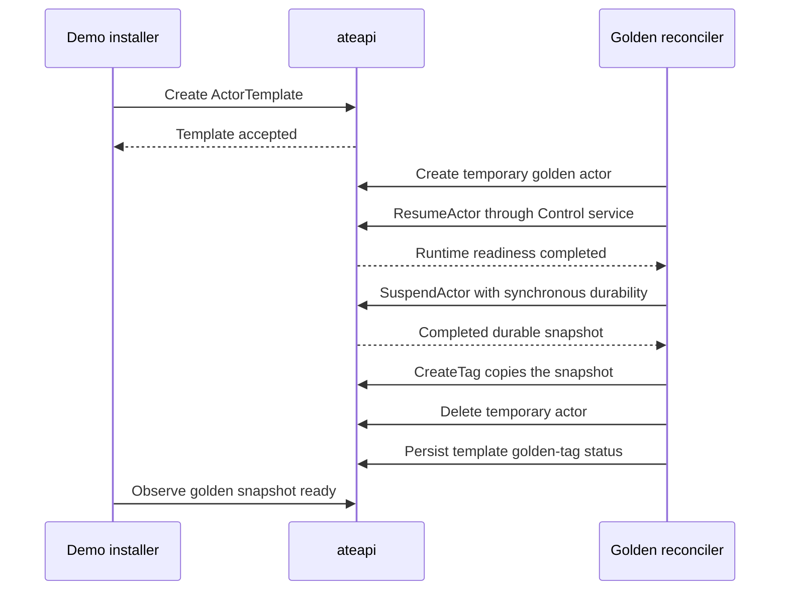

The golden actor consumes real capacity and uses the same runtime lifecycle as ordinary actors. Template acceptance alone is insufficient to claim that initialization has already been paid for. The demo installer waits for the golden workflow, so the subsequent user actor normally starts from saved initialized state.

Create that actor:

```bash
kubectl ate create actor lifecycle-counter \
  -a ate-demo-counter --template counter

kubectl ate get actor lifecycle-counter -a ate-demo-counter -o yaml
```

`ServiceImpl.CreateActor` in [actor.go](../cmd/ateapi/internal/controlapi/actor.go) resolves the template and either an explicit source tag or the template's current golden tag. It writes a SUSPENDED actor record. When a tag is available, the actor initially borrows the tag's snapshot, stamped as tag-owned generation 1. It does not copy every object into a new actor prefix at creation. The first actor-owned suspension produces its own capture under its UID.

When no source tag is available, creation can instead produce a SUSPENDED actor with no snapshot. Its first activation takes the cold `Run` branch. The selected initial state is frozen at actor creation; a golden tag appearing later is not a reason to silently replace the actor's initial history. The default counter walkthrough and the no-snapshot cold-boot case must therefore remain distinct when explaining “the first start.”

Creating the actor does not create a user Pod, Sentry or application process. It creates resource identity and its initial recovery reference. Registry state consumes database/storage resources; resident execution starts only after activation.

## L.5 The first request and the placement transaction

Start the authenticated local proxy in one terminal:

```bash
kubectl ate proxy actor lifecycle-counter -a ate-demo-counter
```

In another terminal, send a request:

```bash
curl -X POST http://localhost:8000/
```

The proxy reaches the ingress router using a component identity permitted by the installation's SPIFFE allowlist. The request identifies the destination through `ate-target-actor`; the HTTP Host retains its application meaning. Ingress allowlisting authorizes the trusted client component to route to actors. It is not a per-user grant for this particular actor. The request path is in [ingress.go](../cmd/atenet/internal/router/ingress/ingress.go) and [resumer.go](../cmd/atenet/internal/router/ingress/resumer.go).

Before forwarding to the application, the router asks ateapi to resume the actor and return its assignment. An already-running actor can use the fast lookup path. A suspended actor enters `ActorWorkflow.ResumeActor` in [workflow_resume.go](../cmd/ateapi/internal/controlapi/workflow_resume.go). The workflow acquires the actor's renewable SQL lease and rereads authoritative state. This serializes competing lifecycle operations on the same actor; it does not reserve capacity on a worker by itself.

Candidate selection uses the cached Worker population. The scheduler checks active registration, sandbox class, runtime compatibility, selectors, locality requirements and resource room. It books the actor's declared CPU and memory plus runtime overhead. It then uses power of two choices among eligible candidates, comparing slot and dominant compute utilization. Enumerating/filtering the candidate fleet is linear in worker count; the two-choice comparison does not make the entire scheduler constant time. See [scheduling.go](../cmd/ateapi/internal/scheduling/scheduling.go).

Authoritative admission occurs in PostgreSQL. `BindActorToWorker` locks the Worker row, inserts or reconciles the actor's unique assignment, rechecks constraints and capacity, updates allocation and commits. If two actors race for the last slot, their distinct actor leases do not conflict, but the worker-row admission serializes their bookings. A stale scheduling cache can cause retries; it cannot replace that authoritative check. The relevant implementation is [worker_assignment.go](../cmd/ateapi/internal/store/atepg/worker_assignment.go).

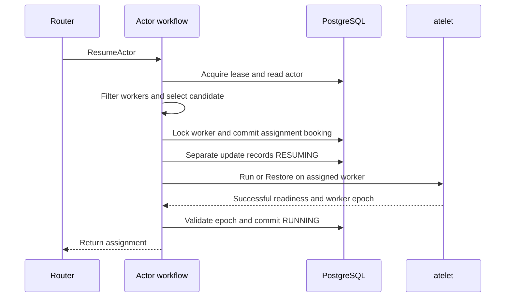

The assignment commit and the RESUMING actor update are separate database operations. A failure between them can leave a capacity claim requiring reconciliation. The remote runtime operation is another boundary. Neither a SQL transaction nor the lease makes a node RPC exactly once. The source explicitly identifies complete Run/Restore reentrancy as unfinished work. A lost reply means the caller lacks an outcome; it does not prove that no sandbox started.

For external volumes, allocation/attachment steps join this workflow and can impose node constraints. The main counter example has only a DurableDir, so it does not depend on CSI attach/detach or volume snapshot support. Avoid treating those branches as invisible details when adding an external-volume template later.

If capacity is temporarily unavailable, the router can park requests. Per-actor flights share activation/retry work; the default parking limit is 1024 requests and the default parked retry budget is five seconds. These are gateway bounds, not guarantees that a restore finishes within five seconds. Once a restore has been committed to the activation path, its lifetime can outlast an individual waiting request. A client timeout and the actor's eventual state must be inspected separately.

## L.6 Atelet prepares the node-side execution contract

Ateapi calls the atelet on the assigned node; atelet then calls the worker identified by Pod UID. Their internal RPCs are defined in [atelet.proto](../internal/proto/ateletpb/atelet.proto) and [ateworker.proto](../internal/proto/ateworkerpb/ateworker.proto). Atelet prepares resources and state. The worker implements runtime-specific creation, restore, checkpoint and termination. Atelet does not need to parse Sentry memory structures or execute private runsc control logic.

`Run` and `Restore` in [atelet/main.go](../cmd/atelet/main.go) validate the request and coordinate through an actor-local lock. `snapshottracker.BeginStart` waits for an active detach. For existing tracked snapshot state, it marks the actor started and persists removal of its detach schedule before execution begins. Otherwise, a restarted atelet could replay an old detach against a newly running actor and remove files beneath it. A new actor with no tracked snapshot has no such detach state to rewrite.

Restore resolves the runtime selected by the assignment, then obtains the snapshot manifest from usable local state or through the node object-store plugin. Atelet parses the manifest and decides which files are required for the requested fidelity. The plugin transfers the files named in its request. Its raw manifest-fetch operation does not choose the runtime or independently decide the restore file set. [snapshot_transfer.go](../cmd/atelet/snapshot_transfer.go) and [objectstoreplugin/node.go](../internal/objectstoreplugin/node.go) make this division explicit.

Preparation includes OCI content, runtime assets, actor directories, volume mappings, network/egress configuration and the workload specification. Checkpoint transfer can overlap runtime-asset and OCI preparation where the implementation permits. The files must be ready before the worker's runtime call consumes them. Shared cache population and the actor's private mutable state have different lifetimes.

Host filesystems participate directly. The image cache composes OCI layers using OverlayFS. [bundle_linux.go](../internal/imagecache/bundle_linux.go) uses the descriptor-based mount API: `fsopen`, `fsconfig`, `fsmount` and `move_mount`. Bind mounts and propagation make prepared paths available across the node/worker boundary. Asset and file caches use verified publication and, where suitable, hard links so consumers retain an inode while cache eviction examines its references.

Snapshot locality requires more than finding a directory with a plausible name. Node boot identity, recorded snapshot metadata, generation and file availability matter. A process restart can preserve valid node state; a node reboot invalidates assumptions encoded by boot-specific local metadata. The restore path validates local state and can fall back to a completed durable source. A path surviving on disk is not by itself proof that the runtime may restore it.

For the golden snapshot, the control plane marks shared state explicitly. The gVisor snapshot-cache path can stage hardlinks to cached immutable files. That avoids repeated object-store downloads for many actors initialized from one tag while still requiring per-actor runtime reconstruction. A private actor snapshot, an OCI layer and a runsc binary are different cache populations with different mutability and eviction rules.

## L.7 How gVisor turns prepared files into a running actor

The worker starts with a registered epoch, validates the runtime path and takes an actor lifecycle lock. It resets stale runsc bookkeeping and stale sandbox cgroup state, prepares egress, creates the actor's network environment and reserves local hosted-actor state. Runtime operations are attributed to the Actor UID from the beginning, including startup resource use. The detailed implementation is [ateworker-gvisor/main.go](../cmd/ateworker-gvisor/main.go).

The execution boundary has three layers:

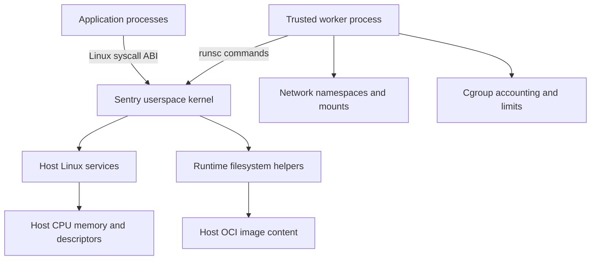

The application executes against the Sentry's Linux-compatible interface. Sentry maintains the process, address-space and filesystem abstractions that runsc can later serialize. The host kernel schedules the Sentry and helper processes and supplies memory, descriptors and filesystem services. The exact trap platform and runtime-internal host syscall sequence belong to the pinned runsc build; they are not implemented by Substrate's Go worker.

This path does not use CRIU to checkpoint ordinary host processes. Nor does the gVisor actor automatically imply a KVM guest. Substrate invokes runsc, while its separate microVM worker drives Cloud Hypervisor. `/dev/kvm` and Cloud Hypervisor's conditional userfaultfd restore mechanism should not be inserted into this gVisor trace simply because they exist elsewhere in the repository.

The worker constructs a reserved `_sandbox` runtime object with `-no-root-container`. It provides the sandbox abstraction without an application root process/filesystem of its own. Application containers are separate runtime objects attached through the annotations produced by [ShapeGVisor](../internal/ocispec/gvisor.go). The ordinary cold path creates and starts `_sandbox`, composes each application's rootfs, creates each application container and starts its command. There is no user Pod creation at this point.

Resource enforcement is also layered. Scheduling booked declared limits and overhead earlier. Host cgroups now account for actual execution. The gVisor path adjusts the sandbox leaf's memory enforcement after creation, using `memory.high` throttling and the worker's pressure guard rather than assuming that every memory charge fits neatly inside the application's nominal RSS. [memlimit.go](../cmd/ateworker-gvisor/memlimit.go), [memwatch.go](../internal/ateworker/cgroup/memwatch.go) and [memguard.go](../internal/ateworker/cgroup/memguard.go) connect usage, PSI and local memory events to intervention. A top-level worker Pod limit remains a separate boundary.

The worker pins the Sentry with a pidfd where supported by the path. `pidfd_open`, descriptor polling and pidfd signaling identify a process incarnation without relying only on a reusable PID. Core-scheduling support is probed with `prctl(PR_SCHED_CORE, PR_SCHED_CORE_GET)` and can enable runsc core tags. That feature concerns host scheduling across SMT siblings; it does not replace cgroup CPU bandwidth control.

Filesystem setup and checkpointing share the same runtime model. The gVisor DurableDir is represented through runtime filesystem semantics and volume hints, rather than being a claim that every application file is already safely persisted in object storage. The worker passes durable mount paths and rootfs paths to runsc's filesystem-checkpoint machinery. The checkpoint operation later determines when those state layers become a saved image.

For the normal counter walkthrough, the first user activation takes `RestoreWorkload` because a golden snapshot exists. For an actor created without a source snapshot, `RunWorkload` performs the cold sequence just described. Both converge on the same readiness and network-admission boundary.

## L.8 Network setup, readiness and the first application response

The gVisor backend creates a runtime network namespace and a gateway network namespace joined by a veth pair. [actornet/sandbox.go](../internal/ateworker/actornet/sandbox.go) programs interfaces, link-local point-to-point addressing, routes and nftables rules. [netns.go](../internal/netns/netns.go) wraps namespace entry on a locked OS thread. Namespace membership is a thread property: entering one namespace in a goroutine without controlling the underlying thread would corrupt the meaning of later socket operations.

The relevant host mechanisms are `unshare(CLONE_NEWNET)`, `setns`, namespace-handle bind mounts and rtnetlink. The setup also programs namespace-scoped sysctls. Once a socket is created in a namespace, it retains that association even after the calling thread returns to the worker's original namespace. This allows the worker to maintain actor-specific dialers without leaving its ordinary serving threads inside actor namespaces.

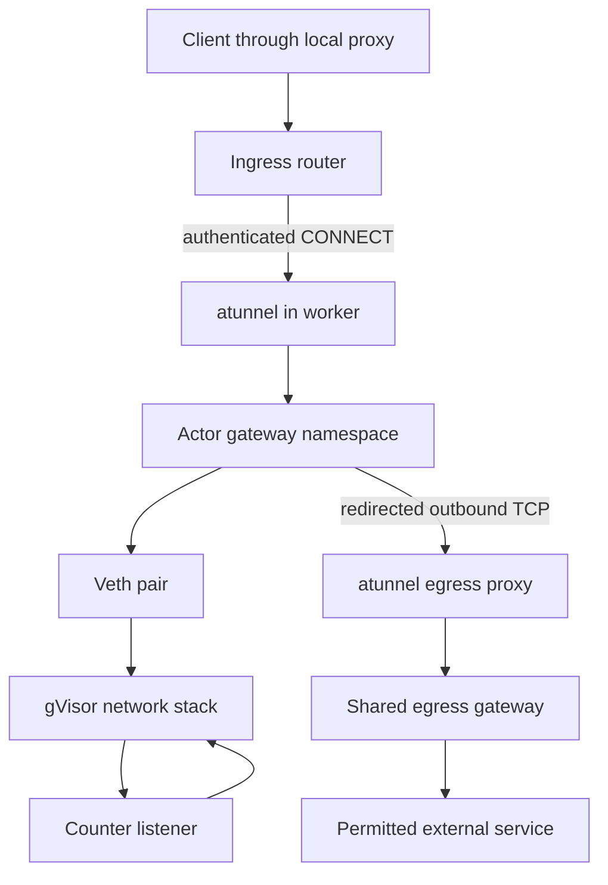

The diagram is directional at the protocol level; request responses travel back over the established streams. It does not imply that the actor can bypass the tunnel by addressing an arbitrary worker Pod port. The microVM backend uses a different one-namespace/TAP construction and is outside this packet trace.

The worker activates egress before application startup/readiness because initialization may need remote dependencies. Outbound TCP is redirected with nftables NAT `REDIRECT`. `SO_ORIGINAL_DST` retrieves the destination before translation, allowing the proxy to retain the application's intended endpoint. This is not a TPROXY implementation. DNS is mediated separately, with actor policy applied to resolution and outbound request handling.

The egress gateway authenticates actor identity, evaluates its current policy and applies any configured credential effect outside the actor sandbox. The policy path accepts actors in RESUMING as well as RUNNING so startup dependencies can work. The actor need not possess the infrastructure credentials held by a storage plugin or the secret inserted by the egress gateway. Transport isolation, policy authorization and credential substitution are separate checks.

Ingress remains inactive until configured wakeup probes succeed. For the counter, `wakeupprobe.WaitAll` waits for `/readyz` to return success. That endpoint does not increment the visible counters. With MEMORY restore, the application's initialized readiness flag is itself part of saved state; the probe still supplies an application-facing readiness observation after runtime reconstruction.

The worker then activates ingress, records the session and initial statistics, starts its sandbox-exit watcher, and returns the worker epoch. Atelet propagates the result. Ateapi compares that epoch with the current Worker registration before committing RUNNING. Only then does the router receive the successful assignment and forward the waiting request. A restored Sentry existing, a worker reporting readiness and an API record reaching RUNNING are three separate events.

The counter response reports memory, durable-file and rootfs counts. Every request to `/` changes them, including an ordinary GET. To inspect infrastructure state without modifying those counters, use the API/CLI or the readiness endpoint rather than an extra request to `/`. This matters when testing continuity: an observation request can itself be the event being counted.

## L.9 What a state snapshot includes

Snapshot fidelity specifies what can be reconstructed. It does not identify where the state is stored or whether upload has completed.

| Fidelity | DurableDir contents | Writable rootfs | Process memory/execution | Counter behavior on restore |
|---|---|---|---|---|
| VOLUMES | Preserved | Fresh | Cold start | Durable-file count continues; memory/rootfs restart. |
| ROOTFS | Preserved | Preserved | Cold start | File/rootfs counts continue; memory restarts. |
| MEMORY | Preserved | Preserved | Runtime execution image | All three can continue under a compatible restore. |

The gVisor worker passes rootfs targets such as `rootfs/=<container>:/` and durable-directory targets such as `fs/=<container>:<mount-path>` to runsc. `fscheckpoint.go` derives these from the workload. Multiple mounts of one durable filesystem are presented so runsc can identify and deduplicate the shared filesystem. VOLUMES capture with no DurableDir targets is rejected by this worker path; it does not silently manufacture an empty useful snapshot.

A conceptual gVisor snapshot has these parts:

```text
snapshot capture
├── runtime memory/checkpoint files       MEMORY only
├── rootfs/ filesystem checkpoint bundle ROOTFS and MEMORY
├── fs/ durable-directory bundle         when durable directories exist
└── manifest.json                        assembled by atelet for transfer
```

This is a grouping of responsibilities, not an exhaustive fixed filename list. The worker enumerates the actual regular files written by runsc and returns `SnapshotFiles` plus the durable-data subset. Atelet records the runtime/assets, workload association and file lists in its manifest. Hard-coding one `checkpoint.img` and assuming that it is the whole state would omit the filesystem bundles and any additional runtime page files.

The kernel cannot make external side effects part of that capture. A request already sent to an external API is not undone by restoring older memory. A peer socket, DNS cache, certificate lifetime or credential expiration may have changed while the actor was suspended. The `-allow-connected-on-save` flag permits the configured runsc save behavior; it does not create an atomic checkpoint of every remote peer. Applications need reconnect and retry semantics appropriate to those dependencies.

Likewise, a `DurableDir` name describes a supported persistence layer in the actor lifecycle. An ordinary file write there is not an immediate synchronous object-store commit. Until capture and the chosen upload mode complete, the latest changes still depend on the current execution/node state.

## L.10 Suspending the actor: control-plane and runtime ordering

For a concrete durable demonstration, suspend while the actor is RUNNING:

```bash
kubectl ate suspend actor lifecycle-counter -a ate-demo-counter --mode=sync
```

Omitting `--mode=sync` selects the CLI's asynchronous mode. The difference is upload completion, not whether execution is stopped. Automatic idle detection is not wired into the production worker at this baseline. The upward suspend-request machinery exists, but this walkthrough deliberately issues the explicit operation.

`ActorWorkflow.SuspendActor` in [workflow_suspend.go](../cmd/ateapi/internal/controlapi/workflow_suspend.go) obtains the actor lease and reads the actor/template. It persists SUSPENDING, advances the relevant generation and records the new snapshot UUID, fidelity, runtime association and pending durable destination before asking atelet to capture. The capture is therefore associated with committed intent. Re-entry uses the same recorded snapshot rather than minting a fresh identity on each retry.

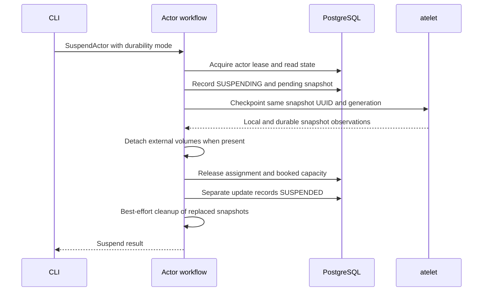

The two final database writes are deliberately shown separately. `ensureSuspendedFinalized` releases the reservation before updating the actor to SUSPENDED and clearing its embedded assignment. That interval must be handled through re-entry/recovery. It is incorrect to describe all capacity, actor and filesystem changes as one atomic transaction.

Atelet serializes the actor operation and calls `BeginCheckpoint`. If that snapshot was already committed, it can return the recorded result rather than capture again. Otherwise it builds `CheckpointWorkload` for the selected worker. The worker validates the request, obtains the actor lock and deactivates the tunnel before snapshotting. A checkpoint uses its own operation lifetime so disappearance of an RPC client does not immediately interrupt a state-saving operation halfway through.

The runtime sequence depends on fidelity. MEMORY capture invokes runsc's checkpoint operation for the sandbox, with rootfs and durable filesystem targets. That operation stops the Sentry. The worker observes its exit, using its pinned process reference where available, before cleanup. ROOTFS and VOLUMES use runsc filesystem-checkpoint commands followed by workload termination. These are real state transitions, not a Pod freezer toggled while every other resource remains unchanged.

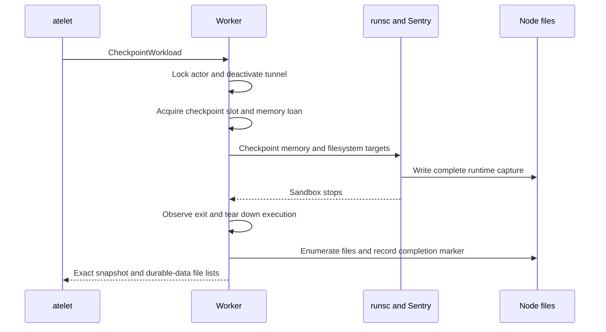

Runtime checkpointing can temporarily consume memory comparable to part of the saved state. New checkpoint file pages are charged by the host memory controller while application memory and runtime state may still exist. [ckptcgroup.go](../cmd/ateworker-gvisor/ckptcgroup.go) isolates checkpoint charging in a sibling cgroup and coordinates temporary borrowing from unused worker memory. The worker also limits simultaneous checkpoint writers. A new activation can wait for conflicting memory loans instead of spending those bytes twice.

The loan is returned after writeback makes the checkpoint cache reclaimable, not simply when the checkpoint command exits. [snapshotcache.go](../internal/snapshotcache/snapshotcache.go) uses `cachestat`, `fdatasync` and cache advice to observe/clean relevant file pages. These operations manage host memory pressure; they are not the object-store durability commit. PSI, `memory.high`, the memory guard and the Pod's own limit remain distinct mechanisms during this overlap.

After capture, the worker tears down runtime objects and actor networking, unmounts prepared state where appropriate, and returns the file lists. It can record a completion marker tied to boot identity and fidelity so a retry can reuse a finished capture. Failure before a trustworthy result can leave a different outcome, including CRASHED. The source still identifies limitations in classifying checkpoint failures that left execution intact.

## L.11 Publishing the snapshot: local commit, upload and RustFS

Atelet turns the worker's file list into an actor recovery record. It associates the capture with snapshot UUID/generation and writes its manifest. The two durability modes take different paths in [atelet/main.go](../cmd/atelet/main.go):

| Mode | Persistence ordering before the checkpoint RPC returns | Meaning |
|---|---|---|
| Deferred / CLI async | Move completed capture into local snapshot storage, `CommitLocal`, schedule upload | The newest state can still depend on one node. |
| Immediate / CLI sync | Upload files and manifest, `CommitDurable`, then attempt local retention | Remote completion is required; retaining locality is an additional optimization. |

For immediate mode, local-retention failure after successful durable upload is logged rather than turning the completed upload into failure. Conversely, a failed immediate upload is serious: the runtime has already stopped. The current source does not provide an unconditional retry that recreates the lost execution, and explicitly notes a path that crashes the actor when that upload fails. Synchronous mode changes the success contract; it cannot prevent the backend from failing after capture.

For deferred mode, `Tracker` records `LatestLocal`, maintains any older `LatestDurable`, and persists the outstanding durability interval. Its background queue works by actor UID and rereads current state. It can select a newer checkpoint that superseded queued work, while an already-started upload retains the files it still needs. Upload and detach use separate queues; destructive work on one actor remains serialized. See [tracker.go](../cmd/atelet/internal/snapshottracker/tracker.go), [lifecycle.go](../cmd/atelet/internal/snapshottracker/lifecycle.go) and [upload.go](../cmd/atelet/internal/snapshottracker/upload.go).

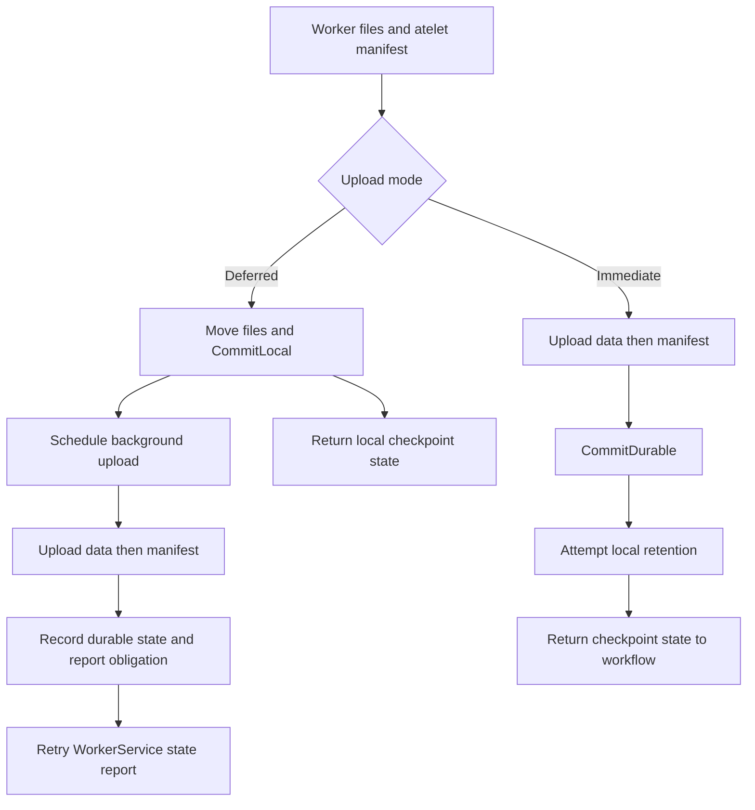

Background upload can begin and finish before the suspend RPC returns. The async guarantee is that the caller does not wait for upload as a required part of success, not that upload must start only after API finalization. A diagram that serializes “SUSPENDED, response, then upload” would invent an ordering that the implementation does not enforce.

The node object-store plugin is a separate process with provider credentials. Atelet calls its public NodeProvider interface. `UploadSnapshot` transfers the specified data files, while manifest publication is a distinct final operation. The manifest's presence identifies the completed object set. A few large objects existing at a prefix are not proof of a committed snapshot. Transfer retry and cleanup use deterministic names and explicit error handling; this is an application commit protocol over objects, not a multi-object database transaction.

The shared content layer compresses data, preserves sparse file information where applicable, and streams to the configured backend. On restore, sparse reconstruction can use `SEEK_DATA`/`SEEK_HOLE` and filesystem-aware copying so logical memory size is not confused with allocated blocks. Four quantities differ: logical file length, populated input bytes, compressed transfer bytes and local allocated bytes. They affect memory, network and disk capacity differently.

The S3 uploader uses 32MiB parts and four upload workers. Its reservation calculation also includes a producer buffer, giving 160MiB before compression buffers for the full streaming allowance. The default shared upload reservation budget is 512MiB, as defined in [pkg/objectstorage/upload.go](../pkg/objectstorage/upload.go). It limits concurrent pipeline reservations, not the process's total RSS. Download buffers, runtime page cache and memory awaiting garbage collection require separate accounting.

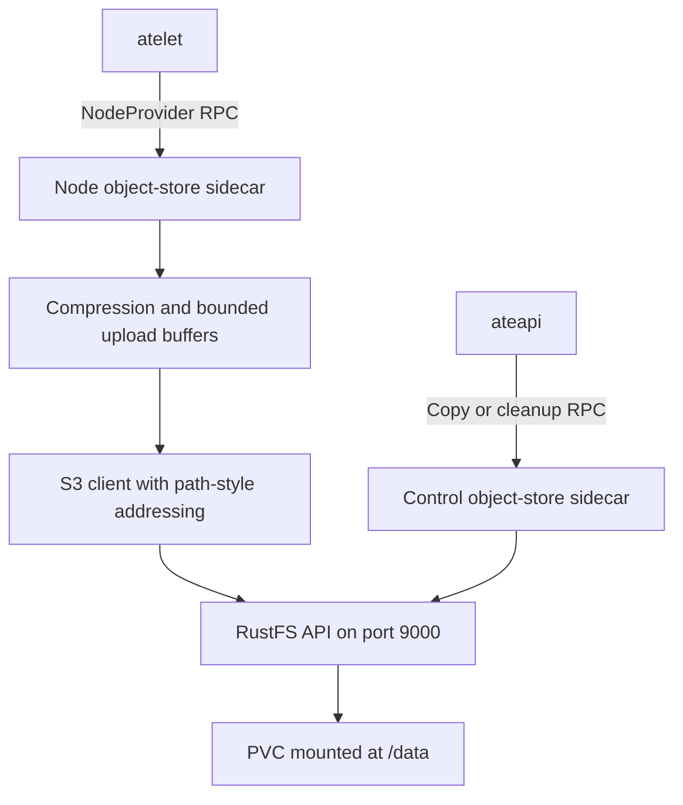

Both sidecars must use the same intended backend. Node upload/restore succeeding does not prove that control-side tag copy or prefix cleanup works. The RustFS bucket-init Job proves only its own endpoint/credential path. Test the actual plugin operations and force a remote restore when validating a backend; a cache hit can conceal a broken store.

The GCS plugin can exchange a worker-for-actor assertion for actor-scoped transfer credentials. The current S3 path uses ambient SDK credentials, including the development credentials configured for RustFS. Path validation and NetworkPolicy still apply, but they do not turn that shared S3 identity into a per-actor credential. Physical durability likewise depends on the chosen RustFS deployment and volume. A successful upload to a single PVC is not proof of survival after losing that PVC or its cluster.

After a background upload advances durable state, atelet reports it to WorkerService through a separate retrying mechanism. `ReportDueSince` and persisted tracker state prevent durability reporting from depending on the original client connection. The immediate checkpoint path instead returns its state to the waiting suspend workflow, which applies that observation during finalization. The control plane validates identity/generation before adopting reported state. A late successful upload of an older capture must not overwrite a newer actor history.

## L.12 Resuming from local state or from object storage

After suspension, repeat the client request through the still-running proxy:

```bash
curl -X POST http://localhost:8000/
kubectl ate get actor lifecycle-counter -a ate-demo-counter -o yaml
```

The router again invokes activation. It does not need the client to know whether the actor is currently suspended. The control-plane workflow chooses a usable recovery source and a compatible worker, reserves capacity and records RESUMING. The Worker Pod can be the same or a different one. The Actor UID is the continuity boundary; the old worker address is not.

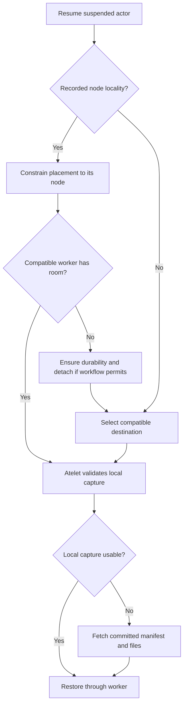

Locality refers to a node, not permanently to one worker process. Node-shared actor paths can support a different compatible worker on that node. If locality prevents placement and the workflow finds a suitable alternative, it can detach local state after ensuring durability and retry elsewhere. Detach does not reserve the alternative worker in advance. Capacity can change before the next attempt, so a successful detach does not guarantee immediate remote admission.

The API places from recorded locality; atelet later establishes whether the corresponding files are physically usable. The remote path retrieves the manifest first, validates the required representation, downloads the selected file set and reconstructs it before runtime restore. A completed manifest can exist while the API still records its upload as PENDING because the report has not arrived. A missing manifest can instead make restoration fail; this branch does not silently select any older durable generation. Shared golden/tag snapshots can use the node cache; private captures follow their own materialization rules. Atelet chooses preparation from the assigned runtime and requested fidelity, not an executable supplied by untrusted manifest content.

Runtime compatibility can change the outcome. MEMORY restore requires suitable runtime support. The workflow can permit ROOTFS fallback when memory runtime compatibility cannot be satisfied. Changing the actor's template can require VOLUMES fidelity. Sandbox class remains constrained because gVisor and microVM representations are not interchangeable. A successful activation can therefore preserve files while cold-starting memory; read the effective fidelity rather than interpreting RUNNING as proof of instruction-level continuation.

The gVisor restore sequence creates the reserved sandbox with applicable filesystem restore arguments. At MEMORY fidelity it invokes runsc restore for the sandbox and then creates/restores the application containers. At ROOTFS or VOLUMES fidelity it creates/starts processes with the applicable filesystem bundles. The rootfs bundle is required for ROOTFS and MEMORY; DurableDir bundles are supplied when present. `fsRestoreArgs` and `fsRestoreContainers` in [fscheckpoint.go](../cmd/ateworker-gvisor/fscheckpoint.go) express those rules.

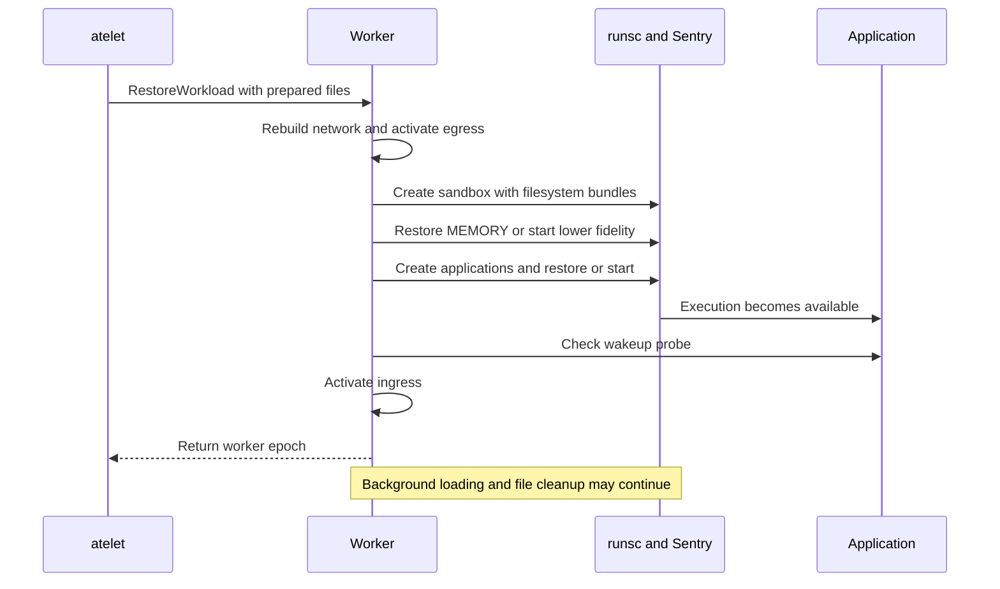

The pinned flags enable `runsc restore -background -detach`. Runtime reconstruction, application readiness and background state loading are therefore separate completion boundaries. The worker waits for the wakeup probes and enables ingress before returning success. It does not equate that success with every possible page/file access having already occurred. First-request latency can include work not visible in a narrowly measured restore command duration.

File lifetime needs precise treatment. [dropActorCheckpointCacheAsync](../cmd/ateworker-gvisor/ckptcgroup.go) can immediately unlink unpreserved restore files when no other hardlinks exist. Open runtime descriptors keep their inodes and contents alive until readers close them. For preserved files or files linked elsewhere, it waits for background memory/filesystem restoration and then evicts clean cache pages, unlinking only when preservation is not required. Removing a pathname, dropping page-cache residency and freeing the final inode reference are different events.

That distinction is a density mechanism. Restored anonymous execution memory and retained checkpoint page cache can otherwise coexist. `fdatasync` and `posix_fadvise(DONTNEED)` help manage the redundant host cache where safe. A hardlink to a shared golden file changes the reclamation consequences: unlinking one actor's name alone does not release the inode held by the cache or another consumer.

For the counter's compatible MEMORY round trip, the next response should advance all three counters from their prior values. This is a semantic expectation, not output observed during this writing session. At lower fidelity, the table in L.9 predicts which values restart. If another request ran during the experiment, its increments must be included before diagnosing a continuity defect.

## L.13 Failure boundaries and what each completion proves

The lifecycle crosses PostgreSQL, node files, runtime processes, object storage and proxies. No one transaction spans them. The useful question after failure is which completion evidence exists and which layer can establish the next safe transition.

| Failure point | What may already have happened | What to inspect or preserve |
|---|---|---|
| Worker booking commits, RESUMING write fails | Capacity is reserved without the final actor-side record | Unique assignment and stale-claim recovery; do not book the same actor again blindly. |
| Run/Restore reply is lost | Execution may have started | Actor state, assignment and worker epoch; a timeout is not evidence of no execution. |
| Worker process restarts | Its Pod can retain UID/IP while sandboxes disappear | Registered/observed epochs and WorkerAssignmentReconciler recovery. |
| Checkpoint completes, caller disappears | Files or committed local state may remain | Snapshot UUID/generation and completion markers before retrying capture. |
| Immediate upload fails after capture | The Sentry has stopped but external persistence failed | Current error classification can produce CRASHED; no universal transparent rollback exists. |
| Deferred upload fails | Latest local state may remain usable on that node | Undurable age, upload retries and older completed durable state. |
| Node is lost before deferred upload commits | The latest capture may be unavailable | Which durable generation completed, and whether explicit recovery can use it. |
| Manifest publication succeeds, report is lost | Durable objects exist but API observation may lag | Persisted reporting obligation and generation-aware retry. |
| Client times out while activation continues | The actor can become RUNNING later | Activation outcome independently of request outcome; client retry can repeat application effects. |

Worker epochs address process replacement, while actor leases serialize a logical workflow and database row locks serialize capacity admission. They cannot substitute for one another. Similarly, an object-store prefix existing does not prove manifest publication, and manifest publication does not prove that ateapi has recorded the report. Keep those observations separate when reconstructing an incident.

An already-SUSPENDED actor returns from `SuspendActor` without redoing the workflow. Consequently, issuing `--mode=sync` after a successful asynchronous suspend is not a general command to wait for or upgrade that earlier upload. Inspect durable snapshot state through the API. The internal promotion/detach operations have their own semantics; they should not be invented as public CLI flags.

Revert is also distinct from resume. The [revert workflow](../cmd/ateapi/internal/controlapi/workflow_revert.go) abandons current execution/local progress in favor of completed durable state under its checks. It can discard newer work. A failed or crashed actor should not be described as always transparently resuming its last in-memory instruction; the available completed snapshot and the explicit recovery operation determine that outcome.

Request retries need application semantics. If a counter POST increments state and the connection fails before the response arrives, repeating it may increment again. Leases, snapshot generations and worker epochs protect infrastructure invariants; they do not provide an application transaction identifier or exactly-once delivery for arbitrary HTTP requests.

## L.14 A complete verification walkthrough

Use the following sequence after deployment, demo installation, actor creation and proxy startup from the earlier sections. The commands are intentionally tied to this checkout rather than hypothetical APIs.

1. Inspect the template and actor. Confirm the requested MEMORY fidelity, wakeup probe, initial SUSPENDED state and source snapshot when the golden workflow completed.
2. Send one request to `/`. Record the three returned values. Inspect the actor's RUNNING state, worker assignment and runtime information.
3. Suspend the running actor with `--mode=sync`. Inspect both SUSPENDED and the completed durable snapshot state. Do not use the actor state alone as the durability observation.
4. Send another request. Inspect RUNNING again and compare all three counters with the previous response. The worker assignment may change without changing the actor identity.
5. Repeat using asynchronous mode while the actor is running. Observe local and durable generations independently. Upload may be fast enough that PENDING is never visible to a polling client; that does not change the mode's contract.
6. Validate a remote restore separately in a controlled environment by ensuring the selected recovery source cannot be satisfied from retained local/cache files. A same-node cache hit does not exercise RustFS download.

```bash
kubectl ate get actor-template counter -a ate-demo-counter -o yaml
kubectl ate get actor lifecycle-counter -a ate-demo-counter -o yaml

curl -X POST http://localhost:8000/
kubectl ate suspend actor lifecycle-counter -a ate-demo-counter --mode=sync
kubectl ate get actor lifecycle-counter -a ate-demo-counter -o yaml

curl -X POST http://localhost:8000/
kubectl ate suspend actor lifecycle-counter -a ate-demo-counter --mode=async
kubectl ate get actor lifecycle-counter -a ate-demo-counter -o yaml
```

For request timing, separate router waiting, actor lease/admission, node preparation, snapshot transfer, runsc work, wakeup probes and response delivery. Some preparation overlaps. Adding individual phase averages does not reconstruct an end-to-end percentile. The architecture's 100ms-p95 activation objective is a target, not a guarantee established by this example. Record runtime version, snapshot fidelity/locality, cache state, resources, concurrency and the exact start/end boundaries of any measurement.

The worker emits actor-attributed lifecycle and checkpoint/restore phase logs. Atelet tracks transfer and snapshot state; the router tracks parking; the API records lifecycle state. Correlate Actor UID, snapshot generation and worker epoch, not only the human-readable actor name. A recreated actor can reuse that name while all three identity domains have changed.

When the example is no longer needed, delete the actor:

```bash
kubectl ate delete actor lifecycle-counter -a ate-demo-counter
```

Deletion drives termination where needed, volume detachment, assignment release and snapshot cleanup through the workflow. An actor's borrowed tag snapshot belongs to the tag and must not be collected as actor-owned storage. Actor-owned object prefixes include its UID, preventing deletion/recreation by name from adopting old data. A retained independent Tag has its own copied snapshot and lifecycle.

Deleting this actor does not by itself request deletion of the WorkerPool, the template, RustFS or the Substrate installation. Those resources have separate lifecycles. This is the final consequence of the two scheduling planes: actor population changes can occur while infrastructure capacity remains ready for other actors.

## L.15 Linux mechanisms along the trace

The following table collects the kernel-facing work used by the gVisor lifecycle. “Runtime” means the pinned external runtime performs the operation; the linked Substrate file is its integration point. Ordinary Go filesystem/network calls also invoke host syscalls, but this table groups them by the lifecycle guarantee they support.

| Stage and mechanism | Executing boundary | Function in this lifecycle | Source |
|---|---|---|---|
| Pod namespaces, cgroups, root mounts | Kubelet and outer container runtime | Establish the trusted worker's execution envelope before any actor activation. | [workerpool_apply.go](../cmd/atecontroller/internal/controllers/workerpool_apply.go) |
| Capabilities, seccomp, AppArmor | Outer Pod configuration and runtime confinement | Permit worker setup while keeping the inner actor boundary separate; outer profiles are explicitly Unconfined here. | [workerpool_apply.go](../cmd/atecontroller/internal/controllers/workerpool_apply.go), [gvisor.go](../internal/ocispec/gvisor.go) |
| Process creation and exec | Go process APIs and runsc | Start the PID 1 child worker and invoke runtime commands/helpers. | [pid1.go](../internal/ateworker/pid1/pid1.go), [runsc.go](../cmd/ateworker-gvisor/runsc.go) |
| `PR_SET_CHILD_SUBREAPER`, `wait4`, signals | PID 1 shim | Reap orphaned descendants and forward shutdown without racing worker `os/exec` waits. | [pid1.go](../internal/ateworker/pid1/pid1.go) |
| `PR_SCHED_CORE` query | Worker, then runsc configuration | Detect core-scheduling support and enable runtime core tags when available. | [main.go](../cmd/ateworker-gvisor/main.go) |
| cgroup v2 control files | Shared worker machinery and runtime | Establish actor accounting and CPU/memory enforcement under the worker envelope. | [cgroup.go](../internal/ateworker/cgroup/cgroup.go), [actor.go](../internal/ateworker/cgroup/actor.go) |
| `memory.high`, PSI, `memory.events.local`, `cgroup.kill` | Worker memory guard | Observe sustained pressure and intervene without confusing admission bookings with measured usage. | [memwatch.go](../internal/ateworker/cgroup/memwatch.go), [memguard.go](../internal/ateworker/cgroup/memguard.go) |
| `pidfd_open`, polling and pidfd signaling | Worker | Track Sentry exit and signal its incarnation safely across PID reuse. | [pidfd.go](../internal/pidfd/pidfd.go), [sandboxexit.go](../cmd/ateworker-gvisor/sandboxexit.go) |
| `unshare(CLONE_NEWNET)`, `setns` | Namespace library used by worker | Construct and enter actor/gateway network stacks on locked OS threads. | [netns.go](../internal/netns/netns.go) |
| Namespace bind mounts and sysctls | Worker namespace setup | Retain namespace handles and configure namespace-specific network behavior. | [sysctl.go](../internal/netns/sysctl.go) |
| Rtnetlink, veth, routes and addresses | Worker network library | Connect gVisor's runtime-side network to the actor gateway. | [sandbox.go](../internal/ateworker/actornet/sandbox.go) |
| nftables NAT `REDIRECT`, connection tracking | Host network stack configured by worker | Direct actor TCP egress through atunnel and restrict bypass paths. | [sandbox.go](../internal/ateworker/actornet/sandbox.go) |
| `getsockopt(SO_ORIGINAL_DST)` | atunnel helper | Recover the intended destination before NAT for egress routing. | [original_dst_linux.go](../internal/linuxsys/original_dst_linux.go) |
| Namespace-bound TCP/UDP sockets | atunnel and DNS relay | Route ingress, egress and DNS while threads return to their original namespace. | [dial.go](../internal/netns/dial.go), [relay.go](../internal/atunnel/dns/relay.go) |
| Unix domain sockets | Node/plugin/runtime processes | Carry local control and provider RPCs; authentication policy remains a userspace concern. | [objectstore-plugin/main.go](../cmd/objectstore-plugin/main.go), [runsc.go](../cmd/ateworker-gvisor/runsc.go) |
| `fsopen`, `fsconfig`, `fsmount`, `move_mount` | Image-cache consumer | Compose the OCI filesystem view using the new mount API. | [bundle_linux.go](../internal/imagecache/bundle_linux.go) |
| OverlayFS, bind mounts and mount propagation | Node/worker preparation | Share immutable content while constructing the runtime's filesystem view. | [bundle_linux.go](../internal/imagecache/bundle_linux.go), [rootfs.go](../cmd/ateworker-gvisor/rootfs.go) |
| Namespace/root transitions including `pivot_root` | External runtime | Establish runtime filesystem isolation within the permissions supplied by the worker Pod. | [runsc.go](../cmd/ateworker-gvisor/runsc.go) |
| `runsc checkpoint` and `fscheckpoint` | Sentry/runtime, using host files | Serialize execution and filesystem abstractions; these commands are not kernel syscalls or CRIU. | [main.go](../cmd/ateworker-gvisor/main.go), [fscheckpoint.go](../cmd/ateworker-gvisor/fscheckpoint.go) |
| Checkpoint cgroup movement and page-cache charging | Worker plus host memory controller | Isolate transient capture charges and coordinate borrowed memory. | [ckptcgroup.go](../cmd/ateworker-gvisor/ckptcgroup.go) |
| `cachestat`, `fdatasync`, `posix_fadvise` | Worker cache/writeback helpers | Observe dirty/cache state, make pages reclaimable and reduce duplicate checkpoint residency. | [snapshotcache.go](../internal/snapshotcache/snapshotcache.go) |
| `SEEK_DATA`, `SEEK_HOLE`, `copy_file_range` | Node sparse-file helpers | Preserve sparse captures without treating holes as populated data. | [sparsefile.go](../cmd/atelet/internal/sparsefile/sparsefile.go), [copyrange_linux.go](../cmd/atelet/internal/sparsefile/copyrange_linux.go) |
| Hard links, rename, unlink and open-FD lifetime | File cache and runtime cleanup | Publish/pin content, retain live readers after pathname removal, and reclaim only the appropriate references. | [getfileto.go](../cmd/atelet/internal/filecache/getfileto.go), [ckptcgroup.go](../cmd/ateworker-gvisor/ckptcgroup.go) |
| `renameat2(RENAME_EXCHANGE)` | Asset-fetch helper | Atomically replace a prepared asset path where supported. This alone is not a power-loss durability guarantee. | [exchange_linux.go](../pkg/assetfetch/exchange_linux.go) |
| `umount2(MNT_DETACH)` and mountinfo | Image-cache cleanup | Detach actor mounts before deleting disposable directories; referenced mounts can outlive names. | [mountinfo.go](../internal/imagecache/mountinfo.go) |
| inotify, filesystem capacity and `/proc` boot identity | Watchers/cache/recovery helpers | Observe configuration changes, manage storage pressure and distinguish restart from reboot. | [watch.go](../internal/ateworker/register/watch.go), [imagegc.go](../cmd/atelet/imagegc.go), [bootid.go](../internal/bootid/bootid.go) |

The missing mechanisms are as informative as the listed ones. A gVisor checkpoint is not a Kubernetes Pod snapshot. SQL leases and transaction locks are not Linux process locks. TLS and SPIFFE are not namespace isolation. RustFS durability is not supplied by the worker's cgroup. Each layer establishes a different part of the actor's continuity, and the lifecycle succeeds only when those parts agree.

## Source map

- [Installer](../cmd/ate-setup/internal/steps/deploy.go), [kind RustFS manifest](../manifests/ate-install/kind/rustfs.yaml), [counter demo](../demos/counter/README.md): deployment and reproducible user operations.
- [WorkerPool reconciliation](../cmd/atecontroller/internal/controllers/workerpool_controller.go), [worker registration](../cmd/ateapi/internal/workerservice/register.go), [runtime configuration](../manifests/ate-install/sandboxconfig-gvisor.yaml): eligible execution capacity.
- [Actor creation](../cmd/ateapi/internal/controlapi/actor.go), [golden reconciler](../cmd/ateapi/internal/controlapi/template_reconciler.go), [resume workflow](../cmd/ateapi/internal/controlapi/workflow_resume.go), [suspend workflow](../cmd/ateapi/internal/controlapi/workflow_suspend.go): logical state and commit boundaries.
- [Scheduler](../cmd/ateapi/internal/scheduling/scheduling.go), [assignment store](../cmd/ateapi/internal/store/atepg/worker_assignment.go), [assignment recovery](../cmd/ateapi/internal/controlapi/worker_assignment_reconciler.go): capacity, races and epochs.
- [Atelet](../cmd/atelet/main.go), [snapshot transfer](../cmd/atelet/snapshot_transfer.go), [snapshot tracker](../cmd/atelet/internal/snapshottracker/tracker.go), [node plugin](../internal/objectstoreplugin/node.go): file selection, local state, durable publication and reports.
- [gVisor worker](../cmd/ateworker-gvisor/main.go), [runsc wrapper](../cmd/ateworker-gvisor/runsc.go), [filesystem checkpoint mapping](../cmd/ateworker-gvisor/fscheckpoint.go), [checkpoint memory handling](../cmd/ateworker-gvisor/ckptcgroup.go): execution, capture, restore and cleanup.
- [Actor networking](../internal/ateworker/actornet/sandbox.go), [ingress](../cmd/atenet/internal/router/ingress/ingress.go), [request resumer](../cmd/atenet/internal/router/ingress/resumer.go), [egress](../cmd/atenet/internal/router/egress/egress.go): traffic ordering and policy boundaries.

The following field study adds measured observations to the source analysis. It uses one development cluster and a small number of actors; its timings describe those requests and command boundaries.

## L.16 Building and deploying the observed system

The experiment used a clean shallow clone of the audited commit, copied to `/home/daman/substrate-lifecycle-20261031` on the Linux machine. The untracked book directory was excluded from the build source. All runtime diagrams in this field study begin at `substrate-lifecycle-control-plane`, the Kubernetes kind node. That node is the host for the namespaces, PIDs and cgroup paths shown here. The outer machine's Docker cgroup is outside the model.

The dedicated cluster was named `substrate-lifecycle`. Its kubeconfig was kept separately from the user's normal kubeconfig. A dedicated registry listened on `localhost:5002`, avoiding an existing registry on port 5001. The existing clusters were left running. The recorded kernel was Linux `6.8.0-138-generic`, with cgroup v2. The build used Go 1.27.3 selected by the module toolchain, kind 0.33.0 through the repository wrapper, Docker 29.7.2 and ko 0.19.1. The installed Go launcher itself was 1.27.1; the effective build toolchain is the relevant version. The actual Pod images and runtime-reported image IDs are preserved in the manifest captures.

The [build scripts](experiments/epc-20261031/scripts/01-build.sh) compiled `ate-setup` and `kubectl-ate` from source. The [cluster script](experiments/epc-20261031/scripts/02-kind.sh) invoked the repository's `hack/create-kind-cluster.sh`, which generated `bin/kind-config.yaml`, enabled the certificate and trust-bundle features needed by this revision, and configured the node's containerd registry mapping. The source commands were:

```bash
export KIND_CLUSTER_NAME=substrate-lifecycle
export KIND_REGISTRY_PORT=5002
export KUBECONFIG=/home/daman/substrate-lifecycle-evidence-20261031/kubeconfig
go build -p=8 -o "$TASK_EVIDENCE/bin/ate-setup" ./cmd/ate-setup
go build -p=8 -o "$TASK_EVIDENCE/bin/kubectl-ate" ./cmd/kubectl-ate
hack/create-kind-cluster.sh
ate-setup deploy ate-system --kind \
  --kind-cluster-name=substrate-lifecycle --ko-docker-repo=localhost:5002 \
  --sandbox-classes=gvisor --credential-provider='{"name":"k8s.io"}' \
  --ingress-allowed-spiffe-ids=spiffe://cluster.local/ns/ate-system/sa/atenet-client
ate-setup deploy demo counter --kind \
  --kind-cluster-name=substrate-lifecycle --ko-docker-repo=localhost:5002
ate-setup deploy demo egress --kind \
  --kind-cluster-name=substrate-lifecycle --ko-docker-repo=localhost:5002
```

`TASK_EVIDENCE`, PATH and the other execution settings are defined in [common.sh](experiments/epc-20261031/scripts/common.sh). The scripts are the executable reproduction entry points; the abbreviated commands above show the inputs that select this deployment.

The installer did considerably more than apply a static YAML bundle. Its [ko runner](../cmd/ate-setup/internal/ko/ko.go) built Go images and replaced `ko://` references with immutable references. The Envoy image followed [a separate buildx path](../cmd/ate-setup/internal/images/dockerfile.go): compile the Rust module with the locked dependency graph, assemble the pinned runtime image, push it, and read the resulting digest from build metadata. Go templates, Kustomize overlays, image resolution and dynamic API writes then produced the deployment.

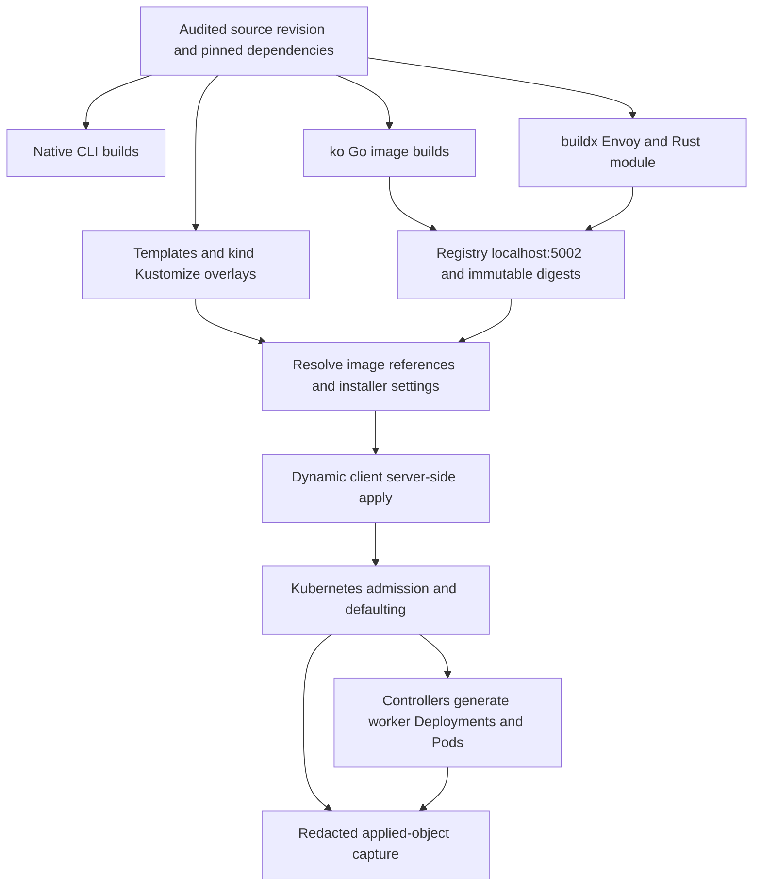

The apply operation uses the installer process's dynamic Kubernetes client and server-side apply. A subsequent `kubectl get` is a capture of admitted, defaulted and possibly reconciled state. It is not the exact pre-admission byte stream. The experiment preserves source hashes, commands, built image references, generated kind configuration and redacted applied objects. It did not modify the installer to archive each transient apply buffer. The exported manifest JSON deliberately redacts credential-bearing values and is evidence, rather than a directly replayable installation bundle. [Build and manifest provenance](experiments/epc-20261031/build-notes.md) traces the exact source functions and capture rules.

| Operation | Recorded UTC interval | Result |
|---|---|---|
| Build ate-setup | 17:43:58–17:44:28 | Success |
| Build kubectl-ate | 17:44:28–17:44:32 | Success |
| Create kind cluster | 17:44:30–17:44:49 | Success |
| Build images and deploy Substrate | 17:49:03–17:53:15 | Success, 252 seconds across the complete command |
| Deploy counter pool/template and await golden snapshot | 17:53:15–17:53:52 | Success |
| Deploy egress pool/template and await golden snapshot | 17:53:52–17:54:16 | Success |

These intervals include different work. The system command includes builds and rollout waits. Golden-snapshot preparation warms images and runtime assets before actor creation. None of these rows is a cold actor-start measurement. Detailed resource usage and fractional elapsed times are in the `metrics/` directory.

## L.17 Observed state continuity and request-driven resume

The counter actor was `ate-demo-counter/lifecycle-counter`, UID `92c54efa-a098-47c4-93f1-f17bd3730c1a`. Creating it produced a SUSPENDED actor referencing the template's completed, tag-owned golden snapshot. Explicit resume selected an existing worker. Three requests returned `1/1/1`, `2/2/2` and `3/3/3` for memory, durable-file and rootfs counters respectively.

The [lifecycle script](experiments/epc-20261031/scripts/05-counter-lifecycle.sh) then suspended the actor asynchronously. The captured API response recorded a new actor-owned snapshot and no active worker assignment. Network inspection ran while it remained suspended. An HTTP request through the already-running local actor proxy caused transparent resume and returned `4/4/4`. The proxy connects through Substrate's router; the application did not call a resume API.

Next, synchronous suspension published a completed durable snapshot. Creating `lifecycle-checkpoint` gave the tag its own copied snapshot, UID `48abb3b2-88ff-442f-ae67-3860b9b26867`. Creating `lifecycle-clone` from that tag and resuming it returned `5/5/5`. Resuming the original also returned `5/5/5`. The two actors now had separate execution identities, starting from the same captured counter state. Further synchronous suspend/request-resume cycles on the original returned `6/6/6`, `7/7/7` and `8/8/8`.

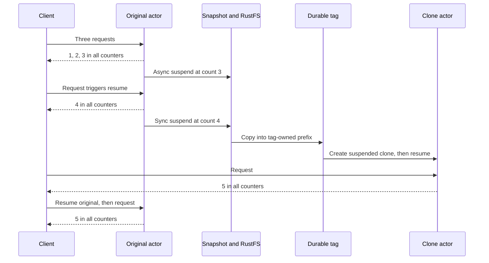

The counters test three distinct persistence layers. A memory-only check could miss lost volume writes; a file-only check could pass after a cold process restart. Here, all three advanced together. This establishes continuity for this small application and fidelity. It does not establish arbitrary connection preservation, application transaction recovery, or cross-node migration. The clone used a different worker Pod on the same node. Its tag points to a durable independent object prefix; selecting that prefix does not alone prove a cache miss for every restored file.

Four untraced request-driven resumes recorded HTTP 200 and these client `time_total` values:

| Request | Returned counters | Client elapsed time |
|---|---:|---:|
| First request after asynchronous suspend | 4/4/4 | 185.865 ms |
| Cycle 1 after synchronous suspend | 6/6/6 | 193.918 ms |
| Cycle 2 after synchronous suspend | 7/7/7 | 185.782 ms |
| Cycle 3 after synchronous suspend | 8/8/8 | 166.623 ms |

The boundary is curl to a loopback proxy on the Linux machine, through the router and resume workflow, to the actor's completed response. It includes more than runsc restoration. The proxy was already established, caches had been warmed, and other experiment work shared the node. Four observations do not define a percentile distribution or validate the roadmap's latency objective. The separate traced diagnostic described in L.22 is excluded.

## L.18 Following the actual network namespaces

The [network collector](experiments/epc-20261031/scripts/capture-network.sh) starts with Kubernetes Pod metadata and CRI container identity. `crictl inspect` supplies the entrypoint PID as viewed from the node. Named actor namespace mounts are reached through `/proc/<entrypoint-pid>/root/run/netns/`. This is essential because `/run/netns` belongs to the worker's mount view. The collector runs the node's inspection binaries with `nsenter --net=<namespace-path>`; it does not require those binaries inside the distroless worker image.

The initial worker was `counter-679c67c85d-fghjq`, Pod IP `10.244.0.25`. The runtime namespace was `worker-actor:92c54efa-a098-47c4-93f1-f17bd3730c1a`; the actor-local gateway appended `-at`. Both sides of the actor veth reported ifindex 3 and peer index 3, in different namespaces. The gateway interface was `atside`, address `169.254.17.1/30`. Its peer was runtime `eth0`. The worker Pod's own `eth0` was a separate CNI interface, with a node peer index of 27 in that capture.

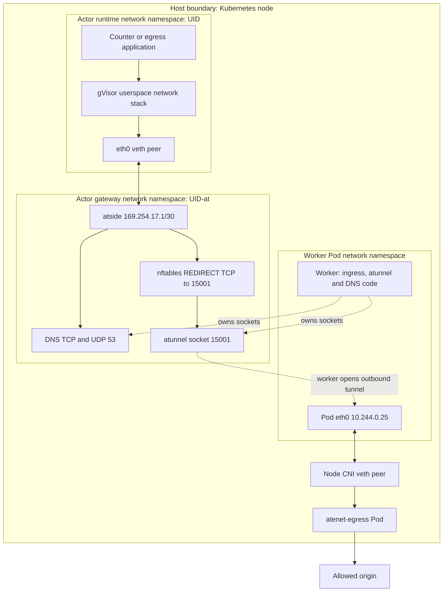

The dotted tunnel hop is a userspace relay with sockets in different namespaces. There is no second veth carrying packets directly from the actor gateway to the Pod network. A worker OS thread enters a namespace to create or operate a socket and then returns; the socket retains its namespace. In the initial capture, PID 8100 owned gateway DNS and port-15001 sockets while also owning worker Pod listeners. PID identity alone therefore does not locate a socket's network stack.

The complete actor gateway nftables dump contains this IPv4 table; rule handles are omitted here but retained in the evidence:

```nft
table ip worker-actor {
  chain forward {
    type filter hook forward priority filter; policy drop;
  }
  chain disallowed-egress {
    type filter hook prerouting priority raw; policy accept;
    ip daddr 169.254.17.0/30 accept
    ip daddr 169.254.0.0/16 reject with icmp admin-prohibited
    meta l4proto != tcp reject with icmp net-unreachable
  }
  chain prerouting {
    type nat hook prerouting priority dstnat; policy accept;
    ip daddr != 169.254.17.0/30 meta l4proto tcp redirect to :15001
  }
}
```

The IPv6 `worker-actor-v6` table had a default-drop forward chain and rejected `fe80::/10` in prerouting. These are the observed rules installed by [installEgressRules](../internal/ateworker/actornet/sandbox.go). DNS is serviced locally at the gateway; the non-TCP rejection does not mean DNS has to cross the gateway as arbitrary forwarded UDP.

The runtime namespace and worker Pod namespace both returned empty nftables rulesets successfully. Their JSON outputs contained nftables metadata, and the command exit status was zero. This matters: an empty successful dump is evidence, while a permission error is not. The actor gateway contains the redirect rules. The external egress gateway implements additional identity and application policy in its userspace data plane. Dumping only the worker Pod would miss the actor-local rules entirely.

After runsc took over the runtime-side network stack, that namespace's kernel route dump contained loopback routes rather than the full application network configuration. The application's sockets and routing are represented in gVisor's userspace stack. Host `ip route` and `ss` inspect host-kernel state; their output is not a complete inventory of gVisor's virtual kernel state.

| Lifecycle observation | Worker mount view | Runtime/gateway inode numbers |
|---|---|---|
| Running | `counter-679c67c85d-fghjq` | 4026537381 / 4026537444 |
| Suspended | Neither named binding present in captured workers | absent |
| Request-resumed | `counter-679c67c85d-db5m4` | 4026537381 / 4026537444 |

The inode numbers were reused. They are not lifecycle generation IDs. The intervening absence and changed worker mount view distinguish these activations. An absent bind mount does not establish that every kernel reference has already closed; open namespace FDs can retain a namespace after removal of its name. Sequential observations also cannot establish the exact instant of destruction.

For policy validation, the experiment built the repository's HTTP origin fixture and pinned its resolved digest. The [egress evidence](experiments/epc-20261031/egress-notes.md) records no-policy refusal, successful access to `origin.lifecycle-target.svc.cluster.local:80`, and HTTP 403 when the same origin was addressed by ClusterIP. The allowed request succeeded again after synchronous suspend and request-driven resume; the IP remained denied. Removing the policy produced DNS refusal while the origin stayed healthy. Re-creating the hostname policy left the cluster usable for inspection.

The first successful request after policy creation took about ten seconds to appear during bounded polling, consistent with the configured cache lifetime. The post-deletion DNS refusal does not prove immediate invalidation of every ext_proc policy cache. These are different enforcement points. The installed CNI was kindnet; recorded Kubernetes NetworkPolicy objects do not establish that a NetworkPolicy enforcement controller was installed. The tested DNS and HTTP denials are attributed to Substrate's observed path.

## L.19 gVisor processes and cgroups, from the node downward

The process capture at 17:58:29 UTC found the original counter on Pod UID `2a3f0bf1-e705-47b9-a943-0142a581fc76`. This was a later activation than the initial fghjq placement. The actual host cgroup path was:

```text
/sys/fs/cgroup/
└── kubelet.slice/
    └── kubelet-kubepods.slice/
        └── kubelet-kubepods-burstable.slice/
            └── kubelet-kubepods-burstable-pod2a3f0bf1_...slice/
                └── cri-containerd-611a5822...scope/
                    ├── worker/
                    ├── 92c54efa-...-_sandbox/
                    └── 92c54efa-...-counter/
```

The full paths, without ellipses, are retained in [network-notes.md](experiments/epc-20261031/network-notes.md) and the kernel dumps. The source describes the delegated root as a “pod scope.” In this actual CRI deployment it was the worker **container** scope beneath the Pod cgroup. Namespace-relative `/sys/fs/cgroup` inside the worker is not the node's cgroup root.

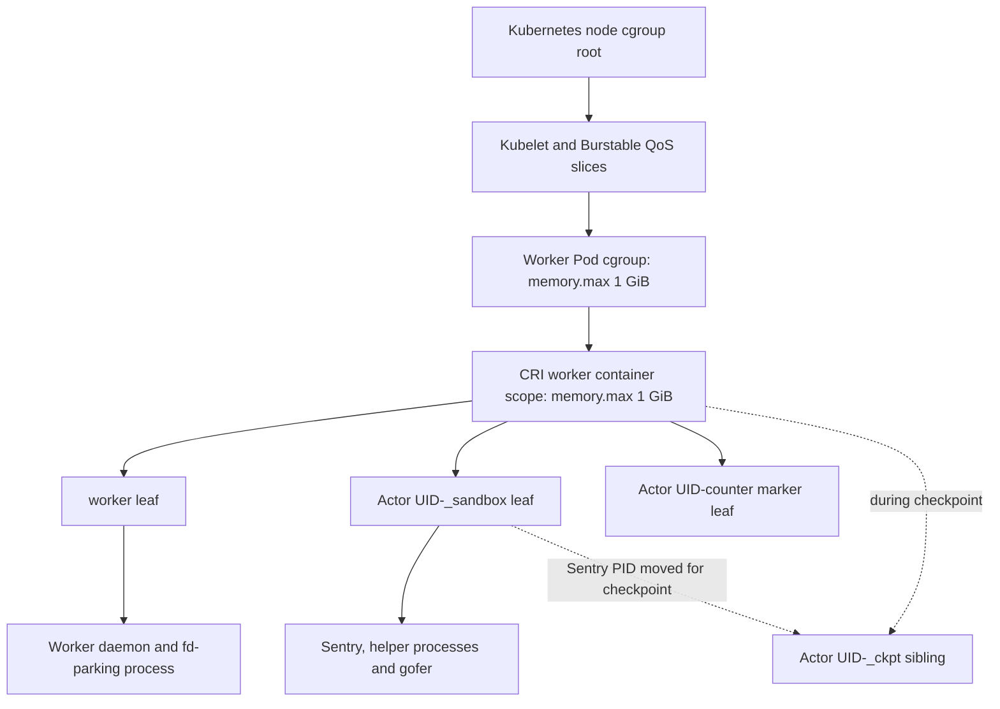

[cgroup.Delegate](../internal/ateworker/cgroup/cgroup.go) remounts the delegated cgroup hierarchy writable, moves worker processes into `worker`, and enables available subtree controllers. This satisfies cgroup v2's no-internal-process restriction for a non-root domain cgroup that delegates controllers. [ShapeGVisor](../internal/ocispec/gvisor.go) supplies the actor/container leaf names in OCI specifications. The application-container marker leaf should not be mistaken for a host process implementing the application's syscalls: the Sentry and related host processes were in the `_sandbox` leaf in this capture.

| Observed cgroup | memory.max | memory.high | cpu.max |
|---|---:|---:|---|
| Kubernetes worker Pod | 1,073,741,824 | max | `100000 100000` |
| CRI worker container scope | 1,073,741,824 | max | `100000 100000` |
| `worker` leaf | max | max | `max 100000` |
| Actor `_sandbox` leaf | max | 536,870,912 | `100000 100000` |

The actor leaf's hard memory setting was `max`; its high threshold was 512 MiB. This is not an unbounded actor. Ancestor hard limits still apply, and Substrate's userspace memory supervision complements the kernel controller. Similarly, `cpu.max=100000 100000` is one CPU's worth of quota per period, not a promise that an actor receives a dedicated physical core. The worker and actor consume the same limited ancestor resources.

At this sample the sandbox leaf charged 22,958,080 bytes and 23 tasks. These values change as execution and page-cache ownership change. They are neither the ActorTemplate reservation nor an application-only RSS measurement. The dumps include `memory.stat`, `memory.events`, pressure, CPU accounting, process lists, controller availability and ancestor settings so readers can inspect the accounting boundary directly.

The node saw Sentry PID 51773, gofer PID 51802 and several helper processes in the actor leaf. Worker PID 8071 and fd-parking PID 51774 were in `worker`. Sentry and gofer reported `NoNewPrivs: 1` and `Seccomp: 2`; the worker and fd-parking process reported zero for both. Filter mode is observed; the exact seccomp instruction program was not dumped. Runtime logs identified gVisor `release-20261026.0`, platform `systrap`, sandbox networking and direct filesystem access. This run did not use KVM or a microVM.

During checkpoint, [checkpointIsolated](../cmd/ateworker-gvisor/ckptcgroup.go) temporarily moves the Sentry into the sibling `<actor-uid>-_ckpt` cgroup. It copies the CPU quota and handles memory throttling separately so newly generated checkpoint page cache is not charged as ordinary steady-state actor residency. Removing the empty checkpoint cgroup reparents residual charges to its parent. The steady-state dumps did not sample that short-lived cgroup; the diagram marks it as a source-derived transient step. They must not be used to claim that the migration was directly observed.

## L.20 What PostgreSQL actually persists

The database was `atepg`, schema `substrate`, PostgreSQL 18.4. The [database collector](experiments/epc-20261031/scripts/capture-database.sh) used the existing local PostgreSQL socket inside the database container, read-only transactions and a schema-only `pg_dump`. It exported selected demonstration records rather than a full data dump. The observed settings were `fsync=on`, `full_page_writes=on`, `synchronous_commit=on` and `wal_level=replica`. These describe PostgreSQL's configured persistence behavior. This one-node test did not inject disk loss or establish replicated database availability.

The actual schema contains relational keys and version columns alongside serialized protobuf bodies:

```sql
CREATE TABLE actors (
    atespace text NOT NULL REFERENCES atespaces(name) ON DELETE RESTRICT,
    name text NOT NULL,
    uid text NOT NULL,
    version bigint NOT NULL,
    proto bytea NOT NULL,
    PRIMARY KEY (atespace, name)
);
CREATE TABLE worker_assignments (
    actor_uid text PRIMARY KEY,
    worker_name text NOT NULL REFERENCES workers(name) ON DELETE CASCADE,
    proto bytea NOT NULL
);
CREATE INDEX worker_assignments_worker_idx
    ON worker_assignments (worker_name);
```

This is an abbreviated presentation of the [migration](../cmd/ateapi/internal/store/atepg/migrations/000001_initial.sql); the captured schema contains the complete constraints, indexes and partition definitions. There is no separate `snapshots` table in this schema. Actor snapshot generations, UUIDs, locality and durability state are inside `Actor.status.snapshots` in the actor protobuf. A Tag's snapshot is likewise inside its serialized Tag. The SQL row does not contain the actor's checkpoint pages.

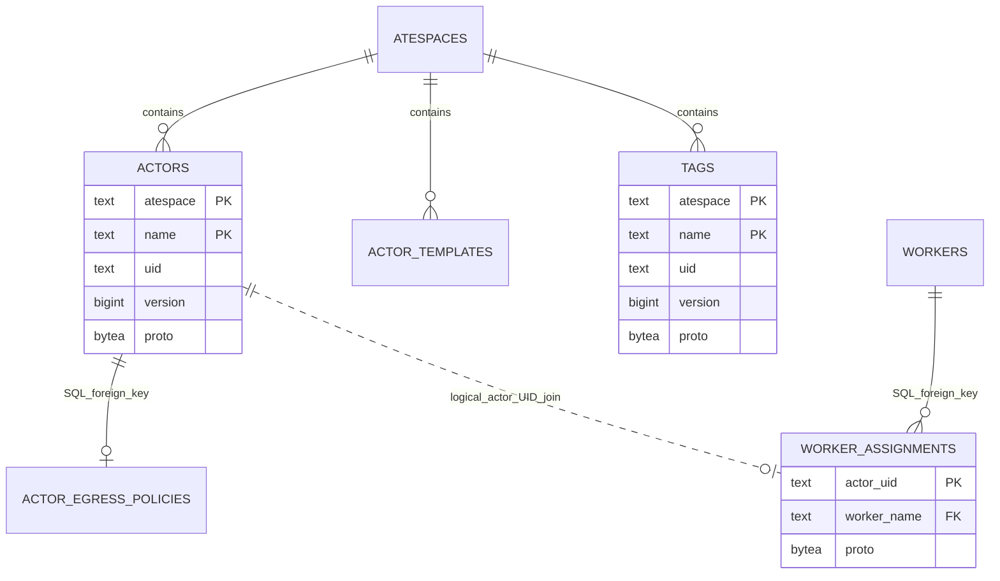

The actor-UID relationship to `worker_assignments` is a logical join, not a declared actor foreign key. The worker reference does have a foreign key. This distinction matters when reasoning about cleanup and consistency obligations: the drawing must not imply a constraint absent from SQL.

[CreateActor](../cmd/ateapi/internal/store/atepg/actor.go) assigns metadata, marshals the protobuf and inserts the scalar columns plus `proto`. Updates read the current row, unmarshal it, validate that protobuf metadata matches the scalar UID/version, apply the mutation, derive a new version, and write with both UID and version in the WHERE clause. Zero affected rows becomes `ErrVersionConflict`. The scalar columns support identity and concurrency checks; the protobuf preserves the API resource's nested state.

Worker admission has a different transaction boundary. [BindActorToWorker](../cmd/ateapi/internal/store/atepg/worker_assignment.go) locks the worker row, inserts the assignment with `ON CONFLICT (actor_uid) DO NOTHING`, checks capacity and updates allocated resources. A rejected admission rolls back that transaction. On suspension, releasing the assignment/allocation and writing the actor's terminal SUSPENDED state are separate persistence operations. The durable artifact, worker allocation and actor state are coordinated by a workflow; they are not a single cross-service SQL transaction.

The experiment captured a later synchronous cycle specifically for database comparison:

| Capture | Actor row version | Protobuf bytes | Decoded state | Assignment row | Snapshot generation |
|---|---:|---:|---|---|---:|
| Before suspend | 35 | 1087 | RUNNING | present | 8 |
| After synchronous suspend | 37 | 663 | SUSPENDED | absent | 9 |
| After request-driven resume | 39 | 1123 | RUNNING | present | 9 |

The absent assignment is a SQL LEFT JOIN result with null assignment columns, not an inference from Pod status. The actor UID remained unchanged. The version increments reflect workflow writes; they are not snapshot generation numbers. Generation 9 identified snapshot UUID `79ade422-1ec9-4857-9e67-d9f1a9f74c97`, locality `substrate-lifecycle-control-plane`, and `SNAPSHOT_STORAGE_STATE_COMPLETED`. The application returned `10/10/10` before this cycle and `11/11/11` afterward.

The saved SQL rows include protobuf lengths and checksums. [decode-proto.go](experiments/epc-20261031/scripts/decode-proto.go) decodes the selected `bytea` values using this source revision's generated Actor, ActorAssignment and Tag types. Thus `decoded-records.json` represents bytes read directly from PostgreSQL. It is not an API response relabeled as a database dump. The API's normal store read path applies defaults; the raw decoder does not. The row summaries, protobuf export and later API read are separate captures, with their own transaction boundaries.

After the deletion test, re-creating the egress hostname policy produced a row in `actor_egress_policies` with UID `cf54fdca-5e22-4d8c-aa15-752da6825d95` and version 1. Its table key is `(atespace, actor_name)` even though the policy protobuf's metadata name is `default`. The policy's actor binding is represented by the storage key.

The schema also exposes a deliberate durability split in worker watches. Core actor, worker, assignment and tag tables are logged. Worker outbox data partitions are UNLOGGED, while the trim high-water mark is logged. The captured `pg_class.relpersistence` values show that distinction. A database crash can therefore require watch consumers to rebuild from authoritative worker state; persistence of an actor row does not imply durable retention of every historical watch event.

## L.21 Reading the RustFS object layout

The installer configured both API and node object-store sidecars with `ATE_STORAGE_BACKEND=s3` and `AWS_ENDPOINT_URL=http://rustfs.ate-system.svc:9000`. Read-only S3 ListObjectsV2 and selected manifest GET requests were made through the actual RustFS Service. Credentials stayed in process memory; only bucket names, keys, sizes and selected manifest fields were published. No checkpoint memory payload, rootfs archive, durable-directory contents or private key was downloaded for the book.

The 18:04:04 UTC listing contained 52 objects across five snapshot prefixes, totaling 9,245,407 stored bytes. The generation-9 counter prefix had 12 objects totaling 2,625,549 bytes. Its manifest was 723 bytes. These are stored, compressed-object sizes, not actor RSS or uncompressed checkpoint volume.

```text
ate-snapshots/
└── atespaces/ate-demo-counter/
    ├── actors/92c54efa-a098-47c4-93f1-f17bd3730c1a/
    │   └── snapshots/79ade422-1ec9-4857-9e67-d9f1a9f74c97/
    │       ├── manifest.json
    │       ├── checkpoint.img.zstd
    │       ├── pages.img.zstd
    │       ├── pages_meta.img.zstd
    │       ├── rootfs/{fscheckpoint.pb,multitar.img,pages.img,pages_meta.img}.zstd
    │       └── fs/{fscheckpoint.pb,multitar.img,pages.img,pages_meta.img}.zstd
    └── tags/
        ├── 48abb3b2-88ff-442f-ae67-3860b9b26867/  # lifecycle-checkpoint copy
        └── 9d10cdd3-4d52-4a09-b94f-a0227f6bebf5/  # counter golden tag
```

Brace notation abbreviates four actual files in each group. The manifest's `snapshotFiles` listed the eleven uncompressed logical names; the node plugin stores each data file with a `.zstd` suffix. Its `dataSnapshotFiles` listed the four `fs/` entries that support durable-volume restoration independently of memory fidelity. `fidelity` was `memory`, `sandboxClass` was `gvisor`, and source actor/template identifiers tied the manifest to the application.

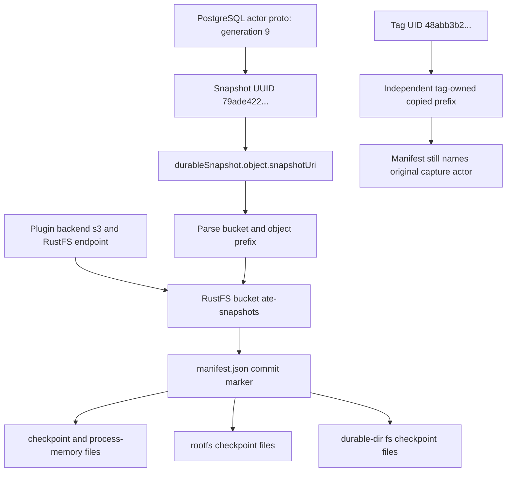

The observed API URI began with `gs://ate-snapshots/`, despite using RustFS. At this revision, the kind profile supplies that logical location, while snapshot code extracts its bucket/path and selects the client from the plugin backend configuration. The URI's spelling alone is not evidence that the request reached Google Cloud Storage. [build-notes.md](experiments/epc-20261031/build-notes.md) follows the parser and backend selection; runtime-asset URL handling has a separate scheme policy and must not be generalized from this snapshot behavior.

Generation, snapshot UUID and ownership UID are separate fields. The object prefix uses the actor UID and snapshot UUID. Generation 9 comes from the Actor protobuf; it cannot be inferred from the UUID or these manifest fields. The tag prefix uses the Tag UID. Copying a snapshot into a tag does not rewrite the source actor inside its manifest, so a tag-owned prefix can correctly contain a manifest naming the original actor UID. A clone initially references that tag prefix without needing a clone-owned snapshot prefix. Its own later suspension would create a checkpoint under its own actor UID.

The first listing, taken at 18:00:36 UTC, captured the earlier generation-8 UUID `bab690e0-d67d-4bd3-91cb-7f088fb604bf`. The later listing captured generation 9 instead; the independent tag prefix remained. Both listings are retained. They let the reader follow retention and ownership changes without mistaking the tag for an alias to the actor's newest snapshot.

The manifest is published after the data objects and serves as the snapshot's commit marker. SQL durability state and this object publication are distinct facts joined by the workflow. A single-node RustFS Deployment and PVC remain one development failure domain. The observed `COMPLETED` state proves this workflow completed against the configured backend; it does not establish multi-node object durability or a production disaster-recovery guarantee.

## L.22 Diagnostic limits, failures and retained evidence

The normal functional cycles succeeded. A separate bounded `strace -f` experiment illustrates why observation must be treated as part of the system under test. The first attachment targeted CRI's entrypoint/reaper and observed child-exit handling but missed the already-running worker daemon. Attaching to the actual daemon captured clone, namespace, mount, pidfd, memfd, checkpoint writeback and cleanup calls. Following child creation through the next restore coincided with a `/proc` mount returning EPERM, a runsc startup EOF, HTTP 500 and actor CRASHED state. The exact underlying tracing/security interaction was not isolated further.

After the tracer detached, `RevertActor` returned the actor to its latest completed durable snapshot. Resume succeeded and returned `10/10/10`, continuing from the captured value 9. The subsequent database cycle returned `11/11/11`. The trace and failure logs remain in `kernel/runtime-trace/`; they are diagnostic evidence and are excluded from normal latency observations. The reproduction script was narrowed to trace checkpoint and detach before restore. That revised ordering was syntax-checked but was not rerun in this experiment. Its source documents why tracing a sandbox startup is intrusive.

| Evidence | What it establishes | What it does not establish |
|---|---|---|
| Actor/API and SQL snapshots | Identity, versions, assignment presence, snapshot references at captured stages | One atomic observation across all files or all workflow steps |
| Namespace and nftables dumps | Namespace-local kernel configuration and command success/failure | All live references after a name is removed, or gVisor's complete virtual network stack |
| cgroup/proc captures | Actual ancestry, controllers, accounting and process confinement flags | Exact seccomp program or a continuously observed transient checkpoint cgroup |
| RustFS listings and selected manifests | Actual served objects, sizes, ownership prefixes and capture metadata | Every restore's cache behavior or storage survival under node loss |
| Client request timings | Elapsed time at the stated request boundary for four untraced resumes | A production percentile, throughput limit or roadmap SLO |
| Bounded syscall diagnostic | Calls made during that traced attempt and its failure | Normal untraced restore behavior |

The evidence also preserves small harness corrections: an unsupported worker-list flag, an initial JSON-envelope assumption in the egress script, and recovery of node `/tmp` captures through an exec/tar stream after `docker cp` could not resolve that mount view. These are distinguished from Substrate failures. The experiment did not execute the entire repository's e2e suite, microVM tests, scale benchmarks or destructive infrastructure-failure tests.

The [evidence index](experiments/epc-20261031/README.md) links the build records, lifecycle responses, complete network rules, process and cgroup hierarchy, database schema/decoded rows and RustFS listings. It provides the observations behind these diagrams without embedding private kubeconfig, credential values or snapshot payloads in the manuscript.
