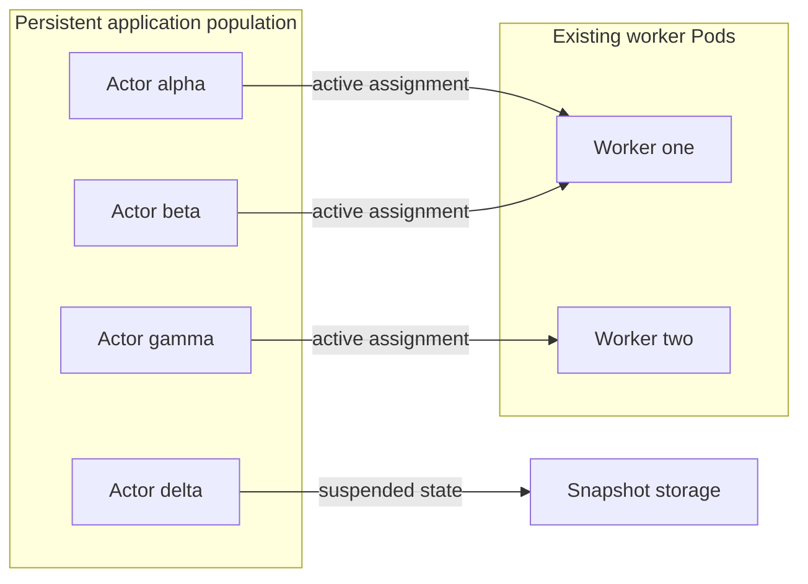
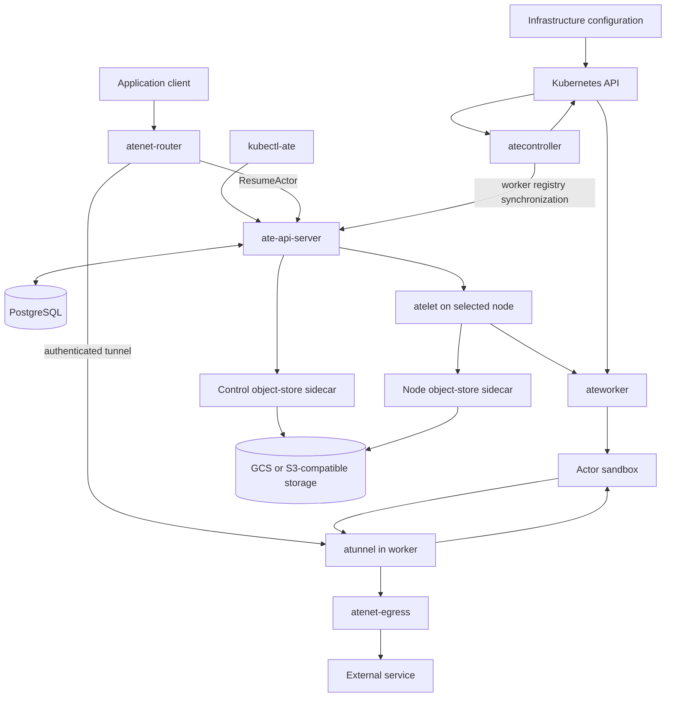
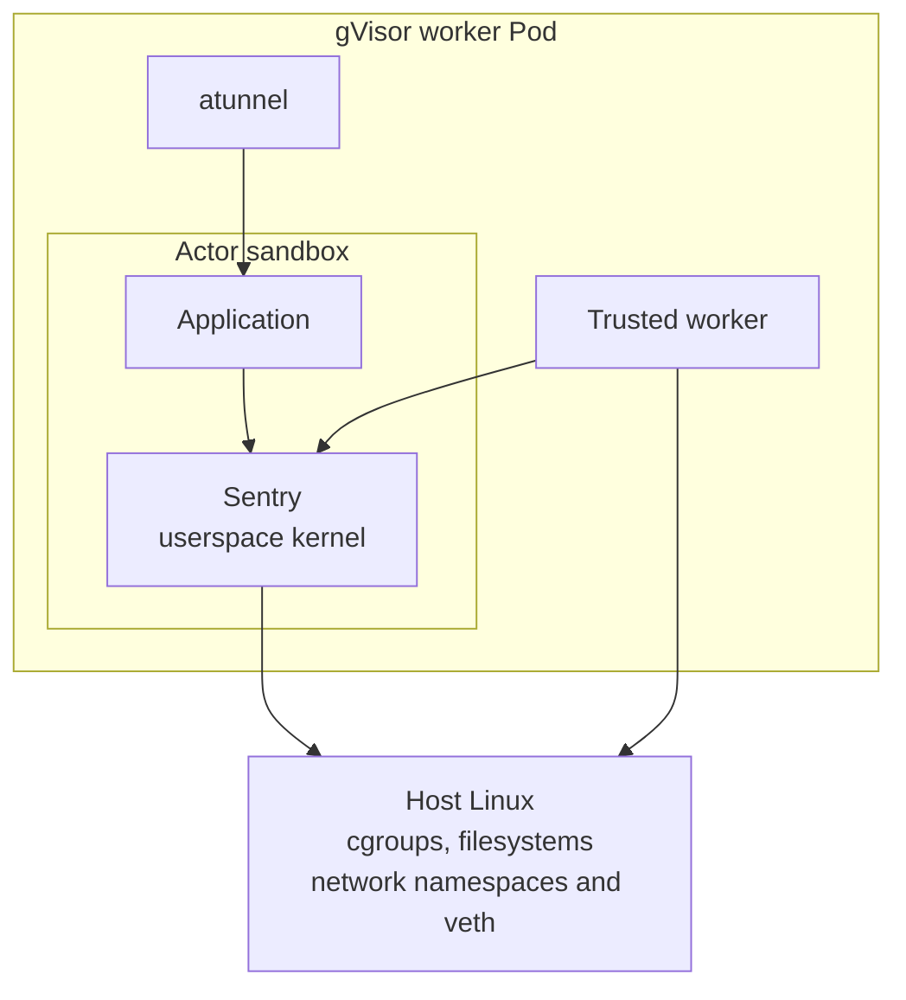
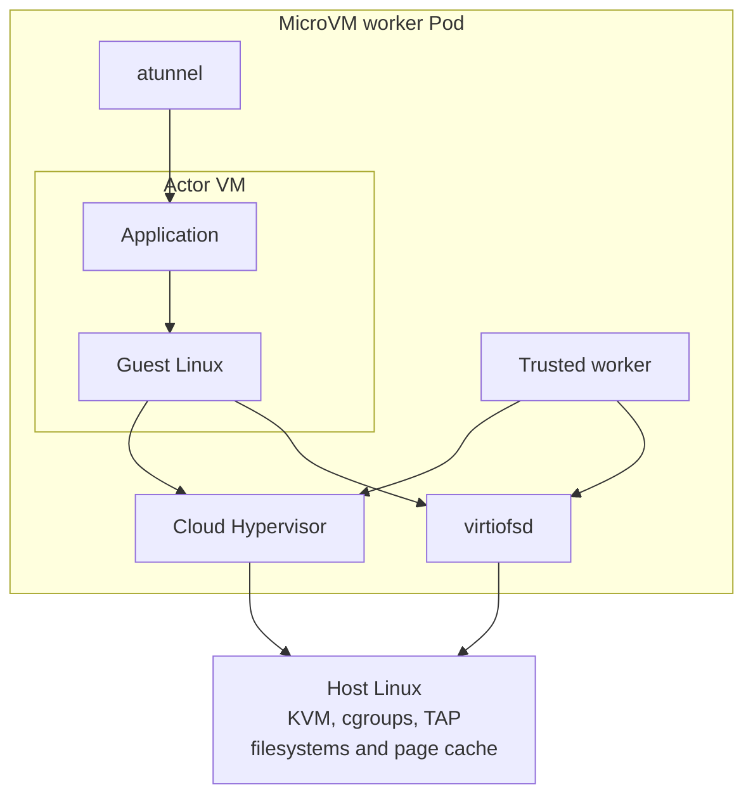
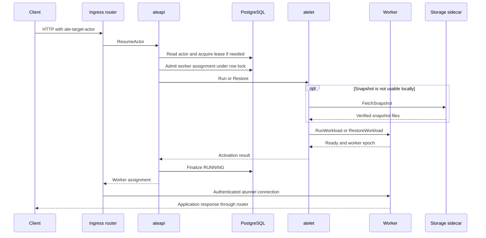

# 1. Multiplexing Actors: Architecture and Execution Boundaries

## 1.1 The unit of persistence is not the unit of execution

Substrate separates an application's durable identity from the Kubernetes Pod that supplies its current execution capacity. The durable object is an Actor. The capacity object is a Worker, represented in Kubernetes by a worker Pod. An Actor can remain registered while it has no running processes, no active worker assignment, and no resident guest memory. When execution is required, Substrate assigns capacity in an existing worker and starts or restores the actor inside a sandbox. The Kubernetes Pod does not need to be created for that activation.

This separation is the architectural reason to build another control plane. It is also more precise than saying that Pods fail to scale. Kubernetes manages an infrastructure lifecycle with established admission, scheduling, node ownership, and reconciliation semantics. Substrate retains that machinery for worker capacity. It introduces a different lifecycle for applications whose useful execution is intermittent and whose state can survive as a checkpoint. The engineering question is whether moving that lifecycle above a warm worker fleet saves enough resources and latency to justify the additional consistency and storage systems.

The implementation makes a second distinction that is easy to miss: a worker can host multiple actors concurrently. Multiplexing is both temporal, as suspended actors reuse execution capacity later, and spatial, as several active sandboxes share one worker Pod. The scheduler tracks actor slots, CPU, and memory capacity. A worker is not simply marked occupied by one actor and returned to an empty pool at suspension. Each assignment books a share of its capacity, and releasing that assignment returns that share. The authoritative accounting resides in the worker and assignment records implemented by [worker_assignment.go](../../cmd/ateapi/internal/store/atepg/worker_assignment.go).

Consider a deliberately simplified capacity calculation. Let there be A registered actors, an active fraction f, a mean active application memory requirement m, and an additional sandbox overhead h. The memory associated with active execution is approximately A × f × (m + h), before adding workers, node supervisors, gateways, page cache, and storage buffers. A Pod-per-actor arrangement that keeps every application's memory resident pays a different cost even when CPU usage is near zero. This equation is a planning device, not a Substrate benchmark: independence between actors, average resource sizes, and stable demand are assumptions that a production workload may violate.

Suspension also has a cost. Every transition can consume CPU to serialize state, storage bandwidth to persist it, and time during which the application cannot serve requests. If an actor wakes repeatedly at short intervals, repeatedly checkpointing it can cost more than retaining its execution state. If a burst wakes most actors simultaneously, f approaches one and the density advantage shrinks. A fleet sized from the mean active fraction can therefore be incapable of serving its correlated peak. Request parking limits the immediate damage of a capacity shortage; it does not manufacture CPU, memory, or worker slots.

Resource accounting must include the runtime. [scheduling.go](../../cmd/ateapi/internal/scheduling/scheduling.go) adds a runtime-specific fixed memory overhead and a term proportional to actor memory to the requested limit. The runtime selected for a restored snapshot influences this booking. It would be incorrect to compare only application RSS across gVisor and microVM workers and then infer cluster capacity. Runtime processes, guest kernel memory, page tables, page cache, and transient checkpoint allocations can all affect the host while appearing in different accounting domains.

An Actor's logical continuity is consequently broader than process continuity. A MEMORY snapshot may restore an execution image. A ROOTFS restore preserves filesystem writes while cold-starting processes. A VOLUMES restore preserves selected durable directories while permitting a different application template to boot. The public API records the fidelity and runtime identity needed to interpret those outcomes. An application that requires instruction-level continuation must distinguish a memory restore from a restart that retains files; both can be legitimate Substrate lifecycle operations.

The actor abstraction is not an actor-language runtime. The repository does not require a mailbox, a single-threaded event loop, or application-level message passing. An actor is a sandboxed workload described by an ActorTemplate. Containers inside that workload can run ordinary applications, subject to the runtime and network contracts. A Jupyter server, a counter service, and an agent execution environment exercise different application behavior while using the same placement and suspend/resume APIs. The name identifies the lifecycle unit, not a concurrency model imposed on application code.

A useful planning model separates three populations: registered actors, active assignments, and ready worker capacity. Registered actors drive database and snapshot-retention costs. Active assignments drive sandbox execution and network costs. Ready capacity drives the ability to absorb activations without a Kubernetes provisioning delay. Those populations can differ by orders of magnitude, but their ratios are workload-dependent. A capacity dashboard that reports only worker Pod count cannot show whether a large registered population is cheap, whether active execution is near saturation, or whether snapshots are consuming the node's local storage budget.

The diagram shows a relationship, not a fixed density. Worker one has two independent active assignments. Actor delta consumes storage and metadata without an execution assignment. If delta resumes, its placement is selected from workers that satisfy selectors, runtime compatibility, locality, and remaining capacity. Its previous worker is neither its identity nor an unconditional destination.

## 1.2 Component topology and the two control loops

The local module is `go.ate.dev/substrate`. Its layout separates public APIs in `api`, command-specific code in `cmd`, shared implementation in `internal`, externally importable packages in `pkg`, and Kubernetes manifests in `manifests`. There is no `ateom` daemon in this revision. Runtime work is implemented by `cmd/ateworker-gvisor` and `cmd/ateworker-microvm`, with shared machinery under `internal/ateworker`. This naming matters because following an obsolete component diagram leads to the wrong ownership assumptions when investigating failures.

The Kubernetes-facing control loop starts with WorkerPool, SandboxConfig, and CSIDriverConfig resources in `ate.dev/v1`. WorkerPool specifies worker replicas and their configuration. `atecontroller` reconciles Deployments and supporting infrastructure, resolves SandboxConfig references, and synchronizes worker Pods with the Substrate worker registry. Kubernetes schedules those Pods and maintains their node-level container lifecycle. None of this removes kube-scheduler, kubelet, or the container runtime from the system. It moves their work to the capacity-provisioning timescale.

The actor-facing control loop runs in `ateapi`, deployed as `ate-api-server`. It exposes the public `Control` gRPC service and the component-facing `WorkerService`. Its PostgreSQL store holds actor records, worker records, assignments, tags, policies, and leases. Actor workflows select workers, change actor state, and call the node supervisor. The critical path for an actor activation therefore includes Substrate's own database and RPCs even when it avoids a Kubernetes write. Describing activation as control-plane-free would be misleading; it bypasses a particular control plane's provisioning path.

`atelet` runs as a DaemonSet. It connects the cluster-level actor workflows to workers on one node. It prepares images and runtime assets, coordinates snapshots and volumes, manages worker-facing support services, and advertises hardware devices through a kubelet device plugin. The worker processes implement the actual sandbox lifecycle. A worker exports internal gRPC operations including `RunWorkload`, `CheckpointWorkload`, `RestoreWorkload`, and `TerminateWorkload`. The intended separation is that atelet and the workers share protocol and path contracts without depending on each other's internal implementation.

Networking has its own topology. The `atenet-router` and `atenet-egress` deployment roles run shared atenet and Envoy machinery. Ingress external processing asks the control plane to resume or locate an actor, then forwards traffic to the appropriate worker tunnel. Egress enforcement evaluates actor-specific policy and can inject credentials outside the sandbox. `atunnel` is an embedded worker library, not a separately scheduled Kubernetes DaemonSet. Its position inside the worker is important: it connects a stable worker-facing transport to per-actor network namespaces whose contents change as actors start and stop.

The identity infrastructure is also explicit. `podcertcontroller` issues the certificates used by Substrate components through its configured signers. `ate-idp-server` exposes actor identity discovery material. Credential-provider implementations serve secrets to the egress path. These processes support execution but do not schedule actors. Treating them as incidental utilities hides availability dependencies: certificate issuance or rotation failures can prevent new authenticated connections even when workers and database capacity are healthy.

Snapshots cross an object-store plugin boundary. The control-plane sidecar implements whole-snapshot copy and cleanup operations; the node-side sidecar uploads and fetches snapshot files and fetches sandbox assets. The main ateapi process does not directly link the GCS or S3 storage SDKs, a rule enforced by [package-deps.sh](../../hack/verify/package-deps.sh). This is more than packaging tidiness. It places provider credentials and provider-specific I/O in a process boundary, allowing the control plane to express storage operations through the public plugin protocol.

RustFS is an existing alternative backend in the kind deployment. Both node and control-plane object-store sidecars set `ATE_STORAGE_BACKEND=s3`, point `AWS_ENDPOINT_URL` at `http://rustfs.ate-system.svc:9000`, and enable `AWS_S3_USE_PATH_STYLE`. The [RustFS manifest](../../manifests/ate-install/kind/rustfs.yaml) provisions the service, a one-replica deployment, a 1 GiB PVC, and bucket initialization. This is a concrete S3-compatible development and CI path. Its static development credentials and single storage replica do not establish production high availability or tenant isolation. Chapter 8 follows the actual data path and failure implications.

There are several loops behind this topology rather than one universal reconciler. The infrastructure controllers use controller-runtime. Worker Pod synchronization uses its own client-go informers and workqueue. Golden snapshot creation and worker-assignment recovery run inside ateapi using their own queues and persisted state. A failure analysis must first identify which loop owns progress. Restarting atecontroller cannot directly repair every stalled actor workflow, and watching a Kubernetes Deployment will not reveal every change to an actor assignment.

The distinction between command name and deployed service name is similarly practical. Source investigation starts in `cmd/ateapi`; cluster inspection usually finds `ate-api-server`. Runtime configuration can be supplied through flags, configuration protos, Kubernetes objects, and mounted identity files. The architecture should be understood through the concrete ownership of each value rather than inferred from binary naming alone. Later chapters trace those contracts at their validation and authentication boundaries.

## 1.3 Host, Pod, sandbox, and guest boundaries

A worker Pod is an infrastructure isolation and allocation unit. An actor sandbox is the execution isolation unit inside it. For gVisor, the application interacts with a userspace kernel, the Sentry, and associated filesystem machinery. For microVMs, the application interacts with a guest kernel, while Cloud Hypervisor and virtiofsd mediate host resources. The host Linux kernel still schedules the runtime processes, enforces their cgroups and capabilities, and supplies device and networking interfaces. The word kernel must identify which boundary is under discussion.

In the gVisor backend, `runsc` executes inside the worker and manages the actor sandbox. The worker invokes runsc lifecycle and checkpoint operations; it is not itself a replacement Sentry. Application syscalls handled inside gVisor do not all become identical host syscalls. Conversely, operations that the worker performs directly, such as creating network devices or preparing files, are host-kernel operations even though the eventual application is sandboxed. A syscall inventory that mixes those two layers cannot explain either isolation or latency.

The microVM backend drives a Kata guest model with Cloud Hypervisor. The worker arranges the VM, the guest agent connection, and the filesystems supplied to it. `/dev/kvm` is a host device boundary used by the VMM. TAP devices connect virtual networking to the actor's host-side network arrangement. Virtio-fs exposes host-backed filesystem state to the guest. The actor's process tree lives under a guest kernel whose memory and device state are part of the VM lifecycle, while the VMM remains a host process with its own resource consumption and failure modes.

The worker Pod security context is deliberately more capable than an ordinary application Pod. [workerpool_apply.go](../../cmd/atecontroller/internal/controllers/workerpool_apply.go) sets both worker classes to nonprivileged, drops the default capability set, and adds explicit capabilities needed for runtime and network operations. It also sets AppArmor and seccomp profiles to Unconfined at the Pod container boundary. Runtime processes can apply their own confinement, but that is a separate claim from the Pod's outer profile. A nearby stale comment about runtime-default seccomp must not override the builder's actual output.

The difference matters during incident investigation. A capability such as `CAP_NET_ADMIN` enables the trusted worker to construct the actor's network environment. It should not be interpreted as an ambient capability granted to every actor process. A host `/dev/kvm` permission allows the VMM to establish virtualization; it is not evidence that an application inside the guest can open that host device. The security argument depends on which process receives which handle and on the runtime's subsequent confinement, not merely on a list of capabilities in a YAML document.

MicroVM workers request KVM as an extended resource served by atelet's device plugin. A hostPath mount alone would make a device inode visible without necessarily granting access through the container's device controls. The kubelet device-manager interaction supplies that access grant and makes KVM availability a placement constraint. By contrast, the current worker template bind-mounts `/dev/net/tun` and relies on the runtime's default device allowance plus network-administration capability for TAP creation. Both are host interfaces, but they enter the Pod through different mechanisms.

Actors also need isolation from one another inside a worker. Shared Pod networking would be insufficient if each sandbox directly inherited a common address space for network configuration. The gVisor worker creates two private network namespaces for each actor: a runtime namespace and a gateway namespace joined by a veth pair. This separation lets runsc take ownership of the runtime-side interfaces while atunnel serves the gateway side. The microVM worker instead puts a TAP interface and atunnel sockets in one host network namespace; the guest owns the other end of that network boundary. The resulting routes direct each actor through atunnel and the controlled egress path. The application is addressed through its actor identity at ingress, not by treating a Pod IP as a durable application endpoint. A worker's address can remain constant while its set of hosted actors changes.

Filesystem isolation follows a similar separation between shared preparation and private mutable state. An image cache can share immutable image content. A runtime asset cache can share verified executable assets by content identity. Each actor still needs distinct writable state and lifecycle cleanup. In microVMs, the writable rootfs upper is host-backed and served through virtio-fs, so its storage and page-cache effects differ from allocating equivalent data inside guest RAM. gVisor's filesystem checkpoint bundles have different mechanics. Architectural equivalence of the API does not mean identical memory accounting or snapshot layout.

The gVisor boundary places the application above the Sentry's syscall implementation. Runtime supervision and atunnel remain trusted host processes. A network namespace is a host-kernel object even when the actor's network stack is implemented by the Sentry.

The microVM boundary adds a guest kernel and virtual devices, with Cloud Hypervisor and virtiofsd mediating host resources. These diagrams describe alternative worker classes: a WorkerPool currently selects one sandbox class, and one worker image does not dynamically mix gVisor and microVM actors. Runtime-version compatibility remains a live concern within a class. A worker advertises which versions it can restore, and a snapshot records its capture runtime. That version boundary permits controlled upgrades without assuming every memory image is portable across executable revisions.

Trust also crosses process boundaries outside the worker. The node object-store plugin has storage credentials that atelet does not need to hold. The egress gateway can obtain a secret that the actor does not receive as an environment variable or mounted file. The control plane verifies component identities before accepting worker reports. These separations reduce particular exposures, but they create protocols that must authenticate the actor, worker, node, and resource incarnation correctly. Chapter 10 examines those checks rather than relying on a general zero-trust label.

## 1.4 Following one actor through the system

Start with an infrastructure operator who creates a WorkerPool and suitable SandboxConfig. The controller resolves the runtime configuration and creates worker capacity. Kubernetes schedules the Pods; atelet and the worker establish their internal relationship; the worker registers its current epoch, runtime information, and capacity. Only then is that capacity eligible for actor placement. A Pod's mere existence is insufficient. A ready infrastructure object and a registered runtime process are related observations, not interchangeable facts.

An application operator creates an ActorTemplate through the Substrate API. The template describes containers, resources, volumes, selectors, probes, and snapshot behavior. It is stored in PostgreSQL. Where golden snapshot generation is enabled, the ActorTemplateReconciler in ateapi drives a temporary golden actor through execution and snapshot creation. This is an asynchronous controller of its own. A client creating an actor must not assume that a golden image exists solely because the template record was accepted.

Creating an Actor establishes the logical identity and initial suspended state. Depending on its source and the template's state, it can refer to reusable snapshot content or have no snapshot to restore. The latter is supported explicitly: `ensureAteletRestored` chooses an atelet `Run` request when `snapshotToResume` is nil. Golden snapshots accelerate a path; they are not a prerequisite for the existence of every actor. The distinction is visible in lifecycle telemetry, which classifies a cold boot separately from local and external snapshot restores.

An ingress client supplies `ate-target-actor` as an atespace/name reference. The HTTP Host field retains its application-authority meaning. The router asks ateapi to resume the actor and obtain an assignment. For an already-running actor, the API can return its record without performing a new distributed-lease write. For a suspended actor, it acquires the actor lease, reads authoritative state, and selects a compatible worker with capacity. Candidate selection uses an in-memory worker view; admission is rechecked against the database row before the booking commits.

The selected worker identifies a node, and the API calls that node's atelet. Atelet prepares the workload and its state, then calls the worker's runtime interface. A restore can use node-local files or fetch external snapshot data through the object-store sidecar. The chosen runtime starts or restores the sandbox, and the worker activates the actor's network path. The API finalizes RUNNING with the returned worker epoch. Only after successful activation does the router forward the original request to the assignment it received.

An explicit suspend reverses the resource commitment without deleting the actor. The API serializes the operation with the actor lease, marks SUSPENDING, asks atelet to checkpoint, coordinates external volume detachment, records snapshot state, and releases the active worker assignment. Asynchronous durability allows the API to return once a local checkpoint exists while upload proceeds in the background. Synchronous durability waits for the external upload. Either mode must distinguish process cessation, local checkpoint completion, and durable publication; those are different events with different failure consequences.

The current runtime does not autonomously detect actor idleness and issue that suspend. The repository contains a reusable upward `RequestActorSuspend` path in `internal/ateworker/suspend`, atelet, and WorkerService, but no production worker constructs the requester. Demos sometimes describe idle suspension in broad terms while their runnable steps invoke `kubectl ate suspend`. A higher-level orchestrator can call the API according to its own application policy. Automatic idle detection remains unfinished; capacity reclamation currently follows an explicit lifecycle request.

A subsequent resume prefers the newest state that remains usable. Locality can pin the actor to a node, avoiding an external download. If that node has no capacity, the workflow can detach the local snapshot, ensure the necessary external state is available, and retry placement elsewhere. If a required runtime version has no room, the supported fallback can restore filesystem state and cold-boot instead of restoring memory. A changed template can require VOLUMES fidelity. These transitions explain why state location, runtime compatibility, and application continuity must be considered together.

Deletion is another workflow rather than a single row removal. A running sandbox must be terminated, volumes must be detached, and capacity must be released before the logical object can safely disappear. Snapshot cleanup is part of resource reclamation, with explicit error handling and remaining garbage-collection TODOs. Revert is distinct from deletion: it abandons current execution or local progress in favor of a completed durable snapshot. These operations are introduced here to make failure semantics visible; Chapter 3 treats execution consistency, and Chapter 8 treats snapshot ownership and durability.

## 1.5 Reading performance and failure domains correctly

The shortest activation path and the most expensive activation path traverse the same named components but perform very different work. An already-running request needs identity checks, a control-plane lookup, and routing. A local memory restore may avoid object storage. An external restore downloads state. A runtime-incompatible snapshot may cold-boot from filesystem state. A brand-new actor without a golden snapshot may need image preparation and application startup. Reporting one resume number without describing these cases obscures the operating envelope.

The repository's architecture document sets a target of 100 ms activation at the 95th percentile, one billion actors, and 1000 wakeups per second. Its front matter explicitly calls much of the document aspirational. Those values are design targets, not measurements produced by this manuscript. The source contains benchmarks and historical analysis, but no cluster was run for this book audit. A production claim requires a workload definition, hardware and runtime versions, storage placement, cache state, concurrency, and an actual distribution of end-to-end observations.

A useful latency decomposition starts at request arrival and ends when the actor can receive traffic. It includes gateway parsing and authorization, API work, any waiting for capacity, lease and transaction latency, node RPCs, snapshot preparation, runtime restore, readiness or wakeup checks, and tunnel establishment. Some spans overlap; others serialize. Adding component averages does not reconstruct a percentile of the combined path. Likewise, a benchmark statistic expressed as mean plus two standard deviations is not a measured p95. Heavy tails and multimodal restore classes make that approximation especially unreliable.

Capacity and latency interact. The scheduler spreads work using a power-of-two-choices policy across eligible workers, but it cannot compensate for a pool whose constraints leave only one feasible destination. A snapshot's locality can concentrate demand on a node. Runtime compatibility can fragment otherwise available memory. Actor slot limits can reject an actor even when CPU is free. CPU and memory requests can leave unusable fragments after heterogeneous bookings. These are properties of the placement problem, not necessarily evidence that kube-scheduler has provisioned the wrong Pods.

Request parking makes the gateway's behavior under temporary exhaustion part of the resource model. Waiting requests consume gateway state and retain clients. Limits and deadlines determine whether a burst is absorbed, delayed, or rejected. A successful response after parking may have a very different latency from an immediate activation. Operational dashboards should separate time waiting for capacity from time restoring a sandbox; otherwise storage tuning can be attempted for a problem caused by insufficient worker supply. Chapter 9 follows the parking implementation and its bounded behavior.

PostgreSQL is a central failure domain for actor state. The implementation supports multiple API replicas, but replicas sharing one database do not eliminate the database dependency. The worker cache reduces repeated fleet reads during candidate selection; it does not allow authoritative admission to proceed safely without the store. Renewable leases, row locks, unique assignment records, and versions protect different invariants. They also consume queries and transactions. Database latency under contention can dominate a path whose runtime restore is fast.

The node is a different failure domain. A local checkpoint can be available before its upload finishes. Losing that node can therefore lose the newest local state even while an older durable snapshot remains. A background upload delay changes the exposure window as well as performance. Keeping state local improves reuse latency but ties availability to the node until durability and detachment conditions are met. A one-node RustFS development deployment can share the cluster's failure domain with its workers; moving snapshots through an object API alone does not prove physical independence.

A worker-process restart is narrower than a node failure but still destroys execution owned by the old process. Worker epochs let the control plane distinguish those incarnations. An actor record that says RUNNING under an earlier epoch must not be treated as proof that the replacement process still hosts it. Recovery reconciles those assignments and records crashes where necessary. Pod UID, worker epoch, actor UID, resource version, and snapshot generation each answer a different identity or ordering question. Collapsing them into a single generation concept loses the ability to explain several restart races.

The gateways add both policy and availability dependencies. Ingress authentication can reject a client before actor routing. Egress can deny a destination or fail credential acquisition even while the actor's processes are healthy. A timeout can occur in the HTTP transport rather than the sandbox. Because atunnel is embedded in the worker, worker restarts affect both execution and its tunnel endpoint. Because the external router is separate, it can remain healthy while every suitable worker is full. Diagnosis needs the complete request path and the relevant identity, not merely Pod phase.

There is also a software-supply boundary around runtime assets. SandboxConfig records verified content identities and supported versions. Atelet prepares those assets and workers report the runtimes they can use. An installation with healthy worker Pods but missing or invalid assets is not ready capacity. Conversely, changing a default runtime should not silently reinterpret an existing memory checkpoint. The runtime-version contract is therefore part of availability engineering as well as execution security. Chapter 5 covers asset caching, and Chapter 12 covers compatibility across upgrades.

A practical architectural review follows ownership rather than component count. For each action, identify the durable record, the process authorized to change it, the lock or precondition protecting concurrent changes, the external side effect, and the recovery path after a lost response. Apply that test to assignment, checkpoint upload, worker registration, credential minting, and runtime selection. Where the repository has only a TODO or an assumed reentrancy property, retain that limitation in the model. A diagram should make the uncertainty discoverable instead of smoothing it away.

### A concrete capacity and failure exercise

Consider an example installation with two worker nodes and one WorkerPool. Each worker advertises several actor slots and a finite CPU and memory budget. Three actors are running, while a fourth is suspended with its newest checkpoint local to the first node. These numbers are illustrative. The example is intended to expose ownership boundaries, not to recommend a pool size or claim a measured concurrency limit.

A request for the suspended actor reaches the router while the first node's compatible workers have no room. The router cannot fix that condition by choosing a different Pod address: the control plane owns assignment and knows the snapshot's locality. The resume workflow first attempts placement under the local constraint. If it decides to detach from the full node, it checks for capacity elsewhere, asks atelet to release the local binding according to the snapshot state, and then retries assignment. The destination is not reserved before that detachment, so another activation can consume the available capacity in the meantime. The code records this race explicitly in `detachFromFullNode`; the actor can be left durable-only and need a later retry.

That outcome is acceptable only if the snapshot durability contract remains intact. It may increase latency, but it must not turn an unavailable local file into an assumed completed external checkpoint. The node supervisor's reported snapshot state and the object-store publication rules determine whether detachment is safe. A gateway that parks the request can wait for a subsequent placement opportunity, but parking must not conceal a permanently missing snapshot. Transient resource exhaustion and loss of the required state are different errors with different recovery actions.

Now suppose the selected worker process restarts after its node has accepted the restore request. The Pod may retain its UID and IP while the process obtains a new epoch. A response associated with the earlier epoch cannot be treated as proof of execution under the new one. Registration and assignment reconciliation provide a way to identify that discrepancy. An operator observing only the Pod's Running phase would miss the relevant transition. The actor's assignment and worker epoch are the records that connect the logical application to the process incarnation that actually executed it.

Alternatively, suppose the API replica loses its connection after the worker has successfully restored the actor but before the final RUNNING write reaches the caller. Retrying the request is not the same as starting a second actor. The workflow must recover persisted progress, honor an existing claim, and repeat only operations that are safe under their identity keys. The architecture therefore depends on contracts at both sides of the RPC, not just on the API's lease. A client deadline ending does not roll back a sandbox that another process has already created. Chapter 3 examines which state is persisted at each seam and where comments still call out reentrancy work.

Finally, suppose object storage becomes unavailable after several asynchronous suspends. The workers may already have released active execution capacity while atelet retains local checkpoints and retries uploads. The cluster can appear computationally healthy while its durability exposure grows. Additional activations on the same node may remain fast, making an average latency metric look reassuring. A node loss during that period has a different consequence from a node loss after completed uploads. Operations must therefore track checkpoint publication and local retention alongside request success.

The exercise illustrates why fault injection should be organized around transitions rather than only around process names. Killing an API replica before a lease is acquired, after a worker claim commits, after an RPC succeeds, and after final state persistence tests four different recovery obligations. The same applies to a worker restart before registration, during restore, and after an actor becomes RUNNING. A production test plan should choose those interruption points from the source-level sequence and inspect the resulting durable records. Generic restart tests are useful, but they cannot establish all of these invariants by themselves.

## 1.6 Roadmap and engineering improvements

The repository-backed roadmap begins with distinctions between goals and working code. The architecture document names activation latency, actor scale, and wakeup throughput targets. It also identifies autoscaling and peer state sharing as unresolved areas. Existing identity, policy, and snapshot features have advanced beyond some of its aspirational prose, so a book cannot treat the document as a synchronized checklist. Each target should be linked to the current implementation and to the measurements still needed to demonstrate it.

Automatic idle suspension is one such gap. The upward suspend request plumbing already exists, including retry policy and worker/node authorization. A future detector must decide what idleness means for an actor with concurrent requests, outbound connections, background computation, and several containers. It must avoid holding locks needed by the downward checkpoint operation. It must also account for stale idleness signals: work can arrive between detection and suspension. The current request helper deliberately limits retries because a past idleness observation loses meaning over time. Wiring a timer to it would not by itself establish a correct application policy.

Worker autoscaling is another architectural extension rather than a property implied by using Deployments. WorkerPool has a replica count and generated workloads can use familiar Kubernetes capacity mechanisms, but the audited source does not justify claiming a complete actor-demand-driven autoscaler. A useful future design would distinguish ready slots from raw Pod count, incorporate runtime compatibility and snapshot locality, and decide how much idle reserve to maintain. Scaling down would need to coordinate drain, active assignments, local snapshots, and external durability instead of simply deleting apparently quiet Pods.

Peer state sharing could reduce dependence on one node's local checkpoint, but it would introduce another publication and ownership protocol. A second copy is useful only if the system can identify which generation is complete, verify its contents, and retrieve it after the original owner disappears. Replication traffic competes with checkpoint and activation traffic. A production design would need explicit acknowledgment semantics, placement across failure domains, and rules for garbage collection. The existing object-store interface and snapshot metadata provide context, but they are not an implementation of peer replication.

The runtime roadmap also requires precision. Conditional userfaultfd-based microVM restore and sparse delta merging exist, but the default Cloud Hypervisor version currently selects eager Copy restore because of the observed prefault behavior recorded in the code. The architectural promise should therefore be bounded by runtime version and restore mode. A general claim that microVM resumes always demand-page would erase the actual compatibility decision. A future improvement can change that default after evidence supports it, while preserving a traceable relation between configuration, code, and benchmark results.

Several engineering improvements in this book are proposals rather than repository commitments. One is an activation classification carried consistently through logs and metrics: already-running, cold boot, local restore, remote restore, and fidelity fallback, with capacity waiting measured separately. Another is a fleet model that reports compatible available capacity for major runtime versions instead of only aggregate resources. A third is an operator-visible statement of local-only snapshot exposure, so delayed durability is treated as an explicit operational choice rather than discovered during a node loss.

A final proposal is to maintain an executable architecture inventory alongside release artifacts. That inventory would name the served RPCs, generated Kubernetes resources, runtime assets, identity authorities, and enabled preview features for a particular build. The repository already has code generation, dependency checks, pinned images, and metric registries that can supply much of the evidence. Connecting them would reduce drift between diagrams and deployment reality. It would also make the distinction between a public contract and an internal convention easier to review when new runtimes or storage providers are added.

The rest of the book proceeds from these boundaries. Its claims are anchored to the audited revision rather than to a hypothetical completed architecture. Where a mechanism is implemented, the following chapters trace the state and calls that make it work. Where behavior is conditional, the condition stays visible. Where the code identifies unfinished work, the analysis treats it as an engineering problem with specific invariants and failure cases, not as an existing guarantee.

## Source map

- [Architecture document](../../docs/concepts/architecture.md): workload model, component vocabulary, explicit aspirational status, and north-star targets.
- [Resource model](../../docs/reference/resource-model.md): separation of PostgreSQL API records and Kubernetes CRDs.
- [Scheduler](../../cmd/ateapi/internal/scheduling/scheduling.go): concurrent actor capacity, constraints, utilization, and runtime overhead.
- [Resume workflow](../../cmd/ateapi/internal/controlapi/workflow_resume.go): cold boot versus restore, assignment, fidelity fallback, and activation completion.
- [Worker Pod construction](../../cmd/atecontroller/internal/controllers/workerpool_apply.go): security contexts, devices, mounts, and class-specific requirements.
- [Worker suspend requester](../../internal/ateworker/suspend/suspend.go): implemented upward request helper and limits of idleness-based proposals.
- [RustFS deployment](../../manifests/ate-install/kind/rustfs.yaml) and [node sidecar overlay](../../manifests/ate-install/kind/atelet/kustomization.yaml): the existing S3-compatible development topology.
- [Dependency boundary verification](../../hack/verify/package-deps.sh): enforced separation between ateapi and object-storage SDKs.
