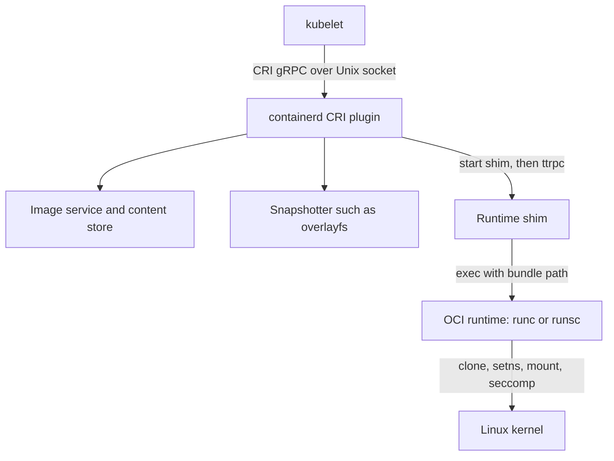
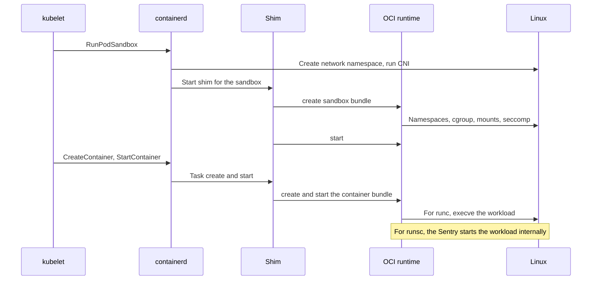

# 2. Container Runtimes: containerd, runc, gVisor and runsc

Chapter 1 described Substrate as a topology of components. Before following how those components place, start and suspend actors, this chapter and the next two establish what happens beneath an ordinary Kubernetes Pod. Every Substrate worker is such a Pod, and every actor mechanism is easiest to understand against that baseline. Chapter 3 follows one Pod from `kubectl apply` through the control plane to its node, and Chapter 4 builds it on Linux. Chapters 9 and 13 later follow an actor through first start, suspend and restore at the same level of detail, naming every component, protocol, command and Linux primitive on the way. This chapter supplies the vocabulary: the four programs that turn an OCI image and a specification into isolated execution, and how they differ.

Two kinds of statement appear in these foundation chapters. Behaviour of containerd, runc, gVisor, the kubelet and the Linux kernel is described from their upstream designs and documented interfaces; this repository does not implement it and its exact details move with their releases. Behaviour of Substrate is grounded in source at the `v1.0.0` tag and linked. Where the two meet, the text says which side owns the step.

## 2.1 The layered runtime stack beneath a Pod

A Kubernetes node runs a stack of runtimes, each with a narrower job than the one above it.

| Layer | Example program | Input it consumes | What it produces |
|---|---|---|---|
| Node agent | kubelet | Pod objects from the API server | CRI calls, volumes, cgroup parents, status |
| CRI runtime | containerd with its CRI plugin | CRI gRPC requests | Images, snapshots, sandboxes, tasks |
| Runtime shim | `containerd-shim-runc-v2`, `containerd-shim-runsc-v1` | Task API calls over ttrpc | A long-lived parent for container processes |
| OCI runtime | `runc`, `runsc` | An OCI bundle: `config.json` plus a root filesystem | A process (or sandbox) with namespaces, cgroups and security settings |
| Kernel | Linux | System calls | The actual isolation and resource control |

The Container Runtime Interface (CRI) is a gRPC protocol that the kubelet speaks over a Unix domain socket, conventionally `/run/containerd/containerd.sock`. Its `RuntimeService` contains sandbox and container operations such as `RunPodSandbox`, `CreateContainer`, `StartContainer`, `StopPodSandbox` and `ContainerStatus`; its `ImageService` contains `PullImage`, `ImageStatus` and `RemoveImage`. The kubelet does not know how to create a namespace, unpack a layer or call `pivot_root`. It asks the CRI runtime for sandboxes and containers and supervises the answers.

The Open Container Initiative (OCI) defines two contracts beneath that. The image specification describes manifests, configurations and content-addressed layers. The runtime specification describes a *bundle*: a directory holding `config.json`, which lists the process arguments, environment, user, mounts, namespaces, cgroup path, capabilities, seccomp filter, rlimits and annotations, plus a root filesystem. An OCI runtime is any program that implements `create`, `start`, `state`, `kill` and `delete` over such a bundle. runc and runsc both satisfy that contract. That is why one node can run ordinary and gVisor Pods side by side, selected through a RuntimeClass whose `handler` names a containerd runtime configuration.

The shim deserves attention because it explains process ownership. containerd does not parent container processes. For each sandbox it starts a shim binary, which daemonizes, listens on its own ttrpc socket and becomes the parent and child subreaper of the processes the OCI runtime creates. containerd can then restart without killing workloads. The shim holds the container's stdio pipes, collects exit statuses with `wait4`, and reports task events back to containerd. For runc, one `containerd-shim-runc-v2` process typically serves every container in one Pod. For gVisor, `containerd-shim-runsc-v1` plays the same role but drives runsc.

Substrate uses this stack exactly once per worker: the worker Pod itself is an ordinary Kubernetes Pod, created by the kubelet and containerd, and run by the node's default OCI runtime. Actors do not pass through the kubelet or containerd. The gVisor worker invokes runsc directly against bundles it prepares, as Chapter 9 shows. The book follows both paths so they can be compared step by step.

## 2.2 containerd: images, snapshots, sandboxes and tasks

containerd is a daemon with a plugin architecture. Its CRI plugin translates CRI requests into calls on internal services, and the services are useful to know by name because their state is visible on disk and through the `ctr` tool.

The **content store** holds immutable blobs addressed by digest, under `/var/lib/containerd/io.containerd.content.v1.content/blobs/sha256/`. A pull resolves an image reference to a manifest or an index, chooses the platform-specific manifest, then fetches the configuration and each layer blob. Every blob is verified against its digest before it is committed. Writes use ingest files and are renamed into place only after verification.

The **metadata store** is a bbolt database that records images, containers, snapshots, leases and namespaces (containerd namespaces, not Linux namespaces; the CRI plugin uses the `k8s.io` namespace). Garbage collection walks references from this database; a lease protects in-progress content from collection during a pull.

The **snapshotter** turns layers into filesystems. The default `overlayfs` snapshotter stores each layer as a directory under `/var/lib/containerd/io.containerd.snapshotter.v1.overlayfs/snapshots/<id>/fs`. Unpacking applies a layer's tar stream into a new *active* snapshot whose parent is the previous layer, then commits it. Committed snapshots are immutable and shared by every container that uses the layer. When a container is created, the snapshotter prepares one more active snapshot, the writable layer, and returns a *mount list* rather than mounting anything itself: typically a single `overlay` mount with `lowerdir` set to the colon-separated committed layers, `upperdir` to the new layer's `fs` directory and `workdir` to a scratch directory. Whiteout files in layers, character devices with device number 0/0, are how overlayfs represents deletions; opaque directories carry the `trusted.overlay.opaque` extended attribute.

The **sandbox** concept groups a Pod's containers. For a runc Pod, the CRI plugin's sandbox controller creates a network namespace, calls CNI, and runs the *pause* container that pins the Pod's shared namespaces. For a gVisor Pod, the same requests produce a gVisor sandbox: one Sentry kernel that will host every container in the Pod.

The **task** service is the live-process view. A container is metadata; a task is its running instance. `CreateContainer` in CRI becomes a container record plus a task create through the shim; `StartContainer` becomes a task start. The shim mounts the rootfs that the snapshotter described into the bundle's `rootfs` directory, writes `config.json`, and calls the OCI runtime.

Operators meet these concepts through three CLIs. `crictl` speaks CRI, so it sees what the kubelet sees: Pod sandboxes, containers, images and their status. `ctr` speaks containerd's native API and exposes content, snapshots, leases and tasks. `nerdctl` offers a Docker-like interface over the same daemon. The lifecycle companion's network collector uses `crictl inspect` to obtain the node-visible PID of the worker container, which is the bridge from Kubernetes identities to `/proc` and `nsenter`.

## 2.3 runc: the OCI runtime that uses the host kernel directly

runc is the reference OCI runtime, built on the `libcontainer` Go library with a small C component. It configures the host kernel to isolate a process and then gets out of the way: after `execve`, the container's process makes ordinary system calls that the host kernel services directly. Namespaces limit what it can see, cgroups limit what it can consume, and capabilities, seccomp, LSM profiles and `no_new_privs` limit what it can ask the kernel to do.

runc separates creation from start so that a supervisor can complete setup, such as network attachment, before user code runs.

1. `runc create <id>` reads `config.json`, creates a state directory under its root (by default `/run/runc/<id>`), and opens a socket pair to communicate with the child it is about to make.
2. It re-executes itself as `runc init`. Early in that process, a C constructor known as `nsexec` runs before the Go runtime starts threads. That timing matters: `setns` into a mount or user namespace and `unshare` of several namespace types require a single-threaded caller, which a running Go program never is.
3. `nsexec` joins any namespaces given by path in the specification with `setns`. A Pod container joins the pause container's network, IPC and UTS namespaces this way. It then creates the remaining new namespaces with `unshare` or `clone`, using flags such as `CLONE_NEWNS`, `CLONE_NEWPID`, `CLONE_NEWCGROUP`, `CLONE_NEWUTS`, `CLONE_NEWIPC` and, when requested, `CLONE_NEWUSER`. A new PID namespace takes effect only for children, so `nsexec` forks again so that the eventual workload is PID 1 of its namespace.
4. The parent `runc` places the child in its cgroup by writing its PID to `cgroup.procs` under the path from `linux.cgroupsPath`, through systemd when the systemd cgroup driver is used, and applies limits such as `memory.max`, `cpu.max` and `pids.max`.
5. Inside the child, Go code prepares the root filesystem. It makes mount propagation private or slave so container mounts do not leak to the host, bind-mounts the rootfs onto itself, performs each mount from the specification (`proc`, `sysfs`, `/dev` as tmpfs, device nodes, `/dev/pts`, `/dev/shm`, `mqueue`, bind-mounted volumes), and then switches root with `pivot_root(".", ".")` followed by a lazy `umount2(".", MNT_DETACH)` of the old root. `chroot` is used only when `pivot_root` cannot be, for example on a ramfs root.
6. It sets the hostname, applies rlimits, OOM score and sysctls, masks and makes read-only the sensitive `/proc` and `/sys` paths listed in the specification, then drops privileges: `prctl(PR_SET_NO_NEW_PRIVS)`, capability bounding set reduction, `capset`, `setgroups`, `setgid` and `setuid`, LSM profile selection through `/proc/self/attr/...`, and finally installs the seccomp filter with `seccomp(SECCOMP_SET_MODE_FILTER)`.
7. `runc init` then blocks opening a FIFO named `exec.fifo` in the state directory. `runc create` exits, leaving a fully configured but not yet running process.
8. `runc start <id>` opens the FIFO from the other end. The blocked init process proceeds to `execve` the user's command, replacing itself with the workload.

runc also protects itself. Because the container could otherwise overwrite the runc binary through `/proc/self/exe` during `runc init`, current releases execute from a protected copy or sealed descriptor rather than the on-disk binary. The details vary with the release, but the lesson is general: an OCI runtime executes inside a boundary it is still constructing.

## 2.4 gVisor and runsc: a user-space kernel behind the same interface

gVisor also implements the OCI runtime contract, as `runsc`, but places a different boundary between the workload and the host. The workload does not make system calls to the host kernel. It makes them to the **Sentry**, a Linux-compatible kernel written in Go that runs as an ordinary, heavily confined host process. The Sentry implements processes, threads, signals, virtual memory, filesystems, pipes, sockets and much of `/proc` itself, and calls the host kernel only through a small, filtered set of system calls.

A gVisor sandbox has several host processes.

| Process | Started by | Role |
|---|---|---|
| `runsc` command | The caller: a containerd shim, or Substrate's worker | Executes one OCI command, such as `create`, `start`, `checkpoint` or `restore`, then exits |
| Sentry (`runsc boot`) | `runsc create` | The application kernel; services every application syscall |
| Gofer (`runsc gofer`) | `runsc create` | A file proxy that opens host files on the Sentry's behalf and serves mount points |
| Application stubs | The Sentry, under the systrap platform | Host processes that provide address spaces in which application code runs |

The **platform** determines how application code is executed and how its system calls reach the Sentry. Under *systrap*, the default in current releases and the platform observed in this book's live experiment, application threads run in stub processes whose seccomp filter returns `SECCOMP_RET_TRAP` for application system calls. The resulting `SIGSYS` is handled by code that hands the call to the Sentry through shared memory, and the Sentry switches contexts without `ptrace` stops on the fast path. The older *ptrace* platform used `PTRACE_SYSEMU` and is slower. The *KVM* platform runs the Sentry as a guest-mode kernel and uses hardware virtualization for address spaces. It needs `/dev/kvm`, but is not a virtual machine monitor with a guest Linux.

Memory belongs to the Sentry. Application memory is backed by a single *memory file*, a host file created with `memfd_create`, from which the Sentry allocates pages and maps them into the stub address spaces with `mmap`. From the host's point of view, an application page is a page of that file. This is why gVisor can checkpoint an application's memory by writing out the populated regions of one file, without inspecting foreign host processes.

Filesystems are mediated. With *directfs*, the default in current releases, the gofer opens files and donates host file descriptors to the Sentry over a Unix socket, after which the Sentry performs I/O directly with calls such as `pread` and `openat` relative to those descriptors. The Sentry itself runs `chroot`ed into an empty directory, so it cannot name host paths. Writable overlays for a container's root filesystem can be backed by memory or by a host file. Durable filesystem state can be checkpointed with the rest of the sandbox.

Networking can be *sandbox*-mode, where the Sentry runs its own TCP/IP stack (netstack) and exchanges raw frames with the network namespace's interface, or *host*-mode, where it forwards socket calls to the host. In sandbox mode, the host namespace keeps the interface but the Sentry owns the addresses and routes. That is exactly why the lifecycle experiment found only loopback routes in an actor's runtime namespace after runsc took it over.

`runsc` supports Kubernetes Pods by grouping containers into one sandbox. When containerd's CRI plugin creates the Pod's first container, it annotates the OCI specification with `io.kubernetes.cri.container-type: sandbox`. Subsequent containers carry `container-type: container` and an `io.kubernetes.cri.sandbox-id` naming the sandbox. runsc reads these annotations: the sandbox container boots a Sentry, and later containers are created inside that same Sentry rather than as new sandboxes. Substrate uses the same mechanism without containerd. [ShapeGVisor](https://github.com/agent-substrate/substrate/blob/v1.0.0/internal/ocispec/gvisor.go) sets `io.kubernetes.cri.container-type` to `sandbox` for the reserved `_sandbox` container and to `container` for each application, with `io.kubernetes.cri.sandbox-id` pointing at `_sandbox`. It also emits `dev.gvisor.spec.mount.<name>.*` annotations so a durable directory mounted by several containers is presented as one shared filesystem.

runsc commands also go beyond the OCI minimum, and those additions are the reason Substrate uses gVisor. `runsc checkpoint` serializes a running sandbox's kernel state and memory into image files. `runsc restore` builds a new sandbox from them. `runsc fscheckpoint` saves filesystem state without memory, and `runsc wait -restore` reports when background page loading completes. Chapters 10 and 13 cover how Substrate drives them.

## 2.5 Comparing runc and runsc where it matters

The following comparison is about isolation and lifecycle mechanics, not marketing performance numbers.

| Property | runc | runsc (gVisor) |
|---|---|---|
| Who services application syscalls | The host Linux kernel | The Sentry, a user-space kernel |
| Host kernel attack surface exposed to the workload | All syscalls not blocked by the seccomp profile | The Sentry's own filtered syscall set; application syscalls never reach the host directly |
| Process view from the host | Workload processes are host processes in new namespaces | Workload processes exist only inside the Sentry; the host sees Sentry, gofer and stub processes |
| Root filesystem | overlayfs mount prepared by the shim, entered by `pivot_root` | Served by the gofer or directfs; the Sentry presents its own VFS |
| Networking | Host kernel stack inside the Pod's network namespace | netstack inside the Sentry, attached to the namespace's interface, or host passthrough |
| `/proc` and `/sys` | Host kernel views, masked and read-only where configured | Sentry-synthesized views |
| Memory accounting | Workload pages charged to the container cgroup | Sentry memory file and Sentry overhead charged to the sandbox cgroup |
| Checkpoint/restore | Optional, through CRIU, which uses ptrace and `/proc` to capture host processes | Native: the Sentry serializes its own state and memory file |
| Compatibility | Native Linux behaviour | Very broad but not complete Linux ABI; some syscalls, ioctls and `/proc` files differ |
| Typical overhead | Syscall cost close to native | Additional cost per syscall and for I/O-heavy workloads; memory overhead for the Sentry |
| Kubernetes integration | Default runtime handler | RuntimeClass handler `runsc`, `containerd-shim-runsc-v1` |

Three differences shape the rest of the book.

First, **what a namespace means differs**. Under runc, the network namespace is the workload's network stack. Under gVisor in sandbox networking mode, the namespace is a plumbing point for frames, and the workload's sockets, routes and ARP state live in the Sentry. Host tools such as `ip route` and `ss` therefore show runc workloads accurately but show only the outer edge of a gVisor workload.

Second, **checkpointing a runc container means checkpointing host processes from outside**. CRIU freezes the processes with the freezer cgroup or `ptrace(PTRACE_SEIZE)`, injects parasite code to dump memory, reads `/proc/<pid>/` files and page maps, and restores by recreating the processes, mappings and descriptors with ordinary syscalls. Checkpointing a gVisor sandbox means asking one program to serialize its own data structures. Substrate's design leans on the second model, and Chapter 13 does not attribute CRIU behaviour to it.

Third, **who must be trusted with privilege differs**. runc needs enough privilege to create namespaces, mount filesystems and set up cgroups, which is why it normally runs as root on the node. Substrate's gVisor worker runs as an unprivileged Pod container with a fixed capability list. [workerpool_apply.go](https://github.com/agent-substrate/substrate/blob/v1.0.0/cmd/atecontroller/internal/controllers/workerpool_apply.go) explains each entry: `SETUID`, `SETGID` and `SETFCAP` so the gofer can write a full-range identity mapping for its user namespace, `SYS_ADMIN` for mounts, `NET_ADMIN` and `NET_RAW` for actor networking, and `DAC_OVERRIDE`, `FOWNER` and `CHOWN` for rootfs ownership. It omits `SYS_PTRACE` and `SYS_CHROOT` because runsc creates an identity-mapped user namespace while directfs is on and networking is not host. The sandbox gets those capabilities inside that namespace, not from the worker.

## 2.6 Roadmap and engineering improvements

The repository-backed facts in this chapter are narrow but important. Substrate pins runsc flags in [internal_flags.json](https://github.com/agent-substrate/substrate/blob/v1.0.0/cmd/ateworker-gvisor/kodata/internal_flags.json). They include JSON logging, `--host-settings=ignore`, `--cpu-num-from-quota` for create and restore, `-allow-connected-on-save` at start, and `-background -detach` at restore. It shapes OCI specifications for gVisor in `ShapeGVisor` and invokes runsc through [runsc.go](https://github.com/agent-substrate/substrate/blob/v1.0.0/cmd/ateworker-gvisor/runsc.go). The worker capability list and its rationale live in the WorkerPool controller. Each of these is a compatibility surface. A runsc upgrade that changes the meaning of a flag, the CRI annotation names or the directfs user-namespace behaviour changes the worker's required privileges or the actor's behaviour.

Proposals follow from that. A conformance suite could assert, per pinned runsc release, the observable facts this book relies on: platform selection, the user-namespace mapping that removes `SYS_PTRACE` from the worker, the set of checkpoint files, and sandbox-mode networking. A second proposal is to record runsc's version and platform in the actor's runtime information so an operator can correlate behaviour without reading runtime logs. A third is documentation work. A short table in the WorkerPool documentation, mapping each worker capability to the runsc behaviour that needs it, would make capability reviews faster than reading controller comments. These are editorial proposals, not current tracked work.

## Source map

- [ShapeGVisor](https://github.com/agent-substrate/substrate/blob/v1.0.0/internal/ocispec/gvisor.go): the CRI sandbox annotations, gVisor mount hints and cgroup leaf names Substrate writes into OCI specifications.
- [runsc.go](https://github.com/agent-substrate/substrate/blob/v1.0.0/cmd/ateworker-gvisor/runsc.go): every runsc command the gVisor worker executes, and how argument vectors are built.
- [internal_flags.json](https://github.com/agent-substrate/substrate/blob/v1.0.0/cmd/ateworker-gvisor/kodata/internal_flags.json): the pinned global and per-command runsc flags.
- [workerpool_apply.go](https://github.com/agent-substrate/substrate/blob/v1.0.0/cmd/atecontroller/internal/controllers/workerpool_apply.go): worker capability sets and the gVisor user-namespace rationale.
