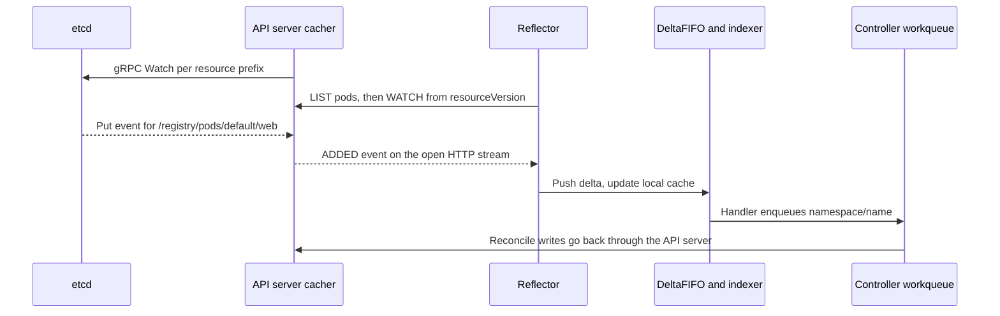
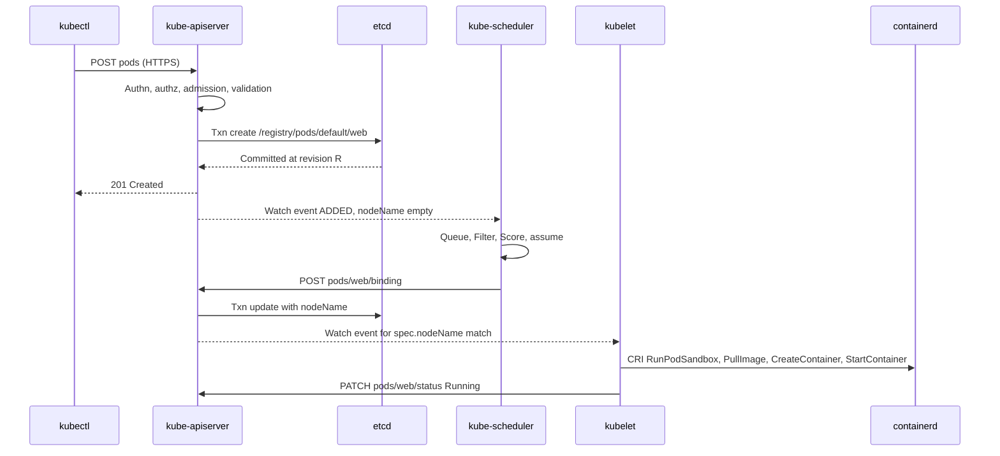

# 3. From kubectl apply to a Pod Bound to a Node

This chapter follows a single manifest, `pod.yaml`, from the operator's terminal to the moment the kubelet on one node decides to run it. It covers kubectl, the API server's request pipeline, etcd, the watch machinery that every controller depends on, the scheduler, and the kubelet's view of its assigned Pods. Chapter 4 continues on the node, from the kubelet's first CRI call to a running process. Chapters 9 and 13 then trace the equivalent journey for an actor, and the comparison tables in Chapter 9 refer back to the sections here.

Everything in this chapter is upstream Kubernetes behaviour. Exact defaults change between releases. The structure described, a central API server persisting to etcd with clients reacting through watches, has been stable for many releases and is what Substrate's own control plane is contrasted with.

## 3.1 kubectl turns a file into an HTTP request

The example manifest is minimal:

```yaml
apiVersion: v1
kind: Pod
metadata:
  name: web
  namespace: default
spec:
  containers:
  - name: app
    image: registry.example/web:1.0
    ports:
    - containerPort: 8080
```

`kubectl apply -f pod.yaml` performs several steps before anything reaches the cluster.

1. **Configuration and credentials.** kubectl reads the kubeconfig (`~/.kube/config` or `$KUBECONFIG`), selects a context, and obtains the API server URL, the cluster CA bundle and a client credential. That can be a client certificate, a bearer token, or an exec plugin that mints a short-lived token.
2. **Discovery.** It fetches the server's API discovery documents (`/api`, `/apis`, and the aggregated discovery endpoint in current releases) and caches them under `~/.kube/cache`. Discovery maps the manifest's `apiVersion` and `kind` to a REST resource, here `pods` in the core group, and tells kubectl that Pods are namespaced.
3. **Decoding.** The YAML is decoded to an unstructured object. Client-side validation is no longer the primary check; current kubectl asks the server to validate fields (`fieldValidation=Strict` or `Warn`).
4. **Apply semantics.** With the default client-side apply, kubectl GETs the live object. If it does not exist, kubectl sends a `POST /api/v1/namespaces/default/pods` with the object and an annotation recording the applied configuration. If it exists, kubectl computes a three-way strategic merge patch between the last applied configuration, the live object and the new file, and sends a `PATCH`. With `--server-side`, kubectl instead sends a `PATCH` with content type `application/apply-patch+yaml`, and the server performs the merge, tracking field ownership in `metadata.managedFields`.

The transport is HTTPS. kubectl verifies the server certificate against the cluster CA and negotiates HTTP/2 where available. Requests are JSON by default for kubectl. Built-in controllers use the more compact protobuf encoding (`application/vnd.kubernetes.protobuf`). Every later component in this chapter talks to the API server, and only the API server talks to etcd.

## 3.2 Inside the API server: authentication to persistence

The kube-apiserver processes every request through a fixed chain of handlers. The order explains many operational behaviours.

| Stage | What happens | Typical failure |
|---|---|---|
| TLS and HTTP | Terminate TLS, apply request timeouts and max in-flight limits | Connection refused, 429 |
| Authentication | Client certificate CN/O, bearer token, service account JWT, OIDC or webhook produce a user, groups and extra fields | 401 Unauthorized |
| Audit | Record request metadata according to policy | None for the client |
| API Priority and Fairness | Classify the request into a flow schema and priority level, queue fairly | 429 Too Many Requests |
| Authorization | RBAC, Node authorizer, webhook: may this user `create` `pods` in `default`? | 403 Forbidden |
| Decoding and defaulting | Convert to the internal version, apply defaults such as `restartPolicy: Always` and `dnsPolicy: ClusterFirst` | 400 Bad Request |
| Mutating admission | Built-in plugins (for example ServiceAccount injection, DefaultStorageClass) then mutating webhooks | Webhook rejection |
| Validation | Field validation for the object and its subresources | 422 Unprocessable Entity |
| Validating admission | Built-in plugins, ValidatingAdmissionPolicy (CEL), validating webhooks, Pod Security admission | 403 or 422 |
| Storage | Encode as protobuf, write to etcd | 409 Conflict, 500 |

For the example Pod, the ServiceAccount admission plugin sets `spec.serviceAccountName: default` and adds a projected volume containing a bound service-account token, the cluster CA and the namespace. The API server also fills `metadata.uid`, `metadata.creationTimestamp` and the initial `status.phase: Pending`.

The storage layer writes to etcd through the etcd v3 gRPC API over mutually authenticated TLS. A create is a transaction: *if* the key `/registry/pods/default/web` has never been modified, *then* put the encoded object. An update is guarded by the object's previous modification revision. This compare-and-swap is the source of Kubernetes optimistic concurrency. Every object's `metadata.resourceVersion` is the etcd revision at which it was last written, and a client update carrying a stale `resourceVersion` fails with 409 Conflict.

etcd itself replicates the write through Raft. The leader appends the entry to its log, replicates it to followers, and acknowledges once a majority has persisted it, which includes an `fdatasync` of the write-ahead log on each of those members. Only then does the API server return `201 Created` to kubectl. At this point the Pod exists, but nothing has happened on any node.

## 3.3 Watches, the cacher and informers

Kubernetes components do not poll for new objects. They *watch*. Understanding the watch path is necessary to answer the question this book keeps asking: who tells whom, and how.

etcd exposes a gRPC `Watch` stream that delivers every change to a key range after a given revision. The API server opens these streams itself, one per resource type, and feeds them into an in-memory **watch cache**, the *cacher*. Clients never watch etcd directly. When a client sends `GET /api/v1/pods?watch=1&resourceVersion=N`, the API server serves the stream from the cacher. It keeps the HTTP response open and writes one JSON or protobuf frame per event (`ADDED`, `MODIFIED`, `DELETED`, `BOOKMARK`), using chunked transfer encoding on HTTP/1.1 or a long-lived stream on HTTP/2. Field and label selectors, such as `spec.nodeName=node-a`, are evaluated in the cacher so each client receives only relevant events.

Client libraries wrap this in the **informer** pattern from `client-go`.

1. A *reflector* performs `ListAndWatch`. It lists the resource to obtain the current objects and a collection `resourceVersion`, then watches from that version. In current releases it can instead request a streaming list, which delivers the initial state as watch events followed by a bookmark.
2. Events go into a *DeltaFIFO*, which records sequences of changes per object key.
3. A *shared informer* pops deltas, updates a thread-safe *indexer* (the local cache, with indexes such as by namespace or by node), and invokes registered event handlers.
4. Controllers' handlers do not do work directly. They enqueue object keys into a rate-limited *workqueue*, and worker goroutines reconcile each key by reading from the local cache and writing desired changes back through the API server.
5. If a watch breaks, the reflector resumes from the last seen `resourceVersion`. If that version has been compacted out of etcd or the cacher (`410 Gone`), it relists.
6. Periodic *resync* redelivers cached objects to handlers so level-based controllers can repair drift without new events.



The important property is that state flows through one place. The scheduler, the kubelet and every controller observe the same object history through the API server, and each writes its decisions back as object updates. No component sends the kubelet an imperative "start this Pod" call. The kubelet discovers that a Pod has been assigned to it by watching.

## 3.4 The scheduler chooses a node and writes a binding

kube-scheduler runs informers for Pods, Nodes, PersistentVolumes, PersistentVolumeClaims, CSI nodes, storage classes and other objects it needs to evaluate placement. Its Pod informer delivers the new Pod because its `spec.nodeName` is empty and its `spec.schedulerName` is `default-scheduler`.

The Pod enters the scheduling queue. The queue has three parts: an *active* heap ordered by priority and enqueue time, a *backoff* queue for Pods that recently failed, and an *unschedulable* set of Pods that wait for a cluster event, such as a new node or a freed resource, that might make them schedulable. A scheduling cycle pops one Pod and runs the scheduling framework's extension points.

| Extension point | Purpose | Examples |
|---|---|---|
| PreEnqueue, QueueSort | Gate and order Pods | Scheduling gates, priority sort |
| PreFilter, Filter | Remove infeasible nodes | NodeResourcesFit, NodeAffinity, TaintToleration, VolumeBinding, PodTopologySpread |
| PostFilter | React when no node fits | DefaultPreemption chooses victims to evict |
| PreScore, Score, NormalizeScore | Rank feasible nodes | NodeResourcesBalancedAllocation, ImageLocality, InterPodAffinity |
| Reserve | Claim resources in the scheduler's own cache | VolumeBinding reserves volumes |
| Permit | Approve, deny or delay | Gang scheduling plugins |
| PreBind, Bind, PostBind | Persist the decision | VolumeBinding binds claims; DefaultBinder posts the binding |

For large clusters, Filter stops after finding enough feasible nodes (`percentageOfNodesToScore`), so the scheduler does not necessarily evaluate every node. After Score, the scheduler *assumes* the Pod onto the chosen node in its cache. The next Pod can then be scheduled immediately, with that capacity already consumed, while binding proceeds asynchronously in a separate binding cycle.

Binding is an API write: `POST /api/v1/namespaces/default/pods/web/binding` with a `Binding` object naming the target node. The API server's binding subresource sets `spec.nodeName` on the Pod and records the `PodScheduled` condition. If binding fails, the scheduler forgets the assumed Pod and requeues it. The scheduler never contacts the node.

## 3.5 The kubelet learns about its Pod and starts work

Each kubelet runs a Pod config source that watches the API server for Pods with `spec.nodeName` equal to its node name. Its credentials are restricted by the Node authorizer and the NodeRestriction admission plugin, so it can read only objects related to its own Pods and update only its own Node and Pod statuses. Static Pods from a manifest directory or URL are merged into the same configuration stream.

When the bound Pod arrives, the kubelet's main sync loop dispatches it to a per-Pod *pod worker*, a goroutine that serializes all lifecycle work for that Pod UID. The pod worker calls `SyncPod`, which performs the node-local steps in Chapter 4: admission checks (resources, node conditions, and, for RuntimeClass Pods, handler availability), creation of the Pod's cgroup, volume attachment and mounting through the volume manager, image pulls, and CRI calls to create the sandbox and containers.

The whole journey from the terminal to the node can now be drawn as one sequence. Every arrow into or out of the API server is either an HTTPS request or an event on a watch stream the receiver opened earlier. The scheduler and kubelet never call each other.



Several kubelet subsystems keep running after start.

- The **pod lifecycle event generator** (PLEG) detects container state changes. The generic PLEG relists containers through CRI periodically; the evented PLEG subscribes to CRI container events. Either one triggers a new `SyncPod` when something changes.
- The **status manager** computes Pod status (phase, conditions, container statuses, IPs) and writes it to the API server with `PATCH` on the `status` subresource.
- The **probe manager** runs startup, liveness and readiness probes, and readiness feeds the `Ready` condition that EndpointSlice controllers watch.
- The **eviction manager** watches memory, disk and PID pressure and may evict Pods.

## 3.6 Roadmap and engineering improvements

The protocols in this chapter are worth summarizing in one place, because Chapter 9 compares them directly with Substrate's actor path.

| From | To | Protocol | Pattern |
|---|---|---|---|
| kubectl | kube-apiserver | HTTPS REST (JSON), HTTP/2 | Request/response |
| kube-apiserver | etcd | gRPC over mTLS (etcd v3 KV, Watch, Lease) | Transactions and watch streams |
| Controllers, scheduler, kubelet | kube-apiserver | HTTPS REST (protobuf), long-lived watch responses | List-and-watch informers; writes as PATCH/POST/PUT |
| kube-scheduler | kube-apiserver | `POST pods/binding` | Decision persisted as an object write |
| kubelet | containerd | CRI gRPC over a Unix domain socket | Request/response; optional event stream |
| containerd | Shim | ttrpc over a Unix socket | Task API |
| Shim | runc or runsc | `fork`/`exec` of the runtime binary with arguments | Process exit status |
| containerd | CNI plugin | `exec` with environment variables and JSON on stdin | Result JSON on stdout |
| kube-apiserver | Admission webhooks | HTTPS POST of AdmissionReview | Synchronous call in the write path |

The Kubernetes Pod path is a reference design, not Substrate's roadmap, and no Substrate work item changes it. The useful engineering proposal is for this book: Chapter 9 maps each row to its actor equivalent. That shows where Substrate keeps Kubernetes's patterns (a single authoritative store, reconcilers, and level-triggered retry) and where it deliberately does not (no watch stream drives node work, and activation is an imperative gRPC call chain with a database-backed lease). Readers evaluating Substrate against a Kubernetes-native design should start with that comparison rather than assume that actors are Pods with a different name.

## Source map

This chapter describes upstream Kubernetes components, not code in this repository. The Substrate files that interact with them are:

- [workerpool_apply.go](https://github.com/agent-substrate/substrate/blob/v1.0.0/cmd/atecontroller/internal/controllers/workerpool_apply.go): the Deployment and Pod template that the API server, scheduler and kubelet turn into worker Pods.
- [syncer.go](https://github.com/agent-substrate/substrate/blob/v1.0.0/cmd/atecontroller/internal/workersync/syncer.go): a client-go informer and workqueue consumer of worker Pods, an example of the pattern in 3.3.
