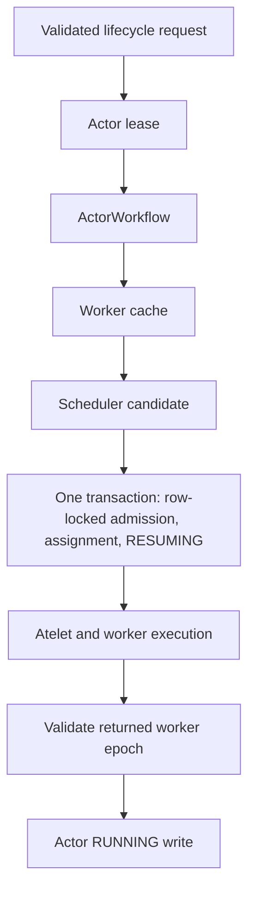
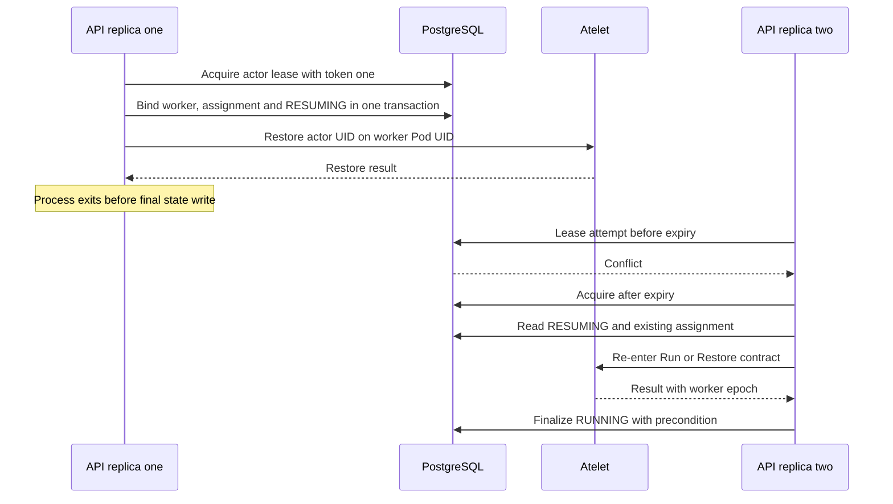
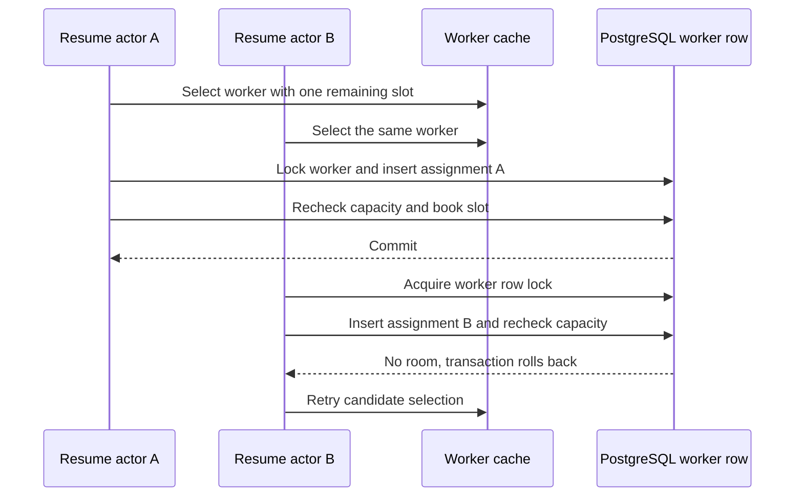
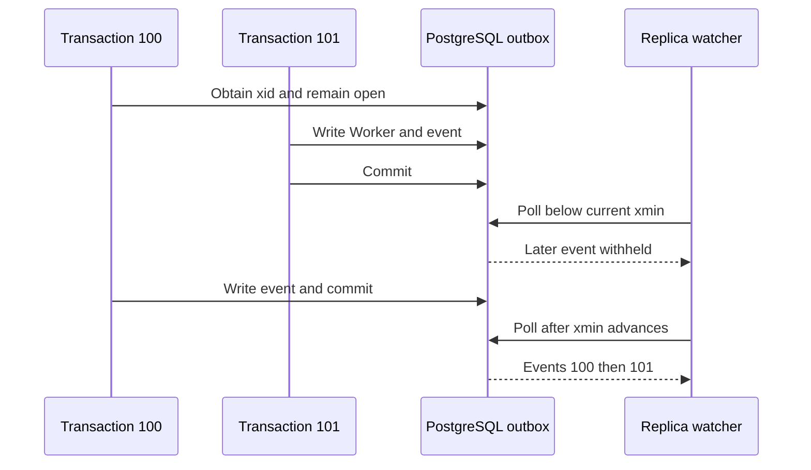
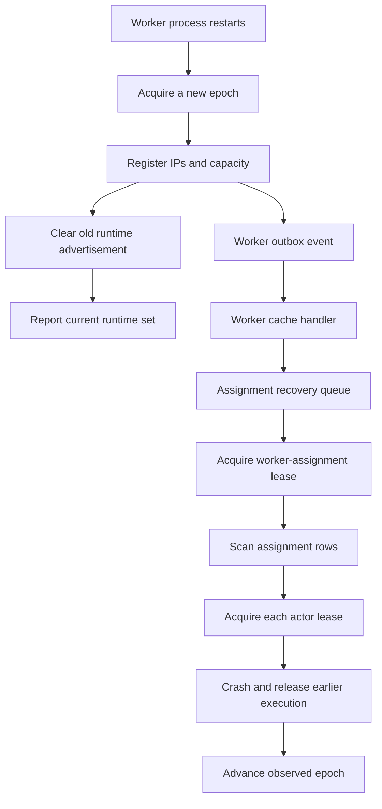

# 3. Placement and Consistency in ateapi

## 3.1 The control plane's authoritative state

The actor activation path is a distributed state transition coordinated by ateapi. It changes PostgreSQL records, obtains capacity in a worker, prepares state on a node, and starts an execution environment in another process. No transaction spans all of those actions. The implementation instead combines several narrower mechanisms: resource versions, renewable leases, a unique assignment table, row-locked capacity admission, worker-process epochs, and workflows that derive progress from persisted state. Each mechanism protects a different invariant.

The main abstractions are `RPCService`, `ServiceImpl`, `ActorWorkflow`, and `WorkerWorkflow` in `cmd/ateapi/internal/controlapi`, the `Scheduler` interface in `cmd/ateapi/internal/scheduling`, and `Persistence` in `cmd/ateapi/internal/store/atepg`. Handlers validate and authorize requests, then invoke service methods or workflows. The scheduler proposes placement. The store decides whether a proposed reservation is still admissible. Atelet and the worker execute external side effects. Keeping those responsibilities separate is what permits a cached scheduling view without making the cache the authority for resource consumption.

[atepg.go](https://github.com/agent-substrate/substrate/blob/v1.0.0/cmd/ateapi/internal/store/atepg/atepg.go) explains the storage representation: SQL columns hold values needed for keys, versions, pagination, and preconditions, while a BYTEA column contains the complete protobuf resource. The [initial migration](https://github.com/agent-substrate/substrate/blob/v1.0.0/cmd/ateapi/internal/store/atepg/migrations/000001_initial.sql) defines atespaces, actors, actor templates, tags, workers, worker assignments, leases, policy storage, and the worker outbox. SQL relationships enforce some ownership constraints directly, such as actor-to-atespace references and assignment-to-worker references.

An actor is addressed by atespace and name, with a separate UID for incarnation. A Worker is globally named by the worker Pod UID. `worker_assignments` is keyed by actor UID, giving an actor at most one recorded worker reservation. Keeping assignments separate from the Worker protobuf prevents worker reads and watch events from growing linearly with the number of hosted actors. Worker allocation is an aggregate, while assignment rows retain the per-actor amounts needed to release that aggregate correctly.

The bind is one transaction. `BindActorToWorker` locks the Worker row, runs admission, updates the Actor to RESUMING with its `WorkerAssignment`, inserts the `worker_assignments` row, and books the Worker's allocation. The Actor's version precondition is checked in the same transaction, so a bind against a stale Actor rolls back and leaves no reservation. A lost response after commit leaves a RESUMING actor that names its assignment. The next attempt reads that record and re-enters activation, so no separate claim needs repair.

The store's update methods apply UID and version preconditions. An update reads the resource, checks the caller's conditions, applies the mutation, and writes with a predicate that still names the expected incarnation and version. If another writer wins, the operation reports a conflict instead of overwriting the newer state. A mutation closure can be retried, so it must not itself emit an irreversible external side effect or a misleading success log. [workflow.go](https://github.com/agent-substrate/substrate/blob/v1.0.0/cmd/ateapi/internal/controlapi/workflow.go) explicitly logs actor state changes from the committed record after the update returns.

The database also stores authorization data used by the embedded OpenFGA integration. Resource policy mutations and authorization tuple updates can share a PostgreSQL transaction through the transaction-aware datastore adapter. This avoids treating authorization policy as an unrelated eventually updated side database. The details belong to Chapter 10, but the consistency implication is relevant here: the store's transaction boundary can include both a resource mutation and the access relationships that make it visible to callers.

Database connections are partitioned by purpose. `Persistence` has the main read/write pool, a watch pool, an owner pool for migrations and outbox maintenance, and a separate readiness-probe pool. The configured watch pool has capacity for polling, maintenance, and headroom; the owner pool accounts for migration locking and work. Separating a probe connection prevents ordinary request traffic from consuming every connection the readiness check needs. It does not make the database independent of request load, but it removes one avoidable queueing dependency.

This is a user-space and database consistency system. PostgreSQL row locks, advisory locks, and MVCC snapshots are not Linux syscalls exposed by Substrate. They ultimately execute in processes scheduled by Linux and communicate over sockets, but their semantic role is a database contract. The host-kernel boundaries enter later, when atelet and workers perform filesystem, network, process, cgroup, and virtualization work. Mixing SQL locks into a syscall inventory would conceal the actual layer at which placement correctness is established.

A compact invariant set helps organize the chapter. A resource write must apply to the intended incarnation. One actor must not hold simultaneous reservations on different workers. A worker must not admit more booked capacity than its fresh record permits. A completed activation must refer to the process epoch that executed it. A replayed workflow must preserve already committed progress and avoid duplicating external effects. A cache may lag, but lag must not invalidate any of those authoritative checks.

The arrows identify dependency. Only the bind is one transaction. Failure between any two later boxes leaves a particular recoverable state. The implementation's quality depends on whether that state is understood by the next request or reconciliation pass. The following sections examine those interruptions in the order that an activation encounters them.

## 3.2 Renewable leases and re-entered workflows

An actor lease serializes lifecycle operations for one logical actor address. `actorLeaseKey` constructs the key from atespace and name. `AcquireLease` in [lease.go](https://github.com/agent-substrate/substrate/blob/v1.0.0/cmd/ateapi/internal/store/atepg/lease.go) generates an ownership token and inserts a lease row with an expiration calculated by PostgreSQL's `clock_timestamp()`. On conflict, it can replace the owner only if the previous lease is expired. If no row is returned, the caller receives `ErrLeaseConflict` rather than assuming it may proceed.

The use of the database clock is important. Expiration and reclamation are evaluated by the authority that owns the row. API replicas do not compare independently skewed wall clocks to decide whether another replica's lease has expired. The client still uses local timers to schedule renewal and cancellation, but the decisive condition is in the SQL predicate. This avoids one class of clock-skew error without making the entire operation independent of timeouts, network delay, or process pauses.

The default lease TTL is thirty seconds. Renewal normally occurs at one third of that interval. The renewal attempt has an earlier deadline than the full expiration period, and transient errors are retried within that budget. Renewal succeeds only if the key and token still match and the lease remains unexpired. If renewal cannot be established, the lease context is canceled. Workflow code uses that context for subsequent operations, so losing ownership becomes a signal to stop making progress.

Closing the lease cancels the renewal loop, waits for it to finish, and then attempts a token-checked DELETE using a bounded background context. The release path cannot delete a successor's lease because it includes the original token. If the release fails, expiration remains the recovery mechanism. Cleanup of old rows is separate: a maintenance pass removes expired leases in bounded batches using `FOR UPDATE SKIP LOCKED`. Reclaiming an expired key does not depend on that cleanup pass having run.

A lease is not a universal fencing token for every remote side effect. The token protects the lease row, and context cancellation stops cooperative work. An RPC that already reached another process may still complete. That is why actor UID, worker Pod UID, worker epoch, resource version, and reentrant node operations remain necessary. It would be unsafe to infer exactly-once execution from the existence of the lease. The lease reduces concurrent workflow activity; other contracts protect the state when ownership changes or responses are lost.

`ActorWorkflow.ResumeActor` begins with an optimization for the common routing case. It reads the actor before taking the lease. If the actor is already RUNNING, it returns the current record immediately. The router can ask for the actor on each request without inserting and deleting a lease row each time. Any state that requires actual activation is read again under the acquired lease. The optimization therefore avoids unnecessary serialization for a read-only fast path while retaining fresh validation for transitions.

The main resume sequence is explicit in [workflow_resume.go](https://github.com/agent-substrate/substrate/blob/v1.0.0/cmd/ateapi/internal/controlapi/workflow_resume.go): load the actor and template, ensure volumes exist, ensure a worker assignment, attach volumes, call atelet to run or restore, and finalize RUNNING. Each ensure step validates its precondition and records progress. A RESUMING actor with a still-valid assignment can skip new placement. A persisted postcondition is the evidence for skipping; an in-memory variable from a previous API process is not. `validateAssignedWorker` then checks the worker's state, its registration, and that `workerHostsActor` still finds the assignment. It crashes the actor when the worker is draining or no longer eligible.

The step wrapper opens trace spans and marks skipped work when the postcondition already holds. This makes a retried workflow inspectable: a trace can show that assignment was reused but restore was repeated, rather than presenting the whole request as a fresh activation. Error wrapping retains the step name. The observability design follows the workflow structure, which is useful when distinguishing database conflict time from node preparation or runtime execution time.

The diagram exposes a requirement rather than granting an unconditional guarantee: the repeated atelet request must have safe semantics for the same actor and worker identities. The comment on `ensureAteletRestored` calls this the reentrancy seam and references continuing work on node-side idempotency. A reader should inspect both ends of that contract before declaring the workflow exactly once. Persisted ensure steps make recovery possible, but an external operation that is not repeatable remains a material limitation.

Suspend follows the same general method. It acquires the actor lease, reads current state, marks SUSPENDING, asks atelet to checkpoint, detaches external volumes, and finalizes SUSPENDED. An actor already SUSPENDED returns as it is. The synchronous versus asynchronous durability choice changes when upload completes, not the need to serialize the execution transition. Snapshot state and retention are covered in Chapter 8; here the important point is that releasing execution capacity follows a successful sequence of recorded and external steps.

Delete and revert introduce different cleanup obligations. Delete must terminate execution and detach volumes before releasing a reservation that could otherwise still represent a live sandbox. The workflow can collect errors and continue safe cleanup where possible, but it deliberately avoids releasing capacity if required termination or detachment failed. Revert preserves a completed durable recovery point while abandoning active or local progress. These are not equivalent to clearing ActorStatus and relying on a future controller to discover the orphaned processes.

External volume operations show where re-entry is still imperfect. The source contains TODOs to replace repeated attach/detach execution with checks against proper recorded attachment state. An operation may currently depend on the CSI driver's own idempotent semantics. That dependency should be named in a production analysis. “The workflow is reentrant” is a useful design pattern, but it must be verified per side effect, especially when calling a plugin with its own persistence and retry behavior.

The upward worker-requested suspend path is similarly instructive. WorkerService first verifies that the caller's atelet is on the worker's node and that the actor incarnation is hosted there, then invokes the ordinary suspend workflow. A TODO in [workerservice/suspend.go](https://github.com/agent-substrate/substrate/blob/v1.0.0/cmd/ateapi/internal/workerservice/suspend.go) identifies a race because those hosting checks occur before the actor lease. The actor can move or be recreated in that interval. The existence of a later lease does not retroactively protect an earlier authorization observation. Moving or repeating the check inside the protected operation is a concrete future improvement.

Finally, cancellation must be interpreted operationally. A deadline ending can stop lease renewal and cause the caller to receive an error while a node is still completing a checkpoint. A retry should re-read state and use the appropriate lifecycle method; it should not assume the actor remained untouched. Logs should be tied to committed records and remote operation identities, allowing an operator to reconstruct what actually completed. This is why the source avoids logging a state transition from inside a mutation closure that might be retried or rejected.

### Separating serialization, admission, and execution evidence

Three superficially similar conflicts reveal why the control plane needs more than one mechanism. First, two API replicas receive ResumeActor for the same suspended actor. They are competing to perform one actor transition. The actor lease serializes the work at the logical resource address. The losing request can report contention and retry according to its caller's policy. It must not select a different worker and proceed independently merely because another worker has capacity.

Second, two different actors compete for the last place on one worker. Their actor leases do not conflict, because both lifecycle operations are legitimate. The worker row lock serializes the capacity decision, and the second admission sees the first booking. A global actor lease would be unnecessarily restrictive, while only per-actor leases would permit overbooking. The separation allows unrelated activations to proceed concurrently until they contend for the same physical resource.

Third, one actor's restore result comes from a worker process that has already been replaced. Neither a successfully acquired actor lease nor a valid capacity reservation proves that the returned process is still the worker's registered incarnation. The epoch comparison supplies that evidence. Resource version and actor UID still matter when recording the result, but they do not describe worker-process continuity. Each conflict is resolved at the layer that can authoritatively observe the relevant fact.

Now examine a lost database response. A transaction can commit even when the client connection fails before the caller learns the result. Retrying a bind must therefore tolerate an assignment that already exists. The `actor_uid` primary key rejects a second claim, and the Actor's version precondition rejects a second bind of an Actor that has already moved. The retry reads the Actor, finds RESUMING with its assignment, and validates that record. Requiring a preliminary read before insertion would not solve it: another transaction could commit after the read. The unique key and the precondition are the decisive concurrency boundaries.

A lost response to an actor write outside a bind is a different ambiguity. The write may have applied even though the caller received an error. A later attempt must reread the actor rather than assume no progress occurred. A resource version is evidence that a particular write applied to a particular prior state; it is not a client request identifier. The workflow uses state and identity to recover intent. Adding a retry loop without rereading those values would repeatedly collide with the very update that may already have succeeded.

A lost node response is harder because the side effect exists outside PostgreSQL. The store can establish that the actor was assigned and that the request named a worker, but it cannot infer from a timeout whether the sandbox was created. That uncertainty must be resolved by the node/worker contract. The API can repeat the same semantic request or query state where supported, but it must not treat a transport timeout as an instruction to allocate a second independent execution. This is the point at which idempotency keys and cleanup behavior become part of isolation as well as availability.

These cases also explain why a retry budget belongs to a particular operation. Assignment contention can be retried quickly with jitter because a fresh candidate may be available. A five-minute runtime operation that exceeded its deadline should not automatically be multiplied into another five-minute attempt without understanding its outcome. An authorization refusal should not be retried as if it were a connection failure. The repository's distinct retry loops encode some of these differences; integrations should preserve them instead of wrapping every call in the same policy.

The most useful review artifact is an operation ledger with one row per side effect. For a resume, it records volume creation, assignment reservation, actor-state persistence, volume attachment, runtime activation, and finalization. For each row, identify the durable key, the success evidence, the repeated-call behavior, and the compensating or recovery action. Such a ledger can be derived directly from the ensure methods. It makes unanswered questions visible before they become production incidents and keeps tests focused on the distributed boundaries rather than the number of helper functions.

A ledger also distinguishes safe over-retention from unsafe early release. Retaining an uncertain assignment can temporarily reduce capacity but prevents that capacity from being allocated while execution might still exist. Releasing it early can admit another actor into resources still in use. The implementation often favors conservative retention until termination or reconciliation supplies evidence. That choice requires eventual cleanup to preserve liveness. A system that never releases uncertain state is safe against one class of overlap but can exhaust itself after repeated failures; recovery must complete the argument.

## 3.3 Candidate selection and authoritative admission

The scheduler has a deliberately small interface: `Schedule`, `Applies`, and `HasRoom`. `Schedule` chooses a worker from a `WorkerSource`. `Applies` checks non-capacity constraints, allowing an existing assignment to be assessed without counting itself as a reason for ineligibility. `HasRoom` evaluates the resources needed for one more actor. This split permits the workflow to reuse an existing claim and to repeat admission against a fresh database record without duplicating policy in the store.

`Constraints` includes sandbox class, required runtime, snapshot runtime, template and actor selectors, required nodes, and declared limits. Sandbox class is never relaxed when restoring a snapshot, including lower-fidelity state, because the worker implementations write and interpret different formats. Required runtime can be relaxed when the snapshot can restore from another location (`canRelaxRuntime`). Snapshot runtime remains relevant to determining the runtime actually used and its overhead. These fields are similar enough that conflating them would produce incorrect capacity accounting during fallback.

A worker must have registered a process epoch and reported its sandbox class and runtimes. It must be ACTIVE. Node constraints must match when local state pins an actor. Both label selectors must match. The required runtime must be supported. Only then does capacity admission make sense. A worker with ample free memory but an unavailable runtime is not an eligible destination, and a newly recreated worker that has not reported runtime information cannot inherit the prior process's eligibility.

`Booking` calculates the resource reservation. CPU comes from the actor's requested limit. Memory includes that limit plus runtime fixed overhead and an additional amount scaled per GiB of actor memory. The proportional calculation uses a 128-bit intermediate through `bits.Mul64`, and sum checks reject overflow. These checks matter because resource arithmetic is an admission boundary. Integer overflow must not turn an enormous requested actor into a small apparent booking that fits the worker.

Actor slots are independent of compute dimensions. `checkRoom` first ensures allocated actor count is below capacity. It then checks whether free compute capacity covers the booking. A workload can fail admission because no slots remain even when its resource request is small. Conversely, a worker can have unused slots while lacking enough memory for the next actor. Capacity is therefore a vector with a discrete count dimension, not a single occupancy boolean or a CPU-only load score.

For eligible candidates, the scheduler uses power of two choices. It samples two distinct candidates and prefers the lower load, where load is the maximum of actor-slot utilization and dominant compute-resource utilization. A tie falls back to exact slot-utilization comparison using cross multiplication, then remaining slots. The policy spreads demand across warm capacity. It is not a best-fit bin packer and does not itself consolidate actors to shut down workers. A future autoscaler must be evaluated together with that spreading behavior.

As an illustrative comparison, suppose two eligible workers have equal slot capacity. One has consumed most of its memory but few slots; the other has moderate memory use and more slots. A slot-only policy can keep choosing the memory-heavy worker until it rejects large actors. The dominant-utilization score recognizes pressure in either dimension. This does not solve every fragmentation case: heterogeneous actor sizes can still leave gaps that none of the queued actors fit. The algorithm is a low-cost placement heuristic with an authoritative admission check behind it.

The scheduler enumerates the fleet returned by the cache and builds an eligible candidate list before sampling. That work is linear in the worker count, not constant time. `Cache.Workers` itself copies map values into a slice. A package comment describing fast O(1) reads should not be repeated as an algorithmic guarantee. Caching avoids a database query for every candidate, but fleet scanning and allocation remain measurable costs as the worker population grows.

The workflow then calls `BindActorToWorker` with an admission callback. The store obtains the Worker row with `SELECT ... FOR UPDATE`, evaluates the callback while holding it, updates the Actor, and inserts an assignment keyed by actor UID. The callback re-runs eligibility and room checks against the fresh Worker. It also checks that runtime overhead still produces the same booking. If a worker re-registered with different overhead after the cache observation, the attempt fails and retries rather than booking an amount derived from stale metadata.

The cache can be arbitrarily stale with respect to this particular race without permitting both claims to consume the final slot. Staleness causes retries or poor choices, not an authoritative overbooking. This is the central correctness property of the two-stage design. It also explains why improving cache freshness is a performance optimization rather than a substitute for the row lock.

A bind for an actor that already has an assignment fails on the `actor_uid` primary key and rolls back. There is no same-worker rebind path. Release is the reverse. `releaseActor` finds the Worker that holds the assignment, locks it, deletes the row, and subtracts the stored amount. `UpdateActorAndRelease` writes that Worker and its outbox event in the same transaction as an Actor update. Crash handling uses it, so the CRASHED record and the released capacity commit together.

The bind writes the RESUMING record and the denormalized `WorkerAssignment` itself, so a failure cannot leave a claim without them. Assignment attempts retry on version conflicts and full workers. `assignmentBackoff` allows twelve steps, starting at 15 ms, doubling to a 250 ms cap, with jitter. The retries are not an unbounded tight loop against a contested worker. A disappeared worker can be forgotten from the local cache after the authoritative store proves it absent. A merely full worker is not forgotten, because it may still fit smaller actors and should remain visible when a later release arrives.

Locality can further constrain this process. A suspended actor whose latest snapshot is attached to one node first searches that node's workers. If no room exists and another suitable destination is available, `detachFromFullNode` coordinates releasing the node binding and retries. It does not reserve the remote destination before detaching, so a competing activation can take that capacity. The result may be a durable-only actor that still needs a later placement attempt. That tradeoff belongs in performance and availability analysis rather than being hidden behind the phrase locality-aware scheduling.

Runtime fallback is also a policy decision in the workflow, not a relaxation of all constraints. A memory image captured under an unavailable runtime may be restored at ROOTFS fidelity under the worker's default runtime. A changed template can force VOLUMES fidelity. Sandbox class remains fixed for snapshot interpretation. These decisions preserve supported state while changing process continuity. The scheduler supplies feasible destinations; the workflow determines what can be restored there and stamps the assignment accordingly.

## 3.4 The transactional worker outbox and cache recovery

The scheduler needs a fleet view without reading every Worker from PostgreSQL for every placement. `workercache.Cache` maintains that view from `store.Interface.WatchWorkers`. The implementation is neither Kubernetes watch storage nor PostgreSQL LISTEN/NOTIFY. It is an application outbox whose events are written in the same transaction as the Worker mutation and then polled by each API replica. This choice gives the cache a recoverable change stream while keeping the primary Worker rows authoritative.

`writeAndAppendEvent` in [outbox.go](https://github.com/agent-substrate/substrate/blob/v1.0.0/cmd/ateapi/internal/store/atepg/outbox.go) begins a transaction, executes the worker mutation, serializes a complete Worker with an event-type byte, appends it to the outbox, and commits. If the mutation returns no Worker worth publishing, it can skip the event. After a successful commit, the process publishes the event directly to its local watchers as an optimization. A local watcher with a full channel does not block the write; it will receive the event through polling later.

The event stream therefore permits duplicates and out-of-order local delivery. A replica can see its own committed update before an older transaction becomes eligible for polling. It later sees the same event again from the outbox. `Cache.applyEvent` compares Worker versions for create and update events, preventing an older resource version from replacing a newer one. Consumers must reconcile state rather than treating every delivery as a unique command. The outbox is a propagation mechanism for resource observations, not an exactly-once operation queue.

Ordering uses PostgreSQL transaction IDs. Each worker write appends one event in its transaction, and the schema assigns the transaction's xid. The poll query selects events after the cursor but below `pg_snapshot_xmin(pg_current_snapshot())`, ordered by xid. The xmin fence prevents a watcher from advancing beyond a transaction that has an earlier ID but has not committed yet. Without that fence, a later committed transaction could move the cursor past an earlier transaction that becomes visible only afterward.

Consider transactions T100 and T101. T100 obtains its transaction ID and remains open; T101 writes a Worker and commits. If the watcher simply selects committed rows above its cursor, it can deliver T101 and set its cursor to 101. When T100 later commits, its event would sort behind the cursor and be lost. The xmin rule withholds the later event until older in-flight transactions can no longer appear behind it. That is the correctness benefit, and it has a direct performance cost: a long-running transaction anywhere in the database can stall remote event delivery.

The implementation polls every fifty milliseconds in the absence of other work and fetches up to 1024 rows per batch. When a batch is full, it continues draining without waiting for another poll interval. That prevents the timer from becoming a fixed throughput ceiling during bursts. These constants bound ordinary batching behavior, not end-to-end propagation latency: transaction fences, database load, connection failures, and a slow consumer can all add delay. Local immediate publication improves the originating replica's view but does not remove the need for remote replicas to catch up.

Outbox partitions are UNLOGGED and retained for a bounded interval. This avoids paying the full durable-WAL cost for a stream whose state can be reconstructed from Worker rows. It also means database crash recovery can remove committed but undelivered events. The primary Worker table remains the recovery source. The watch protocol detects database restart by comparing `pg_postmaster_start_time()` with the value recorded at subscription and closes the channel so the consumer must rebuild its view.

Retention uses fifteen-minute partition ranges and a minimum retention age. Maintenance pre-creates future partitions and drops expired ones rather than deleting every old event row individually. The partition strategy reduces ongoing row-deletion and vacuum work. A DEFAULT partition catches writes if partition creation falls behind. Its existence is a backstop, not a reason to ignore maintenance: accumulated rows can conflict with creation of the intended range partition and require a recovery path.

A logged `worker_outbox_trim` row records the highest transaction ID discarded by retention or DEFAULT cleanup. A watcher checks whether trimming has passed both its cursor and its subscription baseline. If so, it closes before delivering beyond the missing interval. The logged trim mark survives the same crash class that can erase UNLOGGED event rows. Restart detection and trim detection protect different failure cases; neither alone is enough to identify every lost-event condition.

Subscription itself records a cursor at xmin minus one, a baseline for pre-subscription history, and the database start time. The baseline prevents an old trim mark from making a new watcher believe it already lost events, while avoiding an artificially advanced starting point that could hide a slow in-flight transaction. `Cache.sync` creates the watch before performing a full list. Events that occur around the list can then be replayed, with resource versions handling overlap. The list and watch need not be one monolithic SQL transaction to provide a recoverable cache construction procedure.

Maintenance has its own lock-order concerns. Partition drops can take an ACCESS EXCLUSIVE lock on the outbox parent and block writers. DEFAULT cleanup can lock the child. The implementation separates some cleanup transactions and takes parent-before-child locks during partition rescue to avoid inversion against writer lock order. It uses PostgreSQL advisory transaction locks to coordinate maintenance among replicas. These details matter because an event-delivery optimization can otherwise become a source of write latency or deadlock in the actor control plane.

When a range partition cannot be created because DEFAULT contains rows in that range, the rescue path locks the parent, records the trim mark, truncates the strays, and creates the partitions in the same transaction. That operation deliberately sacrifices events while preserving recoverability through relist. It does not silently pretend that every event was retained. The cache's correctness contract is therefore “detect loss and reconstruct current state,” not “retain all worker history forever.” Audit history belongs to a different facility.

Persistent polling failure also closes the watch after thirty seconds of failed polls (`outboxPollFailureCloseAfter`). This limits how long consumers continue treating a frozen fleet view as ready during an outage. On channel closure, `workercache` marks itself not ready, closes the old watch, and retries subscription and relist with backoff. Scheduling then fails rather than continuing indefinitely from an unchanging view. Authoritative row admission already protects capacity, but failing the cache explicitly prevents repeated misleading candidate choices and makes the outage visible.

Periodic relists provide another repair mechanism. The main process configures a five-minute interval. A relist replaces the map with a fresh set and notifies handlers about new or changed Worker versions. That handler behavior matters for worker-epoch recovery: an update missed during an event failure must still reach the assignment reconciler after a relist. Merely restoring the map without notifying dependent controllers would repair scheduling while leaving recovery work undiscovered.

The cache's handlers run on the goroutine applying changes and must not block. The worker-assignment controller responds by enqueueing keys rather than performing full recovery inline. This preserves the separation between observing fleet changes and carrying out potentially slow actor cleanup. A slow external operation in a cache handler could stall event consumption, cause retention loss, and affect unrelated scheduling. The shared client-go workqueue is the boundary that turns observed changes into independently retried work.

Operationally, outbox health should be evaluated with database transaction age, poll failures, cache readiness, relist activity, and maintenance latency. A high rate of authoritative admission conflicts can indicate cache lag, but it can also reflect legitimate contention for a small feasible pool. A low event rate can mean a quiet fleet or a stalled xmin fence. Diagnosis requires distinguishing those cases. The source has an explicit TODO for cache metrics, so some of this visibility remains an improvement rather than a complete existing dashboard contract.

## 3.5 Worker epochs, crashes, and interrupted activation

Kubernetes Pod identity does not identify a worker process incarnation. A container process can restart inside the same Pod, retaining its Pod UID and network identity while losing all sandboxes it managed. Substrate uses worker epochs to distinguish those executions. `issued_epoch` counts epochs handed out, `registered_epoch` identifies the process whose registration is active, and `observed_epoch` records how far assignment recovery has reconciled the consequences of replacement.

`AcquireWorkerEpoch` in [register.go](https://github.com/agent-substrate/substrate/blob/v1.0.0/cmd/ateapi/internal/workerservice/register.go) authenticates the calling atelet, verifies the worker belongs to that node, and increments the issued epoch with a version precondition. Registration then activates an issued epoch and records IPs and capacity. An epoch greater than the issued value is refused. An epoch older than the registered value is superseded. Repeating the same registered epoch succeeds only when the registration's IPs and capacity match; a retry cannot rewrite an established process identity with different values.

Registration clears the previous process's sandbox-class information. The replacement process must report its own runtime set before the worker becomes eligible for new actors. This is a critical coupling between execution incarnation and scheduling. Without it, a worker could temporarily advertise the restore capabilities of an executable that no longer exists. Runtime updates are accepted only for the registered epoch, preventing a delayed report from an older process from reintroducing stale compatibility information.

The actor's embedded WorkerAssignment records a worker epoch when activation becomes RUNNING. `finalizeRunning` reads the current Worker and compares the epoch returned by Run or Restore with its registered epoch. A lower returned epoch means the process that performed activation has already been replaced, so the workflow asks for retry. A higher returned epoch is an internal inconsistency because it exceeds the recorded registration. A matching epoch is written into ActorStatus along with the current worker IPs.

This final comparison is important but is not the entire recovery system. Worker registration can occur independently of actor operations. The `WorkerAssignmentReconciler` observes worker changes through the cache and queues workers whose registered epoch exceeds their observed epoch. It acquires a per-worker assignment lease, then calls `WorkerWorkflow.ReconcileAssignments`. This controller runs inside every ateapi replica; the lease prevents simultaneous sweeps of the same worker, while the queue and retries provide eventual progress.

`releaseAssignmentsBefore` pages through assignments. Each actor is considered under its own lease, so recovery does not casually interleave with a resume, suspend, or delete. Busy actors are counted and left for a retry after other assignments have been processed. This prevents one contested actor from blocking all cleanup immediately, while preserving a signal that the sweep is incomplete. The worker's observed epoch advances only after the pass has completed the required work.

The per-assignment logic checks identity and state rather than releasing every row indiscriminately. If the actor is gone or its UID no longer matches the assignment, the old reservation can be removed. If the actor no longer points at this worker, the row may be a claim whose actor update has not yet completed, so it is left for the resume path to reconcile. If the actor's recorded worker epoch is current or later, it is not a victim of the restart being processed. A RESUMING actor is left to its resume because it has not yet finalized the epoch under which it runs.

For an actor that was RUNNING under an earlier worker epoch, recovery records the crash before releasing the assignment. That order preserves evidence if a failure occurs between the two writes: the next pass finds an already-crashed actor and an outstanding reservation that still needs release. Reversing the order could make capacity available while leaving the actor recorded as successfully executing under a process that no longer exists. The sequence embodies a conservative bias toward retaining a claim until loss of execution has been recorded.

`recordObservedEpoch` uses worker UID and version preconditions and retries conflicts against a fresh record. A later write to the Worker does not invalidate the fact that an earlier epoch's assignments were examined, but a replacement Worker incarnation must not inherit the old observation. Advancing the observed epoch with `max` preserves monotonic progress. This is different from setting it blindly to the latest registered value read after the sweep; that could acknowledge an epoch whose consequences were never processed.

A useful failure matrix separates the remaining interruption points. Before the bind commits, a failed resume holds no worker capacity. After the bind commits, the actor is RESUMING with its assignment, and a later attempt re-enters activation from that record. After node activation but before RUNNING persistence, it leaves a potentially executing sandbox whose result must be reconciled through the node contract and epoch check. Each state is different even if the client receives the same transport error.

| Interruption point | Durable observation | Required next behavior |
|---|---|---|
| Before the bind commits | Actor remains SUSPENDED with no assignment row | Select and admit normally |
| After the bind commits | Actor is RESUMING and names its worker and assignment | Validate assignment and re-enter activation |
| After runtime result, before final write | Sandbox may already execute | Repeat safely and validate process epoch |
| After worker replacement | Higher registered epoch | Reconcile earlier assignments and record lost execution |

This matrix is also a test design. A test that kills an API replica at an arbitrary time may repeatedly hit only one row. To exercise the contract, failure injection must identify the specific committed boundary and assert both actor state and worker allocation afterward. Tests should check for leaked assignments as well as duplicate execution, because a system can avoid duplication by conservatively retaining every failed reservation and still become unusable over time.

Node loss introduces snapshot questions beyond worker epoch recovery. A worker process restart loses active execution; a node loss can also remove local checkpoints. The actor's assigned node and snapshot locality determine whether the newest state can be recovered elsewhere. A durable older snapshot may support revert, while a missing newest checkpoint can cause crash handling. Chapter 8 traces those state choices. Here the key distinction is that worker epoch is evidence about process replacement, not a proof of snapshot durability.

The actor lease and worker-assignment lease form a hierarchy of operation scopes rather than a single global mutex. Recovery holds the worker-scoped lease while attempting actor-scoped leases; ordinary actor operations hold their actor lease while changing assignments. Correctness depends on avoiding indefinite waits and on using conflict/retry behavior where operations meet. The implementation treats a busy actor as retryable work instead of blocking the whole sweep while holding the worker lease indefinitely. This makes the lock structure visible in the control flow.

Crash records are public operational evidence. They preserve a reason and time in ActorStatus and are cleared when revert returns the actor to a suspended recovery point. An operator must distinguish a sandbox that deliberately exited, a worker process replacement, a lost local snapshot, and a failed activation. These may share a CRASHED state but require different remediation. The source's structured lifecycle events and phase spans are the route to that distinction; a generic Kubernetes restart count cannot reconstruct it.

## 3.6 Roadmap and engineering improvements

The first repository-backed improvement is the placement of recovery controllers. `worker_assignment_reconciler.go` explicitly notes that every API replica queues every worker and relies on a per-worker lease to avoid duplicate sweeps. It suggests a single elected leader or moving controller loops into their own Deployment. Such a change could reduce duplicate database traffic, but it would also create a leadership and availability contract. The current design trades redundant enqueueing for simple replica-local operation and lease-based serialization.

Template reconciliation has a related sharding TODO. Its periodic list of ActorTemplates is an event source independent of the worker outbox. As the template population grows, list frequency, page size, worker count, and per-template leases determine the cost of golden snapshot progress. A future controller service could share operational patterns with assignment recovery while retaining separate queues and failure semantics. Combining them under one process should not imply that a long golden-image build may block worker crash recovery.

The worker cache proposes indices by node and label and lacks some desired metrics. Indexing can reduce repeated full-fleet scans, particularly when locality or selectors sharply narrow the feasible set. It must preserve the same authoritative admission callback and runtime-overhead checks. An index is another derived view that can lag or be rebuilt; it should not become a second source of allocation truth. Measurements should show whether candidate scanning, database admission, or runtime work actually dominates before adding index complexity.

Outbox delivery has a concrete coupling to long database transactions through the xmin fence. One improvement proposal is to expose oldest relevant transaction age and event-cursor lag alongside cache readiness. Another is to benchmark retention DDL under representative write load, because partition drops briefly block writers. A replacement propagation mechanism would need to preserve gap detection, restart recovery, version reconciliation, and bounded retention. Lower nominal polling latency is not sufficient if it loses those properties.

The code also records unfinished lifecycle reentrancy work. Atelet Run and Restore semantics are the external seam for replayed activation. Volume attach/detach steps still call out the need for proper persisted state checks. Delete contains a TODO for garbage collection after cleanup failures. Async suspend has a TODO (#2734) to skip detaching volumes when the actor can resume on the same node. These are concrete areas for failure-injection tests: lose replies, restart participants, repeat requests, and inspect the resulting assignment, process, mount, and snapshot ownership state. Successful steady-state benchmarks cannot establish those recovery guarantees.

The worker-requested suspend race deserves a narrowly scoped correction. Authorization of the hosted actor currently precedes acquisition of the actor lease, as documented in the source. A future implementation should bind the hosting and UID observation to the serialized operation or repeat it under the lease. The change must preserve nondisclosure behavior for actors outside the caller's hosting scope and avoid introducing a lock cycle with the downward checkpoint RPC. Automatic idle detection, if later wired in, would increase the practical importance of this path.

A broader proposal is to publish a small set of executable invariants with the control-plane tests. For every committed assignment, the worker allocation should include the recorded booking exactly once. Every released assignment should subtract that same booking. A RUNNING actor should name a meaningful worker process incarnation, and replacement should eventually produce the appropriate crash or recovery observation. A completed sweep should not acknowledge unseen epochs. These invariants can be checked after randomized sequences of conflicts and failures without mirroring every helper function in a unit test.

Another proposal concerns scheduling policy and autoscaling. Power-of-two choices spreads demand, while scale-down benefits from consolidation. Local snapshots favor retaining capacity near state, while cross-node redistribution can improve utilization. A future policy should state its objective and the cost of changing locality rather than layering an unrelated bin-packing heuristic onto the existing selector. Experiments should include heterogeneous actor sizes, runtime-version fragmentation, burst correlation, and background snapshot I/O. Uniform tiny actors in a permanently warm fleet exercise only a narrow part of the problem.

Finally, database evolution is part of production consistency. Goose migrations use a PostgreSQL session advisory lock, and repository verification requires sequential, transactional Up migrations without editing already merged files. The schema policy and future version-skew contract constrain how fields and tables can evolve while old binaries still run. The database may retain serialized protobuf data longer than any individual API process. Changes to validation, defaults, and stored messages must therefore be evaluated together with migration and rollback behavior. Chapter 12 returns to that cross-version contract.

## Source map

- [Workflow types and step instrumentation](https://github.com/agent-substrate/substrate/blob/v1.0.0/cmd/ateapi/internal/controlapi/workflow.go): ensure-style progress, actor leases, and committed-state logging.
- [Resume](https://github.com/agent-substrate/substrate/blob/v1.0.0/cmd/ateapi/internal/controlapi/workflow_resume.go), [suspend](https://github.com/agent-substrate/substrate/blob/v1.0.0/cmd/ateapi/internal/controlapi/workflow_suspend.go), and [node detachment](https://github.com/agent-substrate/substrate/blob/v1.0.0/cmd/ateapi/internal/controlapi/workflow_resume_detach.go): lifecycle ordering and fallback behavior.
- [Scheduler](https://github.com/agent-substrate/substrate/blob/v1.0.0/cmd/ateapi/internal/scheduling/scheduling.go): eligibility, resource booking, dominant utilization, and power of two choices.
- [Assignment persistence](https://github.com/agent-substrate/substrate/blob/v1.0.0/cmd/ateapi/internal/store/atepg/worker_assignment.go): row-locked admission, uniqueness, rebind, and release.
- [Leases](https://github.com/agent-substrate/substrate/blob/v1.0.0/cmd/ateapi/internal/store/atepg/lease.go): database-clock expiry, token ownership, renewal, and cleanup.
- [Outbox](https://github.com/agent-substrate/substrate/blob/v1.0.0/cmd/ateapi/internal/store/atepg/outbox.go) and [worker cache](https://github.com/agent-substrate/substrate/blob/v1.0.0/cmd/ateapi/internal/workercache/workercache.go): event ordering, retention, loss detection, and relist.
- [Worker registration](https://github.com/agent-substrate/substrate/blob/v1.0.0/cmd/ateapi/internal/workerservice/register.go) and [assignment recovery](https://github.com/agent-substrate/substrate/blob/v1.0.0/cmd/ateapi/internal/controlapi/workflow_reconcile_assignments.go): process epochs and crash reconciliation.
- [PostgreSQL schema evolution](https://github.com/agent-substrate/substrate/blob/v1.0.0/docs/dev/postgresql-schema-evolution.md): migrations and compatibility constraints.
