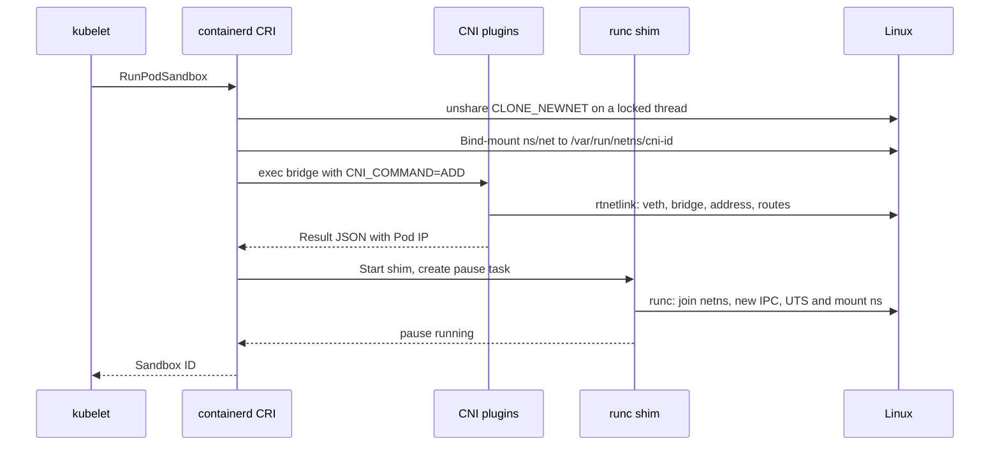
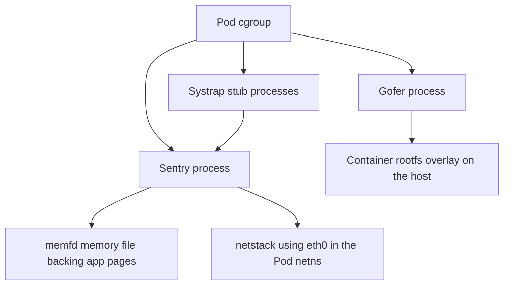

# 4. Building a Pod Sandbox on Linux

Chapter 3 ended with a kubelet holding a bound Pod. This chapter follows the kubelet's work on the node until the container's command is running. Each step names the program that performs it and the Linux primitives it uses. Appendix D has a paragraph on each primitive; here the emphasis is on order and ownership. The reference configuration is a cgroup v2 node running containerd with the runc shim and a bridge-style CNI plugin, which is what most clusters and kind use. Section 4.5 then shows what changes when the Pod's RuntimeClass selects gVisor.

## 4.1 The kubelet prepares cgroups, volumes and images

`SyncPod` begins with work that does not involve the container runtime.

**The Pod cgroup.** The kubelet maintains a cgroup hierarchy by QoS class. On a systemd node with cgroup v2, it looks like `/sys/fs/cgroup/kubepods.slice/kubepods-burstable.slice/kubepods-burstable-pod<uid>.slice`. Guaranteed Pods sit directly under `kubepods.slice` and BestEffort Pods under `kubepods-besteffort.slice`. Under the systemd cgroup driver, the kubelet asks systemd over D-Bus to create the slice. Under the `cgroupfs` driver, it creates directories itself with `mkdir` and writes control files. It sets the Pod-level limits computed from container requests and limits: `cpu.weight` from requests, `cpu.max` from limits, `memory.max` from memory limits, and `pids.max` if Pod PID limits are configured. This book's live experiment observed exactly this shape for the Substrate worker Pod: `kubelet-kubepods-burstable-pod<uid>.slice` with `memory.max` of 1 GiB and `cpu.max` of `100000 100000`.

**Volumes.** The volume manager attaches and mounts volumes before containers can start. For the service-account token volume, a *projected* volume, the kubelet requests a bound token through the `TokenRequest` API, then writes the token, CA bundle and namespace into a tmpfs directory under `/var/lib/kubelet/pods/<uid>/volumes/kubernetes.io~projected/`. It uses `mount("tmpfs", ...)` and writes the files with an atomic directory swap: a timestamped directory plus a `..data` symlink replaced by `rename`. Persistent volumes involve CSI calls such as `NodeStageVolume` and `NodePublishVolume` over gRPC to the CSI node plugin, which issue the actual `mount` calls.

**Images.** The kubelet's image manager checks `imagePullPolicy` and asks the runtime with `ImageStatus`. If needed, it calls `PullImage` through CRI, passing registry credentials that came from image pull Secrets or a credential provider plugin. The pull itself is containerd's work and is described in 4.3.

**Ordering.** The kubelet computes the actions needed by comparing the desired Pod with the runtime's state (`computePodActions`). For a new Pod, the plan is: create the sandbox, then start init containers one at a time to completion, then start regular containers (with sidecar-style restartable init containers started first in current releases).

## 4.2 RunPodSandbox: the network namespace, CNI and the pause container

The kubelet calls `RunPodSandbox` with a `PodSandboxConfig` that includes the Pod's metadata, hostname, DNS configuration, port mappings, cgroup parent and Linux security options, plus the RuntimeClass handler. containerd's CRI plugin then performs the following steps.

**1. Pull the pause image.** The sandbox image (for example `registry.k8s.io/pause:3.10`) is pulled if absent, like any image.

**2. Create a network namespace.** For a Pod without `hostNetwork`, containerd creates a new, empty network namespace and gives it a stable name so it can outlive any process. The technique is the same one `ip netns add` uses. A thread locked to its OS thread calls `unshare(CLONE_NEWNET)`, which moves only that thread into a new namespace. containerd then creates an empty file such as `/var/run/netns/cni-<uuid>` and bind-mounts `/proc/self/task/<tid>/ns/net` onto it with `mount(..., MS_BIND)`. The bind mount holds a reference, so the namespace persists when the thread exits. The new namespace contains only a `lo` interface, which is down.

**3. Configure networking through CNI.** containerd loads the CNI configuration from `/etc/cni/net.d/` and executes each plugin binary in `/opt/cni/bin/`. The interface is a process execution, not a socket:

| CNI input | Example value |
|---|---|
| `CNI_COMMAND` environment variable | `ADD` (later `CHECK`, `DEL`, `STATUS`, `GC`) |
| `CNI_CONTAINERID` | The sandbox ID |
| `CNI_NETNS` | `/var/run/netns/cni-<uuid>` |
| `CNI_IFNAME` | `eth0` |
| `CNI_ARGS` | `K8S_POD_NAMESPACE=default;K8S_POD_NAME=web;...` |
| stdin | The network configuration JSON, including the IPAM section |
| stdout | A result JSON with interfaces, IPs, routes and DNS |

A bridge plugin performs these operations with rtnetlink messages, which are the same messages the `ip` command sends.

1. Ensure a Linux bridge, conventionally `cni0`, exists on the host and is up (`RTM_NEWLINK` with kind `bridge`; `ip link add cni0 type bridge`).
2. Create a veth pair (`RTM_NEWLINK` with kind `veth` and a peer; `ip link add vethXXXX type veth peer name eth0`). Create the container end directly in the target namespace, or create it on the host and move it with `IFLA_NET_NS_FD` (`ip link set eth0 netns cni-<uuid>`).
3. Attach the host end to the bridge (`ip link set vethXXXX master cni0`) and bring it up.
4. Call the IPAM plugin, itself another executable. `host-local` allocates the next free address from the node's Pod CIDR and records it as a file under `/var/lib/cni/networks/<network>/`, using a file lock to serialize allocators.
5. Inside the namespace, entered with `setns` on a locked thread, add the address (`RTM_NEWADDR`; `ip addr add 10.244.0.25/24 dev eth0`), set the link up, add the default route via the bridge address (`RTM_NEWROUTE`; `ip route add default via 10.244.0.1`), and bring up `lo`.
6. Optionally set sysctls in the namespace, such as `net.ipv4.conf.eth0.arp_notify`, and send a gratuitous ARP.
7. On the host, configure masquerading for off-node traffic with iptables or nftables (`ipMasq`), and enable `net.ipv4.ip_forward`.

Chained plugins can follow, such as `portmap` for `hostPort` (DNAT rules), `bandwidth` (tc qdiscs) or `tuning` (sysctls). Other CNI plugins use different topologies. kind's kindnet uses point-to-point veths with host routes rather than a bridge, and overlay plugins add VXLAN or eBPF. The contract is the same: by the end of `ADD`, the namespace has an `eth0` with the Pod IP and a route out. containerd records the result and later returns the IP through `PodSandboxStatus`, and the kubelet publishes it as `status.podIP`.

**4. Start the pause container.** containerd starts a shim for the sandbox and asks runc to create and start the pause container. The container's specification lists the network namespace by path (`{"type": "network", "path": "/var/run/netns/cni-<uuid>"}`) and asks for new IPC and UTS namespaces, a new mount namespace, and, when the Pod sets `shareProcessNamespace`, a new PID namespace that later containers will join. The pause program is a few dozen lines of C. It installs handlers for `SIGINT` and `SIGTERM` that exit, installs a `SIGCHLD` handler that reaps zombies with `waitpid` in a loop, and then calls `pause()` forever.

**Why the pause container exists.** Namespaces are reference-counted kernel objects. They live while a process is a member or a file descriptor or bind mount refers to them. A Pod's containers come and go: they crash, restart and run in sequence for init containers. Without a stable member, the Pod's IPC and UTS namespaces, and its PID namespace when shared, would be destroyed when the last application container exited, and a restarted container would get different ones. The pause process is a cheap, never-exiting member that pins them. When processes are shared, it is also PID 1 of the Pod's PID namespace, so it adopts and reaps orphaned processes from other containers. The network namespace is pinned by containerd's bind mount as well, but pause remains the conventional anchor that every application container joins.



## 4.3 Pulling and unpacking an image into a root filesystem

`PullImage` for `registry.example/web:1.0` makes containerd act as an HTTP client of an OCI distribution registry.

1. **Resolve.** `GET /v2/web/manifests/1.0` with `Accept` headers for OCI and Docker manifest and index media types. A `401` response with a `WWW-Authenticate` challenge leads to a token request to the registry's auth service, using the credentials passed by the kubelet. The response is either an image *index*, a list of manifests per platform from which containerd selects the node's OS and architecture, or a manifest directly.
2. **Fetch the configuration.** The manifest names a config blob by digest. The config carries the default command, environment, working directory, user, exposed ports and the `rootfs.diff_ids` list of uncompressed layer digests.
3. **Fetch layers.** Each layer is a compressed tar (`gzip` or `zstd`). Blobs are downloaded with `GET /v2/web/blobs/<digest>`, often in parallel, written to the content store's ingest area, and committed only after the SHA-256 of the received bytes matches the digest. A lease protects the partially written content from garbage collection.
4. **Unpack.** For each layer in order, the snapshotter prepares a new active snapshot on top of the previous committed one, and containerd's differ applies the tar stream into it. Applying a layer means creating files, directories, symlinks, hard links and device nodes with `openat`, `mkdirat`, `symlinkat`, `linkat` and `mknodat`, and setting ownership, modes, timestamps and extended attributes with `fchownat`, `fchmodat`, `utimensat` and `lsetxattr`. Deletions are translated to overlayfs whiteouts: `.wh.<name>` entries become 0/0 character devices, and `.wh..wh..opq` marks an opaque directory with the `trusted.overlay.opaque` xattr. The extracted content's digest is checked against the config's `diff_id`. The snapshot is then committed under a chain ID derived from the layer digests, so identical layer stacks are shared.
5. **Record.** The image name is recorded in the metadata store and labelled as unpacked for the snapshotter.

When `CreateContainer` runs later, the snapshotter's `Prepare` creates the writable layer and returns a mount description such as:

```text
overlay  overlay  lowerdir=/var/lib/containerd/.../snapshots/12/fs:.../snapshots/11/fs,
                  upperdir=/var/lib/containerd/.../snapshots/57/fs,
                  workdir=/var/lib/containerd/.../snapshots/57/work
```

The shim performs that mount onto the bundle's `rootfs` directory, `/run/containerd/io.containerd.runtime.v2.task/k8s.io/<id>/rootfs`, with `mount("overlay", rootfs, "overlay", 0, options)` before invoking runc. overlayfs then presents a merged view: lookups search the upper directory and then each lower directory in order, and a write to a lower file triggers *copy-up* of that file into the upper directory.

Substrate's image cache performs the same composition for actors without containerd. It mounts an overlay of cached layers plus a per-actor upper directory with the descriptor-based mount API (`fsopen("overlay")`, `fsconfig` for each option, `fsmount`, then `move_mount` onto the target), as shown in [bundle_linux.go](https://github.com/agent-substrate/substrate/blob/v1.0.0/internal/imagecache/bundle_linux.go). Chapter 9 returns to that.

## 4.4 CreateContainer and StartContainer: runc builds the process

For each application container, the kubelet first calls `CreateContainer` with the image, command, environment, mounts, resources and security context, and then `StartContainer`. containerd generates the OCI specification and writes it as `config.json` in the bundle directory. The specification combines the image config's defaults, the Pod spec's overrides and the CRI plugin's defaults: the default capability set, default masked paths and the runtime's default seccomp profile when `RuntimeDefault` is selected. Its `linux.namespaces` list says which namespaces to join and which to create:

```json
"namespaces": [
  {"type": "pid"},
  {"type": "ipc",     "path": "/proc/<pause-pid>/ns/ipc"},
  {"type": "uts",     "path": "/proc/<pause-pid>/ns/uts"},
  {"type": "mount"},
  {"type": "network", "path": "/var/run/netns/cni-<uuid>"},
  {"type": "cgroup"}
]
```

A namespace entry with a `path` is joined. One without a path is created. The PID entry carries the pause container's path only when the Pod shares its process namespace. Here, each container gets its own PID and mount namespaces but shares the network, IPC and UTS namespaces with pause. That is why containers in a Pod reach each other on `localhost`, can share System V IPC and see the same hostname, but cannot see each other's processes or root filesystems.

The shim then runs `runc create --bundle <dir> --pid-file <file> <id>` and, on `StartContainer`, `runc start <id>`. Section 2.3 described the steps in prose. The table below lists the kernel calls in order and who makes them. The *runc parent* is the `runc create` process. *nsexec* is the C code at the start of `runc init`. *runc init* is the Go code that follows it in the child.

| Step | Caller | Linux primitive | Effect |
|---|---|---|---|
| Re-exec self | runc parent | `clone`/`execve` of `/proc/self/exe init`, socket pair | Start the child that becomes the container |
| Join Pod namespaces | nsexec | `open` of namespace paths, `setns` | Enter the pause container's network, IPC and UTS namespaces |
| New namespaces | nsexec | `unshare(CLONE_NEWNS \| CLONE_NEWPID \| CLONE_NEWCGROUP ...)`, then `clone` | Private mount table, new PID namespace (child becomes PID 1), cgroup namespace |
| Join cgroup | runc parent | `mkdir` and write of the PID to `cgroup.procs`, or a systemd scope over D-Bus | Place the process under `kubepods-...-pod<uid>.slice/cri-containerd-<id>.scope` |
| Set limits | runc parent | Writes to `memory.max`, `cpu.max`, `cpu.weight`, `pids.max`, `io.max` | Enforce container resources |
| Mount propagation | runc init | `mount(NULL, "/", NULL, MS_REC \| MS_SLAVE or MS_PRIVATE)` | Container mounts do not propagate to the host |
| Root bind | runc init | `mount(rootfs, rootfs, MS_BIND \| MS_REC)` | Make the rootfs a mount point, as `pivot_root` requires |
| Specification mounts | runc init | `mount` of `proc`, `sysfs`, `tmpfs` for `/dev`, `devpts`, `mqueue`, `shm`; bind mounts for volumes | Build the container's filesystem view |
| Devices | runc init | `mknod` or bind-mount device nodes, symlinks for `/dev/fd` and `/dev/stdin` | Provide the minimal device set |
| Switch root | runc init | `pivot_root(".", ".")`, `umount2(".", MNT_DETACH)`, `chdir("/")` | Make the rootfs `/` and detach the host's root |
| Mask paths | runc init | Bind `/dev/null` over masked files, read-only remounts | Hide `/proc/kcore`, `/proc/sys` writes and similar |
| Identity | runc init | `sethostname` (only if the UTS namespace is new), `setrlimit`, write `/proc/self/oom_score_adj` | Apply the remaining process properties |
| Privilege drop | runc init | `prctl(PR_SET_NO_NEW_PRIVS)`, `prctl(PR_CAPBSET_DROP)`, `capset`, `setgroups`, `setresgid`, `setresuid` | Least privilege |
| LSM | runc init | Write of `/proc/self/attr/apparmor/exec` or the SELinux exec context | Confinement takes effect at exec |
| Seccomp | runc init | `seccomp(SECCOMP_SET_MODE_FILTER)` with the BPF program | Restrict future syscalls |
| Wait for start | runc init | `open` of `exec.fifo` (blocks) | Pause between create and start |
| Start | runc start | `open` of `exec.fifo` for reading | Unblock init |
| Run workload | runc init | `execve(argv[0], argv, envp)` | The application replaces init as PID 1 of its namespace |

After `execve`, the shim, which is the subreaper, holds the container's stdio pipes. The container's process makes ordinary system calls to the host kernel. When it exits, the shim's `wait4` collects the status and containerd emits a task-exit event, which the kubelet's PLEG observes and acts on according to `restartPolicy`. Teardown runs in reverse. `StopContainer` sends `SIGTERM`, waits the grace period, then sends `SIGKILL`, and the shim calls `runc delete`, which removes the cgroup. `StopPodSandbox` calls CNI `DEL`, which deletes the veth and releases the IPAM file. `RemovePodSandbox` unmounts and deletes the namespace bind mount and stops pause.

## 4.5 The same Pod under gVisor

Setting `runtimeClassName: gvisor` on the Pod changes only the handler that containerd uses. The kubelet's work is unchanged. containerd still creates the network namespace and calls CNI exactly as above, and still pulls images and prepares overlay mounts. The differences begin at the shim, `containerd-shim-runsc-v1`.

**The sandbox container boots a kernel.** For the sandbox container, `runsc create` starts two long-lived host processes. The **Sentry** (`runsc boot`) joins the Pod network namespace and new IPC, UTS, PID and mount namespaces. It applies its own seccomp filter, which allows only the host calls the Sentry needs, `chroot`s itself into an empty directory, and drops capabilities. The **gofer** (`runsc gofer`) gets a mount namespace in which it can reach the container's root filesystem, `pivot_root`s or `chroot`s into it, and serves file access for the Sentry. With directfs, it hands the Sentry host file descriptors over a Unix socket. When directfs is on and networking is not host-mode, runsc places these processes in an identity-mapped user namespace, which supplies capabilities such as `CAP_SYS_CHROOT` inside it.

**Networking moves into the Sentry.** In sandbox networking mode, the Sentry reads the addresses and routes CNI configured on `eth0` inside the namespace, recreates them in its own netstack, and exchanges frames with the interface through a packet socket. The host kernel no longer terminates the Pod's TCP connections. The Pod IP is unchanged and the CNI configuration is unchanged; the stack that owns them is different.

**Application containers are started by the Sentry, not exec'd by runc.** For each application container, the shim calls `runsc create` and `runsc start` with the CRI annotations described in 2.4. runsc sends the request to the running Sentry over its control socket. The Sentry creates a new task inside its own kernel, with that container's mounts served by the gofer and the container's command loaded by the Sentry's ELF loader, and schedules it. There is no host `execve` of the workload binary. The application's `open`, `read`, `socket`, `clone` and `mmap` calls are trapped by the platform and implemented by the Sentry. Only the Sentry's own filtered host calls reach Linux.

**Resources are charged to the sandbox.** The Pod cgroup still bounds everything, but what is charged is the Sentry's memory file, its own heap and the stub processes. An application's resident set is therefore not directly visible as host process RSS. `kubectl top` and cgroup files report the sandbox's total.



## 4.6 Roadmap and engineering improvements

The Pod path in this chapter is upstream behaviour. What Substrate adds is a second, independent use of the same primitives inside an already-running worker Pod: network namespaces created with `unshare(CLONE_NEWNET)` and pinned by bind mounts, veth pairs programmed through rtnetlink, overlayfs composed from cached layers, and runsc sandboxes created directly. Chapter 9 follows that path, and the comparison is deliberate. An actor's activation repeats the expensive parts of Pod creation (image unpacking, namespace and network plumbing, kernel boot) only where it must, and restores memory instead of booting where it can.

Two proposals follow from reading the two paths together. First, operational runbooks for workers should state which namespace each diagnostic command observes. `crictl inspect` and `/var/run/netns` show the worker Pod's namespaces created by containerd. Actor namespaces are named bind mounts inside the worker's mount namespace, reachable through `/proc/<worker-pid>/root/run/netns/`, as the lifecycle companion's collector does. Second, the Substrate documentation could include the exact CNI-equivalent `ip` and `nft` commands that the worker's network setup corresponds to, generated from the same constants as [sandbox.go](https://github.com/agent-substrate/substrate/blob/v1.0.0/internal/ateworker/actornet/sandbox.go), so operators can reproduce an actor's namespace layout manually during debugging. Both are proposals, not tracked work.

## Source map

The Pod creation path is implemented by the kubelet, containerd, CNI plugins and runc, outside this repository. The Substrate code that reuses the same Linux mechanisms is:

- [bundle_linux.go](https://github.com/agent-substrate/substrate/blob/v1.0.0/internal/imagecache/bundle_linux.go): overlayfs composition of cached layers using `fsopen`, `fsconfig`, `fsmount` and `move_mount`.
- [netns.go](https://github.com/agent-substrate/substrate/blob/v1.0.0/internal/netns/netns.go): creating, pinning and entering network namespaces on locked OS threads, the same technique containerd uses for Pods.
- [sandbox.go](https://github.com/agent-substrate/substrate/blob/v1.0.0/internal/ateworker/actornet/sandbox.go): the veth, address, route and nftables programming that plays the role of CNI for actors.
- [cgroup.go](https://github.com/agent-substrate/substrate/blob/v1.0.0/internal/ateworker/cgroup/cgroup.go): delegation of the worker container's cgroup subtree created by the kubelet and runc.
