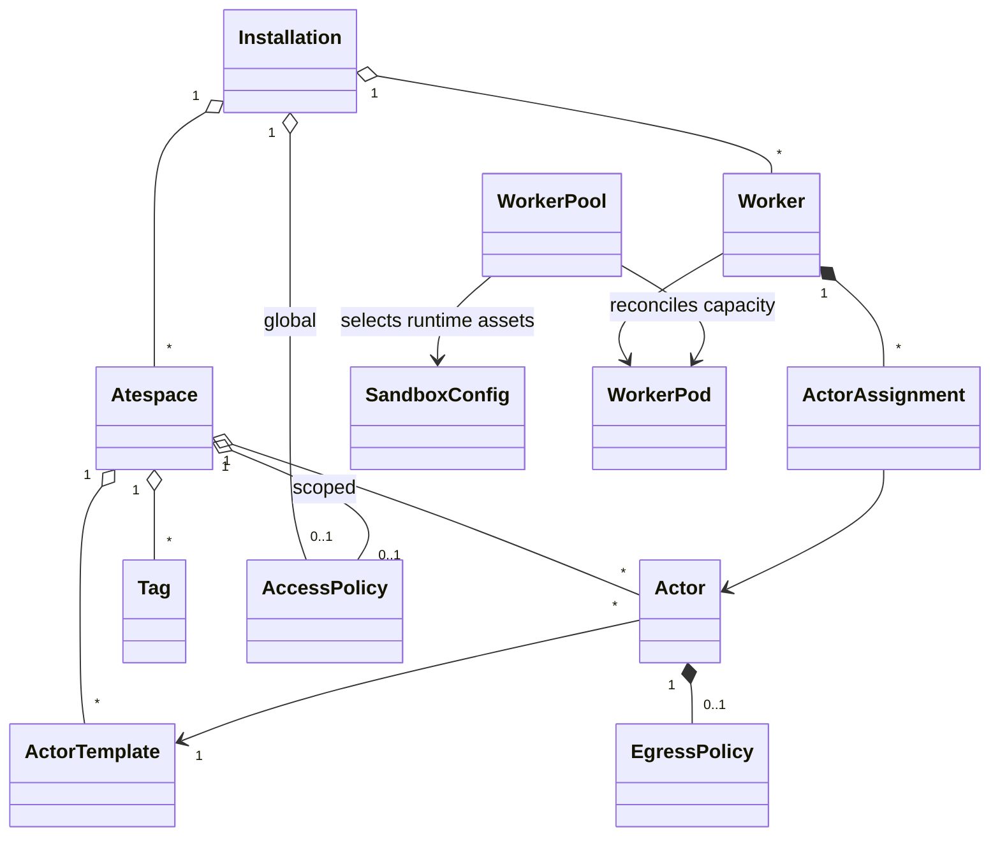
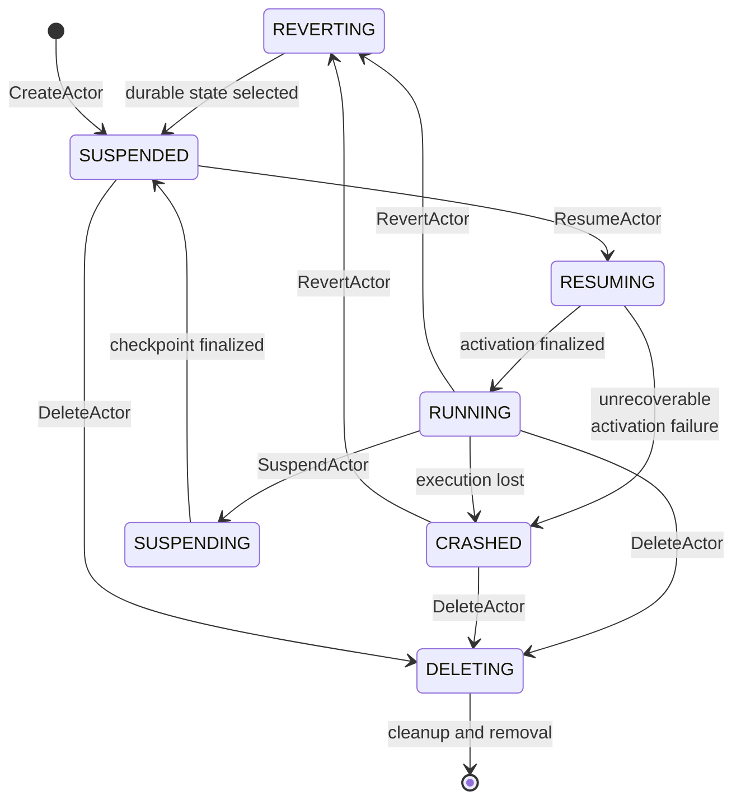
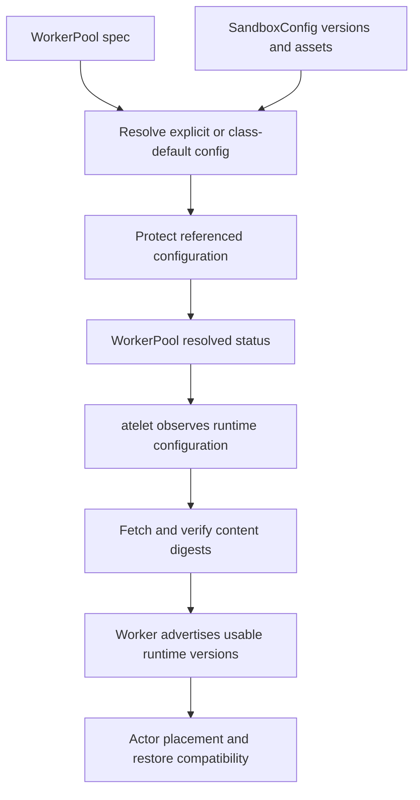
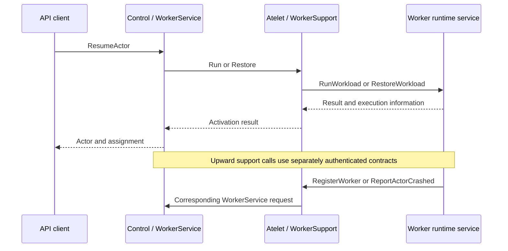
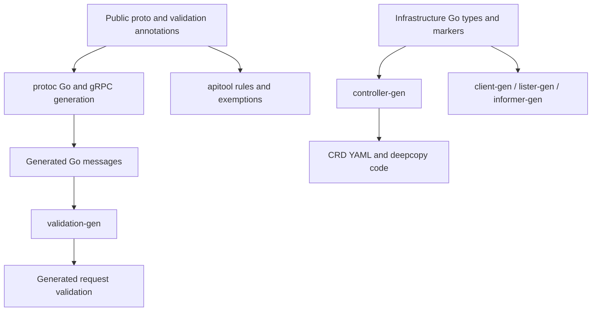

# 5. Two API Planes: Resources, Schemas, and Contracts

## 5.1 Infrastructure objects and workload records

Substrate has two public resource systems with different persistence and reconciliation paths. Kubernetes stores the infrastructure objects: WorkerPool, SandboxConfig, and CSIDriverConfig. PostgreSQL stores the workload and control records exposed by the Substrate gRPC API. Both systems use familiar concepts such as names, versions, desired configuration, and observed state, but they do not share an API server, storage implementation, or authorization path. Understanding that separation prevents several common mistakes, including treating an actor as a CRD or expecting Kubernetes admission to validate an ActorTemplate.

The Kubernetes types live in [api/infra/k8s/ate/v1](https://github.com/agent-substrate/substrate/tree/v1.0.0/api/infra/k8s/ate/v1). `groupversion_info.go` registers `ate.dev/v1`. WorkerPool is namespaced; SandboxConfig and CSIDriverConfig are cluster-scoped. Their generated CRDs live under `manifests/ate-install/generated`. The generated clientset, informers, and listers in `pkg/client` are clients for those infrastructure objects. They are not a general SDK for Actor lifecycle operations.

The workload schema lives in [ateapi.proto](https://github.com/agent-substrate/substrate/blob/v1.0.0/api/ateapi/v1/ateapi.proto). The `Control` service exposes actor, template, atespace, worker, tag, and policy operations. The generated Go messages and gRPC clients live beside that proto. The main process registers `Control` and `WorkerService` in [cmd/ateapi/main.go](https://github.com/agent-substrate/substrate/blob/v1.0.0/cmd/ateapi/main.go). Its store serializes resource messages into PostgreSQL rows while maintaining relational columns needed for identity, lookup, assignment, and concurrency. A protobuf definition therefore participates in both the wire contract and the stored representation.

The root of the resource hierarchy is the Substrate installation. Atespace and Worker are global resources. Actor, ActorTemplate, and Tag belong to an atespace. An EgressPolicy belongs to one Actor and is a singleton named `default`. AccessPolicy is a singleton subresource of either the global scope or an Atespace. ActorAssignment is a worker subresource maintained by the system, one per hosted actor. The hierarchy in [resource-model.md](https://github.com/agent-substrate/substrate/blob/v1.0.0/docs/reference/resource-model.md) is deliberately more explicit than a flat collection of names.

Atespace is not a Kubernetes namespace. An atespace scopes application records and access policy in the Substrate store. A worker's Kubernetes namespace identifies the Pod and WorkerPool supplying execution capacity. A routing reference such as `research/session-17` identifies an actor in the `research` atespace; it does not imply a Pod named `session-17` in a Kubernetes namespace named `research`. This distinction matters when constructing RBAC, audit queries, labels, and operational commands. Kubernetes namespace isolation and Substrate atespace authorization solve related but different problems.

An ActorTemplate supplies the execution description: containers, volume definitions, actor resource limits, worker selection, snapshot configuration, and optional golden-actor egress policy. An Actor refers to a template rather than embedding the entire description. The schema contains an explicit TODO considering a self-contained actor specification, but that is not the current representation. Clients create templates and can change an actor's template reference under the implemented rules; they do not update the template specification in place through a public update RPC.

A template selector and an actor selector are combined by the scheduler. The actor selector narrows the template's eligible workers; it does not override the template. A template that needs a particular sandbox class should select appropriate worker pools. A new actor with no snapshot and no selector may be placed on either supported class if the fleet offers both. After checkpointing, the snapshot's class constrains subsequent restoration. This is an example of a lifecycle-derived constraint that is not visible by inspecting the actor's input fields alone.

Worker records describe the actual execution fleet to the Substrate control plane. The worker synchronizer names a Worker by its Kubernetes Pod UID. The record includes infrastructure identity, labels, runtime information, capacity, allocation, and process-epoch state. The Pod name is useful for operators, but it is not the stable key used by the API. Reusing a Pod name after deletion must not cause a new process to inherit assignments belonging to an earlier Pod incarnation.

Two similarly named structures require particular care. `WorkerAssignment`, embedded in ActorStatus, is the actor's view of its hosting worker. `ActorAssignment`, stored under a Worker, is the worker's reservation for an actor. The former carries denormalized routing and runtime information; the latter records the actor identity and resources booked against capacity. They are not redundant copies that can be freely substituted. Chapter 6 follows the interval in which a reservation exists before the actor's state write completes, and shows why recovery must understand both views.

Tags provide another relation that is more specific than an arbitrary label. A tag identifies retained snapshot content and has its own resource identity, status, and publication scope. An actor created from a tag can borrow that snapshot rather than immediately copying its files. The `source_tag` field is immutable provenance, while the actor's later snapshots evolve independently. Storage ownership and retention belong to Chapter 12, but the API shape already tells a client that changing a tag's metadata is different from changing the snapshot to which it is fixed.

A useful rule when reading an API call is to ask which resource owns the addressed data. `GetWorker` takes a global Worker reference. An actor policy operation addresses an Actor parent plus its singleton policy. A list operation scoped to an atespace enumerates workload records, not Kubernetes objects. Deletion must honor those relationships: a child policy cannot outlive its actor, and an atespace cannot simply be removed while dependent resources require it. The database schema makes some of these constraints relationally explicit, while workflows enforce additional lifecycle obligations.

## 5.2 Identity, versions, and observable lifecycle state

`ResourceMetadata` carries atespace, name, UID, version, and creation, update, and deletion timestamps. These fields look familiar to Kubernetes contributors, but their semantics are implemented by Substrate's store and handlers. A name identifies an address within its scope. A UID identifies one incarnation at that address. A version changes on mutation. Timestamps describe recorded events; they do not replace concurrency preconditions. A correct client preserves the distinctions when retrying a write or acting on an earlier observation.

Create handlers scrub server-owned metadata before validation and persistence. [validate.go](https://github.com/agent-substrate/substrate/blob/v1.0.0/cmd/ateapi/internal/controlapi/validate.go) clears incoming UID, version, and timestamps. Update handlers retain UID and version because those are preconditions, while clearing client-supplied server timestamps. Resource handlers similarly discard caller-provided status where status is output-only. Accepting a serialized response back as an update therefore does not grant the caller authority to set every field it received.

The store represents write conditions with `Precondition` and deletion conditions with `DeletePreconditions`. UID prevents an operation from applying to a replacement resource with the same name. Version prevents an operation from overwriting a concurrent change to the same incarnation. These checks solve different races. If a client reads version 12, another writer produces version 13, and the first client writes its old copy, a version condition can reject the lost update. If the object is deleted and recreated at version 1, UID is the condition that identifies the substitution even if a numerical version happens to match a remembered value.

`DeleteOptions` exposes optional UID and version guards. Leaving one unset deliberately omits that protection. This can be useful for a client whose intent is “delete whatever currently exists at this address,” but it is not equivalent to deleting the object previously inspected. A controller cleaning up resources from an old owner should generally reason in terms of incarnation. A human performing an unconditional deletion has a different intent. The API makes both possible, so callers must choose deliberately instead of assuming that a name carries all required identity.

ActorState contains RESUMING, RUNNING, SUSPENDING, SUSPENDED, CRASHED, DELETING, and REVERTING. Transitional states are persisted because operations cross database transactions and node RPCs. They are evidence of an in-progress or interrupted workflow, not merely cosmetic progress labels. A client observing RESUMING should not conclude that traffic is already safe to send to the recorded worker. A client observing SUSPENDED should separately inspect snapshot durability before assuming the newest state survives a node failure.

The diagram is an explanatory selection of important transitions rather than a complete admission table for every interrupted state. The workflow implementations validate the exact edge they are about to take. Re-entry can continue a transitional operation from persisted state, and deletion can need to clean up partial work. The key point is that the state machine is public observation backed by concrete workflow logic, not a promise that each RPC completes in one transaction.

`ActorStatus.worker_assignment` is unset when the actor has no active worker, including ordinary SUSPENDED and CRASHED states. `assigned_node` can nevertheless remain set for a suspended actor because its latest checkpoint remains on that node. The two fields answer different questions: which worker executes the actor, and which node still holds its local state. Conflating them would make a suspended actor appear to consume an active worker assignment merely because it remains local to a node.

The embedded `WorkerAssignment` intentionally denormalizes worker information. It contains the Worker reference, Kubernetes namespace, pool, Pod name and UID, Pod IPs, node name, worker epoch, runtime identity, and worker SPIFFE ID. The router can use the assignment without an additional worker lookup on every request. The schema restricts changes to fields that identify the worker while the assignment remains present. Pod IPs and process epoch are refreshed when activation becomes RUNNING. This is a controlled cache of identity and routing data, not an invitation to treat every copy as independently authoritative.

Snapshot fields introduce additional ordering dimensions. The actor records snapshot generations and `last_assigned_generation`. That generation does not decrease during revert, because old reports and cleanup still need an ordering relation to previously assigned generations. Snapshot UUID, generation, durable state, locality, and runtime identity each contribute to interpretation. A public status field can therefore be meaningful even after its corresponding process has stopped; it may protect the system from a delayed report rather than describe active execution.

Resource size is also part of the API contract rather than an implementation guess. ActorTemplate requires CPU and memory limits, represented as millicores and bytes. The scheduler books those values and runtime overhead; the microVM backend uses actor size when constructing the VM. A worker's own Pod resources describe the enclosing capacity allocation. A client should not substitute Kubernetes quantities or assume that a zero actor limit means unlimited capacity. The schema and custom validation define what is accepted, and the scheduling conversion defines how the accepted values are used.

Defaulting is observable behavior. [defaults.go](https://github.com/agent-substrate/substrate/blob/v1.0.0/cmd/ateapi/internal/defaults/defaults.go) fills an omitted snapshot configuration, defaults preferred fidelity to MEMORY, and enables golden snapshot generation when its mode is unspecified. It supplies wakeup-probe timeout and HTTP path defaults when a probe exists. It also supplies conventional ports for HTTP and HTTPS egress rules, while TLS passthrough requires explicit ports. A client that wants golden generation disabled must state that choice; omission is not a neutral “do nothing.”

Defaults are applied independently of validation so both handlers and storage reads can use them. That arrangement prevents the store from depending on the RPC package merely to interpret older or incomplete serialized values. It also means that the meaningful object is the normalized resource after defaulting, not the exact bytes a client submitted. Reviewers must verify the order: scrub server-owned input, apply defaults, validate, execute the operation, and validate server-produced changes where required. Reversing those steps can accept forbidden state or reject an omission that should have a defined default.

### Updating an actor without rewriting its history

A template change is a useful example of how several API rules combine. Suppose an actor named `session-17` is suspended under a template named `analysis-v1`. A client wants it to resume using `analysis-v2`, retaining durable application data. The client first reads the actor and keeps its UID and version. It then submits an UpdateActor containing the desired user-owned fields and the preconditions from that read. It does not submit a desired RUNNING state or a newly invented worker assignment; those are server-owned results of subsequent lifecycle work.

The handler in [actor.go](https://github.com/agent-substrate/substrate/blob/v1.0.0/cmd/ateapi/internal/controlapi/actor.go) acquires the actor lease and performs a whole-object replacement of user-owned fields. It preserves the stored metadata and status. This is not a merge patch: a mutable field omitted from the replacement can be cleared rather than retained. A client that constructs only a template reference and forgets another desired mutable field can therefore change more than intended. Reading the current object and deliberately constructing the replacement is a semantic requirement, not merely a way to obtain a version number.

The service validates the resulting update and checks that a changed template reference is allowed only while the actor is SUSPENDED. It resolves the new template. Where the old template remains available, volume definitions must match, and containers present in both templates must preserve their mount lists, including order. The check protects restoration from placing previously captured files at different paths. Newly added or removed containers are treated according to the implementation's comparison rules rather than by assuming every container set must be identical.

The service also protects snapshot cleanup. If the actor owns existing snapshots under one storage prefix, switching to a template that would place its later snapshots under a different prefix can leave old state outside the cleanup domain. `validateSnapshotLocationUnchanged` rejects that change when the ownership conditions apply. A borrowed tag snapshot is handled differently because it is not owned by the actor. This demonstrates why a seemingly simple template reference update needs both execution-state and storage-ownership checks.

After the reference changes, a subsequent resume cannot assume that the old process memory is compatible with the new application specification. The restore workflow uses the snapshot's template identity to select the supported fidelity, falling back to VOLUMES for a replaced template. The actor retains its resource identity while process continuity changes. This is an application upgrade through suspended durable state, not a rolling update of the currently executing process. A client should arrange its own application-level migration requirements around that distinction.

There remains a non-atomicity boundary between resolving a referenced template and later using it. The source explicitly notes that resume resolves it again and fails cleanly if it has disappeared. The API does not hold a database transaction open across all future use of the reference. A robust integration treats the existence check as validation of current intent and still handles later lifecycle failures. Referential design, lifecycle serialization, and eventual cleanup each address part of the problem; none makes a referenced resource immortal.

## 5.3 CRDs that describe executable infrastructure

WorkerPool is the bridge from declared capacity to worker Pods. Its spec requires a replica count, worker image, and sandbox class list. The list is currently constrained to exactly one entry, and the class name is immutable. The schema exposes a list because the representation may evolve, but the current admission contract does not permit a mixed-class pool. Code and diagrams should follow that cardinality instead of interpreting the plural field name as existing multi-runtime composition.

`WorkerPoolPodTemplate` permits selected metadata, node selection, tolerations, priority class, node affinity, resource requirements, and service account configuration. It is not an unrestricted Kubernetes PodTemplateSpec. This deliberate shape lets the controller retain ownership of runtime containers, mounts, security settings, and required infrastructure behavior. Labels and annotations in the `ate.dev` domain and its subdomains are reserved. If a caller could overwrite controller identity labels, the worker registry and network-policy selectors could observe a different relationship from the generated Deployment's owner graph.

Worker image and SandboxConfig have different roles. The worker image contains the Substrate worker implementation. SandboxConfig identifies the runtime assets that implementation will execute: runsc bundles for gVisor, or the hypervisor, kernel, image, and related assets for microVM. Replacing the worker image changes supervisor code. Selecting a runtime version changes the sandbox executable set. A snapshot compatibility decision can depend on the latter even while the worker implementation is unchanged.

SandboxConfig is cluster-scoped and contains a sandbox class, a default version, and a bounded list of named versions. Each version contains state and assets keyed by architecture and asset name. AssetFile pairs a URL with a lowercase SHA-256 digest. The digest both verifies content and participates in cache identity. A URL alone would permit the same declarative object to fetch different executable bytes at different times. The digest turns the asset reference into an explicit content assertion that atelet can verify.

The default version must name an enabled version. Disabled versions cannot become the default. Those constraints are encoded in the CRD validation. Per-class required asset sets are checked by [sandboxconfig-validation.yaml](https://github.com/agent-substrate/substrate/blob/v1.0.0/manifests/ate-install/sandboxconfig-validation.yaml), which defines a ValidatingAdmissionPolicy and binding. This splits generic versioned-asset structure from runtime-specific requirements. It also creates an installation dependency: the full intended validation contract includes both the CRD schema and the admission policy, not just the Go type's field names.

A WorkerPool can name a SandboxConfig explicitly or use the newest config of its class marked as the class default. Status records the resolved reference and the conditions explaining resolution. During a switch, `pendingConfigRef` participates in protecting the target configuration from concurrent deletion. The protection finalizer is described in [sandboxconfig_types.go](https://github.com/agent-substrate/substrate/blob/v1.0.0/api/infra/k8s/ate/v1/sandboxconfig_types.go) and implemented by the infrastructure controllers. This is an example of status being part of an ownership protocol rather than only a dashboard summary.

A failed config update is not necessarily a reason to discard the last working runtime. The controller's resolution code can retain the previously resolved config while reporting why the new desired configuration cannot be used. That behavior needs careful reading: the spec expresses intent, status identifies confirmed use, and a condition describes the disagreement. Operators should inspect all three before assuming that a newly applied config name is already active on every worker. Chapter 7 examines the switch protocol and cache-versus-live-read choices.

CSIDriverConfig describes how Substrate reaches a CSI driver's controller and node services. It includes the standard driver name, a controller endpoint, an optional node socket override, and TLS configuration. The node default follows kubelet's plugin-socket convention. This resource does not convert actors into Pods with PVC mounts. Instead, Substrate's volume interfaces invoke the appropriate CSI operations while coordinating actor lifecycle and node-local publication.

External volumes are currently a preview feature. That status does not make the CRD irrelevant: it means the feature has an explicit opt-in contract in the workload API and supporting implementation that must be evaluated as preview. The TLS configuration currently supports using Substrate pod identity when TLS is enabled; comments identify manual certificate support as future work. Endpoint validation has an explicit hardening TODO. Custom CSI integrations must retain those constraints; the type is not a fully general connection policy.

The CRDs are generated from the Go types, but the generated YAML is what the API server actually enforces. The `gen.go` file invokes controller-gen and Kubernetes client, lister, and informer generators. Changes to a type therefore require a generated-artifact review. A field can compile successfully while its schema fails to include the intended immutability or boundedness rule. Conversely, changing a CEL expression can alter admission without changing the shape of a Go struct. For production reasoning, both source and generated contract matter.

These infrastructure objects also establish administrative authority boundaries. A Substrate application caller may be allowed to create actors without being allowed to choose host capabilities or replace hypervisor binaries. Kubernetes authorization governs changes to WorkerPool and SandboxConfig. Substrate authorization governs the workload API. The split permits different operators to own runtime supply and application lifecycle, but it does not automatically impose a particular organizational policy. Installations must grant each API's privileges deliberately and understand which changes affect all tenants using a pool.

## 5.4 Public RPCs, component RPCs, and plugin contracts

The public `Control` service combines resource operations with lifecycle verbs. Create, get, list, update, and delete methods manage records where supported. ResumeActor, SuspendActor, RevertActor, DrainWorker, and worker availability methods express operations whose effects span several records or external processes. The distinction is visible in handler structure: a simple read delegates to the store, while a lifecycle operation enters a workflow with leases, preconditions, and node communication. A resource-oriented API does not imply that every method is a single CRUD transaction.

`WorkerService` is also declared in the public API proto, but its callers and authorization are component-specific. It provides worker epoch acquisition, registration, runtime updates, actor certificate and JWT minting, actor-initiated suspend plumbing, snapshot reports, and crash reports. An arbitrary API client must not gain those powers simply by possessing a generated stub. The service authenticates the atelet identity and checks that the named worker and actor belong to the caller's node and hosting relationship. Chapter 15 follows those checks in detail.

The internal atelet protocol has two directions. `Atelet` exposes downward lifecycle operations such as Run, Restore, Checkpoint, PromoteSnapshot, DetachActor, and Terminate. `WorkerSupport` exposes upward worker needs such as registration, runtime updates, identity minting, policy lookup, crash reporting, and suspend requests. These directions help explain why the same node supervisor acts as both client and server across an operation. A worker asking for suspension can cause the control plane to call back down into that worker to checkpoint it.

The worker protocol in [ateworker.proto](https://github.com/agent-substrate/substrate/blob/v1.0.0/internal/proto/ateworkerpb/ateworker.proto) is the boundary between atelet and the runtime implementation. `Worker` exposes workload run, checkpoint, restore, termination, and statistics operations. The runtime workers share this interface while implementing different host and guest mechanisms. The protocol carries actor identity and workload information rather than requiring atelet to understand runsc process layout or Cloud Hypervisor's REST API. That separation is essential to keeping a new runtime from spreading backend-specific knowledge throughout the node supervisor.

Object storage uses a public plugin API rather than the internal worker protocol. `NodeProvider` fetches and uploads snapshots. `ControlProvider` copies and cleans up snapshots. `AssetProvider` fetches runtime assets. The operations reflect ownership: atelet needs files on a node, whereas ateapi needs to manipulate whole snapshot objects without interpreting every runtime file. Both provider roles can be implemented by the in-tree object-store plugin, but their separation makes the allowed operation surface explicit.

The credential-provider API is narrower still. `CredentialProvider.FetchSecret` allows the egress service to acquire a secret for an authorized use. It does not give the sandbox a general secret-store client. The public proto is the integration contract; provider-specific deployment and authentication live in implementations. A review of an egress feature should therefore trace both the policy reference and the provider call, rather than assuming that a configured secret name means the actor receives that secret directly.

The repository includes other protos that are not interchangeable with these contracts. `pkg/proto/ateconfigpb/apiconfig.proto` describes API server configuration. `internal/proto/objectstoreexchangepb/exchange.proto` supports an internal credential-exchange path. `internal/proto/ateenv/v1alpha/guest.proto` is a pinned copy of another repository's guest process and filesystem API used by benchmarks. Kata agent definitions are vendored under the microVM worker's third-party directory. Their presence in the clone does not make them all public Substrate extension APIs.

Schema duplication across boundaries can be justified when it protects independent ownership, but it requires conversion code. The control plane converts public workload descriptions into atelet requests; atelet converts its protocol to worker requests. Runtime identity and resource fields must survive those conversions with their intended units and defaults. A new public field that is validated but omitted from a conversion can be silently ineffective. A new internal field that assumes a particular runtime can violate the common-worker boundary. Chapter 17 treats those propagation obligations as part of extension design.

Error semantics are also part of the contract. Resource exhaustion indicates that placement or another bounded resource cannot currently admit the request. Failed precondition indicates that the requested operation is not valid for the observed state or configuration. Aborted can indicate a conflict requiring a fresh attempt. Not found can mean either absence or an intentional nondisclosure under component authorization. A caller should not retry all non-success codes blindly. The worker suspend helper, for example, distinguishes transient availability/backpressure/conflict from decisions that another attempt will not resolve.

Deadlines and cancellation cross process boundaries but do not create distributed rollback. If a client times out after a worker started the sandbox, the side effect may exist even though the caller received no result. Internal requests therefore need identity keys and repeatable semantics, and workflows need persisted postconditions. Protocol review should ask what a repeated request means after each possible lost response. That question is more useful than treating gRPC delivery as exactly once or assuming that a canceled context proves the remote process did nothing.

## 5.5 Validation, generation, and client behavior

Substrate reuses Kubernetes declarative validation tooling for protobuf-backed APIs. Comments in the proto are copied into generated Go code, and validation-gen reads those annotations to emit validators. [apivalidation/doc.go](https://github.com/agent-substrate/substrate/blob/v1.0.0/cmd/ateapi/internal/apivalidation/doc.go) points the generator at `api/ateapi/v1` and request types. The arrangement lets the public schema carry requiredness, bounds, immutability, list semantics, and feature-gate conditions while producing Go validation used by the API handlers.

This is not Kubernetes admission for actor records. The server invokes the generated and custom validation itself. Invalid requests must be rejected before they reach storage or side effects. The API validation guide emphasizes validating every field because relaxing a contract later is usually easier than rejecting values that users already stored. The same concern applies to server-generated status: an internal bug can persist an invalid state even when every user input was valid, so internal update validation and store preconditions remain important.

Protobuf zero values require particular attention. An integer zero or empty string generally represents unspecified unless the field's contract says otherwise. Wire presence is not the same as an accepted nonzero value. Defaults can turn an unspecified enum into a valid choice before validation. Required resource limits receive additional custom checks because their nested structure and operational meaning go beyond a single scalar bound. A client generator faithfully producing a zero-valued struct does not establish that the server will accept it.

Custom validation covers relationships that are awkward or inappropriate to encode as simple annotations. Examples include matching a policy's singleton name, validating timestamp ordering, checking IP addresses, preventing ambiguous egress-rule precedence, and validating storage URIs. Container capability additions are checked against `AllowedAddCapabilities` in [validate.go](https://github.com/agent-substrate/substrate/blob/v1.0.0/internal/resources/validate.go), which rejects `ALL` and any capability outside that list. A mount path must not be `/dev`, and must not be `/dev/pts`, `/proc`, `/sys`, or a path under one of them. The rule for a storage prefix is especially architectural: owner-specific snapshot paths are derived beneath it, so the accepted prefix must not collide with reserved path structure. Validation is protecting later authorization and cleanup assumptions, not merely improving error messages.

The public API also has a linting tool. [tools/apitool](https://github.com/agent-substrate/substrate/blob/v1.0.0/tools/apitool/README.md) parses the embedded schema and checks naming, documentation, resource declarations, fields, and standard-method shapes. Its exemptions file is strict: an unnecessary exemption fails just as a new unexempted violation does. This makes deviations visible in review and prevents the exemptions list from becoming an unchecked historical accumulation. Lint rules do not prove lifecycle correctness, but they make the public surface consistent enough that clients and reviewers can reason about it.

The generation order matters. [codegen.sh](https://github.com/agent-substrate/substrate/blob/v1.0.0/hack/update/codegen.sh) first runs Go generation, then protobuf generation, then validation generation. The latter depends on comments and types produced by the protobuf step. CRD generation and Kubernetes clients are driven by the infrastructure package's `go:generate` directives. Generated files should be inspected as outputs and regenerated from their source rather than edited directly. A handwritten repair in generated validation can disappear on the next update and leave the actual schema unchanged.

Preview gating adds another dimension to accepted input. The current gates are ExternalVolumes, GoldenEgressPolicy, and PerTemplateSnapshotLocation. Both the server-side gate and the caller's opt-in metadata must permit use. `kubectl ate --preview` supplies the client indication. Internal lifecycle operations deliberately opt in where necessary so that disabling a gate does not strand existing resources during cleanup. A preview gate is not authorization: enabling a feature does not grant a caller permission to use another actor or atespace.

Feature removal or gate disablement needs a lifecycle analysis. If a user created an actor with external volumes while the gate was enabled, later suspend or deletion still needs to handle those volumes. Gating every read of the field would make cleanup impossible after an operator changed configuration. Conversely, accepting a new gated field merely because an older object contains it could permit new use after disablement. The validation operation context and ratcheting rules distinguish new requests from preserving existing state. The preview guide documents this as a design obligation, not an optional UI behavior.

List methods use bounded pagination. The control layer defaults or clamps page size to 1000 and maps invalid token or size errors to InvalidArgument. A client should treat tokens as opaque and use them only with the corresponding list operation and scope. Enumerating workers or actors is not a transactionally frozen view unless the API explicitly establishes such a guarantee. Controllers must tolerate changes while paging and rederive work from current state when they act. Worker-assignment cleanup, for example, uses a key-based cursor so deleting rows during the scan does not produce offset-based skipping.

There is no public Kubernetes-style watch of every workload resource merely because the implementation has an internal worker watch. `store.Interface.WatchWorkers` exists to feed the API replica's worker cache and recovery controller. Clients use the exposed gRPC surface. Assuming a public watch stream from internal method names can produce an integration design that the API cannot support. A future watch API would need event ordering, retention, recovery, and authorization semantics of its own; it cannot be safely exposed by forwarding an internal channel without those decisions.

The CLI is a client of these contracts rather than an alternate source of truth. It handles resource references, validation-friendly input, output formatting, and lifecycle verbs. The Kubernetes-looking command name does not mean that `kubectl ate create actor` submits a Kubernetes Actor object. Code examples should use the current command structure and atespace conventions. When a conceptual example omits authentication or deployment setup, it should be labeled as pseudocode rather than presented as a directly executable installation recipe.

Client retries should preserve intent. Retrying a create after a lost response may encounter AlreadyExists; the client must decide whether the existing resource is the one it intended to create. Retrying an update after a version conflict requires a fresh read and reconsideration of the desired mutation, not simply resending the same stale object forever. Retrying a lifecycle operation relies on its server-side re-entry contract. These cases differ, and a generic retry interceptor that ignores method semantics can turn temporary failure into persistent contention or accidental action on a replacement resource.

### What an opaque pagination token does and does not promise

The current PostgreSQL token implementation is small enough to inspect directly in [pagetoken.go](https://github.com/agent-substrate/substrate/blob/v1.0.0/cmd/ateapi/internal/store/atepg/pagetoken.go). A token carries a format version, resource kind, scope, and the last ordering-key values. It is serialized as JSON and encoded with base64. Decoding checks the format version, expected list kind, expected scope, and key count. The token contains no database topology and is not a transaction snapshot identifier.

Those checks prevent accidental use of a Worker token with an Actor list or reuse of a scoped token in another atespace. They do not make the token an authorization credential. Authorization still applies to the request being made. Nor does base64 provide secrecy or tamper resistance; clients are instructed to treat the representation as opaque because its meaning is an implementation contract, not because the encoding conceals it. An integration should never infer access rights from possession of a token.

Keyset pagination behaves differently from offset pagination while records are inserted or deleted. Continuing after the last observed key can avoid skipping a later row merely because an earlier row was deleted. It can also omit a newly inserted row whose key sorts before the cursor. That is a normal consequence of enumerating a changing collection without a fixed snapshot. A controller performing reconciliation should repeat its sweep or use an appropriate event source, and it should re-read a resource before a consequential mutation when its correctness requires current state.

The distinction becomes important in fleet recovery. A worker-assignment scan releases entries as it processes them. An offset-based scan could move past entries when preceding rows disappear. The key-based cursor is suitable for that pattern, but the scan still needs incarnation checks and leases when acting on each actor. Pagination only controls traversal. It does not serialize lifecycle operations, establish ownership, or guarantee that every returned object remains unchanged until the caller acts.

A schema review should finally distinguish boundedness from business correctness. A maximum list length limits parser, validation, and storage work; it does not prove that every admitted combination can be executed. A valid runtime URL and digest can still name an unavailable object. A valid worker selector can match no workers. A valid container image reference can fail authentication during preparation. These cases belong to asynchronous status or lifecycle errors after admission. Rejecting syntactically invalid intent early improves the contract, but admission cannot guarantee the future availability of every external dependency.

The reverse distinction matters too. Runtime failure is not a reason to accept an unbounded or ambiguous schema. If two egress rules can tie under the defined precedence, the server rejects the ambiguity before a gateway must choose. If a field carries an unsupported enum value, the server should not persist it and hope a later component interprets it consistently. Validation defines the set of states the rest of the implementation is entitled to assume. Operational failures occur within that set and require separate recovery logic.

This separation guides tests. Schema tests should demonstrate rejection and normalization at the API boundary, including update and preview contexts. Workflow tests should demonstrate behavior after valid input meets a changing fleet, failed storage, or a restarted worker. Testing only generated validators leaves the distributed contract unexamined; testing only successful end-to-end execution leaves malformed and concurrent client behavior unexamined.

## 5.6 Roadmap and engineering improvements

Several future directions are recorded directly in the schema and implementation. Actor currently references ActorTemplate; the proto asks whether an actor should eventually contain a full specification. That choice would change more than serialization. It would affect template deletion, actor provenance, update semantics, defaulting, snapshot compatibility, and the amount of information copied into every actor record. A self-contained actor can reduce dependency on a template lookup, but it creates a separate specification lifecycle that must be reconciled with shared golden snapshots.

The CSI configuration identifies unfinished endpoint hardening and manual-certificate support. Those are concrete contract gaps. A stronger endpoint validator should reflect the transports the client actually supports and the trust model of administrators permitted to configure them. Adding manual certificates would require secret-reference ownership, reload behavior, and server-name validation, not merely a byte field. The existing pod-identity path provides one supported mechanism; it should remain distinct from proposed alternatives in examples and compatibility claims.

The schema's sandbox-class list is another deliberate future-facing shape with a current restriction. Allowing multiple classes per WorkerPool would require decisions about which image and device requirements apply, how capacity is reported, and whether one worker can host more than one runtime family. Removing `MaxItems=1` alone would not implement that behavior. The controller currently branches on a class when building Pod requirements, and the workers are separate binaries. Any expansion must align API cardinality with executable topology.

Preview features need graduation criteria grounded in failure behavior. External volumes should be evaluated across create, attach, resume, suspend, revert, deletion, and node loss. GoldenEgressPolicy must preserve the distinction between the temporary initialization actor's permissions and those of actors later created from its snapshot. PerTemplateSnapshotLocation must preserve ownership and cleanup boundaries when actors change templates. The existence of a feature flag is a release mechanism; evidence from these lifecycle cases is what supports a stronger stability claim.

Several engineering proposals follow from this contract beyond the explicit TODOs. One is a generated contract matrix linking each public field to its validator, defaulting rule, conversion into internal RPCs, storage representation, and runtime consumer. Such a matrix would expose fields that are accepted but not propagated and fields whose runtime-specific interpretation is undocumented. The repository already has embedded schema text and API linting that could support this analysis. This proposal is not an existing generator output.

Another proposal is a clearer client-facing account of continuity. The API records snapshot fidelity and runtime information, but application integrations need to know whether a resumed actor preserved process memory or cold-started with preserved files. Exposing that distinction consistently in lifecycle responses and operational tools would help clients that maintain long-lived sessions or external transactions. Any change should avoid promising that a process checkpoint reproduces external systems' state. Network peers, credentials, clocks, and remote services continue evolving while the actor is suspended.

A future workload watch API would require explicit consistency and retention semantics. The internal worker outbox already demonstrates that event delivery needs recovery after trimming, crashes, and missed polls. A public API would additionally need tenant filtering and stable resume tokens. It should state whether a list followed by a watch can avoid gaps, how clients recover after retention loss, and whether events carry complete resources or deltas. Those are design questions suggested by the implementation, not a claim that such a watch is currently planned or served.

Finally, compatibility should be read in release context. The README states that Agent Substrate has reached 1.0 and commits to compatibility of the public API, CLI, and configuration formats. [CONTRIBUTING.md](https://github.com/agent-substrate/substrate/blob/v1.0.0/CONTRIBUTING.md) defines that commitment for reviewers: existing RPCs and fields must not be removed or changed incompatibly, and preview-gated APIs are excluded. Public package placement signals intended external use, but the stability policy decides which surfaces a client can rely on. Chapter 17 examines how protobuf, database, runtime, and node-sharing contracts interact during upgrades. For the present API model, the discipline is simpler: use the current schema, distinguish server state from caller intent, preserve resource incarnation in writes, and validate assumptions at every API boundary.

## Source map

- [Public control-plane schema](https://github.com/agent-substrate/substrate/blob/v1.0.0/api/ateapi/v1/ateapi.proto): resources, lifecycle verbs, metadata, status, preview annotations, and component RPCs.
- [Resource hierarchy](https://github.com/agent-substrate/substrate/blob/v1.0.0/docs/reference/resource-model.md): scopes, singleton subresources, and cross-resource relationships.
- [WorkerPool types](https://github.com/agent-substrate/substrate/blob/v1.0.0/api/infra/k8s/ate/v1/workerpool_types.go), [SandboxConfig types](https://github.com/agent-substrate/substrate/blob/v1.0.0/api/infra/k8s/ate/v1/sandboxconfig_types.go), and [CSI configuration](https://github.com/agent-substrate/substrate/blob/v1.0.0/api/infra/k8s/ate/v1/csidriverconfig_types.go): Kubernetes infrastructure contracts.
- [Defaulting](https://github.com/agent-substrate/substrate/blob/v1.0.0/cmd/ateapi/internal/defaults/defaults.go) and [input scrubbing](https://github.com/agent-substrate/substrate/blob/v1.0.0/cmd/ateapi/internal/controlapi/validate.go): normalization and server-owned fields.
- [Validation guide](https://github.com/agent-substrate/substrate/blob/v1.0.0/docs/api-validation.md), [preview guide](https://github.com/agent-substrate/substrate/blob/v1.0.0/docs/dev/preview-gates.md), and [API lint tool](https://github.com/agent-substrate/substrate/blob/v1.0.0/tools/apitool/README.md): how input contracts are generated and checked.
- [Atelet protocol](https://github.com/agent-substrate/substrate/blob/v1.0.0/internal/proto/ateletpb/atelet.proto) and [worker protocol](https://github.com/agent-substrate/substrate/blob/v1.0.0/internal/proto/ateworkerpb/ateworker.proto): internal lifecycle and support boundaries.
- [Object-store API](https://github.com/agent-substrate/substrate/blob/v1.0.0/api/objectstore/v1/objectstore.proto) and [credential-provider API](https://github.com/agent-substrate/substrate/blob/v1.0.0/api/credprovider/v1/credprovider.proto): public plugin surfaces.
