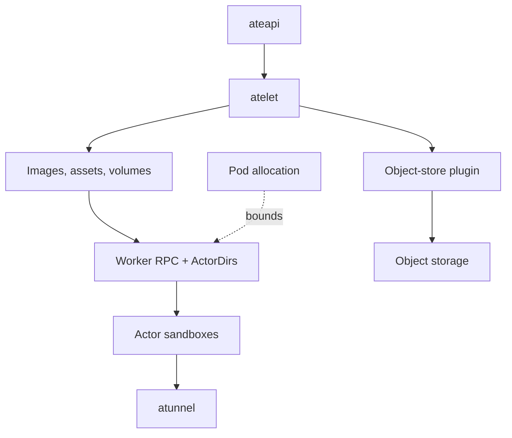
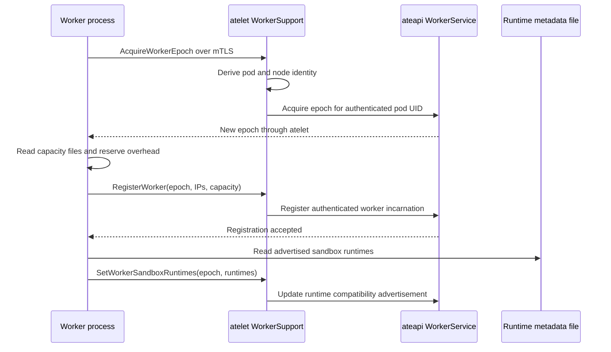
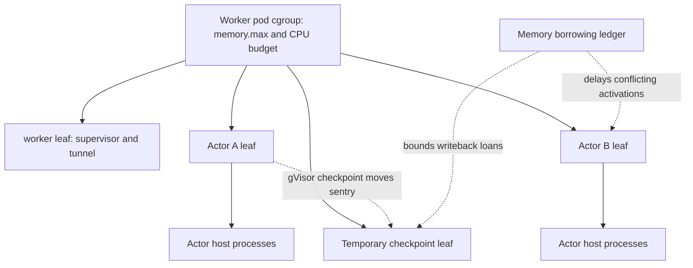
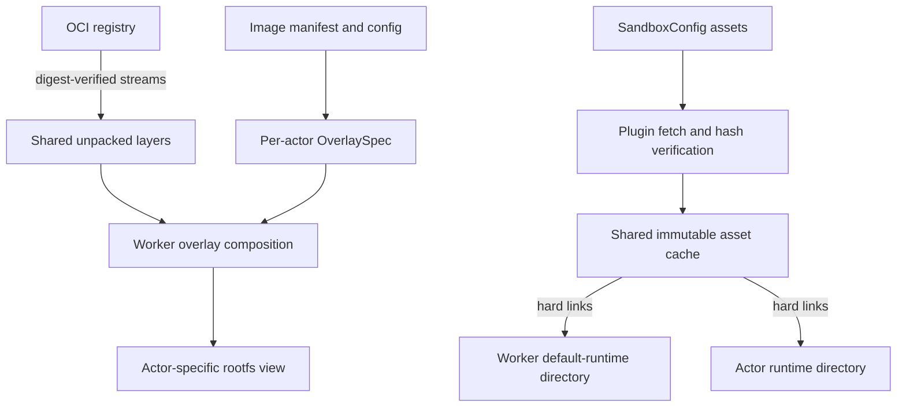

# 5. Node Supervision and Shared Worker Machinery

## 5.1 The node supervisor is an execution boundary

The control plane assigns an actor to physical capacity, but it does not construct the actor's execution environment. That work crosses a second boundary: `atelet` prepares node-local resources and asks a worker to perform a runtime operation. The distinction is visible in the two internal protocols, [atelet.proto](https://github.com/agent-substrate/substrate/blob/v1.0.0/internal/proto/ateletpb/atelet.proto) and [ateworker.proto](https://github.com/agent-substrate/substrate/blob/v1.0.0/internal/proto/ateworkerpb/ateworker.proto). The first describes operations on a node. The second describes operations supported by an already running worker process. Neither protocol is CRI. Substrate is deliberately operating beneath the lifetime of a Kubernetes workload object while continuing to use pods as its physical allocation units.

`Atelet` in [cmd/atelet/main.go](https://github.com/agent-substrate/substrate/blob/v1.0.0/cmd/atelet/main.go) contains a worker dialer, an OCI image cache, a runtime asset cache, a snapshot cache, a runtime index, volume plugins, an actor-lock collection, and a snapshot tracker. These fields describe the supervisor's obligations more accurately than the label “node agent.” It must ensure that the worker sees a coherent set of files, that a runtime request names an advertised runtime, that lifecycle operations do not interfere within an actor's directories, and that storage work remains attributable to the correct actor. It does not implement the Sentry or the VMM. It also does not directly hold the object-store credentials used to move external snapshots.

The worker interface carries concrete resource paths rather than making the worker discover atelet's directory layout. `ActorDirs` is part of the protobuf boundary. The runtime receives locations for bundles, checkpoint data, restore data, and volume trees, together with the workload specification and runtime asset paths. Shared path conventions that genuinely belong on both sides live under [internal/nodepath](https://github.com/agent-substrate/substrate/tree/v1.0.0/internal/nodepath). The repository's contributor contract explicitly keeps atelet and worker implementations opaque to one another outside the protocol and these common paths. That constraint is valuable even before version skew is guaranteed: it makes an accidental dependency on a particular runtime's private directory structure easier to identify.

The lifecycle of the pod remains separate from that of its hosted actors. A worker process can execute several actors concurrently, and an actor's suspension does not require the worker pod to terminate. The Kubernetes scheduler has already paid the cost of assigning the pod to a node; kubelet and the pod runtime have already established its outer namespaces, resource limit, mounts, and identity. Within that allocation, Substrate creates additional actor-specific execution environments. Density therefore depends on both the control-plane admission calculation and the implementation's ability to reclaim one actor without disrupting another.

The deployment in [atelet.yaml](https://github.com/agent-substrate/substrate/blob/v1.0.0/manifests/ate-install/atelet.yaml) is consequently part of the implementation, not merely packaging. It gives atelet access to the node paths it prepares, the local plugin socket, the kubelet device-plugin directory, and projected credentials. It also mounts the node's device directory for detection. That mount does not grant atelet arbitrary device access: device visibility and device-controller permission are separate properties. The distinction reappears when the supervisor advertises KVM to kubelet.

Atelet's own privilege requirements differ from the workers'. The image-cache store can pull and unpack files without mounting them. The workers perform overlay and namespace mounts in their own mount namespaces. Separating those activities avoids requiring atelet to adopt the full capability set of every sandbox backend. It also means that observing atelet's mount table cannot establish which image layers are in use by workers. The cache's garbage collector needs an explicit, shared representation of references, which the bundle specifications provide.

The `Run` method shows the ordering discipline. It validates the request and resolves its runtime through `advertisedRuntime` before beginning local lifecycle work. It then acquires the actor lock and enters the snapshot tracker's start operation. Runtime assets are fetched into a staging directory before existing actor directories are reset. A failed download should not destroy a live activation merely because a new request arrived. Only after reset does the method commit the staged asset set and record the runtime describing it. The resulting invariant is that the record and the installed paths advance together through an intentional transition.

This is a useful distinction between idempotence and harmless repetition. Calling `Run` twice is not equivalent to checking whether a process exists. The request may need to replace partially prepared state, and some state, especially external volume publication, must survive retries. `ResetActorDirsKeepingVolumes` leaves external volume mountpoints in place because an earlier attempt may have published a volume successfully. Repeating publication can then be a no-op at the driver boundary. Blindly deleting the entire actor tree would turn a retry into data destruction or invalidate a still-mounted path.

The actor lock in `Atelet` is local serialization, implemented through [internal/actorlock](https://github.com/agent-substrate/substrate/tree/v1.0.0/internal/actorlock). It answers a narrower question than the renewable SQL lease described in Chapter 3: may two goroutines in this atelet manipulate this actor's node-local state at once? The lock cannot prove that another node is not acting on stale control-plane state. Conversely, a database lease cannot make two local filesystem operations atomic. Both mechanisms are required because they protect different resources and have different failure domains.

After assets and volumes are ready, `prepareOCIBundles` creates the application bundles. The worker workload specification includes the actor identity, template attribution, resource requirements, and egress gateway configuration. `RunWorkload` is the point at which the supervisor hands execution responsibility to the selected backend. The response includes the worker epoch, linking this successful local operation to the particular worker process incarnation. The returned value is not merely an address: it is evidence about which process accepted the operation.

Consider an illustrative activation interrupted after volume publication but before `RunWorkload`. The actor lock is released when the failed call returns, but the volume may remain published. A retry resolves the runtime again, reconstructs the bundles, and republishes the same volume through the existing interface. The preserved mountpoint prevents the retry from erasing published contents. If the interruption occurs after a sandbox starts but before the response reaches atelet, the worker's actor-specific replacement and teardown paths become relevant. Correctness requires each layer to tolerate uncertainty at its own boundary; no single “retry” switch solves the entire sequence.

Node supervision also includes shutdown. The main process uses signal-aware contexts and readiness handling so that service withdrawal and completion of existing operations can be coordinated. Checkpoint work has a separate bounded lifetime once it detaches from the caller's cancellation. In the audited code, `defaultCheckpointTimeout` is five minutes. That value bounds a stuck worker or storage operation holding the actor lock; it is not a latency objective for a healthy checkpoint. Treating timeout values as performance expectations would obscure exactly the failures they are intended to contain.

The ordering also limits the damage of invalid input. Resolving the requested runtime before resetting directories keeps a stale or unsupported runtime name from destroying reusable local state. Staging assets before publication keeps a partial download from masquerading as an installed runtime. Recording the installed asset set lets later operations identify the concrete binaries used for that activation. These checks move inexpensive validation ahead of mutation and give recovery a stable description of completed preparation. The same pattern should govern future node-local resources added to `ActorDirs`: validate authority and compatibility, stage incomplete work separately, then publish only the paths the worker may consume.

## 5.2 Registration, epochs, and runtime advertisement

A worker's pod identity is necessary but insufficient for scheduling. The control plane also needs to know that a particular worker process has initialized, what capacity it offers, and which sandbox runtimes it can restore. [internal/ateworker/register/register.go](https://github.com/agent-substrate/substrate/blob/v1.0.0/internal/ateworker/register/register.go) implements this shared registration machinery. `Epoch` represents the process incarnation admitted by the control plane. `Report` coordinates registration and runtime reporting. `ReportConfig` provides the class, runtime metadata location, reserved memory, and other information that makes the protocol backend-independent.

The registration flow passes through atelet's `workerSupportServer` in [workersupport.go](https://github.com/agent-substrate/substrate/blob/v1.0.0/cmd/atelet/workersupport.go). That service derives the worker identity from its mTLS certificate rather than accepting a worker name from the request. `AcquireWorkerEpoch` forwards a request for the caller's own worker record. `RegisterWorker` forwards the same identity together with the acquired epoch, pod IPs, and capacity. The control plane can therefore reject stale process reports without trusting a self-selected identifier supplied by an arbitrary client.

The same-node check is more specific than comparing a hostname string. `verifyClientOnSameNode` checks both the node name and node UID carried in the pod certificate. Kubernetes can reuse a node name after deletion; a node incarnation identifier prevents a worker certificate from an earlier object from satisfying the comparison solely because its name matches. This check belongs at the connection boundary because all the worker-support RPCs rely on the resulting identity. Individual methods still validate their requests after authentication before forwarding them.

`FromFiles` reads worker resource limits from the downward-API directory defined by [internal/workercapacity](https://github.com/agent-substrate/substrate/tree/v1.0.0/internal/workercapacity). Memory capacity is reduced by the amount reserved for the worker itself. If a finite pod memory limit is no greater than that reservation, startup fails instead of advertising a negative or fictitious actor capacity. CPU and actor-slot capacity are separate fields. The distinction matters because an apparently empty worker can be constrained by any one of these dimensions.

The reported capacity is not a live estimate of free pages. It is the capacity from which the placement system accounts for actor bookings. Actual usage can differ from bookings due to page cache, sandbox overhead, guest behavior, and delayed writeback. Runtime-specific memory guards and snapshot borrowing address some of those differences, but they do not redefine the registration contract. The worker reads capacity at startup; the source explicitly does not claim support for updating that capacity through in-place pod vertical scaling. An operator changing pod limits must not assume that all internal accounting immediately follows a changed cgroup file.

Runtime advertisement has its own asynchronous path. `workerSandboxSyncer` in [worker_sandbox_syncer.go](https://github.com/agent-substrate/substrate/blob/v1.0.0/cmd/atelet/worker_sandbox_syncer.go) watches local pods, WorkerPools, and SandboxConfigs through client-go informers. It resolves the configurations applicable to a worker and writes the runtime metadata that the worker reports. This is a reconciliation loop, but it is not implemented as a controller-runtime `Reconcile` method. Understanding the event source, queue, and retry behavior is more useful than forcing every repository controller into one framework vocabulary.

The syncer must handle two kinds of lag. Kubernetes object caches may not yet reflect a new WorkerPool or SandboxConfig. Separately, the runtime assets needed to validate and prewarm a version may not yet be local. Scheduling a version before the worker can use it would move an administrative update into the activation failure path. The runtime index and prewarming machinery therefore connect declared configurations to concrete assets before the worker's capability report can be treated as useful execution capacity.

`runtimePrewarmer` in [runtime_prewarm.go](https://github.com/agent-substrate/substrate/blob/v1.0.0/cmd/atelet/runtime_prewarm.go) stages default runtime assets under worker-owned paths. Those paths retain references into the shared asset cache even when no actor is currently using that runtime. An empty but ready worker can consequently keep its default runtime warm. This is an explicit memory-and-disk retention decision: prewarming reduces activation work, while its references make the corresponding cache entries ineligible for eviction. “Unused by actors” and “safe to evict” are not equivalent.

Compatibility metadata should be read as a restore constraint. A runtime name is an administrative label; a compatibility version captures the properties relevant to reusing memory state. `worker_sandbox_versions.go` includes runtime probing, including `runsc cpu-features`, and conversion into advertised attributes. A snapshot made with one runtime cannot be assumed to restore merely because a newer executable carries the same backend name. The control plane's compatibility selection and atelet's runtime resolution need to agree on the runtime whose assets will actually be staged.

The metadata file is watched through [register/watch.go](https://github.com/agent-substrate/substrate/blob/v1.0.0/internal/ateworker/register/watch.go). It watches the parent directory rather than only the current inode, because configuration publication can replace a file by rename. An inode-specific watch would otherwise continue observing an obsolete object. Events are coalesced into a buffered signal channel: they mean “reread current state,” not “apply this event as a state transition.” Queue overflow also triggers a reread. This design treats the file as authoritative and notifications as hints, matching the same pattern that makes informer resynchronization useful.

When fsnotify cannot establish a watch, the helper logs the failure and falls back to periodic signals. In the audited implementation the polling interval is five seconds. The fallback keeps a resource shortage, such as exhausted inotify instances, from permanently freezing runtime advertisement. It also changes convergence time, which should be visible in operational diagnosis. A worker whose metadata is correct on disk but whose advertised runtime is stale may be experiencing notification or registration convergence rather than an asset-download problem.

Epochs and runtime reports also separate failure cases that look similar from outside. If a worker process restarts in the same pod, its pod UID does not change, but its epoch must. If a SandboxConfig changes while the process remains alive, its epoch need not change, while its offered runtime set can. If the node is replaced with a new node UID, the connection's node-identity check changes. Treating all three as “worker changed” loses the information required to reject stale assignments without discarding valid capacity unnecessarily.

For a concrete review, follow one field through all three layers. The pod's IP list is parsed by `ParsePodIPs`, sent during registration, forwarded under certificate-derived worker identity, and stored by the control plane. The worker cannot select another worker's record by changing that list. Nevertheless, the list itself is data that the service validates, and its usefulness depends on the network being ready. A successful authenticated registration is therefore one prerequisite for routing, not a replacement for sandbox activation and wakeup-probe success.

## 5.3 Admission and resource enforcement inside a worker

The placement transaction in Chapter 3 establishes an authoritative actor assignment. The worker still maintains local hosted-actor state. [gVisor hosted.go](https://github.com/agent-substrate/substrate/blob/v1.0.0/cmd/ateworker-gvisor/hosted.go) and [microVM hosted.go](https://github.com/agent-substrate/substrate/blob/v1.0.0/cmd/ateworker-microvm/hosted.go) implement `admitActor`, `hostActor`, and `unhostActor`. These methods protect actor-slot capacity during execution and teardown. The local map is not a second independent scheduler; it is the runtime's record of resources that have been claimed or are still draining.

`admitActor` takes the actor map lock before creating networking. If the actor already exists, the old activation is canceled and its network is returned for explicit cleanup. If it is a new actor, the method checks hosted actors plus draining actors against the maximum. Reserving before setup avoids a race in which several requests all observe a free slot and then each build namespaces and processes. Retaining a draining count prevents the reverse race: a slot cannot become available merely because an actor was removed from the lookup map while its resources remain in teardown.

The hosted actor object carries activation attribution and cancellation. In the gVisor implementation, it also carries a pinned sandbox-process reference and a `MemoryGuard`. `stopping` distinguishes a process exit caused by an intentional lifecycle action from an unexpected crash. That distinction affects reporting. A checkpoint that deliberately terminates the Sentry should not race a process watcher into reporting the actor as crashed. State must be marked before triggering the exit, not reconstructed afterward from an exit status that cannot encode intent.

Resource enforcement begins by preparing the pod's cgroup subtree. [cgroup.Delegate](https://github.com/agent-substrate/substrate/blob/v1.0.0/internal/ateworker/cgroup/cgroup.go) requires a private cgroup namespace whose visible root corresponds to the pod's own scope. It reads `/proc/self/cgroup` and refuses to proceed if the path is not the expected namespace root. This check prevents an implementation intended to organize one pod's descendants from attempting to reorganize the host cgroup hierarchy. Privileged pods can expose a different cgroup namespace arrangement, which is one reason that “more privilege” is not automatically compatible with this worker design.

The worker moves its own processes into a `worker` leaf and enables the controllers delegated by its parent. The no-internal-process rule then permits actor leaves beneath the scope. If the cgroup mount was presented read-only, the worker bind-remounts its own view writable. The operation relies on the capabilities deliberately granted to the worker pod. Controller availability is still determined by the parent and kernel configuration; enabling one unavailable controller does not justify treating all others as absent.

For microVMs, `OpenActorLeaf` creates a cgroup for the VMM and virtiofsd. `cpu.max` derives from the actor's millicore limit; the period is fixed and the quota is bounded to the kernel's minimum accepted value. The opened cgroup descriptor is passed through `syscall.SysProcAttr{UseCgroupFD: true, CgroupFD: ...}` so that children start in the leaf. The important property is atomic placement at process creation. Starting outside the leaf and moving afterward would leave a period in which memory and CPU work are charged to the wrong scope.

The gVisor backend applies cgroup settings through its shaped OCI specification and runsc, then adjusts memory handling around runtime creation and checkpoint. Its host resource usage is principally the Sentry backing the actor. A container's cgroup inside the Sentry's model is not automatically equivalent to a host process cgroup for that container. Chapter 6 examines that consequence for per-container limits and usage attribution. Shared machinery should expose these differences instead of pretending both backends have identical accounting inputs.

Memory isolation requires more care than setting a hard limit on each leaf. The implementation uses `memory.high` with a userspace `MemoryGuard` when cgroup PSI is available. The kernel applies reclaim and allocation throttling at `memory.high` rather than directly invoking the OOM killer there. The guard observes whether an actor remains stuck near its booking and can terminate that actor's cgroup deliberately. This reduces the chance that the pod-wide hard limit turns one actor's allocation burst into a worker restart affecting all hosted actors.

`MemoryWatch.Check` in [memwatch.go](https://github.com/agent-substrate/substrate/blob/v1.0.0/internal/ateworker/cgroup/memwatch.go) reads `memory.current`, a breakdown from `memory.stat`, `memory.pressure`, and `memory.events.local`. It uses the `some` PSI total because another runnable thread can hide an allocation stall from a `full` measure. It also requires evidence that this cgroup has encountered its own `memory.high`, avoiding attribution of node-wide reclaim pressure to an actor that has not exceeded its local threshold. This is a causal check, not merely a comparison between one byte counter and one limit.

The current algorithm keeps a short observation window. It can act when non-page-cache usage substantially overshoots the booking, or when usage remains near the limit and a sufficient part of the observed interval is spent stalled. The exact constants in the source, including the two-second window and one-second minimum observation, are implementation choices rather than a universal resource-control theorem. They should be evaluated against workloads with different allocation parallelism and reclaim behavior. The useful invariant is that the guard considers both inability to make progress and the resource boundary being enforced.

Page cache is handled separately because snapshot writes can temporarily make a healthy actor look memory-heavy. Dirty pages cannot be dropped until writeback completes. Counting those pages as unreclaimable application growth would punish an actor for Substrate's own persistence work. Conversely, ignoring them at the pod level would be unsafe because they still consume memory. The combination of memory-stat interpretation, checkpoint-specific accounting, and borrowing addresses this tension. No single RSS value captures the worker's true transient cost.

[memborrow.Ledger](https://github.com/agent-substrate/substrate/blob/v1.0.0/internal/ateworker/memborrow/memborrow.go) lends snapshot writers memory that is both unbooked and currently free in the pod, leaving an explicit margin. Its loan is bounded by the requested amount, unbooked capacity minus outstanding loans, and the difference between the pod hard limit and current usage. The borrower returns the amount when the associated pages have been written back. New hosted actors wait if their bookings would overlap an outstanding loan. The ledger therefore ties accounting to writeback completion instead of assuming that returning from a snapshot RPC releases dirty memory immediately.

This is a second form of multiplexing. Actors multiplex execution capacity over time, while checkpoint writes temporarily borrow spare memory from actors that have not yet been admitted. The protocol only works if loan return is attached to the actual lifetime of dirty cache. Returning early makes the admission calculation optimistic; failing to return makes capacity appear unavailable indefinitely. Reviewing the asynchronous completion callback is consequently as important as reviewing `Take` itself.

When PSI is unavailable, the runtime logs the weaker behavior and uses its fallback. Actor-local memory enforcement therefore does not provide identical failure isolation on every kernel. Likewise, `cgroup.kill` support and delegated controllers are environmental requirements that influence cleanup. The kernel audit in the appendix distinguishes features the code probes from features a configured backend requires. Operators should use the startup and phase logs to determine which branch is active on their nodes.

An illustrative resource-pressure sequence makes the distinction between booking and consumption concrete. Two actors may each reserve enough memory for their ordinary working sets while consuming less at the instant a checkpoint begins. The checkpointing actor then creates filesystem page cache while writing its state. That cache belongs to a real cgroup and consumes the pod's finite memory even if the application heap did not grow. Charging it as permanent actor demand would overstate the actor's stable requirement; ignoring it would expose the pod to an out-of-memory event. The borrowing ledger exists to make this temporary phase visible and bounded.

The ledger has to consider two limits simultaneously. Unbooked capacity says how much memory has not already been promised to actors. Actual pod headroom says how much additional charge can currently fit below the parent limit. Neither alone is sufficient. A lightly consuming pod can have nearly all capacity booked, so lending all observed free memory would compete with legitimate future growth. A lightly booked pod can already contain substantial page cache or runtime overhead, so lending all unbooked capacity could exceed its physical allowance. `memborrow.Ledger` takes the minimum and retains safety headroom.

Returning a loan before the kernel releases its writeback charge would create fictitious capacity. Another checkpoint could borrow the same bytes while the first still occupies them. The runtime therefore couples the return to its writeback and cache-release sequence, not merely to the end of a Go function that initiated I/O. This is a distributed accounting problem within one kernel: the ledger tracks promises, cgroup files expose charges, and filesystem writeback determines when the temporary cost actually ends.

New actor placement can wait behind outstanding loans because admitting another long-lived workload during that transient interval could invalidate the headroom calculation. This does not make the worker a general preemptive scheduler. It is a local admission barrier around an identified source of temporary memory growth. The control plane still owns assignment, and the runtime still owns the concrete sandbox. Separating these roles prevents a local optimization from silently becoming a second authority over actor placement.

## 5.4 OCI images and sandbox assets are different caches

Two node-local caches appear on the activation path before any snapshot bytes are considered. The OCI image cache holds unpacked application-image layers. The sandbox asset cache holds executable and boot artifacts such as runsc, Cloud Hypervisor, virtiofsd, the Kata kernel, and its guest image. They share a desire to avoid repeated downloads but have different keys, publication rules, consumers, and retention roots. Conflating them under “image cache” hides both correctness and performance questions.

[internal/imagecache](https://github.com/agent-substrate/substrate/tree/v1.0.0/internal/imagecache) stores content-addressed unpacked layers and manifest records. `Store.EnsureImage` resolves mutable tags to immutable digests before caching. A tag cannot safely be the permanent content key because its registry binding can change. Digest references avoid that resolution step when the necessary local records and layers are already present. A manifest record identifies the ordered layer diffIDs and image configuration; multiple image manifests can share a layer tree without extracting another copy.

The cache distinguishes the compressed blob digest from the uncompressed diffID. The manifest authenticates the downloaded blob, while the configuration describes the expected uncompressed layer. The implementation hashes the uncompressed stream during extraction and consumes the download through EOF so the underlying registry library can finish its own digest validation. Publishing a layer before both checks complete would permit one image to seed shared content that another image later trusts. Singleflight keys include the relevant blob and diffID identities so an invalid mapping in one pull does not contaminate another flight merely because the claimed diffID matches.

Extraction is streamed. That property bounds memory use by working buffers rather than the size of a flattened image. Completed layers are published independently, so an interrupted pull can retain useful progress. Temporary directories are renamed into the content-addressed tree only after successful extraction and verification. The atomic publication boundary prevents another actor from observing a partially unpacked layer simply because its destination directory already exists.

The extraction code in [unpack.go](https://github.com/agent-substrate/substrate/blob/v1.0.0/internal/imagecache/unpack.go) also has to preserve Linux filesystem semantics that matter to arbitrary agent images. Numeric ownership, permission modes, setuid/setgid/sticky bits, symlinks, hardlinks, and implied parent directories all affect behavior. Path confinement is enforced through `os.Root`-based operations rather than by trusting archive names. Device nodes are not created by atelet. Overlay whiteouts are recorded for the worker-side consumer to materialize, matching the capability split between store and mount operations.

At bundle preparation, atelet writes an `OverlaySpec` describing the layers and required extra directories. [bundle_linux.go](https://github.com/agent-substrate/substrate/blob/v1.0.0/internal/imagecache/bundle_linux.go) is the worker-side consumer. It finalizes recorded whiteouts using `mknodat` and opaque-directory xattrs, then mounts the overlay in the worker's mount namespace. The new mount API uses `fsopen`, repeated `fsconfig` operations, `fsmount`, and `move_mount`. Repeated `lowerdir+` configuration avoids packing an arbitrarily deep digest-derived path list into the legacy `mount` option string. The documented kernel requirement for this mechanism is a real compatibility boundary, not an incidental optimization.

An image may list the same layer more than once. OverlayFS cannot simply receive duplicate lower directories, so composition collapses duplicates to the topmost occurrence. The layer order still determines the visible filesystem. A cache is not correct merely because every input tree exists; it must produce the same merge semantics as applying the image's layers in order. This is why the bundle specification and composition algorithm deserve attention alongside registry download code.

Implicit directory metadata is another subtle case. A layer can contain a file below a directory whose explicit metadata exists only in a lower layer. Extraction must create a parent directory to write the file, but a fabricated root-owned `0755` parent must not accidentally override a lower layer's `/tmp` sticky bit or private `/root` mode. [implicitdirs.go](https://github.com/agent-substrate/substrate/blob/v1.0.0/internal/imagecache/implicitdirs.go) tracks these cases and repairs the composed view through the actor's private upper. The shared layer pool is not rewritten to fit one image's particular layer chain. Directory timestamps and extended attributes have documented residual limits; exact image fidelity should be stated at the level the code provides.

Garbage collection cannot inspect only the cache's own files. Atelet cannot see overlay mounts in worker mount namespaces, so [gc.go](https://github.com/agent-substrate/substrate/blob/v1.0.0/internal/imagecache/gc.go) derives its root set from per-actor bundle specifications. Those specifications are written before asking a worker to mount and removed after teardown. Image records and layer references then define which content is reachable. If a directory or record cannot be enumerated reliably, the pass retains content rather than guessing from a partial root set.

The collector also accounts for in-flight pulls and freshness. Cache-hit and final eviction checks synchronize so that a recently used image is not retired between checking its presence and handing it to a consumer. A layer is retired through its image records, not by an independent sweep that could remove shared content while a record still describes it. When a record cannot safely release all its associated layers, the record is restored. This relationship keeps the persistent cache understandable after failures rather than leaving unexplained orphan content as normal operation.

[cmd/atelet/imagegc.go](https://github.com/agent-substrate/substrate/blob/v1.0.0/cmd/atelet/imagegc.go) measures filesystem pressure with `statfs` and combines volume thresholds with a cache-size budget. The reclaim target is capped by the cache's own size because the cache may share a volume with unrelated data. Even with that cap, foreign disk pressure can repeatedly evict all eligible cache entries without solving the volume's shortage. An operator must distinguish “cache exceeds its budget” from “another tenant filled the disk.” The dry-run path is useful for understanding the policy's decisions before changing retention in a production fleet.

Sandbox assets follow a simpler content model but a more security-sensitive supply chain. A `SandboxConfig` names an asset URL and SHA-256. Atelet first asks `AssetProvider` in the object-store sidecar to fetch it. The plugin stages bytes where atelet cannot read them and only releases verified contents. Atelet verifies the digest again before use. Anonymous GCS fallback exists for eligible public `gs://` artifacts; it does not give atelet ambient snapshot credentials. Chapter 8 explains why the plugin refuses asset URLs under snapshot locations.

The generic [filecache.Store](https://github.com/agent-substrate/substrate/blob/v1.0.0/cmd/atelet/internal/filecache/getfileto.go) publishes immutable files or trees and serves consumers with hard links. A file consumer keeps a valid inode even if the cache later removes its own directory entry. Link counts therefore become retention evidence. Fetches are singleflight by key, detached from individual callers but bounded by a fetch timeout. One canceled actor must not abort a shared runtime download still needed by several other actors. Failed fetches are not negatively cached, allowing a later retry to recover after a transient registry or storage failure.

Hard links impose a concrete filesystem constraint. The destination must be on the same mounted filesystem as the cache; being on the same physical disk is insufficient. The cache reports `EXDEV` rather than silently changing an immutable shared-file contract into a copy contract. Some higher-level consumers choose explicit copy behavior where needed, but that choice belongs to the caller. The distinction becomes especially important for writable microVM restore staging in Chapter 8.

Read-only file mode protects ordinary consumers from accidental writes to shared bytes, but it is not a complete adversarial boundary against a sufficiently privileged process. The worker's capabilities and mounted paths still determine what a compromised runtime could modify. For production reasoning, distinguish immutable-by-contract, read-only mounts, and cryptographic revalidation. Each protects a different stage of the asset lifetime, and a cache hit may intentionally avoid repeating an expensive whole-file hash.

## 5.5 Process lifetime, filesystem lifetime, and hardware devices

The binary starts through `RunIfPID1`, which turns the PID 1 invocation into a small init shim and re-executes the real worker as its child. [internal/ateworker/pid1/pid1.go](https://github.com/agent-substrate/substrate/blob/v1.0.0/internal/ateworker/pid1/pid1.go) keeps orphan reaping separate from the worker's ordinary `os/exec` waits. A `wait4(-1)` loop inside the real worker could otherwise consume the exit status of a child that `os/exec` was waiting for. The shim forwards selected signals, reaps adopted descendants, and exits with the real worker's status. It also calls `PR_SET_CHILD_SUBREAPER`, which is redundant at PID 1 but allows the same supervision behavior in tests outside that position. Without reaping, repeated actor activations could accumulate zombies; without signal forwarding, the worker would not receive the shutdown sequence expected by its backend.

The code does not use one context lifetime for every child. A command such as a bounded runsc operation can follow the request context. A newly launched Cloud Hypervisor process must outlive the request that booted it. `LaunchVMM` therefore starts it without `exec.CommandContext`, while readiness waits still honor the request's context and failure cleanup explicitly stops the child. This separation avoids a common error: canceling an HTTP or gRPC request must not automatically kill a successfully admitted long-lived actor.

Stable process identity is equally important. Linux can recycle a PID after exit. A goroutine that stores only a numeric PID and later signals or probes it risks acting on a different process. [internal/pidfd](https://github.com/agent-substrate/substrate/blob/v1.0.0/internal/pidfd/pidfd.go) uses `pidfd_open`, descriptor duplication, nonblocking behavior, and polling to observe exit through a stable kernel reference. The gVisor `sandboxProcess` in [sandboxexit.go](https://github.com/agent-substrate/substrate/blob/v1.0.0/cmd/ateworker-gvisor/sandboxexit.go) pins the Sentry and uses `pidfd_send_signal` probing where appropriate. Closing a stale activation's handle is part of replacement, not an optional housekeeping detail.

Filesystem references have a similar distinction between names and live objects. Unlinking a path does not destroy an inode held open, and lazily unmounting a filesystem detaches its name while references can remain. That behavior is useful during teardown but dangerous when followed by recursive deletion through the wrong mount. The image and Kata cleanup code inspects mount topology and detaches mounts before removing actor directories. Cleanup must fail visibly if it cannot establish that removing a directory will not traverse a still-mounted source.

[actordirs.go](https://github.com/agent-substrate/substrate/blob/v1.0.0/cmd/atelet/internal/actordirs/actordirs.go) makes this caution explicit for external volumes. `removeEmptyVolumeDirs` uses removal of empty mountpoint directories rather than `RemoveAll`. If unpublication failed and the target remains populated, cleanup stops. The symptom may be a leaked directory or an unavailable actor slot; the alternative could be deleting user data through a volume mount. A production operator should recognize the retained path as evidence of a failed safety precondition, not immediately “repair” it with recursive deletion.

The same code distinguishes reset from removal. A reset leaves the actor's roots ready for another activation and can preserve volume mountpoints. Final removal deletes actor state only after the relevant tracker state has been forgotten and volumes are safe. Runsc logs are intentionally left alone by the ordinary reset path. These choices determine what evidence survives a failed activation and which resources must be rediscovered after an atelet restart.

Hardware advertisement is another shared responsibility. [cmd/atelet/deviceplugin.go](https://github.com/agent-substrate/substrate/blob/v1.0.0/cmd/atelet/deviceplugin.go) starts a device plugin for supported host devices found under the read-only detection root. [internal/deviceplugin/deviceplugin.go](https://github.com/agent-substrate/substrate/blob/v1.0.0/internal/deviceplugin/deviceplugin.go) currently defines the KVM resource `ate.dev/kvm`. Each registration serves the plugin on a new socket with a random suffix and registers that socket with kubelet. Allocation returns a `DeviceSpec` granting read/write access to `/dev/kvm`. Kubelet translates that request into both device exposure and the matching device-access permission for the container runtime.

HostPath alone is insufficient for KVM. Mounting `/dev/kvm` gives a process a pathname but does not bypass its device controller. The WorkerPool controller therefore requests the extended resource for microVM workers. This also constrains placement to nodes where atelet advertised the device. A label asserting that a node supports microVMs is weaker evidence than the detected device resource, although taints and tolerations can still reserve those nodes for particular workload classes.

The plugin's allocation is not a CPU scheduler for virtual machines. The resource expresses access to a shared host facility under the repository's advertised capacity model. Actual actor CPU and memory admission still occur through worker resources and cgroups. Confusing KVM device allocation with exclusive virtualization capacity would lead to an incorrect density model. A microVM can be feasible from the device perspective and still be rejected because no compatible worker has enough booked memory.

`/dev/net/tun` follows a different path. The controller mounts it into microVM workers and grants network-administration capability for TAP creation. The implementation comments rely on the container runtime's default TUN device allowance. It does not advertise TUN as another scarce extended resource. The backend then uses netlink's TUN/TAP support, which invokes the relevant ioctls under the hood. These distinctions belong in the host-boundary diagram: KVM device access, TAP creation, network namespace management, and guest virtio-net are separate layers.

Kubelet restarts invalidate device-plugin registration. The plugin watches the kubelet socket directory using fsnotify and re-registers when the socket is recreated. It compares file identity and modification time to avoid interpreting a stale creation event as a new kubelet instance. Otherwise, a premature duplicate registration can race kubelet closing the old stream. The device list is static for a running plugin; `ListAndWatch` sends it and holds the stream. Dynamic hardware health is not implied merely because the API method contains “Watch.”

This chapter's mechanisms also explain why node recovery needs more than pod readiness. A worker may have a valid pod IP while its runtime metadata has not converged. Atelet may be serving while the device plugin is retrying registration. A sandbox may have exited while namespace references still keep networking alive. An image layer may be present while its manifest record is missing or invalid. Each subsystem has a distinct observable state, and an effective readiness or diagnosis procedure must follow the dependency relevant to the failed operation.

The node supervisor has several independently recoverable identities, and operational diagnosis benefits from keeping them separate. The Kubernetes node UID identifies the node object incarnation. The boot ID identifies the current host boot. The pod UID identifies the outer worker allocation. The worker epoch identifies the process registered inside that allocation. The actor UID identifies the logical resource whose local directories and snapshots are being manipulated. A failure report containing only an actor name and hostname cannot distinguish all of these cases.

For example, a worker process restart can leave the pod UID and node boot ID unchanged while replacing the epoch. A kubelet-driven pod replacement changes the pod UID without necessarily invalidating every node-local cache entry. A host reboot changes the boot ID and invalidates unsynchronized local checkpoint assumptions even when persistent paths still exist. Recreating an actor under its old name changes the actor UID and must not adopt the predecessor's private files. These are concrete reasons to carry incarnation identifiers through logs and state rather than infer them from path existence.

The source's startup checks also provide a useful order for failure analysis. A worker unable to delegate its cgroup subtree has not reached actor execution. A worker registered with no compatible runtime has capacity but cannot satisfy a particular snapshot. A correctly advertised runtime whose asset path cannot be materialized is a node preparation failure. A worker that starts a sandbox but fails probes has crossed into runtime and application readiness. These conditions can all present as a failed activation at the public API, but their remediation differs substantially.

Cache state should be interpreted with the same care. An OCI blob present on disk does not prove that its unpacked layer is valid; the content checks and publication step establish that. A published immutable layer does not prove that an overlay is mounted; the worker owns that operation. A runtime asset in cache does not prove that a worker advertises its compatibility version. Each transition produces a different piece of evidence. Exposing those phases in traces gives an operator a causal explanation instead of a list of coincidental filesystem observations.

## 5.6 Roadmap and engineering improvements

Several future directions follow directly from constraints recorded in the source. The first is runtime independence. The repository wants atelet and worker runtimes to remain opaque to one another so they can eventually roll independently. The version-skew policy from 1.0.0 already allows atelet to run one release ahead of the workers on its node, which is the direction that goal needs. The reverse order is not supported. The policy's rules rest on the wire schema, on-disk metadata, resource advertisement, and runtime assets staying compatible across that one-release window. Chapter 12 treats those rules in detail.

The second direction is generic sandbox requirements. `maybeApplyMicroVMPodShape` in [workerpool_apply.go](https://github.com/agent-substrate/substrate/blob/v1.0.0/cmd/atecontroller/internal/controllers/workerpool_apply.go) contains a TODO about declaring devices, mounts, and placement requirements through sandbox configuration rather than branching on one backend in the controller. That would reduce the changes required to add another runtime. It also introduces an authorization problem: allowing a runtime definition to request arbitrary host devices or capabilities effectively gives that configuration authority over worker privileges. A generic schema should therefore be reviewed as a security API, not only as code reuse.

The existing security context is a documented improvement area. Both worker classes run nonprivileged with explicit capabilities, but AppArmor and seccomp are Unconfined because their runtime children perform operations denied by default profiles. Runtime self-confinement remains important, yet it does not substitute for constraining the trusted worker process. The source identifies tailored profiles as follow-up work. A profile must permit the exact mount, namespace, process, and device operations used by a backend while remaining compatible with its supported runtime versions. Generating a profile from one successful trace would miss error cleanup and upgrade paths.

Image-cache retention has a repository-backed extension point. The cache documentation discusses sustained pressure from other users of the same filesystem and a possible retention floor. A floor could preserve a useful warm set when evicting more image content cannot solve external pressure. It would also need a clear interaction with emergency disk exhaustion and pinned layers. The existing fail-toward-retention behavior is a correctness policy; a floor would be a performance policy. They should remain independently understandable in code and metrics.

Resource control offers several editorial proposals. First, expose enough information to distinguish actor application growth from runtime overhead, snapshot dirty cache, and immutable shared page cache. The existing cgroup statistics and activation attribution provide a starting point, but the two backends observe different quantities. A cross-runtime utilization metric should document those differences rather than flatten them into a number named “memory used.” Second, evaluate the PSI guard under correlated resume and checkpoint waves. The window constants are sensible implementation choices to test, not assumptions that every node's storage latency and reclaim behavior satisfy.

Capacity refresh is another proposal, separate from current behavior. The registration code reads downward-API capacity once and explicitly excludes in-place pod resize support. Supporting resize would require coordinating a changed pod limit with worker reservation accounting and in-flight memory loans. Shrinking capacity below current bookings cannot be handled by merely publishing a smaller integer. A design would need a refusal, drain, or eviction policy and a definition of when the control plane stops placing new actors during the transition.

Automatic idle suspension is not a shipped feature in this checkout. [internal/ateworker/suspend](https://github.com/agent-substrate/substrate/tree/v1.0.0/internal/ateworker/suspend) contains request machinery, but there is no production constructor wiring that makes it an inactivity detector. A future detector would have to account for in-flight ingress, egress, DNS, application background work, checkpoint eligibility, and races with newly arriving requests. The worker machinery described here provides cancellation, identity, and lifecycle hooks that such a design could use. It does not establish that a quiet connection graph means an actor is safe to suspend.

Finally, node-local correctness should be tested through interruption matrices. This is an engineering proposal for maintaining the implementation, not a claim that the manuscript ran those tests. Useful cut points include asset download before publication, volume publication before bundle creation, sandbox start before response delivery, runtime-file replacement during watcher failure, and cgroup teardown before capacity release. Each cut should assert both the next successful operation and the absence of cross-actor effects. The highest-value tests are those that demonstrate a preserved invariant after partial progress, rather than duplicating the sequence of helper calls.

## Source map

- [cmd/atelet/main.go](https://github.com/agent-substrate/substrate/blob/v1.0.0/cmd/atelet/main.go): node lifecycle sequencing, actor locks, caches, runtime resolution, and worker RPC construction.
- [worker_sandbox_syncer.go](https://github.com/agent-substrate/substrate/blob/v1.0.0/cmd/atelet/worker_sandbox_syncer.go), [runtime_prewarm.go](https://github.com/agent-substrate/substrate/blob/v1.0.0/cmd/atelet/runtime_prewarm.go), and [workersupport.go](https://github.com/agent-substrate/substrate/blob/v1.0.0/cmd/atelet/workersupport.go): runtime convergence and authenticated registration.
- [internal/ateworker/register](https://github.com/agent-substrate/substrate/tree/v1.0.0/internal/ateworker/register), [cgroup](https://github.com/agent-substrate/substrate/tree/v1.0.0/internal/ateworker/cgroup), [memborrow](https://github.com/agent-substrate/substrate/tree/v1.0.0/internal/ateworker/memborrow), and [pid1](https://github.com/agent-substrate/substrate/tree/v1.0.0/internal/ateworker/pid1): shared worker process and resource machinery.
- [internal/imagecache](https://github.com/agent-substrate/substrate/tree/v1.0.0/internal/imagecache) and [cmd/atelet/internal/filecache](https://github.com/agent-substrate/substrate/tree/v1.0.0/cmd/atelet/internal/filecache): unpacked OCI layers, mount composition, immutable assets, and retention.
- [internal/deviceplugin/deviceplugin.go](https://github.com/agent-substrate/substrate/blob/v1.0.0/internal/deviceplugin/deviceplugin.go), [actordirs.go](https://github.com/agent-substrate/substrate/blob/v1.0.0/cmd/atelet/internal/actordirs/actordirs.go), and [atelet.yaml](https://github.com/agent-substrate/substrate/blob/v1.0.0/manifests/ate-install/atelet.yaml): device grants, safe filesystem cleanup, and actual node permissions.
