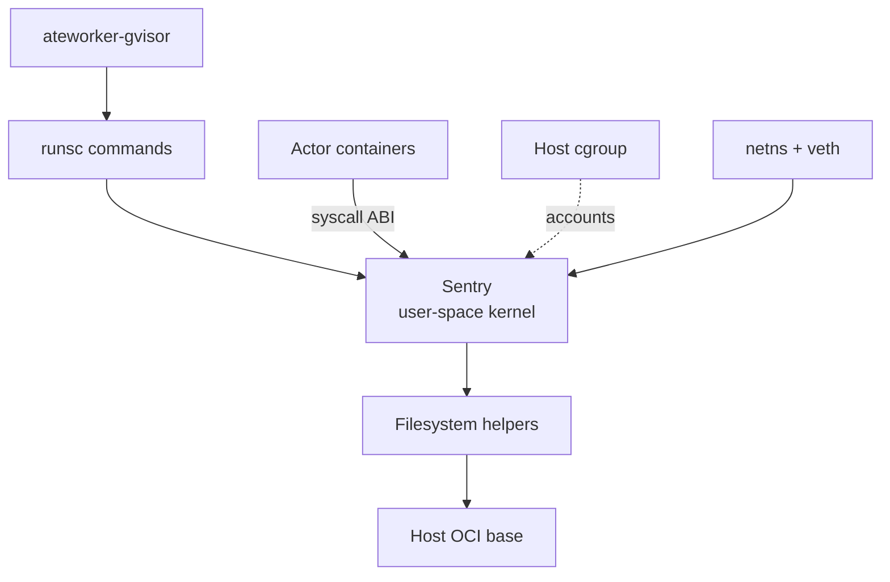
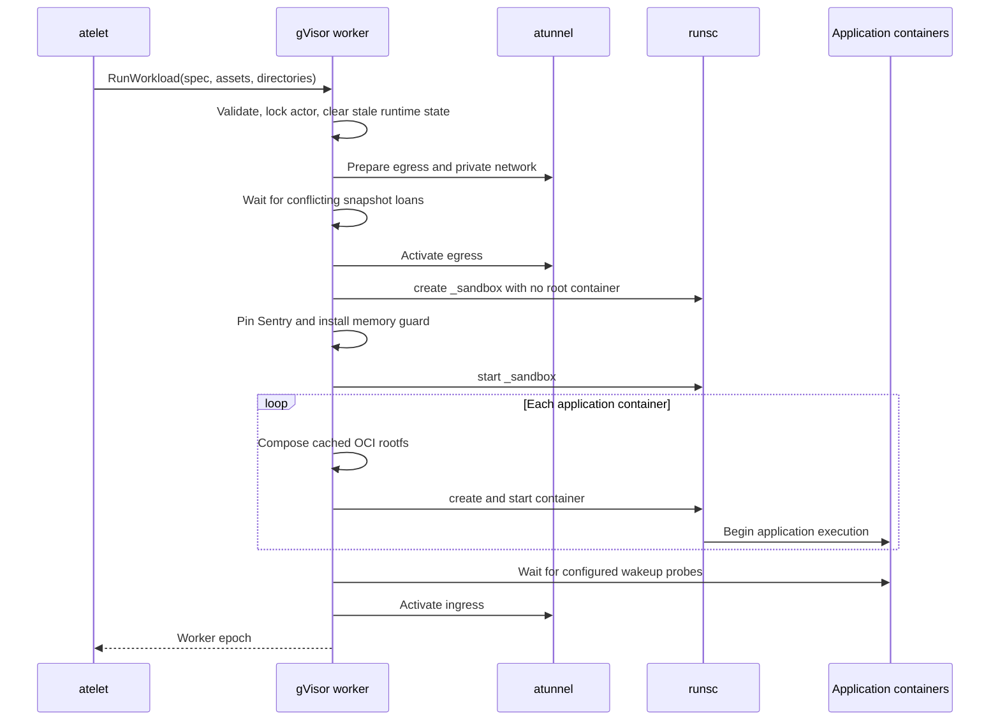
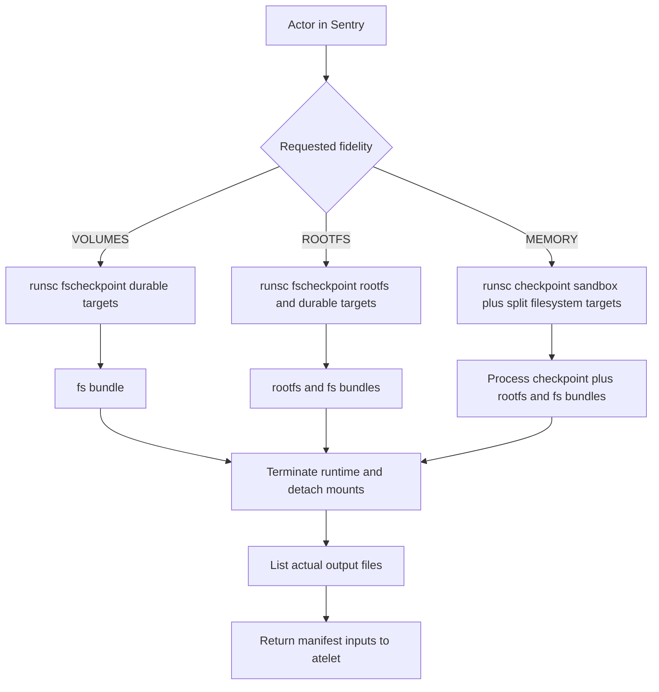
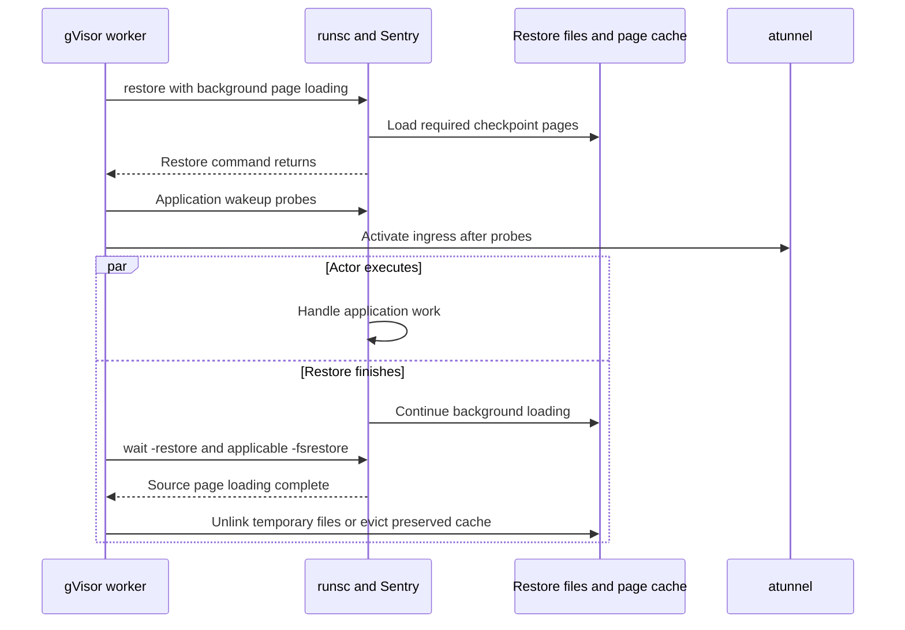

# 6. gVisor Execution and Checkpoint Internals

## 6.1 The worker controls a user-space kernel

The gVisor backend is a long-lived Go service that drives a versioned runsc executable. It does not embed gVisor's Sentry in its address space, implement CRI, or ask kubelet to create an actor container. [AteWorkerService](https://github.com/agent-substrate/substrate/blob/v1.0.0/cmd/ateworker-gvisor/main.go) implements the worker protobuf service and invokes runsc for creation, start, checkpoint, filesystem checkpoint, restore, wait, state, kill, and deletion. Its unit of lifecycle management is an actor sandbox containing one or more application containers. Kubernetes continues to manage the outer worker pod.

This boundary determines what “kernel” means throughout the chapter. Application system calls are handled by gVisor's user-space kernel. The Sentry and its supporting processes are themselves Linux processes confined and scheduled by the host. Host cgroups account for their actual resource consumption. Host namespaces and mounts establish the environment from which runsc creates the sandbox. A gVisor checkpoint serializes state understood by the Sentry; it is not a host-kernel process checkpoint obtained by asking Linux to serialize an ordinary container.

Substrate's source contains the integration code, the required runtime flags, and a digest-pinned asset definition. It does not contain the complete source of the pinned gVisor binary. Consequently, a claim about a runsc-internal syscall must be distinguished from a direct call made by the worker. For example, the worker directly probes Linux core-scheduling support with `prctl`, while its invocation of `runsc checkpoint` is an external-runtime operation. Namespaces, seccomp, and root pivoting inside runsc belong to the latter boundary. This distinction prevents a kernel audit from mistakenly attributing every runtime implementation detail to a Go function in Substrate.

The default asset is recorded in [sandboxconfig-gvisor.yaml](https://github.com/agent-substrate/substrate/blob/v1.0.0/manifests/ate-install/sandboxconfig-gvisor.yaml). At v1.0.0 its default version, `v7`, selects gVisor release `20261102.0` with architecture-specific SHA-256 values. Version `v6`, which selects `20261026.0`, stays enabled because an actor restores its memory only on the version its snapshot was taken with. The comments identify the filesystem-checkpoint and no-root-container fixes needed by this integration. Those details are operationally relevant: replacing runsc with another release is not equivalent to updating a generic command-line utility. Memory snapshots and filesystem bundles encode runtime behavior and compatibility assumptions, and the worker's flags require features that an older binary may not understand.

The sandbox has a reserved runsc identifier, `_sandbox`, defined by [internal/ocispec/gvisor.go](https://github.com/agent-substrate/substrate/blob/v1.0.0/internal/ocispec/gvisor.go). It is created with `-no-root-container`, so the sandbox itself has no application process or root filesystem. Application containers are separate runsc objects associated with that sandbox. The underscore also keeps the identifier outside the permitted application-container naming space, preventing a template from colliding with the internal object. A reader familiar with pause containers should avoid assuming that `_sandbox` is simply another process that receives ordinary application signals.

`ShapeGVisor` writes CRI-style annotations into the OCI specification even though the worker is not using a CRI service. The annotations identify sandbox versus application container and associate application containers with `_sandbox`. It also creates the per-actor cgroup path and declares durable-volume hints on the sandbox specification. It caps `/tmp` at half the actor's memory limit, makes the tmpfs mode `0777` as an emptyDir would be, and removes the `/dev`, `/dev/pts`, and mqueue mounts that runsc supplies itself. This is a practical example of reusing a runtime's established interpretation of OCI annotations while changing the orchestration layer around it. The annotation semantics must be reviewed against the pinned runsc version, not inferred solely from their `io.kubernetes.cri` prefix.

The `runsc` wrapper in [runsc.go](https://github.com/agent-substrate/substrate/blob/v1.0.0/cmd/ateworker-gvisor/runsc.go) carries the executable path, actor UID, actor directories, sizing, durable-volume names, container definitions, and active flag store. `buildArgs` combines global flags, command-specific global flags, the actor's runsc state directory, subcommand flags, and the operation's arguments. Every command is therefore parameterized by actor-local state. A shared worker does not use a single undifferentiated runsc root for all actors and then rely on container names alone to separate them.

Flags are configuration with execution consequences. [internal_flags.json](https://github.com/agent-substrate/substrate/blob/v1.0.0/cmd/ateworker-gvisor/kodata/internal_flags.json) enables background detached restore, forced deletion, quiet listing, CPU-count derivation from quota, and the connected-socket save allowance. [flags.go](https://github.com/agent-substrate/substrate/blob/v1.0.0/cmd/ateworker-gvisor/flags.go) parses the JSON strictly, keeps an immutable active configuration behind a lock, and watches the backing file asynchronously. A malformed replacement is logged and rejected while the previous configuration remains active. Reads on the command path do not perform file I/O.

That reload behavior provides availability but introduces a versioning question: the effective runtime behavior is a function of both the executable and its flags. The current wrapper reads configuration when building each command. A reviewer considering a new flag should ask whether changing it between create and checkpoint, or between checkpoint and restore, is meaningful. Not every option can safely be treated as an independent operational tuning knob. The repository's runtime compatibility machinery captures selected runtime attributes, while a future compatibility policy must also account for options that change snapshot semantics.

Core scheduling is one explicit host feature probe. At startup the worker queries support with `prctl(PR_SCHED_CORE, PR_SCHED_CORE_GET, ...)` and enables runsc's core tags when supported. This is a host scheduling defense across SMT siblings, separate from the actor's CPU bandwidth quota. Failure to support the feature is handled according to the probe's recognized error cases; it is not evidence that the worker has switched to a different sandbox implementation. CPU placement defenses and cgroup resource ceilings remain distinct parts of the host boundary.

The outer worker security context remains significant. [workerpool_apply.go](https://github.com/agent-substrate/substrate/blob/v1.0.0/cmd/atecontroller/internal/controllers/workerpool_apply.go) supplies explicit capabilities, root identity, and Unconfined AppArmor and seccomp settings while leaving `privileged` false. These permissions allow runsc and the worker to perform required mounts, root transitions, and networking setup. They do not imply that application containers receive the same capabilities. The actor OCI specification and the runtime's own confinement are additional boundaries, each with its own semantics and failure modes.

`parseFlagConfig` rejects unknown JSON fields and trailing tokens. That behavior catches misspelled configuration keys instead of silently dropping an intended runtime option. Initial configuration failure prevents a valid store from being constructed, whereas a later failed reload preserves the previously accepted configuration. The distinction avoids booting with an unknowable initial policy while allowing an already functioning worker to survive an invalid update. The parser validates the configuration structure; runsc still determines whether the selected flag strings are meaningful for its executable version.

Global and subcommand flags occupy different positions in `buildArgs`. A per-command global option is placed before the command name, while subcommand options follow it. Treating the JSON as an unordered collection of interchangeable switches would therefore change command interpretation. The wrapper preserves both ordering and command scope explicitly. This is a consequential integration contract when a runtime feature is enabled only for checkpoint or restore: moving the option into a top-level list could affect every runsc invocation, including probes and cleanup. Configuration review must consider those additional commands because a change that succeeds during activation may still break deletion or recovery.

## 6.2 Building and starting a multi-container actor

`RunWorkload` begins with validation, registration-epoch availability, and validation of the runsc path for the supplied actor directories. It then takes the actor lifecycle lock and registers the operation with the worker's in-flight machinery. The order matters. A request naming an invalid executable path should fail before creating network namespaces or deleting stale state. A worker that has not completed registration should not accept an activation and only later discover that it cannot report the relevant epoch.

The method resets runsc state and PID-file directories and removes a stale sandbox cgroup before creating the replacement. [memlimit.go](https://github.com/agent-substrate/substrate/blob/v1.0.0/cmd/ateworker-gvisor/memlimit.go) explains why the cgroup cleanup is more than tidiness. During normal operation the worker may replace the sandbox's `memory.max` with `memory.high`. If a later runsc create reuses that leftover leaf unchanged, runsc can infer an inappropriate total memory value from an unlimited hard limit. A stale control file can therefore change the application-visible machine size, not merely leave an unused directory behind.

Networking is deactivated before a new activation is prepared. The worker asks atunnel to prepare egress state, reserves the actor locally, and creates its sandbox network. The gVisor path requests a veth pair between runtime and gateway namespaces. The runtime-side address and route are what gVisor imports into its own network stack; the gateway namespace hosts the actor-specific forwarding path through atunnel. Chapter 9 covers those transport details. Here, the key lifecycle rule is that no old forwarding state should survive into the new actor activation merely because its UID is unchanged.

The actor is published to local attribution machinery before boot so resource samples can include startup cost. That does not immediately make it reachable by ingress. The worker waits for any outstanding snapshot-memory loans that conflict with the new booking, then enables egress before starting the sandbox. An application may need outbound service calls during initialization. Ingress activation waits until the enabled wakeup probes have succeeded. Separating these gates lets startup dependencies work without routing arbitrary user requests to an incompletely initialized application.

`cmdCreate` builds an OCI specification immediately before invoking runsc. For `_sandbox`, it uses `BuildSandbox`; for an application container, it builds the container spec from the common OCI options and then applies `ShapeGVisor`. The wrapper writes the resulting specification into the corresponding bundle. This keeps the backend-specific shaping near the point of execution, while atelet remains responsible for preparing application-image content and shared paths.

The application rootfs is composed by `setupAppRootfs` in [rootfs.go](https://github.com/agent-substrate/substrate/blob/v1.0.0/cmd/ateworker-gvisor/rootfs.go). It invokes the image-cache consumer to mount the OCI layer view and writes the actor's `/etc` files into that view. The mount occurs in the worker's namespace, where runsc's filesystem helper resolves it. The bundle is therefore both a static declaration from atelet and a worker-local mounted view. A path listing from atelet alone cannot show the complete filesystem the runtime will use.

After creating `_sandbox`, the worker pins the Sentry process through its PID reference and adjusts memory enforcement. Only then does it start the sandbox and create application containers. Each application container receives a separate log pipe, preserving the container name in actor log attribution. Container creation and start occur in the source's explicit loop. There is no basis for treating a multi-container actor's startup latency as identical to a single-container actor's latency; per-container specification, rootfs, command, logging, and probe work all contribute.

The reserved sandbox object is especially important during failure cleanup. `containersToDelete` records objects whose creation has been attempted so the deferred cleanup can remove partially constructed state. The failure path uses a bounded context detached from the original request's cancellation. It deactivates networking, deletes created runsc objects, detaches mounted bundle overlays, and releases hosted-actor state. If cleanup were driven by an already-canceled request context, it could abort immediately and leave the resources that make the next activation fail.

Cleanup is not equivalent to rolling back every external side effect. An application may already have made an egress request before its wakeup probe failed. The worker can terminate the sandbox and restore local capacity, but it cannot undo that request at a remote service. This is a general consequence of enabling outbound dependencies before ingress readiness. The lifecycle API's success boundary tells a caller whether the actor became available through Substrate; it does not create a distributed transaction encompassing the actor's startup behavior.

Waking a container is also an application contract rather than a process-existence check. `wakeupprobe.WaitAll` waits for the configured containers to report the expected success response through the actor network. An application can be executing but not ready to answer requests. Conversely, a probe that reports success before reconstructing application-level state can make activation appear complete too early. Substrate provides the gating mechanism; the template author defines whether that signal corresponds to useful readiness for the workload.

Once ingress is activated, the worker stores a `workloadSession` containing the runtime wrapper and container names, records initial usage, and starts watching the sandbox. The response includes the epoch required earlier. Storing the session gives graceful shutdown and later lifecycle operations a concrete list of containers and runtime state to act on. It also avoids reconstructing the actor's process relationships by scanning arbitrary host processes, which would be unreliable in a multiplexed worker.

There are three distinct views of success in this trace. Runsc can successfully create a Sentry. All application containers can successfully start. The actor can successfully pass its wakeup probes and become routable. A latency investigation must select which boundary it is measuring. Reporting only the runsc command duration as “resume time” omits network preparation, image composition, per-container work, and readiness. Reporting the outer API latency without phase data loses the information needed to explain why it grew.

## 6.3 Checkpoint fidelity and the filesystem split

The gVisor worker supports three cumulative snapshot fidelities: `VOLUMES`, `ROOTFS`, and `MEMORY`. Their implementation is visible in the switch inside `CheckpointWorkload`, not only in the public API description. `VOLUMES` saves declared durable-directory filesystems. `ROOTFS` adds the application containers' writable rootfs state. `MEMORY` adds the process and user-space kernel state. These are different recovery contracts. Only the last attempts to continue the previously executing process tree.

[fscheckpoint.go](https://github.com/agent-substrate/substrate/blob/v1.0.0/cmd/ateworker-gvisor/fscheckpoint.go) constructs the filesystem checkpoint targets. Rootfs targets are grouped under `rootfs/`, while durable-directory volumes are grouped under `fs/`. Each target identifies the container and mounted path from which runsc should capture state. A durable volume shared by multiple mounts can appear in several target specifications; runsc deduplicates the underlying shared filesystem. Substrate preserves the explicit mount relationships instead of assuming that one volume name maps to exactly one container path.

`ShapeGVisor` declares durable volumes as shared tmpfs mounts in the sandbox's runtime model. The resulting contents are not simply files in an ordinary host directory that atelet can archive to obtain equivalent state. The Sentry owns the filesystem objects and their runtime representation. `runsc fscheckpoint` is therefore the mechanism used for volume-only and rootfs snapshots. This differs fundamentally from the microVM host-backed upper and tar path in Chapter 7, even though the public fidelity enum is shared.

For `MEMORY`, the worker invokes `runsc checkpoint` once for `_sandbox`, supplying filesystem checkpoint paths so the rootfs and durable-volume bundles are split from the process checkpoint. The sandbox is the state-sharing unit: its application containers execute under one Sentry, and their state belongs in one coherent checkpoint operation. There is no loop that independently checkpoints each application container and then declares the resulting collection atomic.

For `VOLUMES`, the worker rejects the request if there are no durable-directory targets. For `ROOTFS`, it checkpoints the rootfs and durable targets without saving memory. In each case, successful capture is followed by workload termination and cleanup so the physical worker capacity can be reused. A filesystem-only snapshot is not a request to freeze a running application while keeping its process state in RAM indefinitely. A later restore creates new processes against the preserved filesystem state.

Checkpoint starts by taking the actor lock and checking whether a completed checkpoint can be reused. [internal/ateworker/checkpoint.go](https://github.com/agent-substrate/substrate/blob/v1.0.0/internal/ateworker/checkpoint.go) records a completion marker that includes the node boot ID and fidelity. If the actor is no longer hosted and the marker establishes that a previous attempt completed, the worker can return the existing result. This handles an uncertain response without attempting to checkpoint a process tree that has already exited. Merely finding a directory named `checkpoint-state` would not provide equivalent evidence; it might contain partial output.

The checkpoint context is treated differently from an ordinary canceled request because it is saving state. In-flight tracking records the operation as noncancelable by the worker's normal cancellation mechanism, while the shared checkpoint context still provides a bounded lifetime. The distinction is not “ignore all deadlines.” It is that a caller abandoning a request must not automatically interrupt the only current attempt to preserve an actor's state halfway through destructive lifecycle progress.

Before capture, the worker deactivates actor networking and reads final usage while the sandbox cgroup still exists. The timing record is installed early and emitted on failure as well as success. A checkpoint that fails after spending substantial time in preparation or capture remains visible in phase telemetry. Otherwise, a dashboard containing only successful operations would systematically hide the slow or broken path an operator most needs to diagnose.

For a memory checkpoint, the worker marks the hosted activation as stopping before invoking runsc. A sandbox watcher observing the resulting exit can then distinguish intentional termination from a crash. If checkpoint fails, the flag is reset because the actor may remain running and a subsequent exit must again be treated as unexpected. The worker also waits for the pinned sandbox process to disappear before operations such as runsc deletion that require it to have been reaped. PID existence and runtime-record existence are related but different conditions.

The filesystem output list is discovered after successful capture rather than hardcoded to a small assumed set. `listSnapshotFiles` enumerates regular files at the checkpoint root and in the `fs` and `rootfs` subdirectories, then sorts the result. Atelet ships precisely those files. This allows runsc to produce the relevant page or bundle files without requiring the storage layer to encode every runtime filename. The separate `DataSnapshotFiles` list identifies the durable-volume portion used by fidelity transitions elsewhere in the system.

That separation is essential when a template changes. A memory image is tied to the template and runtime context that created it. Durable-volume data can remain useful across a cold boot under a new template. The storage and control-plane layers choose the allowed fidelity and supply the corresponding files; the worker implements the backend-specific reconstruction. No layer should silently treat a process checkpoint as portable application data merely because both are stored below one snapshot prefix.

The checkpoint directory is cleared before a new capture to avoid mixing partial files from a failed attempt with fresh output. After success, the completion marker is recorded. Failure to write that marker is logged rather than retroactively invalidating a checkpoint response whose files were already produced, but it removes an optimization for a later uncertain retry. This is an example of separating correctness-critical payload creation from local recovery metadata that improves repeatability.

External durability is not established by the worker's return. The worker has produced local files and a list of them. Atelet decides whether upload must finish synchronously or can proceed in the background, and the control plane tracks the durable snapshot. The gVisor source contains comments naming GCS in this handoff, but the actual object-store plugin supports more than one backend. The runtime should be understood as producing files for the node supervisor, not as possessing GCS-specific persistence semantics.

A two-container actor illustrates why filesystem targets and process targets must remain distinct. Suppose the main container and a helper both mount the same durable directory, while each has its own writable root filesystem. A volume-only checkpoint emits both mount relationships so runsc can identify the shared filesystem, but it should not create two independently diverging copies of that directory. A rootfs checkpoint additionally captures each container's overlay. A memory checkpoint captures the common Sentry state that includes the two process groups and the shared filesystem relationships. The number of containers is therefore neither the number of independent sandboxes nor necessarily the number of independently stored volume filesystems.

Restore waiting follows that same ownership relationship. For volume-only restoration, the first container that establishes the shared volume owns its master mount and its corresponding filesystem-restore wait entry. Calling `wait -fsrestore` for a container that registered no entry would not prove useful progress; it would ask the runtime about a condition that does not exist. `fsRestoreContainers` derives the appropriate set from the ordered mount declarations. For rootfs or memory fidelity, every container has its own restored root overlay and therefore participates in the wait set.

The presence checks in `fsRestoreArgs` also encode a failure policy. A missing rootfs manifest is fatal when the requested fidelity requires rootfs state. Falling back to the pristine image would silently violate the restore contract: a process could resume with memory referring to files or directory entries that no longer exist. The durable-volume bundle is optional when no such filesystems were captured. These are semantic checks, not merely helpful diagnostics about missing files. The runtime should reject an incomplete snapshot before presenting an apparently healthy but inconsistent application.

Image reconstruction remains part of this contract even when writable state was captured. The immutable lower filesystem is supplied through the OCI image machinery, while the checkpoint carries the mutable view and runtime state. A snapshot is not a standalone container image that can be launched with an unrelated lower. Template and runtime compatibility selection must provide the same logical base expected by the saved state. A successful download of every checkpoint object cannot compensate for using an incompatible image layout.

The distinction also clarifies rollback behavior. A memory snapshot can preserve a process that has already read configuration, loaded a library, or opened a deleted file. A rootfs-only restore starts new processes against the preserved filesystem and may observe different external services or time. A volume-only restore starts from the template's root filesystem with retained application data. Choosing among them changes application semantics, not just checkpoint size. The common public fidelity model is meaningful only because each backend implements these boundaries explicitly.

Finally, the connected-socket save flag should not be read as an end-to-end network-session guarantee. It permits a runtime checkpoint operation that would otherwise reject connected sockets under the relevant conditions. Remote peers, proxies, timeout policies, and reconstructed networking have their own state. The worker's transparent-resume path is designed to make an actor available for traffic after activation; it does not prove that every arbitrary connection initiated before suspension remains valid forever. Applications that rely on remote sessions still need to tolerate the recovery semantics of those external systems.

## 6.4 Checkpoint memory pressure and restore page lifetime

A checkpoint writes memory that was previously represented by the live sandbox into a host file. During that transition, the old memory and the newly dirtied page cache can coexist. At high density, that overlap can be as important as the time spent serializing state. A system that frees actor capacity immediately but ignores dirty snapshot cache can admit new actors into memory that has not actually become available.

[ckptcgroup.go](https://github.com/agent-substrate/substrate/blob/v1.0.0/cmd/ateworker-gvisor/ckptcgroup.go) addresses one part of the problem by moving the Sentry from its sandbox leaf into a sibling checkpoint cgroup for the capture operation. Newly written snapshot pages are charged there rather than competing with the live sandbox's existing memory.high boundary in the same way. The checkpoint leaf preserves the CPU quota and receives an appropriate memory.high setting for its cache growth. The operation must verify that the PID it intends to move really belongs to the expected sandbox cgroup before moving it.

Moving the process is not a resource exemption. The parent pod remains bounded, the checkpoint leaf can be throttled, and the worker limits the number of concurrent checkpoint writers. [memory.go](https://github.com/agent-substrate/substrate/blob/v1.0.0/cmd/ateworker-gvisor/memory.go) defines checkpoint write slots and reserved headroom. It calculates a cache allowance using the actor's booking, current sandbox usage, and any memory borrowed from the shared ledger. The goal is to use genuinely available memory to make writeback progress without allowing many simultaneous checkpoint writers to consume the pod's entire reserve.

`checkpointIsolated` must also restore a valid state on failure. If capture fails while the Sentry remains alive, the code attempts to return it to its sandbox leaf. If safe restoration cannot be established, termination is preferable to leaving a live actor outside its expected resource boundary. On successful capture, teardown removes the process and the temporary cgroup. The failure paths are part of the isolation design; a happy-path diagram showing only “move, write, delete” omits the most dangerous state.

After output files are listed, `StartWriteback` in [internal/snapshotcache](https://github.com/agent-substrate/substrate/blob/v1.0.0/internal/snapshotcache/snapshotcache.go) starts asynchronous writeback and returns borrowed memory when the pages are clean and reclaimable. Returning the loan at the end of the runsc command would be too early because dirty pages can remain charged after the writer exits. The explicit callback ties the accounting lifetime to the kernel's data lifetime. If writeback initiation itself fails, the code returns the loan and records a warning rather than retaining an accounting reservation with no completion path.

Restore has the inverse overlap. The snapshot file can occupy page cache while the Sentry loads the same logical data into restored memory. Background restore allows execution to begin before all page loading completes, but it extends the interval during which the source file must remain available. Deleting or evicting the wrong file too early can break restore; keeping everything indefinitely can erase the memory savings of suspension.

The configured `runsc restore` flags are `-background` and `-detach`. After the actor passes wakeup probes and ingress becomes active, `RestoreWorkload` launches asynchronous cache cleanup tied to the hosted activation's context. For memory fidelity, it waits for `runsc wait -restore _sandbox`. For filesystem bundles, it also waits for `runsc wait -fsrestore` on the containers that registered corresponding restore entries. Only when those conditions complete can the worker safely drop temporary snapshot files or evict preserved files' page cache.

The `PreserveRestoreDir` flag changes file ownership semantics. A temporary per-activation source can be removed when the runtime no longer needs it. A preserved source, for example one retained for reuse through the cache, must keep its files while allowing their resident cache pages to be reclaimed. The shared snapshot-cache helpers use `cachestat` to see which pages are clean, `sync_file_range` to start writeback of dirty pages, and `posix_fadvise(DONTNEED)` to evict clean pages only. If `cachestat` fails, eviction is skipped rather than guessed. An advisory eviction call is not a guarantee that the kernel releases every page, so `EvictWithRetries` retries while pages remain in cache.

The gVisor path does not establish that its background restoration is implemented with the same host `userfaultfd` mechanism as Cloud Hypervisor's conditional OnDemand mode. The integration visible here is a runsc command and completion protocol. Conflating the two because both defer some memory work would produce an inaccurate syscall map. The relevant production contract is that runsc can execute while loading state, tells the worker when source use is complete, and must be paired with the correct runtime version and filesystem bundles.

Restore reconstructs more than memory. The worker resets stale runtime state, prepares egress, recreates actor networking, shapes specifications, creates the sandbox, and composes each application's OCI base rootfs. For `MEMORY`, it creates and restores the sandbox, then creates and restores each application container using the same checkpoint. For `ROOTFS` and `VOLUMES`, it creates and starts new processes with filesystem restore arguments. The outer method resembles a single RPC, but the internal trace deliberately distinguishes sandbox create, sandbox restore/start, per-container rootfs work, per-container create, per-container restore/start, probes, and activation.

`fsRestoreArgs` requires the rootfs bundle for `ROOTFS` and `MEMORY`. It includes the durable bundle when present. `fsRestoreContainers` identifies which containers have corresponding filesystem-restore wait entries. For volume-only restore, this depends on the first container that owns the shared volume's master mount; waiting on every container indiscriminately would be incorrect. The metadata relationship between shared mounts and runtime wait maps is a concrete example of why multi-container checkpointing cannot be reduced to a loop over filenames.

A useful analytical model separates the latency boundary from the memory-release boundary. Let the actor become routable at time `t_ready`, background source loading complete at `t_loaded`, and cache reclamation converge at `t_reclaimed`. The implementation permits `t_ready < t_loaded <= t_reclaimed`. The intervals are not interchangeable. A benchmark reporting only request readiness can miss a long memory overlap that limits sustainable activation rate, while a benchmark waiting for complete cache reclamation can overstate user-visible latency. Chapter 11 discusses measuring both without calling one a substitute for the other.

No constant in this code proves a sub-100ms activation distribution. A cache hit can remove downloads and extraction, but host scheduling, per-container command startup, page faults, probe behavior, and concurrent checkpoint writeback remain. The correct way to evaluate a proposed optimization is to identify which phase and resource overlap it changes, then measure under a representative distribution of actor sizes and resume locality. The phase log gives the necessary decomposition; it does not itself provide the benchmark result.

## 6.5 Accounting, crash detection, and termination

The gVisor worker's statistics deliberately measure the sandbox. [stats.go](https://github.com/agent-substrate/substrate/blob/v1.0.0/cmd/ateworker-gvisor/stats.go) reads the sandbox leaf identified by `GVisorCgroupLeaf(actorUID, SandboxID)`. One Sentry backs the actor's application containers, so their host cgroup markers do not each contain an independent application process tree. Summing those empty marker leaves would undercount the actual actor cost. The relevant host resource consumption includes the Sentry's own heap, page tables, networking state, and supporting filesystem processes.

This means a sandbox memory sample is not directly comparable to the memory figure for one application container under a conventional runc-based deployment. A mostly idle actor retains a nonzero runtime floor. That overhead is real capacity consumed by hosting the actor and therefore belongs in density and chargeback analysis, even if it is not all application heap. Conversely, an application-internal heap metric cannot replace the cgroup measurement because it omits the machinery required to run that application safely.

The public API can express per-container resource limits, but the gVisor backend's host enforcement is at sandbox scope. [sandbox-classes.md](https://github.com/agent-substrate/substrate/blob/v1.0.0/docs/reference/sandbox-classes.md) documents that the per-container leaves are discovery markers and the per-container limits are accepted without the same enforcement available in the microVM guest. A template containing a tightly bounded helper container and a larger main container must not rely on gVisor to enforce that division as separate host quotas.

Memory setup has an ordering requirement. Runsc reads `memory.max` while creating the Sentry to determine its total memory view. Only afterward does `throttleSandboxMemory` switch enforcement to `memory.high` and arm the userspace guard when PSI is available. It writes high before removing the hard cap, so the leaf is not briefly unconstrained. If the switch fails, the leaf retains the hard limit and the worker warns about the less isolated OOM behavior. This preserves a meaningful bound even when the preferred enforcement mechanism cannot be installed.

CPU sizing likewise has both a host and an application-visible effect. The OCI quota limits host CPU time, while `--cpu-num-from-quota` controls the count exposed through runsc's sizing behavior. The documented runtime behavior rounds quota-derived CPU count and retains a minimum. An actor limited to a fractional core can therefore observe more than one logical CPU while receiving only its quota of host execution time. Thread-pool sizing and throttling analysis should distinguish those two quantities instead of treating the reported CPU count as an entitlement.

Statistics collection avoids the actor lifecycle lock. `GetWorkloadStats` must not wait behind a slow boot or checkpoint, and checkpoint must not wait for telemetry to release a lock. The method takes a pointer to the current hosted activation, reads cgroup data without the lifecycle lock, and then verifies that the same hosted object remains current. If a checkpoint and new activation replaced it while the read was in progress, the sample is rejected. Pointer identity is being used as an activation identity check, not as a substitute for actor identity in the API.

The errors communicate useful distinctions. If the actor is not hosted, `NotFound` tells the caller to resolve its current assignment rather than retrying the same worker indefinitely. If the actor has been accepted but its cgroup does not yet exist, `FailedPrecondition` can mean that measurement landed during startup. Other filesystem errors are actual read failures. A monitoring client that collapses all three into zero usage would create misleading utilization and could conceal failed activation.

Periodic sampling and direct reads share activation accounting. Initial and final samples bound the activation's resource history, while cached samples serve discovery reads without forcing every scrape to open cgroup files. The code reads final counters before checkpoint destroys the sandbox leaf and emits the final record after teardown. That ordering prevents the disappearance of a cgroup from erasing the usage accrued immediately before suspension. Resource accounting has to follow the physical execution lifetime, not merely the control-plane state's transition timestamp.

Crash detection uses the pinned Sentry and the hosted activation's stopping state. An intentional checkpoint or terminate path marks stopping before triggering exit. Unexpected exit can be reported through shared worker-support machinery. The source's crash handling should be understood together with the control plane's epoch checks: a late report from an old activation or worker process must not overwrite the state of a new one. The local watcher identifies what happened on this worker, while the control plane decides whether that observation still applies to the authoritative assignment.

Termination itself stops application containers before deleting their runsc records and deletes the sandbox last. A no-root-container sandbox cannot be treated as an ordinary application process receiving `runsc kill`. The helper `stopContainers` iterates application containers; `cleanupContainers` checks runtime state, handles objects already absent, and then deletes the present objects in the required order. The code uses `runsc state` and, when needed, `runsc list` to distinguish an already-destroyed container from a different runtime error.

The deletion context is detached from caller cancellation because a deadline in the middle of runtime record deletion can leave a live container without the metadata needed to manage it. The cleanup remains time-bounded. Afterwards, runsc state/PID directories are reset, overlay mounts are detached, and the actor is unhosted. Errors are joined so that a failure in one cleanup stage does not prevent attempting other necessary stages. This does not mean every failure is harmless; it means the worker makes the remaining cleanup progress visible rather than stopping after the first error.

An important operational distinction is whether a failed checkpoint preserved a running actor, left a reusable completed local checkpoint, or ended the actor without a valid new checkpoint. The runtime path, node snapshot tracker, and control-plane workflow together determine the answer. The worker cannot simply return “failed” and let the caller assume no state changed. Phase logs, completion markers, actor stopping state, and durable snapshot references provide the evidence needed for recovery. Chapter 8 follows that evidence across the storage boundary.

For engineering review, consider a three-container actor whose second application restore fails. The sandbox and first application may already exist, the second creation may be partial, and the third has not begun. The deferred failure path must remove every attempted object, including the sandbox, detach overlays already mounted, and release the network reservation only after cleanup. At the same time, the immutable source snapshot must remain available for a retry or revert. The code's explicit attempted-container list and `PreserveRestoreDir` handling make those obligations inspectable.

Several failure cases are distinguishable without adding another runtime abstraction. If `create` fails before a Sentry exists, cleanup primarily removes prepared mounts, networking, and runtime metadata. If an application container fails to start after sandbox creation, the Sentry can remain alive while the actor is unusable, so cleanup must delete the entire actor sandbox rather than only the failed application entry. If probes fail after all containers start, the processes may already have produced local or external effects even though ingress never became active. Those cases warrant different diagnostic attribution despite sharing the same outer activation RPC.

Process pinning is particularly important for the last two cases. A numeric PID can be reused after a process exits; a pidfd continues to identify the originally opened process. The worker's watcher and termination paths can therefore reason about the Sentry they launched, not whichever process later occupies the same number. The runtime's state directory supplies another view of identity, but filesystem state may outlive the process. Comparing both prevents a stale runsc record from being treated as proof of a living sandbox and prevents an unrelated reused PID from receiving a lifecycle signal.

The `stopping` flag answers a different question: whether the expected process exit is intentional. A pidfd can identify the correct process but cannot explain why it exited. Checkpoint and termination set intent before triggering exit, while unexpected death remains eligible for crash reporting. The map entry's activation identity then prevents a late watcher from an old activation from removing or reporting a newer replacement. These are three separate protections—process identity, lifecycle intent, and activation identity—and none is redundant with the others.

Statistics deliberately avoid taking the full actor lifecycle lock. A slow measurement must not prevent checkpoint or termination from progressing. The implementation samples the hosted activation and verifies that the entry still refers to it before accepting the result. If the actor changes during collection, returning an error is preferable to labeling the old sandbox's usage as the new activation's consumption. This is a common optimistic-read pattern, but its consequence here is specific: resource telemetry must remain attributable across rapid suspend and resume cycles.

The distinction between `NotFound` and a leaf that is not yet ready is useful to callers. Absence of an actor in hosted state means there is no current activation to sample. A hosted entry whose resource leaf is still being prepared is a transient lifecycle condition. Collapsing both into zero usage would make an activating actor look free and could distort capacity or autoscaling decisions. Resource observation should represent uncertainty explicitly rather than infer successful zero consumption from a failed read.

Termination must similarly preserve evidence until the relevant layer is gone. Runsc application deletion, sandbox deletion, process reaping, cgroup removal, network teardown, and overlay cleanup are separate operations with possible partial failure. The worker joins errors and uses bounded cleanup contexts so the first failed step does not prevent every remaining independent cleanup attempt. That does not make cleanup infallible; it makes leftover state diagnosable and subsequent recovery more likely to converge. A response that reported only the first error while abandoning the rest would leave more ambiguity for the next activation.

## 6.6 Roadmap and engineering improvements

Runtime compatibility is the most immediate repository-backed concern. [version-skew-policy.md](https://github.com/agent-substrate/substrate/blob/v1.0.0/docs/reference/version-skew-policy.md) explains that a memory restore stays on a compatible runtime, while a cold restore of filesystem state may use the worker's default runsc. It also records that Substrate does not currently check whether one runsc version can read filesystem checkpoint bundles written by another. A failed restore can crash the actor. This gap is narrower and more actionable than saying “snapshots are not portable”: it identifies the artifact type, version transition, and failure consequence that need a contract.

An engineering proposal is to add explicit filesystem-bundle compatibility evidence to runtime advertisement. That could be a supported-format identifier, a compatibility matrix maintained with pinned releases, or a tested capability negotiated during runtime validation. The design must avoid falsely implying that a matching string proves every semantic detail. Representative multi-container, shared-volume, rootfs, and ownership cases would be needed. Compatibility should include restored behavior, not only whether runsc accepts the bundle without returning an error.

Per-container accounting is a second area where the repository documents a real limitation. Host cgroup discovery markers cannot provide enforcement for application processes that share one Sentry. A future solution would need runtime-level accounting or resource controls that operate within the Sentry's model. Creating more empty host cgroups would not solve the problem. Until such support exists, templates and policy systems should avoid promising container-specific hard isolation on the basis of fields that this backend does not enforce.

The worker's outer confinement is also unfinished. The implementation uses explicit capabilities with nonprivileged pods, but its seccomp and AppArmor profiles remain Unconfined. The controller comments identify tailored profiles as future work. For gVisor, such a profile must account for runsc create/restore, helper process creation, namespace operations, mount composition, PID observation, checkpoint cleanup, and supported execution-platform behavior. The profile belongs to the integration of a particular runtime family and version, rather than to a generic “agent workload” category.

Checkpoint memory borrowing and background cleanup deserve sustained-load evaluation. This is a proposed validation direction, not a report of measurements performed for this book. A useful experiment varies actor working set, snapshot size, storage writeback rate, and simultaneous checkpoints while tracking both readiness latency and pod memory overlap. It should include slow or failed writeback and cancellations during restore. An optimization that improves the median runsc duration but produces long-lived page-cache pressure can reduce the fleet's sustainable wake rate.

The phase breakdown already provides a basis for attributing cost. Further instrumentation should preserve the distinction between time spent waiting for a checkpoint slot, time in serialization, time in teardown, and time until borrowed memory returns. Those are different queues with different remedies. Increasing writer concurrency can reduce queue wait while increasing dirty-memory pressure. Reducing a cache budget can improve memory headroom while increasing subsequent storage reads. The engineering task is to make those tradeoffs measurable, not to select one tuning value from a single small demonstration.

Flags deserve stronger compatibility treatment as the project approaches stable upgrades. The live-reload mechanism is implemented, but arbitrary mid-activation changes to snapshot-affecting options should not be assumed safe. A future design could classify options by whether they affect logging, future activations, or snapshot format/semantics, then bind the latter to the recorded runtime compatibility identity. That is an editorial proposal. The current code should be described as reading the active flag configuration for each command, with malformed reloads rejected.

Finally, the architecture's performance target remains a target. The pinned runsc supports the mechanisms needed for filesystem separation and background restore, and the node cache avoids repeated image extraction on a warm node. Those facts explain where activation work can be reduced. They do not establish a p95 bound for every actor size, container count, kernel, or storage topology. Production validation must report the workload distribution, runtime asset digest, kernel features, cache state, and concurrency along with its latency result.

## Source map

- [main.go](https://github.com/agent-substrate/substrate/blob/v1.0.0/cmd/ateworker-gvisor/main.go), [runsc.go](https://github.com/agent-substrate/substrate/blob/v1.0.0/cmd/ateworker-gvisor/runsc.go), and [internal_flags.json](https://github.com/agent-substrate/substrate/blob/v1.0.0/cmd/ateworker-gvisor/kodata/internal_flags.json): lifecycle ordering, external runtime commands, and configured restore behavior.
- [internal/ocispec/gvisor.go](https://github.com/agent-substrate/substrate/blob/v1.0.0/internal/ocispec/gvisor.go), [rootfs.go](https://github.com/agent-substrate/substrate/blob/v1.0.0/cmd/ateworker-gvisor/rootfs.go), and [fscheckpoint.go](https://github.com/agent-substrate/substrate/blob/v1.0.0/cmd/ateworker-gvisor/fscheckpoint.go): no-root sandbox, OCI shaping, application base filesystems, and fidelity bundles.
- [ckptcgroup.go](https://github.com/agent-substrate/substrate/blob/v1.0.0/cmd/ateworker-gvisor/ckptcgroup.go), [memory.go](https://github.com/agent-substrate/substrate/blob/v1.0.0/cmd/ateworker-gvisor/memory.go), and [memlimit.go](https://github.com/agent-substrate/substrate/blob/v1.0.0/cmd/ateworker-gvisor/memlimit.go): checkpoint charging, write concurrency, borrowing, and actor memory enforcement.
- [stats.go](https://github.com/agent-substrate/substrate/blob/v1.0.0/cmd/ateworker-gvisor/stats.go), [sandboxexit.go](https://github.com/agent-substrate/substrate/blob/v1.0.0/cmd/ateworker-gvisor/sandboxexit.go), and [hosted.go](https://github.com/agent-substrate/substrate/blob/v1.0.0/cmd/ateworker-gvisor/hosted.go): sandbox accounting, stable process observation, and activation lifetime.
- [sandboxconfig-gvisor.yaml](https://github.com/agent-substrate/substrate/blob/v1.0.0/manifests/ate-install/sandboxconfig-gvisor.yaml) and [version-skew-policy.md](https://github.com/agent-substrate/substrate/blob/v1.0.0/docs/reference/version-skew-policy.md): pinned assets and the limits of cross-version restore guarantees.
