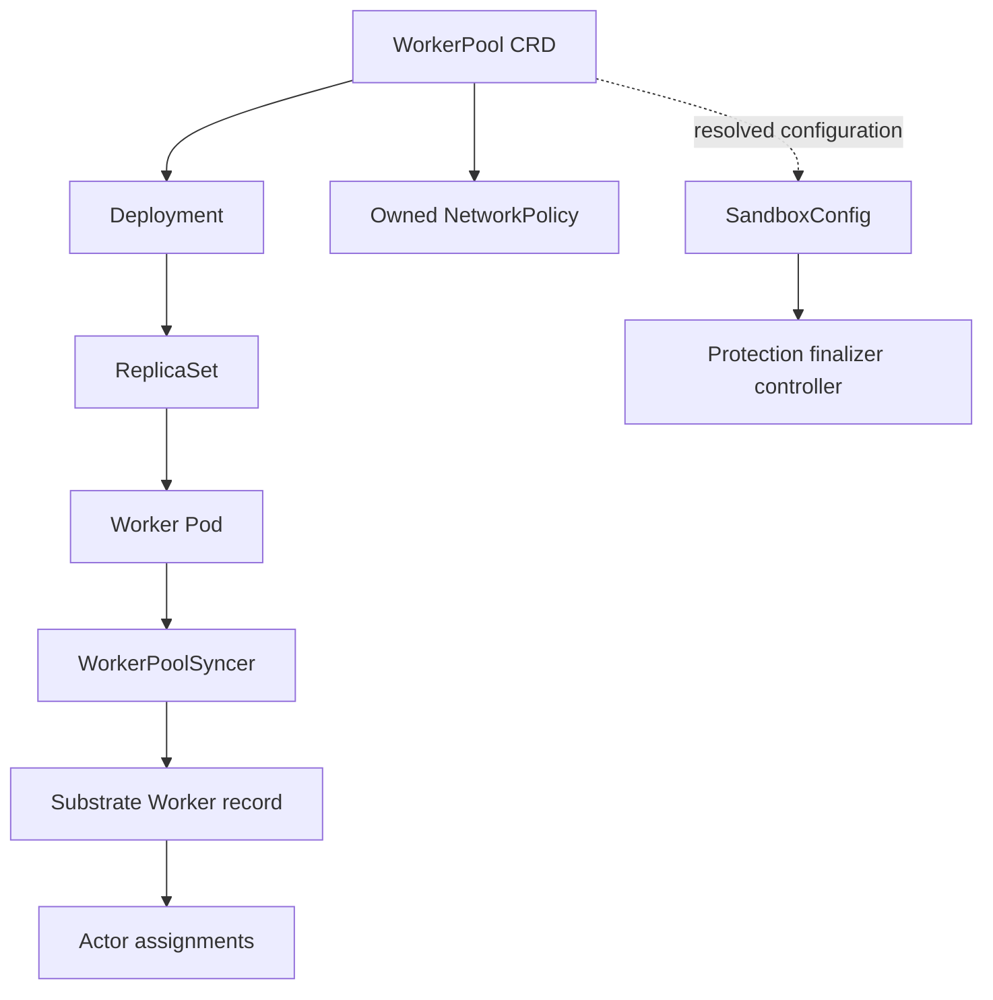
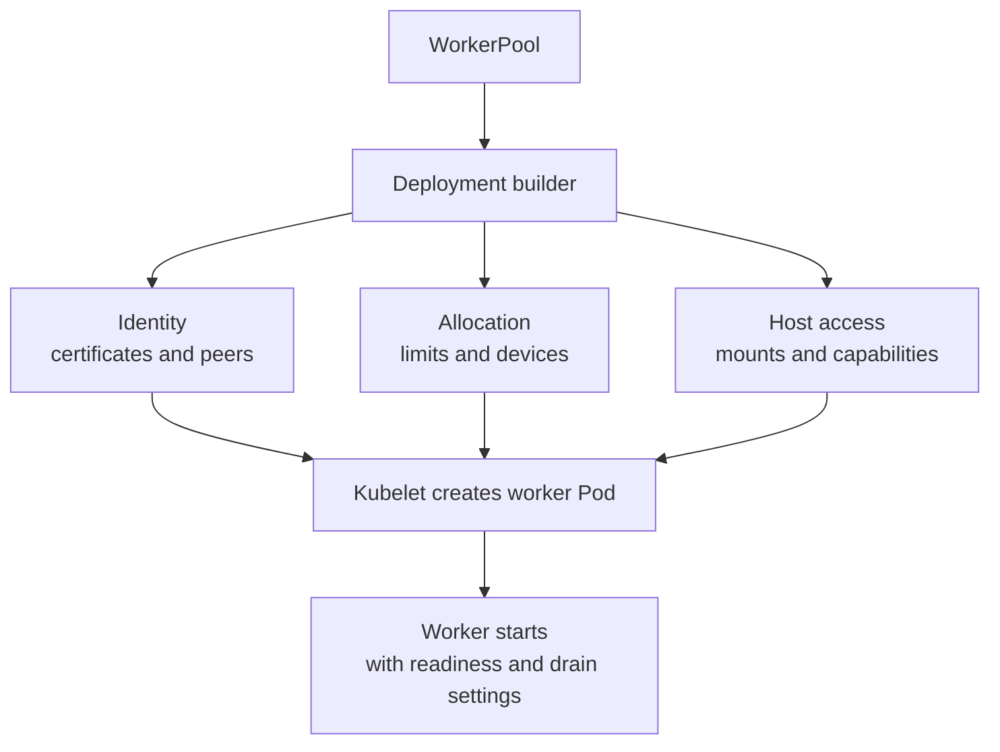
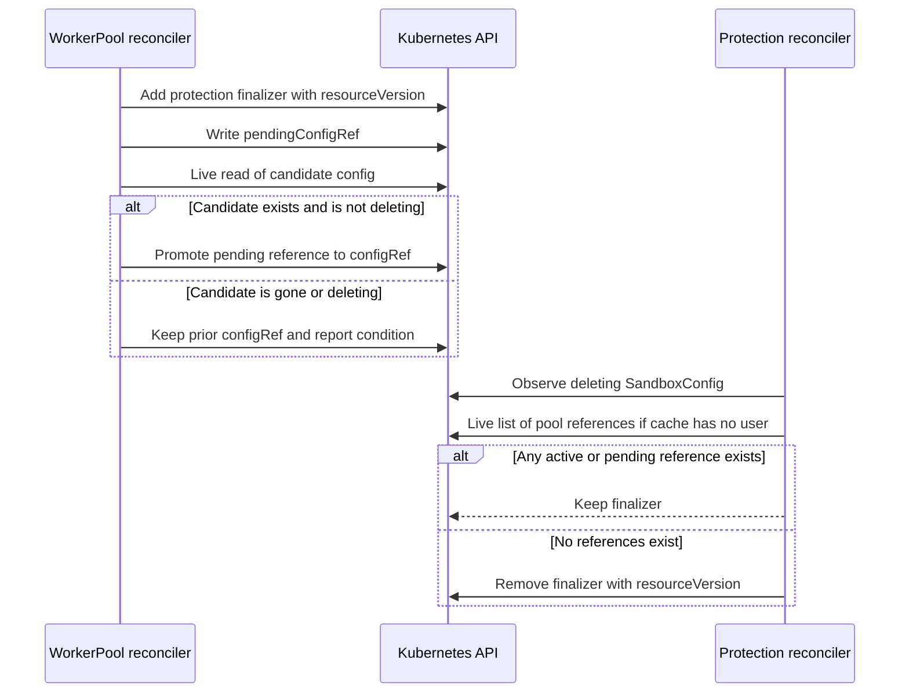
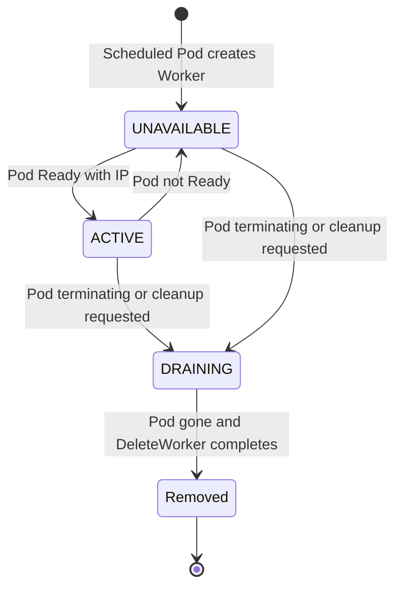
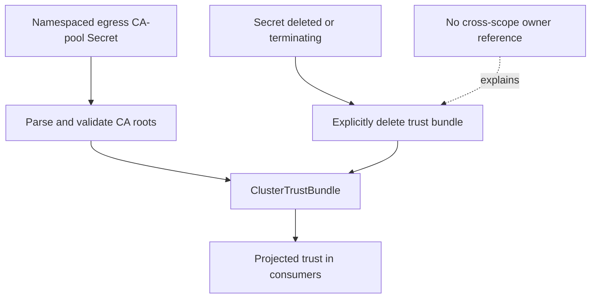

# 7. Reconciling Kubernetes Infrastructure

## 7.1 What atecontroller owns

`atecontroller` maintains the Kubernetes infrastructure that makes actor execution possible. Its principal objects are WorkerPool and SandboxConfig, with generated Deployments, worker ServiceAccounts, NetworkPolicies, and an egress trust bundle. It also synchronizes worker Pod observations into the Substrate API. It does not implement the actor scheduler, does not store Actor records in Kubernetes, and does not own every reconciliation loop in the repository. Golden snapshot creation and worker-epoch recovery run inside ateapi.

The executable entry point is [cmd/atecontroller/main.go](https://github.com/agent-substrate/substrate/blob/v1.0.0/cmd/atecontroller/main.go). It creates a controller-runtime manager and registers `WorkerPoolReconciler`, `SandboxConfigProtectionReconciler`, `NetworkPolicyReconciler`, and `EgressMITMTrustReconciler`. The manager supplies the shared client, cache, scheme, event recorder, and direct API reader used by those controllers. The code then starts a separate worker synchronizer with independent client-go informers. This split is intentional and affects startup, resync behavior, and failure recovery.

WorkerPool reconciliation establishes a Kubernetes ownership chain: WorkerPool controls a Deployment, the Deployment controls ReplicaSets, and ReplicaSets control Pods. That chain governs infrastructure garbage collection. The Substrate Worker registry is outside the Kubernetes object graph, so owner references cannot delete its records. Worker Pod synchronization must observe or reconstruct the disappearance of a Pod and call the Substrate API to clean up the corresponding Worker. The architecture thus has two ownership systems connected by explicit reconciliation.

The dotted SandboxConfig edge is not a Kubernetes owner reference. A cluster-scoped configuration can be referenced by several namespaced pools and needs an explicit protection protocol. Likewise, the Worker record is not a child Kubernetes object hidden behind a custom client. It is a PostgreSQL-backed resource reached over gRPC. These distinctions explain why familiar garbage-collection assumptions are insufficient when a pool is deleted or a configuration is replaced.

The main controller-runtime watches are narrowly related to the desired objects. WorkerPoolReconciler watches WorkerPool, owns Deployment, and maps SandboxConfig changes back to potentially affected pools. NetworkPolicyReconciler watches WorkerPool and owns NetworkPolicy. SandboxConfigProtectionReconciler watches configs and maps pool status changes to the configs they use. The trust controller watches one configured Secret and the managed trust-bundle object. A controller event is a prompt to re-read state, not an instruction that can safely be replayed without checking current ownership.

The manager restricts its Secret cache to the egress MITM CA-pool Secret in the configured namespace. This is a concrete reduction in the secrets the process needs to observe through that cache. It does not eliminate the sensitivity of the selected Secret or replace RBAC, but it avoids an unrestricted Secret informer merely to reconcile one trust bundle. The exact cache setup is in `managerOptions`, which constructs per-object namespace and field selectors.

The worker synchronizer cannot share every manager behavior. Its Pod informer has a five-minute resync period so registry drift can be repaired even when there is no new Pod event. An informer's resync period is a property of that informer; imposing it through the manager's shared cache would affect unrelated controllers. The separate factory lets this cross-API synchronizer have its own repair cadence and indexes. It watches Pods carrying the worker-pool label, rather than every application Pod in the cluster.

Startup ordering is part of correctness. The synchronizer registers event handlers before starting its informer factories. The initial list then synthesizes Add events for existing Pods. It waits for caches before beginning decisions that depend on their contents. A separate startup scan lists registered Workers from the Substrate API to find records whose Pods disappeared while the controller was down. Initial Kubernetes events can reconstruct live Pods, but they cannot replay historical deletion events for objects absent from the new cache.

The controller's output also determines host-level privileges indirectly. The Deployment builder selects worker capabilities, device resources, projected certificates, hostPath mounts, mount propagation, probes, and shutdown grace. Reconciliation does not itself call KVM ioctls or create an actor veth. It declares the environment in which workers later perform those operations. The builder establishes capability and device grants; node and runtime code perform the actual host interface operations.

Controller-runtime does not automatically make all operations transactional. Applying a Deployment, protecting a SandboxConfig, writing WorkerPool status, and updating the Substrate registry are separate requests. The implementation chooses ordering and optimistic concurrency checks to preserve invariants across them. The most interesting parts of this controller are consequently the boundaries between otherwise familiar API calls: when a cached observation is sufficient, when a live read is required, and which intermediate status makes a race recoverable.

For a Kubernetes core contributor, the productive reading strategy is to follow those intermediate states. A pool can have an existing Deployment while its newly requested config is unresolved. A terminating config can remain valid because a pool still holds it. A Pod can be Ready while its worker process has not yet reported runtime information. A worker can be DRAINING while the Pod still exists. None of those combinations is necessarily a bug; each expresses progress at a different layer.

## 7.2 Building and maintaining worker Deployments

`WorkerPoolReconciler.Reconcile` reads the pool, treats NotFound as completed deletion, and stops ordinary reconciliation when deletion has begun. The main work is in `reconcileWorkerPool`. It first discovers whether a Deployment already exists. An existing Deployment is applied before SandboxConfig resolution, because the Pod template does not embed the SandboxConfig's runtime asset contents. A configuration error must not prevent an operator from scaling existing capacity down or otherwise applying the pool's current infrastructure shape.

Initial creation is more conservative. A pool without a Deployment receives one only after every declared sandbox class has a usable resolved configuration. The schema currently allows exactly one class, but the controller expresses the check across the list. This prevents launching a first fleet whose runtime configuration has never resolved. The asymmetry is useful: configuration mistakes do not freeze lifecycle changes to established infrastructure, while an entirely new pool does not create apparently usable capacity without a runtime source.

`applyDeployment` builds an apply configuration and uses server-side apply with a controller field owner and forced ownership. The controller therefore actively maintains the fields it declares rather than preserving arbitrary manual edits to those fields. The desired Deployment has a controller owner reference to the WorkerPool, a stable pool label in its selector and Pod template, configured replica count, rollout strategy, progress deadline, and worker container. Optional pool template metadata is merged with controller-reserved identity labels.

The default worker ServiceAccount is shared by pools in a namespace. The controller creates it when the pool does not specify another service account, but does not assign it an owner reference to one pool. If it did, deleting that pool could remove identity used by unrelated pools. This small ownership choice illustrates a broader rule in the implementation: shared infrastructure cannot be modeled as the exclusive child of whichever resource first caused its creation.

The worker container receives its Pod UID and IPs through the downward API, listens for atunnel HTTPS and CONNECT traffic, and exposes a readiness endpoint. The builder passes the expected router identity and, where needed, the atelet broker identity. Those identities are derived from the configured system namespace and service-account names rather than assuming the workers run in the installation namespace. A WorkerPool in another namespace still needs to authenticate the actual central router and node supervisor.

Certificate material is projected into the Pod. The identity volume combines a PodCertificate projection with a ClusterTrustBundle projection for the pod-identity signer. A separate trust projection supplies the service-DNS trust used for egress connections. The worker receives file paths, not embedded private keys in command-line arguments. Runtime code must still reload or consume those files correctly; the Deployment's responsibility is to request the identity material and mount it at the agreed paths.

The `ate-base` hostPath supplies the node-sharing area described by `internal/nodepath`. Its mount uses HostToContainer propagation so mounts prepared on the host side can appear inside the worker. Worker capacity files are projected through a downward-API volume with CPU expressed in millicores and memory in bytes. The worker's reported capacity derives from this enclosing allocation, while individual actor limits arrive through the actor lifecycle protocol. Confusing those two resource sources would size every actor as if it owned the entire worker Pod.

Preview flags are propagated from the controller to generated workers. The builder sorts the enabled gate names before constructing the flag. Map iteration order is otherwise unstable, and a different order in the Pod template would trigger a needless Deployment rollout even though the enabled feature set had not changed. This is a concrete case where deterministic rendering protects execution availability: an incidental formatting change can restart capacity that hosts several actors.

The worker security context is class-specific but follows the same outer pattern for both backends. It runs as root without privileged mode, drops all capabilities, and adds the explicit set needed for runtime operations. AppArmor and seccomp are set to Unconfined because the nested runtime processes perform operations, including `pivot_root`, that the default profiles can deny. Runtime self-confinement remains separate. This is a deliberate privileged-work boundary in the system, despite the Kubernetes `privileged` boolean being false.

The gVisor capability set covers network administration, mounts, user and group mapping, ownership changes, and the file capabilities runsc's gofer needs. It omits SYS_PTRACE and SYS_CHROOT, which the sandbox's user namespace supplies, and SETPCAP and MKNOD, which the outer worker does not need. The microVM set drops NET_RAW and adds MKNOD, FSETID, and SETPCAP for guest device nodes, setgid files, and virtiofsd's child sandbox. The builder requests KVM through an extended resource advertised by atelet and bind-mounts `/dev/net/tun`. KVM resource advertisement doubles as a placement signal: a node lacking the advertised device cannot satisfy the Pod's request. A manually applied sandbox-class node label is not the authority for device presence.

The generated toleration for a sandbox-class taint allows pools to use nodes reserved for that class. It is additive to user-supplied tolerations. The device request constrains where a microVM worker can fit; the toleration controls whether it may enter a tainted node. Those mechanisms are complementary. Neither causes the actor scheduler to select a worker directly; they shape the fleet that later reports capacity to ateapi.

WorkerPool status copies Deployment replica and ready-replica counts and selector information, together with sandbox-class resolution state. The controller avoids a status update when the desired status is semantically equal. Replica readiness remains a Kubernetes observation. Actor-placement readiness additionally requires the worker's registered epoch and runtime report, as Chapter 6 describes. A ready-replica gauge is therefore useful for infrastructure health but cannot alone prove that a particular snapshot has a feasible restore destination.

Rollouts change more than container binaries in a multiplexed system. One worker can host several actors, so terminating it can affect multiple application executions. The generated termination grace and worker drain behavior give the runtime an opportunity to shut down, while WorkerPoolSyncer marks terminating Pods DRAINING to stop new assignments. The controller does not perform a live migration of every actor simply because Deployment rolling update exists. Operators must combine rollout settings with actor recovery and snapshot durability requirements.

## 7.3 Resolving and protecting SandboxConfig

SandboxConfig selection is a stateful protocol because configuration deletion can race pool adoption. A pool can specify a config name explicitly. Otherwise, `resolveLatestSandboxConfig` chooses the newest nondeleting config of the required class marked as the class default. Equal creation timestamps are broken deterministically by name. An explicit reference is checked for existence, class match, and deletion state. Failure produces a condition explaining whether the config is missing, mismatched, or being deleted.

When a desired reference does not resolve, `keepSandboxConfig` can retain the configuration already recorded in status. It preserves a deleting config only if that config still carries the protection finalizer. A deleting object without protection can disappear immediately and is not a safe retained dependency. Status can therefore report `Resolved=False` while still naming a usable prior config. That is intentional degradation reporting, not an instruction to strip the runtime configuration from a running fleet.

The protection finalizer is added only when a pool resolves a config for use. An unused config need not remain terminating behind a finalizer that serves no purpose. Adding the finalizer uses an optimistic-lock merge patch carrying resourceVersion. If the config changed concurrently, the reconcile fails and retries. Kubernetes does not allow adding a new finalizer after deletion has begun, so the code leaves deleting objects alone and relies on later confirmation to determine whether a switch remains safe.

A naive adoption sequence would add a finalizer, read the config, then write `configRef` into pool status. That sequence still races a protection controller that previously listed no users and is about to remove the finalizer. A cached read can also miss deletion. The implementation closes the gap with a two-stage status protocol: record a pending claim before the live confirmation that permits promotion to the active reference.

The actual ordering is: resolve from cache; protect candidate configs; write the new reference into `pendingConfigRef` while retaining the previous `configRef`; read the candidate directly from the API server; and write final status with either the confirmed new config or the retained old one. Both active and pending references count as use for protection. The direct read must occur after the pending status write. Moving it earlier would reopen the race that the protocol is designed to prevent.

The safety argument depends on the ordering of the two controllers. Suppose the protection controller already concluded there were no users and removed the finalizer before the pool's pending claim appeared. The config must already have been deleting for that controller to release it. The later live read sees deletion or absence, and the pool refuses to switch. If the pending claim appeared before the protection controller's live list, that list sees a user and preserves protection. The pending status is the synchronization evidence connecting two independent reconciliations.

`SandboxConfigProtectionReconciler.usedByWorkerPool` first uses a cache index from config name to pools whose status names it. A positive cached result is sufficient to retain the finalizer conservatively. A negative result is not sufficient to remove it, because the cache might lag a newly written pending claim. Only then does the controller perform a live list from the API server. This asymmetric use of cache freshness is a useful pattern: stale positive evidence can delay deletion, while stale negative evidence could violate safety.

The index includes both `configRef` and `pendingConfigRef`. The watch mapping handles old and new pool objects so a config being switched away from is reconciled as well as the new one. A deleting config still in use is not periodically requeued solely to poll for release. Changes to its users enqueue it, and startup reconciliation covers users that disappeared while the controller was down. The protocol uses event-driven progress with a conservative live check at the irreversible boundary.

Finalizer removal is another optimistic-lock patch. A concurrent change to the config causes conflict rather than an unconditional overwrite of its metadata. Other finalizers are preserved. The controller is responsible only for the protection token it owns, not for forcing deletion past unrelated cleanup obligations. An operator manually removing that finalizer bypasses the protocol and can invalidate the guarantee that a pool's confirmed reference names retained configuration.

The pool controller emits events after successful status writes. A changed reference produces a normal event naming the transition. An unresolved condition produces a warning unless the same failure was already recorded. This avoids emitting identical warnings on every reconcile while still recording meaningful changes. Events have retention limits in Kubernetes, so durable audit history requires an external event collection path. The source explicitly distinguishes transient event history from a permanent record of every runtime configuration used.

Status writes themselves can conflict if a reconcile started from an older pool version. That conflict is part of the protocol rather than an exceptional corruption case. The controller requeues and reevaluates current desired and observed state. It does not continue to emit a switch event after a failed status write. This preserves the relation between reported transitions and committed state, analogous to the actor workflow's practice of logging only after a successful store update.

A config's protection concerns WorkerPool references, not every snapshot ever captured under one of its runtime versions. Snapshot runtime compatibility and runtime-asset retention have additional mechanisms in atelet and the workers. Deleting or disabling a runtime version can therefore affect restoration even if a pool has moved to a new default. The finalizer protocol should not be overinterpreted as a universal retention system for all historical runtime binaries. Chapter 8 covers asset retention, and Chapter 17 covers runtime upgrade compatibility.

The practical diagnostic sequence follows the protocol's records. Inspect the desired pool reference, the active and pending status references, the Resolved condition, the config's deletion timestamp and finalizers, and the controller's recent events. A pool that retains an older config while warning about a missing new one may be behaving correctly. A config stuck Terminating may still be referenced by a pending claim. Deleting either field manually can hide the evidence needed to understand the state and should not be treated as a routine repair.

## 7.4 Synchronizing worker Pods with the Substrate registry

`WorkerPoolSyncer` maintains a cross-API projection from Kubernetes worker Pods to Substrate Worker records. Its queue key contains namespace, Pod name, and Pod UID. Namespace/name locates the current object in the informer; UID identifies the incarnation being reconciled. The Worker name is the UID. This lets one queue contain cleanup for a deleted Pod and registration for a same-named replacement without confusing the two.

The reconcile method first reads the Pod from the informer. If it is absent, it calls `DeleteWorker` for the recorded incarnation. If a Pod exists under the name but has a different UID, it also cleans up the old Worker; the new Pod was queued under its own key. This is why a queue key containing only namespace/name would be insufficient. A delayed delete observation must not deregister the replacement or leave the old assignment state attached to a reused name.

A Pod entering deletion is marked DRAINING in the Substrate API. The scheduler then stops admitting new actors to that Worker. The synchronizer deliberately leaves active actor cleanup to the worker's shutdown path and later Pod deletion handling, rather than immediately declaring every actor gone when deletionTimestamp first appears. There is an interval in which graceful shutdown is in progress and the Pod still exists. DRAINING represents that interval more accurately than deleting the registry record at once.

A terminal Pod phase is handled differently from ordinary temporary unreadiness. Succeeded or Failed will not return to serving execution. The synchronizer marks the Worker draining and requests Pod deletion with a UID precondition, allowing the eventual absence to drive registry cleanup. A NotFound or conflict indicating replacement is treated as success for that deletion request, because the intended old Pod is already gone. The precondition prevents cleanup from deleting a new Pod that reused the same name.

For a live Pod, `createOrUpdateWorker` finds the owning pool through the worker-pool label and the pool informer. A new Worker is created only after the Pod has a node name, because node identity is required and immutable. The record includes Kubernetes namespace, pool name, Pod name and UID, node name, worker SPIFFE ID, and the pool's labels. It starts UNAVAILABLE. Process epochs, IPs, capacity, and runtime sets are not fabricated by this controller; the worker process reports them through WorkerService.

The label source is worth noticing. Actor placement matches the labels on the Worker record, and the synchronizer copies the WorkerPool's labels. Pod-template labels serve Kubernetes selection and metadata purposes, but they are not automatically the same configuration surface as pool labels used for Substrate placement. A user debugging a selector mismatch should inspect the registered Worker labels and the pool metadata rather than assuming every label visible on the Pod is a scheduling label in ateapi.

Availability requires a Pod IP and a true PodReady condition. If the Pod becomes unready while its Worker is ACTIVE, the synchronizer marks it unavailable before applying other mutable metadata. If the Pod is ready and the Worker is UNAVAILABLE, it marks it available. A DRAINING Worker is left draining even if a later readiness observation is true, because it is on the way out. This prevents a stale or reordered readiness event from re-admitting work during termination.

The diagram describes the synchronizer's infrastructure view. Actual scheduling also requires registered runtime information. An ACTIVE record with no current sandbox-class report is still ineligible under the scheduler. Splitting availability from registration avoids giving the Pod watcher authority over process-internal facts it cannot observe. The worker can know which binaries and runtime compatibility it has established; Kubernetes readiness alone cannot infer that information from the container image name.

Worker updates use whole-object replacement semantics. The synchronizer edits mutable labels on the Worker it read and sends the rest back unchanged, carrying the returned version from one write into the next. It does not construct a sparse replacement that accidentally clears immutable infrastructure fields. If a concurrent writer causes Aborted, the queue retries and fetches a fresh record. A field that is immutable after create cannot be repaired by rewriting the Worker; a new Pod incarnation must establish a new record.

Missing pools require careful cleanup because informer absence can reflect a deletion whose garbage collection is still progressing. The synchronizer walks the controller chain Pod → ReplicaSet → Deployment → WorkerPool using live owner reads and UID checks. If an owner is gone or deleting, cascading cleanup is pending and the Pod is left to it. If the chain is cut, the Pod is orphaned and can be deleted gracefully. Immediately deleting the Worker registry record would crash actors before the Pod had a chance to shut them down.

A replacement Pod created by an orphaned ReplicaSet may have no registered Worker. In that case the synchronizer leaves it alone rather than turning a missing pool into an endless create/delete cycle. The source's behavior is specific to the observed registry and owner chain, not a blanket rule that every Pod with an unknown pool label must be destroyed. Ownership evidence determines the action, and transient read failures are propagated instead of treated as proof of orphaning.

After cache startup, `enqueueRegisteredWorkers` pages through the Substrate registry. Every Worker yields a key reconstructed from its recorded Pod namespace, name, and UID. Live matching Pods converge to no-op or metadata repair; missing and replaced Pods drive cleanup. Each failed list page is retried with capped backoff until it succeeds or the controller context ends. Pages already read are enqueued immediately, so one late failure does not discard earlier progress or require holding the entire registry in memory.

This startup scan repairs a gap that ordinary informer resync cannot fill. Resync redelivers objects that exist in the cache. A Pod deleted while the controller was down is absent and produces no new delete event. Without the registry-side enumeration, its Worker could remain indefinitely as a ghost record. Cross-system reconciliation needs a way to enumerate both sides of the relation, not merely a watch on the currently live Kubernetes side.

The queue distinguishes permanent invalid input from transient failure. If the Substrate API returns InvalidArgument for a request derived from current Pod and pool state, replaying that same request immediately will not help. The synchronizer forgets the key and waits for a future relevant event. Other errors are rate-limited and retried. Successful reconciliation also forgets failure history. This keeps malformed infrastructure state from consuming an unbounded hot retry loop while preserving recovery from transport errors and concurrent-write conflicts.

### A rollout observed from both APIs

Consider an established pool with three worker Pods and several active actors on each. An operator changes the worker image while also selecting a newer SandboxConfig. There are at least three distinct changes to follow: the Deployment's Pod template, the pool's resolved configuration, and each running worker's advertised runtime set. They do not advance as one transaction. A successful WorkerPool update proves only that Kubernetes accepted the desired specification. The Deployment controller, config protection protocol, atelet, worker registration, and registry synchronizer each have further work.

The existing Deployment can be applied before the desired configuration resolves. If the new reference is misspelled, infrastructure reconciliation still applies the image or replica change, while config status explains the failure and may retain the prior protected configuration. This behavior prevents a broken config reference from blocking an urgent scale-down, but it also means an operator must inspect both the rollout and the config condition. The mere appearance of new Pods does not establish that they use the newly requested runtime version. The confirmed status reference and the workers' reported versions provide that evidence.

Now suppose one old Pod receives a deletion timestamp. Its synchronization key still names its own UID. The synchronizer marks its Worker DRAINING, so subsequent admission rejects that destination even if the Pod remains Ready briefly. Existing actors have a separate shutdown path; the synchronizer does not make their execution disappear by changing an availability enum. If readiness later changes or a delayed Ready observation reaches the queue, the DRAINING check prevents accidental reactivation. This is a monotonic retirement decision for that Worker incarnation, not a readiness fluctuation that can be undone automatically.

Meanwhile a replacement Pod can be scheduled and become visible before its runtime is useful. Creation of its Worker record waits for a node name and starts the record as UNAVAILABLE. Pod readiness can move the infrastructure state to ACTIVE, but actor placement still requires the runtime report that belongs to the process's registered epoch. The apparent ordering of the two observations does not confer authority on the wrong writer. Pod observation supplies infrastructure availability; the worker supplies execution facts. An ACTIVE record with no matching runtime remains an unsuccessful placement candidate rather than inheriting capabilities from the Pod it replaced.

If atecontroller restarts at this point, several events may have occurred while it was absent: the old Pod may have vanished, the new Pod may already be Ready, and the config switch may have reached pending status without final confirmation. The initial Pod list reconstructs the new infrastructure objects. The registry scan reconstructs work for the old Worker even though its Pod cannot produce a deletion event in the new informer session. WorkerPool reconciliation resumes from status, rechecks configuration, and completes or rejects the switch using current evidence. Recovery works because the durable states contain incarnation and adoption information, rather than depending on replaying every intermediate watch notification.

A temporary ateapi outage changes timing without making Kubernetes ownership authoritative over the registry. Deployment rollout and Kubernetes garbage collection can continue, while registry updates fail and enter rate-limited retry. The system therefore has intervals in which a Worker record outlives its Pod. A scheduler using that stale availability may select a candidate, but later lifecycle execution cannot successfully turn a missing process into a running actor. This is a reason to monitor the age and failure rate of registry synchronization, not a reason to claim that all cross-store transitions are atomic. Startup enumeration and retry establish eventual repair after the API becomes reachable.

During diagnosis, collect identities before comparing timestamps. Match Worker name to Pod UID, then inspect the Pod's namespace, node, owner chain, deletion timestamp, and readiness. Inspect the Worker availability, registered epoch, reported runtime versions, and assignment state separately. Match the pool's desired config to its active and pending status references. These observations distinguish a failed new config from a missing runtime report, a retiring old process from an unready replacement, and a ghost registry record from a live worker whose Pod happens to share a historical name.

The rollout is complete at different layers under different definitions. Deployment availability answers whether the desired worker infrastructure is established. Configuration resolution answers which protected runtime source the pool has adopted. Runtime reports answer which versions the current processes can execute. Actor state and snapshots answer what happened to the workloads affected by retirement. Treating one of those conditions as proof of all the others hides precisely the boundaries where recovery is required. A production rollout procedure can wait for each relevant condition while preserving this separation of authority.

## 7.5 Policy, trust, and controllers outside atecontroller

The per-pool NetworkPolicy controller constructs an ingress policy selecting worker Pods by the pool label. It permits traffic from router Pods in the configured system namespace. The generated rule allows the router across ports; actor-specific transport and authorization remain in the tunnel and gateway layers. The controller does not currently manage pool egress through Kubernetes NetworkPolicy. Egress policy can require application-aware decisions that are enforced elsewhere in the stack.

Before applying with forced field ownership, the controller checks the existing NetworkPolicy's owner. A policy controlled by this WorkerPool is accepted even if its label was edited, allowing reconciliation to restore it. A policy controlled by another object is refused. A policy without a controller is accepted only when its pool label matches. This prevents a deterministic generated name from becoming permission to seize an unrelated policy created by an operator or another pool.

When a pool is deleted, the policy's owner reference delegates cleanup to Kubernetes garbage collection. That works because both objects have compatible scope and the policy is exclusively owned by the pool. The controller emits a warning when ownership conflicts prevent application. A force-apply call is therefore preceded by an ownership decision; server-side apply does not itself establish that taking over an object is semantically authorized.

The egress MITM trust controller has a different ownership problem. Its source is a namespaced Secret containing a serialized CA pool, while its output is a cluster-scoped ClusterTrustBundle. A cluster-scoped object cannot use a namespaced owner reference for this relationship. The controller must explicitly delete the bundle when the source Secret disappears or enters deletion. Otherwise consumers could continue trusting a CA whose configuration owner is gone while its private key still exists elsewhere.

`egressMITMTrustBundlePEM` requires the Secret's `pool` key, parses the local CA pool, verifies that it contains roots, and emits their certificates as PEM. It does not publish private keys in the trust bundle. The controller applies the signer name and live-canarying label used by projections. It supports the cluster's available trust-bundle API version through the selected object type. Invalid pool data returns an error rather than replacing trust with an empty or malformed bundle.

The manager's restricted Secret cache and the controller's exact watch predicate keep this loop focused on its configured source. A trust-bundle edit triggers reconciliation so owned fields can be restored. As with worker configuration, a successful apply is a declaration of desired state; downstream projection and process reload have their own timing. Certificate rotation analysis must include those later steps rather than declaring rotation complete when the controller's API call succeeds.

Two important controllers live outside this binary. `ActorTemplateReconciler` in ateapi drives golden snapshot construction from PostgreSQL ActorTemplate records. It uses a periodic list as its event source, a typed rate-limiting workqueue, and per-template SQL leases. `WorkerAssignmentReconciler` consumes worker-cache changes and repairs assignments after process epochs advance. Both use controller techniques familiar from Kubernetes, but neither is a controller-runtime reconcile of a CRD.

Golden construction is particularly useful for comparing the systems. The temporary golden actor is named using the template UID and lives in the template's atespace. A template recreated under the same name gets a different temporary actor identity. The reconciler checks for an already completed tag before recreating work, allowing recovery after a crash during cleanup or status persistence. A conflicting tag or egress policy produces a terminal error instead of silently adopting content belonging to another template.

The controller observes the golden actor's current state and takes the next required action. A suspended actor without a completed checkpoint is resumed. A running actor waits until its recorded snapshot deadline. If the process died after resume but before recording the deadline, the reconciler restarts the warmup clock because elapsed warmup is unknowable. A SUSPENDING actor re-enters suspend. A completed durable snapshot can be tagged even if the earlier pass failed before recording that progress in template status.

Golden suspend explicitly requests synchronous durability and verifies that a completed external snapshot exists. The controller creates a published tag, deletes the temporary actor, and only then records the golden tag as terminal success. This ordering means a retry can rediscover the durable tag if actor deletion or the final status write failed. It also avoids declaring success while leaving an untracked temporary actor consuming resources. The exact snapshot-copy and retention mechanics belong to Chapter 12; the reconciliation pattern is level-triggered observation of durable facts.

A crashed golden actor or an unexpected deleting/reverting state can produce a terminal error with a bounded message. Invalid template input is not retried forever. Temporary transport or lifecycle errors go back through the queue. The distinction between terminal specification failure and retryable infrastructure failure appears in both the Kubernetes worker synchronizer and this SQL-backed controller, even though their object stores and event sources differ.

The shared client-go workqueue supplies per-key processing and rate limiting. Its dirty and processing sets avoid concurrently processing the same key within one queue while ensuring a change observed during processing can cause another pass. The default typed controller limiter combines exponential per-item delay with an overall token bucket. These are in-process coordination tools; SQL leases or Kubernetes optimistic concurrency still protect work across replicas. A queue's single-key behavior cannot be used as evidence that only one process in the cluster is reconciling a resource.

## 7.6 Roadmap and engineering improvements

The Deployment builder contains an explicit TODO about hardcoded sandbox-class Pod requirements. Today microVM device access and placement are selected by branching on the class. A future generic mechanism could allow a sandbox class to declare devices, mounts, and placement requirements. That change would affect the administrative trust boundary: admitting a new runtime description could become equivalent to granting host device and filesystem access. Any declarative extension would need validation and authority constraints at least as explicit as the current compiled builder.

The same source identifies tailored AppArmor profiles as future work. Both classes currently request Unconfined because nested runtime mounts and root changes conflict with the default profile. A replacement profile must be derived from the actual worker and runtime operations and tested across the supported distributions and architectures. Tightening the profile without exercising checkpoint, restore, cleanup, and CSI paths can produce a worker that boots successfully but fails during a later lifecycle transition. The target is a verified boundary, not a more reassuring YAML value.

Worker autoscaling remains an architectural area for further work. WorkerPool reconciliation faithfully applies a replica count, but that is not an actor-demand-driven autoscaler. A future controller needs to interpret ready registered capacity, runtime-version compatibility, actor resource shapes, parked demand, and local snapshot retention. It also needs a scale-down protocol that stops new assignments and accounts for active actors before deleting capacity. The existing DRAINING path and Pod ownership chain provide building blocks, not a complete policy.

There are opportunities to improve observation without changing those semantics. WorkerPool desired and ready counts should be presented beside Substrate's eligible capacity, registration state, and runtime availability. A pool can have ready Pods while no worker can restore a particular snapshot. A config can be unresolved while an older confirmed config remains in service. Dashboards that flatten those states into one green or red condition make troubleshooting harder and can encourage unnecessary disruptive rollouts.

The cross-API worker synchronizer merits targeted failure testing. Useful cases include a Pod name reused before an old queue key runs, a controller outage spanning Pod deletion, a missing pool with garbage collection still in progress, a cut owner chain, and a version conflict between availability and label updates. These tests should assert both the surviving Kubernetes object and the Substrate registry result. Observing only that the queue eventually drains can miss deletion of the wrong incarnation or a leaked Worker record.

SandboxConfig protection should retain a race-oriented test matrix as it evolves. The important interleavings place deletion and finalizer removal before and after the pending status write and live confirmation. Cache lag should be simulated explicitly because the safety proof relies on using a live list for a negative-use decision and a live read after adoption intent. Replacing those reads with cached clients for apparent efficiency would change the proof, not merely the performance profile.

Controller placement is another repository-backed discussion. Assignment recovery currently runs on every API replica, and template reconciliation has a sharding TODO. Moving those loops into a separate deployment could give their concurrency and resource use independent control, but it must preserve startup repair, per-resource serialization, and access to internal lifecycle methods. The current in-process golden controller invokes a narrow Control interface directly; separating it would turn that call into an authenticated network boundary with corresponding availability and compatibility concerns.

A final proposal is to make generated-infrastructure changes easier to review as behavioral changes. Tests can compare selected semantic properties of the desired Pod, such as required identities, device grants, mount propagation, and stable preview ordering, without snapshotting every incidental field. Review descriptions should identify which host boundary a changed field enables and which lifecycle operation depends on it. This keeps controller code connected to runtime consequences and prevents a small template edit from being treated as harmless solely because it contains no direct syscall.

## Source map

- [Controller entry point](https://github.com/agent-substrate/substrate/blob/v1.0.0/cmd/atecontroller/main.go): manager setup, registered controllers, independent informer startup, and cache scope.
- [WorkerPool reconciliation](https://github.com/agent-substrate/substrate/blob/v1.0.0/cmd/atecontroller/internal/controllers/workerpool_controller.go): Deployment application, config adoption ordering, status, and events.
- [Worker Pod builder](https://github.com/agent-substrate/substrate/blob/v1.0.0/cmd/atecontroller/internal/controllers/workerpool_apply.go): identities, resources, devices, capabilities, mounts, and rollout behavior.
- [Config resolution](https://github.com/agent-substrate/substrate/blob/v1.0.0/cmd/atecontroller/internal/controllers/workerpool_sandboxconfig.go) and [protection controller](https://github.com/agent-substrate/substrate/blob/v1.0.0/cmd/atecontroller/internal/controllers/sandboxconfig_protection_controller.go): current/pending references and deletion-race safety.
- [Worker synchronizer](https://github.com/agent-substrate/substrate/blob/v1.0.0/cmd/atecontroller/internal/workersync/syncer.go) and [Pod informer](https://github.com/agent-substrate/substrate/blob/v1.0.0/cmd/atecontroller/internal/workersync/informer.go): registry projection, Pod incarnations, drain, orphan handling, and startup repair.
- [NetworkPolicy controller](https://github.com/agent-substrate/substrate/blob/v1.0.0/cmd/atecontroller/internal/controllers/networkpolicy_controller.go) and [MITM trust controller](https://github.com/agent-substrate/substrate/blob/v1.0.0/cmd/atecontroller/internal/controllers/egressmitmtrust_controller.go): policy ownership and cross-scope trust cleanup.
- [Golden-template controller](https://github.com/agent-substrate/substrate/blob/v1.0.0/cmd/ateapi/internal/controlapi/template_reconciler.go): the SQL-backed reconciliation loop that runs inside ateapi.
