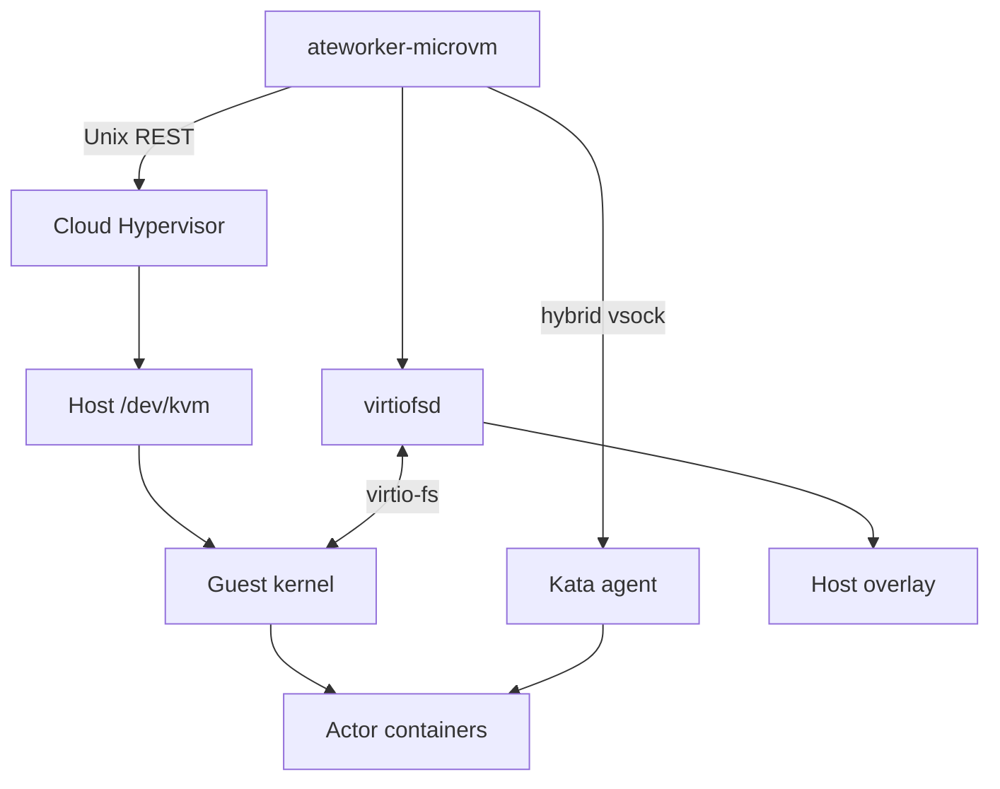
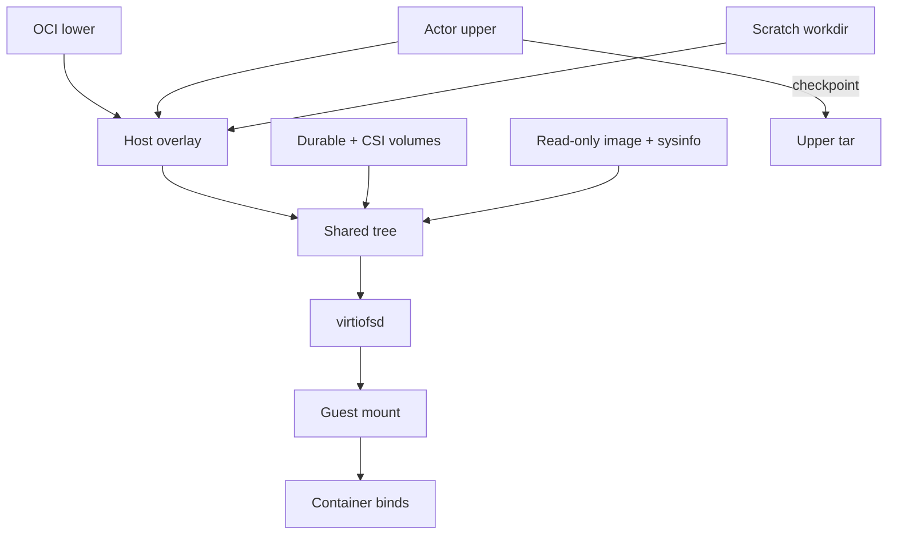
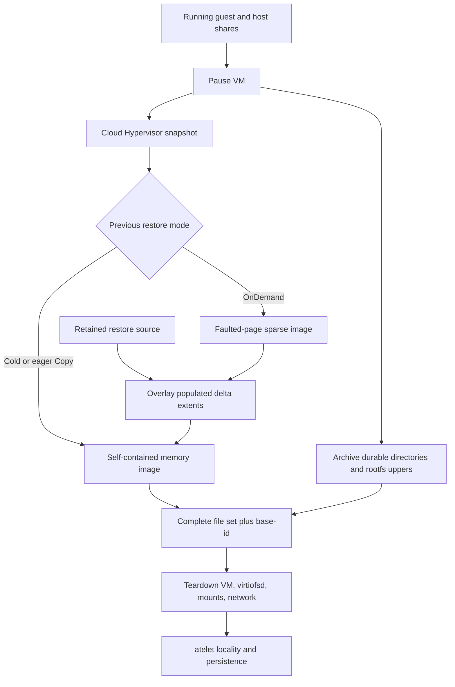
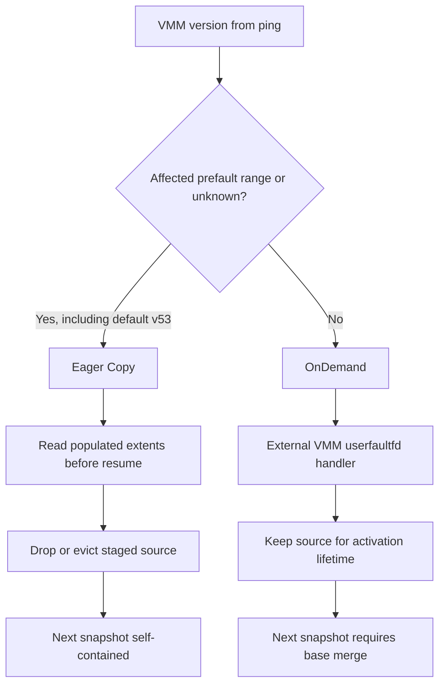

# 7. MicroVM Execution with Kata and Cloud Hypervisor

## 7.1 One actor, one guest kernel, several application containers

The microVM backend runs each actor in a Cloud Hypervisor virtual machine containing a Kata guest kernel and agent. All application containers belonging to that actor share the VM. The worker starts and owns the VMM and virtiofsd processes directly, constructs Cloud Hypervisor's configuration, and calls the Kata agent through ttrpc. This is a narrower integration than running a complete Kata containerd shim stack inside the worker. The implementation is visible in [run.go](https://github.com/agent-substrate/substrate/blob/v1.0.0/cmd/ateworker-microvm/run.go), [internal/ch](https://github.com/agent-substrate/substrate/tree/v1.0.0/cmd/ateworker-microvm/internal/ch), and [internal/kata](https://github.com/agent-substrate/substrate/tree/v1.0.0/cmd/ateworker-microvm/internal/kata).

The host-versus-guest boundary is the central difference from Chapter 6. Application system calls execute against a guest Linux kernel. KVM provides hardware-assisted execution through the host's `/dev/kvm`, and Cloud Hypervisor implements the VM's userspace device and control model. The worker itself remains a trusted host process inside a Kubernetes pod. Virtiofsd is another host process exposed to guest filesystem requests. A guest boundary does not remove the need to inspect those host-side attack surfaces or the worker's outer capabilities.

`runningActor` records the physical state of one activation: the Cloud Hypervisor child process, virtiofsd child process, API socket, stopping state, resource booking, memory guard, retained Kata-agent connection, and guest workload IDs. It also records the restore lineage and memory-source lifetime. Those last fields are essential for snapshots: `baseID`, `restoreSourceDir`, `preserveRestoreSource`, and `snapshotIsSelfContained` distinguish the identities and files that must survive different restore modes.

The runtime assets are supplied through the worker protocol rather than baked into the worker image. The required names are `cloud-hypervisor`, `virtiofsd`, `kata-kernel`, and `kata-image`. [microvm.go](https://github.com/agent-substrate/substrate/blob/v1.0.0/cmd/ate-setup/internal/steps/microvm.go) stages the default asset set, while [sandboxconfig-microvm.yaml.tmpl](https://github.com/agent-substrate/substrate/blob/v1.0.0/manifests/ate-install/sandboxconfig-microvm.yaml.tmpl) records digest-addressed objects for each architecture. In the audited checkout, setup pins Kata `4.3.1` and Cloud Hypervisor `v53.0`. These exact defaults determine which restore workarounds execute.

The Kata protocol bindings have separate provenance. [PROVENANCE.md](https://github.com/agent-substrate/substrate/blob/v1.0.0/cmd/ateworker-microvm/internal/third_party/kata/PROVENANCE.md) records the copied `.proto` definitions and their equivalence to the later runtime asset version. Only message types are generated in-tree. `AgentClient` calls named methods on `grpc.AgentService` through `ttrpc.Client.Call`. A reader looking for generated gRPC server/client stubs for the guest lifecycle will therefore not find the path that actually executes these calls.

The guest agent is booted as PID 1 from the Kata image. `buildVMConfig` supplies the kernel and command line, including the guest cgroup-v2 configuration from [internal/kata/config.go](https://github.com/agent-substrate/substrate/blob/v1.0.0/cmd/ateworker-microvm/internal/kata/config.go). The command line includes `swiotlb=noforce`, which skips the software bounce buffer, and the serial console stays off unless debugging is enabled. The host does not run the actor's application binary directly. It creates the VM, establishes its devices and shared filesystem, then asks the agent to create and start the actor's containers. Guest process and mount operations are thus mediated through the agent's protocol and guest kernel.

Cloud Hypervisor's `VmConfig` is modeled explicitly in [createvm.go](https://github.com/agent-substrate/substrate/blob/v1.0.0/cmd/ateworker-microvm/internal/ch/createvm.go). It contains vCPU sizing, memory sizing, kernel payload, persistent-memory image, virtio-fs, vsock, and other device configuration used by the backend. Shared memory is enabled so guest RAM is backed in a way that permits sparse snapshot files. The guest image's persistent-memory mapping is configured to discard writes rather than mutate the immutable boot asset. These fields define a reproducible VM shape; they are not a generic pass-through of arbitrary hypervisor options from the actor.

Actor memory limits size guest RAM. The implementation rejects a guest below its configured minimum, currently 128 MiB. CPU limits determine the rounded-up vCPU count while the host cgroup still limits actual CPU time to the requested millicores. Additional runtime overhead is booked outside guest RAM, including VMM/virtiofsd cost and memory structures whose size grows with guest RAM. This separates the actor's virtual machine capacity from the host's complete cost of running it.

The same distinction matters during resize. A cold boot can construct a VM with a new requested size. A memory restore reuses the shape embedded in the snapshot. Updating a template field does not rewrite a snapshotted guest's memory layout or vCPU state. A fidelity downgrade or another cold-boot path may be required for changed sizing to take effect. The control-plane compatibility and template rules must therefore be read together with the runtime's physical restore behavior.

Hardware access is established before any of these operations. The WorkerPool controller requests `ate.dev/kvm`, which atelet advertises through its device plugin, and mounts `/dev/net/tun`. The worker can see and use the device only when both the container runtime's device exposure and access controls permit it. Cloud Hypervisor, not Substrate's Go code, executes the KVM ioctls that create and run the VM. Keeping that attribution correct makes it possible to audit which host features the worker requires and which belong to the external VMM binary.

The advertised overhead is concrete code, not a measurement discovered dynamically for each guest. `actorOverhead` in [run.go](https://github.com/agent-substrate/substrate/blob/v1.0.0/cmd/ateworker-microvm/run.go) currently reserves four MiB plus eight MiB per GiB of guest memory. The size-dependent term accounts for host-side costs that grow with the memory mapping. This reservation is separate from the worker's own fixed memory reservation and from the guest RAM requested for the actor. It is an admission model whose adequacy can be measured under different workloads and VMM versions; it does not assert that every activation consumes precisely that amount.

Likewise, the 128-MiB minimum is an implementation admission threshold for the shipped guest setup. It is not a recommended memory size for arbitrary agent software. A workload can satisfy that minimum and still fail because its application, guest kernel, or initialization sequence needs more memory. Conversely, lowering the constant without verifying agent startup, filesystem behavior, and restore pressure would make the API accept a VM shape that may never become usable. The source connects the minimum to observations about this guest image, so changing the image or its boot services warrants reevaluating the threshold rather than treating it as a universal microVM property.

Host backing remains important even at these small sizes. Shared guest memory and the immutable pmem boot image serve different purposes: one holds mutable guest RAM, while the other supplies boot filesystem content whose writes are discarded. A memory checkpoint must capture the former and retain compatible identity for the latter. Treating both as interchangeable files would obscure why snapshot compatibility depends on the selected Kata image as well as the VMM executable.

## 7.2 Cold boot and the host-backed filesystem

`RunWorkload` validates the request, requires a registered worker epoch, takes the actor lifecycle lock, and reserves the actor's hosted state. It passes an `actorBootParams` value into the cold-boot machinery. That structure contains the actor/template identity, directories, containers, runtime assets, egress gateway, sandbox size, and an optional source for restored rootfs uppers. The same boot path can therefore start a pristine actor or cold-boot an actor whose filesystem state came from a `ROOTFS` snapshot.

`coldBootActor` first resolves the runtime assets and prepares egress. It cleans stale sandbox state before touching the writable rootfs upper, because an old overlay mount could still reference that upper. The method begins upper-directory preparation in a goroutine and overlaps it with OCI bundle preparation. Every return before the explicit join drains the goroutine. This detail prevents a retry from clearing or reconstructing the same directory while work from the previous attempt is still running.

The current rootfs design is host-backed. For each application container, the worker composes the OCI image base and constructs a host OverlayFS mount with an actor-specific upper and work directory. Virtiofsd exposes the merged tree through the VM's single shared filesystem. The guest runs the container against that tree; it does not build the current writable upper in guest tmpfs. Some older documentation comments still describe the retired arrangement, so [rootfsupper.go](https://github.com/agent-substrate/substrate/blob/v1.0.0/cmd/ateworker-microvm/rootfsupper.go) and [overlay_linux.go](https://github.com/agent-substrate/substrate/blob/v1.0.0/cmd/ateworker-microvm/internal/kata/overlay_linux.go) are the authoritative implementation sources.

The density consequence is substantial even without assigning it a benchmark number. Files written to the actor's rootfs consume host-backed filesystem storage and reclaimable host page cache. They do not require every written byte to remain in guest RAM merely because the upper is tmpfs. The guest still uses memory for application and kernel caches, and virtio-fs has its own cost, but rootfs growth no longer has the same direct dependence on a guest-memory-backed upper. An actor that installs packages or writes build artifacts benefits from this separation of storage and guest memory.

The snapshot consequence is equally important. Guest memory alone no longer contains the writable rootfs. `ROOTFS` and `MEMORY` snapshots must ship a tar of each container's host upper. The archive preserves whiteouts, opaque directory markers, ownership, modes, and relevant extended attributes so that recreating the overlay reproduces deletion and replacement semantics. A `VOLUMES` snapshot deliberately excludes those uppers and cold-boots on a pristine rootfs. Public fidelity remains consistent across backends even though the representation differs.

`StageMergedRootfs` creates the overlay with explicit options and recreates the work directory rather than archiving it. The work directory is scratch space, not user state. The mount uses volatile behavior because local upper durability is not the persistence contract; the upper is captured into the snapshot when appropriate. That choice removes unnecessary filesystem writeback obligations from ordinary overlay operations, but it also means local storage surviving a crash cannot be treated as a guaranteed checkpoint. Chapter 8 distinguishes retained local files from durable external snapshots.

Host mounts receive `nosuid` and `nodev` attributes where appropriate. These attributes protect the host's interpretation of the exposed tree; the guest sees filesystem contents through virtio-fs under its own mount and execution rules. The backend must not execute an actor-provided setuid file on the host merely because the guest needs to preserve its mode for container semantics. Recursive read-only handling is used for image and system-information paths that should not be writable through the share.

All volume classes are organized beneath one shared tree. Durable-directory volumes appear under their dedicated subtree; external CSI volumes are bind-mounted into another; image volumes and system-information volumes are mapped to their guest paths by [ShapeMicroVM](https://github.com/agent-substrate/substrate/blob/v1.0.0/internal/ocispec/microvm.go). That function also applies containerd's default masked and read-only paths and sets `net.ipv4.ping_group_range`, in place of the fixed system mounts it used to add. This avoids adding another virtual filesystem device for every volume. It also means the path mapping is part of the restore contract: the guest's references must resolve to the same logical content after reconstruction on another worker.

Virtiofsd is launched with the shared directory and the options chosen in `virtiofsdArgs`. The implementation does not enable its writeback mode. The checkpoint code relies on this write-through behavior: once the guest is paused, completed guest writes have reached the host tree and can be archived coherently. This does not mean every application transaction is complete; an application may have had higher-level operations in progress. It establishes the filesystem visibility boundary needed for the runtime's snapshot mechanism.

The worker creates an actor cgroup before launching the VMM and virtiofsd. Both children start with the cgroup descriptor passed through `SysProcAttr`, so their allocations are charged to the actor from birth. The host CPU quota bounds their combined execution. The memory guard observes the combined host cost associated with the actor, including guest RAM backing and filesystem service behavior, while guest per-container cgroups can enforce the container-level limits passed through the Kata OCI conversion.

Networking uses a TAP interface in the actor's namespace. [net.go](https://github.com/agent-substrate/substrate/blob/v1.0.0/cmd/ateworker-microvm/net.go) supplies fixed gateway and guest MAC addresses. A snapshot freezes the guest's ARP cache; changing the host TAP's gateway MAC on restore would leave the guest sending traffic toward an obsolete layer-2 identity until its cache changed. The constant MAC is safe in this context because each actor has its own isolated namespace. It is a state-reconstruction requirement, not a shortcut that assumes all actors share one Ethernet segment.

Cloud Hypervisor receives TAP file descriptors through its Unix API socket. The worker creates the VM, supplies network devices, and boots it, then connects to the guest agent through hybrid vsock. [agentclient.go](https://github.com/agent-substrate/substrate/blob/v1.0.0/cmd/ateworker-microvm/internal/kata/agentclient.go) first sends a textual `CONNECT` request to the VMM's host Unix socket and then runs ttrpc over the resulting stream. The host-side connection is not a direct `AF_VSOCK` call in this package. The VMM bridges it to the guest's virtual socket transport.

The agent configures guest interfaces, routes, ARP neighbors, sandbox state, and application containers. Each application gets its own rootfs and `CreateContainer`/`StartContainer` calls while sharing the VM. Guest stdout and stderr are read through agent RPCs and forwarded with actor/container attribution. The connection remains open after boot because logging and statistics continue using it. Closing it when `RunWorkload` returns would silently break essential ongoing services even though the application processes might remain alive.

Cold-boot retry is deliberately narrow. `coldBootActorRetrying` retries when the guest stops before the agent answers, after cleanup of the failed attempt. At that point no actor application container has run, so repeating boot does not repeat application side effects. The implementation limits the attempt count. It does not retry an arbitrary later failure after containers may have called external services. This restriction is an important example of placing retries at a boundary where their safety can be explained from execution order.

After application containers start, wakeup probes gate ingress activation. Egress is available during cold boot so initialization can contact dependencies. The worker records the running VM, retained agent connection, workload IDs, and runtime state for later statistics and shutdown. A successful response means the current worker epoch accepted and prepared the actor through this sequence. It does not mean the Kubernetes pod was recreated or that a generic VM-management controller observed a desired-state object.

## 7.3 Capturing a complete snapshot from several state domains

MicroVM state spans guest RAM, virtual device state, host rootfs uppers, durable directories, external volumes, and runtime-local sockets and mounts. A correct snapshot cannot simply copy the VMM's memory file and assume those other domains are represented. `CheckpointWorkload` in [checkpoint.go](https://github.com/agent-substrate/substrate/blob/v1.0.0/cmd/ateworker-microvm/checkpoint.go) coordinates capture around a paused guest, then tears down the live execution resources. The returned snapshot file list is the boundary handed to atelet for locality and external persistence.

The method validates fidelity and actor state, takes the actor lifecycle lock, and can reuse a completed checkpoint from a previous attempt through the shared completion-marker mechanism. It deactivates actor traffic and records the state needed for capture. The VMM is paused before archiving host-backed files so the guest cannot continue changing them while the tar walk proceeds. A filesystem snapshot assembled while the guest writes would contain an uncontrolled mixture of times, even if every individual file read succeeded.

For `VOLUMES`, only the declared durable-directory contents are preserved, and the workload will cold-start later. For `ROOTFS`, each rootfs upper is added. For `MEMORY`, the VMM's configuration/state/memory output is captured as well. The host OCI lower is reconstructed from the image at restore and is not shipped as a duplicate part of every actor snapshot. External CSI volumes have their own persistence lifecycle; the snapshot does not magically convert an arbitrary external volume into a tarred durable-directory volume.

[durable.go](https://github.com/agent-substrate/substrate/blob/v1.0.0/cmd/ateworker-microvm/durable.go) generates one archive per durable volume and validates the volume name used in its filename. The destination volume directory is created by atelet, not taken from an archive entry that might be a symlink. This protects the later guest bind operation from being redirected by a malicious snapshot layout. The archive includes the root directory's metadata while extraction remains confined to the directory the supervisor created.

[rootfsupper.go](https://github.com/agent-substrate/substrate/blob/v1.0.0/cmd/ateworker-microvm/rootfsupper.go) similarly owns the layout above each per-container upper. A snapshot contains the upper's content, not arbitrary path names that tell the worker where to mount or delete. The worker recreates its directory structure, extracts into it, and creates a fresh work directory. This distinction between restoring content and trusting topology should be preserved in any extension to the snapshot format. A path derived from actor-controlled archive metadata must not become a host cleanup target without validation.

Memory capture records a `base-id` file. This identifier is the frozen filesystem lineage identity the guest's virtio-fs references were originally built against. A clone made from a golden actor has a new actor UID, and its current VMM socket paths are rewritten for that UID, but the restored guest still contains references associated with the original shared layout. `runningActor.baseID` propagates that invariant across repeated suspend/restore cycles. Deriving it from the current `config.json` socket path would work for an initial case and fail after the first restored actor is checkpointed again.

Snapshot writing can temporarily double part of the actor's memory footprint through dirty page cache. `writeSnapshot` limits concurrent writes and uses the shared borrowing ledger. It can lift or adjust the actor's memory.high threshold while the guest is paused, but the amount is bounded by booking, current usage, available headroom, and borrowed memory. The memory guard is paused for the capture interval so it does not classify Substrate's own snapshot cache growth as a runaway application. Afterward, normal enforcement resumes.

The writeback callback returns borrowed memory once the generated files are clean and reclaimable. The rootfs-upper and durable-directory tars use the same accounting through `archiveDir`, which borrows the pod's unbooked memory when the whole source directory fits and returns the loan after its archive is written back. This is analogous to the gVisor mechanism but the accounting location differs: Cloud Hypervisor writes from the actor's VMM cgroup rather than moving a Sentry into a sibling checkpoint group. These backend differences affect how a memory-pressure trace should be interpreted. A shared metric named “checkpoint memory” should not imply that identical cgroup movement occurs in both implementations.

The most subtle correctness branch follows an OnDemand restore. Cloud Hypervisor has only materialized pages the guest touched since restoration. Its subsequent sparse memory snapshot can therefore omit pages still represented by the old restore source. Those holes mean “unchanged data remains in the base,” not necessarily “the logical contents are zero.” Substrate must combine the new populated extents with the old source before publishing a self-contained snapshot.

[MergeSparseOverlay](https://github.com/agent-substrate/substrate/blob/v1.0.0/cmd/ateworker-microvm/internal/ch/merge.go) makes a sparse copy of the base and overlays every data extent from the delta at the same offset. `SEEK_DATA` and `SEEK_HOLE` identify the extents to copy. File sizes must match because the algorithm assumes identical flat memory layout for the same guest and runtime. A mismatched layout is rejected rather than producing an image whose byte offsets silently refer to different guest addresses.

`MergeDeltaIntoBase` optimizes the case where the restore source is private, on the same filesystem, and no longer needed as an immutable shared base. It overlays delta data into that staging file and links the complete result into the checkpoint location. If the file is shared by another hard link or crosses a filesystem boundary, the code falls back to copying. `preserveRestoreSource` forces the safe copying merge. This branch is a direct connection between filesystem ownership and snapshot algorithm: an optimization is valid only when mutation cannot corrupt another actor's source.

The merge is not a general object-store incremental snapshot chain. The output handed to atelet is complete and can be restored without retaining a sequence of earlier external deltas. The implementation uses differential information locally to avoid losing untouched pages and, when safe, to reduce copying. A future native incremental storage design would need reference tracking, garbage collection, chain compaction, corruption handling, and failure semantics not supplied by this local merge alone.

The code also attends to filesystem behavior during publication. Comments in the merge path explain why replacing an existing destination through rename can force unwanted writeback on some filesystems, and why the algorithm removes an old name before publishing its private result in the relevant case. Those comments describe the motivation for the current sequence, not a portable latency guarantee. The safety argument depends on which file is authoritative at each step and on the retry's ability to find its base if a sibling checkpoint step later fails.

An eager `Copy` restore has a simpler subsequent snapshot. It has read every populated source extent into guest memory, so the next VMM snapshot is self-contained. `snapshotIsSelfContained` records that fact, and `snapshotVMState` skips the merge. A cold-booted actor likewise has no OnDemand restore source to merge. Avoiding an unnecessary merge is not only a speed optimization; it simplifies source-file lifetime and reduces accidental dependence on an already discarded staging image.

Consider an illustrative memory image divided into four equal regions. The base contains application data in regions zero and three, while regions one and two are holes. After OnDemand restore, the guest touches only region zero and changes part of it. The next VMM snapshot can contain populated data for region zero while leaving region three absent because it was never faulted into the restored guest's backing memory. Interpreting every delta hole as zero would erase region three, even though the application never changed it. Overlaying the delta's populated regions on the base preserves it.

The same reasoning explains why the merge algorithm requires identical logical size and layout. An offset is meaningful only relative to the memory mapping represented by the files. If a runtime upgrade changes that layout, copying bytes at matching offsets can place valid data at the wrong guest address. Equality of file length is a necessary defensive check, not a universal proof of compatibility across VMM versions. Runtime compatibility policy must prevent combinations whose layouts differ even when their total sizes happen to match.

There is also a distinction between a populated extent containing zeros and an absent extent. The merge copies all data extents, including zeros, because those bytes can represent an intentional change from nonzero base data. A hole in the delta is interpreted according to the VMM's on-demand snapshot semantics as retaining base content. The integration depends on that semantic agreement. An optimization that punched holes for all-zero modified pages without additional metadata could destroy the information needed to distinguish “unchanged” from “changed to zero.”

The private-base optimization preserves retryability by leaving the base addressable under its restore directory while constructing the checkpoint result. If a sibling operation, such as rootfs archiving, fails and the checkpoint directory is cleared for retry, the merge source still exists. Linking the completed image into the checkpoint path establishes a second name only after the data overlay succeeds. This is why link count and mount identity participate in the optimization decision: they reveal whether mutation is private and whether a hardlink publication is possible.

A preserved or shared source follows the copying path. That extra I/O is the cost of maintaining another consumer's immutable view. A hardlink is not a copy-on-write clone; writing through one name changes the same inode observed through every other name. The snapshot cache therefore materializes private microVM copies, and the merge still checks its preconditions rather than trusting how the file was supposedly obtained. Defense at both the staging and merge layers protects against future callers that use a different materialization strategy.

These operations can leave partial local files after a host failure because they intentionally avoid forcing the full image to stable storage on the checkpoint critical path. Chapter 8's boot-ID rule closes that recovery boundary by invalidating uncertain local snapshots after reboot. Within the same boot, completion markers and tracker state distinguish a published capture from scratch output. Across boots, external durability is the authoritative recovery tier. The sparse merge algorithm and the node tracker are therefore parts of one correctness story even though they reside in different processes.

## 7.4 Restore mode, namespace reconstruction, and page demand

The microVM restore path must be described conditionally. [restoreMemMode](https://github.com/agent-substrate/substrate/blob/v1.0.0/cmd/ateworker-microvm/restore.go) asks the VMM what version it is and selects a memory mode using [PrefaultsUnconditionally](https://github.com/agent-substrate/substrate/blob/v1.0.0/cmd/ateworker-microvm/internal/ch/prefault.go). The audited default Cloud Hypervisor version is `v53.0`, which the implementation treats as affected by unconditional background prefaulting. For that version, and for an unrecognized version, it selects eager `Copy`. The existence of `userfaultfd` support does not mean the default deployment currently uses demand paging.

The source records the reason for the workaround: affected VMM behavior can prefault registered pages in the background and gate a subsequent snapshot until that work finishes. Under contention, the resulting activity can prevent the guest's wakeup probe from making progress. The code prefers the larger eager footprint over an actor that cannot reliably activate. This is a version-specific tradeoff visible in the implementation. It must not be rewritten into a universal claim that eager restore is inherently better or that demand paging is unsupported.

For an unaffected VMM, `OnDemand` uses Cloud Hypervisor's `userfaultfd` restore machinery. The host kernel reports missing-page faults to the VMM's userspace handler, which supplies data from the snapshot memory file. Substrate does not issue `userfaultfd` or its registration ioctls directly. It sends `memory_restore_mode` in the VMM REST request. The source snapshot remains needed for the VM's lifetime, and the next checkpoint must merge its faulted-page image against that source.

For eager `Copy`, the VMM reads the populated source extents during restore. Once that step finishes, the source is no longer needed for paging or later merge. The worker can drop temporary staged memory data and evict its page cache before resuming the guest, reducing overlap between guest RAM and snapshot cache. A preserved cache-backed source keeps its file identity but can shed resident pages. This source-lifetime branch is one of the main reasons memory mode is stored in `runningActor` rather than treated as a one-shot REST option.

Before memory restore, the worker reconstructs all host resources the guest expects. It rewrites snapshot configuration paths to point to the current actor's kernel, image, API-related sockets, and filesystem service locations. It reads the frozen base ID separately. Rootfs uppers and durable volumes are restored before the corresponding overlays and shared tree become visible. OCI bundle construction can overlap archive extraction, but the code joins the extraction before mounting the merged rootfs, preventing the guest from observing a partially materialized upper.

The network descriptor transfer deserves a closer reading because it crosses both a namespace boundary and a process boundary. `SnapshotNetDevices` reads the saved device identifiers, queue counts, and MAC addresses from the VMM configuration. The worker opens fresh TAP descriptors for those devices in the newly constructed actor network namespace. It cannot reuse an integer recorded by the old process: descriptor numbers are local to a process table, and the original TAP objects belonged to an earlier physical activation.

`RestoreWithNetFDs` pairs each saved network-device identifier with a count of fresh descriptors and appends those descriptors in matching order to the ancillary data. It sends an HTTP request over the Unix API connection using `WriteMsgUnix` and `unix.UnixRights`. Linux transfers references to the open file descriptions through `SCM_RIGHTS`; Cloud Hypervisor receives usable descriptors in its own process table. The JSON body supplies their logical association with the saved virtual devices. Neither the JSON nor a pathname alone can carry that kernel object reference.

The implementation uses raw HTTP construction for this particular operation because the ordinary `net/http` transport does not attach the required ancillary descriptor data. It still parses the response as HTTP and bounds the error body it reads. The socket gets a request deadline, including a default when the context provides none. This is a specialized local control protocol, not an unauthenticated network service exposed to actors. Its authority comes from the worker's access to the VMM socket and the descriptors it created.

The restored VM remains paused when the request succeeds. That pause is a useful synchronization point: the VMM has accepted the memory and device state, but guest execution has not yet resumed against a partly reconstructed host environment. The worker can finish the mode-dependent source handling and then invoke `Resume`. After resume it must establish guest-agent communication, refresh entropy, pass probes, and activate traffic. A successful `vm.restore` response is therefore an intermediate milestone, not the actor's final readiness signal.

The VMM process itself intentionally outlives the RPC context that launched it. `LaunchVMM` uses `exec.Command`, and the returned child process becomes the caller's owned resource. Readiness waiting honors cancellation, and failure stops the process. After successful handoff, canceling the original client request must not kill a healthy actor merely because the request's scope ended. That ownership transfer mirrors the retained guest-agent connection: process and connection lifetimes follow the activation, while individual management calls remain bounded.

Virtiofsd must be running before the restored VM reconnects to its filesystem device. The worker stages the shared tree and launches virtiofsd inside the actor cgroup, then waits for its socket. A socket path alone is not evidence that it belongs to the intended live service; stale state is cleaned before launch. Failure cleanup stops the child and detaches mounts so a retry starts from a coherent topology rather than inheriting a half-reconstructed share.

Fixed MAC addresses prevent a subtler failure after the descriptors are accepted. The guest's restored ARP entry for its gateway must still identify the host endpoint. Recreating a TAP with a fresh random MAC could leave the VM apparently running, agent communication functional over vsock, and outbound TCP blackholed. The worker therefore reconstructs both the control-plane device identity and the layer-2 identity that lives inside guest memory. A successful `vm.restore` response alone does not prove application networking works.

The runtime's guest-visible filesystem paths have the same shape of requirement. Changing only the current VMM socket paths cannot rewrite every path embedded in guest memory. The frozen `base-id` ensures that the reconstructed share presents content at the location the guest's restored handles expect. This is why a snapshot must be tested through repeated clone, checkpoint, and restore sequences, not only a single restore of the original actor. The second generation exercises the difference between current actor identity and preserved lineage identity.

The final phase includes agent connection, entropy reseeding, wakeup probes, and ingress activation. These steps can dominate a small VM's user-visible activation after the memory image is restored. The phase log records them separately from VM restore and from host filesystem reconstruction. A measurement comparing cold and warm resumes should identify whether the difference came from object-store fetch, cached image composition, upper extraction, VMM startup, memory mode, or readiness. “VM restore took X” is not a complete explanation of the request's delay.

The density model also depends on mode. With OnDemand, an idle restored VM can initially occupy a smaller working set but retains the base file and may fault later. With Copy, activation reads the populated image eagerly and memory residency rises earlier, while the later source lifetime and checkpoint algorithm simplify. The implementation's version workaround chooses between those actual costs. A production capacity model should use the active mode reported by the worker, not a product-level description that assumes all microVM snapshots are lazy.

## 7.5 Entropy, clocks, statistics, and failure cleanup

A memory snapshot includes guest kernel state beyond application pages. Randomness and time are two examples where restoring bytes is not sufficient to restore correct behavior in a new activation. Cloning the same frozen kernel random-number generator state can make different actors emit correlated or identical values before fresh entropy is mixed in. A restored guest clock can lag wall time and affect TLS, token expiry, timers, and application logic. These are semantic restore requirements, not optional polish after a successful VMM operation.

The worker generates fresh entropy with the host's cryptographic random source and calls the Kata agent's `ReseedRandomDev`. [restore.go](https://github.com/agent-substrate/substrate/blob/v1.0.0/cmd/ateworker-microvm/restore.go) performs this after resuming the VM and connecting to the agent, and before enabling egress. Failure to reseed fails the restore. The egress gate prevents the normal outbound path from exposing values generated under the shared frozen random state before reseeding completes. Ingress remains gated by the later wakeup probes.

The implementation explicitly acknowledges a remaining race. Guest instructions run after `Resume` and before the agent completes reseeding, so code reading randomness in those first instants can still observe the old state. The source proposes a VMM generation-ID mechanism or keeping the workload frozen across reseeding to close that interval. The reseed RPC therefore reduces repeated-randomness exposure without closing the first-instruction timing boundary identified by the source.

[guestclock.go](https://github.com/agent-substrate/substrate/blob/v1.0.0/cmd/ateworker-microvm/internal/ch/guestclock.go) records the VMM version at which guest clock restoration is repaired automatically. The comments distinguish the architecture-specific mechanisms, including KVM clock handling on x86. This is external-VMM behavior that Substrate recognizes, not a direct Go `KVM_SET_CLOCK` call. Unknown versions are treated conservatively by the capability predicate. A reader auditing a new VMM release should check both the prefault workaround and the clock predicate; the same version transition can improve one restore property while requiring a workaround for another.

The guest agent connection remains part of the running activation. Logging pumps `ReadStdout` and `ReadStderr` through ttrpc, and statistics use the same retained connection. The protocol multiplexes concurrent requests, so separate application streams do not require a new guest agent for each operation. Teardown closes the connection after its useful lifetime, causing pending reads to terminate. A stuck or failed agent therefore affects observability as well as control, even if the VMM process has not exited.

Statistics distinguish host cost from guest container observations. The host cgroup measures the VMM and virtiofsd boundary, while Kata's container statistics provide guest-side information through [internal/agentstats](https://github.com/agent-substrate/substrate/tree/v1.0.0/cmd/ateworker-microvm/internal/agentstats). Neither is an interchangeable replacement for the other. Guest application limits may be enforced inside the VM, but the host still pays for guest kernel memory, VMM structures, device handling, and host-backed filesystem work. Capacity accounting must retain that overhead.

The `runningActor.memoryBytes` field records the booking relevant to host enforcement. The worker creates the actor leaf with CPU and memory.high settings, and its guard watches for sustained pressure. During snapshot writing, the guard is paused and the memory limit can be temporarily adjusted to account for the controlled writeback load. If a runtime process exits unexpectedly, the watcher distinguishes it from an intentional stop through the `stopping` flag. Virtiofsd may exit after its sole VMM client disappears; that secondary exit must not be misreported as a new independent actor crash.

Graceful shutdown propagates signals into the guest by invoking Kata's `SignalProcess` for the recorded workload IDs. It waits for application exit within the shutdown policy and can escalate. Host process termination is a different operation from signaling the guest's application process. Killing Cloud Hypervisor immediately discards the guest's opportunity to handle SIGTERM and may leave host filesystem or runtime cleanup to recovery. The code keeps the guest process list precisely so it can attempt application-level shutdown before removing the VM boundary.

`teardownActor` stops the VMM, stops virtiofsd, closes the agent connection, and removes sandbox mounts and runtime state in a controlled order. The filesystem service should not be removed while the VMM still relies on it. Likewise, upper directories must not be deleted while overlay mounts or shared binds still reference them. [cleanup_linux.go](https://github.com/agent-substrate/substrate/blob/v1.0.0/cmd/ateworker-microvm/internal/kata/cleanup_linux.go) inspects mountinfo and detaches mounts before directory removal. Failure to detach must not become recursive deletion of content reached through a still-live bind.

The worker also controls when an activation is safe to retry. A cold boot that dies before the agent answers has not run actor containers and can be retried under the narrow rule described earlier. A restore failing before egress and ingress activation is handled through `restoreGuestReadyError` and atelet's bounded restore-failure accounting. The relevant safety argument is that the restored workload has not been made externally reachable through the controlled paths. It is not a claim that the guest executed zero instructions or that every possible local computation is reversible.

The source deliberately bounds repeated retryable failures at the node layer. An intrinsically incompatible snapshot or a consistently broken runtime should not produce an infinite loop of expensive VMM launches. The error classification must therefore preserve enough information for atelet to distinguish transient readiness failures from invalid requests or unrecoverable state. Flattening all runtime errors into an opaque string would make that policy less reliable and make operational diagnosis harder.

An illustrative failure demonstrates several boundaries at once. Suppose upper extraction succeeds, virtiofsd starts, TAP descriptors are created, and `vm.restore` fails because the snapshot's device configuration is incompatible. The worker must stop any launched VMM process, stop virtiofsd, close TAP descriptors, detach reconstructed mounts, and release the actor's hosted reservation. It must preserve the original immutable snapshot so the control plane can retry elsewhere or revert according to policy. Cleanup of the failed physical activation must not mutate the recovery source merely because both reside on the same node filesystem.

Another case occurs after a successful OnDemand restore but before the next checkpoint completes. The running VM may still fault from its retained source. A partially written delta is not independently restorable. If the worker removes the base too early, both continued execution and checkpoint retry can fail. `restoreSourceDir` and the merge helpers make that dependency explicit. The implementation's correctness relies on treating that source as live state until teardown and complete snapshot construction have established the next recovery point.

The backend's failure domain remains the worker pod for some host-level failures. Actor-specific cgroups and namespaces limit many effects, but the worker process, pod memory ceiling, node filesystem, and VMM binaries are shared dependencies. A pod restart affects all actors hosted there. A corrupted shared runtime asset can affect multiple future activations. The node cache and identity boundaries reduce exposure, while durable snapshots provide recovery state. None of these mechanisms makes a multiplexed worker equivalent to a dedicated node for every actor.

A useful resource-accounting comparison follows from these boundaries. The guest container can report a small resident set while the host cgroup still carries guest kernel memory, shared-memory backing, virtiofsd allocations, and file cache caused by its workload. Conversely, a host usage sample may include reclaimable cache that does not represent irreplaceable guest state. Treating either sample as the complete definition of actor memory would lose information. The host guard must protect the pod, while guest statistics help explain what the application is doing inside that protected allocation.

The CPU model has a similar two-level interpretation. Rounding a fractional CPU request into an integer vCPU count determines the virtual topology visible to the guest. The host cgroup quota limits how much CPU time the VMM and its associated processes can consume. An actor can therefore see more virtual CPUs than its sustained host entitlement. That is deliberate: virtual CPU count and bandwidth are different dimensions. Workloads that size thread pools from the visible CPU count may produce contention even while the host enforces the correct overall quota.

Filesystem limits cross another pair of boundaries. A guest process can dirty its root filesystem through virtio-fs, causing host-backed storage and host page-cache growth. Increasing guest RAM does not create additional disk capacity for that upper. Increasing the node volume does not make the guest immune to memory pressure caused by application allocation. Snapshot upload introduces still another cost in the plugin process. Operational capacity models need separate allowances for guest execution, host filesystem state, checkpoint writeback, and transfer buffers; combining them into one nominal actor memory number hides the mechanism that actually fails first.

The source's phase records make these distinctions testable without assuming a particular performance result. A restore that spends most time extracting an upper needs a different investigation from one stalled in VMM readiness, guest-agent connection, or probes. A checkpoint delayed by write-slot admission differs from one delayed by sparse merge or tar creation. Recording the active memory mode and runtime asset identity alongside those phases is essential because a version change can deliberately switch the whole source-lifetime strategy. Comparing traces without those attributes can mistake a compatibility workaround for an unexplained regression.

## 7.6 Roadmap and engineering improvements

The most immediate repository-backed improvement is removing the eager-restore workaround when Cloud Hypervisor exposes suitable behavior. `prefaultingUntil` is intentionally open-ended in [prefault.go](https://github.com/agent-substrate/substrate/blob/v1.0.0/cmd/ateworker-microvm/internal/ch/prefault.go). A future release that stops unconditional prefaulting or lets the caller decline it can close that range and restore OnDemand selection. The correct change is tied to verified VMM behavior and tests of repeated restore/snapshot cycles. Merely increasing a version constant because a new release exists would risk reintroducing the stalled-probe failure.

Validation must include the second snapshot after an OnDemand restore. A first restore can appear correct while the next sparse snapshot silently omits pages that were never faulted. The existing merge code addresses that case, but future VMM changes may alter memory-file layout, sparse extent behavior, or snapshot completeness. A compatibility test should place data in pages that remain untouched during the resumed interval, checkpoint again, and verify them after another restore. This tests the base dependency rather than only the workload's active working set.

The entropy race is another explicit upstream dependency. The source proposes switching to a VMM generation-ID mechanism when available so the guest kernel can refresh randomness before workload execution resumes. That would remove an agent round trip and close the post-Resume window. Until then, the implemented reseed and egress gate should remain documented with their exact scope. An application that requires proof that no instruction observes duplicated random state needs a stronger mechanism than the current sequence provides.

A proposed improvement is to make restore capabilities explicit rather than infer every property from a version range. Version predicates are practical when integrating external binaries, but vendor builds, backports, or patched releases can differ. A capability report that covers memory mode, prefault behavior, clock correction, and snapshot format could make compatibility more precise if the upstream APIs support it. Such a report must be authenticated by the runtime asset identity and tested, not accepted as an arbitrary user-supplied assertion.

Host-backed rootfs persistence has its own future work. The current per-container tar captures writable state completely, which is simple to reason about but can make checkpoint time proportional to accumulated rootfs changes. Native filesystem snapshots or incremental archive strategies could reduce that cost. They would need to preserve whiteouts, ownership, xattrs, sparse files, and actor isolation while supporting cross-node reconstruction. They would also introduce cleanup and retention obligations beyond the current independent tar files. This is an editorial proposal, not an implemented storage feature.

The frozen path identity deserves a formal format contract as upgrades stabilize. `base-id` currently carries an important lineage invariant that is easy to misunderstand as a convenient name. A future snapshot manifest could describe the guest's expected shared-tree layout and its version explicitly, allowing validation before the VMM starts. The goal would be earlier rejection of incompatible state and easier migration tooling. It would not eliminate the need to reconstruct files deterministically at paths the restored guest can use.

Performance work should separate host reconstruction, VMM launch, memory restore, reseeding, and application readiness. The implementation already emits phase logs that support this analysis. Proposed experiments should include cold versus warm OCI caches, shared versus private snapshot sources, large rootfs uppers, multiple containers, and concurrent resume waves. They should measure peak host memory and source-file lifetime alongside request latency. A low single-actor restore time does not establish how many actors a node can wake concurrently without reclaim or writeback contention.

Finally, runtime extension should retain the shared worker contract without forcing backend internals to look identical. A new VMM may expose different descriptor-transfer APIs, device snapshot semantics, or memory restoration modes. It can still implement `RunWorkload`, `CheckpointWorkload`, `RestoreWorkload`, termination, and statistics while documenting those differences. The microVM backend demonstrates the right level of commonality: shared actor lifecycle and resource contracts, with explicit backend code for guest boot, filesystem reconstruction, and snapshot correctness.

## Source map

- [run.go](https://github.com/agent-substrate/substrate/blob/v1.0.0/cmd/ateworker-microvm/run.go), [restore.go](https://github.com/agent-substrate/substrate/blob/v1.0.0/cmd/ateworker-microvm/restore.go), and [checkpoint.go](https://github.com/agent-substrate/substrate/blob/v1.0.0/cmd/ateworker-microvm/checkpoint.go): activation state, boot/restore sequencing, fidelity, and complete snapshot construction.
- [internal/ch/createvm.go](https://github.com/agent-substrate/substrate/blob/v1.0.0/cmd/ateworker-microvm/internal/ch/createvm.go), [restorefds.go](https://github.com/agent-substrate/substrate/blob/v1.0.0/cmd/ateworker-microvm/internal/ch/restorefds.go), [prefault.go](https://github.com/agent-substrate/substrate/blob/v1.0.0/cmd/ateworker-microvm/internal/ch/prefault.go), and [merge.go](https://github.com/agent-substrate/substrate/blob/v1.0.0/cmd/ateworker-microvm/internal/ch/merge.go): VMM configuration, FD transfer, mode selection, and sparse memory merging.
- [internal/kata/overlay_linux.go](https://github.com/agent-substrate/substrate/blob/v1.0.0/cmd/ateworker-microvm/internal/kata/overlay_linux.go), [rootfsupper.go](https://github.com/agent-substrate/substrate/blob/v1.0.0/cmd/ateworker-microvm/rootfsupper.go), and [durable.go](https://github.com/agent-substrate/substrate/blob/v1.0.0/cmd/ateworker-microvm/durable.go): host-backed filesystems and archive boundaries.
- [internal/kata/agentclient.go](https://github.com/agent-substrate/substrate/blob/v1.0.0/cmd/ateworker-microvm/internal/kata/agentclient.go), [net.go](https://github.com/agent-substrate/substrate/blob/v1.0.0/cmd/ateworker-microvm/net.go), and [internal/ch/guestclock.go](https://github.com/agent-substrate/substrate/blob/v1.0.0/cmd/ateworker-microvm/internal/ch/guestclock.go): guest control, stable network identity, entropy, and clock behavior.
- [microvm.go](https://github.com/agent-substrate/substrate/blob/v1.0.0/cmd/ate-setup/internal/steps/microvm.go), [sandboxconfig-microvm.yaml.tmpl](https://github.com/agent-substrate/substrate/blob/v1.0.0/manifests/ate-install/sandboxconfig-microvm.yaml.tmpl), and [PROVENANCE.md](https://github.com/agent-substrate/substrate/blob/v1.0.0/cmd/ateworker-microvm/internal/third_party/kata/PROVENANCE.md): runtime asset pins and protocol provenance.
