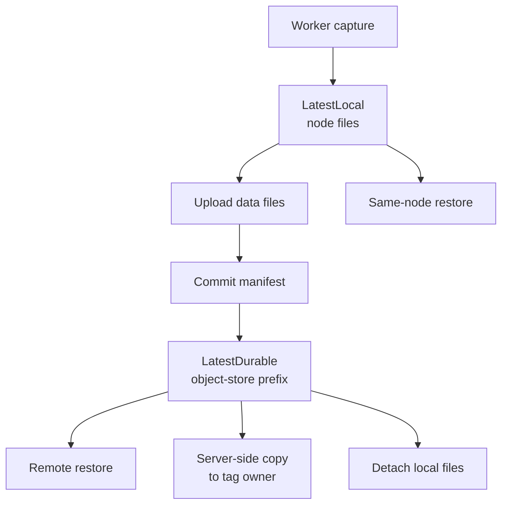
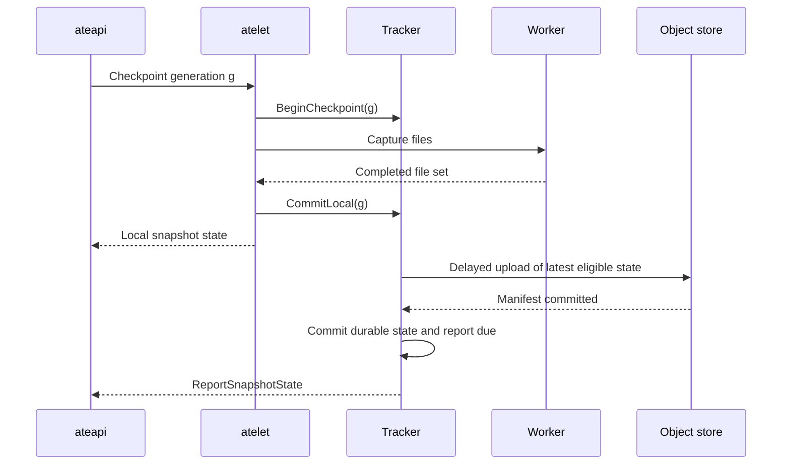
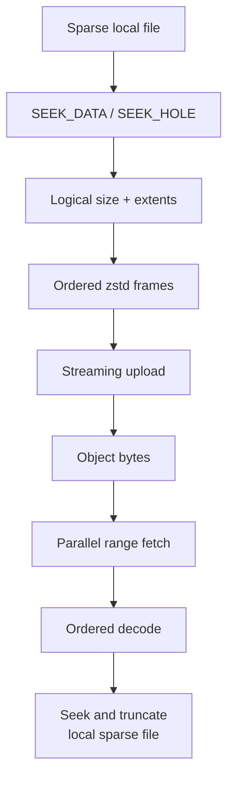
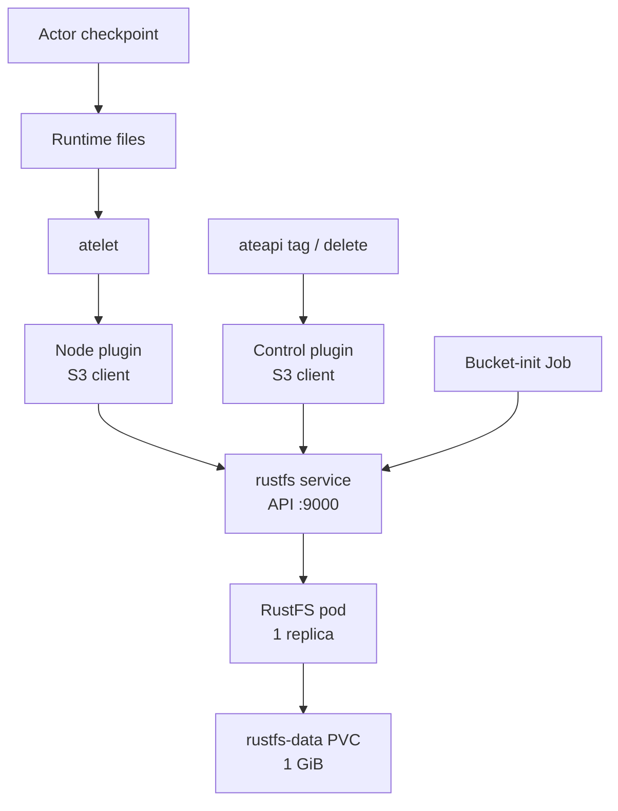

# 8. Snapshot Persistence, Locality, and Storage Backends

## 8.1 A snapshot has an owner, a fidelity, and several locations

A worker checkpoint does not by itself make an actor recoverable on another node. It produces a collection of local files with a particular fidelity. Atelet must associate those files with an actor generation, retain them while they remain useful, transfer them to object storage when required, and tell the control plane which locations are valid. Those are separate transitions. Collapsing them into a single suspended flag would lose the distinction between an actor whose latest memory image exists only on one node and an actor that can be restored after that node disappears.

The split is visible in [snapshottracker/tracker.go](../../cmd/atelet/internal/snapshottracker/tracker.go). `Tracker` keeps both `LatestLocal` and `LatestDurable`; its comments define how the two advance across checkpoint, upload, promotion, restore, and detach. A newer local checkpoint can coexist with an older durable checkpoint. Upload success does not delete the local checkpoint. A local checkpoint can therefore provide the next same-node activation while the durable copy provides a different recovery option. Neither field alone describes the actor's complete recovery position.

Fidelity belongs to another axis. The worker implementations distinguish volume, root filesystem, and memory checkpoint behavior. A volume checkpoint preserves the selected durable filesystem contents while application processes restart. A root filesystem checkpoint adds the container's writable filesystem state, still without preserving its process execution. A memory checkpoint captures the runtime's process or VM state together with the filesystem state required to interpret it. Chapters 6 and 7 explain how the two runtimes materialize those promises differently. The storage layer transfers the resulting file set; it does not manufacture a higher fidelity from a lower one.

This yields a useful four-part identity: owner, snapshot identifier, fidelity, and generation. Ownership answers who may collect the objects. The snapshot identifier distinguishes immutable captures. Fidelity answers what execution state a restore can reconstruct. Generation determines whether a result may advance the actor's current state. Locality then describes where that particular capture is available. A generation check cannot substitute for ownership, and an object-store URI cannot substitute for a statement about fidelity.

The naming rules live in [resources/snapshot.go](../../internal/resources/snapshot.go). `ActorSnapshotOwner` and `TagSnapshotOwner` encode distinct owner kinds. Actor snapshot paths have the form `atespaces/<atespace>/actors/<actorUID>/snapshots/<snapshotID>` below the configured storage location. A tag owns its copy beneath `atespaces/<atespace>/tags/<tagUID>`. The names use resource UIDs so that deleting and recreating a resource under the same human-readable name does not adopt the predecessor's objects.

Those paths are also a garbage-collection contract. The owner may collect its own prefix. An actor initialized from a tag borrows objects owned by that tag; deleting the actor must not remove the tag's snapshot. Ownership is recoverable from the URI instead of being a second mutable Boolean that can disagree with it. The URI structure makes deletion scope explicit without requiring the collector to inspect the memory image or understand a runtime-specific checkpoint format.

`ParseStoragePrefix` rejects a bare bucket and rejects URI components that do not belong in an ownership prefix. A deletion request must name a path beneath a bucket, not the entire bucket by accident. The control storage adapter adds the separator needed to keep one prefix from matching a sibling with a longer name. These checks protect an administrative operation whose effect is much larger than an individual data download. Object names remain an authorization boundary even when the storage service exposes a flat key space.

Tag creation is consequently more than a convenient alias. The control-plane workflow in [workflow_tag.go](../../cmd/ateapi/internal/controlapi/workflow_tag.go) arranges an independently owned copy. A tag can remain valid after its source actor is removed because its data does not live solely under that actor's collection prefix. Publishing a tag changes the resource's availability through API policy; it does not require rewriting the storage address into a public bucket URL. The control-plane database records the resource and its relationship to the copied snapshot, while storage owns the large immutable payloads.

The copy operation stays out of the API server's data path. [internal/objectstore/objectstore.go](../../internal/objectstore/objectstore.go) defines a small `Store` with `List`, `Delete`, and `Copy`, all addressing objects by name. `CopyPrefix` lists the source and copies objects server-side to deterministic destination names. Repeating a copy can overwrite the same destination object, which allows a partially completed operation to retry. An empty source is an error for copying: silently creating a tag with no snapshot would turn a missing source into apparent success.

Deletion has a different idempotency rule. An object or bucket that has already disappeared is successfully collected, but permission failures and other storage errors do not count as absence. That distinction is essential when reconciling an actor deletion. Treating a 403 response as a missing object would erase the control-plane obligation while leaving inaccessible garbage behind. Treating an already missing object as a permanent failure would prevent cleanup from converging after a partial attempt.

The S3 adapter in [internal/objectstore/s3.go](../../internal/objectstore/s3.go) also handles objects too large for one ordinary copy request. It uses object metadata to choose a single copy or multipart copy, with one-GiB parts and bounded parallelism for the latter. Failure aborts the multipart operation under a separate bounded cleanup context and preserves cleanup errors alongside the original error. The API server orchestrates names and outcomes; snapshot bytes do not flow through its heap simply because a user creates a tag.

An external snapshot is therefore a small distributed commit built from ordinary objects. Data files are written before the manifest that identifies the completed file set. The manifest is the observable completion point used by the transfer protocol, rather than the mere existence of any one large memory object. This does not create an object-store transaction across arbitrary keys. It gives the application a recognizable terminal record and a retryable naming scheme, which are the mechanisms the code actually uses.

## 8.2 Local durability is a node state machine

The tracker separates fast lifecycle calls from slower persistence work without allowing the latter to race through an actor's active filesystem. Its lifecycle methods are called under atelet's per-actor serialization. `BeginCheckpoint`, `BeginPromote`, `BeginStart`, and the corresponding commit operations establish points at which background work can safely inspect or change state. [lifecycle.go](../../cmd/atelet/internal/snapshottracker/lifecycle.go) implements these transitions; [background.go](../../cmd/atelet/internal/snapshottracker/background.go) supplies the work queues.

A checkpoint can return after local commit or wait for durable upload, according to the requested behavior. The asynchronous path lowers the work required before the checkpoint RPC completes, but it exposes a period during which the latest state depends on that node. The synchronous path includes object-store transfer in completion. Both paths can retain a local copy afterward. Thus synchronous versus asynchronous persistence is not the same decision as whether a subsequent restore benefits from local files.

`CommitLocal` advances `LatestLocal` monotonically by generation and records that the actor is no longer started. It also preserves the beginning of the outstanding durability interval in `UndurableSince`. This is a subtle scheduling choice. If an actor checkpoints repeatedly before the delayed upload runs, resetting the delay on every checkpoint could postpone durability indefinitely. Measuring from the oldest outstanding undurable state lets the upload become due even while newer local generations replace earlier ones.

The upload queue contains actor UIDs rather than immutable commands to upload a particular file set. A worker rereads current state when it takes the actor. If generations 41, 42, and 43 arrive while the actor waits, and none has begun uploading, the worker can upload 43 directly. There is no reason to spend storage bandwidth on superseded checkpoints solely because they once occupied a queue. The selected snapshot becomes `Uploading` only when work actually begins.

An upload already in progress follows a more careful rule. It may continue across a newer checkpoint and even across atelet restart until it succeeds, a newer durable snapshot supersedes it, or a failure permits replacement by a newer local snapshot. Canceling every transfer whenever another checkpoint appears could waste almost-complete uploads and repeatedly restart expensive compression. Retaining `Uploading` also pins the local files that the transfer still needs. [upload.go](../../cmd/atelet/internal/snapshottracker/upload.go) and [localcheckpoints.go](../../cmd/atelet/internal/snapshottracker/localcheckpoints.go) make that lifetime explicit.

There are separate delaying queues and worker pools for uploads and detaches. A slow upload for one actor must not occupy the only execution slot for all due detaches; a slow detach must not stall every upload. Within one actor, however, an `actorOp` permits only one of these background operations at a time. When a queue finds an operation already running, it leaves the next scheduling decision to that operation's completion. The design combines parallelism across actors with serialization of destructive work within one actor.

Detach means making the latest state independent of this node before removing its local working set. It first ensures the required snapshot is durable, then removes local snapshots and actor files while preserving `snapshot-state.json` long enough to report the result. Upload alone leaves the local copy intact. Confusing the two would either discard locality too early or retain node resources forever after a successful external transfer.

`BeginStart` is the transition that protects a resumed actor from a previously scheduled detach. It waits for an active detach, marks the actor started, clears the detach deadline, and persists that state before the runtime is allowed to start. If the save fails, the start cannot proceed safely: after an atelet restart, the old detach schedule could otherwise be replayed against a running actor. A failed runtime start does not automatically reschedule detach because the supervisor may not have sufficient evidence that no execution survived. A later checkpoint or explicit termination establishes the next safe cleanup decision.

This is a case where conservative state can cost disk space while preserving correctness. Keeping a failed-start actor's files longer than necessary is recoverable. Deleting files beneath a partially started runtime may corrupt the actor or remove the only recent snapshot. The same principle appears in the external-volume removal code described in Chapter 5: filesystem cleanup must prove that it is operating on disposable local state before recursively deleting anything.

Durability reports are another independent queue. A background upload can finish after the original API request has gone away, so its new `LatestDurable` cannot depend on that request returning a response. State changes save `ReportDueSince`; report workers spread saved work across startup and retry with actor-specific and queue-wide backoff. If another relevant state change occurs while a report is in flight, the tracker schedules another report. Reporting an older state once does not clear a newer obligation.

The acknowledgment rules also determine when the last local state file may disappear. After a detached actor's state is acknowledged, or the control plane responds that the actor no longer exists, the tracker can remove the retained state and directory, provided the actor has not started again. Other refusals or exhaustion of the reporting window leave the state file in place. That retained record allows a later explicit detach request to return the known durable snapshot instead of presenting an empty local history. [report.go](../../cmd/atelet/internal/snapshottracker/report.go) encodes these recovery choices.

An explicit detach does not wait behind unrelated actors in the background queue. It runs under the tracker's context, so disappearance of the caller does not interrupt the cleanup halfway through. This is different from indiscriminately ignoring cancellation everywhere: normal data transfers and queue waits still have bounds, while a state-changing operation already accepted by the supervisor is allowed to reach a coherent stopping point. Callers must use the returned or subsequently reported state to learn the result after an interrupted connection.

Upload timeouts account for data volume. The tracker derives a deadline from a base duration and the allocated bytes to transfer at an estimated throughput; repeated failures can increase the allowance up to a bounded multiplier. A zero setting disables that timeout. This is an operational policy, not a storage latency guarantee. A congested or unavailable backend can still fail, and increasing deadlines does not add bandwidth. The useful invariant is that the task is sized from the work it expects to perform instead of giving a tiny descriptor and a large memory image identical deadlines.

Process restart and node reboot are deliberately different recovery events. Local checkpoints may have been published without forcing every data block to stable storage. An atelet restart on the same boot can reuse files whose process owner disappeared. A reboot can expose torn or unwritten local data. The tracker compares local checkpoint metadata with the host boot ID from `/proc/sys/kernel/random/boot_id`; a previous-boot or missing boot marker makes that local checkpoint unusable. The manifest and tracker state are not evidence that all checkpoint payload blocks survived a power loss.

This policy narrows the meaning of local durability. It is a fast recovery tier within the current node boot, with explicit lifetime tracking. Object-store completion is the tier used for independence from that node. A deployment that wants stronger local persistence could add synchronization and validate its crash behavior, but that would change the latency and writeback tradeoff. The implementation must be read as it stands: it chooses to invalidate uncertain local files instead of silently treating them as sound after reboot.

## 8.3 The transfer pipeline preserves sparsity and bounds upload memory

The object-store plugin is a process boundary between the node supervisor and cloud-specific storage behavior. [api/objectstore/v1/objectstore.proto](../../api/objectstore/v1/objectstore.proto) defines node, control, and asset services; [cmd/objectstore-plugin/main.go](../../cmd/objectstore-plugin/main.go) wires the implementations. Node-side transfer runs beside atelet, while control-side name operations run beside ateapi. Unix-domain RPC carries requests and local paths. Large snapshot payloads move between the plugin and object storage, not through ateapi's ordinary API handlers.

Two similarly named Go packages serve different purposes. `pkg/objectstorage.ObjectStorage`, defined in [objects.go](../../pkg/objectstorage/objects.go), contains only `GetObject` and `PutObject`. It streams snapshot content. `internal/objectstore.Store` contains `List`, `Delete`, and server-side `Copy`, as described in Section 8.1. Treating the former as a generic CRUD interface would obscure the architectural decision to keep byte movement away from the control plane. Some helper names still contain GCS even when their selected client is S3; the interface and URI parsing determine the behavior, not the historical helper name.

The node provider validates a snapshot URI, the allowed local write root, and every requested filename before transferring data. [internal/objectstoreplugin/node.go](../../internal/objectstoreplugin/node.go) uses `os.Root` to confine filesystem operations beneath an approved tree and checks that upload sources are regular files. Those checks matter because the plugin possesses storage credentials and can write files on behalf of a privileged node component. A malformed relative filename must not turn a snapshot download into an arbitrary host-path write.

Uploads compress individual payload files into objects with a `.zstd` suffix. The manifest remains a separately readable uncompressed JSON object. Payload files can upload concurrently, but the manifest is sent only after they all complete. The implementation deliberately uses the original operation context for the final manifest upload: the context returned by `errgroup.WithContext` is canceled when `Wait` returns, even on success. Reusing it for publication would turn a successfully uploaded file set into a reliably canceled final commit.

Downloads reverse the process with responsibilities split across the RPC boundary. Atelet fetches the manifest through the provider, parses and validates it, and names the selected files in later fetch requests. The provider's `fetchManifest` copies the uncompressed manifest bytes without interpreting their schema; `FetchSnapshot` validates and transfers the requested filenames, streaming their content into reconstructed local files. A retry must rewind and truncate its destination rather than append another decompressed image to partial output. Errors remain associated with the file and transfer phase. Manifest interpretation belongs to atelet, while the plugin enforces its own URI and filesystem-path constraints before writing the requested content.

Most memory images are sparse enough that logical file size is a poor estimate of useful I/O. A two-GiB file may contain far fewer allocated data extents. Reading every hole as zeros and feeding those zeros to a compressor still consumes CPU and memory bandwidth, even if the resulting object is small. The encoder in [sparsezstd.go](../../pkg/objectstorage/sparsezstd.go) discovers populated ranges with `SEEK_DATA` and `SEEK_HOLE` and serializes only those ranges.

The on-wire representation begins with the eight-byte `ATESPRSE` magic and a little-endian version number, currently 2. The remaining stream describes total logical size followed by extent offset, extent length, and extent bytes, ending with an offset of minus one. The version is outside the compressed data so readers can reject incompatible layouts before interpreting the body. A plain zstd stream remains distinguishable from this sparse representation. The code's format is a Substrate encoding wrapped around compression, not an S3-native sparse-object feature.

Four byte counts should remain separate in measurements: logical file length, populated bytes read from data extents, compressed bytes transferred, and allocated blocks in the reconstructed file. They answer different questions. Logical bytes describe the address space represented. Populated bytes drive compression work. Compressed bytes consume network and object-store capacity. Allocated blocks consume local filesystem space. Reporting only the compression ratio against logical size can make an optimization appear much larger than its reduction in actual host reads.

The parallel zstd implementation in [parzstd.go](../../pkg/objectstorage/parzstd.go) processes chunks concurrently while preserving output order. That allows the reader to consume a valid ordered stream without learning the encoder's worker schedule. The sparse metadata does not require the encoder to know the final extent count in advance; the terminal marker keeps the format streamable. Backend-specific sparse upload support can further divide work by file ranges, while the ordinary streaming path remains available when a file is too small to justify that planning overhead.

Streaming alone does not imply small memory use. Compression workers retain input and output buffers, backend multipart uploads retain part buffers, and several actor uploads can overlap. [upload.go](../../pkg/objectstorage/upload.go) therefore introduces a shared weighted semaphore budget, defaulting to 512 MiB for an uploader. It reserves the expected pipeline memory before allocating the work and holds the reservation until both compression and backend transfer have stopped. Waiting callers can cancel without allocating the reserved buffers first.

The planner accounts for backend differences. The S3 uploader uses 32-MiB parts with four upload workers. A casual multiplication suggests 128 MiB, but the budget also accounts for a producer part, making the multipart reservation larger. Compression input, output queues, and encoder state add further costs. Reducing concurrency or chunk planning lets a large file proceed within the budget; the entire logical memory image does not have to fit in process memory. Per-actor GCS clients created through `WithClient` share the same uploader budget rather than each receiving a fresh independent allowance.

That budget is specifically an upload-pipeline bound. It is not a promise that the plugin's total RSS stays below 512 MiB. Download buffers, SDK connections, Go garbage awaiting collection, asset transfers, and other process state exist outside the reservation. Nor does it bound the worker's checkpoint page cache, which is handled by the runtime mechanisms in Chapters 5 through 7. Capacity planning must include those simultaneous domains instead of assigning the same bytes to a single all-purpose memory limit.

Large downloads use range requests in [rangedget.go](../../pkg/objectstorage/rangedget.go), [s3ranged.go](../../pkg/objectstorage/s3ranged.go), and [gcsranged.go](../../pkg/objectstorage/gcsranged.go). The default planning uses 16-MiB chunks and eight concurrent reads, a substantial buffer allowance for each large object. Completed ranges are reassembled in order before decompression, so the persistent format does not change when parallel download is enabled. The first range response supplies the whole-object size through response metadata; a separate metadata request is not required merely to discover the length.

The implementation also considers services that ignore a range request and return a full object. It must recognize that response rather than concatenate full copies as if they were distinct chunks. This is particularly relevant when using compatible storage implementations or proxies whose behavior differs from the primary cloud service. Compatibility here includes response semantics, cancellation, and retry behavior, not merely accepting a familiar URL scheme.

Storage errors retain a useful distinction between missing data and inaccessible data. `ErrObjectNotFound` represents absence, while `ServiceError` exposes only status details the backend considers safe to log. The S3 path does not indiscriminately print arbitrary SDK error content containing request URIs or credentials. The transfer layer must produce enough evidence to diagnose a failed snapshot without turning telemetry into a second copy of credential-bearing requests.

## 8.4 Shared snapshots need cache policy and credential policy

The snapshot cache is separate from both the OCI layer cache and the runtime asset cache. OCI layers share container image content; runtime assets share a selected runsc binary or VM boot bundle; snapshot files share a captured actor state. Those populations have different mutability and lifetime rules. [cmd/atelet/snapshotcache.go](../../cmd/atelet/snapshotcache.go) makes the snapshot cache conditional on an explicit control-plane declaration that the snapshot is shared. Atelet does not infer immutability merely because two requests contain the same URI.

This is an important division of authority. The control plane understands whether a snapshot belongs to a stable shared tag or a private changing lifecycle. The node knows how its chosen runtime consumes files. `snapshotCacheMode` combines the sharing declaration with `cacheModeFor`, producing hardlink, copy, or bypass behavior. Unknown sandbox classes default to bypass. A new runtime cannot accidentally receive shared writable inodes just because its class name was added elsewhere.

The gVisor mode stages hardlinks to cached files. Runsc reads those files during restore, and the worker eventually drops restore images from page cache and removes its links after background restoration completes. A hardlink keeps the cached inode available through the period in which the consumer needs it. Once unlinked, open descriptors still preserve the inode until their readers finish. The cache and runtime use ordinary Linux inode lifetime rather than a distributed reference counter for every page.

The microVM mode makes a private hole-preserving copy. This choice is not based solely on fear that Cloud Hypervisor rewrites the cached file: configuration replacement uses rename, and delta merging already checks for shared inodes. The cost model is more specific. An on-demand VM can keep its memory source open for its entire lifetime; a hardlink would pin the cache entry for that duration. A later delta merge would require copying a shared base, and page-cache eviction on a shared inode could disrupt other simultaneous restores. A private copy trades local I/O for independent mutation, eviction, and lifetime.

Both modes still avoid repeated object-store downloads on one node. Concurrent requests for a shared file converge through the file cache's singleflight behavior. Once content is present, later consumers link or copy it locally. The manifest is cached too, so a complete hit need not contact object storage merely to rediscover an unchanged file list. This is a locality improvement, not evidence that every activation avoids disk reads: microVM copies, page faults, and cold filesystem cache can still contribute latency.

Cache configuration is validated even when caching is disabled. A negative minimum age could make newly fetched files immediately evictable, and a nonpositive fetch timeout would remove the bound on detached cache population. The cache directory must remain beneath the node state path because the plugin confines writes there. These are cross-component invariants checked at startup rather than deferred until the first restore fails.

Population outlives individual waiters but remains bounded by its own timeout. If one of many simultaneous restorers disconnects, canceling the shared download would penalize all of the others. Conversely, a hanging backend request cannot keep every future requester blocked forever. Minimum age protects the brief interval between file publication and consumer linking. A startup debris sweep removes incomplete temporary state where possible; debris that cannot be removed is logged without making valid published cache entries unusable.

File materialization also avoids following destination symlinks. The helper uses `Lstat` and rejects anything already occupying a required directory path unless it is an actual directory. Cross-filesystem hardlink failure falls back to copying cached content instead of downloading it again. Cache keys remove query components so credentials carried in a URI cannot become persistent metadata. These details preserve the distinction between immutable content identity and the temporary authorization used to retrieve it.

Credential isolation sits beside cache policy, not inside it. The GCS plugin can obtain credentials scoped to the actor whose snapshot is being accessed. Atelet provides a worker-for-actor JWT; the exchange path verifies the signature, expected worker token kind, audience, and actor identity, then consults the current actor record. The actor UID matters because a recreated actor must not inherit an old token's authority solely by reusing a name. [actorauthz](../../internal/objectstoreplugin/actorauthz/actorauthz.go), [actorlookup](../../internal/objectstoreplugin/actorlookup/lookup.go), and [actorscope](../../internal/objectstoreplugin/actorscope/actorscope.go) separate these responsibilities.

The resulting GCS authorization includes access to the actor's own snapshot prefix and read access to a borrowed source when appropriate. [gcsboundary/boundary.go](../../internal/objectstoreplugin/gcsboundary/boundary.go) builds the credential access boundary, while [gcsissuer/issuer.go](../../internal/objectstoreplugin/gcsissuer/issuer.go) obtains the downscoped token. Node-side credential caches reuse valid credentials and clients with sufficient remaining lifetime; an authentication failure can trigger a bounded refresh retry. Repeated failure remains a permission error rather than an infinite credential refresh loop.

This credential design does not mean that every storage backend provides identical per-actor isolation. In the S3 branch, the plugin uses its ambient AWS SDK credentials and does not apply the actor JWT as a storage credential boundary. The exchange service reports the S3 path as unimplemented. The plugin still validates local paths, snapshot URIs, and RPC inputs, and network policy still limits access to its service. Those controls do not transform a broad S3 access key into an actor-scoped credential.

The asset provider has another deliberately separate policy. Runtime assets can live outside actor snapshot ownership prefixes; they are immutable boot inputs selected by runtime configuration. The plugin refuses asset requests that point into protected snapshot locations, preventing the asset API from becoming a credential shortcut around snapshot authorization. It serves the configured backend's supported scheme. Atelet retains an anonymous GCS client for eligible public-asset fallback, not an ambient cloud credential capable of accessing every actor's private snapshot. [asset.go](../../internal/objectstoreplugin/asset.go) and the atelet asset setup show that separation.

When diagnosing a restore, these layers provide distinct questions. Was the snapshot declared shared? Did the node find a published cached entry? Did the runtime receive an independent or shared inode as intended? Did a cache miss reach the node plugin? Did its credentials authorize the snapshot owner and any borrowed source? Did the storage backend return an absent object or a permission error? Answering them separately avoids treating all failed restores as generic object-store unavailability.

## 8.5 RustFS as the repository's S3-compatible alternate

The local kind installation already contains a concrete alternate to GCS. [manifests/ate-install/kind/rustfs.yaml](../../manifests/ate-install/kind/rustfs.yaml) deploys RustFS and initializes an `ate-snapshots` bucket. This is integrated with the same object-store plugin interfaces used by the cloud backend. RustFS does not introduce a separate checkpoint format, a new worker runtime, or a second snapshot tracker. It changes the service implementing object get, put, list, delete, range reads, and copy operations beneath the existing S3 adapters.

The manifest pins `rustfs/rustfs:1.0.3` by image digest, runs one replica, and mounts a one-GiB `ReadWriteOnce` PVC at `/data`. The pod runs with UID, GID, and filesystem group 10001. A ClusterIP service exposes the S3 API on port 9000 and the console on port 9001. The server enables the console and binds both addresses explicitly. These details describe the checked-in development topology; they do not imply a distributed deployment or a storage durability level beyond that supplied by its volume and environment.

Both plugin locations must point at the same service. The kind overlays in [atelet/kustomization.yaml](../../manifests/ate-install/kind/atelet/kustomization.yaml) and [ate-api-server/kustomization.yaml](../../manifests/ate-install/kind/ate-api-server/kustomization.yaml) set the backend environment on the `objectstore-plugin` native sidecar, represented in `initContainers`. Setting these values only on the main atelet or API container would not configure the process that makes storage requests. This is a practical consequence of moving credentials and provider behavior behind the plugin boundary.

The checked-in settings select `ATE_STORAGE_BACKEND=s3`, `AWS_REGION=us-east-1`, `AWS_ENDPOINT_URL=http://rustfs.ate-system.svc:9000`, and `AWS_S3_USE_PATH_STYLE=true`, together with the development access and secret keys. [pkg/objectstorage/env.go](../../pkg/objectstorage/env.go) selects S3 only when the backend string is exactly `s3`; every other value takes the GCS branch. Path-style addressing is similarly enabled only by the exact string `true`. An unnoticed spelling error can therefore select an entirely different backend instead of producing a clear unknown-backend error.

`NewS3ClientFromEnv` delegates ordinary AWS configuration loading to the AWS SDK. The endpoint variable directs requests to RustFS rather than the AWS service endpoint, while the path-style option keeps the bucket in the request path. These are separate settings. The stored snapshot URI still identifies a bucket and object prefix, for example an `s3://ate-snapshots/...` location. It is not rewritten to contain the Kubernetes service URL. The URI names the data; SDK configuration selects the service that resolves that name.

The bucket-init Job is part of the dependency chain. It uses a pinned AWS CLI image and the same endpoint, region, and credentials. Its loop first checks for `ate-snapshots`, then attempts creation, retrying while the service becomes available. This makes repeat installation tolerate an existing bucket and avoids assuming that a ready Kubernetes Service implies that the bucket already exists. The Job has its own retry limit and pod restart policy; repeated failures eventually remain observable instead of being hidden by an unbounded installer wait.

The networking policy is narrower than the Service port list. The kind base denies ingress to pods in `ate-system`; the RustFS policy admits its API port from pods labeled as atelet or ate-api-server and from the bucket-init Job. It does not admit the console merely because port 9001 appears on the Service. The manifest directs console access through port forwarding. Actor sandboxes are not direct storage clients; the allowlist selects the atelet and API infrastructure pods and the initialization Job. Workers provide snapshot files to the node machinery and the plugin reaches RustFS on their behalf.

That restriction reduces direct exposure but does not create per-actor S3 credentials. The checked-in server and clients use the static `rustfsadmin` development credentials. The S3 plugin path described in Section 8.4 uses those ambient credentials for its requests. A compromise of that plugin identity therefore has the storage authority granted to the key, not the narrower GCS exchange authority of one actor. Replacing literal keys with a secret delivery mechanism would improve credential handling, but it would not by itself implement actor-scoped authorization. The two changes solve different problems.

The same distinction applies to transport. The manifest uses HTTP inside the cluster. NetworkPolicy restricts which selected pods can initiate admitted traffic, but it does not encrypt that traffic or authenticate an object-store server certificate. A production deployment choosing a different endpoint and TLS policy must configure and validate that path independently. The source does not demonstrate a production TLS termination topology for RustFS, and the development configuration should not be presented as proof that one exists.

Runtime asset staging uses this backend too. [cmd/ate-setup/internal/steps/microvm.go](../../cmd/ate-setup/internal/steps/microvm.go) stages microVM artifacts under a `microvm-assets` prefix organized by architecture and content hash. In kind, those assets can occupy the same `ate-snapshots` bucket, outside the actor snapshot ownership subtree. GKE staging uses a distinct asset bucket convention. The installer waits for RustFS rollout and bucket initialization before uploading assets, so the first worker does not encounter a runtime manifest whose payloads were never staged.

The installer also handles a custom bucket and uses a Docker-based AWS CLI path in the RustFS node's network namespace for kind staging. This is a concrete environment accommodation: the uploader must have a route and policy-permitted access to the internal object-store service. It is not evidence that arbitrary external clients can resolve the Kubernetes service name. When reproducing the setup outside kind, endpoint reachability, DNS, and credentials have to be considered from the process that performs staging, separately from the plugin pods that later download the assets.

A complete persistence trace through RustFS uses existing algorithms without modification. The worker completes a local checkpoint. Atelet records its generation and asks the node plugin to upload. The shared upload budget limits compression and multipart buffers. The S3 adapter sends each compressed data object to the configured endpoint, then the plugin commits `manifest.json`. The tracker advances durable state and reports it. A restore on another node fetches the manifest, performs range reads where applicable, reconstructs sparse files, and invokes the runtime. Tag creation uses the control plugin's server-side copy path; actor deletion uses its ownership prefix deletion path.

This trace exposes why configuring only the node plugin is insufficient. Upload and restore might work while tag creation or garbage collection fail because the control plugin still addresses GCS or a different S3 endpoint. Conversely, a working bucket-init Job proves only that its own environment and network path can create a bucket. It does not prove that both plugin deployments received the same settings. Operational checks should trace each process boundary instead of treating one successful CLI request as validation of the complete storage architecture.

S3 compatibility must be assessed against the operations actually used. The RustFS documentation describes a tested compatibility subset, including relevant object, range, and multipart behaviors; it does not claim that every S3 feature is interchangeable. The application-specific surface includes streaming multipart upload, ordered range download, object metadata for large server-side copies, multipart copy completion and abort, listing, idempotent deletion, and error classification. [RustFS S3 compatibility reference](https://docs.rustfs.com/en/reference/s3-compatibility) supplies product context, while the local adapters define the requirements of this checkout.

The one-GiB PVC is especially consequential for a snapshot system. The compressed size of a memory checkpoint may be small relative to its logical size, but repeated actors, retained tags, asset bundles, partial multipart work, and object metadata all consume capacity. Sparsity and compression reduce some costs; they do not turn a finite local volume into an elastic backend. A storage-full condition can block new durable commits while actors continue to hold local checkpoints. At that point the system has a growing durability backlog, not simply a transient slow upload.

The failure domain is equally concrete. A single RustFS pod backed by one PVC is in the same cluster that hosts the actor infrastructure. Pod restart with the volume intact is different from loss of the volume, loss of the node hosting an unsuitable local volume, or loss of the cluster. A successful object-store PUT means the service accepted its persistence operation under that service's deployment assumptions. It does not establish independence from every failure affecting the compute tier. Production recovery objectives must choose storage and backup arrangements that survive the failures they claim to cover.

The checked-in manifest is therefore useful for development, CI, and controlled integration testing. It exercises the S3 path without requiring GCS credentials and makes endpoint behavior inspectable within kind. It supplies no evidence of high availability, replication, cross-site recovery, or a validated capacity envelope. Those would require a deliberately selected RustFS topology, durable-volume behavior, operational procedures, and failure testing. They should be recorded as deployment requirements or proposed validation work, not attributed to the single-replica example.

Failure diagnosis can proceed along the same chain as a successful upload. If the bucket-init Job fails, inspect its endpoint reachability and the server's readiness before investigating actor checkpoints. If the Job succeeds but the node plugin cannot upload, compare the sidecar's effective environment and selected backend, then its network-policy identity and local source-path validation. If uploads succeed but tags fail, follow the control plugin's copy path and permissions. If restoration fails after data download, move outward from object storage to sparse decoding, manifest file selection, runtime compatibility, and guest readiness. These are separate observations, not interchangeable tests of whether RustFS is “up.”

A partially completed upload requires equally careful interpretation. Large data objects can exist while the manifest is absent because compression, a sibling upload, or final publication failed. The tracker must not call that snapshot durable merely because a bucket listing shows substantial transferred bytes. Conversely, the manifest may have been committed successfully while the response was lost. `UploadLocalSnapshot` can recognize an already committed external snapshot even if the local copy later disappears. The retry protocol uses the completion record to distinguish uncertainty in the RPC from absence of durable state.

Control-plane cleanup is designed to converge after partial progress. Suppose deletion lists several objects, removes some, and then encounters a transient backend error. Retrying the same ownership prefix should treat already removed objects as success and continue with those remaining. A permission error must keep the obligation pending. The S3-compatible service must return errors that the adapter can classify correctly; a service that translates every failure into a generic not-found response would violate the assumptions of this cleanup protocol even if ordinary get and put appeared functional.

Large server-side copies create another compatibility edge. Tag creation may use multipart copy when an object exceeds the single-copy threshold. The control adapter must obtain metadata, copy ranges, complete the destination upload, and abort on failure. Testing a tiny snapshot exercises only the simple copy branch. A realistic backend validation plan therefore includes at least one sufficiently large object and an interrupted multipart operation, as well as ordinary checkpoint/restore traffic. The repository's adapter logic identifies those requirements without claiming that this manuscript ran that experiment against RustFS.

Endpoint migration also needs an ownership-aware plan. Changing `AWS_ENDPOINT_URL` while keeping the same `s3://` snapshot URIs changes where the plugins look for every existing object. The URIs do not automatically carry the old service endpoint. If data has not been transferred, previously durable snapshots become unreachable through the new client configuration. Moving both plugin roles together is necessary but insufficient: the bucket contents, manifests, ownership prefixes, and compatibility of stored runtime state must remain available. This is a consequence of separating logical object identity from client endpoint configuration.

The same reasoning applies to restoring the development cluster from backup. Recreating the RustFS Deployment and an empty bucket restores the service shape, not actor state. Restoring the PVC without the API database can leave objects whose owners are unknown to the new control plane. Restoring the database without its referenced snapshot objects can leave apparently durable actors that cannot activate. Recovery procedures must account for both metadata and payloads, including tags that deliberately outlive their source actors. The repository's local manifest does not automate a coordinated disaster-recovery protocol for those stores.

The development endpoint is consequently a useful integration boundary to test explicitly. A service health check establishes process availability; a complete actor checkpoint, detach, cross-node restore, tag copy, and owner deletion exercise progressively more of Substrate's storage contract. Each should report its own failure instead of collapsing the sequence into one backend-health Boolean.

## 8.6 Roadmap and engineering improvements

The repository's architecture goals describe faster activation, greater density, and richer storage tiers. The current implementation already has distinct local checkpoint retention, durable object storage, a shared snapshot file cache, and runtime-specific demand-loading behavior. These are real tiers with different lifetimes, but they do not yet constitute an arbitrary distributed memory hierarchy. A remote object store is not directly mapped into guest memory by the Go transfer code; it first reconstructs files used by the runtime.

Incremental snapshots also require precise terminology. The microVM worker can merge an on-demand restore base with a new sparse delta, as Chapter 7 explains. The result is a complete snapshot suitable for independent persistence. The object-store layer does not maintain a long parent chain of dirty-page deltas and resolve it during every restore. Sparse transfer avoids reading holes; compression reduces bytes; delta merging preserves a complete state. Each is useful, but none alone proves a distributed incremental snapshot protocol.

A future incremental object format would need ownership and garbage-collection rules for shared ancestors, atomic publication of dependency graphs, bounded chain depth, corruption detection, and compatibility across runtime upgrades. Tag copy would need either to copy the transitive closure or explicitly retain shared parents. Actor deletion could no longer collect an apparently private prefix without checking references from other snapshots. These are editorial design requirements derived from the existing ownership model, not features implemented by the current `Store` interface.

Tiered memory storage would also change the fault path. Today's node plugin reconstructs sparse files and hands them to the runtime, while conditional on-demand microVM loading occurs through Cloud Hypervisor. Pulling individual pages from a remote tier would introduce authorization, timeout, retry, and backpressure into a path that can stall guest execution. The engineering question is not only whether a remote page can be retrieved quickly. It is what happens when the service is unavailable, a credential expires, the actor is deleted, or hundreds of actors fault simultaneously after a node restart.

The most immediate storage security difference is the S3 ambient-credential path. The GCS exchange code provides a concrete pattern: validate a worker-for-actor assertion, derive scope from the current resource, and issue a bounded credential. An S3-compatible implementation would need an equivalent provider-supported mechanism or a proxy enforcing the same object-prefix authority. Merely passing the actor JWT through an otherwise unchanged S3 request would not cause RustFS or AWS to enforce that scope. The current unimplemented exchange branch should remain visible until the storage service and plugin agree on a real authorization mechanism.

Backend selection could also be stricter. `UsesS3` currently treats any non-`s3` value as GCS. Rejecting an unknown explicit value would convert a deployment typo into an early configuration error. That is an editorial proposal, not the present contract. Similar early validation could verify that both plugin roles agree on the intended backend and endpoint, without logging secrets. Such validation should test the control and data paths independently because their interfaces deliberately differ.

Memory accounting remains a promising operational improvement. Upload budgeting is shared and explicit, whereas large range downloads can reserve substantial buffers per object outside that budget. A unified transfer admission policy could account for concurrent restore bursts as well as checkpoint uploads, while preserving priority for latency-sensitive restores. It would need to avoid a deadlock in which an upload holds resources required to complete the detach that would free capacity for a restore. The existing separate work queues offer scheduling isolation, but not a universal byte budget across every subsystem.

Observability should preserve the implementation's distinct byte counts and state transitions. Useful measurements include logical and populated checkpoint bytes, compressed transfer bytes, allocated local blocks, cache-hit materialization mode, pending undurable age, upload queue delay, backend transfer duration, and report lag. The difference between local commit and durable commit should be visible to users who select asynchronous persistence. Reporting one aggregate checkpoint latency would hide whether a faster result came from better transfer efficiency or simply from returning before upload.

Failure validation should follow the commit boundaries. A targeted test matrix would interrupt a node plugin before and after manifest publication, restart atelet with an active upload, reboot a node containing only local state, lose report responses after a durable commit, fill the RustFS volume, and deny control-plugin copy while leaving node-plugin get and put available. Existing unit tests cover many local state and transfer behaviors, but this manuscript does not claim to have executed a cluster fault campaign. Such experiments are the evidence needed to turn the source's intended recovery rules into deployment-specific operational guarantees.

Format evolution deserves the same discipline as API evolution. The sparse encoding has an explicit version; runtime snapshots carry additional compatibility constraints described in Chapters 6 and 7. A storage backend migration must preserve those bytes and manifests, not merely copy a convenient subset of objects. A successful list operation says little about whether restored state remains compatible with the selected runsc or Cloud Hypervisor assets. Storage migration, runtime rollout, and tag retention therefore intersect at snapshot compatibility and should be validated together.

Finally, a production RustFS deployment must define the recovery domain it intends to provide. The repository contributes an operationally useful S3 integration and a reproducible development manifest. Capacity, redundancy, credential management, transport security, backup, restore testing, and endpoint availability remain properties of the chosen deployment. Keeping those responsibilities explicit allows the same Substrate snapshot protocol to serve local development and a more resilient installation without pretending that the two configurations provide identical guarantees.

## Source map

- [snapshottracker](../../cmd/atelet/internal/snapshottracker/tracker.go), [lifecycle transitions](../../cmd/atelet/internal/snapshottracker/lifecycle.go), and [reporting](../../cmd/atelet/internal/snapshottracker/report.go): local and durable generations, background work, restart recovery, and detach acknowledgment.
- [snapshot ownership](../../internal/resources/snapshot.go) and [tag workflow](../../cmd/ateapi/internal/controlapi/workflow_tag.go): object prefixes, independent tag ownership, and lifecycle integration.
- [node provider](../../internal/objectstoreplugin/node.go), [control provider](../../internal/objectstoreplugin/control.go), and [protocol](../../api/objectstore/v1/objectstore.proto): process boundaries and transfer versus name operations.
- [content interface](../../pkg/objectstorage/objects.go), [upload budget](../../pkg/objectstorage/upload.go), [sparse format](../../pkg/objectstorage/sparsezstd.go), and [range reader](../../pkg/objectstorage/rangedget.go): byte movement, compression, memory, and sparse reconstruction.
- [snapshot cache](../../cmd/atelet/snapshotcache.go) and [GCS credential boundary](../../internal/objectstoreplugin/gcsboundary/boundary.go): sharing policy, runtime-specific inode handling, and actor-scoped storage authority.
- [RustFS manifest](../../manifests/ate-install/kind/rustfs.yaml), [backend environment](../../pkg/objectstorage/env.go), and [microVM asset staging](../../cmd/ate-setup/internal/steps/microvm.go): the S3-compatible alternate and its concrete development deployment.
