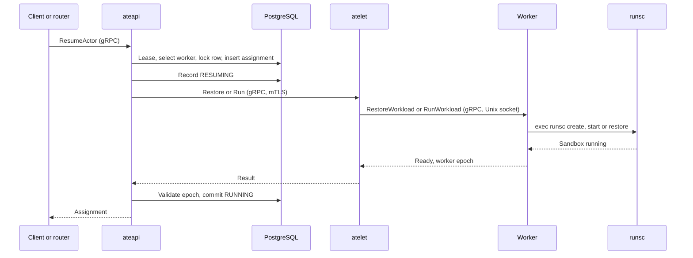
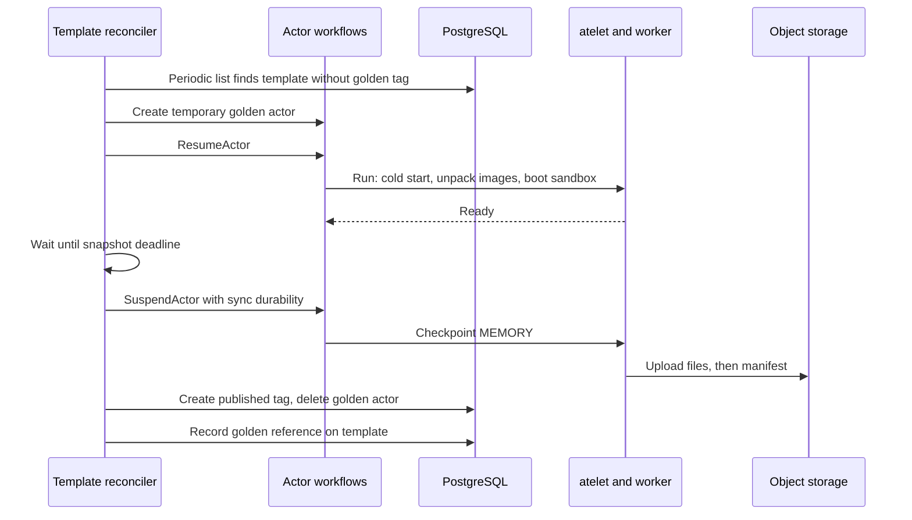
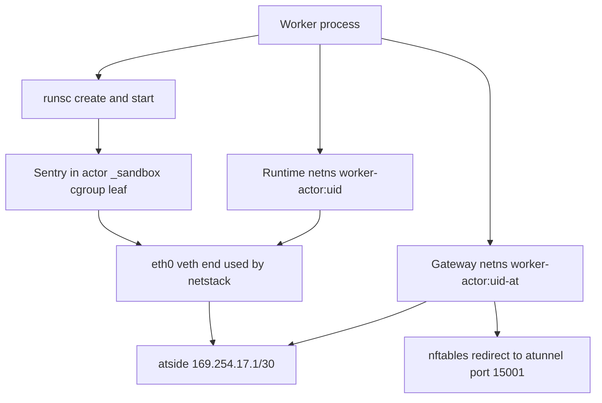

# 9. From CreateActor to a Running Actor

An actor's journey begins where a Pod's ends. Everything in Chapters 3 and 4 has already happened once, for the *worker* Pod. That Pod is running, has an IP from CNI, its own cgroup and namespaces, and a trusted worker process that can create sandboxes. An actor activation adds no Pod, no kubelet work, no CNI call and no containerd task. It is a chain of gRPC calls and database transactions that ends with runsc creating a gVisor sandbox inside the existing worker Pod, or restoring one from a snapshot. This chapter traces that chain and names each Linux primitive used on the node. Chapter 13 continues with suspend and restore.

The running example is the counter actor from the lifecycle companion: one application container with a DurableDir, a `/readyz` wakeup probe and MEMORY fidelity.

## 9.1 The precondition: a registered worker Pod

A WorkerPool is a Kubernetes custom resource. `atecontroller` reconciles it into a Deployment with controller-runtime, and from there the path is exactly Chapter 3: the Deployment controller creates a ReplicaSet, the ReplicaSet controller creates Pods, the scheduler binds them, and each kubelet runs Chapter 4's sequence with the node's ordinary runtime. The Pod template comes from [workerpool_apply.go](https://github.com/agent-substrate/substrate/blob/v1.0.0/cmd/atecontroller/internal/controllers/workerpool_apply.go). For gVisor workers, it grants the fixed capability list discussed in 2.5, runs with seccomp and AppArmor Unconfined at the Pod level (the inner sandbox supplies its own confinement), and mounts the node paths that atelet and the worker share.

When the worker container starts, three things happen that have no Pod-path equivalent.

1. **A PID 1 shim.** The container's first process is a small init, [pid1.go](https://github.com/agent-substrate/substrate/blob/v1.0.0/internal/ateworker/pid1/pid1.go). It calls `prctl(PR_SET_CHILD_SUBREAPER)` so orphaned runsc helpers are reparented to it, reaps them with `wait4`, forwards termination signals, and starts the worker daemon as a child. It plays the role that pause and the shim play for a Pod.
2. **cgroup delegation.** The worker's container cgroup, created by runc as `cri-containerd-<id>.scope` under the Pod slice, becomes the root of a subtree the worker manages. [cgroup.go](https://github.com/agent-substrate/substrate/blob/v1.0.0/internal/ateworker/cgroup/cgroup.go) remounts the delegated hierarchy writable inside the container, moves the worker's own processes into a `worker` leaf, and writes `+cpu +memory +pids` style controller lists to `cgroup.subtree_control`. cgroup v2 forbids processes in a non-root cgroup that delegates controllers, so moving them into a leaf is required before actor leaves can be created as siblings.
3. **Registration.** The worker connects to atelet's `WorkerSupport` gRPC service over a TLS-protected Unix socket on the node ([workersupport.go](https://github.com/agent-substrate/substrate/blob/v1.0.0/cmd/atelet/workersupport.go)). It calls `AcquireWorkerEpoch`, which atelet forwards to ateapi with the Pod's authenticated identity, then `RegisterWorker` with its epoch, IPs and capacity, and `SetWorkerSandboxRuntimes` with the runsc versions it can execute. Separately, `atecontroller`'s worker synchronizer, a client-go informer and workqueue over worker Pods ([syncer.go](https://github.com/agent-substrate/substrate/blob/v1.0.0/cmd/atecontroller/internal/workersync/syncer.go)), projects each Pod into a Worker record. A Worker becomes schedulable only when both views agree.

From this point the Kubernetes control plane is out of the actor path. It keeps the worker Pod running, but it is not consulted when an actor starts, suspends or resumes.

## 9.2 Who talks to whom: the actor communication map

The Pod path is driven by watches: every component observes the API server and writes decisions back as objects. The actor path is driven by imperative calls under database-backed leases. The table lists every hop used by actor creation, activation and suspension, mirroring 3.6.

| From | To | Transport | Calls | Pattern |
|---|---|---|---|---|
| `kubectl ate`, SDKs | ateapi | gRPC over TLS, `Control` service in [ateapi.proto](https://github.com/agent-substrate/substrate/blob/v1.0.0/api/ateapi/v1/ateapi.proto) | `CreateActor`, `ResumeActor`, `SuspendActor`, `GetActor` | Request/response; long operations run synchronously within the call |
| Ingress router | ateapi | gRPC | `ResumeActor` with retry and singleflight per actor ([resumer.go](https://github.com/agent-substrate/substrate/blob/v1.0.0/cmd/atenet/internal/router/ingress/resumer.go)) | Request-driven activation |
| ateapi | PostgreSQL | PostgreSQL wire protocol over TCP | Leases, row locks, assignment inserts, outbox appends | Transactions; no watch stream |
| ateapi replicas | PostgreSQL outbox | Polling query ordered by transaction ID ([outbox.go](https://github.com/agent-substrate/substrate/blob/v1.0.0/cmd/ateapi/internal/store/atepg/outbox.go)) | Worker change events | Feeds each replica's worker cache ([workercache.go](https://github.com/agent-substrate/substrate/blob/v1.0.0/cmd/ateapi/internal/workercache/workercache.go)) |
| ateapi | atelet on the assigned node | gRPC over mutual TLS, `Atelet` service in [atelet.proto](https://github.com/agent-substrate/substrate/blob/v1.0.0/internal/proto/ateletpb/atelet.proto) | `Run`, `Restore`, `Checkpoint`, `Terminate`, `DetachActor`, `PromoteSnapshot` | Imperative, idempotent by snapshot identity |
| atelet | Worker in a specific Pod | gRPC over a per-Pod-UID Unix socket, `Worker` service in [ateworker.proto](https://github.com/agent-substrate/substrate/blob/v1.0.0/internal/proto/ateworkerpb/ateworker.proto) | `RunWorkload`, `RestoreWorkload`, `CheckpointWorkload`, `TerminateWorkload` | Local RPC; filesystem permissions bound the socket |
| Worker | atelet | gRPC over TLS on the `WorkerSupport` Unix socket | `AcquireWorkerEpoch`, `RegisterWorker`, `ReportActorCrashed`, `MintActorCertificate` | Upward reports and credentials |
| atelet | ateapi | gRPC over mutual TLS | Worker registration, durable snapshot reports | Retried reports with persisted obligations |
| atelet | Object-store plugin | gRPC over a Unix socket | `UploadSnapshot`, fetch manifest and files | Local RPC to a credentialed sidecar |
| Worker | runsc | `fork`/`exec` of the runsc binary | `create`, `start`, `restore`, `checkpoint`, `wait`, `kill`, `delete` | Process exit status ([runsc.go](https://github.com/agent-substrate/substrate/blob/v1.0.0/cmd/ateworker-gvisor/runsc.go)) |
| ateapi template reconciler | Its own API | In-process calls driven by a periodic list of ActorTemplates ([template_reconciler.go](https://github.com/agent-substrate/substrate/blob/v1.0.0/cmd/ateapi/internal/controlapi/template_reconciler.go)) | Create, resume and suspend the golden actor | Level-triggered reconciliation without watches |

Three contrasts with Kubernetes matter. First, there is no etcd and no watch fan-out: PostgreSQL is the authoritative store, and the only event stream is the transactional worker outbox that keeps scheduling caches warm. Second, the scheduler is not a separate process that writes a binding for a node agent to discover. It is a library inside ateapi that selects a worker and then *calls* that worker's atelet. Third, node work is synchronous with the API call. A `ResumeActor` that returns success has seen the worker report readiness and has committed RUNNING. A Pod `create` that returns success has only persisted an object.

## 9.3 Templates, golden snapshots and CreateActor

An ActorTemplate is a PostgreSQL record that describes containers, images, resources, volumes, wakeup probes and snapshot policy. It is not a Kubernetes object. Creating one does not start anything directly. The golden-template controller inside ateapi notices it on its next periodic list and decides whether a *golden snapshot* is needed.

A golden snapshot is the template's application already booted and initialized, captured once so that every actor created from the template can restore it instead of cold-starting. The controller builds it with the ordinary actor lifecycle.

1. It creates a temporary golden actor named from the template UID, in the template's atespace.
2. It resumes that actor. With no source snapshot, the activation takes the cold `RunWorkload` path described in 9.5: images unpacked, sandbox booted, application started, wakeup probe passed.
3. It waits until the template's configured snapshot deadline, giving the application time to warm caches, load models or populate state.
4. It suspends the golden actor with synchronous durability (`--mode=sync` semantics), so the snapshot is uploaded and `CommitDurable` has completed before the call returns, and verifies that a completed external snapshot exists.
5. It creates a published *tag* that owns a copy of that snapshot, deletes the temporary actor, and records the golden reference on the template.

`CreateActor` then only writes a row. The new actor gets a UID, a reference to its template, a source snapshot (the template's golden tag, if one exists) and the initial state SUSPENDED. No worker is chosen and no node is touched. An actor can exist for months without consuming any execution capacity, which is the point of the design.

## 9.4 First activation: lease, placement and node preparation

The first request for the actor reaches the ingress router with an `ate-target-actor` header. The router calls `ResumeActor`. ateapi's resume workflow ([workflow_resume.go](https://github.com/agent-substrate/substrate/blob/v1.0.0/cmd/ateapi/internal/controlapi/workflow_resume.go)) proceeds as follows.

1. **Lease.** It acquires a renewable SQL lease on the actor, which serializes lifecycle operations on that actor across API replicas, and rereads the authoritative row.
2. **Candidate selection.** It filters cached Workers by registration state, sandbox class, runtime compatibility, selectors, locality and free capacity, and uses power-of-two choices on utilization ([scheduling.go](https://github.com/agent-substrate/substrate/blob/v1.0.0/cmd/ateapi/internal/scheduling/scheduling.go)). This is the analogue of kube-scheduler's Filter and Score, run in-process against a cache maintained from the outbox.
3. **Admission.** It locks the chosen Worker's row, rechecks capacity, inserts the unique assignment and books CPU and memory ([worker_assignment.go](https://github.com/agent-substrate/substrate/blob/v1.0.0/cmd/ateapi/internal/store/atepg/worker_assignment.go)). This is the analogue of the binding write, but it is a database transaction rather than an object update another component must observe.
4. **RESUMING.** It records the actor as RESUMING with its assignment.
5. **Node call.** It calls atelet's `Restore`, because a golden snapshot exists, or `Run` for an actor with no snapshot.

atelet, in [main.go](https://github.com/agent-substrate/substrate/blob/v1.0.0/cmd/atelet/main.go), takes an actor-local lock and prepares everything the worker will need, so the worker can stay runtime-focused.

- **Runtime assets.** It ensures the runsc binary pinned by the SandboxConfig is present, verified by digest and published atomically. Where supported, it uses `renameat2(RENAME_EXCHANGE)` ([exchange_linux.go](https://github.com/agent-substrate/substrate/blob/v1.0.0/pkg/assetfetch/exchange_linux.go)).
- **Images.** Its image cache pulls and unpacks OCI layers into node-shared directories, the actor equivalent of 4.3, using its own registry client rather than containerd. Layers are shared across actors.
- **OCI bundles.** It writes each application container's bundle directory under the actor's directories.
- **Snapshot files.** For `Restore`, it resolves the snapshot manifest, from a local capture or the golden tag's node cache, or by fetching from object storage through the node object-store plugin ([snapshot_transfer.go](https://github.com/agent-substrate/substrate/blob/v1.0.0/cmd/atelet/snapshot_transfer.go)). It then materializes the files the requested fidelity needs. Shared golden files can be hard links to the node cache, so a thousand actors from one template need not download the golden image a thousand times.

atelet then dials the worker by Pod UID over its Unix socket and calls `RestoreWorkload` or `RunWorkload`.

## 9.5 Inside the worker: runsc builds the sandbox

The gVisor worker's [RunWorkload](https://github.com/agent-substrate/substrate/blob/v1.0.0/cmd/ateworker-gvisor/main.go) performs a fixed sequence. Restore follows the same shape with `runsc restore` in place of start, as Chapter 13 explains.

1. **Validate and lock.** Check the request and the current worker epoch, validate the runsc path, and take the actor's RPC lock.
2. **Reset stale state.** Remove leftover runsc state and PID-file directories, and remove a stale sandbox cgroup leaf from a previous incarnation.
3. **Prepare egress.** Ask the embedded atunnel to prepare egress for this actor and gateway.
4. **Host the actor.** Create the actor's network namespaces and cgroup leaves and publish attribution, so startup resource use is charged to the actor.
5. **Wait for memory loans.** Block if checkpoint memory borrowed from this worker has not yet been returned (Chapter 13).
6. **Activate egress** before the application starts, because initialization may call out.
7. **Create and start `_sandbox`.** Write the sandbox's OCI specification with `ShapeGVisor`, then run `runsc create -no-root-container -bundle <dir> -pid-file <file> _sandbox` and `runsc start _sandbox`.
8. **Each application container.** Compose its rootfs, run `runsc create` and `runsc start` for the container name, and pipe its output to an actor-attributed log stream.
9. **Wakeup probes.** Dial each probe-enabled container's port through the actor's namespace until it returns HTTP 200.
10. **Activate ingress** so atunnel accepts routed connections for this actor.
11. **Return the worker epoch.** ateapi will check that epoch before committing RUNNING.

The table lists the Linux-level work in that sequence and who performs it. As in 4.4, *runsc* means the pinned gVisor runtime acting on the worker's behalf; its internal call sequence belongs to its release.

| Step | Performed by | Primitive or command | Purpose |
|---|---|---|---|
| Name network namespaces | Worker, [netns.go](https://github.com/agent-substrate/substrate/blob/v1.0.0/internal/netns/netns.go) | `runtime.LockOSThread`, `unshare(CLONE_NEWNET)`, bind-mount `/proc/self/task/<tid>/ns/net` to `/run/netns/worker-actor:<uid>` and `...-at` | Create the runtime and gateway namespaces and pin them, the same technique as `ip netns add` |
| Enter a namespace | Worker | `setns(fd, CLONE_NEWNET)` on a locked thread, then back | Configure or open sockets inside an actor namespace |
| Namespace sysctls | Worker, [sysctl.go](https://github.com/agent-substrate/substrate/blob/v1.0.0/internal/netns/sysctl.go) | Writes under `/proc/sys/net/...` inside the namespace | Forwarding and per-namespace network behaviour |
| veth pair, addresses, routes | Worker, [sandbox.go](https://github.com/agent-substrate/substrate/blob/v1.0.0/internal/ateworker/actornet/sandbox.go) | rtnetlink `RTM_NEWLINK` (veth), `IFLA_NET_NS_FD`, `RTM_NEWADDR` (`169.254.17.1/30` on `atside`), `RTM_NEWROUTE` | Connect the runtime namespace's `eth0` to the gateway namespace, the role CNI plays for a Pod |
| Egress interception | Worker | nftables tables `worker-actor` and `worker-actor-v6`: NAT `redirect to :15001`, link-local rejects, default-drop forward | Force actor TCP through atunnel; block bypass |
| Original destination | atunnel, [original_dst_linux.go](https://github.com/agent-substrate/substrate/blob/v1.0.0/internal/linuxsys/original_dst_linux.go) | `getsockopt(SO_ORIGINAL_DST)` | Recover the pre-NAT destination of a redirected connection |
| Namespace-bound sockets | atunnel and DNS relay, [dial.go](https://github.com/agent-substrate/substrate/blob/v1.0.0/internal/netns/dial.go) | `socket` created after `setns` | Listeners and dialers that stay in the actor namespace after the thread returns |
| Actor cgroup leaves | Worker ([actor.go](https://github.com/agent-substrate/substrate/blob/v1.0.0/internal/ateworker/cgroup/actor.go)), then runsc and the worker again ([memlimit.go](https://github.com/agent-substrate/substrate/blob/v1.0.0/cmd/ateworker-gvisor/memlimit.go)) | `mkdir` of the actor leaf with `cpu.max` and `memory.high`; runsc creates the `_sandbox` leaf named by `linux.cgroupsPath` and sets `memory.max`; the worker swaps that `memory.max` for `memory.high` | Account and limit the actor beneath the worker container scope, throttling instead of OOM-killing at the limit |
| Root filesystem | Worker, via [bundle_linux.go](https://github.com/agent-substrate/substrate/blob/v1.0.0/internal/imagecache/bundle_linux.go) | `fsopen("overlay")`, `fsconfig`, `fsmount`, `move_mount`; bind mounts | Overlay of shared cached layers plus the actor's private upper |
| Create sandbox | runsc | `runsc create`: starts Sentry and gofer; `clone` with new namespaces, identity-mapped user namespace, `pivot_root`/`chroot`, seccomp filters | Boot the user-space kernel inside the worker Pod |
| Start containers | runsc and Sentry | `runsc start`; Sentry creates tasks internally | Run application processes inside the Sentry |
| Track Sentry | Worker, [pidfd.go](https://github.com/agent-substrate/substrate/blob/v1.0.0/internal/pidfd/pidfd.go) | `pidfd_open`, `poll` on the pidfd | Detect exit of this Sentry incarnation without PID-reuse races |
| Core scheduling | Worker, then runsc | `prctl(PR_SCHED_CORE, PR_SCHED_CORE_GET)` probe, `--enable-core-tags` | Keep untrusted sandboxes off sibling SMT threads where supported |
| Memory supervision | Worker, [memguard.go](https://github.com/agent-substrate/substrate/blob/v1.0.0/internal/ateworker/cgroup/memguard.go), [memwatch.go](https://github.com/agent-substrate/substrate/blob/v1.0.0/internal/ateworker/cgroup/memwatch.go) | `memory.high`, PSI `memory.pressure`, `memory.events.local`, `cgroup.kill` | Throttle and, if needed, kill an actor under sustained pressure |

Placed beside Chapter 4, the correspondence is direct. The worker's namespace code does what containerd does for a Pod network namespace, its veth and nftables programming does what a CNI plugin does, the image cache does what containerd's snapshotter does, and `runsc create`/`start` does what the runc shim does. What disappears is the Kubernetes machinery around it: no object write, no scheduler watch, no kubelet sync, no CRI call. What is added is a database-backed lease and admission check, and a direct readiness answer to the caller.

## 9.6 Roadmap and engineering improvements

The repository records several directions that touch this path. The resume workflow notes that complete Run/Restore re-entrancy is unfinished: a lost reply leaves the caller without an outcome even though a sandbox may be running. Automatic idle suspension has upward RPCs (`RequestActorSuspend`) but no production detector at this baseline. Template reconciliation runs on every API replica with a sharding TODO. Chapters 6, 7 and 12 discuss each of these.

Two editorial proposals come from the Pod comparison. First, Substrate could publish an actor *event* stream, for example from the same outbox that feeds worker caches, so external tooling can observe actor state transitions the way Kubernetes clients watch Pods, without polling `GetActor`. Second, the worker's sequence in 9.5 has natural phase boundaries (namespaces, egress, sandbox create, container start, probes, ingress). Exporting them as one structured activation trace, correlated by actor UID and worker epoch, would make cold-start and restore latency explainable in the same way kubelet's Pod startup latency tracker explains Pod start. Both are proposals.

## Source map

- [workflow_resume.go](https://github.com/agent-substrate/substrate/blob/v1.0.0/cmd/ateapi/internal/controlapi/workflow_resume.go): lease, placement, RESUMING and the node call.
- [template_reconciler.go](https://github.com/agent-substrate/substrate/blob/v1.0.0/cmd/ateapi/internal/controlapi/template_reconciler.go): how golden snapshots are produced with the ordinary actor lifecycle.
- [atelet main.go](https://github.com/agent-substrate/substrate/blob/v1.0.0/cmd/atelet/main.go): node-side preparation and dialing of workers by Pod UID.
- [ateworker-gvisor main.go](https://github.com/agent-substrate/substrate/blob/v1.0.0/cmd/ateworker-gvisor/main.go): the RunWorkload and RestoreWorkload sequences.
- [netns.go](https://github.com/agent-substrate/substrate/blob/v1.0.0/internal/netns/netns.go) and [sandbox.go](https://github.com/agent-substrate/substrate/blob/v1.0.0/internal/ateworker/actornet/sandbox.go): actor network namespaces, veths and nftables.
- [atelet.proto](https://github.com/agent-substrate/substrate/blob/v1.0.0/internal/proto/ateletpb/atelet.proto) and [ateworker.proto](https://github.com/agent-substrate/substrate/blob/v1.0.0/internal/proto/ateworkerpb/ateworker.proto): the node-side gRPC contracts.
