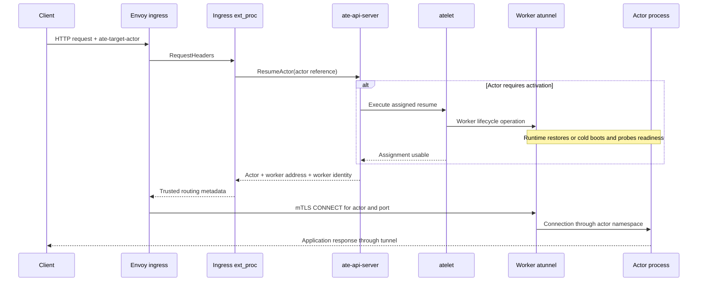
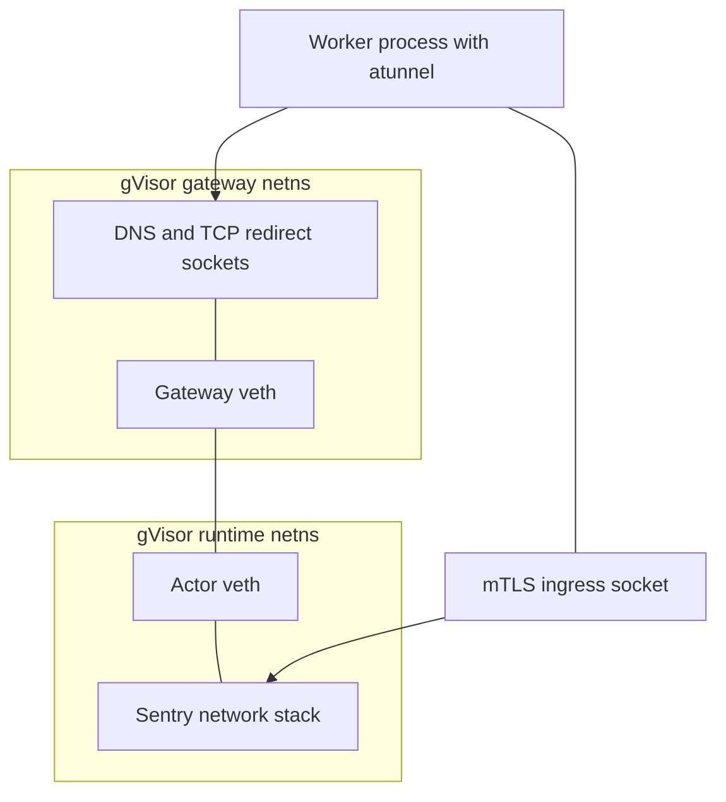
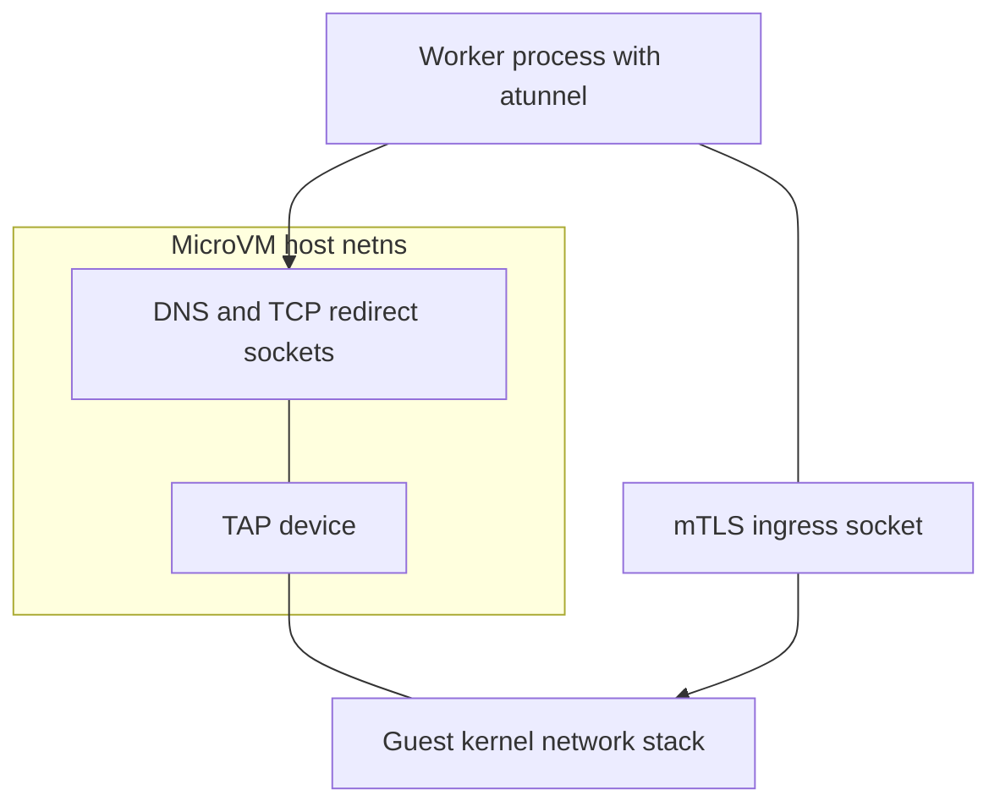
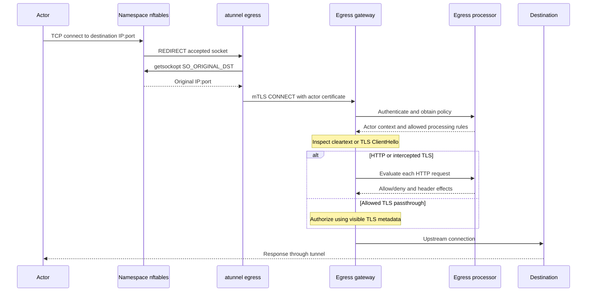
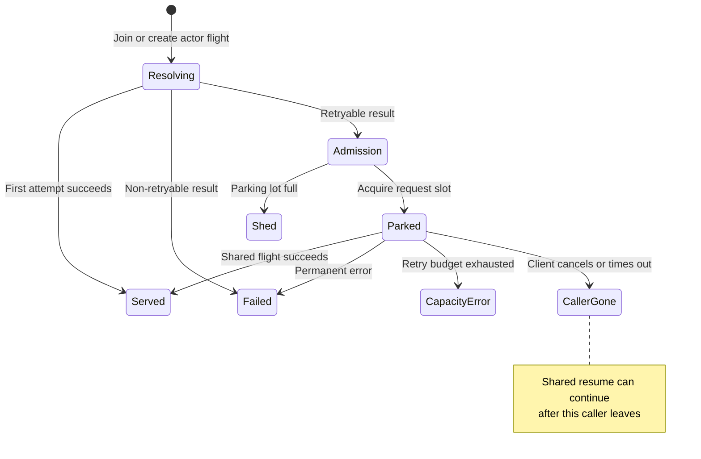
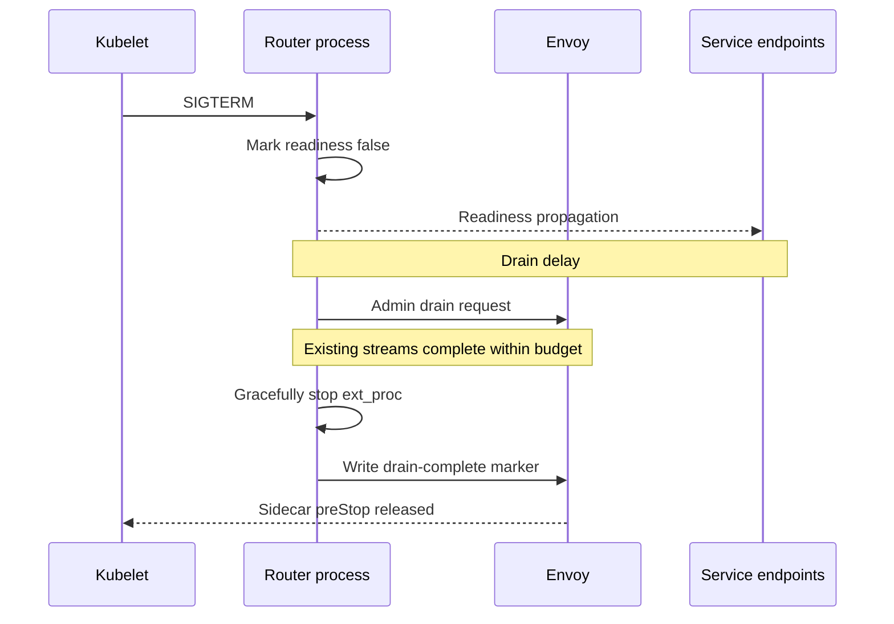

# 9. Actor Networking, Transparent Resume, and Backpressure

A request to an actor is a request to a logical identity whose execution location can change between successive HTTP messages. A worker Pod IP is an implementation detail of the current assignment. It is not the actor's address, and retaining it beyond the assignment's lifetime is unsafe. Substrate therefore resolves placement at a transport boundary, waits for a usable execution environment when necessary, and forwards through a worker endpoint that verifies the actor is currently active.

This chapter follows that path from the external listener to the actor's network stack and back out through the egress gateway. It covers the mechanisms that make multiplexing observable to the infrastructure while keeping ordinary application HTTP usable: explicit actor addressing, request-level resolution, private network namespaces, bounded parking, and authenticated tunnels. Authorization policy is developed in Chapter 10. The distinction matters because a transport that reaches the correct worker can still carry an unauthorized request, while a correctly authorized request can still exhaust a queue or arrive after its assignment has disappeared.

## 9.1 Routing a logical actor to a current execution location

The production networking topology has fewer binaries than its deployment names suggest. The source command is [cmd/atenet](https://github.com/agent-substrate/substrate/blob/v1.0.0/cmd/atenet/main.go). Its router implementation is shared by ingress and egress roles, with configuration selecting the listeners and processing behavior. The deployments named `atenet-router` and `atenet-egress` combine this control logic with a dataplane. Envoy is the default dataplane. AgentGateway is an alternative with a materially different ingress integration. The worker-side `atunnel` is a library linked into the worker process, under [internal/atunnel](https://github.com/agent-substrate/substrate/blob/v1.0.0/internal/atunnel/tunnel.go). There is no separate production atunnel Pod for each actor.

The Envoy ingress path begins with an HTTP request carrying `ate-target-actor: <atespace>/<actor>`. The actor reference is independent of `Host` or HTTP/2 `:authority`. [Handler.HandleRequestHeaders](https://github.com/agent-substrate/substrate/blob/v1.0.0/cmd/atenet/internal/router/ingress/ingress.go) parses that reference through the shared `internal/atenet` helpers, calls `ActorResumer.ResumeActor`, and obtains the current worker assignment. The returned actor record includes worker Pod IPs and the worker SPIFFE identity. Both are needed: an IP selects a route, while a certificate identity constrains which process may answer at that route.

Keeping `Host` separate is a substantial compatibility decision. An application can use virtual hosts, origin checks, absolute redirects, or a host-specific authentication scheme without having to treat a Substrate actor identifier as its application authority. Conversely, the router cannot accidentally select an actor because a request supplies an application hostname that happens to resemble one. The two values serve different trust and routing purposes. The ingress handler validates the actor reference, performs resolution, and then overwrites the actor header sent downstream so the resolved actor and the carried actor identity agree.

`ResumeActor` is invoked for already-running actors as well as suspended ones. In the former case it resolves the current assignment without a restore. In the latter it may initiate placement, node coordination, storage retrieval, runtime startup, and readiness checks. A successful transport-level resolution therefore depends on a control-plane operation whose cost varies considerably with actor state and snapshot locality. The router does not implement the actor lifecycle itself; it waits for the API's authoritative answer.

The exact metadata and tunnel configuration are in [xds.go](https://github.com/agent-substrate/substrate/blob/v1.0.0/cmd/atenet/internal/router/xds.go). The ingress processor produces dynamic metadata containing a destination address, actor port, and expected worker identity. In the regular HTTPS mode, that address targets worker port 443. With upstream CONNECT enabled, which is the default, Envoy uses the resolved information to establish a tunnel to the worker's CONNECT listener on port 8443. The metadata is infrastructure state inside the proxy; it is not accepted as an arbitrary client-provided destination header.

The handler chooses the first worker Pod IP returned by the assignment. Its source includes a TODO to select the IP family matching the dataplane. That detail limits claims of fully general dual-stack routing. Kubernetes may publish several addresses, but the current selection algorithm does not perform a sophisticated family preference or reachability race. An address list alone therefore does not establish complete dual-stack behavior; reachability must be tested for the selected family.

An assignment can change after the API answers. A worker can crash, a lifecycle operation can deactivate the actor, or an existing connection can overlap the end of an activation. Substrate therefore checks activity again at the worker boundary. [ingress.Server](https://github.com/agent-substrate/substrate/blob/v1.0.0/internal/atunnel/ingress/ingress.go) maintains an activation map keyed by actor reference, with the actor UID and a namespace-specific dialer. The worker accepts only the expected router certificate identity, then resolves the named actor against its own active state. The API lookup and worker admission are complementary checks at different times, not a single atomic transaction spanning the network.

The activation map also determines connection-pool ownership. An HTTP reverse proxy belongs to one activation. A pool shared across actor activations could retain a connection into a previous sandbox or route the next occupant of a worker through stale transport state. The source explicitly prevents pool sharing across activations. This is a recurring multiplexing rule: anything that can retain a reference to execution state needs a lifetime no longer than the state it references, unless it carries an explicit generation or identity check.

The worker's reverse-proxy path removes infrastructure routing headers before delivering the request to the application. It also strips the stale-assignment response header from actor responses. Without that stripping, a hostile actor could imitate an infrastructure rejection and influence router recovery behavior. A header that is useful for control between trusted proxies becomes a capability when an untrusted application can emit it. The code treats that response boundary explicitly rather than assuming all downstream headers have equal authority.

### The control plane remains on the route-resolution path

The architecture removes Kubernetes object creation and scheduling from per-activation work. It does not remove every control-plane dependency from the request path. In the Envoy implementation, an incoming request reaches ext_proc and the resumer, and a shared flight calls `ResumeActor`. Existing workers and cached fleet state make this much cheaper than creating a Pod, but API service availability, database behavior, and admission contention still affect routing.

This observation changes how to interpret a latency target. A 100ms activation target cannot be evaluated solely by timing `runsc restore` or a hypervisor API request. The client-visible path also contains TLS, proxy dispatch, RPC handling, assignment, node transport, readiness, and possibly parking. Some components overlap; some serialize. A runtime-only benchmark is useful for identifying one cost, but it does not demonstrate an end-to-end percentile.

The direction mux in [extproc/dispatch.go](https://github.com/agent-substrate/substrate/blob/v1.0.0/cmd/atenet/internal/router/extproc/dispatch.go) keeps ingress and egress handlers separate. Direction comes from the dataplane's configured filter-chain attributes, not a request header selected by the caller. Ingress treats incoming headers as untrusted request input. Egress obtains actor identity from the authenticated transport and uses trusted metadata on inner legs. Combining those trust models into a generic handler with a caller-selectable direction would undermine the boundary the package layout currently makes visible.

## 9.2 Network namespaces, interception, and worker tunnel lifetimes

The worker Pod has a Kubernetes network identity, but actors do not simply share that identity's network stack. [SetupSandboxNetwork](https://github.com/agent-substrate/substrate/blob/v1.0.0/internal/ateworker/actornet/sandbox.go) creates actor-specific namespaces and connects the runtime to a private gateway. The network design differs between runtime backends because gVisor takes ownership of the interfaces in its runtime namespace, whereas a microVM uses a host TAP interface associated with its guest network device.

For gVisor, `SandboxNetwork` carries separate `RuntimeNetNS` and `GatewayNetNS` handles. A veth pair crosses those namespaces. The actor side has a fixed private address and a route to its gateway; the gateway side hosts atunnel's egress listener and DNS relay. For microVM, the runtime and gateway can share one host namespace because the guest attaches through TAP rather than claiming all host interfaces. The fixed addressing is safe because each actor has its own network namespace. Reusing addresses across namespaces avoids consuming a cluster-wide unique Pod address for every suspended or active actor.

The microVM path uses a different host namespace arrangement:

The diagram represents socket and namespace relationships, not a claim that atunnel continuously executes on one thread inside each namespace. Namespace membership is per operating-system thread. [internal/netns](https://github.com/agent-substrate/substrate/blob/v1.0.0/internal/netns/netns.go) locks the goroutine to a thread before switching namespaces and restores the original namespace before unlocking. The namespace wrapper ultimately calls `unshare(CLONE_NEWNET)` and `setns` through the vendored `vishvananda/netns` implementation. Named namespaces are held under `/run/netns` with bind mounts, and teardown uses a detached, no-follow unmount before unlinking the name.

A socket retains the namespace in which it was created. That property lets the worker open an egress listener or actor-facing connection inside a namespace and then serve or use it from ordinary Go goroutines. [netns.Dialer](https://github.com/agent-substrate/substrate/blob/v1.0.0/internal/netns/dial.go) narrows the thread-pinned interval further: it restores the original namespace in `ControlContext` after socket creation, before waiting for connection establishment. The dialer accepts IP literals, preventing a hostname lookup from unexpectedly introducing resolution in the wrong namespace. If restoring the original namespace fails, its helper avoids returning a contaminated operating-system thread to ordinary scheduling.

The private gateway does not route packets directly onto the worker Pod network. Its namespace sysctls disable forwarding. nftables adds a default-drop forwarding chain as another enforcement layer. Outbound TCP is intercepted by a prerouting NAT `REDIRECT` rule and delivered to atunnel's local listener. Link-local destinations are rejected before that redirect, and non-TCP traffic leaving the private subnet is rejected. DNS is served inside the private gateway rather than being allowed to bypass the egress path as arbitrary UDP.

This is NAT REDIRECT, not TPROXY. The distinction is visible in the source's `expr.Redir` and matters when reasoning about the destination that the socket reports. The accepted socket's local endpoint is the interception listener, so atunnel needs the pre-NAT destination. [TCPOriginalDestination](https://github.com/agent-substrate/substrate/blob/v1.0.0/internal/linuxsys/original_dst_linux.go) performs `getsockopt` using `SO_ORIGINAL_DST`, with an IPv6 counterpart, through a direct `unix.Syscall6`. That kernel query retrieves the connection's original destination recorded by the NAT path. Atunnel uses the recovered IP and port as the authority of an outbound CONNECT request to the egress gateway.

The actor cannot use a string in an HTTP header to change the kernel destination that atunnel reports for that connection. It can choose what to dial and what bytes to send, but the proxy derives the original address from the accepted socket. This does not complete authorization: the remote gateway still needs to decide whether the authenticated actor may use that destination and, for HTTP or intercepted TLS, whether the request authority is permitted. It does establish a trustworthy transport fact to feed that decision.

The [sandbox sysctl list](https://github.com/agent-substrate/substrate/blob/v1.0.0/internal/ateworker/actornet/sandbox.go) also closes less obvious namespace inheritance problems. A newly created namespace can inherit defaults influenced by host CNI or kube-proxy configuration. Substrate explicitly disables source-route acceptance, ICMP redirects, and routing of loopback destinations received from the actor side. It enables reverse-path filtering and prevents actor packets from claiming a local gateway source. The order of writes matters because disabling forwarding can change redirect settings. The code writes them in a defined sequence before adding interfaces so link-specific defaults are copied from the desired values.

`net.ipv4.ip_unprivileged_port_start` is set to zero within the private namespace so atunnel can bind DNS port 53 without retaining `CAP_NET_BIND_SERVICE`. This setting does not grant a privilege outside that namespace. Conversely, the worker needs privileges to create namespaces, configure links, and install nftables rules. The worker's outer container policy is part of Chapter 10's isolation analysis; the network path should not be described as an unprivileged application simply opening a proxy socket.

### Activating and deactivating a tunnel endpoint

The worker starts common atunnel infrastructure once. Per actor, [PrepareEgress](https://github.com/agent-substrate/substrate/blob/v1.0.0/internal/atunnel/tunnel.go) obtains a certificate and prepares an authenticated gateway client before workload startup. Egress activation occurs before the workload needs to contact dependencies. Ingress activation occurs after the workload is ready to serve. These are intentionally different moments. Requiring ingress readiness before enabling egress could deadlock an application whose initialization depends on outbound traffic. Admitting ingress before readiness would expose requests to a partially started actor.

Deactivation stops admission and drains active streams before the network namespace is torn down. `Tunnel.Deactivate` attempts both ingress and egress cleanup even if one direction fails. The runtime cannot assume that stopping the actor process alone releases every host-side proxy goroutine, connection, certificate renewal timer, or namespace reference. A namespace survives while something holds it open, even after its name is unmounted. File-descriptor ownership is therefore part of lifecycle correctness, not merely resource hygiene.

Consider actor A and actor B sharing one physical worker at different times. A has an idle HTTP keep-alive connection held by a proxy. If worker reuse only replaced the actor record and left that transport alive, a subsequent request might traverse a socket into A's old network environment. The per-activation proxy and deactivation drain prevent that transport from becoming a reusable worker-wide resource. The same principle applies when several actors execute concurrently in one worker: the outer process is shared, but its actor-specific transports remain separate.

The network lifecycle must also tolerate failed startup. A namespace can be created before asset preparation, runtime execution, or readiness fails. Setup functions use cleanup on error, and actor UID-derived names allow a later incarnation to remove leftover namespace names. Removing a stale name does not destroy a still-referenced namespace immediately, which is why name cleanup and reference cleanup are distinct. When debugging leaks, listing names alone is insufficient evidence that all actor network resources have disappeared.

## 9.3 HTTP CONNECT, protocol preservation, and egress transport

Substrate uses CONNECT in two different places. At the external ingress boundary, a client can request a non-default actor port by sending CONNECT to the router's dedicated listener. At the worker boundary, the router can use CONNECT to carry ordinary actor traffic to atunnel. Both create tunnels, but they have different responsibilities and should not be collapsed into one box labelled TCP proxy.

External arbitrary-port ingress terminates the client's CONNECT at the router and feeds the tunneled traffic back into the HTTP processing path. The outer request establishes actor and target-port context. Each inner HTTP request still goes through resolution and can be routed independently if the actor changes workers. This behavior preserves transparent resume across a long-lived client tunnel. It also means the supported payload is HTTP(S), not an arbitrary non-HTTP byte stream to any actor port.

The outer actor target is retained in filter state. [routingValue](https://github.com/agent-substrate/substrate/blob/v1.0.0/cmd/atenet/internal/router/ingress/ingress.go) prefers that trusted attribute and refuses to fall back to an inner actor header when it recognizes CONNECT reentry. Otherwise a client could establish a tunnel for one actor and send an inner header naming another. Application `Host` remains the inner request's authority, while the target port is derived from the retained CONNECT authority. A complete diagram must label these three pieces separately: actor identity, application authority, and transport port.

The upstream worker CONNECT path is more opaque. Atunnel authenticates the router, looks up the current activation, parses the requested port, and connects through that actor's dialer. It does not use the authority's hostname as a general destination to dial. That restriction prevents a CONNECT authority from turning atunnel into a proxy to arbitrary worker-local services. The selected activation determines the actor network, and the authority contributes the port within that network.

Envoy's connection-pool keys need to include actor and port. [xds.go](https://github.com/agent-substrate/substrate/blob/v1.0.0/cmd/atenet/internal/router/xds.go) defines a single hashable tunnel key and separately propagates worker, actor, port, and expected upstream SAN state. A pooled internal connection must not carry one actor's retained filter state into another actor's tunnel. The code comments make the single-key requirement explicit because adding several independently hashable values can change Envoy pool partitioning in surprising ways. The application-facing consequence of a pooling error would be much more serious than a cache miss: it could select the wrong execution environment.

Ordinary HTTP and gRPC need different protocol handling. The regular reverse-proxy path mirrors supported downstream protocol behavior and includes a gRPC-specific HTTP/2 decision. The CONNECT path carries bytes without doing that same request parsing in atunnel; protocol decisions move into router configuration. Long-lived WebSocket and gRPC streams also interact with timeout and drain semantics differently from short request-response traffic. The repository has dedicated end-to-end suites for these combinations rather than assuming that passing an HTTP GET proves all protocols work.

The route timeout and stream idle timeout are separate clocks. `defaultRouteTimeout` is five minutes in the audited source, sized to avoid terminating a normal model response too aggressively. The idle timeout bounds intervals without encode/decode activity, and the builder keeps it beyond the route timeout when necessary. A request can be computationally active while producing no network bytes, so transport idleness is not evidence that the actor is semantically idle. It must not be used as a substitute for an application-level suspension decision.

CONNECT routes disable the ordinary route timeout over the lifetime of the outer tunnel. Leaving Envoy's short route default on that route would make a healthy long-lived tunnel expire simply because it remained open. Idle timeout, peer closure, and drain still constrain it. These choices demonstrate why one global timeout cannot represent all the system's waits. Resume, parked retry, workload response, stream idleness, and shutdown have different cancellation consequences.

### Outbound transport from actor to gateway

The outbound path begins with a TCP socket in the actor environment. The private gateway redirects it to atunnel, which recovers the original IP and port and opens an authenticated CONNECT toward `atenet-egress`. The [egress.Client](https://github.com/agent-substrate/substrate/blob/v1.0.0/internal/atunnel/egress/client.go) implements HTTP/2 transport and maps streams into `net.Conn`-like objects. A single gateway connection can carry several actor outbound streams, but identity and activation lifetimes still constrain reuse.

The gateway has an outer CONNECT filter chain and inner chains for cleartext HTTP, TLS interception, and TLS passthrough. The outer chain establishes actor identity and basic policy presence. The inner HTTP chains evaluate each request because a connection can carry multiple requests with different authorities or effects. TLS passthrough has a different visibility boundary: the gateway can inspect ClientHello metadata but cannot apply per-request HTTP header injection inside encrypted traffic it does not terminate.

The Envoy dynamic module participates at this inner listener transition. `EgressPolicyStoreFilter` parses policy metadata from the trusted ext_proc response, computes a hash, and stores a shared `Rc<EgressPolicy>` in a thread-local store. The listener filter receives the hash through filter state, retrieves the policy, and selects a transport verdict. This keeps each CONNECT's carried state small while sharing identical policies on a worker thread. The lifetime is tied to active CONNECT filters so an inner connection can retrieve the policy for as long as the outer connection keeps it alive.

The hash is an indexing optimization, not an authorization proof. [policy_store_filter.rs](https://github.com/agent-substrate/substrate/blob/v1.0.0/cmd/dataplane/envoy/dynamic-modules/egress-policy/src/policy_store_filter.rs) compares an existing policy with the newly parsed policy and rejects a mismatch on collision. The equality check prevents a hash collision from silently reusing a different policy; collision probability alone is not the correctness argument.

DNS completes the outbound path. [dns.Relay](https://github.com/agent-substrate/substrate/blob/v1.0.0/internal/atunnel/dns/relay.go) obtains upstream resolver information outside the actor namespace and serves actor queries through sockets inside its gateway namespace. The implementation supports UDP and TCP, pending-request tracking, bounded admission, and failover. The policy evaluator decides which names may be queried; Chapter 10 examines that decision. Operationally, a DNS denial and an egress connection denial can look similar to an application, but they occur before and after different pieces of infrastructure. Their traces should be distinguished.

There is no direct actor-to-actor flat network hidden underneath these tunnels. Actor addresses are private, reused, and isolated. Applications that need to reach another actor must use an authenticated higher-level path that identifies that actor and causes resolution. A future actor-to-actor feature must therefore integrate addressing, policy, and activation rather than merely expose the private subnet through CNI.

### DNS is a per-actor transport service

DNS does not share the same admission budget as parked ingress. Each actor has a `dns.Server`, created from the worker's `Relay`, with its own UDP pending-request table and TCP connection count. [limiter.go](https://github.com/agent-substrate/substrate/blob/v1.0.0/internal/atunnel/dns/limiter.go) allows 64 outstanding UDP queries and 16 open TCP connections per server. These are different units: the UDP limit counts exchanges, while the TCP limit counts streams that can carry several pipelined messages. They constrain one actor's resource use without pretending to impose a worker-wide DNS quota. A worker with many actors still pays the sum of their permitted activity.

UDP multiplexing is explicit. The relay forwards queries through a worker-namespace socket, so the actor's original transaction ID is not sufficient to identify the client endpoint. Two actor sockets can simultaneously choose the same 16-bit value. [pendingRequests.record](https://github.com/agent-substrate/substrate/blob/v1.0.0/internal/atunnel/dns/pendingreq.go) allocates a currently unused upstream ID, probing a bitmap from a cryptographically random starting value. It retains the original client address, original ID, normalized question, upstream list, and a copy of the rewritten query. The response path validates the upstream source and the question's name, type, and class before restoring the original ID and delivering the packet. A matching transaction number alone is deliberately insufficient.

The pending entry owns a concurrency slot after insertion. Removing the entry frees both the bitmap ID and that slot. Timeout, normal completion, send failure, and shutdown must converge on that accounting rule; otherwise an actor can permanently exhaust DNS capacity without keeping any useful query in flight. The limiter uses atomic accounting, while the pending map and bitmap share a mutex. Their scopes differ: the limiter bounds entry admission, and the map lock protects ownership transitions. The code's panic on over-release makes a bookkeeping error visible instead of allowing a negative occupancy count to silently raise effective capacity.

UDP failover retains the same logical query while moving through configured upstream resolvers. `SERVFAIL`, `NOTIMP`, and `REFUSED` can trigger another attempt. A held error response can be returned if later resolvers time out, preserving useful information from the earlier attempt. A periodic sweep advances expired entries and eventually releases them. Synchronous send errors carry the attempted upstream index back into the state transition, so an error from an obsolete attempt cannot advance a query that has already moved on.

Timeout names require careful reading here. `dnsExchangeTimeout` is five seconds, but `timeoutForAttempt` gives intermediate resolvers a share capped by the upstream-attempt limit and gives the final resolver the full exchange timeout. Consequently, the name does not establish a strict five-second wall-clock bound across a multi-upstream exchange. Scheduling delay in the sweep adds another source of elapsed time. When diagnosing a resolver outage, inspect the configured resolver count and the per-attempt transition instead of treating one constant as the entire lookup deadline. The actor's own resolver may also retry the logical query independently.

TCP uses a different design in [tcphandler.go](https://github.com/agent-substrate/substrate/blob/v1.0.0/internal/atunnel/dns/tcphandler.go). Each accepted actor connection receives a dedicated upstream stream. The handler tries the configured upstreams in order until one connects, then uses that stream for the connection's lifetime. This is connection-establishment failover, not transparent replay of already-delivered DNS messages after an upstream connection breaks. Each frame carries the standard two-byte length prefix. Separate request and response goroutines permit pipelining and out-of-order replies without serializing every query into a request-response round trip.

Locally synthesized errors and upstream replies can both write to the actor stream, so `tcpClientConn` serializes frame writes with a mutex. Without that lock, two valid messages could interleave their length prefix and body, corrupting a stream even though policy decisions were correct. The default connection idle deadline is thirty seconds and is refreshed by successful protocol progress. If the actor half-closes its sending side, the relay half-closes the upstream write side and allows outstanding responses to drain. Socket lifetime, protocol framing, and policy decisions therefore each have their own correctness obligation.

DNS lifetime is detached from the activation RPC but explicitly owned by the actor's running tunnel. `newServer` derives a cancelable context from `context.WithoutCancel`; successful activation must not lose DNS when the initiating RPC ends. `Server.Stop` cancels that context before closing sockets and waiting for serving goroutines. Cancellation matters because a policy fetch may be in progress without currently blocking on those sockets. Merely closing the listener would stop new work while leaving that fetch and its goroutine alive. The shutdown ordering is the DNS analogue of the broader tunnel lifecycle: detach from the initiating request, then attach to an explicit resource owner.

## 9.4 Parking, shared resume flights, and overload control

Oversubscription means there can be more runnable demand than available worker capacity. Failing every request at the first `ResourceExhausted` response would turn a brief capacity overlap into immediate user-visible failure. Waiting without a bound would move the resource-exhaustion problem from workers into the router. Request parking is the implementation between those outcomes.

The relevant structures are `ActorResumer`, `resumeActorFlight`, and `parkingLot`. A flight is keyed by actor reference. The first request creates it and starts a shared resume operation. Later requests for the same actor join the flight rather than sending duplicate `ResumeActor` calls. They retain their own caller contexts and result accounting, while the actual resume has a separate lifetime. This separation is essential because one disconnected client must not cancel a restore needed by other clients.

The retry classification is narrow. `Aborted` is retryable for concurrent lifecycle conflicts. With parking enabled, `ResourceExhausted` and `Unavailable` are also retryable. Permanent or state-dependent failures such as `NotFound`, `PermissionDenied`, and `FailedPrecondition` are returned rather than held in the hope that something changes. This is a capacity and transient-availability mechanism, not a generic queue for every unsuccessful request. Setting `--parked-request-max=0` disables capacity parking. The resumer still retries concurrent-update `Aborted` conflicts under its separate fifteen-second fail-fast-mode budget, while capacity and availability errors return immediately. Disabling parking therefore does not mean every unsuccessful resume is attempted exactly once. It changes which failures can wait and which request-admission accounting applies.

With default parking enabled, the shared flight has a five-second retry budget, an initial retry interval of 100ms, a 1.1 multiplier, and jitter. The budget starts with the first caller. A request that joins four seconds later shares the remaining budget; it does not acquire a fresh five seconds. This explains why a parking-duration histogram can contain budget-exhausted samples much shorter than the configured budget. The timer belongs to the shared attempt sequence, while the metric measures an individual request's wait.

A request does not consume a parking slot merely because its actor is being resolved. It acquires a slot only after the flight produces a retryable failure. This prevents a saturated parking lot from rejecting requests to actors that can be served immediately. A hot actor with many callers consumes one flight but can consume many parking slots: deduplicating control-plane work does not eliminate the memory and stream cost of holding separate client requests.

The default maximum is 1024 parked requests. The lot provides admission and release accounting; it is not a FIFO scheduling queue that assigns worker capacity itself. Worker selection remains in ateapi. Requests observe the outcome of their actor's flight and may compete with other flights through retry timing. The jitter reduces synchronization, but it does not constitute a fairness guarantee between actors or tenants. A bounded queue alone provides no tenant fairness guarantee.

Each parked request holds an ext_proc stream. Envoy's ext_proc cluster circuit breaker can therefore become a tighter limit than the Go parking lot. The xDS builder derives a request limit of twice the configured parking maximum, with a minimum of 1024, unless explicitly overridden. That leaves headroom for short header exchanges while parked streams occupy their share. Startup validates an explicit limit against the parking capacity. Without this coupling, Envoy could reject requests before the Go lot observed them, creating invisible capacity loss in parking metrics.

### Cancellation is not rollback

`runFlight` creates a budget context but derives each actual API attempt through `context.WithoutCancel`. When the retry budget ends, it prevents starting another attempt. It does not cancel an attempt already running. By that time the API may have acquired a lease, committed an assignment, or started restoring a sandbox. Abandoning the client-side RPC is not equivalent to undoing those actions. The router waits for the attempt's real result, bounded elsewhere by server-side limits and the dataplane stream timeout.

This behavior can serve a request after the nominal parking budget. It is deliberate: the budget is a retry-start bound rather than a hard activation deadline. A late successful restore remains useful. A late retryable error becomes capacity exhaustion. The external ext_proc message timeout, configured with additional time beyond the parking budget, still limits how long the client stream remains open. The flight can outlive every original caller, and new callers join it while it exists rather than creating another restore.

A practical failure analysis must track three populations: waiting requests, active flights, and executing control-plane attempts. They are not equal. One flight can have many requests. A flight can have zero current callers while its attempt continues. A request can leave the lot while the actor still progresses toward RUNNING. Measuring only parked-request count misses detached work; measuring only API call count misses client memory occupancy.

For a rough capacity estimate, let the average arrival rate of requests that actually park be λ and their average waiting time be W. Stable average occupancy is approximately λW. This is an accounting relationship, not a guarantee for bursts or heavy-tailed waits. A five-second window with a large fan-in to one actor can fill the lot even though it creates only one API flight. Conversely, many distinct actors can create substantial API and database work while few requests remain parked because they fail quickly. Benchmark both patterns.

The error mapping also matters to callers. Missing actors map to 404; authentication and permission failures remain distinct; deadline exhaustion maps differently from worker saturation. A caller deciding whether to retry should not treat every 503 as equivalent. A failed state transition, a full parking lot, and an unavailable API can all manifest as unavailability while requiring different operational action. The router's outcome attributes and structured errors preserve more information than the HTTP status alone.

### Comparing fan-in and fan-out under saturation

Consider two constructed load cases, each with 800 requests waiting after a retryable placement failure. In the first, every request targets one actor. The router holds one resume flight, 800 caller waits, and up to 800 occupied parking slots. In the second, every request targets a different actor. The same request occupancy can coexist with 800 flights competing for API and scheduling work. These numbers illustrate the accounting model; they are not measured capacity results. Equal parked-request graphs can therefore describe very different control-plane pressure.

For fan-in, completing one activation releases many requests together. That release can immediately create a burst of application work against a newly restored process. The router's deduplication prevented duplicate resumes, but it did not coalesce application requests or add an actor-specific request limiter. An application that cannot absorb the release burst needs admission at an appropriate higher layer. Placing such admission before the gateway changes which requests can trigger activation; placing it in the actor changes what resources are already committed when rejection occurs. Either design must state its intended queue owner.

For fan-out, increasing the parking limit can increase retained demand without increasing the rate at which workers become available. If there is a sustained shortage, longer waits consume more ext_proc streams and eventually end with the same capacity result. A useful experiment increases available worker capacity separately from parking capacity. If success rate improves only when workers increase, parking was smoothing timing rather than resolving the bottleneck. If short bursts succeed with a modest parking increase and stable worker utilization, the extra queue may be serving its intended purpose. The experiment should retain failures in its results, since reporting latency only for accepted requests can make an overloaded configuration appear faster.

Now consider one request that leaves after a short client deadline. Its flight has already entered an API attempt that continues independently. When the actor becomes ready, no original client may remain. A later request can nevertheless benefit from that activation. Charging all activation cost to successful original requests would undercount this work; charging every disconnected caller a separate activation would overcount fan-in. Attribution needs an activation identifier or equivalent trace linkage, plus separate records for each caller's outcome. This is why application request rate alone is not a reliable estimate of restore rate.

The timeout chain should be reviewed as a set of nested purposes, not a collection of values to make uniformly large. The caller deadline expresses willingness to wait. The parking budget bounds when another shared attempt may start. The ext_proc timeout bounds the proxy's wait for the routing decision. The route timeout bounds application service after routing. The drain budget bounds how long an old gateway can survive a rollout. A longer inner budget is useless if an earlier outer boundary closes the stream, while an excessively long outer boundary retains resources after useful progress has stopped. The current code couples some values, including parking and ext_proc configuration, but application and deployment budgets still require deliberate alignment.

Cancellation tests should assert both the departing caller's result and the surviving system state. A test that only sees a canceled HTTP request cannot establish that the shared resume continued, that another waiter received its result, or that the parking slot was released. Conversely, an actor that eventually reaches RUNNING does not prove that every abandoned waiter released its stream. These are separate assertions because the implementation intentionally gives callers and flights different lifetimes. The same principle applies when the gateway itself terminates: observe caller cleanup, in-flight API behavior, and actor state independently.

## 9.5 Draining, failure cases, and evidence for the dataplane

A router rollout is a transport lifecycle operation. Kubernetes removes endpoints eventually, but it does not coordinate Envoy's active streams with a Go ext_proc server that is about to stop. [drain.go](https://github.com/agent-substrate/substrate/blob/v1.0.0/cmd/atenet/internal/router/drain.go) and [envoydrain.go](https://github.com/agent-substrate/substrate/blob/v1.0.0/cmd/atenet/internal/router/envoydrain.go) implement an ordered shutdown: withdraw readiness, allow endpoint changes to propagate, ask Envoy to drain, allow ext_proc streams to finish, and signal the sidecar through a shared marker. The Pod's termination grace period must accommodate that sequence.

The default drain allowance is intentionally shorter than the maximum workload route timeout. It is derived from the parking budget, a route budget, and a five-second margin, and it ignores the configured route timeout. Otherwise a five-minute application timeout could force every routine rollout to wait five minutes. The tradeoff is explicit: a sufficiently long in-flight request can be cut during shutdown. Operators who need longer turns to survive must set `--drain-timeout` and increase the Pod termination budget together. Increasing only the HTTP route timeout changes request handling but does not extend kubelet's termination deadline.

The marker is a coordination mechanism inside one Pod. It does not make endpoint propagation instantaneous or guarantee that every upstream load balancer stops sending new connections at the same moment. The readiness delay covers a deployment assumption about that propagation. If the delay is shorter than the actual path, the old Pod can still receive work during its drain. Diagnose such resets by correlating readiness changes, endpoint updates, and proxy access logs rather than treating every termination reset as an actor failure.

The code exposes component health and a local status page. `/statusz` is diagnostic and binds to loopback by default; it is not a public actor listener. Health and readiness use a separate listener. Binding diagnostics to a non-loopback interface changes their exposure, and publishing that port through a Service is an independent decision. The status page can help inspect parking and recent requests, but it is not an authorization layer for workload traffic.

The optional AgentGateway dataplane requires reading rendered manifests. The base configuration under `components/agentgateway` still contains plaintext ingress entries, while the installer composes `components/agentgateway-static-mtls`, adds a trust root, removes plaintext listeners, and injects the SPIFFE allowlist. A direct reading of one base fragment can therefore produce the wrong conclusion about a normal installation. Conversely, manually applying a fragment does not inherit safeguards supplied by `ate-setup`. The deployment procedure is part of the effective configuration.

The AgentGateway path also does not inherit every implementation property of Go `ActorResumer`. Its native `substrateIngress` integration calls the API and manages its dataplane behavior. Shared API semantics do not prove identical retry, parking, drain, or metric behavior. The CI workflow currently marks AgentGateway end-to-end jobs as allowed to fail, and ordinarily runs them after merge or on a schedule outside release branches. That is evidence of a supported alternative under development, not evidence of parity for every operational property.

### Three failures that look similar from an application

First, an actor can be absent. The router's lookup fails before a worker tunnel exists. Retrying the same reference does not create the actor. Second, an actor can exist but lack available worker capacity. The router may park and retry, then return capacity failure. Third, the actor can have a ready assignment but fail to answer the application request. The first two belong to resolution; the third belongs to the route or application. Combining their latency distributions hides which mechanism needs attention.

A fourth case is stale transport. The API resolved a worker, but the actor deactivated before the worker admitted the request. Worker-side validation must reject that request rather than reach another actor. Recovery can involve resolving again, but replaying application bytes is constrained by whether any bytes already reached the actor. An HTTP method label alone does not establish that replay is harmless. The correct observability question is where the failure happened relative to application delivery.

For egress, distinguish DNS policy refusal, intercepted TCP admission, actor-certificate validation, HTTP policy rejection, upstream DNS, upstream TLS, and destination response. An actor may report a generic connection or TLS error for several of these stages. Gateway logs and the atunnel path identify which boundary failed. A successful outer CONNECT also does not prove every inner HTTP request will be allowed: request-level enforcement intentionally continues after tunnel establishment.

The repository provides several complementary evidence sources. [networking e2e tests](https://github.com/agent-substrate/substrate/blob/v1.0.0/internal/e2e/suites/networking/networking_test.go) exercise direct-access denial, egress, multiplexing, and non-standard ports; separate files cover gRPC and WebSocket behavior. [networkpolicy tests](https://github.com/agent-substrate/substrate/blob/v1.0.0/internal/e2e/suites/networkpolicy/networkpolicy_test.go) validate controller lifecycle and dataplane enforcement. [atunnel benchmarks](https://github.com/agent-substrate/substrate/blob/v1.0.0/benchmarking/atunnel/README.md) isolate CPU and memory cost with real namespaces and redirects but fake surrounding services. Nighthawk ingress measures router capacity. None substitutes for the others, and their presence in source is not a statement that they were executed for this manuscript.

A useful packet-path investigation records the last boundary known to have accepted the request. An accepted client TLS handshake establishes component authentication at ingress, but it says nothing about actor resolution. A completed resume establishes a placement result, but it does not establish worker admission. A successful worker tunnel admission establishes that the selected actor endpoint was active, but it does not prove the actor returned an application response. These distinctions prevent a failure at the next boundary from being misattributed to an earlier successful one.

The same reasoning guides packet capture. A capture in the worker Pod namespace sees outer tunnel traffic and worker DNS egress; it does not show every actor-side packet as if all namespaces shared one interface. A capture in the private gateway namespace sees redirected connections before their content is encapsulated and can identify original destination handling. A capture inside the microVM guest observes the guest's own stack. Capture placement must therefore follow the boundary under investigation, with appropriate care for application payloads and credentials. One host-wide trace is not automatically a complete semantic account of the request.

For repeatable debugging, pair transport observations with actor attribution and lifecycle timing. If the actor stopped between route resolution and worker admission, a stale-assignment rejection is evidence that the boundary held. If a request reached the actor before a connection reset, replay policy becomes an application concern. If no tunnel attempt occurred because parking exhausted, packet inspection at the worker will correctly show nothing. Starting with these hypotheses narrows the required evidence and avoids generating large captures that cannot answer the actual question.

## 9.6 Roadmap and engineering improvements

Repository-backed work includes the TODO to choose the worker IP family that matches the dataplane, the desire to let gVisor use the same single-namespace shape as microVM once runsc can consume a selected interface, and timeout consolidation referenced in `xds.go`. Gateway extensibility documents planned ingress augmentation and replacement. Actor-to-actor authorization is explicitly future work in the security documentation. These capabilities remain unfinished in the audited implementation.

The 100ms p95 activation objective remains a target. The networking path demonstrates mechanisms designed to reduce latency: preexisting workers, direct API assignment, request-triggered activation, and tunnel routing. It does not enforce a fixed elapsed-time guarantee. Remote snapshot retrieval, overloaded nodes, credential minting, and parking can exceed that target. A future performance claim should state runtime, snapshot locality and size, warm-cache conditions, concurrency, success criteria, and the boundary at which timing starts and ends.

Several engineering proposals follow from the implementation but are not commitments in the repository. First, expose active flights and detached attempts separately from parked requests. This would reveal committed work that has no remaining caller. Second, measure tenant and actor fairness under a saturated pool instead of inferring fairness from jitter. Third, maintain explicit dataplane conformance tests for the same identity, stale-assignment, protocol, and cancellation semantics across Envoy and AgentGateway. Such tests would make differences visible before operators rely on parity.

A further proposal is to record assignment identity and activation generation in a compact trace event at both routing and worker admission. The current actor and worker attribution already support much diagnosis, but a paired event would make races around relocation easier to reconstruct. The event must avoid becoming a high-cardinality metric label; it belongs in sampled traces or structured logs. The purpose is to distinguish a correct stale rejection from an incorrect cross-activation delivery without turning the telemetry backend into another scaling bottleneck.

Finally, transport-specific idle state should remain separate from suspension policy. An empty HTTP/2 connection, an open WebSocket, and an application waiting for a tool response have different meanings. This checkout does not wire automatic idle suspension into production runtime execution. Networking can provide observations, but an automatic suspension controller would need an explicit contract for in-flight requests, outbound streams, checkpointable socket state, and wakeup behavior. The current feature is resume-on-demand; the router does not autonomously decide when every actor should sleep.

## Source map

- [Ingress handler](https://github.com/agent-substrate/substrate/blob/v1.0.0/cmd/atenet/internal/router/ingress/ingress.go), [resumer](https://github.com/agent-substrate/substrate/blob/v1.0.0/cmd/atenet/internal/router/ingress/resumer.go), [parking lot](https://github.com/agent-substrate/substrate/blob/v1.0.0/cmd/atenet/internal/router/ingress/parking.go), and [flight state](https://github.com/agent-substrate/substrate/blob/v1.0.0/cmd/atenet/internal/router/ingress/flight.go): addressing, admission, retries, cancellation, and shared work.
- [Envoy xDS](https://github.com/agent-substrate/substrate/blob/v1.0.0/cmd/atenet/internal/router/xds.go), [drain](https://github.com/agent-substrate/substrate/blob/v1.0.0/cmd/atenet/internal/router/drain.go), and [Envoy drain](https://github.com/agent-substrate/substrate/blob/v1.0.0/cmd/atenet/internal/router/envoydrain.go): transport topology, timeouts, pool keys, and rollout behavior.
- [Actor network setup](https://github.com/agent-substrate/substrate/blob/v1.0.0/internal/ateworker/actornet/sandbox.go), [namespace helpers](https://github.com/agent-substrate/substrate/blob/v1.0.0/internal/netns/netns.go), [namespace dialer](https://github.com/agent-substrate/substrate/blob/v1.0.0/internal/netns/dial.go), and [original destination syscall](https://github.com/agent-substrate/substrate/blob/v1.0.0/internal/linuxsys/original_dst_linux.go): host-kernel mechanisms and lifetimes.
- [Tunnel lifecycle](https://github.com/agent-substrate/substrate/blob/v1.0.0/internal/atunnel/tunnel.go), [ingress server](https://github.com/agent-substrate/substrate/blob/v1.0.0/internal/atunnel/ingress/ingress.go), [egress client](https://github.com/agent-substrate/substrate/blob/v1.0.0/internal/atunnel/egress/client.go), and [DNS relay](https://github.com/agent-substrate/substrate/blob/v1.0.0/internal/atunnel/dns/relay.go): worker-side transport.
- [Rust policy store filter](https://github.com/agent-substrate/substrate/blob/v1.0.0/cmd/dataplane/envoy/dynamic-modules/egress-policy/src/policy_store_filter.rs), [listener filter](https://github.com/agent-substrate/substrate/blob/v1.0.0/cmd/dataplane/envoy/dynamic-modules/egress-policy/src/listener_filter.rs), and [shared store](https://github.com/agent-substrate/substrate/blob/v1.0.0/cmd/dataplane/envoy/dynamic-modules/egress-policy/src/egress_policy_store.rs): policy metadata ownership inside Envoy.
- [Installer overlay composition](https://github.com/agent-substrate/substrate/blob/v1.0.0/cmd/ate-setup/internal/steps/overlay.go), [AgentGateway mTLS configuration](https://github.com/agent-substrate/substrate/blob/v1.0.0/manifests/ate-install/components/agentgateway-static-mtls/configmap.yaml), [request-parking guide](https://github.com/agent-substrate/substrate/blob/v1.0.0/docs/concepts/request-parking.md), and [dataplane benchmark](https://github.com/agent-substrate/substrate/blob/v1.0.0/benchmarking/atunnel/README.md): effective deployment and validation context.
