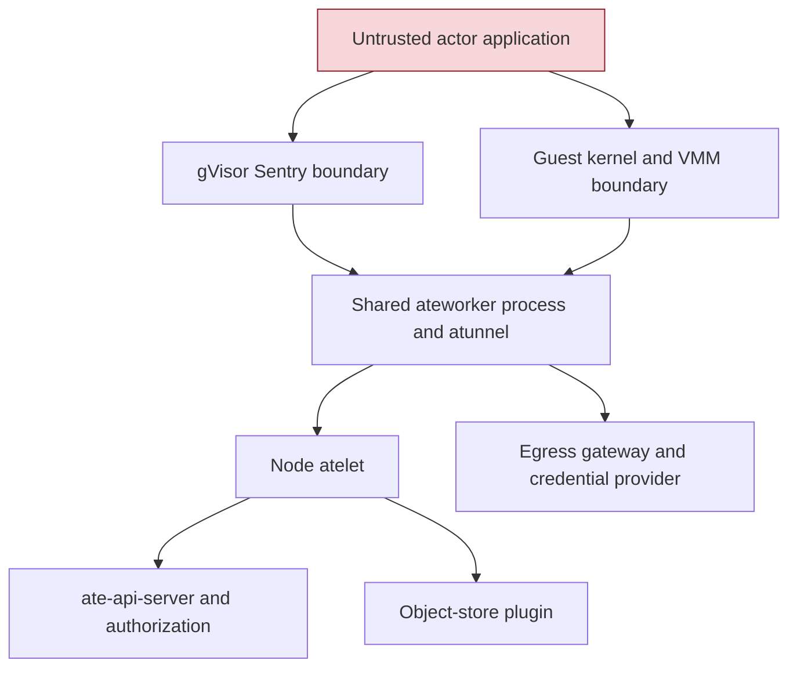
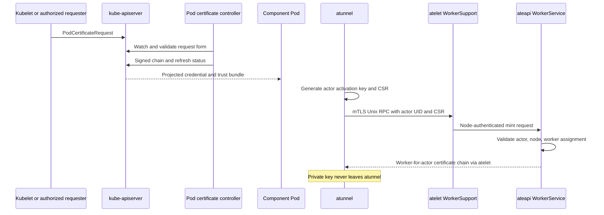
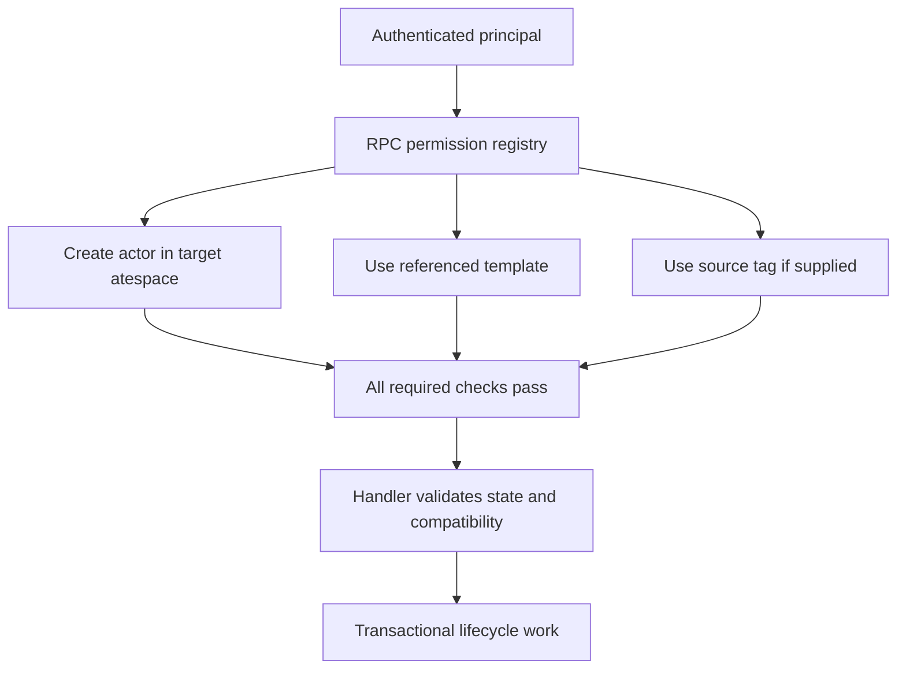
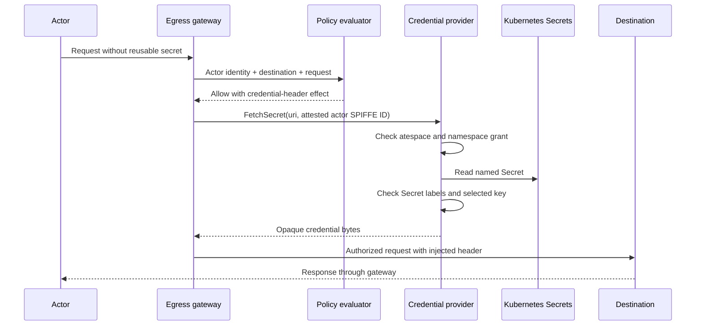
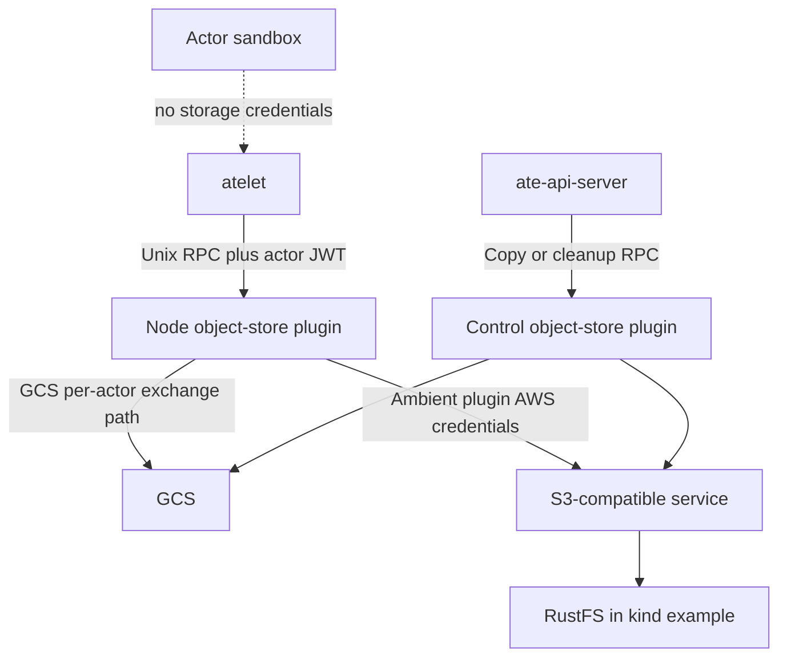

# 10. Identity, Authorization, and Credential Brokering

Substrate shares infrastructure processes among actors that need not trust one another. The security question is therefore not simply whether a container has a certificate or a namespace. It is whether every operation that crosses a shared boundary carries the right authority for the current actor, whether that authority survives relocation correctly, and whether its lifetime ends when the assignment ends.

The implementation uses several identities for different purposes. Kubernetes component identities authenticate supervisors, workers, and gateways. Actor identities identify the logical workload independently of a Pod. Worker-for-actor identities authorize infrastructure acting on an actor's behalf. API access policies authorize people and automation to manage records. Egress policies authorize network behavior, and credential providers impose their own rules on secret retrieval. Treating these as one universal identity would conceal differences in issuer, audience, attestation, and enforcement.

This chapter follows those differences through the source. It also distinguishes containment from policy. A sandbox boundary limits what hostile code can execute against the host. A policy boundary limits what a correctly identified caller is allowed to request. Both can be necessary for one operation, but neither proves the other is correct.

## 10.1 Trust boundaries and the actual containment model

The actor is the unit of untrusted execution. The worker process, atelet, runtime, network gateway, database, and object-store plugin are infrastructure with access that actors do not receive directly. A worker can host several actors, and a node can retain local snapshots for actors that are no longer executing. The trust model must cover live process memory, persistent files, reusable transport state, and infrastructure credentials, not only the currently running application.

The two runtime classes provide different containment boundaries. gVisor runs a userspace kernel that implements the actor-visible system-call environment and mediates host access. A microVM runs a guest kernel behind Cloud Hypervisor and KVM. The ordinary outer Linux container is not the actor security boundary for either runtime. The surrounding worker Pod is an infrastructure envelope whose security settings permit the runtime to establish its own sandbox.

[workerpool_apply.go](../../cmd/atecontroller/internal/controllers/workerpool_apply.go) renders nonprivileged worker containers with explicit capabilities, but sets both AppArmor and seccomp to Unconfined for the worker classes in this checkout. The reason includes runtime child operations such as `pivot_root` and virtiofsd sandbox setup that a default outer profile can reject. Runtime self-confinement is a separate layer. Calling the Pod nonprivileged does not mean it has no sensitive capabilities, and calling the outer seccomp profile Unconfined does not mean the runtime installs no filters of its own.

This trust-boundary diagram is deliberately not a privilege lattice. A gateway may hold credential-provider access that a worker lacks, while a worker holds host-facing runtime privileges that the gateway lacks. A compromise of one component must be evaluated against its own capabilities and credentials. The phrase zero trust describes an architectural direction, not proof that all component compromises have the same bounded effect.

The private network setup from Chapter 9 removes ordinary lateral connectivity between actors. It also prevents an actor from reaching metadata and control-plane services by taking the worker Pod's normal network path. Outbound TCP reaches atunnel and then a gateway that authenticates an actor certificate. DNS is filtered, and unsupported outbound protocols are rejected. Those controls are meaningful only if the actor cannot bypass the sandbox and reconfigure the host namespace; that is where runtime containment and network policy meet.

Kubernetes NetworkPolicy provides an additional boundary around system Pods and worker pools. [ate-system-networkpolicies.yaml](../../manifests/ate-install/ate-system-networkpolicies.yaml) defaults system ingress to deny and admits required flows. The WorkerPool controller reconciles per-pool policies. These are Kubernetes network identities and deployment relationships, not a replacement for actor-level policy inside shared workers. A policy allowing a worker Pod to reach the egress service says nothing by itself about which actor may call which external hostname.

Storage isolation requires similar layering. Actor directories are separate, paths are tied to actor identity, and atelet resets local directories across lifecycle transitions. Snapshot manifests and runtime metadata constrain how state is restored. The object-store plugin holds external storage access. None of those facts alone establishes per-actor encryption. The repository's security document explicitly leaves per-actor encryption and stronger restore authorization as future work. Filesystem segregation and cryptographic isolation must remain separate claims.

The boundary also ends at the actor. Substrate does not provide mutually distrustful sub-tenants inside one actor's process tree. If an application multiplexes several human users inside an actor, application code must protect their state. The repository places user-to-actor authentication, agent registry management, and delegated lineage in the higher-level system that creates actors. That scope decision is important for framework integrations: an actor's infrastructure identity is not automatically a human user's identity or a signed proof of every tool call's ancestry.

### Snapshot reuse changes the security review

A golden snapshot can be restored into many actor instances. Any identity material captured inside it risks being duplicated. Substrate's worker-side credential preparation occurs for the current activation outside the guest's persistent state. The end-to-end identity test [identity_test.go](../../internal/e2e/suites/identity/identity_test.go) specifically checks that a restored actor uses its own identity rather than the golden source's identity. This is the right invariant to test because successful TLS alone would not reveal identity reuse.

Tags add another persistence boundary. A tag is a durable copy of an actor's state and can outlive that actor. Memory or filesystem state may contain application secrets even when Substrate itself injects external credentials out of band. Granting an editor permission to create, publish, and clone tags therefore grants a data-copy capability. Deleting the original actor does not retract a tag's independent copy. The authorization model documents this limitation rather than pretending lifecycle deletion is universal erasure.

An authoritative threat analysis must name these residual capabilities. It should also distinguish an untrusted actor from a malicious installation administrator. A person able to replace the worker image, rewrite the signer trust roots, or grant broad Kubernetes access can change the trusted computing base. The useful production question is which administrative roles are intentionally trusted and which routine application roles can operate without that power.

## 10.2 Component certificates, actor certificates, and JWTs

`podcertificate-controller` implements component certificate issuance through Kubernetes PodCertificateRequests and ClusterTrustBundles. The [main program](../../cmd/podcertcontroller/main.go) instantiates separate signers for pod identity, service DNS, and PostgreSQL usage. The shared [signer controller](../../cmd/podcertcontroller/internal/signercontroller/signercontroller.go) uses an informer and workqueue, with a `SignerImpl` interface for certificate creation and desired trust bundles. It is a controller, but it is not a controller-runtime reconciler.

The pod-identity signer constructs a SPIFFE URI from the request's namespace and ServiceAccount. It also embeds Substrate-specific Pod identity information, including Pod, ServiceAccount, and node identifiers. The source of those values matters. [podidentitysigner.MakeCert](../../cmd/podcertcontroller/internal/podidentitysigner/podidentitysigner.go) takes them from the PodCertificateRequest specification. For kubelet-created requests, kube-apiserver attests the relationship among the requesting node, Pod, and ServiceAccount. Other principals with permission to create requests can name identities themselves.

This makes Kubernetes RBAC for PodCertificateRequests a sensitive delegation boundary. The CLI's proxy support and tests can request certificates without creating the named Pod and node because that path is not a kubelet-attested request. An administrator granting that permission must trust the principal with the identities it can name in the namespace. Node fields in the resulting certificate do not establish that every issuance path supplied the same node attestation.

The signer's certificate lifetime is capped and its status includes a refresh time. Kubelet projections and ClusterTrustBundle projections deliver updated material to components. Consumers must reload it correctly. Atunnel's ingress server loads credentials at startup to fail promptly on broken configuration, then reloads serving material and trust roots for new connections. This lets a long-running worker follow rotation without needing a Pod restart. Existing TLS connections have their own lifetime; replacing a file does not retroactively redo an established handshake.

Service-DNS identity answers a different question from Pod identity. A client reaching `api.ate-system.svc` can verify the service name through its service certificate, while a peer-specific mTLS policy can verify a SPIFFE URI representing the calling component. The egress gateway has yet another actor-identity trust root. Using the right root for the right handshake prevents a certificate valid for one infrastructure purpose from being accepted as an actor credential by accident.

Actor egress uses a worker-for-actor certificate. [BrokerCertificateSource](../../internal/atunnel/egress/credential.go) generates an ECDSA key for an activation, retains it inside atunnel, and sends only a CSR through the node-local WorkerSupport socket. The worker authenticates to atelet with its Pod certificate. Atelet forwards the request to the API's WorkerService, which verifies the current actor and assignment relationship before issuing the certificate. A failed mint prevents configured tunneled egress from starting; it does not silently create an unauthenticated fallback path.

The mint request includes actor name, atespace, and UID, and the API checks the requested incarnation. The current assignment also matters: a worker released from an actor must not continue minting fresh credentials for it. [workerservice/certificate.go](../../cmd/ateapi/internal/workerservice/certificate.go), [workerservice/jwt.go](../../cmd/ateapi/internal/workerservice/jwt.go), and the associated after-release tests enforce these relationships. A name alone is insufficient at this issuance boundary because deletion and recreation can reuse a name.

The egress gateway's acceptance path is a separate check. It re-verifies the actor certificate chain against the actor-identity roots, requires the expected usage and worker-for-actor SPIFFE form, extracts the actor reference, and asks the API for that actor. The current code permits `RUNNING` and `RESUMING`, allowing an application to use egress during initialization before its wakeup probe passes. Other lifecycle states are denied. This is more precise than the README statement that egress requires a running actor.

Do not assume every verification stage checks the same fields. The egress certificate parser returns an actor reference from the SPIFFE URI, and `validateActor` performs an atespace/name lookup and state check. Issuance validates the requested UID and placement, while the shown gateway check has its own narrower inputs. If a security requirement needs incarnation binding at every use, it must be demonstrated in the relevant verifier rather than inferred from a richer issuance request elsewhere.

### JWT identities and key discovery

Substrate also issues JWTs. [internal/actoridjwt](../../internal/actoridjwt/actoridjwt.go) defines the actor and worker-for-actor claim forms. [internal/localjwtauthority](../../internal/localjwtauthority/localjwtauthority.go) owns signing pools and verification keys. [ate-idp-server](../../cmd/ate-idp-server/internal/server/server.go) publishes the discovery document and JWKS; it does not become a general-purpose interactive identity provider or login portal.

A JWT's audience narrows where it may be presented. Storage-transfer tokens use the object-store plugin audience, while external actor JWT injection uses audiences configured for the destination. A verifier must check audience, issuer, time, signature, and the expected claim kind. Merely decoding a signed token and reading its actor name is not sufficient. The implementation centralizes verification in `internal/oidcjwt` and related helpers to avoid distributing slightly different validation rules throughout the codebase.

Key rotation has at least two moments: begin signing with a new key and stop publishing an old verification key. Removing an old key too soon invalidates tokens that have not expired. Keeping a compromised key too long extends exposure. The local key-pool abstractions distinguish active signing from the set of published verification keys, giving operators a mechanism for overlap. The operational rollout of that mechanism must also account for discovery caches held by relying parties.

The actor private key held by atunnel is reused across its certificate renewals within the activation. The source currently establishes a fresh broker gRPC connection for minting, which picks up rotated worker credentials and verifies the current atelet identity. A TODO suggests connection reuse for efficiency. That optimization cannot simply cache TLS forever without preserving rotation and node-verification behavior. This is a good example of a performance change whose correctness depends on an identity lifecycle, not only on reducing handshakes.

### Following one identity through issuance and use

A concrete issuance trace reveals why the identity chain has several checks. Atunnel knows the actor reference and UID from activation state, creates its key, and authenticates to the node's WorkerSupport endpoint. Atelet derives the requesting worker's identity from the peer certificate rather than accepting a worker name supplied by application data. The forwarded request identifies that worker to WorkerService. WorkerService authenticates the atelet, retrieves the actor, verifies the actor's node relationship, requires the actor's recorded worker assignment to match the requesting worker, and only then compares the requested actor UID. These checks serve distinct purposes: node scope prevents one node from minting for arbitrary placements; worker scope prevents a released worker from minting through its former supervisor; UID scope rejects deletion-and-recreation races.

The order also affects information disclosure. `MintWorkerActorCertificate` returns `NotFound` for a caller without the required assignment before exposing an incarnation conflict. A legitimate assigned caller whose UID is stale gets `Aborted`. Those responses are not interchangeable debugging details: they decide how much a caller can learn about another actor and whether a client should refresh its own state. A successful request parses and verifies the CSR signature before signing its public key, preventing a malformed or unsigned CSR from being treated as proof of possession.

The minted certificate has a one-hour validity period, a five-minute allowance before current time, and an actor-identity extension containing atespace, actor name, and actor UID. Its SPIFFE URI identifies the worker-for-actor role through atespace and name. The extension and URI therefore carry different amounts of information. Atunnel verifies the returned key matches its own private key and that the certificate is currently usable for client authentication. The gateway independently verifies the chain, rejects a CA certificate used as a leaf, requires client-auth usage, and requires exactly one URI SAN with the worker-for-actor form. Repeating chain verification in the Go handler protects that handler from treating forwarded certificate text as already trustworthy merely because an Envoy configuration is expected to validate it.

The current gateway does not use every field available in the certificate extension. That is a review boundary, not proof of an exploit by itself: exploitability also depends on key exposure, credential lifetime, actor lifecycle, and connection admission. It does mean an incarnation-sensitive security argument cannot stop at the issuer. The relying party must actually compare the incarnation it intends to authorize. This distinction generalizes to every attested field in the system: cryptographic integrity says a value was signed; only verifier code determines whether that value constrains an operation.

Certificate rotation has similar boundaries. Issuer availability is needed for new credentials and renewals, while an already established TLS connection can continue without repeating the handshake. Trust-bundle projection, file reload, minting, and handshake happen on different schedules. A rotation exercise should therefore examine a newly activated actor, an actor opening a new outbound connection, and an actor using an existing connection. Successful traffic in the third case cannot prove the first two work. Conversely, a mint outage during a restore wave can prevent new activations even while existing actors continue communicating, producing an availability pattern that resembles exhausted worker capacity unless mint failures are observed separately.

## 10.3 API authentication and relationship-based authorization

The public API authenticates requests before applying resource permissions. [apiauthn](../../cmd/ateapi/internal/apiauthn/apiauthn.go) uses transport mTLS identity when a client presents a certificate; otherwise it requires a bearer JWT from configured providers. A request with no usable credentials is rejected. The actor egress identity and a human or automation principal managing actor records are different categories, even when both eventually appear as strings in an authorization system.

The embedded [OpenFGA model](../../cmd/ateapi/internal/authz/model.fga) defines global scope, atespaces, actors, templates, tags, workers, nodes, and users. Human-facing roles are owner, editor, and viewer, with inheritance. A global owner inherits ownership into atespaces; an atespace editor can perform actor lifecycle and creation operations; a viewer can read. Infrastructure roles such as ingress router, egress gateway, controller, atelet, and API sidecar are supplied through contextual tuples associated with authenticated component identities. AccessPolicy cannot grant those system roles to an arbitrary user.

The model is useful only if every served RPC selects the correct check. [registry.go](../../cmd/ateapi/internal/authz/registry.go) is the declarative method-to-permission map. Missing entries are denied. Extractors validate resource identifiers before constructing graph objects and return all checks a request must satisfy. Some operations authorize in their handler because their checks depend on specialized node or assignment state; the registry records that choice rather than silently omitting them.

Creating an actor illustrates why a single permission is often insufficient. The request needs permission to create in the target atespace. It also needs permission to use the referenced template, which may be in another atespace. If it names a source tag, that tag has its own use check, followed by handler validation of scope and compatibility. Authorization to create an empty record in one scope must not imply authority to read state from every possible template or snapshot source.

AccessPolicy updates carry UID and version information so a stale editor cannot overwrite a policy that changed or was recreated. The global policy cannot simply be deleted; an update can remove bindings. At the atespace level, policy deletion follows the scope lifecycle. The authorization guide describes a bootstrap owner used at installation and a recovery procedure for administrators able to redeploy the API. That recovery ability is intentionally powerful and belongs in the installation-administrator trust boundary.

The current grant granularity stops at atespace. The model contains actor objects because operations refer to actors and because placement relationships matter, but it does not expose general per-actor user grants through AccessPolicy. A tenant requiring different readers for individual actors cannot obtain that isolation by assuming the graph's object types imply a user-facing policy feature. The graph's internal representation is broader than the grants administrators can express through the current policy API.

JWT principals are not qualified by issuer in the documented current limitation. If several trusted providers can issue the same subject string, they can resolve to the same principal. System roles still require component certificates, but ordinary owner/editor/viewer grants can be affected. A deployment trusting several identity providers must review their subject namespaces and administrative authority. The limitation is documented in [authorization.md](../../docs/guides/authorization.md).

Node-scoped minting is more restrictive than a shared ServiceAccount identity alone. Atelet authentication extracts and validates node-related Pod identity, and WorkerService checks that the actor is on the caller's node. The model's actor-to-worker-to-node relation expresses that purpose. However, not every atelet API has the same restriction: the model explicitly documents that any atelet can currently read any actor's egress policy because the role is shared and the read path lacks the equivalent hosting check. The TODO proposes moving that read to an appropriately node-authorized service.

### Authorization at request time and state changes after it

An authorization check observes state at a moment. A lifecycle workflow may continue after the initiating client disconnects or after a policy is changed. Substrate separates request authorization from durable workflow correctness; Chapter 3 covers the latter. An operator should not assume that revoking a user's editor role cancels all work that was already authorized and committed. Similarly, deleting an actor record, deactivating a worker endpoint, and invalidating every already-issued credential are separate operations with different propagation.

This distinction affects incident response. Revoking the principal prevents future management calls. Changing egress policy affects network decisions after caches refresh. Suspending or terminating the actor changes execution and tunnel admission. Rotating an issuer key affects token verification. These mechanisms overlap but do not have identical latency or blast radius. A response procedure should select the boundary that matches the unwanted behavior and then verify that boundary's observable state.

The static ingress SPIFFE allowlist is also separate from API permissions. A caller on that allowlist can reach actors through the gateway; it does not gain arbitrary API editing rights. Conversely, a user able to create an actor through the API does not automatically have a usable ingress client certificate. The higher-level application is expected to decide which human may invoke which actor. Until per-actor ingress authorization exists, the allowlist should be understood as trust in an upstream application or gateway, not as fine-grained tenant policy.

## 10.4 Egress policy, TLS interception, and credential injection

The egress gateway authenticates the worker-for-actor certificate before accepting a CONNECT. It then verifies that the referenced actor exists in a placement-compatible state and obtains the actor's EgressPolicy. An actor with no policy or no effective rules is denied. The [policy cache](../../cmd/atenet/internal/router/egress/policycache.go) caches both valid policy and absence, with a default ten-second TTL. A newly created allow rule may therefore take time to replace a cached denial, and a removed allow rule may remain usable until the relevant cached view expires.

[egresspolicy.Compile](../../internal/egresspolicy/egresspolicy.go) converts API rules into the gateway's internal representation. Matching considers hostname or IP and port specificity. `EvaluateRequest` distinguishes cleartext from decrypted traffic, while `SNIRules` selects the transport rules for a dialed port. Invalid entries are ignored so they cannot match, and compile errors are reported. This keeps a malformed rule from becoming an accidental wildcard, but operators still need visibility into policies whose intended entries were unusable.

Rule precedence also selects credentials. Exact hostname matches outrank a one-label wildcard, which outranks the universal wildcard. Within the hostname rank, an explicit port list outranks an all-port rule. Equal-ranked matches preserve source order: `EvaluateRequest` replaces the current decision only when a candidate has a strictly better rank, and `SNIRules` uses stable ordering. Only the deciding rule's `Effects` apply; effects from other matching rules are not merged. A broad rule with one credential and a narrow rule with another therefore requires reviewing both match specificity and order. Reordering equal-ranked entries can change the credential attached to an otherwise permitted request. Policy review must evaluate the resulting decision, not merely confirm that each individual rule looks reasonable.

The outer CONNECT does not authorize every future request carried inside it. Cleartext HTTP and TLS-intercepted HTTP invoke request-level processing. The handler derives the request destination from authority and the port actually dialed; it checks disagreement between `Host` and `:authority`. On the MITM path it also considers the connection's SNI. A reusable connection must not let a permitted initial destination authorize unrelated later requests through an alternate authority.

TLS passthrough has less visibility. The listener can decide based on SNI and transport characteristics, but it cannot inspect encrypted headers or inject an HTTP credential. A policy requiring header effects therefore needs an HTTP-visible path. The distinction is architectural: adding an ext_proc service cannot reveal plaintext that the gateway never terminates. Operators choosing passthrough accept a different enforcement surface, often to preserve end-to-end TLS semantics required by the application.

TLS interception requires the actor to trust the gateway's MITM authority. Substrate distributes that trust bundle through its workload setup and controller support. The [sdsmint service](../../cmd/atenet/internal/sdsmint/minter.go) issues destination certificates on demand, and delta SDS delivers them to Envoy. Trusting this authority gives the gateway the ability to impersonate permitted HTTPS destinations to the actor within that execution environment. The authority is therefore a sensitive infrastructure asset, distinct from the Pod identity CA and actor egress CA.

Credential injection occurs after a request is authorized for its destination. The effect can fetch material from a provider or mint an actor JWT. The actor sends a placeholder header rather than the real credential. `applyEffects` selects only configured replacement headers already present in the request; an absent header does not trigger a credential fetch. This supports the zero-ambient-credential goal: the sandbox can identify the desired operation without holding the reusable secret that grants it. The gateway applies the credential at the final HTTP-visible boundary before forwarding.

[applyEffects](../../cmd/atenet/internal/router/egress/credentials.go) validates injection headers and fails the request if a required credential cannot be obtained. It does not send the request without the effect. Header names that would alter HTTP routing or pseudo-header semantics are rejected, and secret values are sanitized before being placed in headers. The resulting guarantee is bounded: Substrate avoids provisioning that credential into the actor, but an external service could still echo sensitive request data in a response. Application behavior and destination trust remain relevant.

The plugin API is intentionally small. [CredentialProvider.FetchSecret](../../api/credprovider/v1/credprovider.proto) receives a provider-interpreted URI and the actor SPIFFE identity attested by the gateway, then returns opaque bytes. The provider owns authorization appropriate to its backend. The gateway's identity field is trustworthy only because the provider authenticates or locally constrains the gateway caller. An arbitrary network client sending the same field must not be accepted as proof of actor identity.

The in-tree Kubernetes Secrets provider makes this second authorization layer concrete. `ParseURI` resolves the namespace, Secret, and key. `NamespaceAuthorizer` maps atespaces to allowed Kubernetes namespaces and optionally narrows grants by Secret labels. The server first validates the actor identity and namespace grant, reads the Secret, then evaluates label constraints. With authorization enabled, an absent Secret and a label-denied Secret return equivalent denial behavior so a caller cannot enumerate names through that distinction.

Kubernetes RBAC on the provider's ServiceAccount still limits what the process can read. Provider policy determines which of those readable secrets a given actor may use. These two controls should be reviewed together: a narrow RBAC grant protects against a provider compromise, while per-actor provider policy protects against an overbroad request from an otherwise authenticated gateway. Making one broad does not make the other redundant.

The server constructor permits a nil authorizer for tests, but [the executable](../../cmd/credential-provider/kubernetes-secrets/main.go) requires `--namespace-policy-file` and fails startup when it is absent. The production path therefore loads an explicit namespace policy. Its contents still matter: a broad namespace grant authorizes more secrets than a label-restricted grant. A credential URI's provider name routes the request to a configured backend; it is not itself authorization. A policy editor able to select a URI should only obtain secrets the provider independently permits.

DNS enforcement uses the same policy intent at an earlier boundary. The DNS evaluator compiles permitted hostname patterns from HTTP, HTTPS, and passthrough rules. Nil or empty policy permits no queries. The relay refuses unsupported or malformed requests and bounds outstanding work. This reduces the ability to use arbitrary DNS as an ungoverned external channel. It does not mean every response IP is permanently trusted: HTTP and TLS processing still evaluate the subsequent connection and request.

### Policy change during a long-lived connection

A long-lived CONNECT can outlive a policy update. The outer transport rule and inner request policy have different evaluation times. HTTP-visible requests can be checked again as they arrive, subject to the policy cache. TLS passthrough has less opportunity to re-evaluate semantic requests inside the stream. A claim of immediate revocation must therefore specify whether it means refusing new tunnels, denying new HTTP requests, or terminating existing opaque streams.

The source's policy refresh tests are useful because they exercise more than initial admission. They do not establish an unbounded universal revocation guarantee. An operator responding to a compromised actor may need to stop the actor or deactivate its transport in addition to modifying policy. The correct choice depends on how quickly existing connections must end and whether preserving application state matters.

### Policy composition and the authority to select a secret

The Kubernetes Secrets authorizer uses OR between grants and AND within one grant's labels. Suppose an atespace has one grant for namespace `tools` restricted to `purpose=search`, and a second grant for the same namespace restricted to `environment=test`. A Secret satisfying either grant is admitted. The implementation retains those grants separately rather than merging their labels into an accidental AND. Conversely, adding a broad grant for `tools` makes the narrower labels irrelevant for admission: one matching grant is enough. These names are illustrative configuration values, but the composition rule is the actual `NamespaceAuthorizer.AllowedSecret` algorithm.

An empty selector matches all Secrets in an already granted namespace. It does not represent deny-all. To grant nothing, omit the grant. This rule matters when generating configuration because an omitted or misspelled label field can change apparent intent drastically. `LoadNamespaceAuthorizer` uses strict YAML parsing, rejecting unknown fields such as an unsupported selector expression instead of silently loading them as an empty selector. Label keys and values are validated at startup. The control is small but important: a configuration typo must become an explicit deployment failure rather than a broader secret grant.

Secret retrieval still requires a valid actor SPIFFE identity and an allowed namespace before contacting Kubernetes. Label selection occurs after the Secret is retrieved because the labels are backend data. With authorization enabled, missing and label-denied Secrets return the same denial code and message. The selected data key is checked only after the Secret passes authorization. This establishes a useful boundary for information disclosure without claiming that all timing differences or all backend errors are indistinguishable. For example, Kubernetes RBAC denial and temporary API unavailability remain operationally different failures, and the provider preserves that difference.

The provider's mTLS configuration also makes the actor identity field meaningful. Its executable requires a serving credential bundle and client trust roots, and `verifyClientSAN` accepts only the expected injector identity among the peer's URI SANs. Backend authorization is consequently evaluating a claim from a trusted gateway, not a self-asserted field from any actor that can open a socket. Moving this provider to another host or introducing a proxy must preserve that caller trust relationship. Merely forwarding the protobuf unchanged does not preserve the original transport authentication.

A credential-header replacement is a requested effect, not unrestricted secret delivery. The actor chooses to include the header that triggers replacement, but its supplied value is overwritten. The matched policy chooses the provider URI or JWT source and optional prefix. The provider then authorizes that actor's access to the named secret. These decisions are deliberately distributed: the actor cannot select an arbitrary provider URI through the placeholder value, and the policy's choice does not bypass provider authorization. A missing configured provider, a denied fetch, or an unusable secret value causes denial when that replacement is required. Omitting the placeholder instead sends no injected credential; the destination's authentication semantics determine whether such a request is useful.

This model supports libraries that insist on receiving an API-key-shaped configuration value: they can emit a placeholder while the gateway supplies the actual secret. It does not protect a secret that the application independently loaded from another source, nor does it prevent an authorized destination from reflecting the injected value into a response. A destination permitted to receive a powerful credential is part of that credential's trust boundary. Restricting destination matching and using appropriately scoped backend credentials are therefore still necessary even when the actor never receives the normal provisioning copy.

### DNS revocation follows its own cache contract

The DNS policy source is [actorEgressPolicy](../../internal/atunnel/egresspolicy.go), separate from the gateway's policy cache. It refreshes through atelet and retains a previously fetched policy if the refresh fails. This is fail-static behavior: the last known decision set remains available during a supervisor outage. An initial fetch failure has no such prior policy and cannot authorize names. A successful refresh returning no policy replaces the cached view with deny-all. These cases differ materially from treating every failed refresh as either permanent allow or immediate deny.

The DNS evaluator compiles hostname patterns from HTTP, HTTPS, and TLS-passthrough rules, discards invalid patterns, normalizes the query name, and checks whether at least one pattern matches. It does not grant authority based on a response address alone, and it does not turn a permitted hostname into permission for all protocols and ports at that address. Transport and request enforcement still occur later. DNS policy is a necessary gate on name resolution, while egress policy at the gateway remains necessary for the actual operation.

The DNS protocol handler returns policy denial as `NXDOMAIN` with a zero-duration negative-cache hint, enabling resolver search-suffix behavior without intentionally extending denial beyond a subsequent policy change. That response is an application-visible protocol choice, not a statement that the external name truly does not exist. An operator debugging a name that resolves normally outside the actor must therefore inspect actor policy before changing cluster DNS. A restored actor can have working transport and still receive synthetic nonexistence because its new policy differs from the source snapshot's policy.

A security test for revocation should separate successful refresh from refresh outage. Remove a hostname grant while atelet remains reachable and observe when new queries stop. Repeat with refresh unavailable and confirm that the previous policy remains in use as designed. Then restore the supervisor path and confirm convergence to the removed grant. These are proposed test scenarios derived from the implemented cache behavior, not measurements from a running cluster. They make the availability-versus-revocation tradeoff explicit and avoid asserting a fixed revocation deadline that the stale-cache path cannot provide.

## 10.5 Storage authority, RustFS, and the limits of zero ambient credentials

Snapshot storage is outside the actor sandbox. Atelet calls a node-side object-store plugin over a Unix socket to fetch or upload named files. The API server calls a control-side plugin to copy or delete snapshots. The plugin processes hold the backend configuration and credentials. This arrangement keeps object-store credentials out of the main atelet and API processes for snapshot I/O and out of actor execution, but it does not imply that every backend uses the same credential scope.

The [object-store API](../../api/objectstore/v1/objectstore.proto) carries an `actor_jwt` on node transfers. The token is a worker-for-actor JWT with audience `objectstore-plugin.ate.dev`, minted for the node hosting the actor. A plugin supporting per-actor authorization validates it and binds storage access to the relevant actor and node. The protocol explicitly allows a plugin without per-actor authorization to ignore it. That is an extension point and a security distinction, not a field whose mere presence proves enforcement.

The in-tree GCS path implements credential exchange. [exchange.go](../../cmd/objectstore-plugin/exchange.go) and the corresponding internal exchange API coordinate short-lived storage access based on actor context. The S3 path currently uses the plugin's ambient AWS credentials. RustFS is reached through that S3-compatible implementation, so it inherits the same current credential model. It must not be described as having GCS-style per-actor token exchange unless an implementation is added and verified.

[NewFromEnv](../../pkg/objectstorage/env.go) selects S3 only when `ATE_STORAGE_BACKEND` equals `s3`; other values select the default GCS path. `NewS3ClientFromEnv` uses standard AWS SDK configuration and enables path-style addressing when `AWS_S3_USE_PATH_STYLE=true`. The kind overlays point the plugin sidecars at `http://rustfs.ate-system.svc:9000`, configure a region and credentials, and use the `ate-snapshots` bucket. The actor and the main supervisor do not need to know that this bucket is served by RustFS rather than another compatible backend.

The [RustFS manifest](../../manifests/ate-install/kind/rustfs.yaml) is explicit development infrastructure: one replica, a 1Gi ReadWriteOnce PVC mounted at `/data`, static example credentials, API port 9000, and console port 9001. A bucket-init Job creates or detects `ate-snapshots`. NetworkPolicy permits the API from the API-server and atelet Pods' sidecars and the initializer, while leaving the console outside that ingress grant. These choices make the example reproducible; they do not establish a production HA or backup design.

The distinction between actor credentials and plugin credentials becomes especially visible here. The RustFS access key belongs to infrastructure with access to stored snapshots, not to one actor. Compromising that plugin or obtaining the development credentials can expose a broader storage namespace than compromising an actor's short-lived identity. Moving credentials into Kubernetes Secrets improves distribution and rotation practices but does not by itself narrow their authorization. Backend policy and plugin behavior determine scope.

Asset fetching has a different contract from snapshot fetching. A SandboxConfig names content-addressed runtime assets. `AssetProvider.FetchAsset` must verify SHA-256 before replacing the caller's target file and must refuse paths under snapshot or tag locations. Without that restriction, a caller could abuse the asset endpoint to retrieve private snapshot data through a path intended for binaries. The protocol also requires the target to remain unchanged on error. Integrity and path-domain separation are both part of the asset trust boundary.

The snapshot API does not impose universal file checksums; its documentation assigns integrity verification to the plugin. The caller owns manifest-last commit ordering so a visible manifest identifies a completed set of data files. That ordering protects against treating partial upload as a committed snapshot, but it is not a substitute for detecting corrupted or maliciously altered bytes. An encryption or authenticated-manifest design would need to define key ownership, replay protection, tag copying, and restore verification as an explicit extension.

### Auditing a restore as a privileged data import

A restore imports saved process and filesystem state into a fresh execution environment. The state may have been produced by an older runtime and may contain attacker-controlled files. Runtime compatibility checks, actor directory segregation, archive extraction rules, and worker cleanup therefore belong in the security review. A successful object-store download only establishes that bytes arrived; it does not establish that they are appropriate for the selected actor, runtime, or template.

Tags and golden snapshots make that import reusable. The API validates source references and fidelity compatibility, but policy decisions about who may publish or clone state remain broad at atespace granularity. An administrator should review templates and tags as executable and data-bearing artifacts, not merely configuration metadata. A memory snapshot can retain application tokens that were never issued by Substrate, and a rootfs snapshot can retain credentials written by the application itself.

The phrase zero ambient credentials is consequently a default provisioning property. It means actors do not automatically receive the platform's reusable infrastructure credentials and can use out-of-band injection for supported requests. It cannot promise that an application never receives or stores any secret, that a response never returns sensitive data, or that every snapshot is secret-free. Those stronger properties require application constraints and data handling rules outside the current substrate boundary.

### Selecting the revocation boundary

The following matrix separates controls that are often collapsed into one instruction to revoke access. Each row names the operation it directly constrains; other effects require their own enforcement path.

| Control | Directly constrained operation | Remaining question |
|---|---|---|
| Remove an API role binding | Future management requests evaluated under that binding | Which already committed workflows continue? |
| Remove an ingress client SPIFFE identity | New gateway admissions using that component identity | Which established streams remain, and who authorizes individual actors? |
| Change an actor's egress policy | Network decisions made with the updated policy view | Which caches and opaque connections still use earlier decisions? |
| Remove a credential-provider grant | Future secret resolutions under that provider policy | Which previously issued external credentials remain valid? |
| Rotate an actor-signing root or JWT key | New verifications after consumers adopt the new trust set | Which caches and established connections retain prior trust? |
| Stop an actor's execution and tunnel | That activation's local application and network activity | Which tags, snapshots, and external side effects remain? |

This matrix is an incident-analysis aid, not a claim that Substrate supplies one atomic revocation transaction across all rows. The repository deliberately distributes these authorities among API authorization, gateways, providers, runtime lifecycle, and external services. A response procedure should verify the chosen boundary directly. For example, removing an editor binding should be checked with a management call from that principal; it should not be judged solely by whether an actor's existing network request stops.

A cloned tag makes the distinction especially concrete. Revoking the source actor's egress policy does not rewrite application data already copied into the tag. Revoking the source user's API role does not delete a clone created earlier by a different authorized user. Rotating the external service credential may invalidate copies of that credential wherever they exist, but only if the external service enforces the rotation. Data retention, execution termination, and authority revocation are related operations with different owners.

Logs used during such a response must preserve the same distinctions without exposing sensitive material. Record actor attribution, the relevant operation, destination, provider identity, and denial category where the implementation supplies them. Avoid treating a token string as a convenient correlation key. The credential protobuf marks returned bytes for redaction, and storage-transfer JWTs are also redacted fields. Custom log statements, application echoes, and external collectors remain separate exposure paths. Useful incident evidence identifies which authority was exercised without turning the evidence store into another repository of reusable credentials.

## 10.6 Roadmap and engineering improvements

The repository identifies several security capabilities as unfinished. Per-actor encryption and stronger restore authorization remain future work. Node blast-radius containment is in progress. Atespace network policies and quotas are not completed simply because API ReBAC exists. Actor-to-actor authorization and comprehensive anti-DoS controls are explicitly future capabilities. Snapshot tainting is also future work. These classifications in [security.md](../../docs/security/security.md) should be read alongside code rather than flattened into a single claim that the security architecture is complete.

The authorization model documents concrete improvements: restrict atelet policy reads to actors on the appropriate node, refine tag create/publish/clone permissions, and consider a stronger distinction between reading and using a template. The current guide also lists issuer-unqualified JWT principals and the absence of groups, login flow, and per-actor grants. These are useful roadmap subjects because they affect deployable trust boundaries today.

For storage, adding S3 per-actor authorization would require more than forwarding an existing JWT. The plugin must validate issuer, audience, claim kind, actor incarnation, node placement, and allowed object prefixes, then obtain or enforce appropriately scoped backend access. A RustFS deployment could participate through a compatible backend policy or a plugin-enforced model; that per-actor implementation is absent from the audited S3 path. The current path uses ambient plugin credentials and should be operated accordingly.

Editorial proposals include a uniform identity-verification matrix that states which fields each boundary validates, and conformance tests covering deletion/recreation, assignment release, certificate renewal, and key rotation. Such a matrix would prevent rich issuance metadata from being mistaken for equally rich verification everywhere. Tests should include negative cases at the actual consuming service, not only checks that the signer produced the desired claims.

Another proposal is to give policy revocation a documented contract per transport. The contract should distinguish new CONNECT admission, per-request HTTP enforcement, opaque passthrough streams, cache TTL, and explicit actor termination. A single adjective such as dynamic is insufficient for operators deciding whether a compromised workload can continue transmitting for milliseconds or for the lifetime of a stream. The existing implementation contains the necessary stages to describe that behavior precisely, even before stronger revocation mechanisms are added.

Finally, production security evidence should preserve the difference between code inspection, unit tests, cluster tests, and adversarial review. This chapter identifies mechanisms and their visible limits at the audited commit. It does not certify absence of sandbox escapes, prove every policy combination safe, or claim a fresh security test run. The useful engineering outcome is a set of concrete boundaries, ownership rules, and failure cases that can be tested as the system evolves.

## Source map

- [Worker security context](../../cmd/atecontroller/internal/controllers/workerpool_apply.go), [system NetworkPolicies](../../manifests/ate-install/ate-system-networkpolicies.yaml), and [security model](../../docs/security/security.md): containment and deployment assumptions.
- [Pod identity signer](../../cmd/podcertcontroller/internal/podidentitysigner/podidentitysigner.go), [signer controller](../../cmd/podcertcontroller/internal/signercontroller/signercontroller.go), and [certificate request client](../../internal/podidentity/podidentity.go): identity issuance and Kubernetes attestation.
- [Worker certificate minting](../../cmd/ateapi/internal/workerservice/certificate.go), [worker JWT minting](../../cmd/ateapi/internal/workerservice/jwt.go), and [atunnel broker client](../../internal/atunnel/egress/credential.go): assignment-bound credentials.
- [API authentication](../../cmd/ateapi/internal/apiauthn/apiauthn.go), [authorization model](../../cmd/ateapi/internal/authz/model.fga), [RPC registry](../../cmd/ateapi/internal/authz/registry.go), and [authorization guide](../../docs/guides/authorization.md): principal and permission semantics.
- [Egress handler](../../cmd/atenet/internal/router/egress/egress.go), [policy evaluator](../../internal/egresspolicy/egresspolicy.go), [credential effects](../../cmd/atenet/internal/router/egress/credentials.go), and [Kubernetes provider](../../cmd/credential-provider/kubernetes-secrets/kubeprovider.go): network authorization and secret injection.
- [Object-store protocol](../../api/objectstore/v1/objectstore.proto), [exchange implementation](../../cmd/objectstore-plugin/exchange.go), [backend selection](../../pkg/objectstorage/env.go), and [RustFS example](../../manifests/ate-install/kind/rustfs.yaml): storage authority and backend differences.
