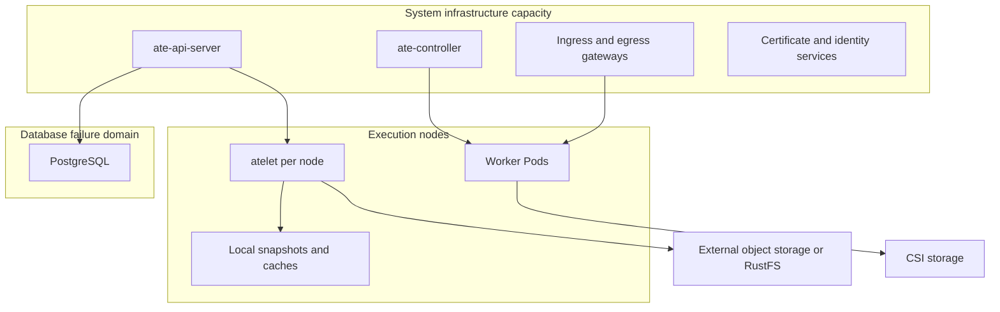
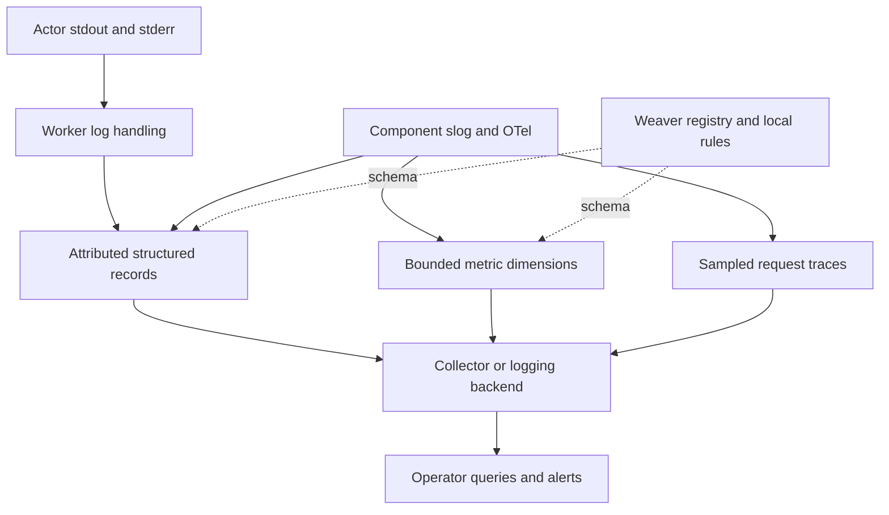
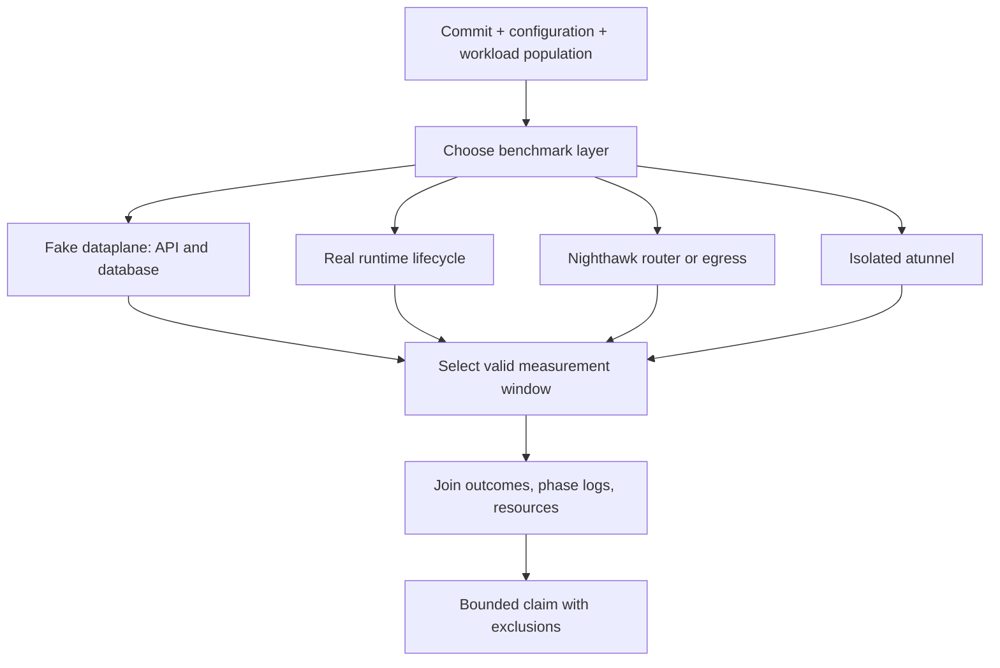
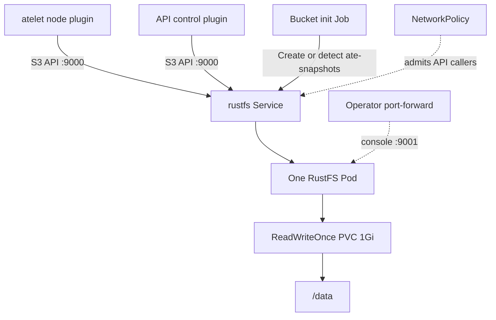
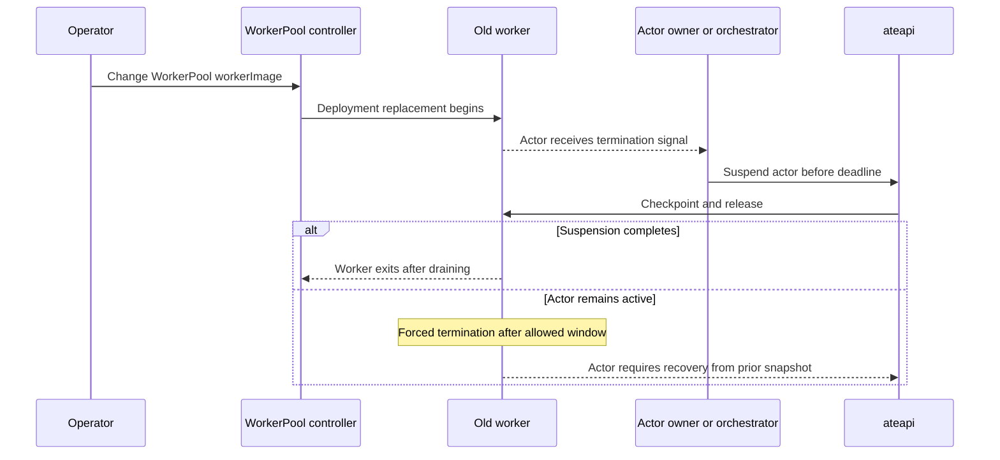

# 11. Operating and Measuring a Multiplexed Fleet

A healthy Kubernetes Deployment is necessary but insufficient evidence that a Substrate fleet is healthy. Workers can be Ready while the API cannot assign them. Actors can be RUNNING while their gateway cannot reach them. A successful asynchronous suspend can leave the newest checkpoint only on one node. A metric can improve because failed requests were excluded from its latency distribution. Operating the system requires following logical actor state, physical capacity, storage durability, and request delivery as separate but connected surfaces.

The repository contains installation tooling, deployment manifests, telemetry contracts, functional tests, end-to-end suites, and several benchmark rigs. These are not peripheral to the implementation. They define how the system is assembled, which failure modes are visible, and what a performance claim can actually establish. This chapter turns those artifacts into an operating model while preserving their limits. No benchmark or cluster test was run to produce this manuscript.

## 11.1 Establishing the effective installation and its failure domains

The installation entry point is [ate-setup](https://github.com/agent-substrate/substrate/blob/v1.0.0/cmd/ate-setup/README.md). Its configuration, rendering, image resolution, and deployment steps live under `cmd/ate-setup/internal`. Kubernetes YAML lives in [manifests/ate-install](https://github.com/agent-substrate/substrate/blob/v1.0.0/manifests/ate-install/base/kustomization.yaml). The rendered result depends on the selected environment, dataplane, storage backend, preview gates, and optional components. Reading one base YAML file is therefore not enough to establish the effective deployment.

The installer records its non-secret configuration for later inspection and reuse. The upgrade guide describes platform-specific record locations and the `ATE_RECORD_DIR` override. The record is valuable evidence of intended installation settings, but it is not a live inventory of every mutation made since deployment. An operator should compare the record with current Kubernetes objects, image digests, API configuration, and externally managed services before using it as the basis for an upgrade.

Source builds and prebuilt images have different provenance. A source deployment builds from the selected checkout. A prebuilt deployment resolves configured component images. In both cases, the relevant operational identity is the exact image digest and configuration, not simply a release-looking tag. Runtime assets are separately selected through SandboxConfig and fetched by digest, so worker image identity alone does not fully describe the sandbox that produced a snapshot.

The fleet has at least four capacity domains: API/database infrastructure, network gateways, node supervisors, and worker execution capacity. Snapshot storage and external CSI volumes add further dependencies. Putting all of them on the same nodes can make a burst of actors consume the resources needed to recover from that burst. The installer supports isolating system infrastructure and PostgreSQL through dedicated labels and taints. This creates resource separation, but it also introduces capacity requirements for those pools; a missing or undersized infrastructure pool can leave system Pods Pending.

The diagram is an operational dependency map. It does not assert that the default install places each box in an independent physical failure domain. The bundled database and kind RustFS example can share the same cluster and underlying host. A cluster-wide outage can therefore remove both execution and its supposed durable storage service. Durability is a property of the storage deployment and recovery procedure, not of the fact that an endpoint speaks an object-store API.

Node-local layout has explicit filesystem constraints. [node-storage.md](https://github.com/agent-substrate/substrate/blob/v1.0.0/docs/guides/node-storage.md) places state under `/var/lib/ate` and allows a dedicated mount for `/var/lib/ate/snapshots`. The mount must be established before actors use that path; mounting over populated storage hides existing snapshots. The actor directory must remain on the expected filesystem, and the worker's mounted view does not make an arbitrary symlink a substitute for a real mount. Hard-link behavior and cache copies also change when snapshots and caches live on different filesystems.

These details affect a common operational temptation: moving a busy snapshot directory to another disk after latency rises. The correct procedure must account for stopped or quiesced actor activity, visible localities in the API, in-progress uploads, and mount propagation into workers. A filesystem change that appears local can invalidate assumptions used by restore and cleanup. Plan the storage layout before load and use the documented boundary rather than depending on every internal directory name.

PostgreSQL is authoritative for actor records, assignments, leases, and other API state. [postgres.md](https://github.com/agent-substrate/substrate/blob/v1.0.0/docs/guides/postgres.md) separates schema-owner and ordinary read/write connections. Startup migrations use owner access, while normal operations use the application role. This reduces routine privilege but makes deployment configuration more exacting: a missing external database setting can select the bundled database in a deployment command. Before rolling the API, verify the effective connection destination and preserve secret configuration separately from the non-secret install record.

The control plane's database pool is shared with embedded authorization work. Increasing API replicas multiplies available connections and can increase database pressure even if each replica's setting is unchanged. The repository's scaling guide accounts for fixed auxiliary pools in addition to the shared read/write pool. A capacity plan should use the configured values and current database limits rather than maximize connection count. Waiting for a connection is often preferable to creating enough active database backends to collapse throughput, but the wait must be visible in diagnosis.

### Readiness should answer the component's real question

Kubernetes readiness is a component-local statement. For an API server it includes ability to serve its role after migrations and initialization. For a router it includes dependencies and drain state. For a worker it indicates infrastructure readiness, while an individual actor still has its own readiness probe and assignment state. A dashboard showing green Pods can conceal a failure in the relationship between them.

Operational checks should follow a representative actor journey: create or locate an actor, resume it, reach its application through the real router, exercise permitted egress if required, suspend it with the intended durability mode, and restore it from the intended locality. That journey should use a disposable test actor and explicit expected behavior. It is stronger than a liveness probe, but it is also more expensive and can consume capacity or storage; it belongs in a deliberately sized synthetic check, not an unbounded health loop.

## 11.2 Telemetry contracts, attribution, and missing evidence

[internal/serverboot](https://github.com/agent-substrate/substrate/blob/v1.0.0/internal/serverboot/serverboot.go) centralizes logging, metrics, tracing, health endpoints, and exporter configuration. The implementation can export OpenTelemetry signals, expose Prometheus metrics, and bridge controller-runtime's registry into the telemetry pipeline. Worker signals can traverse a relay rather than requiring every worker to hold direct external telemetry configuration. Shared initialization keeps component behavior consistent, but operators still need to inspect enabled exporters and destinations.

The schema for Substrate's signals lives in [docs/metrics/registry](https://github.com/agent-substrate/substrate/blob/v1.0.0/docs/metrics/registry/metrics.yaml), with events in a companion file. This registry defines instruments and attributes; [substrate.yaml](https://github.com/agent-substrate/substrate/blob/v1.0.0/docs/metrics/substrate.yaml) records rules and exceptions that the registry format does not express. One central rule is that actor identity does not become an unrestricted metric label. At large actor counts, adding UID to every series would make the monitoring system scale with the logical population rather than with a bounded set of operational dimensions.

Actor identity belongs in structured logs and traces where it can be sampled, indexed, and retained under an explicit cost policy. [internal/ateattr](https://github.com/agent-substrate/substrate/blob/v1.0.0/internal/ateattr/ateattr.go) defines shared attribution names so an actor's container output and component events can be joined. A container's log stream is associated with the actor activation that produced it, rather than relying only on worker Pod identity. That matters because one Pod can host many actors over its lifetime and several concurrently.

An actor's own output cannot automatically receive the trace identity of the request that caused each line. A forwarder sees a container-wide byte stream, not the application's request context. If the application emits trace fields, they can pass through; infrastructure-generated events can use their own known context. The observability guide explicitly identifies actor telemetry relay work as the path toward stronger per-line correlation. Inferring a trace from whichever request happened to be active would produce misleading evidence under concurrency.

Tracing is head-sampled. The documented defaults include a smaller root sampling ratio at the router than in other system components. The resumer preserves the leader request's span context when it detaches shared work from caller cancellation. That avoids fragmenting a restore into unrelated traces, but joined callers still share one underlying flight. A trace shows one causally useful execution, not necessarily one independent restore per incoming request.

For per-actor restore distributions, the unsampled timing breakdown logs are more appropriate than sampled traces or aggregate histograms. Atelet emits `Restore timing breakdown` and `Checkpoint timing breakdown`; workers emit nested runtime phases with the same actor attribution. Durations are seconds. A phase that did not execute is absent, not zero. Failed operations carry `error.type`, allowing a report to separate successful latency from failures rather than silently mixing them.

The phase names are developer-facing implementation details. The public histogram stops at coarser boundaries such as download, persistence, worker restore, and worker checkpoint. This avoids turning every runtime refactor into a metrics compatibility change. The [phase analysis tool](https://github.com/agent-substrate/substrate/blob/v1.0.0/benchmarking/analysis/phase_report.py) consumes the finer logs and computes distributions and waterfalls. Operators should preserve the source commit with a report because phase definitions can evolve even when the top-level metric remains stable.

### Missing metrics are part of the operating model

`docs/metrics/substrate.yaml` explicitly lists blind spots. The store lacks its own comprehensive metrics; worker-cache staleness is not fully instrumented; actor population counts are absent from the described metric set; image-cache eviction and preparation cost are not fully covered. Certificate issuance, IDP behavior, golden-template work, and drain outcomes also have gaps. These omissions are unusually valuable documentation because they prevent an investigator from assigning all unexplained latency to the component that happens to emit a histogram.

Suppose lifecycle duration and scheduler assignment duration rise while the measured runtime phases remain stable. The unmeasured remainder can include database work, connection-pool wait, cache behavior, or coordination. It is not evidence that the runtime is slow. Conversely, a stable API latency histogram can coexist with growing failure rate if failed operations are counted separately or excluded from a success-only view. Every panel should state its population and outcome filter.

Atelet's actor statistics poller introduces another limit. It samples workers while actors are hosted and aggregates by bounded dimensions such as template. Short activations can complete between samples or lose their final CPU interval. The registry's companion document explains that sampled usage records preserve information that the aggregate counter can miss, and references work to move accounting closer to workers. A billing or efficiency calculation must not treat the sampled CPU counter as exact resource consumption for arbitrarily short activations.

The collector can also be the bottleneck. [benchmarking/telemetry](https://github.com/agent-substrate/substrate/blob/v1.0.0/benchmarking/telemetry/README.md) provides a tee-based measurement arrangement for exporter traffic and cost. A growing telemetry queue, dropped records, or exporter retries can distort both application performance and observed evidence. Increasing trace sampling to diagnose a problem can worsen the system under investigation. Measure collector and exporter health alongside the fleet rather than assuming observability is free.

The registry check validates the registry, not every instrument emitted by Go code. The observability guide proposes generation and live checking to close that gap. Until such checks exist, a successful schema validation does not prove all emitted telemetry matches the documented contract. The end-to-end metric suite is a separate evidence source, and it still needs to be run against the relevant configuration.

## 11.3 Benchmark design and interpreting latency without hiding work

The repository has several benchmark layers because no single rig isolates every cost. The Locust suite drives actor lifecycle and workload scenarios. Go boomer workers supply workloads where Python client overhead would otherwise dominate. Nighthawk measures network dataplane capacity. Fake atelet and worker-sync components isolate API/database behavior. The atunnel rig measures the embedded worker tunnel with real namespaces and nftables but simplified surrounding services. Each answers a different question.

[benchmarking/automation](https://github.com/agent-substrate/substrate/blob/v1.0.0/benchmarking/automation/README.md) orchestrates deployment and execution for selected tests, associates runs with commits, and uploads results. Its configuration includes runtime class and control-plane tuning. Reproducibility requires retaining that configuration, image identities, cluster shape, dataset size, workload distribution, and whether preview gates were enabled. A result labelled only with requests per second is incomplete because the same rate can represent already-running lookups, local memory restores, or remote cold activation.

A useful benchmark separates fill from steady turnover. Filling a fleet creates records and warms caches; steady turnover resumes and suspends a population whose size is stable. [turnover_window.py](https://github.com/agent-substrate/substrate/blob/v1.0.0/benchmarking/locust/turnover_window.py) and [server_telemetry.py](https://github.com/agent-substrate/substrate/blob/v1.0.0/benchmarking/locust/server_telemetry.py) identify appropriate windows and correlate server-side evidence. Including the fill phase in a steady-state average can make a cache-warm workload look slower, while excluding warmup without reporting it can hide an operationally important cold-start cost.

The lifecycle state distribution is part of the input. If most requests address RUNNING actors, measured router latency says little about restore capacity. If every actor is detached from local snapshots before resume, the test stresses remote storage and download. If the same template golden snapshot is reused across many actors, caches can change both memory and I/O behavior. Report these modes explicitly. They are workload choices, not noise to be averaged away.

The atunnel benchmark uses an open-loop generator: work is scheduled at a fixed rate and latency is measured from when work was due. This makes generator-side queuing visible rather than letting a slower system automatically reduce offered load. It runs atunnel in its own cgroup and keeps actor stand-ins outside that measured cgroup. The harness can therefore estimate tunnel CPU and memory under connection patterns, but it does not measure gVisor, the real gateway, the real router, or actor activation churn.

Its scenarios distinguish reused HTTP connections, new TLS/CONNECT handshakes, idle connection populations, and bulk TCP throughput. These are different resource regimes. A proxy that handles many requests on a few reused connections can still consume excessive memory when thousands of idle connections remain open. A handshaking benchmark can be CPU-bound even when byte throughput is low. Use the scenario that matches the production question instead of selecting the largest headline number.

Nighthawk ingress uses an adaptive load controller to find a rate satisfying configured criteria. The [README](https://github.com/agent-substrate/substrate/blob/v1.0.0/benchmarking/nighthawk-ingress/README.md) explicitly says its tail-latency threshold uses mean plus twice standard deviation, not a true percentile. For a non-Gaussian or heavy-tailed distribution, that statistic is not interchangeable with p95. The tool also reports actual percentiles, but the adaptive pass/fail criterion must be described accurately. A 100ms mean-plus-two-sigma threshold does not prove the architecture's 100ms-p95 activation target.

### Phase joins and overlap

Atelet restore phases can overlap: snapshot download, runtime asset acquisition, and OCI preparation need not be sequential. Worker checkpoint can capture several state components concurrently while the guest is paused. Adding every phase duration therefore overstates elapsed time. [phase_report.unattributed](https://github.com/agent-substrate/substrate/blob/v1.0.0/benchmarking/analysis/phase_report.py) accounts for known overlap and identifies time not explained by the recorded phases. The residual is a diagnostic category, not automatically a bug or a particular component's fault.

Joining requires actor identity and operation timing. The analysis tool pairs worker records with their enclosing atelet operation and separates runtime class, snapshot kind, fidelity, and local versus durable scope. A golden-template restore and an actor's durable restore may share a scope label while differing in cache behavior; include surrounding workload metadata when interpreting them. The script also excludes failed operations from successful latency percentiles, so a complete report must retain failure counts beside the percentiles.

Consider a run where successful restore p95 improves while timeouts double. A naïve success-only graph suggests an optimization. The real change may have pushed the slowest operations out of the successful population. A production comparison should report offered rate, completed successful rate, failure rate by code, in-flight work at the end, and latency of the relevant population. If the run stops while detached resumes continue, the apparent throughput can omit work already committed by the system.

Capacity is likewise more than the highest attempted rate. The cold-resume isolation guide defines capacity using a step whose achieved resume rate keeps up with target and has no failures. That is a useful bounded criterion for the fake dataplane. It does not include real checkpoint restore, certificate handshake, node memory pressure, or object-store download unless the selected fake behavior models them. The rig is designed to isolate ateapi and PostgreSQL, so its result should be named accordingly.

Server telemetry helps identify saturation. The Locust harvesting code collects working-set memory, OOM events, snapshot activity, CPU and memory pressure information, and cluster packing. PSI can reveal time lost to resource contention even when average utilization looks moderate. However, the granularity and availability of those measurements depend on the cluster's exporters. Missing series should be represented as missing evidence, not converted into zero pressure.

Historical reports under `benchmarking/atunnel/runs` demonstrate how earlier investigators recorded measurements. They are useful methodological examples but are tied to their source and hardware. Their values do not establish general fleet capacity. The same restraint applies to comments in `s3.go` describing prior throughput observations: those comments motivate defaults, while a current deployment needs its own measurements.

### A measurement acceptance record

For each proposed production capacity, preserve a short record describing the exact claim. It should name the client-visible operation, population, runtime and asset version, snapshot locality, object-store backend, concurrency model, latency population, and failure threshold. It should also list what the rig faked. This is not paperwork detached from engineering; it prevents later readers from using an API-only result to size a runtime fleet or using a cache-hot result to estimate disaster recovery.

Log retention is part of this acceptance record. State whether evidence came from current-container logs, previous-container logs, or a durable logging backend, and preserve the collection summary with the result. A run with incomplete timing coverage may still establish a client-visible success rate, but it cannot support the same phase-level attribution as a complete run. Mark those claims separately instead of discarding the whole experiment or silently accepting every derived table.

Readiness and recovery checks should also record cache provenance. “Remote restore succeeded” requires evidence that the selected snapshot bytes were fetched from the backend; deleting a client-side variable or restarting the load generator does not invalidate a node cache. Conversely, deliberately clearing shared caches can disrupt unrelated workloads. Use isolated test actors and nodes when the experiment needs cold-cache conditions, and retain the source and configuration that define what was cleared. This makes the test reproducible without turning a diagnostic exercise into an undocumented fleet mutation.

Repeated runs should vary a controlled parameter. Changing worker count, database size, runtime assets, and storage backend together prevents attribution. A rate ladder identifies a saturation region, after which focused experiments can vary one resource limit or one lifecycle mode. The repository's separate rigs support this progression: isolate a suspected layer, change it, then return to the end-to-end workload to confirm that the user-visible outcome improves.

### Preserving the measurement population

The phase collector has an operational deadline: it must obtain node and worker logs before teardown or log rotation removes them. [benchmarking/analysis/README.md](https://github.com/agent-substrate/substrate/blob/v1.0.0/benchmarking/analysis/README.md) explains the manual collection path and the Locust runner's automatic collection at the end of a headless run. The automation orchestrator can delete workload and system Pods immediately after the test finishes. Waiting until an investigator notices an interesting percentile can therefore be too late. Collection belongs to the test execution path, with its own success criteria, rather than to an optional retrospective debugging step.

The runner writes a phase-breakdown summary alongside the request results. It records which Pods were read, failed reads, and the number of matching timing records. Compare those counts with successful lifecycle requests before interpreting the percentile table. Fewer records can mean lost logs, not a faster runtime. More records can be legitimate because shutdown cleanup performs additional suspends. The correct population is reconstructed from operation identity and run boundaries; it is not obtained by forcing every log count to equal the client request count.

One operation can appear in both a Kubernetes log dump and a cloud logging export. Feeding both copies to an analysis tool without deduplication doubles its contribution. Likewise, a container restart can require collecting previous-container logs as well as current logs. The collector and report must distinguish duplication from missing history. A polished waterfall built from the wrong population remains misleading even if every individual duration was correctly emitted by the source process.

A controlled latency investigation can start with a matrix of three paths: resume from a node-local snapshot, resume from object storage with cached runtime assets, and resume with cold runtime assets. Keep actor content, runtime version, requested resources, concurrency, and readiness probe fixed. The first comparison isolates remote snapshot work; the second exposes asset preparation and related cache effects. Then repeat at a higher arrival rate to determine whether the dominant phase changes under contention. This is an experimental design derived from the implementation, not a claim that the repository has executed this exact matrix on every backend.

The ready boundary must include useful application behavior. A wakeup probe can establish that the actor's configured readiness condition passed while later requests still trigger memory faults, lazy file access, connection setup, or model initialization. Measuring both activation-to-ready and first useful response exposes displaced work. This is particularly important when comparing eager microVM restore with conditional on-demand restore: lower initial latency can coexist with higher first-request latency. The default Cloud Hypervisor path uses eager copy in this checkout, so a result must identify the actual selected restore mode rather than infer it from the presence of userfaultfd code.

A rate experiment also needs a stop rule. Once the client, collector, or backend reaches sustained overload, additional offered load can mostly measure queue growth and rejection. Record offered requests, completed requests, errors, timeouts, and outstanding work together. If a run ends with a large backlog, include the drain period or state clearly that work remained. A throughput number measured only during submission can count work that never completed. The separate API, tunnel, and end-to-end rigs help locate the limiting layer, but all need the same accounting discipline.

Finally, compare the host's resource evidence with phase movement. Increasing restore time alongside memory pressure and page faults suggests a different cause from increasing restore time with idle workers and rising database wait. PSI and cgroup working-set observations in the Locust server telemetry provide useful context, but they are correlated evidence rather than proof of causality. Vary one resource constraint or workload property and repeat. A targeted perturbation is stronger evidence than assigning blame to whichever graph rose first.

## 11.4 Storage operations with GCS, S3, and RustFS

Object storage sits on the durability path, but local snapshot retention can keep it off some immediate resume paths. An asynchronous suspend returns after a local checkpoint and schedules upload later. A synchronous suspend waits for durable upload. Locality allows a later resume on the same node to use local files; detachment requires ensuring the checkpoint is durable before removing the local copy. Operators must distinguish completion of the API request from completion of remote durability.

A dashboard showing many successful asynchronous suspends can coexist with a failing object store. For a time, local resumes may continue working and hide the backend outage. The risk appears when the node fails, a checkpoint must detach, or the actor needs placement elsewhere. Alerting should therefore consider pending durable snapshots, upload failures, and age, not just suspend success. The precise data model and ordering are covered in Chapter 8; here the operational consequence is that storage failure can be deferred rather than absent.

The S3 implementation streams compressed data through the AWS upload manager. [s3.go](https://github.com/agent-substrate/substrate/blob/v1.0.0/pkg/objectstorage/s3.go) configures 32MiB parts and concurrency four. Its comment describes 128MiB for active parts, but the reservation calculation in [upload.go](https://github.com/agent-substrate/substrate/blob/v1.0.0/pkg/objectstorage/upload.go) includes a fifth producer buffer: 160MiB before compression buffers. The uploader shares a 512MiB default reservation budget across concurrent uploads, so another transfer can wait for memory instead of allocating its full pipeline immediately. That budget does not cap total plugin RSS; downloads, other process state, and memory awaiting garbage collection remain outside it. An operator increasing throughput must account for these distinct charges as well as runtime memory. Network saturation is not the only possible limit.

RustFS is an existing alternate backend in the kind deployment. It is reached through the same S3 client, using `ATE_STORAGE_BACKEND=s3`, standard AWS credentials and endpoint configuration, and path-style addressing. The endpoint in the example is `http://rustfs.ate-system.svc:9000`. Path-style addressing is important for a cluster service name because bucket selection is carried in the request path rather than requiring a bucket-specific DNS hostname. A changed endpoint or omitted path-style setting can therefore produce failures that look like missing objects while actually being addressing failures.

The example's data path is concrete. RustFS stores under `/data` on the `rustfs-data` PVC. The Service exposes API and console ports. The initialization Job checks for and creates `ate-snapshots`; it retries service startup. The node and control object-store sidecars use the same backend configuration so uploads, restores, copies, and cleanup refer to one storage namespace. Configuring only the node plugin would leave control-plane tag copies or cleanup pointed at a different backend.

The manifest is a development and CI topology. It has one replica and a small volume, and contains static example credentials. It does not prove that RustFS is deployed with replication, erasure coding, automatic failover, independent backups, or a production-supported disk layout. The [official RustFS compatibility reference](https://docs.rustfs.com/en/reference/s3-compatibility) describes a tested subset of S3 behavior, so “S3-compatible” should not be read as complete equivalence for every S3 feature. Substrate's required operations must be tested against the selected backend version and configuration.

A production adaptation needs an explicit failure-domain decision. If the RustFS data volume and PostgreSQL both depend on the same cluster storage or host, a cluster failure can remove the records and the snapshots together. If the object store is external to the execution cluster, connectivity and credentials become additional dependencies, but the storage can survive loss of worker nodes. Neither arrangement is universally correct; the recovery objective determines which failures must be independent.

Back up PostgreSQL and snapshot storage as a coordinated system. A database backup can contain references to snapshots that a later cleanup removed, while a bucket copy can contain data whose owning records are absent in the database backup. A recovery procedure must define how it chooses a consistent point or tolerates such mismatch. Merely taking a PVC snapshot of RustFS and a `pg_dump` at unrelated times is not evidence that every actor can restore. Validate recovery with representative actors and tags, including snapshots that were pending at the backup boundary.

For the in-tree RustFS example, treat the static access key and secret as disposable development values. A production deployment should distribute credentials through an appropriate secret mechanism, scope backend permissions, and define rotation. This is an operational proposal, not a statement that changing two environment references supplies per-actor authorization. As Chapter 10 explains, the S3 plugin currently uses ambient infrastructure credentials. Rotating them requires both RustFS and every relevant plugin client to converge on accepted credentials without stranding transfers.

The example uses HTTP inside the cluster. If a production endpoint requires TLS, configure the endpoint, certificate trust, and network path consistently with the AWS client. Do not assume the actor mTLS tunnel also protects plugin-to-object-store traffic; they are separate connections. Similarly, NetworkPolicy admitting the S3 API limits which Pods can connect but does not authenticate an S3 request. Backend credentials and transport security retain their own roles.

### Failure diagnosis for a RustFS-backed snapshot

Start by identifying which operation failed: upload data files, upload manifest, fetch manifest, fetch data, copy tag state, cleanup, or asset fetch. The object-store protocol returns distinct errors, and callers rely on them. A missing manifest can represent a snapshot that was never committed; missing data named by a visible manifest indicates a different invariant failure. Avoid “repairing” the situation by manually writing a manifest or deleting metadata without understanding which operation completed.

Then verify the effective backend selection in both plugin deployments. `UsesS3` checks for the exact `s3` value. An unexpected value selects GCS, so a typo is not a generic unknown-backend error in this implementation. Check endpoint, bucket, region, credentials, and path-style configuration as a set. The bucket initializer's success proves initial bucket availability, not that current plugin credentials can upload multipart objects or perform copies and deletes.

Next inspect service endpoints, Pod readiness, PVC attachment and capacity, and the RustFS process logs. The 1Gi development PVC can fill quickly under realistic snapshots. A volume full condition can surface as upload failure, which leaves already-uploaded files or partial work according to the plugin contract. Retrying is expected to be idempotent, but cleanup still matters for failed attempts. Capacity alarms should cover the backend volume and the node staging path separately.

Finally, test the required operation through the plugin boundary rather than only with a generic S3 client. A CLI successfully listing a bucket does not establish Substrate's manifest ordering, streaming upload, copy behavior, or path validation. A disposable actor lifecycle exercises the actual contract. Keep the test data isolated and record whether the restore used local files or truly fetched from RustFS; otherwise a local cache can make a broken backend appear healthy.

### A storage outage across two suspend modes

Consider an actor that has a durable checkpoint A, then performs more work and creates checkpoint B through asynchronous suspend. B exists locally while its upload is pending. A RustFS outage at that moment can leave ordinary same-node resumes functional, because they do not need to fetch B remotely. That success says nothing about recovery after loss of the node. The operator needs to know both the newest local state and the newest durable state, along with the age and failure history of pending persistence. Treating a single SUSPENDED label as sufficient durability evidence erases precisely the distinction asynchronous suspension introduces.

The corresponding synchronous suspend has a different caller-visible boundary: persistence failure prevents successful completion of the durable operation. This makes the problem more immediately visible but also puts backend latency into the request path. Neither mode is inherently more reliable under every workload; they offer different latency and failure exposure. Applications choosing asynchronous behavior accept a period in which the newest state depends on the local node. Applications choosing synchronous behavior pay for remote durability before receiving success. The operating policy must match that choice to the application's recoverable work interval.

During an incident, preserve the surviving local state while diagnosing upload failure. Deleting a Pending worker Pod, draining a node, or replacing storage mounts can remove the copy needed to finish persistence. The API and atelet own the recovery transitions; manual file deletion bypasses their bookkeeping. If the backend is simply unavailable, restoring its endpoint or credentials may allow normal reconciliation to progress. If the local disk is also failing, the situation has a different recovery limit. The existence of an older durable checkpoint does not justify reporting that no application work was lost.

For RustFS, distinguish service recovery from data recovery. Restarting the single example Pod against its surviving PVC can restore the API endpoint. Recreating an empty PVC and successfully rerunning the bucket initializer creates a reachable but empty bucket. Both installations can pass a basic readiness probe, while only the first preserves prior snapshots. Backup verification must restore actual objects and exercise a remote actor restore; recreating the bucket name is not recovery of its contents.

### Coordinating backup evidence

A useful backup record ties together the database recovery point, object-store data capture, runtime asset identities, and installation configuration needed to read them. Actor records identify snapshots and templates; objects carry checkpoint bytes; SandboxConfig identifies runtime assets; credentials and trust configuration let the restored services reach their dependencies. These artifacts have different confidentiality and retention requirements, but recovery needs their relationship. A database dump without usable decryption or storage credentials, or a bucket backup without compatible runtime assets, can leave an apparently complete archive operationally unusable.

The repository does not supply a universal atomic backup protocol spanning PostgreSQL and every possible object store. A production procedure must therefore define its consistency strategy. One approach is a maintenance window that stops relevant mutations and waits for persistence before capturing both sides. Another is a backend-specific point-in-time design with retention long enough to preserve every object referenced by the selected database point. These are engineering options, not shipped Substrate features. Their correctness must account for cleanup, tag copies, and snapshots that were still pending when the backup began.

A restore drill should include a durable actor snapshot, a tag cloned into another actor, an asynchronous checkpoint whose upload was pending at the boundary, and an actor requiring a nondefault retained runtime version. For each, record whether recovery preserves memory, files only, or neither, and whether that outcome matches the declared recovery objective. Test from nodes without the original local cache. Otherwise the drill can quietly consume surviving local files and never prove that the backup contains the state needed after a real execution-cluster loss.

Credential rotation belongs in the same operational evidence set. The S3 plugins read ambient AWS configuration, while the development RustFS manifest embeds static values. Replacing the development values with Secret references changes distribution but still requires a coordinated acceptance window at the backend and rollout of node and control plugins. A successful node upload after rotation does not prove that API-side copies or cleanup use the new key. Verify each role's required operations and remove old credentials only after that evidence exists. This procedure also tests whether the chosen backend policy grants the intended minimum operations rather than unrestricted bucket administration.

## 11.5 Rollouts, recovery, and validation discipline

The upgrade runbook is a dependency-ordered procedure, not a single apply of the entire installation. Its rules come from the version-skew policy, which applies from 1.0.0 and covers only compatible release pairs. Before adopting a runbook between releases, confirm that the pair is supported. A patch example in documentation is not permission to skip an incompatible minor or carry an old snapshot through an unsupported schema transition.

The documented forward order begins with the certificate controller, then atelet, then workers, then API and IDP, CRDs and controller, networking, SandboxConfig, and the remaining system bundle. The reason is directional skew. A newer worker must not run under an older atelet, and a newer API may rely on behavior that workers must already understand. Chapter 12 examines the contract; operationally, the order means an all-at-once deployment can create unsupported intermediate combinations even if its final state is correct.

Worker image changes belong on WorkerPool. The controller reconciles the Deployment, so editing the Deployment image directly is temporary and can be reverted. The source-of-truth manifest in Git or another deployment system must change as well, or its next reconciliation can roll workers back unexpectedly. A paused Deployment is a documented special case the controller leaves in place; it should be tracked as an explicit operational state, not forgotten after an incident.

The worker drain behavior is consequential for applications. The runbook says actors receive SIGTERM and have a bounded window in which to be suspended. Substrate does not automatically suspend them during that window. An actor not suspended before forced termination loses work since its last recoverable snapshot and becomes crashed. This is why a production integration needs an application or orchestrator response to eviction. Pod termination grace is an opportunity to preserve state, not proof that state preservation happened.

The API rollout can migrate the shared database before all old replicas exit. Migrations must therefore remain compatible with the old binary at every committed prefix. A binary rollback does not undo those migrations. Back up the database before the migration step and retain the prior release/configuration for the supported rollback path. Editing the migration ledger or applying a down migration is outside the repository's contract.

SandboxConfig changes do not necessarily roll worker Pods. They can add a runtime version, select a new default, and preserve older versions for existing memory snapshots. If a needed runtime version disappears, an actor can fall back to a lower-fidelity cold boot retaining files while losing memory state. Operators should make that behavior visible to actor owners before removing versions. Keeping the worker image unchanged is not evidence that actor restore semantics remain unchanged.

Network rollouts can cut sufficiently long requests and outbound connections after drain budgets expire. An application must treat a broken connection carefully because the operation may already have executed. Blindly replaying a tool invocation after a reset can duplicate external effects. The platform's retryable infrastructure errors and the application's idempotency strategy need to be connected; neither Kubernetes readiness nor HTTP status alone determines whether an application operation happened.

Recovery from CRASHED uses the available durable state rather than pretending the last in-memory operation can be reconstructed. The documented `kubectl ate revert actor <name> -a <atespace>` returns the actor to its recoverable snapshot state. Before invoking it in a real incident, establish which checkpoint is durable and what work can be lost. A local latest checkpoint and a durable older checkpoint have different failure exposure. Reverting is an explicit data-loss boundary relative to uncheckpointed work.

### Tests and what they establish

The repository's normal checks include Go unit tests, root-gated Linux tests, generated-code and style verification, PostgreSQL integration tests, and cluster end-to-end suites. Root-gated tests cover mechanisms such as mounts, xattrs, and namespaces that ordinary unprivileged tests cannot exercise. CI reruns packages importing `internal/roottest` under elevated privileges. It also verifies that expected JUnit output exists and that tests actually ran, avoiding a successful exit caused by every relevant test skipping.

The end-to-end workflow uses kind with both gVisor and microVM on KVM-capable runners. It varies preview features and dataplane selection. AgentGateway is currently allowed to fail and has different scheduling in the workflow, so a green required check does not imply every optional lane passed. Inspect the actual matrix result and artifacts for the configuration being deployed. A production microVM environment may differ from the runner in kernel, CPU architecture, nested virtualization, storage, and runtime assets.

For an operational change, select validation that reaches the changed boundary. A credential-provider configuration change needs an allowed and denied retrieval through the gateway. A runtime version change needs checkpoint/restore and filesystem-fidelity tests. A RustFS endpoint change needs durable upload, detach, remote restore, tag copy, and cleanup. A router timeout change needs long-running and idle-stream cases as well as a short GET. Broad test counts are less informative than evidence that the affected invariant was exercised.

The demos provide useful fixtures but are not production workload specifications. Counter demonstrates preserved state; parking demonstrates oversubscription behavior; egress demonstrates policies and protocols; Jupyter and sandbox demos exercise interactive applications. Some README notes describe historical workarounds. Use the current implementation and tests to establish behavior, and keep any demo-specific assumptions out of general capacity or security claims.

## 11.6 Roadmap and engineering improvements

The repository already identifies observability work that would improve operations: store and worker-cache instrumentation, actor population metrics, image-cache eviction cost, certificate and IDP visibility, golden-template timing, drain outcomes, and short-activation CPU accounting. Weaver code generation and live telemetry checking are proposed in the observability guide. These are concrete gaps in evidence, not simply requests for more dashboards.

The SLO document describes goals whose demonstration details remain incomplete. A production deployment should define its own successful-operation populations, latency objectives, durability objectives, and acceptable failure budget. The architecture's 100ms activation target and large-scale population targets are useful directions, but they do not replace measurements under the deployment's workload. In particular, a system can meet a resume percentile for local checkpoints while missing it for detached snapshots; publish separate objectives if the two classes have different costs.

Editorial proposals include a repeatable recovery exercise covering database and object-store backup together, and a backend conformance suite that runs the actual object-store plugin against the selected RustFS version. The suite should cover multipart streaming, interrupted upload, manifest ordering, missing files, copy, cleanup idempotency, and credentials rotating during a transfer. It should deliberately force a remote restore so node locality cannot conceal a storage problem.

Another proposal is to preserve one machine-readable installation evidence bundle per rollout: resolved image digests, SandboxConfig asset digests, rendered manifests with secrets removed, database schema version, active preview gates, and validation results. The existing installer records and benchmark metadata provide parts of this. Combining them would make a later incident easier to reproduce without assuming the original workstation still has the same environment.

Capacity planning should also include recovery capacity. A fleet sized exactly for steady active demand may lack workers, network bandwidth, or object-store throughput to resume actors after a node loss. A controlled loss of one failure domain can reveal how locality disappears, uploads accumulate, and parking behaves. Such an experiment requires explicit operational planning; it is proposed here as validation methodology, not claimed as a test performed for the book.

Finally, improve runbooks by naming the authority for every action. WorkerPool controls worker images; SandboxConfig controls runtime assets; the API controls logical actor state; the plugin controls object-store representation; Kubernetes and the storage platform control their own recovery. An incident becomes harder when an operator changes a derived object and another controller immediately restores it. Following the ownership map makes interventions durable and keeps the resulting state understandable to the next engineer.

## Source map

- [Installer](https://github.com/agent-substrate/substrate/blob/v1.0.0/cmd/ate-setup/README.md), [overlay composition](https://github.com/agent-substrate/substrate/blob/v1.0.0/cmd/ate-setup/internal/steps/overlay.go), [node storage](https://github.com/agent-substrate/substrate/blob/v1.0.0/docs/guides/node-storage.md), and [database configuration](https://github.com/agent-substrate/substrate/blob/v1.0.0/docs/guides/postgres.md): effective deployment and resource ownership.
- [Telemetry initialization](https://github.com/agent-substrate/substrate/blob/v1.0.0/internal/serverboot/serverboot.go), [attribute vocabulary](https://github.com/agent-substrate/substrate/blob/v1.0.0/internal/ateattr/ateattr.go), [metric registry](https://github.com/agent-substrate/substrate/blob/v1.0.0/docs/metrics/registry/metrics.yaml), [events](https://github.com/agent-substrate/substrate/blob/v1.0.0/docs/metrics/registry/events.yaml), and [blind spots](https://github.com/agent-substrate/substrate/blob/v1.0.0/docs/metrics/substrate.yaml): what can and cannot be observed.
- [Phase analysis](https://github.com/agent-substrate/substrate/blob/v1.0.0/benchmarking/analysis/phase_report.py), [Locust server telemetry](https://github.com/agent-substrate/substrate/blob/v1.0.0/benchmarking/locust/server_telemetry.py), [turnover windows](https://github.com/agent-substrate/substrate/blob/v1.0.0/benchmarking/locust/turnover_window.py), [Nighthawk ingress](https://github.com/agent-substrate/substrate/blob/v1.0.0/benchmarking/nighthawk-ingress/README.md), and [atunnel rig](https://github.com/agent-substrate/substrate/blob/v1.0.0/benchmarking/atunnel/README.md): measurement boundaries.
- [RustFS example](https://github.com/agent-substrate/substrate/blob/v1.0.0/manifests/ate-install/kind/rustfs.yaml), [kind overlay](https://github.com/agent-substrate/substrate/blob/v1.0.0/manifests/ate-install/kind/kustomization.yaml), [S3 client configuration](https://github.com/agent-substrate/substrate/blob/v1.0.0/pkg/objectstorage/env.go), and [streaming upload](https://github.com/agent-substrate/substrate/blob/v1.0.0/pkg/objectstorage/s3.go): concrete alternate object-store operation.
- [Upgrade runbook](https://github.com/agent-substrate/substrate/blob/v1.0.0/docs/guides/upgrade.md), [version-skew policy](https://github.com/agent-substrate/substrate/blob/v1.0.0/docs/reference/version-skew-policy.md), [migration contract](https://github.com/agent-substrate/substrate/blob/v1.0.0/docs/dev/postgresql-schema-evolution.md), and [CI workflow](https://github.com/agent-substrate/substrate/blob/v1.0.0/.github/workflows/pr-workflow.yaml): rollout and validation constraints.
