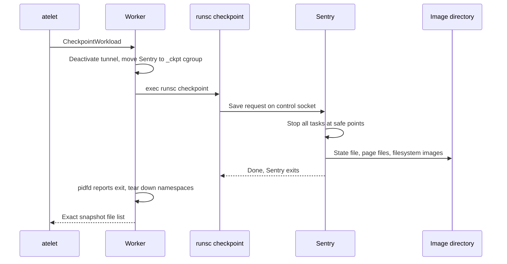
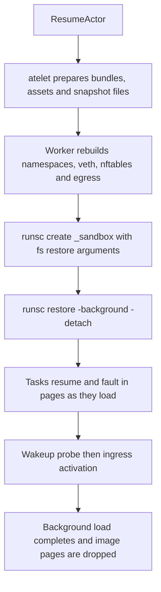

# 13. Suspend and Restore at the System-Call Level

A Kubernetes Pod has no suspend operation. It can be deleted and recreated, losing memory and the writable layer, or it can stay resident and keep consuming capacity. An actor can be suspended: its execution is captured, its capacity on the worker is released, and a later request restores it, possibly on another node. This chapter follows that cycle from the API call to the kernel. It separates three things that are easy to conflate: the control-plane protocol that makes suspension safe, the runtime operation that captures a sandbox, and the host primitives that move bytes between memory, page cache, disk and object storage. Chapter 10 covered gVisor checkpoint fidelity in depth, and the lifecycle companion (L.10 to L.12) has an observed walkthrough. This chapter concentrates on mechanism.

## 13.1 The suspend protocol from API to worker

`kubectl ate suspend actor counter -a demo --mode=sync` calls ateapi's `SuspendActor`. The workflow ([workflow_suspend.go](https://github.com/agent-substrate/substrate/blob/v1.0.0/cmd/ateapi/internal/controlapi/workflow_suspend.go)) acquires the actor's lease and records intent *before* touching the node.

1. It persists SUSPENDING with a new snapshot UUID, the requested fidelity, the runtime association and the pending durable destination, and advances the generation. A retry reuses this recorded identity instead of minting a new one.
2. It calls atelet's `Checkpoint` with that identity and the durability mode.
3. atelet takes the actor lock and asks its snapshot tracker whether this snapshot already completed. If so, it returns the recorded result. Otherwise it calls the worker's `CheckpointWorkload`.
4. When atelet returns, ateapi detaches external volumes if any, releases the worker assignment and its booked capacity, and records SUSPENDED in a separate update.

The worker side, in the gVisor worker's `CheckpointWorkload` in [main.go](https://github.com/agent-substrate/substrate/blob/v1.0.0/cmd/ateworker-gvisor/main.go), runs in a context that a disappearing caller cannot cancel, because a half-written checkpoint is worse than a slow one. It validates fidelity and the runsc path, and can reuse a completed capture marked with the node's boot ID. It then deactivates the actor's tunnel so no new connections arrive, clears any partial checkpoint directory, computes the filesystem checkpoint targets, and invokes runsc.

| Fidelity | runsc command | What is captured | Sandbox afterwards |
|---|---|---|---|
| MEMORY | `runsc checkpoint -image-path <dir> -fs-checkpoint-paths <targets> _sandbox` | Kernel state, application memory, rootfs and durable-directory filesystems | Stopped by the checkpoint |
| ROOTFS | `runsc fscheckpoint -image-path <dir> -path rootfs/=<c>:/ ...` | Writable rootfs and durable directories | Terminated by the worker |
| VOLUMES | `runsc fscheckpoint -image-path <dir> -path fs/=<c>:<mount> ...` | Durable directories only | Terminated by the worker |

The argument construction is in [runsc.go](https://github.com/agent-substrate/substrate/blob/v1.0.0/cmd/ateworker-gvisor/runsc.go) (`checkpointArgs`, `fsCheckpointArgs`), and the targets come from [fscheckpoint.go](https://github.com/agent-substrate/substrate/blob/v1.0.0/cmd/ateworker-gvisor/fscheckpoint.go).

## 13.2 What a gVisor checkpoint does inside the sandbox

This section describes upstream gVisor's design. Substrate invokes it but does not implement it, and its file layout and internal sequence belong to the pinned runsc release.

`runsc checkpoint` is a short-lived command. It connects to the running Sentry's control socket, a Unix domain socket in the sandbox's state directory under the `-root` that Substrate sets per actor, and sends a save request. The work happens inside the Sentry.

**Stop the world.** The Sentry pauses every task, its equivalent of threads, at a safe point, much as a kernel would freeze processes. Because application threads only ever run on the Sentry's behalf through the platform, there is no foreign process to interrupt. Under systrap, each stub thread is parked waiting for the Sentry instead of being resumed into application code. In-flight application system calls are completed or restarted according to Linux semantics, so the saved state is a consistent kernel image.

**Serialize kernel state.** The Sentry's kernel objects (tasks, thread groups, signal state, file descriptions, mounts, pipes, futexes, timers, sockets in netstack and more) are Go structures annotated for gVisor's `state` package. The checkpoint walks the object graph from the kernel root and encodes every reachable object once, with pointers turned into object IDs. The result is written to the state file in the image directory. Host file descriptors cannot be serialized as numbers, so file objects record enough to reopen their host files, and the gofer or directfs reconnects them on restore.

**Save memory.** All application memory lives in the Sentry's memory file, a `memfd_create` file mapped into stub address spaces (2.4). The Sentry knows which ranges of that file are allocated and which pages are populated. Saving memory therefore means reading those ranges and writing them sequentially to page files in the image directory. Reads are plain memory accesses through the Sentry's own `mmap` of the memory file. The output files are created in the image directory by the runsc command and handed to the Sentry over the control socket as file descriptors, and the Sentry writes through those descriptors. Unpopulated ranges are not written. The page data and the metadata that locates it are separate files in current releases. That is one reason Substrate enumerates the files runsc actually wrote rather than assuming a single `checkpoint.img`.

**Save filesystems.** With `-fs-checkpoint-paths`, writable filesystem state that lives in the sandbox, such as a container's rootfs overlay upper layer and the shared tmpfs used for a durable directory, is serialized into separate filesystem images beside the state file. That is what makes ROOTFS and MEMORY captures self-contained without a host overlay upper directory surviving.

**Connected sockets.** By default gVisor refuses to save a sandbox with connected TCP sockets, because a restored connection cannot continue with a peer that has moved on. Substrate starts sandboxes with `-allow-connected-on-save`. Such sockets are saved, and after restore the application observes them as reset or broken and must reconnect.

**Exit.** Unless asked to leave the sandbox running, the Sentry exits after the save completes. The gofer and stubs exit with it. The worker observes the Sentry's exit through the pidfd it opened at start ([pidfd.go](https://github.com/agent-substrate/substrate/blob/v1.0.0/internal/pidfd/pidfd.go), [sandboxexit.go](https://github.com/agent-substrate/substrate/blob/v1.0.0/cmd/ateworker-gvisor/sandboxexit.go)). Polling a pidfd becomes readable when that exact process exits, which avoids confusing a recycled PID with the Sentry.

This differs from CRIU-based checkpointing of runc containers. CRIU attaches to each host process with `ptrace(PTRACE_SEIZE)`, freezes the process tree, injects parasite code to dump memory through `vmsplice` into pipes, reads `/proc/<pid>/maps`, `/proc/<pid>/pagemap`, `/proc/<pid>/fdinfo` and many other files, and on restore recreates processes, mappings, descriptors and namespaces with `clone`, `mmap`, `open`, `prctl(PR_SET_MM_*)` and the rest. gVisor needs none of that because the "processes" are the Sentry's own data. Substrate's gVisor path does not use CRIU.

## 13.3 Host memory during capture: cgroups and page cache

A checkpoint writes roughly as many bytes as the actor's populated memory. On Linux, those writes first land in the *page cache*, and page-cache pages are charged to the memory cgroup of the process that dirtied them. If the Sentry did that inside the actor's leaf, the actor's `memory.high` would throttle the checkpoint, or the pages would push the worker container toward its `memory.max`. Substrate's worker handles this explicitly in [ckptcgroup.go](https://github.com/agent-substrate/substrate/blob/v1.0.0/cmd/ateworker-gvisor/ckptcgroup.go).

1. **Borrow memory.** Before capture, the worker acquires a checkpoint slot and a memory *loan* from unused worker capacity, and limits concurrent checkpoint writers. A new activation that would need the same bytes waits for the loan (step 5 of 9.5).
2. **Isolate the charge.** It creates a sibling cgroup, `<actor-uid>-_ckpt`, beside `<actor-uid>-_sandbox`, sets its `memory.max` to `max`, copies the sandbox's `cpu.max`, and sets `memory.high` to the loan size. It moves the Sentry by writing its PID to the sibling's `cgroup.procs`. New page-cache pages written by the checkpoint are charged there.
3. **Restore placement.** After the checkpoint, the Sentry has exited. If it had not, an `ESRCH` from moving it back would show that it was gone. Removing the empty `_ckpt` cgroup with `rmdir` reparents any remaining charges to the parent.
4. **Return the loan only when pages are reclaimable.** A dirty page cannot be dropped until written. [snapshotcache.go](https://github.com/agent-substrate/substrate/blob/v1.0.0/internal/snapshotcache/snapshotcache.go) starts writeback with `sync_file_range(SYNC_FILE_RANGE_WRITE)` on the checkpoint files, polls their dirty and writeback page counts with `cachestat`, finishes with a waiting `sync_file_range`, and then uses `posix_fadvise(POSIX_FADV_DONTNEED)` to evict clean pages that will not be read again soon. Only then is the borrowed memory considered returned.

These calls manage *memory*, not durability. `sync_file_range` does not flush filesystem metadata or the disk's volatile cache. The durability contract is the object-store manifest commit in 13.4, or for deferred mode the local commit plus a later upload.

## 13.4 Publishing the capture: local commit, sparse files and object storage

The worker returns the exact list of regular files runsc wrote, plus the subset that represents durable data. atelet turns it into a manifest and publishes it according to the durability mode ([main.go](https://github.com/agent-substrate/substrate/blob/v1.0.0/cmd/atelet/main.go)).

- **Deferred** (CLI `--mode=async`): `rename` the capture into local snapshot storage, record `CommitLocal` in the persisted tracker ([tracker.go](https://github.com/agent-substrate/substrate/blob/v1.0.0/cmd/atelet/internal/snapshottracker/tracker.go)), schedule a background upload and return. The newest state depends on this node until the upload commits.
- **Immediate** (`--mode=sync`): upload every data file, then upload the manifest last, record `CommitDurable`, then try to retain a local copy. The manifest's existence defines a committed snapshot, so a crash mid-upload leaves objects that no reader will treat as a snapshot.

Memory images are sparse. A process with a 4 GiB address space may have populated only part of it, and files that represent it should not allocate or transfer zero-filled blocks. atelet's sparse-file helpers ([sparsefile.go](https://github.com/agent-substrate/substrate/blob/v1.0.0/cmd/atelet/internal/sparsefile/sparsefile.go)) walk files with `lseek(fd, off, SEEK_DATA)` and `lseek(fd, off, SEEK_HOLE)` to find populated extents, and copy them with `copy_file_range`, which lets the filesystem move or reflink data without passing it through user space. The object-store layer compresses data and preserves the sparse layout, so a reconstructed file has holes where the capture had them rather than allocated zero blocks. Logical size, populated bytes, compressed bytes and allocated blocks are four different numbers, and capacity planning has to use the right one.

## 13.5 Restore: building a sandbox from an image

Resume follows 9.4 until atelet's `Restore`. atelet prepares the same bundles and assets as a cold start, plus the snapshot files: hard links from a local capture or the golden node cache, or files downloaded and reconstructed from object storage. The worker's `RestoreWorkload` then rebuilds networking and egress exactly as for a cold start, because namespaces, veths and nftables rules are host objects that were destroyed at suspend, and invokes runsc.

1. `runsc create -no-root-container ... _sandbox` with filesystem-restore arguments, which creates a fresh Sentry and gofer just as at first start.
2. At MEMORY fidelity, `runsc restore -bundle <dir> -image-path <dir> -pid-file <file> -background -detach _sandbox`, using the flags pinned in [internal_flags.json](https://github.com/agent-substrate/substrate/blob/v1.0.0/cmd/ateworker-gvisor/kodata/internal_flags.json). Then `runsc restore` for each application container against the same image.
3. At ROOTFS or VOLUMES fidelity, `runsc start` for each container with the saved filesystem images applied. The applications cold-start on top of their preserved files.

Inside the Sentry, restore is the inverse of save. The state file is decoded and the object graph rebuilt: tasks, file descriptions, mounts and sockets. Host file descriptors are reopened through the gofer or directfs, and the memory file is recreated with `memfd_create`. Memory is loaded from the page files into it. With `-background`, the Sentry does not wait for every page before letting tasks run. It starts loading pages asynchronously and makes any task that touches a page not yet loaded wait for that page. `-detach` lets the `runsc restore` command return while the sandbox continues. The worker can then run wakeup probes against a restored application while the remaining pages stream in, and `runsc wait -restore` (`cmdWaitRestore`) reports when background loading has finished. `runsc wait -fsrestore` does the same for filesystem images.

The application does not boot. Its threads resume where the checkpoint stopped them, with the same heap, the same initialized readiness flag and the same in-memory caches. That is why a golden snapshot turns a cold start of many seconds into a restore dominated by file preparation and page loading. Connections it held before suspension are broken; listening sockets are restored.

**Freeing the image after restore.** Once pages are loaded, the image files are redundant, and their page cache would otherwise sit beside the restored anonymous memory. `dropActorCheckpointCacheAsync` in [ckptcgroup.go](https://github.com/agent-substrate/substrate/blob/v1.0.0/cmd/ateworker-gvisor/ckptcgroup.go) handles three cases. If the restore files are not preserved and have no other hard links, it unlinks them immediately; the Sentry's open descriptors keep the inodes alive until it closes them. If they are preserved, or hard-linked from the golden cache, it waits for background restore to finish, then evicts their clean pages with `posix_fadvise(DONTNEED)`, and unlinks only what is not preserved. Unlinking a name, dropping cached pages and freeing an inode are three separate events. With a shared golden file, unlinking one actor's name frees nothing, because the cache still holds a link.

**The microVM contrast.** The microVM worker drives Cloud Hypervisor instead of runsc (Chapter 11). Cloud Hypervisor pauses the guest, writes guest RAM, device state and configuration, and on restore either copies the memory file eagerly into guest memory or, in its OnDemand mode, maps guest memory empty and registers it with `userfaultfd`. In OnDemand mode, guest page faults arrive as messages on the userfaultfd descriptor, and the VMM resolves each with `UFFDIO_COPY` from the snapshot file. A guest that has touched only some pages leaves a sparse image on its next snapshot, which Substrate merges with the base ([merge.go](https://github.com/agent-substrate/substrate/blob/v1.0.0/cmd/ateworker-microvm/internal/ch/merge.go)). Substrate selects eager Copy for current Cloud Hypervisor versions, as Chapter 11 explains, so the demand-paging path is conditional.

## 13.6 Roadmap and engineering improvements

The repository is explicit about the hard edges of this path. Immediate-mode upload failure after a completed MEMORY capture can leave the actor CRASHED, because the sandbox has already stopped and there is no universal transparent rollback. Checkpoint failure classification is incomplete in cases where execution survived. Run/Restore re-entrancy after lost replies is unfinished. Automatic idle suspension is not wired into production. Each is discussed with its source in Chapters 10, 12 and 16, and in L.13.

Mechanism-level proposals follow. First, the memory loan in 13.3 assumes page cache becomes reclaimable after writeback. Writing checkpoint pages with `O_DIRECT`, or with a file opened under a dedicated cgroup from the start, could remove the need to migrate the Sentry between cgroups. That requires runsc support and measurement. Second, background restore makes first-request latency depend on the order in which pages load. Recording which pages the application touched first after a restore, and storing that order with the golden snapshot, would let the loader fetch the working set first. This is a prefetch technique, and its benefit would have to be measured, not assumed. Third, an operator-facing view of the four sizes in 13.4 per snapshot would make capacity and cost planning concrete. All three are proposals, not tracked work.

## Source map

- [workflow_suspend.go](https://github.com/agent-substrate/substrate/blob/v1.0.0/cmd/ateapi/internal/controlapi/workflow_suspend.go): intent recording, the atelet call and finalization.
- [ateworker-gvisor main.go](https://github.com/agent-substrate/substrate/blob/v1.0.0/cmd/ateworker-gvisor/main.go): CheckpointWorkload and RestoreWorkload.
- [runsc.go](https://github.com/agent-substrate/substrate/blob/v1.0.0/cmd/ateworker-gvisor/runsc.go) and [fscheckpoint.go](https://github.com/agent-substrate/substrate/blob/v1.0.0/cmd/ateworker-gvisor/fscheckpoint.go): runsc checkpoint, fscheckpoint, restore and wait argument vectors and targets.
- [ckptcgroup.go](https://github.com/agent-substrate/substrate/blob/v1.0.0/cmd/ateworker-gvisor/ckptcgroup.go) and [snapshotcache.go](https://github.com/agent-substrate/substrate/blob/v1.0.0/internal/snapshotcache/snapshotcache.go): checkpoint cgroup isolation, memory loans, writeback and cache eviction.
- [sparsefile.go](https://github.com/agent-substrate/substrate/blob/v1.0.0/cmd/atelet/internal/sparsefile/sparsefile.go) and [tracker.go](https://github.com/agent-substrate/substrate/blob/v1.0.0/cmd/atelet/internal/snapshottracker/tracker.go): sparse transfer and local/durable commit state.
- [merge.go](https://github.com/agent-substrate/substrate/blob/v1.0.0/cmd/ateworker-microvm/internal/ch/merge.go): the microVM sparse-delta merge after OnDemand restores.
