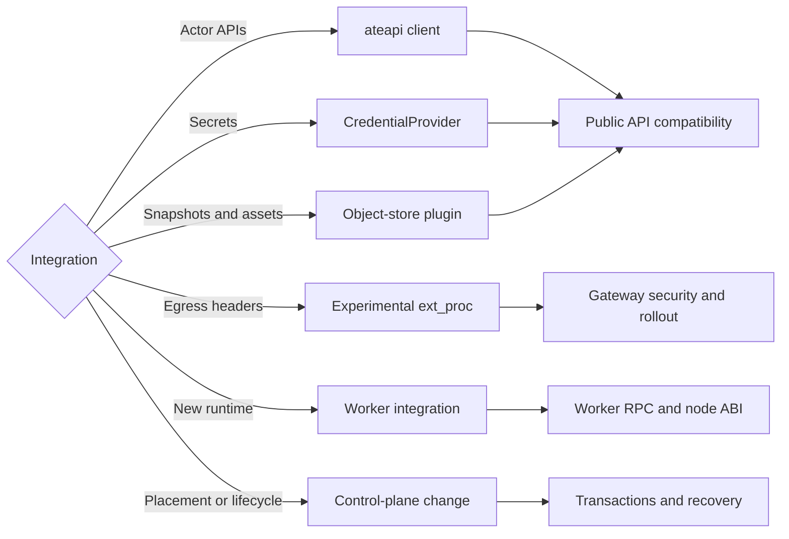
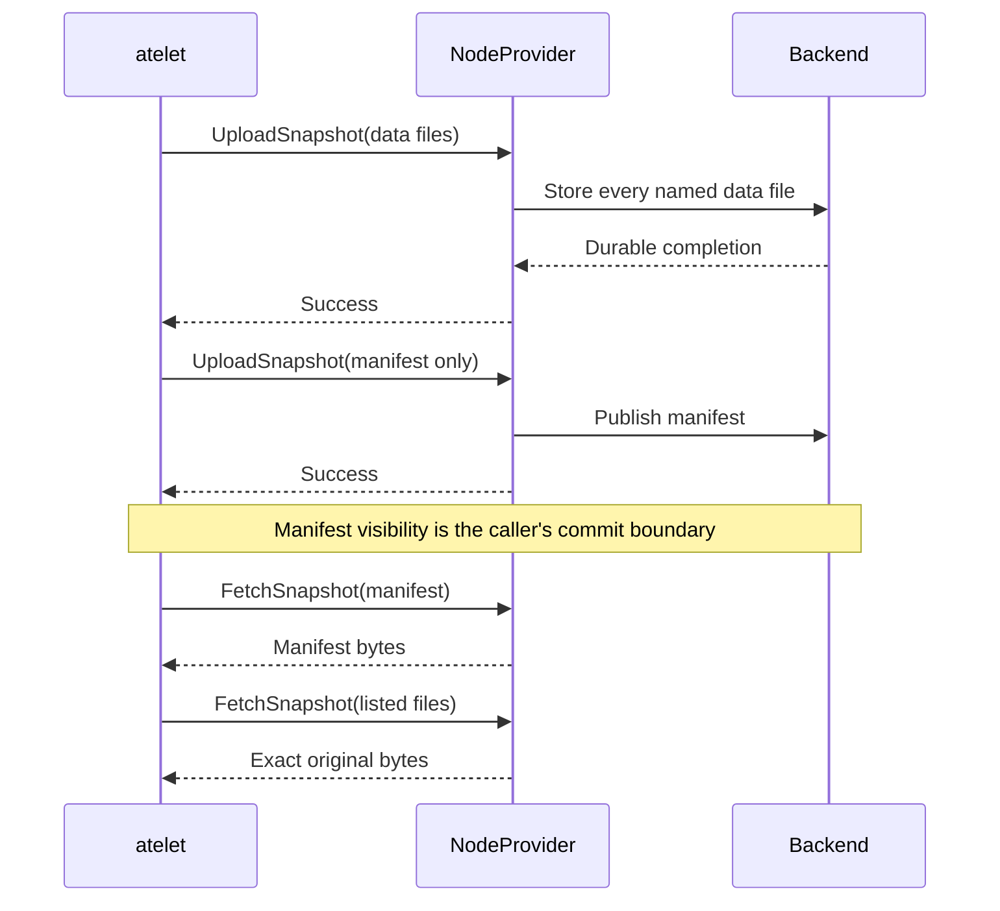
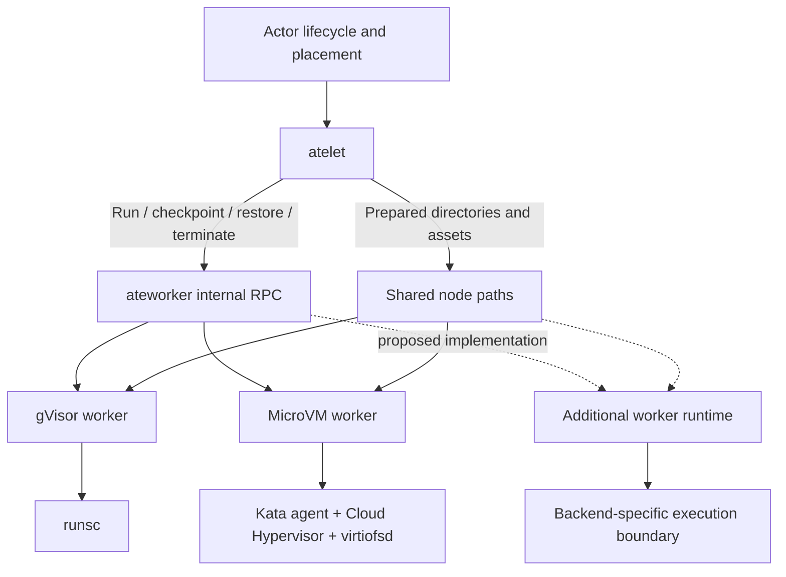
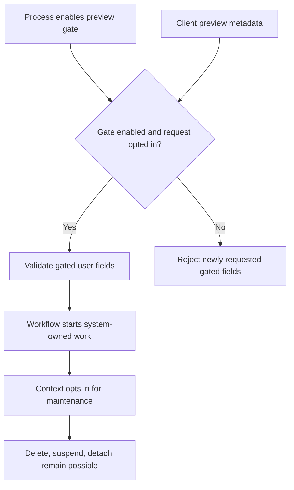
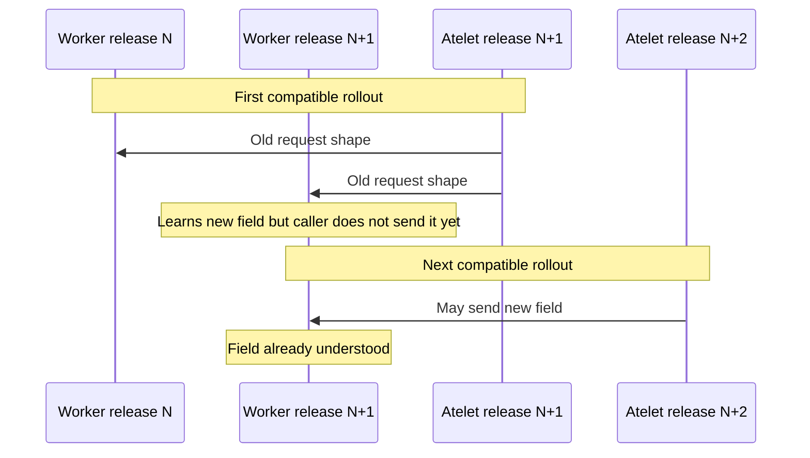

# 17. Extension Contracts and Upgrade Compatibility

An extension is useful only if it preserves the invariants on both sides of its boundary. A storage plugin that uploads bytes but changes commit ordering can make snapshots appear complete before they are restorable. A credential provider that returns the right secret without authenticating its caller can turn an identity field into an impersonation interface. A new runtime that boots an application but cannot clean up a failed restore can leak resources across actors. The extension surface is therefore a set of behavioral contracts, not merely a collection of protobuf methods.

Substrate exposes public control and plugin APIs while retaining internal protocols between its supervisors and workers. It also has extension mechanisms through Envoy processing, Kubernetes infrastructure resources, and separately versioned runtime assets. This chapter explains where those boundaries are deliberate, where they remain provisional, and how an implementation change can cross several compatibility domains at once. The audited revision is v1.0.0, the first release covered by the README's compatibility commitment and the version-skew policy. The rules below apply to it and to later compatible releases, not to earlier revisions.

## 17.1 Choosing the correct boundary for an extension

The repository layout encodes intended consumers. [api/ateapi/v1](https://github.com/agent-substrate/substrate/blob/v1.0.0/api/ateapi/v1/ateapi.proto) is the public control-plane protocol. [api/credprovider/v1](https://github.com/agent-substrate/substrate/blob/v1.0.0/api/credprovider/v1/credprovider.proto) and [api/objectstore/v1](https://github.com/agent-substrate/substrate/blob/v1.0.0/api/objectstore/v1/objectstore.proto) are public plugin protocols. Kubernetes infrastructure types live under [api/infra/k8s/ate/v1](https://github.com/agent-substrate/substrate/blob/v1.0.0/api/infra/k8s/ate/v1/workerpool_types.go). Shared externally importable helpers live under `pkg`; shared implementation libraries live under `internal`; binary-specific code lives under `cmd/<binary>/internal`.

This organization gives an extension author an initial test: can the integration be implemented using public `api` and `pkg` packages, or does it require importing internal supervisor logic? The latter is a core change or an intentionally coupled component, not an ordinary stable plugin. Go's internal-package restriction reinforces that distinction. Copying internal code into another repository does not remove the compatibility problem; it merely turns changes into downstream synchronization work.

A credential backend is a natural plugin because the platform needs a narrow operation: resolve a URI under an attested actor context. An object-store backend is another because the platform needs transfer, copy, cleanup, and asset-fetch behavior while the backend owns representation and credentials. A scheduler replacement is not exposed through an equivalent public plugin interface in this checkout. A new runtime integrates through an internal worker protocol and controller/runtime configuration, so it requires a broader compatibility and lifecycle review.

The [code-layout guide](https://github.com/agent-substrate/substrate/blob/v1.0.0/docs/dev/code-layout.md) recommends keeping backend plugin implementations in their own repositories while retaining reference implementations in core. The Kubernetes Secrets provider and object-store plugin give development and kind environments concrete implementations. External plugins should import only public APIs and helpers. This lets backend dependencies and release cadence vary without making the core repository a collection of every provider SDK and policy model.

Application integrations belong at a different layer. The [integration-repository guide](https://github.com/agent-substrate/substrate/blob/v1.0.0/docs/project/integration-repos.md) distinguishes small in-tree demos from substantial applications built on Substrate. A code-execution service, an always-on conversational gateway, or a framework adapter can use actor lifecycle APIs without changing the substrate's execution boundary. If the integration requires a missing capability, the project's convention is to land that capability in core and then depend on a released version rather than carry a private core patch indefinitely.

The distinction also prevents an API-design mistake: adding a platform field solely to encode one framework's current implementation detail. A field should express a substrate capability with stable semantics, such as a supported volume or runtime selection, rather than a special case for one application's naming scheme. Existing interfaces already provide actor references, templates, tags, resource requirements, and policies. An extension should first map its requirements onto those concepts before widening the core contract.

There is no need to expose every internal helper as a public package. Once a helper becomes part of `pkg`, external consumers can depend on its types and behavior. A later refactor then has compatibility cost. The source guide treats this as a deliberate commitment after GA. Keeping implementation detail internal is not an obstacle to extensibility; it preserves freedom to improve coordination and caching without forcing every plugin to track those changes.

### An extension changes failure ownership

A new component adds a place where requests can wait, fail, or return ambiguous results. Before implementing it, identify who retries, who cancels, who owns partial state, and who decides an operation is committed. The existing object-store protocol answers those questions explicitly. The credential protocol delegates backend authorization but requires the gateway to fail closed when an effect cannot be applied. Runtime RPCs interact with actor lifecycle and cleanup. A generic “plugin succeeded” status is inadequate unless success has a precise durable meaning.

Consider a remote credential service that times out after reading a secret. Retrying the read may be harmless, but a provider that mints single-use credentials or creates external sessions has different side effects. The public protocol returns bytes and does not supply a generic transaction identifier for arbitrary external mutations. Such a provider must either make its implementation safe under the caller's retries or expose a separate workflow outside this interface. The narrow contract protects core from having to understand every backend's transaction model.

## 17.2 Implementing credential and object-store plugins

`CredentialProvider` has one RPC, `FetchSecret`. Its request contains the URI and actor SPIFFE identity asserted by the gateway; its response contains redacted opaque bytes. The URI's provider tail is backend-defined. This is deliberately smaller than a general secret-management API: Substrate does not create, rotate, enumerate, or administer every backend secret through the plugin protocol.

The plugin must establish that the caller is authorized to assert the actor identity. For a local socket, filesystem and Pod composition constrain the caller; for a remote service, transport authentication and peer policy must do so. Parsing a valid SPIFFE string in the request proves only syntax. The reference provider's namespace and label grants demonstrate authorization based on that attested identity, while Kubernetes RBAC constrains the provider's backend access.

A backend implementation should preserve useful error distinctions. Invalid URI syntax is a client error. A denied actor is a permission error. An unavailable backend is operational unavailability. Returning an empty successful credential for a denied request is unsafe because the gateway might forward a request that the policy required to be authenticated. Returning all failures as “not found” can also hide outages and complicate incident response. The reference implementation deliberately equalizes some errors only where it avoids leaking Secret existence under an enforced policy.

Credential bytes must not enter ordinary logs, traces, or status pages. The protobuf response has a redaction annotation, and the gateway validates header placement and sanitizes values. A plugin still controls its own logging, SDK debug output, and errors. A provider error containing the secret would bypass the intended response-field redaction. Tests should include representative backend errors and assert that diagnostic output identifies the operation without returning the material.

Object storage exposes three services with distinct authority. `NodeProvider` transfers named snapshot files between a local directory and a snapshot URI. `ControlProvider` copies or removes whole snapshot prefixes. `AssetProvider` retrieves a content-addressed runtime asset after verifying its hash. Combining them in one binary is convenient, but the protocol separation allows deployment and credentials to differ by role.

The central node-transfer invariant is byte fidelity: fetch must return the bytes upload received. Compression, object naming, chunking, and physical backend layout are private to the plugin. The caller supplies the list of files and controls commit ordering. It uploads data first and uploads the manifest in a separate call only after the data upload succeeds. A reader finding the manifest can then rely on the listed file set according to the plugin's durability contract.

An upload may fail after storing some files. The contract allows those files to remain, and control cleanup can remove the partial snapshot. All node RPCs are idempotent: a retry overwrites the relevant files or local output. This does not mean every backend SDK call is intrinsically idempotent; the plugin must implement the protocol's observable behavior despite multipart state, temporary objects, and interrupted connections. If it changes file names or adds internal metadata, cleanup must still remove the whole representation it owns.

`FetchSnapshot` returns `NOT_FOUND` when a requested file is absent. It should not silently synthesize an empty file or return success for an incomplete set. `UploadSnapshot` returns success only after every named file is durably stored. A backend with asynchronous acknowledgment must either wait for its actual durability condition or document that it cannot meet the interface as deployed. The word durable refers to the backend's real failure model, not merely to an SDK returning without an error.

`CopySnapshot` permits different source and destination buckets and overwrites existing destination files. An empty source is a failed precondition. `CleanupSnapshot` can remove one snapshot or all snapshots below an owner's prefix, but rejects a bare bucket. This boundary prevents a malformed cleanup request from becoming an unrestricted bucket deletion. A replacement plugin must preserve the prefix validation and missing-object behavior even if its physical representation is not one object per input file.

The actor JWT on node transfers supports per-actor backend authorization. Its audience is fixed by the public plugin API. A plugin implementing that mode must validate the token and bind it to the URI and node context. A plugin without that feature may ignore it, which is how the current S3 path differs from GCS. An external implementation should state its authorization mode explicitly so operators do not infer security from the common request shape. For a provider that serves its own credential exchange, [pkg/objectstore/actorauthz](https://github.com/agent-substrate/substrate/blob/v1.0.0/pkg/objectstore/actorauthz/actorauthz.go) runs the same token and actor checks as the in-tree GCS exchange, and it reaches the internal packages through the module.

`AssetProvider` has stricter output semantics. The destination must already be a regular file. The plugin stages and verifies the asset, checks the maximum size and SHA-256, and replaces the target only on success. A descriptor opened before replacement still sees the old file. This lets atelet control the visible target and prevents partially downloaded binaries from becoming executable assets. The plugin must also reject snapshot and tag locations as assets before reading them.

The fallback behavior is part of this contract. Atelet tries anonymous `gs://` access only for a `gs://` asset, and only after the plugin returns `NotFound`, `InvalidArgument`, `Unimplemented`, `Unavailable`, or `Internal`. Other codes are final. A plugin should therefore classify failures deliberately: returning a generic internal error can trigger an alternate retrieval path for a public asset. The hash still constrains content, but source selection and audit expectations change. Error codes are executable control flow, not decorative diagnostics.

### RustFS as a backend, not a new core storage protocol

The in-tree RustFS integration demonstrates the benefit of the plugin boundary. It uses the S3 implementation selected by environment, while actor and snapshot APIs remain unchanged. The kind installer stages microVM assets into the RustFS-backed bucket and records `s3://` asset locations. [microvm.go](https://github.com/agent-substrate/substrate/blob/v1.0.0/cmd/ate-setup/internal/steps/microvm.go) waits for the deployment and bucket initializer, uploads pinned assets, and builds the SandboxConfig using the resulting locations. The node plugin then serves those assets through `AssetProvider`.

The integration does not imply complete S3 feature equivalence. Substrate needs a particular set of operations and semantics. A backend conformance test should exercise those operations through the plugin, including streaming multipart upload, interruption, copy, cleanup, and hash-verified asset fetch. Features the backend does not implement and Substrate does not call are irrelevant to that contract, while a subtle difference in an operation Substrate does call can break restores.

A different S3-compatible backend can often use the same client path, but endpoint, addressing mode, credential source, TLS trust, and supported API behavior must be verified. Adding a backend selector to the control plane for every compatible service would duplicate responsibilities the plugin already owns. A distinct plugin becomes appropriate when representation, authorization, or transport requirements cannot be expressed safely through the existing implementation.

### A conformance exercise for partial transfers

An object-store implementation needs tests that force ambiguity at its public boundary. Begin an upload of two data files, let one become durable, then inject a failure before the second completes. The call must fail, and the caller must not publish the manifest afterward. Repeating the same upload must converge on the exact original bytes even if the first object already exists. Fetching a committed snapshot must return `NotFound` when any requested file is absent, rather than returning success with a shortened result. These scenarios follow the protocol's idempotence and completeness requirements; they do not prescribe the backend's internal object naming or compression format.

Next lose the response after all data files have become durable. The caller cannot distinguish that case from an incomplete upload and can retry. The plugin must tolerate that uncertainty without appending a duplicate logical file, producing a different decoded representation, or requiring a new identifier unknown to the caller. The same principle applies to cleanup: deleting an already-absent snapshot is success. Such semantics let infrastructure recover from lost RPC responses without needing a distributed transaction between atelet and the storage system.

The manifest belongs to a separate caller-controlled upload. A plugin that buffers successful data calls locally and postpones durable storage until it later sees a manifest violates the contract, even if its happy-path end-to-end restore succeeds. The caller may crash after the data call and before the manifest call, or may use another plugin process for the next operation. Success must mean that the files named in that call are already durable under the backend's declared durability model. The public protocol deliberately makes that boundary observable.

Control-plane copy has its own cases. Copy an actor snapshot to a tag prefix, retry after losing the response, and verify the destination remains equivalent. Include a source and destination in different buckets because the protocol permits that combination. An empty source must return `FailedPrecondition`; treating it as a successful empty tag would move the failure into a later restore. Cleanup must reject a bare bucket while permitting the documented owner prefix. A backend that supports only one of these scopes must reject the unsupported operation clearly rather than guessing a broader deletion target.

Asset conformance is stricter about local replacement. Create the target regular file with known content and mode, then request an asset with the wrong hash, an excessive size, or a forbidden snapshot-domain URI. Each failed operation must leave the target unchanged. A successful operation may replace the path after verification, preserving its mode; a descriptor opened before replacement still observes the old file. Test callers must therefore reopen after success, just as the contract specifies. This file-replacement behavior is a concurrency contract as well as an integrity rule.

Credential-provider conformance must test authority independently from lookup correctness. A successful fetch by the expected gateway identity does not prove that another trusted certificate is refused. A syntactically valid actor SPIFFE string from an unauthorized transport peer must not authorize a read. A permitted actor with a denied namespace, denied Secret labels, malformed URI, or missing backend key exercises different checks. Error responses must avoid returning secret bytes or accidental debug representations. The protobuf's redaction annotation is useful, but it cannot prevent a provider from explicitly logging the returned value in custom code.

These tests can live outside core while targeting the published plugin protocols. That separation lets a backend implementation evolve its storage SDK, authentication integration, or compression without coupling a conformance test to private helpers. They also make claimed compatibility reviewable: the result describes behavior at the contract boundary, including failures, rather than merely proving that a generated gRPC client can call the service. The shared suite remains an engineering proposal in this checkout; the contract obligations it tests are already present in the API comments. A plugin's health endpoint is a separate contract from these behavioral tests. A responsive gRPC health check can establish that the process is serving while its backend denies all uploads or its configured bucket has disappeared. Operators need both process health and a deliberately scoped backend exercise. The latter must use disposable data and account for cleanup, because repeatedly testing upload and copy against production prefixes would itself create retention and authorization risks. Backend validation should preserve the same public-path semantics used by real callers.

## 17.3 Runtime integration and the supervisor-worker boundary

The worker protocol under [internal/proto/ateworkerpb](https://github.com/agent-substrate/substrate/blob/v1.0.0/internal/proto/ateworkerpb/ateworker.proto) is an internal contract between atelet and runtime-specific worker processes. It includes run, checkpoint, restore, termination, and statistics operations. The repository's contributor rules require atelet and workers to remain opaque to one another except for this protocol and the paths in [internal/nodepath](https://github.com/agent-substrate/substrate/blob/v1.0.0/internal/nodepath/nodepath.go). Shared libraries are allowed; reaching into the other side's implementation is not.

This boundary lets atelet own scheduling-facing node coordination, snapshot movement, asset staging, and shared directory preparation while the worker owns runtime execution. A new runtime should not make atelet invoke its private monitor API or parse its proprietary snapshot files. Instead, the worker translates the common workload and lifecycle requests into backend-specific operations. This is already the relationship between the gVisor worker and the microVM worker.

Some comments near the top of the protocol still describe a single guest and microVM as future work. The implementations support both runtimes and multiple hosted actors. Interface review must therefore read message fields and server implementations, not preserve outdated narrative comments as semantics. The actor identity and directories on each request identify the specific workload; a worker-wide available/executing binary state is not an adequate model for current concurrent hosting.

`ActorDirs` is a concrete part of the boundary. Atelet supplies paths rather than making the worker reconstruct all directories from UID. Checkpoint and restore directories may live on a different filesystem from the actor root, so the worker must not assume cross-directory rename or hard-link operations are possible. Runtime asset paths are constrained to the staged actor asset directory. These rules protect both portability of node storage layout and the integrity of executable assets.

A runtime implementation must cover failure transitions, not only the successful boot path. If network setup succeeds and runtime startup fails, it must close namespace references and listeners. If checkpoint captures memory but filesystem capture fails, it must report failure without advertising a complete snapshot. If restore fails after creating a VMM process, termination must remove it and its mounts. The existing workers' hosted-actor machinery, shutdown paths, crash handling, and root-gated tests are more useful templates than a minimal `RunWorkload` handler.

Fidelity is a shared semantic contract. `VOLUMES`, `ROOTFS`, and `MEMORY` identify cumulative state preservation levels. A backend may serialize them differently, but it must return and restore what the declared fidelity means. A runtime that can preserve a writable rootfs but not process memory should not label its snapshot MEMORY for API convenience. Runtime version compatibility also matters: saved process state can require the exact runtime assets, while filesystem-only recovery may cold boot under a default runtime with its own compatibility constraints.

Resource requirements reach the worker through the protocol. gVisor and microVM enforce them through different mechanisms, such as cgroup/OCI limits or VM sizing. A new backend must define what its reported usage and admission size mean. A VM's configured memory, host resident memory, shared page cache, and guest-reported memory are not interchangeable. The API's placement accounting relies on declared resource semantics, while observability may report sampled physical usage. An extension must not silently change one into the other.

Statistics methods deliberately avoid blocking behind the lifecycle mutex. `GetWorkloadStats` distinguishes an actor not hosted here from an actor accepted but not yet measured. `GetActiveWorkloadStats` returns attribution with each sample, including an unspecified source when measurement is not available. Consumers must attribute from the returned identity rather than a stale worker-to-actor map. A new runtime that blocks its stats handler for the whole restore would hide exactly the resource spike operators need to observe.

The node-to-worker protocol is not a public third-party runtime SDK with a guaranteed independent release cycle at v1.0.0. It is an internal seam designed to support controlled skew. The version-skew policy covers Substrate's own components, built from one commit and upgraded in the documented order. It does not promise compatibility to third-party worker images. The practical path is to integrate and test the backend with a core release and follow the skew rules for that release.

### Host-kernel prerequisites belong in the runtime contract

A runtime extension can require KVM, TAP, userfaultfd, namespaces, cgroups, or mount support. Those prerequisites affect the device plugin, WorkerPool rendering, node setup, and CI. They cannot be hidden in an image and discovered only after placement. The current microVM path illustrates this: `/dev/kvm` availability, asset architecture, virtio-fs, and kernel behavior constrain whether a worker can execute the assigned workload.

The outer worker security context also needs review. Adding a capability or changing seccomp behavior affects the shared infrastructure boundary, not just one application. A backend's own sandbox can fail to initialize if the outer profile rejects required syscalls, but disabling all outer restrictions without understanding the backend is not a compatibility design. The current code makes explicit choices for gVisor and microVM; a new class needs equally explicit rationale and tests.

## 17.4 Gateway augmentation, policy boundaries, and preview features

Gateway augmentation and gateway replacement have different obligations. An additional egress ext_proc service, enabled with `--experimental-additional-egress-extproc-service`, runs after Substrate authenticates the actor and applies its EgressPolicy. It receives headers and actor context and can deny or add headers. The current mechanism is experimental and header-only. It does not receive arbitrary body content merely because Envoy's general ext_proc API can support body processing.

A service using this extension must preserve the trust of the actor metadata it receives. The metadata is meaningful because the preceding gateway path authenticated it. If the extension is reachable independently, it must authenticate its callers or otherwise constrain access. It should also define failure behavior: a policy enforcement point that becomes unavailable must not silently turn a required inspection into permission. The installer and dataplane configuration determine the actual callout behavior, so review the rendered filter chain as well as the service implementation.

Replacing the egress gateway transfers more responsibility. The replacement must validate actor certificates and attribute traffic to an actor in an appropriate current state. The network egress contract describes the tunnel protocol and identity expectations. It is encouraged to honor Substrate EgressPolicy, but a custom PEP may use its own policy system. Operators must know which policy is authoritative; leaving an EgressPolicy object in the API while the replacement ignores it can create a false sense of enforcement.

Ingress replacement is broader still. The router does more than inspect requests: it parses actor targets, resumes suspended actors, handles overload, resolves assignment, and routes with the correct worker identity. The security extensibility document marks generalized ingress augmentation and replacement as planned. AgentGateway is a concrete alternate dataplane integration, but it is not evidence that every arbitrary gateway can be substituted without implementing the same lifecycle and identity behavior.

The extension must preserve the distinction between caller identity and actor identity. An upstream human-facing gateway authenticates a user and chooses an actor. Substrate's ingress allowlist trusts that gateway as a component; it does not currently enforce per-actor user grants. A vendor adding richer ingress policy needs a defined representation for the original caller, a trustworthy propagation path, and a decision before activation if unauthorized requests must not consume restore capacity. That is a new authorization contract, not just another header.

Preview gates provide a mechanism for exposing incomplete capabilities deliberately. [internal/preview](https://github.com/agent-substrate/substrate/blob/v1.0.0/internal/preview/preview.go) currently lists ExternalVolumes, GoldenEgressPolicy, and PerTemplateSnapshotLocation. Gates are process-wide, but user requests must also opt in through a metadata header. `kubectl ate --preview` supplies that opt-in. Substrate components use dial options that opt in for system work so they can maintain and clean up enabled resources.

Declarative validation connects gates to API fields. Proto comments carry preview documentation and Kubernetes validation tags; generated Go validation evaluates the operation context. The guide requires wrappers to build create/update operations through the preview-aware helpers. A bare operation value could omit gate state and defeat the intended field restriction. This is why adding a comment alone does not implement a gate: the generated validation and its call site must both participate.

Cleanup paths should remain available when a gate is turned off. Gating server-written status or every system operation can strand resources created while the feature was enabled. The workflow entry points explicitly opt into system work, and tests enforce that pattern. A preview feature needs a disablement story as much as an enablement story. For an external volume, for example, refusing a new attachment is compatible with continuing to detach an existing one.

Preview is not equivalent to version negotiation. It expresses operator and client consent to use a feature in the current implementation. It does not prove an older worker understands a newly added field, and it does not override the component skew rules. A release can enable a gate on the API while still needing workers upgraded first. The compatibility review must consider both dimensions independently.

Testing must include gates off and on, and requests with and without opt-in. The CI matrix does this for end-to-end lanes. A feature test that skips when its gate is disabled is appropriate only if another lane deliberately enables it and the test runner proves that lane ran. The repository's fail-closed CI conventions exist to prevent a configuration mistake from turning every test into a successful skip.

## 17.5 Compatibility across RPCs, database state, node files, and snapshots

Compatibility is not one binary property. The [version-skew policy](https://github.com/agent-substrate/substrate/blob/v1.0.0/docs/reference/version-skew-policy.md) defines a directed order: certificate controller, atelet, workers, API server, Kubernetes controller, networking, then clients. A component can be one compatible release ahead of components later in that order, but not ahead of dependencies earlier in it. API and IDP move together. Within a rollout, replicas of one component can be split across two adjacent releases.

That order creates specific message directions. A new atelet can drive old workers and call an old API. An old controller can render Pods for new workers. Old clients can call a new API. The reverse combinations are not all supported. These facts determine when a caller may begin sending a new field and whether a new worker can assume a new Pod template. A final-state compatibility test does not cover the mixed state that exists during a rollout.

The worker Pod template is particularly restrictive. From v1.0, the policy requires the same template for the same WorkerPool within a major release, so upgrading the controller after workers does not unexpectedly roll them again. New behavior must arrive through the image or an explicit new WorkerPool field, and new workers must accept the flags and environment produced by the old controller. An apparently harmless default flag change can therefore violate the rollout contract even if the new controller and worker agree with each other.

Unknown protobuf fields have deliberately different handling by role. API servers reject unknown request fields, preventing a client from assuming a field was honored when it was ignored. When reading stored objects written by a newer replica, an older API server drops fields it cannot validate and serves the reduced object. Read-modify-write clients preserve unknown fields so an old client does not erase fields the server still understands. The CLI rejects unknown manifest fields. These choices are contextual rather than a universal rule to always keep or always discard unknown data.

Atelet and workers reject fields they do not know. Because a newer atelet can call an older worker, introducing an internal request field requires two releases: the worker learns to accept it first; the caller begins sending it in a later minor release. This is compatibility through staged behavior, not through silently accepting arbitrary fields. Patch releases cannot carry such staged additions, because an upgrade can skip patch releases and a rollback can land on any of them.

CRD changes have their own timing. New CRDs are applied with the controller, after components such as atelet have already upgraded. Those components must therefore work against the old CRD shape until that step. Compatible changes add optional fields; the served CRD version has no conversion machinery that magically preserves every removed field during rollback. Reapplying old schemas can prune fields unknown to the old version, and users must stop using new fields when rolling back.

Database migrations are shared across replicas. The first new API instance can apply a migration while old instances still serve. [postgresql-schema-evolution.md](https://github.com/agent-substrate/substrate/blob/v1.0.0/docs/dev/postgresql-schema-evolution.md) requires every committed migration prefix to remain readable and writable by the previous binary. A sequence that becomes compatible only after its final migration is unsafe because a failure can leave the database at any intermediate prefix. Goose's per-migration commits make those boundaries durable states.

The expand-and-contract pattern therefore spans releases. Add the new structure while preserving old behavior, transition readers and writers while keeping both representations consistent, and remove the old structure only after the supported previous binary no longer needs it. New columns need compatible nullability or defaults. New constraints must allow values an old binary can still write. Large backfills do not belong in startup migrations that hold readiness hostage. There are no down migrations in the contract; binary rollback retains the newer schema.

Node files are another protocol. Atelet and workers share directories, sockets, and selected files such as runtime metadata. Their layout must remain readable in both upgrade and rollback directions within supported skew. A layout change can require a first release that reads old and new forms while writing the old form, followed by a later release that writes the new form. Renaming an internal directory is not merely a refactor when another process or an older binary can still hold a path to it.

Snapshot manifests live longer than node-local coordination files. Within a major, a release must read earlier snapshots, and new manifest fields must be safe for older readers to ignore on rollback. The runtime's own checkpoint representation follows separate rules. A runsc memory image or hypervisor state cannot be assumed portable simply because the Substrate manifest parses. SandboxConfig records available runtime versions so memory restore can select the version that produced the state.

Filesystem-only recovery has its own caveats. MicroVM rootfs and durable-directory archives are Substrate-managed representations. gVisor uses `fscheckpoint` bundles written by runsc. The version-skew policy explicitly notes that Substrate does not prove a new default runsc can read every bundle an older version wrote; a failure can crash the actor. “Files survive runtime replacement” is an intended recovery path with a concrete compatibility dependency, not an unconditional theorem.

### Reviewing one change across all domains

Suppose a new runtime option affects checkpoint compression and adds a request field, a manifest field, and a SandboxConfig asset. The request field needs caller/callee skew staging. The manifest field must be safe for older readers. The runtime asset must remain fetchable for saved memory state. The controller must render a compatible worker envelope. The object-store plugin must still preserve exact bytes and commit ordering. Tests need old/new combinations and rollback, not just a new-version round trip.

Now suppose the change is only a credential-provider URI extension. It may avoid core database changes, but it still affects parser validation, authorization, error handling, secret redaction, and old plugin behavior. If the gateway begins emitting the new URI while an older provider remains deployed, the provider should reject it clearly rather than interpret it as a different secret. The rollout order and feature enablement must be documented even when protobuf wire fields do not change.

This is the practical value of an explicit boundary map. It lets a reviewer enumerate which readers and writers persist beyond the current process lifetime. Compatibility defects often arise from a reader the author forgot: an old CLI, a draining worker, a stored tag, an earlier API replica, or a node directory reused after restart. The schema compiler cannot find all of those relationships; the architecture and tests must make them visible.

A mixed-version exercise should preserve objects written at each stage of the rollout, not only test the final pair of binaries. For example, retain a snapshot from before the upgrade, one written while API replicas are mixed, and one written after completion, then perform the supported rollback and attempt the documented recovery paths. Keep node files produced by the newer supervisor when restarting the older supported supervisor. This exposes compatibility obligations that a clean reinstall erases. A test environment rebuilt from scratch for every binary combination cannot demonstrate that persisted state survives those transitions.

The same discipline applies to generated clients. A read-modify-write test should retain a field unknown to the older client when the newer server still accepts it. A create test using that unknown field against an older server should be rejected according to the policy. Those outcomes can appear contradictory until their ownership is explicit: the client preserves data it does not own, while the server refuses new requests it cannot validate. Testing both directions prevents an apparently helpful normalizer from stripping newer state during routine updates.

## 17.6 Roadmap and engineering improvements

The repository's documented extension roadmap includes generalized ingress augmentation and replacement, a fuller egress replacement path than the partial one the extensibility guide describes, and additional backend plugins outside core. Runtime independence is a design objective reflected in the atelet-worker boundary and future skew policy. It is not yet a universal promise that arbitrary worker releases or external runtimes can mix with any API version.

Several architectural targets remain broader than current extension contracts. Actor-to-actor routing needs addressing, activation, and authorization semantics. More advanced memory storage or incremental snapshots need clear ownership of bytes, dirty-state tracking, commit, and recovery. Current microVM sparse-delta merging produces complete snapshots for the applicable restore mode; it is not a generic object-store chain of incremental snapshots. An extension claiming incremental persistence must define how chains are retained, compacted, authorized, and recovered after partial failure.

The current default microVM memory-restore choice also constrains future runtime work. Cloud Hypervisor version and prefault behavior determine whether the worker uses eager copy or on-demand handling. A new backend or optimized path must expose measured behavior rather than assuming userfaultfd always reduces end-to-end latency. Demand paging moves work after initial restore and can increase later fault latency; the correct objective is application readiness and useful work under the expected access pattern.

Editorial proposals include reusable conformance suites for public plugins, explicit mixed-version integration tests, and contract documentation generated alongside protobufs. A credential suite can verify caller trust, URI rejection, denial semantics, redaction, and backend outage behavior. An object-store suite can verify byte fidelity, manifest-last ordering, idempotent retry, copy, cleanup, and asset isolation. A runtime suite can verify attribution, cleanup after each failure point, resource limits, fidelity, and network activation ordering.

A second proposal is to require each new extension point to state its authority and cancellation model before implementation. The statement should answer who may call it, what identity is attested, what success commits, what partial work may remain, and what a retry does. This small amount of design information is more valuable than a generic interface that leaves every implementer to invent those answers. Existing object-store comments show how much correctness can be captured directly at the protocol boundary.

Finally, compatibility evidence should become an artifact of a release. The version-skew policy defines the intended combinations; tests should demonstrate them with the old and new binaries, database schema prefixes, node files, and representative snapshots. The release can then distinguish tested compatibility from a plausible design. Until that evidence exists for a particular pair, operators and extension authors should follow the stated support boundary and avoid treating a successful same-version test as proof of upgrade safety.

## Source map

- [Code layout](https://github.com/agent-substrate/substrate/blob/v1.0.0/docs/dev/code-layout.md), [public control API](https://github.com/agent-substrate/substrate/blob/v1.0.0/api/ateapi/v1/ateapi.proto), [credential API](https://github.com/agent-substrate/substrate/blob/v1.0.0/api/credprovider/v1/credprovider.proto), and [object-store API](https://github.com/agent-substrate/substrate/blob/v1.0.0/api/objectstore/v1/objectstore.proto): supported external seams.
- [Object-store plugin command](https://github.com/agent-substrate/substrate/blob/v1.0.0/cmd/objectstore-plugin/main.go), [storage configuration](https://github.com/agent-substrate/substrate/blob/v1.0.0/pkg/objectstorage/env.go), [S3 uploader](https://github.com/agent-substrate/substrate/blob/v1.0.0/pkg/objectstorage/s3.go), and [microVM asset staging](https://github.com/agent-substrate/substrate/blob/v1.0.0/cmd/ate-setup/internal/steps/microvm.go): backend integration and RustFS reuse.
- [Worker protocol](https://github.com/agent-substrate/substrate/blob/v1.0.0/internal/proto/ateworkerpb/ateworker.proto), [shared node paths](https://github.com/agent-substrate/substrate/blob/v1.0.0/internal/nodepath/nodepath.go), [gVisor worker](https://github.com/agent-substrate/substrate/blob/v1.0.0/cmd/ateworker-gvisor/main.go), and [microVM worker](https://github.com/agent-substrate/substrate/blob/v1.0.0/cmd/ateworker-microvm/main.go): internal runtime contract.
- [Gateway extension guide](https://github.com/agent-substrate/substrate/blob/v1.0.0/docs/security/extensibility.md), [egress contract](https://github.com/agent-substrate/substrate/blob/v1.0.0/docs/guides/network-egress.md), [preview mechanism](https://github.com/agent-substrate/substrate/blob/v1.0.0/internal/preview/preview.go), and [preview guide](https://github.com/agent-substrate/substrate/blob/v1.0.0/docs/dev/preview-gates.md): policy integration and controlled feature exposure.
- [Version-skew policy](https://github.com/agent-substrate/substrate/blob/v1.0.0/docs/reference/version-skew-policy.md), [database evolution](https://github.com/agent-substrate/substrate/blob/v1.0.0/docs/dev/postgresql-schema-evolution.md), [API validation](https://github.com/agent-substrate/substrate/blob/v1.0.0/docs/api-validation.md), and [integration repository conventions](https://github.com/agent-substrate/substrate/blob/v1.0.0/docs/project/integration-repos.md): evolution across releases and repositories.
