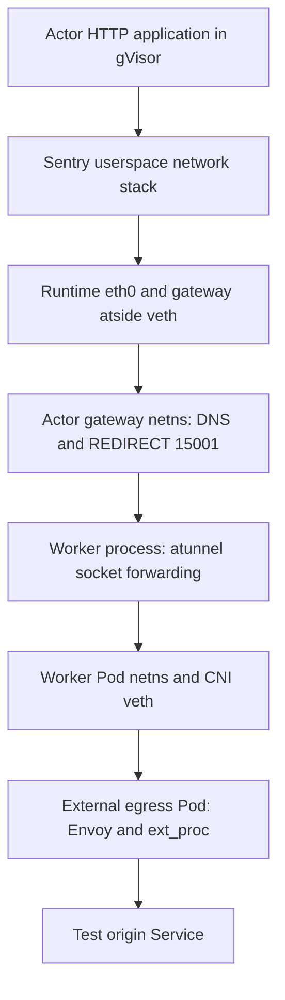
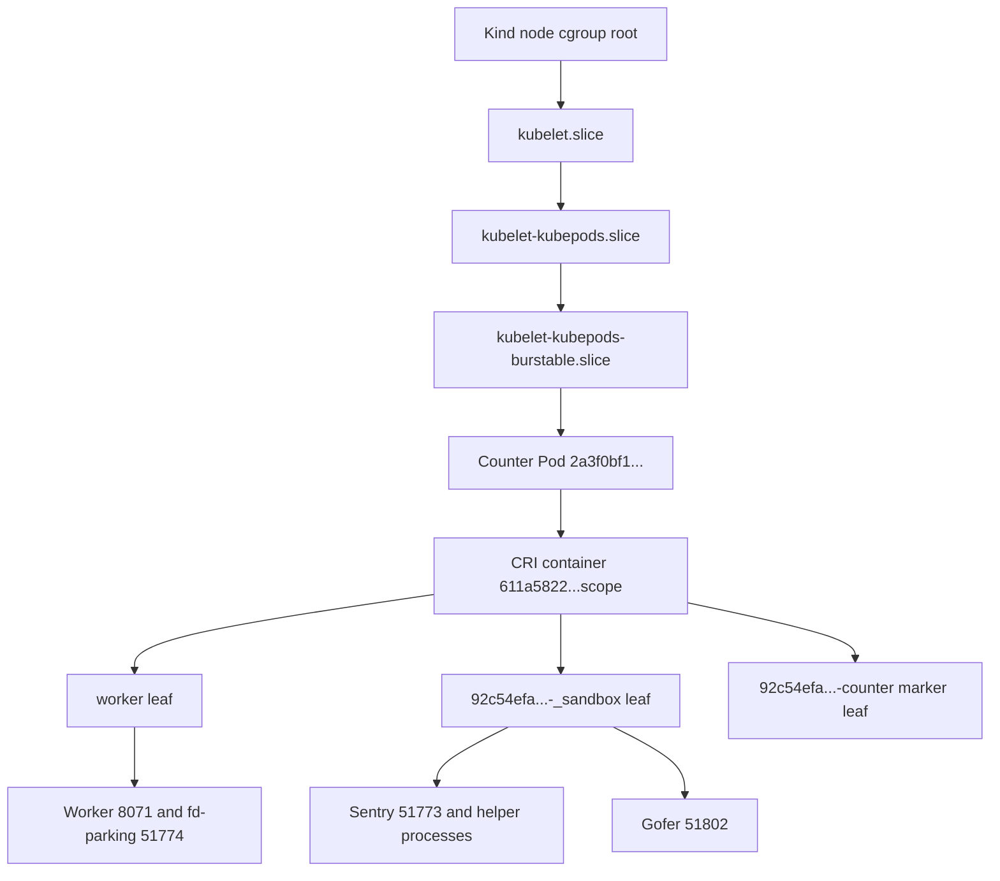

# Network and process evidence from the Linux lifecycle run

The host boundary in this report is the dedicated Kubernetes kind node, `substrate-lifecycle-control-plane`. Paths and PIDs below are observed from inside that node. The physical epc host and the Docker cgroup containing the kind node are intentionally outside the diagram and capture hierarchy.

The collector is [capture-network.sh](scripts/capture-network.sh). It accepts `STAGE [ACTOR_UID]`, sources the experiment's `common.sh`, and writes a timestamped directory under `kernel/`. Each probe has separate stdout and stderr plus an exit status in `node/status.tsv`. It reads network, process, cgroup and selected Kubernetes metadata; it does not change rules, interfaces, routes, sysctls or actor state. It never exports process environments, full CRI runtime specifications, Secret objects, private keys, or kubeconfig contents.

## Capture method and limits

CRI container metadata maps a worker Pod to its init PID. The collector reaches worker-private named namespace bind mounts through `/proc/<worker-init-pid>/root/run/netns/`, then calls `nsenter --net=<that-path>`. This uses the worker's mount view to locate the namespace while retaining the node's inspection binaries. It does not require a shell or `nft` inside a distroless worker image. Worker Pod networking is inspected through `/proc/<pid>/ns/net`. Namespace inode, nftables text and JSON, `ip` link/address/route data, socket ownership, and selected namespace sysctls are recorded separately.

The collector deliberately does not read `/sys/class/net` after merely changing network namespace: the existing node sysfs mount could expose the wrong interface population. `ip -j -d link` supplies interface indices and peer indices through netlink in the selected namespace instead. Interface indices and network-namespace IDs have namespace-local meaning; matching the number 3 in two unrelated namespaces is not sufficient to establish a peer relationship without the namespace and link evidence.

Captures are sequential, not atomic. Processes, sockets, counters and namespace bindings may change between probes. An absent named namespace proves that the binding was absent in that worker's mount view at capture time; it does not prove that every reference anywhere in the kernel was already closed. Likewise, `Seccomp: 2` proves filter mode, not the contents or effectiveness of a particular filter. No microVM was deployed in this gVisor experiment.

The initial collector wrote evidence successfully but `docker cp` could not retrieve the kind node's `/tmp` tree through the daemon's filesystem view. The baseline and first counter-running captures were recovered with `docker exec ... tar`. Their original copy failure and successful recovery remain in `outer-status.tsv`. Subsequent captures use that tar stream directly. This was an evidence-retrieval failure, not an actor-network failure.

## Actor namespace lifetime

The counter actor UID was `92c54efa-a098-47c4-93f1-f17bd3730c1a`. Its named runtime namespace is `worker-actor:<UID>`; gVisor's separate gateway namespace appends `-at`. This naming follows [nodepath](../../../internal/nodepath/nodepath.go) and [SandboxGatewayNetNSName](../../../internal/ateworker/actornet/sandbox.go).

| Capture | Worker containing both bindings | Runtime inode | Gateway inode |
|---|---|---:|---:|
| `network-counter-running-20261031T175640-2033250` | `counter-679c67c85d-fghjq` | 4026537381 | 4026537444 |
| `network-counter-suspended-async-20261031T175646-2039424` | Neither binding present in any captured worker | absent | absent |
| `network-counter-request-resumed-20261031T175652-2045005` | `counter-679c67c85d-db5m4` | 4026537381 | 4026537444 |

The numeric inode values were reused after suspension. They must not be presented as globally unique generation numbers. The intervening absence, changed worker mount view, and lifecycle evidence distinguish the observations. [SetupSandboxNetwork](../../../internal/ateworker/actornet/sandbox.go) creates the names for an activation and its cleanup removes them. A different inode number is not required for that lifecycle to have occurred.

The separate egress actor, UID `8fe5de26-cc8a-40e4-aa86-770a6bd8c43e`, was observed in worker `egress-78cb8c86b6-l8b67`. Its running and resumed captures recorded runtime inode 4026537654 and gateway inode 4026537717. That pair was also numerically reused. See the egress experiment's own request/state evidence for the intervening synchronous suspend and resume; the two network snapshots alone are not a continuous trace.

## Veth, rules and sockets

In the initial counter activation, the runtime namespace had `eth0` with ifindex 3 and peer `link_index` 3; the gateway namespace had `atside` with ifindex 3 and peer `link_index` 3. They were reported as veth devices in their separate namespaces. Gateway `atside` held `169.254.17.1/30`; the actor-facing address is reconstructed in gVisor's userspace stack. After runsc takes ownership, the runtime namespace's kernel route output contained loopback routes rather than the application's full network configuration. An empty kernel `ss` or missing application route there is consequently not evidence that the actor application lacked networking.

The gateway namespace contained these observed rules:

```text
table ip worker-actor
  forward: hook forward, policy drop
  disallowed-egress: hook prerouting, priority raw
    accept destination 169.254.17.0/30
    reject destination 169.254.0.0/16 with admin-prohibited
    reject non-TCP with net-unreachable
  prerouting: hook prerouting, priority dstnat
    TCP destination outside 169.254.17.0/30 -> REDIRECT :15001

table ip6 worker-actor-v6
  forward: hook forward, policy drop
  disallowed-egress: reject fe80::/10 with admin-prohibited
```

The complete rules, handles and JSON remain in each gateway's `nft.txt` and `nft.json`. Both the runtime namespace and worker Pod namespace had empty nftables rulesets, observed with exit code 0 and JSON containing only nftables metadata. Those are positive empty observations; a failed command would instead have a nonzero status and its stderr. The enforcement location agrees with `installEgressRules`, which installs the rules in `GatewayNetNS`.

Gateway sockets on UDP/TCP 53 and TCP 15001 were owned by the worker process, PID 8100 in the initial capture, although the sockets belonged to the gateway namespace. The worker Pod namespace separately held listeners on 443, 8443 and readiness port 8080, plus an outbound DNS socket. Its `eth0` had ifindex 3 with peer index 27 in the node network. The node-side peer was `veth26f1d552`, ifindex 27, `link_index` 3, and node-local `link_netnsid` 21. Both halves are recorded in `link.json`. Socket ownership and network-namespace ownership are different axes: a Go process can retain a socket created while a thread temporarily entered another namespace.

The installed CNI configuration was `10-kindnet.conflist`, with `ptp`, `host-local`, `portmap` and `loopback` binaries recorded. Kubernetes NetworkPolicy objects were captured, but this observation does not demonstrate a NetworkPolicy enforcement controller. The experiment's observed Substrate DNS and HTTP policy denials must not be attributed to Kubernetes NetworkPolicy enforcement. See [egress-notes.md](egress-notes.md) for the distinct application-level probes.

## External gateway Pod boundaries

`network-gateway-boundaries-20261031T180237-2088756` additionally captured the external ingress and egress gateway Pods. These are distinct from each actor's local `-at` gateway namespace. Every enabled probe in that capture returned zero.

| External gateway Pod | Network namespace inode | Selected observed listeners |
|---|---:|---|
| `atenet-egress-867b49b5cb-ltsqh` | 4026536576 | Envoy `:443`; local ext_proc `127.0.0.1:50051`; local admin `127.0.0.1:15000`; health/metrics `:9090`, `:9091`, `:15090` |
| `atenet-router-599d645d96-crwdw` | 4026536645 | Envoy `:8443`, `:8444`; local ext_proc `127.0.0.1:50051`; local admin `127.0.0.1:9901`; health/metrics listeners retained in raw socket evidence |

Both external gateway namespaces returned empty nftables rulesets with exit code 0 and metadata-only JSON. This does not mean egress policy was disabled: request enforcement lives in Envoy and the ext_proc handler, while actor-side interception occurs in the actor's local gateway namespace. The saved socket records identify the owning Envoy and atenet PIDs. Link, address, route and namespace data are under `node/external-gateways/<pod>/network/`.

The resulting path has several independently observed boundaries:



The arrows describe the source-backed transport arrangement and captured endpoints. Packet tracing was disabled for these topology snapshots, so they are not a packet-by-packet proof of the entire path. The egress experiment's unique origin response and policy logs provide the corresponding request-level observations.

## Actual cgroup hierarchy and processes

The final process capture, `network-counter-final-processes-20261031T175829-2068208`, records the counter on Pod UID `2a3f0bf1-e705-47b9-a943-0142a581fc76`. Its actual delegated scope was the CRI **container** scope beneath the Kubernetes Pod cgroup. The source's shorthand “pod scope” must not replace this observed hierarchy.



The full delegated scope was:

```text
/kubelet.slice/kubelet-kubepods.slice/kubelet-kubepods-burstable.slice/
  kubelet-kubepods-burstable-pod2a3f0bf1_e705_47b9_a943_0142a581fc76.slice/
    cri-containerd-611a58221ba89ac45167e6a5c52bb84dfac1ab7e4328cb19508c7f4ecd3789b2.scope
```

Line breaks above are for readability. The collector retains the literal path in `delegated-scope.txt`, `/proc/<pid>/cgroup` observations, and `cgroup-ancestry.tsv`. The actor sandbox leaf and the `worker` leaf were siblings inside that container scope. The application-container marker is a different leaf; it must not be drawn as the host process group executing the application's system calls.

Sentry PID 51773, helpers 51781/51809/51810/51815, and gofer 51802 were all charged to the actor's `_sandbox` leaf. Worker PID 8071 and the runsc fd-parking process 51774 were in `worker`. The collector labels the explicit `boot` and `gofer` argv tokens without exporting full command lines. It leaves helper roles unknown when those tokens are absent. A process named `gvisor_sentry` is not by itself proof of a specific systrap role or of a distinct application process. Runtime tracing supplies additional evidence separately.

Sentry and gofer reported `NoNewPrivs: 1` and `Seccomp: 2`. Worker and fd-parking processes reported `NoNewPrivs: 0` and `Seccomp: 0`. This is direct evidence that outer worker confinement and runtime self-confinement differ. It does not identify individual seccomp rules. The Sentry's namespace set also differed from both the worker and gofer; all inode values are retained per process.

The sandbox leaf sample had `memory.high=536870912`, `memory.max=max`, `cpu.max=100000 100000`, and `pids.max=max`. `memory.current` was 22,958,080 bytes at that sample and `pids.current` was 23; both are observations, not stable reservations. A leaf hard limit of `max` does not mean the actor escapes ancestor limits: every ancestor through the node root has its controller settings captured. The hierarchy and the userspace memory guard must be considered together. The transient checkpoint `_ckpt` leaf is not guaranteed to appear in a steady-state capture; its absence is not evidence that checkpoint migration never occurred.

## Reproduction and evidence quality

Run the collector alongside `common.sh` on epc:

```bash
bash capture-network.sh running ACTOR_UID
bash capture-network.sh suspended ACTOR_UID
bash capture-network.sh resumed ACTOR_UID
```

Optional `NETWORK_TRACE_SECONDS=8` enables bounded `tcpdump` textual packet headers, with no `-A`, `-X`, payload dump or pcap. The default is off. The traffic generator must overlap those windows; an empty trace is not proof that the path never carries traffic. Timeout exit 124 is retained rather than rewritten as success.

The script passed `bash -n` and ShellCheck. The final process capture and the completed lifecycle network captures reported exit code 0 for every enabled probe. Capture recovery failures remain visible. The evidence demonstrates this pinned gVisor deployment on this Linux node; it does not validate microVM networking, production scale, arbitrary CNI policy enforcement, or an HA storage topology.
