# Substrate Internals

## Sandboxing, Scheduling, and Multiplexing AI Agents on Kubernetes

Source-grounded manuscript · October 31, 2026

Implementation baseline: `0ddbf78d54bb6da2ccb01125b7e085aa14d555a6`

## Preface

Substrate puts a second scheduling and lifecycle system above Kubernetes. Kubernetes provisions worker Pods and supplies the surrounding infrastructure. Substrate assigns actors to those workers, restores their execution state, mediates their network traffic, and moves their snapshots between local storage and an object store. Understanding that division requires following several kinds of state at once: PostgreSQL records, Kubernetes objects, node-local bookkeeping, sandbox processes, filesystem objects, and authenticated network sessions.

This book follows those state transitions through a specific checkout. Its central questions are concrete. Which write establishes an actor assignment? Which process may still use a snapshot file after a restore returns? What prevents a worker restart from accepting instructions for an earlier incarnation? Which memory charge can kill a neighboring actor? Where is an outbound request authenticated, and where is its credential added? What survives losing a node, and what survives losing an object-storage deployment?

The answers cross component boundaries. A scheduler policy cannot establish exclusive assignment without a store transaction. A fast restore does not establish readiness until the guest can service the wakeup probe. An object-store acknowledgment establishes only the durability offered by that configured backend. A private network namespace does not decide whether an actor may contact a particular hostname. The book therefore treats the system as cooperating protocols rather than a list of binaries.

The intended reader already understands Kubernetes control-plane internals, reconciliation, container construction, namespaces, cgroups, and virtualization. Basic explanations appear only where a distinction changes Substrate behavior. The emphasis is on actual structs, interfaces, algorithms, failure sequences, resource accounting, and the cost of maintaining consistency while many actors share a smaller worker fleet.

## The source contract

Every implementation claim refers to the local repository baseline named above. Links in the individual chapters resolve to files in that clone. Generated public and internal protocols, deployment manifests, dependency pins, benchmark harnesses, tests, and relevant vendored wrappers are part of the evidence. A comment or documentation page is not treated as proof when executable code contradicts it.

The reconnaissance inventoried the complete clone outside Git's object database: 14,145 files before the manuscript was created, including 11,794 files under `vendor/`. Deep inspection concentrated on first-party behavior and the dependency boundaries it exercises. That does not mean every line of every vendored library was manually reviewed. The complete syscall behavior of Go, Envoy, runsc, Cloud Hypervisor, virtiofsd, and a selected CSI driver cannot be established by searching Substrate's Go files. Appendix A identifies direct calls, library-mediated calls, and external-runtime mechanisms separately.

The checkout is pre-1.0. Its future version-skew contract is valuable design material, but it is not a current blanket compatibility guarantee. Its architecture document is explicitly marked aspirational. There is no `docs/roadmap.md` in this checkout. Roadmap discussions therefore cite explicit targets, preview gates, limitations, or source TODOs, and identify additional proposals as proposals.

The book contains no new performance measurements. Numbers from flags, manifests, algorithms, and configuration are implementation facts at the baseline. North-star latency and scale numbers are targets. Historical benchmark observations are identified as such when discussed. Capacity examples are worked models with stated assumptions, not claims about a measured cluster.

## What the book covers

The first four chapters establish the resource model, execution topology, placement protocol, and Kubernetes reconciliation loops. Chapters 5 through 8 follow node supervision, common worker machinery, gVisor, microVMs, and persistence. Chapters 9 and 10 separate transport from authorization and credential handling. Chapters 11 and 12 cover measurement, operations, extension boundaries, and upgrades.

Each chapter has six numbered sections. Section N.6 considers the subsystem's roadmap and engineering improvements. This keeps unfinished work adjacent to the mechanism it would change. The appendices collect the kernel audit, source inventory, implementation-status matrix, and vocabulary.

RustFS receives explicit treatment as an alternate object-store deployment through the S3 backend. The repository already includes a RustFS deployment, bucket-initialization Job, NetworkPolicy, and matching node/control plugin configuration for kind. Those files establish an integration path. Their single-replica deployment, small PVC, HTTP endpoint, and static development credentials do not establish a production availability or security design. The storage and operations chapters explain what changes when the object store shares infrastructure and failure domains with the compute fleet.

## Reading the diagrams and examples

Mermaid diagrams express ordering, ownership, and boundaries. An arrow labeled with an RPC means a protocol invocation, not a claim that the associated state transition is atomic with every adjacent arrow. Database transaction boundaries and persistence points are identified explicitly when they matter. State diagrams abbreviate error handling only when the accompanying text explains the omitted branches.

Code excerpts illustrate actual implementation decisions. Pseudocode is labeled and should not be compiled as an API example. Operational commands are tied to the repository's current tooling; environment-specific values remain placeholders. Commands shown for a runbook are instructions for a prepared environment, not a record of commands executed while writing the manuscript.

The local source links are useful during code review. For a stable comparison against a later checkout, use the full baseline commit above. The manuscript is intended to make such comparison easier: changes to schema ownership, worker admission, snapshot fidelity, runtime compatibility, or identity scope should be visible as changes to a specific contract, rather than as vague changes to an architectural description.

## Publication and verification notes

This is a complete first manuscript, not a declaration that the software or prose has received an independent production certification. The publication checks verify chapter structure, source-link resolution, diagram rendering, cross-references, and actual word/page counts. They do not execute Kubernetes, KVM, CSI, cloud storage, or multi-node failure tests.

The project source retains its existing license and attribution. Short excerpts identify their source. No upstream source files were altered to make the narrative fit. The companion audit records important mismatches between older documentation and current behavior, including the conditional microVM demand-paging path and the absence of a wired automatic idle-suspension trigger.


# 1. Multiplexing Actors: Architecture and Execution Boundaries

## 1.1 The unit of persistence is not the unit of execution

Substrate separates an application's durable identity from the Kubernetes Pod that supplies its current execution capacity. The durable object is an Actor. The capacity object is a Worker, represented in Kubernetes by a worker Pod. An Actor can remain registered while it has no running processes, no active worker assignment, and no resident guest memory. When execution is required, Substrate assigns capacity in an existing worker and starts or restores the actor inside a sandbox. The Kubernetes Pod does not need to be created for that activation.

This separation is the architectural reason to build another control plane. It is also more precise than saying that Pods fail to scale. Kubernetes manages an infrastructure lifecycle with established admission, scheduling, node ownership, and reconciliation semantics. Substrate retains that machinery for worker capacity. It introduces a different lifecycle for applications whose useful execution is intermittent and whose state can survive as a checkpoint. The engineering question is whether moving that lifecycle above a warm worker fleet saves enough resources and latency to justify the additional consistency and storage systems.

The implementation makes a second distinction that is easy to miss: a worker can host multiple actors concurrently. Multiplexing is both temporal, as suspended actors reuse execution capacity later, and spatial, as several active sandboxes share one worker Pod. The scheduler tracks actor slots, CPU, and memory capacity. A worker is not simply marked occupied by one actor and returned to an empty pool at suspension. Each assignment books a share of its capacity, and releasing that assignment returns that share. The authoritative accounting resides in the worker and assignment records implemented by [worker_assignment.go](../cmd/ateapi/internal/store/atepg/worker_assignment.go).

Consider a deliberately simplified capacity calculation. Let there be A registered actors, an active fraction f, a mean active application memory requirement m, and an additional sandbox overhead h. The memory associated with active execution is approximately A × f × (m + h), before adding workers, node supervisors, gateways, page cache, and storage buffers. A Pod-per-actor arrangement that keeps every application's memory resident pays a different cost even when CPU usage is near zero. This equation is a planning device, not a Substrate benchmark: independence between actors, average resource sizes, and stable demand are assumptions that a production workload may violate.

Suspension also has a cost. Every transition can consume CPU to serialize state, storage bandwidth to persist it, and time during which the application cannot serve requests. If an actor wakes repeatedly at short intervals, repeatedly checkpointing it can cost more than retaining its execution state. If a burst wakes most actors simultaneously, f approaches one and the density advantage shrinks. A fleet sized from the mean active fraction can therefore be incapable of serving its correlated peak. Request parking limits the immediate damage of a capacity shortage; it does not manufacture CPU, memory, or worker slots.

Resource accounting must include the runtime. [scheduling.go](../cmd/ateapi/internal/scheduling/scheduling.go) adds a runtime-specific fixed memory overhead and a term proportional to actor memory to the requested limit. The runtime selected for a restored snapshot influences this booking. It would be incorrect to compare only application RSS across gVisor and microVM workers and then infer cluster capacity. Runtime processes, guest kernel memory, page tables, page cache, and transient checkpoint allocations can all affect the host while appearing in different accounting domains.

An Actor's logical continuity is consequently broader than process continuity. A MEMORY snapshot may restore an execution image. A ROOTFS restore preserves filesystem writes while cold-starting processes. A VOLUMES restore preserves selected durable directories while permitting a different application template to boot. The public API records the fidelity and runtime identity needed to interpret those outcomes. An application that requires instruction-level continuation must distinguish a memory restore from a restart that retains files; both can be legitimate Substrate lifecycle operations.

The actor abstraction is not an actor-language runtime. The repository does not require a mailbox, a single-threaded event loop, or application-level message passing. An actor is a sandboxed workload described by an ActorTemplate. Containers inside that workload can run ordinary applications, subject to the runtime and network contracts. A Jupyter server, a counter service, and an agent execution environment exercise different application behavior while using the same placement and suspend/resume APIs. The name identifies the lifecycle unit, not a concurrency model imposed on application code.

A useful planning model separates three populations: registered actors, active assignments, and ready worker capacity. Registered actors drive database and snapshot-retention costs. Active assignments drive sandbox execution and network costs. Ready capacity drives the ability to absorb activations without a Kubernetes provisioning delay. Those populations can differ by orders of magnitude, but their ratios are workload-dependent. A capacity dashboard that reports only worker Pod count cannot show whether a large registered population is cheap, whether active execution is near saturation, or whether snapshots are consuming the node's local storage budget.

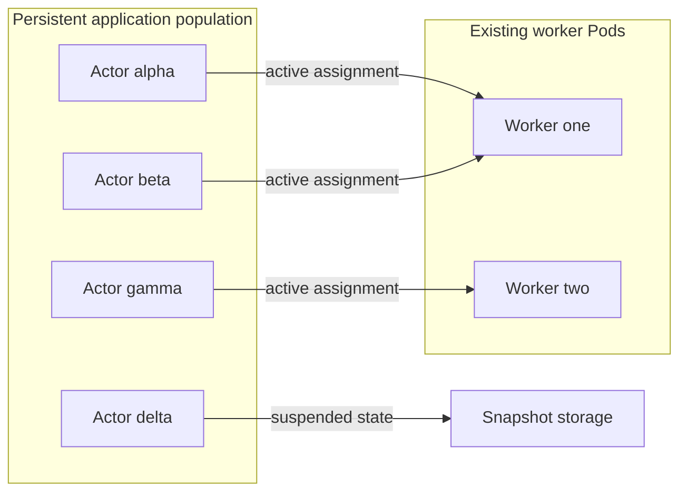

The diagram shows a relationship, not a fixed density. Worker one has two independent active assignments. Actor delta consumes storage and metadata without an execution assignment. If delta resumes, its placement is selected from workers that satisfy selectors, runtime compatibility, locality, and remaining capacity. Its previous worker is neither its identity nor an unconditional destination.

## 1.2 Component topology and the two control loops

The local module is `go.ate.dev/substrate`. Its layout separates public APIs in `api`, command-specific code in `cmd`, shared implementation in `internal`, externally importable packages in `pkg`, and Kubernetes manifests in `manifests`. There is no `ateom` daemon in this revision. Runtime work is implemented by `cmd/ateworker-gvisor` and `cmd/ateworker-microvm`, with shared machinery under `internal/ateworker`. This naming matters because following an obsolete component diagram leads to the wrong ownership assumptions when investigating failures.

The Kubernetes-facing control loop starts with WorkerPool, SandboxConfig, and CSIDriverConfig resources in `ate.dev/v1`. WorkerPool specifies worker replicas and their configuration. `atecontroller` reconciles Deployments and supporting infrastructure, resolves SandboxConfig references, and synchronizes worker Pods with the Substrate worker registry. Kubernetes schedules those Pods and maintains their node-level container lifecycle. None of this removes kube-scheduler, kubelet, or the container runtime from the system. It moves their work to the capacity-provisioning timescale.

The actor-facing control loop runs in `ateapi`, deployed as `ate-api-server`. It exposes the public `Control` gRPC service and the component-facing `WorkerService`. Its PostgreSQL store holds actor records, worker records, assignments, tags, policies, and leases. Actor workflows select workers, change actor state, and call the node supervisor. The critical path for an actor activation therefore includes Substrate's own database and RPCs even when it avoids a Kubernetes write. Describing activation as control-plane-free would be misleading; it bypasses a particular control plane's provisioning path.

`atelet` runs as a DaemonSet. It connects the cluster-level actor workflows to workers on one node. It prepares images and runtime assets, coordinates snapshots and volumes, manages worker-facing support services, and advertises hardware devices through a kubelet device plugin. The worker processes implement the actual sandbox lifecycle. A worker exports internal gRPC operations including `RunWorkload`, `CheckpointWorkload`, `RestoreWorkload`, and `TerminateWorkload`. The intended separation is that atelet and the workers share protocol and path contracts without depending on each other's internal implementation.

Networking has its own topology. The `atenet-router` and `atenet-egress` deployment roles run shared atenet and Envoy machinery. Ingress external processing asks the control plane to resume or locate an actor, then forwards traffic to the appropriate worker tunnel. Egress enforcement evaluates actor-specific policy and can inject credentials outside the sandbox. `atunnel` is an embedded worker library, not a separately scheduled Kubernetes DaemonSet. Its position inside the worker is important: it connects a stable worker-facing transport to per-actor network namespaces whose contents change as actors start and stop.

The identity infrastructure is also explicit. `podcertcontroller` issues the certificates used by Substrate components through its configured signers. `ate-idp-server` exposes actor identity discovery material. Credential-provider implementations serve secrets to the egress path. These processes support execution but do not schedule actors. Treating them as incidental utilities hides availability dependencies: certificate issuance or rotation failures can prevent new authenticated connections even when workers and database capacity are healthy.

Snapshots cross an object-store plugin boundary. The control-plane sidecar implements whole-snapshot copy and cleanup operations; the node-side sidecar uploads and fetches snapshot files and fetches sandbox assets. The main ateapi process does not directly link the GCS or S3 storage SDKs, a rule enforced by [package-deps.sh](../hack/verify/package-deps.sh). This is more than packaging tidiness. It places provider credentials and provider-specific I/O in a process boundary, allowing the control plane to express storage operations through the public plugin protocol.

RustFS is an existing alternative backend in the kind deployment. Both node and control-plane object-store sidecars set `ATE_STORAGE_BACKEND=s3`, point `AWS_ENDPOINT_URL` at `http://rustfs.ate-system.svc:9000`, and enable `AWS_S3_USE_PATH_STYLE`. The [RustFS manifest](../manifests/ate-install/kind/rustfs.yaml) provisions the service, a one-replica deployment, a 1 GiB PVC, and bucket initialization. This is a concrete S3-compatible development and CI path. Its static development credentials and single storage replica do not establish production high availability or tenant isolation. Chapter 8 follows the actual data path and failure implications.

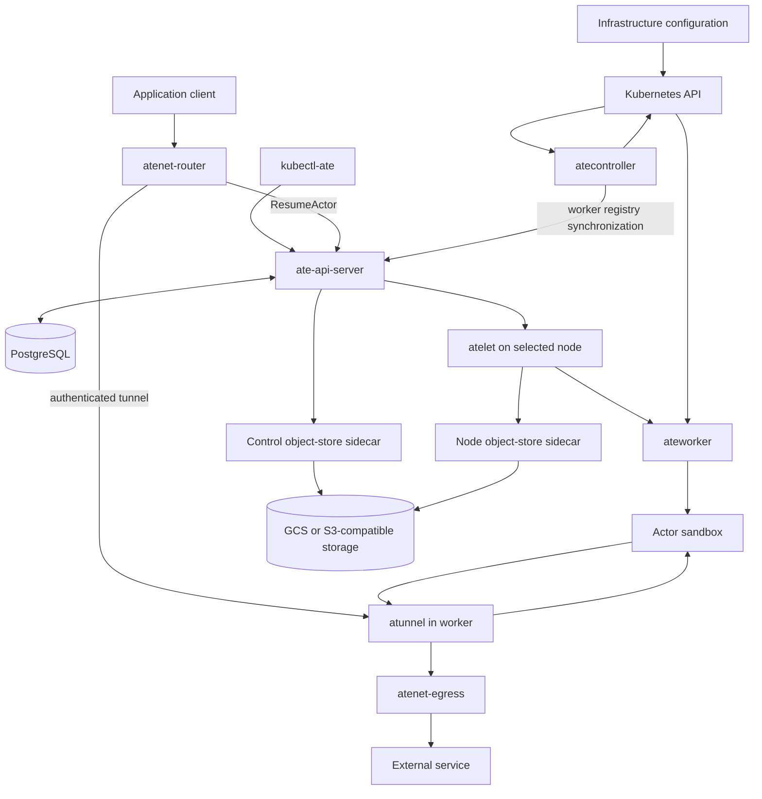

There are several loops behind this topology rather than one universal reconciler. The infrastructure controllers use controller-runtime. Worker Pod synchronization uses its own client-go informers and workqueue. Golden snapshot creation and worker-assignment recovery run inside ateapi using their own queues and persisted state. A failure analysis must first identify which loop owns progress. Restarting atecontroller cannot directly repair every stalled actor workflow, and watching a Kubernetes Deployment will not reveal every change to an actor assignment.

The distinction between command name and deployed service name is similarly practical. Source investigation starts in `cmd/ateapi`; cluster inspection usually finds `ate-api-server`. Runtime configuration can be supplied through flags, configuration protos, Kubernetes objects, and mounted identity files. The architecture should be understood through the concrete ownership of each value rather than inferred from binary naming alone. Later chapters trace those contracts at their validation and authentication boundaries.

## 1.3 Host, Pod, sandbox, and guest boundaries

A worker Pod is an infrastructure isolation and allocation unit. An actor sandbox is the execution isolation unit inside it. For gVisor, the application interacts with a userspace kernel, the Sentry, and associated filesystem machinery. For microVMs, the application interacts with a guest kernel, while Cloud Hypervisor and virtiofsd mediate host resources. The host Linux kernel still schedules the runtime processes, enforces their cgroups and capabilities, and supplies device and networking interfaces. The word kernel must identify which boundary is under discussion.

In the gVisor backend, `runsc` executes inside the worker and manages the actor sandbox. The worker invokes runsc lifecycle and checkpoint operations; it is not itself a replacement Sentry. Application syscalls handled inside gVisor do not all become identical host syscalls. Conversely, operations that the worker performs directly, such as creating network devices or preparing files, are host-kernel operations even though the eventual application is sandboxed. A syscall inventory that mixes those two layers cannot explain either isolation or latency.

The microVM backend drives a Kata guest model with Cloud Hypervisor. The worker arranges the VM, the guest agent connection, and the filesystems supplied to it. `/dev/kvm` is a host device boundary used by the VMM. TAP devices connect virtual networking to the actor's host-side network arrangement. Virtio-fs exposes host-backed filesystem state to the guest. The actor's process tree lives under a guest kernel whose memory and device state are part of the VM lifecycle, while the VMM remains a host process with its own resource consumption and failure modes.

The worker Pod security context is deliberately more capable than an ordinary application Pod. [workerpool_apply.go](../cmd/atecontroller/internal/controllers/workerpool_apply.go) sets both worker classes to nonprivileged, drops the default capability set, and adds explicit capabilities needed for runtime and network operations. It also sets AppArmor and seccomp profiles to Unconfined at the Pod container boundary. Runtime processes can apply their own confinement, but that is a separate claim from the Pod's outer profile. A nearby stale comment about runtime-default seccomp must not override the builder's actual output.

The difference matters during incident investigation. A capability such as `CAP_NET_ADMIN` enables the trusted worker to construct the actor's network environment. It should not be interpreted as an ambient capability granted to every actor process. A host `/dev/kvm` permission allows the VMM to establish virtualization; it is not evidence that an application inside the guest can open that host device. The security argument depends on which process receives which handle and on the runtime's subsequent confinement, not merely on a list of capabilities in a YAML document.

MicroVM workers request KVM as an extended resource served by atelet's device plugin. A hostPath mount alone would make a device inode visible without necessarily granting access through the container's device controls. The kubelet device-manager interaction supplies that access grant and makes KVM availability a placement constraint. By contrast, the current worker template bind-mounts `/dev/net/tun` and relies on the runtime's default device allowance plus network-administration capability for TAP creation. Both are host interfaces, but they enter the Pod through different mechanisms.

Actors also need isolation from one another inside a worker. Shared Pod networking would be insufficient if each sandbox directly inherited a common address space for network configuration. The gVisor worker creates two private network namespaces for each actor: a runtime namespace and a gateway namespace joined by a veth pair. This separation lets runsc take ownership of the runtime-side interfaces while atunnel serves the gateway side. The microVM worker instead puts a TAP interface and atunnel sockets in one host network namespace; the guest owns the other end of that network boundary. The resulting routes direct each actor through atunnel and the controlled egress path. The application is addressed through its actor identity at ingress, not by treating a Pod IP as a durable application endpoint. A worker's address can remain constant while its set of hosted actors changes.

Filesystem isolation follows a similar separation between shared preparation and private mutable state. An image cache can share immutable image content. A runtime asset cache can share verified executable assets by content identity. Each actor still needs distinct writable state and lifecycle cleanup. In microVMs, the writable rootfs upper is host-backed and served through virtio-fs, so its storage and page-cache effects differ from allocating equivalent data inside guest RAM. gVisor's filesystem checkpoint bundles have different mechanics. Architectural equivalence of the API does not mean identical memory accounting or snapshot layout.

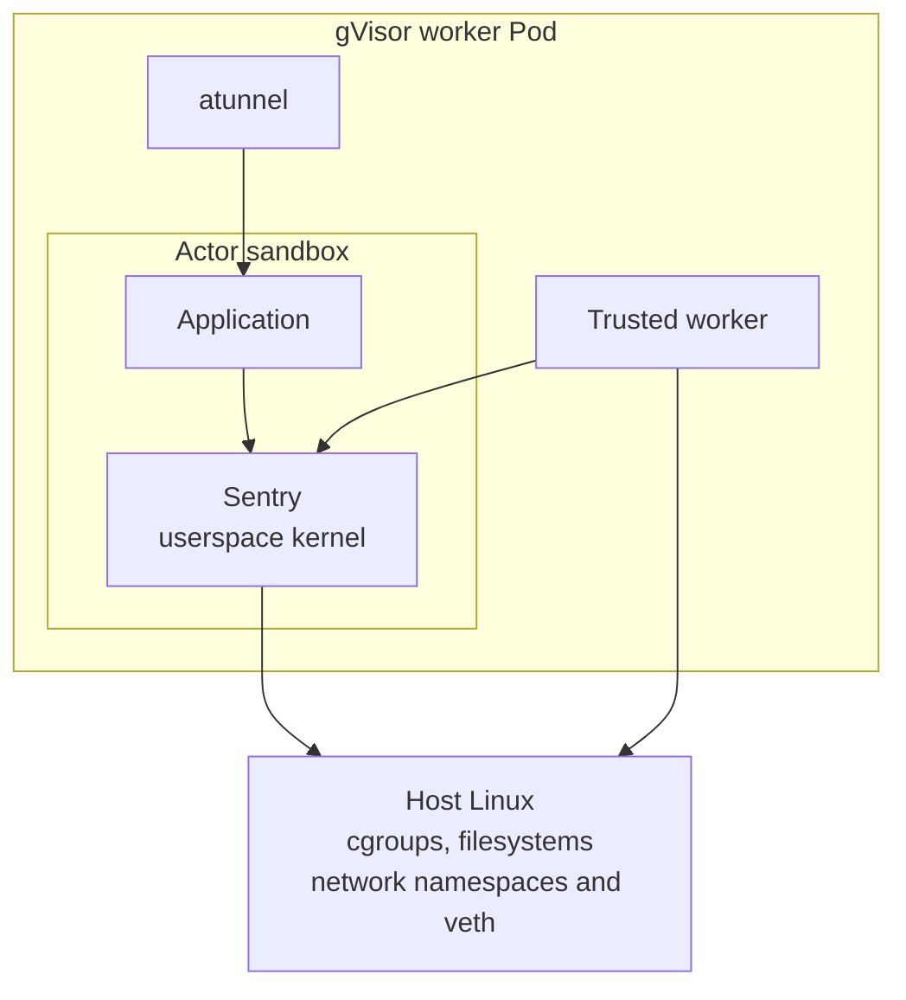

The gVisor boundary places the application above the Sentry's syscall implementation. Runtime supervision and atunnel remain trusted host processes. A network namespace is a host-kernel object even when the actor's network stack is implemented by the Sentry.

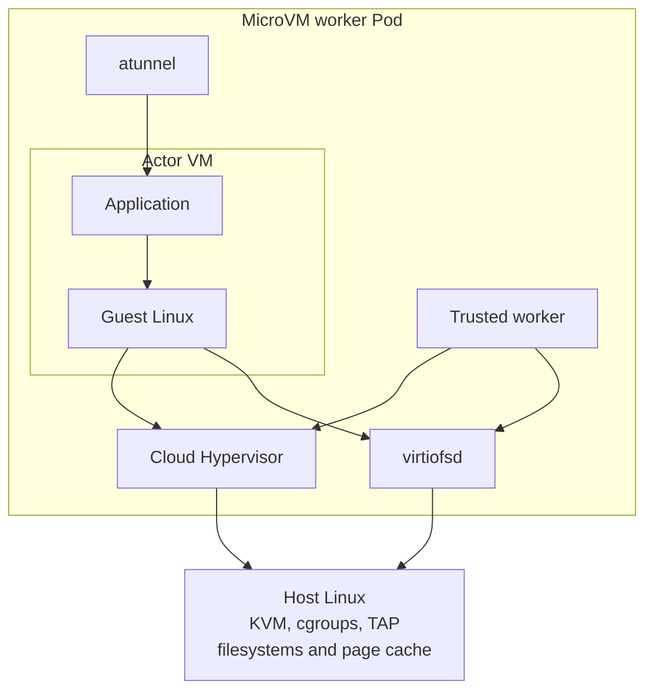

The microVM boundary adds a guest kernel and virtual devices, with Cloud Hypervisor and virtiofsd mediating host resources. These diagrams describe alternative worker classes: a WorkerPool currently selects one sandbox class, and one worker image does not dynamically mix gVisor and microVM actors. Runtime-version compatibility remains a live concern within a class. A worker advertises which versions it can restore, and a snapshot records its capture runtime. That version boundary permits controlled upgrades without assuming every memory image is portable across executable revisions.

Trust also crosses process boundaries outside the worker. The node object-store plugin has storage credentials that atelet does not need to hold. The egress gateway can obtain a secret that the actor does not receive as an environment variable or mounted file. The control plane verifies component identities before accepting worker reports. These separations reduce particular exposures, but they create protocols that must authenticate the actor, worker, node, and resource incarnation correctly. Chapter 10 examines those checks rather than relying on a general zero-trust label.

## 1.4 Following one actor through the system

Start with an infrastructure operator who creates a WorkerPool and suitable SandboxConfig. The controller resolves the runtime configuration and creates worker capacity. Kubernetes schedules the Pods; atelet and the worker establish their internal relationship; the worker registers its current epoch, runtime information, and capacity. Only then is that capacity eligible for actor placement. A Pod's mere existence is insufficient. A ready infrastructure object and a registered runtime process are related observations, not interchangeable facts.

An application operator creates an ActorTemplate through the Substrate API. The template describes containers, resources, volumes, selectors, probes, and snapshot behavior. It is stored in PostgreSQL. Where golden snapshot generation is enabled, the ActorTemplateReconciler in ateapi drives a temporary golden actor through execution and snapshot creation. This is an asynchronous controller of its own. A client creating an actor must not assume that a golden image exists solely because the template record was accepted.

Creating an Actor establishes the logical identity and initial suspended state. Depending on its source and the template's state, it can refer to reusable snapshot content or have no snapshot to restore. The latter is supported explicitly: `ensureAteletRestored` chooses an atelet `Run` request when `snapshotToResume` is nil. Golden snapshots accelerate a path; they are not a prerequisite for the existence of every actor. The distinction is visible in lifecycle telemetry, which classifies a cold boot separately from local and external snapshot restores.

An ingress client supplies `ate-target-actor` as an atespace/name reference. The HTTP Host field retains its application-authority meaning. The router asks ateapi to resume the actor and obtain an assignment. For an already-running actor, the API can return its record without performing a new distributed-lease write. For a suspended actor, it acquires the actor lease, reads authoritative state, and selects a compatible worker with capacity. Candidate selection uses an in-memory worker view; admission is rechecked against the database row before the booking commits.

The selected worker identifies a node, and the API calls that node's atelet. Atelet prepares the workload and its state, then calls the worker's runtime interface. A restore can use node-local files or fetch external snapshot data through the object-store sidecar. The chosen runtime starts or restores the sandbox, and the worker activates the actor's network path. The API finalizes RUNNING with the returned worker epoch. Only after successful activation does the router forward the original request to the assignment it received.

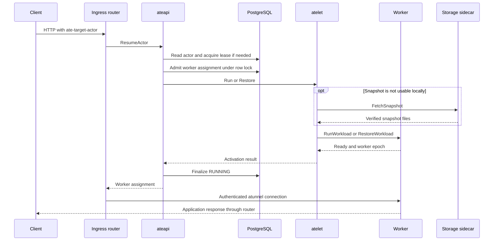

An explicit suspend reverses the resource commitment without deleting the actor. The API serializes the operation with the actor lease, marks SUSPENDING, asks atelet to checkpoint, coordinates external volume detachment, records snapshot state, and releases the active worker assignment. Asynchronous durability allows the API to return once a local checkpoint exists while upload proceeds in the background. Synchronous durability waits for the external upload. Either mode must distinguish process cessation, local checkpoint completion, and durable publication; those are different events with different failure consequences.

The current runtime does not autonomously detect actor idleness and issue that suspend. The repository contains a reusable upward `RequestActorSuspend` path in `internal/ateworker/suspend`, atelet, and WorkerService, but no production worker constructs the requester. Demos sometimes describe idle suspension in broad terms while their runnable steps invoke `kubectl ate suspend`. A higher-level orchestrator can call the API according to its own application policy. Automatic idle detection remains unfinished; capacity reclamation currently follows an explicit lifecycle request.

A subsequent resume prefers the newest state that remains usable. Locality can pin the actor to a node, avoiding an external download. If that node has no capacity, the workflow can detach the local snapshot, ensure the necessary external state is available, and retry placement elsewhere. If a required runtime version has no room, the supported fallback can restore filesystem state and cold-boot instead of restoring memory. A changed template can require VOLUMES fidelity. These transitions explain why state location, runtime compatibility, and application continuity must be considered together.

Deletion is another workflow rather than a single row removal. A running sandbox must be terminated, volumes must be detached, and capacity must be released before the logical object can safely disappear. Snapshot cleanup is part of resource reclamation, with explicit error handling and remaining garbage-collection TODOs. Revert is distinct from deletion: it abandons current execution or local progress in favor of a completed durable snapshot. These operations are introduced here to make failure semantics visible; Chapter 3 treats execution consistency, and Chapter 8 treats snapshot ownership and durability.

## 1.5 Reading performance and failure domains correctly

The shortest activation path and the most expensive activation path traverse the same named components but perform very different work. An already-running request needs identity checks, a control-plane lookup, and routing. A local memory restore may avoid object storage. An external restore downloads state. A runtime-incompatible snapshot may cold-boot from filesystem state. A brand-new actor without a golden snapshot may need image preparation and application startup. Reporting one resume number without describing these cases obscures the operating envelope.

The repository's architecture document sets a target of 100 ms activation at the 95th percentile, one billion actors, and 1000 wakeups per second. Its front matter explicitly calls much of the document aspirational. Those values are design targets, not measurements produced by this manuscript. The source contains benchmarks and historical analysis, but no cluster was run for this book audit. A production claim requires a workload definition, hardware and runtime versions, storage placement, cache state, concurrency, and an actual distribution of end-to-end observations.

A useful latency decomposition starts at request arrival and ends when the actor can receive traffic. It includes gateway parsing and authorization, API work, any waiting for capacity, lease and transaction latency, node RPCs, snapshot preparation, runtime restore, readiness or wakeup checks, and tunnel establishment. Some spans overlap; others serialize. Adding component averages does not reconstruct a percentile of the combined path. Likewise, a benchmark statistic expressed as mean plus two standard deviations is not a measured p95. Heavy tails and multimodal restore classes make that approximation especially unreliable.

Capacity and latency interact. The scheduler spreads work using a power-of-two-choices policy across eligible workers, but it cannot compensate for a pool whose constraints leave only one feasible destination. A snapshot's locality can concentrate demand on a node. Runtime compatibility can fragment otherwise available memory. Actor slot limits can reject an actor even when CPU is free. CPU and memory requests can leave unusable fragments after heterogeneous bookings. These are properties of the placement problem, not necessarily evidence that kube-scheduler has provisioned the wrong Pods.

Request parking makes the gateway's behavior under temporary exhaustion part of the resource model. Waiting requests consume gateway state and retain clients. Limits and deadlines determine whether a burst is absorbed, delayed, or rejected. A successful response after parking may have a very different latency from an immediate activation. Operational dashboards should separate time waiting for capacity from time restoring a sandbox; otherwise storage tuning can be attempted for a problem caused by insufficient worker supply. Chapter 9 follows the parking implementation and its bounded behavior.

PostgreSQL is a central failure domain for actor state. The implementation supports multiple API replicas, but replicas sharing one database do not eliminate the database dependency. The worker cache reduces repeated fleet reads during candidate selection; it does not allow authoritative admission to proceed safely without the store. Renewable leases, row locks, unique assignment records, and versions protect different invariants. They also consume queries and transactions. Database latency under contention can dominate a path whose runtime restore is fast.

The node is a different failure domain. A local checkpoint can be available before its upload finishes. Losing that node can therefore lose the newest local state even while an older durable snapshot remains. A background upload delay changes the exposure window as well as performance. Keeping state local improves reuse latency but ties availability to the node until durability and detachment conditions are met. A one-node RustFS development deployment can share the cluster's failure domain with its workers; moving snapshots through an object API alone does not prove physical independence.

A worker-process restart is narrower than a node failure but still destroys execution owned by the old process. Worker epochs let the control plane distinguish those incarnations. An actor record that says RUNNING under an earlier epoch must not be treated as proof that the replacement process still hosts it. Recovery reconciles those assignments and records crashes where necessary. Pod UID, worker epoch, actor UID, resource version, and snapshot generation each answer a different identity or ordering question. Collapsing them into a single generation concept loses the ability to explain several restart races.

The gateways add both policy and availability dependencies. Ingress authentication can reject a client before actor routing. Egress can deny a destination or fail credential acquisition even while the actor's processes are healthy. A timeout can occur in the HTTP transport rather than the sandbox. Because atunnel is embedded in the worker, worker restarts affect both execution and its tunnel endpoint. Because the external router is separate, it can remain healthy while every suitable worker is full. Diagnosis needs the complete request path and the relevant identity, not merely Pod phase.

There is also a software-supply boundary around runtime assets. SandboxConfig records verified content identities and supported versions. Atelet prepares those assets and workers report the runtimes they can use. An installation with healthy worker Pods but missing or invalid assets is not ready capacity. Conversely, changing a default runtime should not silently reinterpret an existing memory checkpoint. The runtime-version contract is therefore part of availability engineering as well as execution security. Chapter 5 covers asset caching, and Chapter 12 covers compatibility across upgrades.

A practical architectural review follows ownership rather than component count. For each action, identify the durable record, the process authorized to change it, the lock or precondition protecting concurrent changes, the external side effect, and the recovery path after a lost response. Apply that test to assignment, checkpoint upload, worker registration, credential minting, and runtime selection. Where the repository has only a TODO or an assumed reentrancy property, retain that limitation in the model. A diagram should make the uncertainty discoverable instead of smoothing it away.

### A concrete capacity and failure exercise

Consider an example installation with two worker nodes and one WorkerPool. Each worker advertises several actor slots and a finite CPU and memory budget. Three actors are running, while a fourth is suspended with its newest checkpoint local to the first node. These numbers are illustrative. The example is intended to expose ownership boundaries, not to recommend a pool size or claim a measured concurrency limit.

A request for the suspended actor reaches the router while the first node's compatible workers have no room. The router cannot fix that condition by choosing a different Pod address: the control plane owns assignment and knows the snapshot's locality. The resume workflow first attempts placement under the local constraint. If it decides to detach from the full node, it checks for capacity elsewhere, asks atelet to release the local binding according to the snapshot state, and then retries assignment. The destination is not reserved before that detachment, so another activation can consume the available capacity in the meantime. The code records this race explicitly in `detachFromFullNode`; the actor can be left durable-only and need a later retry.

That outcome is acceptable only if the snapshot durability contract remains intact. It may increase latency, but it must not turn an unavailable local file into an assumed completed external checkpoint. The node supervisor's reported snapshot state and the object-store publication rules determine whether detachment is safe. A gateway that parks the request can wait for a subsequent placement opportunity, but parking must not conceal a permanently missing snapshot. Transient resource exhaustion and loss of the required state are different errors with different recovery actions.

Now suppose the selected worker process restarts after its node has accepted the restore request. The Pod may retain its UID and IP while the process obtains a new epoch. A response associated with the earlier epoch cannot be treated as proof of execution under the new one. Registration and assignment reconciliation provide a way to identify that discrepancy. An operator observing only the Pod's Running phase would miss the relevant transition. The actor's assignment and worker epoch are the records that connect the logical application to the process incarnation that actually executed it.

Alternatively, suppose the API replica loses its connection after the worker has successfully restored the actor but before the final RUNNING write reaches the caller. Retrying the request is not the same as starting a second actor. The workflow must recover persisted progress, honor an existing claim, and repeat only operations that are safe under their identity keys. The architecture therefore depends on contracts at both sides of the RPC, not just on the API's lease. A client deadline ending does not roll back a sandbox that another process has already created. Chapter 3 examines which state is persisted at each seam and where comments still call out reentrancy work.

Finally, suppose object storage becomes unavailable after several asynchronous suspends. The workers may already have released active execution capacity while atelet retains local checkpoints and retries uploads. The cluster can appear computationally healthy while its durability exposure grows. Additional activations on the same node may remain fast, making an average latency metric look reassuring. A node loss during that period has a different consequence from a node loss after completed uploads. Operations must therefore track checkpoint publication and local retention alongside request success.

The exercise illustrates why fault injection should be organized around transitions rather than only around process names. Killing an API replica before a lease is acquired, after a worker claim commits, after an RPC succeeds, and after final state persistence tests four different recovery obligations. The same applies to a worker restart before registration, during restore, and after an actor becomes RUNNING. A production test plan should choose those interruption points from the source-level sequence and inspect the resulting durable records. Generic restart tests are useful, but they cannot establish all of these invariants by themselves.

## 1.6 Roadmap and engineering improvements

The repository-backed roadmap begins with distinctions between goals and working code. The architecture document names activation latency, actor scale, and wakeup throughput targets. It also identifies autoscaling and peer state sharing as unresolved areas. Existing identity, policy, and snapshot features have advanced beyond some of its aspirational prose, so a book cannot treat the document as a synchronized checklist. Each target should be linked to the current implementation and to the measurements still needed to demonstrate it.

Automatic idle suspension is one such gap. The upward suspend request plumbing already exists, including retry policy and worker/node authorization. A future detector must decide what idleness means for an actor with concurrent requests, outbound connections, background computation, and several containers. It must avoid holding locks needed by the downward checkpoint operation. It must also account for stale idleness signals: work can arrive between detection and suspension. The current request helper deliberately limits retries because a past idleness observation loses meaning over time. Wiring a timer to it would not by itself establish a correct application policy.

Worker autoscaling is another architectural extension rather than a property implied by using Deployments. WorkerPool has a replica count and generated workloads can use familiar Kubernetes capacity mechanisms, but the audited source does not justify claiming a complete actor-demand-driven autoscaler. A useful future design would distinguish ready slots from raw Pod count, incorporate runtime compatibility and snapshot locality, and decide how much idle reserve to maintain. Scaling down would need to coordinate drain, active assignments, local snapshots, and external durability instead of simply deleting apparently quiet Pods.

Peer state sharing could reduce dependence on one node's local checkpoint, but it would introduce another publication and ownership protocol. A second copy is useful only if the system can identify which generation is complete, verify its contents, and retrieve it after the original owner disappears. Replication traffic competes with checkpoint and activation traffic. A production design would need explicit acknowledgment semantics, placement across failure domains, and rules for garbage collection. The existing object-store interface and snapshot metadata provide context, but they are not an implementation of peer replication.

The runtime roadmap also requires precision. Conditional userfaultfd-based microVM restore and sparse delta merging exist, but the default Cloud Hypervisor version currently selects eager Copy restore because of the observed prefault behavior recorded in the code. The architectural promise should therefore be bounded by runtime version and restore mode. A general claim that microVM resumes always demand-page would erase the actual compatibility decision. A future improvement can change that default after evidence supports it, while preserving a traceable relation between configuration, code, and benchmark results.

Several engineering improvements in this book are proposals rather than repository commitments. One is an activation classification carried consistently through logs and metrics: already-running, cold boot, local restore, remote restore, and fidelity fallback, with capacity waiting measured separately. Another is a fleet model that reports compatible available capacity for major runtime versions instead of only aggregate resources. A third is an operator-visible statement of local-only snapshot exposure, so delayed durability is treated as an explicit operational choice rather than discovered during a node loss.

A final proposal is to maintain an executable architecture inventory alongside release artifacts. That inventory would name the served RPCs, generated Kubernetes resources, runtime assets, identity authorities, and enabled preview features for a particular build. The repository already has code generation, dependency checks, pinned images, and metric registries that can supply much of the evidence. Connecting them would reduce drift between diagrams and deployment reality. It would also make the distinction between a public contract and an internal convention easier to review when new runtimes or storage providers are added.

The rest of the book proceeds from these boundaries. Its claims are anchored to the audited revision rather than to a hypothetical completed architecture. Where a mechanism is implemented, the following chapters trace the state and calls that make it work. Where behavior is conditional, the condition stays visible. Where the code identifies unfinished work, the analysis treats it as an engineering problem with specific invariants and failure cases, not as an existing guarantee.

## Source map

- [Architecture document](../docs/concepts/architecture.md): workload model, component vocabulary, explicit aspirational status, and north-star targets.
- [Resource model](../docs/reference/resource-model.md): separation of PostgreSQL API records and Kubernetes CRDs.
- [Scheduler](../cmd/ateapi/internal/scheduling/scheduling.go): concurrent actor capacity, constraints, utilization, and runtime overhead.
- [Resume workflow](../cmd/ateapi/internal/controlapi/workflow_resume.go): cold boot versus restore, assignment, fidelity fallback, and activation completion.
- [Worker Pod construction](../cmd/atecontroller/internal/controllers/workerpool_apply.go): security contexts, devices, mounts, and class-specific requirements.
- [Worker suspend requester](../internal/ateworker/suspend/suspend.go): implemented upward request helper and limits of idleness-based proposals.
- [RustFS deployment](../manifests/ate-install/kind/rustfs.yaml) and [node sidecar overlay](../manifests/ate-install/kind/atelet/kustomization.yaml): the existing S3-compatible development topology.
- [Dependency boundary verification](../hack/verify/package-deps.sh): enforced separation between ateapi and object-storage SDKs.


# 2. Two API Planes: Resources, Schemas, and Contracts

## 2.1 Infrastructure objects and workload records

Substrate has two public resource systems with different persistence and reconciliation paths. Kubernetes stores the infrastructure objects: WorkerPool, SandboxConfig, and CSIDriverConfig. PostgreSQL stores the workload and control records exposed by the Substrate gRPC API. Both systems use familiar concepts such as names, versions, desired configuration, and observed state, but they do not share an API server, storage implementation, or authorization path. Understanding that separation prevents several common mistakes, including treating an actor as a CRD or expecting Kubernetes admission to validate an ActorTemplate.

The Kubernetes types live in [api/infra/k8s/ate/v1](../api/infra/k8s/ate/v1). `groupversion_info.go` registers `ate.dev/v1`. WorkerPool is namespaced; SandboxConfig and CSIDriverConfig are cluster-scoped. Their generated CRDs live under `manifests/ate-install/generated`. The generated clientset, informers, and listers in `pkg/client` are clients for those infrastructure objects. They are not a general SDK for Actor lifecycle operations.

The workload schema lives in [ateapi.proto](../api/ateapi/v1/ateapi.proto). The `Control` service exposes actor, template, atespace, worker, tag, and policy operations. The generated Go messages and gRPC clients live beside that proto. The main process registers `Control` and `WorkerService` in [cmd/ateapi/main.go](../cmd/ateapi/main.go). Its store serializes resource messages into PostgreSQL rows while maintaining relational columns needed for identity, lookup, assignment, and concurrency. A protobuf definition therefore participates in both the wire contract and the stored representation.

The root of the resource hierarchy is the Substrate installation. Atespace and Worker are global resources. Actor, ActorTemplate, and Tag belong to an atespace. An EgressPolicy belongs to one Actor and is a singleton named `default`. AccessPolicy is a singleton subresource of either the global scope or an Atespace. ActorAssignment is a worker subresource maintained by the system, one per hosted actor. The hierarchy in [resource-model.md](../docs/reference/resource-model.md) is deliberately more explicit than a flat collection of names.

Atespace is not a Kubernetes namespace. An atespace scopes application records and access policy in the Substrate store. A worker's Kubernetes namespace identifies the Pod and WorkerPool supplying execution capacity. A routing reference such as `research/session-17` identifies an actor in the `research` atespace; it does not imply a Pod named `session-17` in a Kubernetes namespace named `research`. This distinction matters when constructing RBAC, audit queries, labels, and operational commands. Kubernetes namespace isolation and Substrate atespace authorization solve related but different problems.

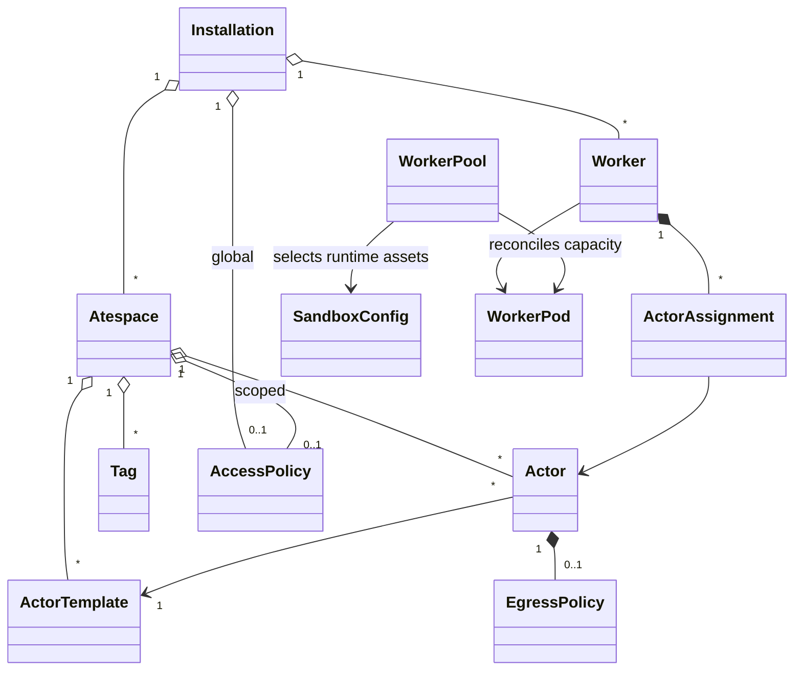

An ActorTemplate supplies the execution description: containers, volume definitions, actor resource limits, worker selection, snapshot configuration, and optional golden-actor egress policy. An Actor refers to a template rather than embedding the entire description. The schema contains an explicit TODO considering a self-contained actor specification, but that is not the current representation. Clients create templates and can change an actor's template reference under the implemented rules; they do not update the template specification in place through a public update RPC.

A template selector and an actor selector are combined by the scheduler. The actor selector narrows the template's eligible workers; it does not override the template. A template that needs a particular sandbox class should select appropriate worker pools. A new actor with no snapshot and no selector may be placed on either supported class if the fleet offers both. After checkpointing, the snapshot's class constrains subsequent restoration. This is an example of a lifecycle-derived constraint that is not visible by inspecting the actor's input fields alone.

Worker records describe the actual execution fleet to the Substrate control plane. The worker synchronizer names a Worker by its Kubernetes Pod UID. The record includes infrastructure identity, labels, runtime information, capacity, allocation, and process-epoch state. The Pod name is useful for operators, but it is not the stable key used by the API. Reusing a Pod name after deletion must not cause a new process to inherit assignments belonging to an earlier Pod incarnation.

Two similarly named structures require particular care. `WorkerAssignment`, embedded in ActorStatus, is the actor's view of its hosting worker. `ActorAssignment`, stored under a Worker, is the worker's reservation for an actor. The former carries denormalized routing and runtime information; the latter records the actor identity and resources booked against capacity. They are not redundant copies that can be freely substituted. Chapter 3 follows the interval in which a reservation exists before the actor's state write completes, and shows why recovery must understand both views.

Tags provide another relation that is more specific than an arbitrary label. A tag identifies retained snapshot content and has its own resource identity, status, and publication scope. An actor created from a tag can borrow that snapshot rather than immediately copying its files. The `source_tag` field is immutable provenance, while the actor's later snapshots evolve independently. Storage ownership and retention belong to Chapter 8, but the API shape already tells a client that changing a tag's metadata is different from changing the snapshot to which it is fixed.

A useful rule when reading an API call is to ask which resource owns the addressed data. `GetWorker` takes a global Worker reference. An actor policy operation addresses an Actor parent plus its singleton policy. A list operation scoped to an atespace enumerates workload records, not Kubernetes objects. Deletion must honor those relationships: a child policy cannot outlive its actor, and an atespace cannot simply be removed while dependent resources require it. The database schema makes some of these constraints relationally explicit, while workflows enforce additional lifecycle obligations.

## 2.2 Identity, versions, and observable lifecycle state

`ResourceMetadata` carries atespace, name, UID, version, and creation, update, and deletion timestamps. These fields look familiar to Kubernetes contributors, but their semantics are implemented by Substrate's store and handlers. A name identifies an address within its scope. A UID identifies one incarnation at that address. A version changes on mutation. Timestamps describe recorded events; they do not replace concurrency preconditions. A correct client preserves the distinctions when retrying a write or acting on an earlier observation.

Create handlers scrub server-owned metadata before validation and persistence. [validate.go](../cmd/ateapi/internal/controlapi/validate.go) clears incoming UID, version, and timestamps. Update handlers retain UID and version because those are preconditions, while clearing client-supplied server timestamps. Resource handlers similarly discard caller-provided status where status is output-only. Accepting a serialized response back as an update therefore does not grant the caller authority to set every field it received.

The store represents write conditions with `Precondition` and deletion conditions with `DeletePreconditions`. UID prevents an operation from applying to a replacement resource with the same name. Version prevents an operation from overwriting a concurrent change to the same incarnation. These checks solve different races. If a client reads version 12, another writer produces version 13, and the first client writes its old copy, a version condition can reject the lost update. If the object is deleted and recreated at version 1, UID is the condition that identifies the substitution even if a numerical version happens to match a remembered value.

`DeleteOptions` exposes optional UID and version guards. Leaving one unset deliberately omits that protection. This can be useful for a client whose intent is “delete whatever currently exists at this address,” but it is not equivalent to deleting the object previously inspected. A controller cleaning up resources from an old owner should generally reason in terms of incarnation. A human performing an unconditional deletion has a different intent. The API makes both possible, so callers must choose deliberately instead of assuming that a name carries all required identity.

ActorState contains RESUMING, RUNNING, SUSPENDING, SUSPENDED, CRASHED, DELETING, and REVERTING. Transitional states are persisted because operations cross database transactions and node RPCs. They are evidence of an in-progress or interrupted workflow, not merely cosmetic progress labels. A client observing RESUMING should not conclude that traffic is already safe to send to the recorded worker. A client observing SUSPENDED should separately inspect snapshot durability before assuming the newest state survives a node failure.

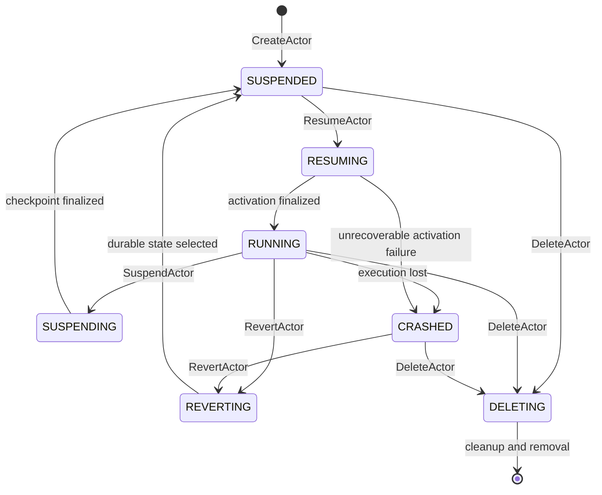

The diagram is an explanatory selection of important transitions rather than a complete admission table for every interrupted state. The workflow implementations validate the exact edge they are about to take. Re-entry can continue a transitional operation from persisted state, and deletion can need to clean up partial work. The key point is that the state machine is public observation backed by concrete workflow logic, not a promise that each RPC completes in one transaction.

`ActorStatus.worker_assignment` is unset when the actor has no active worker, including ordinary SUSPENDED and CRASHED states. `assigned_node` can nevertheless remain set for a suspended actor because its latest checkpoint remains on that node. The two fields answer different questions: which worker executes the actor, and which node still holds its local state. Conflating them would make a suspended actor appear to consume an active worker assignment merely because it remains local to a node.

The embedded `WorkerAssignment` intentionally denormalizes worker information. It contains the Worker reference, Kubernetes namespace, pool, Pod name and UID, Pod IPs, node name, worker epoch, runtime identity, and worker SPIFFE ID. The router can use the assignment without an additional worker lookup on every request. The schema restricts changes to fields that identify the worker while the assignment remains present. Pod IPs and process epoch are refreshed when activation becomes RUNNING. This is a controlled cache of identity and routing data, not an invitation to treat every copy as independently authoritative.

Snapshot fields introduce additional ordering dimensions. The actor records snapshot generations and `last_assigned_generation`. That generation does not decrease during revert, because old reports and cleanup still need an ordering relation to previously assigned generations. Snapshot UUID, generation, durable state, locality, and runtime identity each contribute to interpretation. A public status field can therefore be meaningful even after its corresponding process has stopped; it may protect the system from a delayed report rather than describe active execution.

Resource size is also part of the API contract rather than an implementation guess. ActorTemplate requires CPU and memory limits, represented as millicores and bytes. The scheduler books those values and runtime overhead; the microVM backend uses actor size when constructing the VM. A worker's own Pod resources describe the enclosing capacity allocation. A client should not substitute Kubernetes quantities or assume that a zero actor limit means unlimited capacity. The schema and custom validation define what is accepted, and the scheduling conversion defines how the accepted values are used.

Defaulting is observable behavior. [defaults.go](../cmd/ateapi/internal/defaults/defaults.go) fills an omitted snapshot configuration, defaults preferred fidelity to MEMORY, and enables golden snapshot generation when its mode is unspecified. It supplies wakeup-probe timeout and HTTP path defaults when a probe exists. It also supplies conventional ports for HTTP and HTTPS egress rules, while TLS passthrough requires explicit ports. A client that wants golden generation disabled must state that choice; omission is not a neutral “do nothing.”

Defaults are applied independently of validation so both handlers and storage reads can use them. That arrangement prevents the store from depending on the RPC package merely to interpret older or incomplete serialized values. It also means that the meaningful object is the normalized resource after defaulting, not the exact bytes a client submitted. Reviewers must verify the order: scrub server-owned input, apply defaults, validate, execute the operation, and validate server-produced changes where required. Reversing those steps can accept forbidden state or reject an omission that should have a defined default.

### Updating an actor without rewriting its history

A template change is a useful example of how several API rules combine. Suppose an actor named `session-17` is suspended under a template named `analysis-v1`. A client wants it to resume using `analysis-v2`, retaining durable application data. The client first reads the actor and keeps its UID and version. It then submits an UpdateActor containing the desired user-owned fields and the preconditions from that read. It does not submit a desired RUNNING state or a newly invented worker assignment; those are server-owned results of subsequent lifecycle work.

The handler in [actor.go](../cmd/ateapi/internal/controlapi/actor.go) acquires the actor lease and performs a whole-object replacement of user-owned fields. It preserves the stored metadata and status. This is not a merge patch: a mutable field omitted from the replacement can be cleared rather than retained. A client that constructs only a template reference and forgets another desired mutable field can therefore change more than intended. Reading the current object and deliberately constructing the replacement is a semantic requirement, not merely a way to obtain a version number.

The service validates the resulting update and checks that a changed template reference is allowed only while the actor is SUSPENDED. It resolves the new template. Where the old template remains available, volume definitions must match, and containers present in both templates must preserve their mount lists, including order. The check protects restoration from placing previously captured files at different paths. Newly added or removed containers are treated according to the implementation's comparison rules rather than by assuming every container set must be identical.

The service also protects snapshot cleanup. If the actor owns existing snapshots under one storage prefix, switching to a template that would place its later snapshots under a different prefix can leave old state outside the cleanup domain. `validateSnapshotLocationUnchanged` rejects that change when the ownership conditions apply. A borrowed tag snapshot is handled differently because it is not owned by the actor. This demonstrates why a seemingly simple template reference update needs both execution-state and storage-ownership checks.

After the reference changes, a subsequent resume cannot assume that the old process memory is compatible with the new application specification. The restore workflow uses the snapshot's template identity to select the supported fidelity, falling back to VOLUMES for a replaced template. The actor retains its resource identity while process continuity changes. This is an application upgrade through suspended durable state, not a rolling update of the currently executing process. A client should arrange its own application-level migration requirements around that distinction.

There remains a non-atomicity boundary between resolving a referenced template and later using it. The source explicitly notes that resume resolves it again and fails cleanly if it has disappeared. The API does not hold a database transaction open across all future use of the reference. A robust integration treats the existence check as validation of current intent and still handles later lifecycle failures. Referential design, lifecycle serialization, and eventual cleanup each address part of the problem; none makes a referenced resource immortal.

## 2.3 CRDs that describe executable infrastructure

WorkerPool is the bridge from declared capacity to worker Pods. Its spec requires a replica count, worker image, and sandbox class list. The list is currently constrained to exactly one entry, and the class name is immutable. The schema exposes a list because the representation may evolve, but the current admission contract does not permit a mixed-class pool. Code and diagrams should follow that cardinality instead of interpreting the plural field name as existing multi-runtime composition.

`WorkerPoolPodTemplate` permits selected metadata, node selection, tolerations, priority class, node affinity, resource requirements, and service account configuration. It is not an unrestricted Kubernetes PodTemplateSpec. This deliberate shape lets the controller retain ownership of runtime containers, mounts, security settings, and required infrastructure behavior. Labels and annotations in the `ate.dev` domain and its subdomains are reserved. If a caller could overwrite controller identity labels, the worker registry and network-policy selectors could observe a different relationship from the generated Deployment's owner graph.

Worker image and SandboxConfig have different roles. The worker image contains the Substrate worker implementation. SandboxConfig identifies the runtime assets that implementation will execute: runsc bundles for gVisor, or the hypervisor, kernel, image, and related assets for microVM. Replacing the worker image changes supervisor code. Selecting a runtime version changes the sandbox executable set. A snapshot compatibility decision can depend on the latter even while the worker implementation is unchanged.

SandboxConfig is cluster-scoped and contains a sandbox class, a default version, and a bounded list of named versions. Each version contains state and assets keyed by architecture and asset name. AssetFile pairs a URL with a lowercase SHA-256 digest. The digest both verifies content and participates in cache identity. A URL alone would permit the same declarative object to fetch different executable bytes at different times. The digest turns the asset reference into an explicit content assertion that atelet can verify.

The default version must name an enabled version. Disabled versions cannot become the default. Those constraints are encoded in the CRD validation. Per-class required asset sets are checked by [sandboxconfig-validation.yaml](../manifests/ate-install/sandboxconfig-validation.yaml), which defines a ValidatingAdmissionPolicy and binding. This splits generic versioned-asset structure from runtime-specific requirements. It also creates an installation dependency: the full intended validation contract includes both the CRD schema and the admission policy, not just the Go type's field names.

A WorkerPool can name a SandboxConfig explicitly or use the newest config of its class marked as the class default. Status records the resolved reference and the conditions explaining resolution. During a switch, `pendingConfigRef` participates in protecting the target configuration from concurrent deletion. The protection finalizer is described in [sandboxconfig_types.go](../api/infra/k8s/ate/v1/sandboxconfig_types.go) and implemented by the infrastructure controllers. This is an example of status being part of an ownership protocol rather than only a dashboard summary.

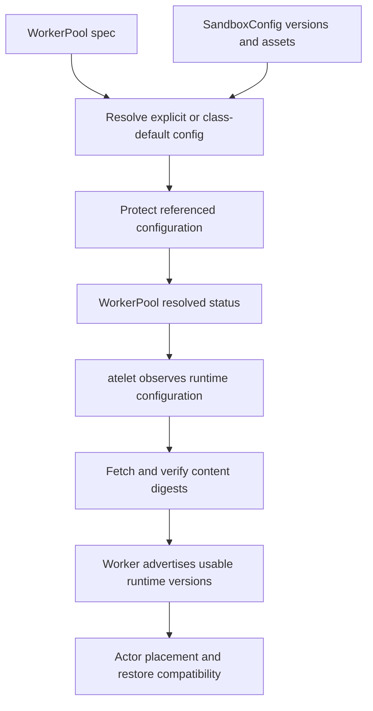

A failed config update is not necessarily a reason to discard the last working runtime. The controller's resolution code can retain the previously resolved config while reporting why the new desired configuration cannot be used. That behavior needs careful reading: the spec expresses intent, status identifies confirmed use, and a condition describes the disagreement. Operators should inspect all three before assuming that a newly applied config name is already active on every worker. Chapter 4 examines the switch protocol and cache-versus-live-read choices.

CSIDriverConfig describes how Substrate reaches a CSI driver's controller and node services. It includes the standard driver name, a controller endpoint, an optional node socket override, and TLS configuration. The node default follows kubelet's plugin-socket convention. This resource does not convert actors into Pods with PVC mounts. Instead, Substrate's volume interfaces invoke the appropriate CSI operations while coordinating actor lifecycle and node-local publication.

External volumes are currently a preview feature. That status does not make the CRD irrelevant: it means the feature has an explicit opt-in contract in the workload API and supporting implementation that must be evaluated as preview. The TLS configuration currently supports using Substrate pod identity when TLS is enabled; comments identify manual certificate support as future work. Endpoint validation has an explicit hardening TODO. Custom CSI integrations must retain those constraints; the type is not a fully general connection policy.

The CRDs are generated from the Go types, but the generated YAML is what the API server actually enforces. The `gen.go` file invokes controller-gen and Kubernetes client, lister, and informer generators. Changes to a type therefore require a generated-artifact review. A field can compile successfully while its schema fails to include the intended immutability or boundedness rule. Conversely, changing a CEL expression can alter admission without changing the shape of a Go struct. For production reasoning, both source and generated contract matter.

These infrastructure objects also establish administrative authority boundaries. A Substrate application caller may be allowed to create actors without being allowed to choose host capabilities or replace hypervisor binaries. Kubernetes authorization governs changes to WorkerPool and SandboxConfig. Substrate authorization governs the workload API. The split permits different operators to own runtime supply and application lifecycle, but it does not automatically impose a particular organizational policy. Installations must grant each API's privileges deliberately and understand which changes affect all tenants using a pool.

## 2.4 Public RPCs, component RPCs, and plugin contracts

The public `Control` service combines resource operations with lifecycle verbs. Create, get, list, update, and delete methods manage records where supported. ResumeActor, SuspendActor, RevertActor, DrainWorker, and worker availability methods express operations whose effects span several records or external processes. The distinction is visible in handler structure: a simple read delegates to the store, while a lifecycle operation enters a workflow with leases, preconditions, and node communication. A resource-oriented API does not imply that every method is a single CRUD transaction.

`WorkerService` is also declared in the public API proto, but its callers and authorization are component-specific. It provides worker epoch acquisition, registration, runtime updates, actor certificate and JWT minting, actor-initiated suspend plumbing, snapshot reports, and crash reports. An arbitrary API client must not gain those powers simply by possessing a generated stub. The service authenticates the atelet identity and checks that the named worker and actor belong to the caller's node and hosting relationship. Chapter 10 follows those checks in detail.

The internal atelet protocol has two directions. `Atelet` exposes downward lifecycle operations such as Run, Restore, Checkpoint, PromoteSnapshot, DetachActor, and Terminate. `WorkerSupport` exposes upward worker needs such as registration, runtime updates, identity minting, policy lookup, crash reporting, and suspend requests. These directions help explain why the same node supervisor acts as both client and server across an operation. A worker asking for suspension can cause the control plane to call back down into that worker to checkpoint it.

The worker protocol in [ateworker.proto](../internal/proto/ateworkerpb/ateworker.proto) is the boundary between atelet and the runtime implementation. `Worker` exposes workload run, checkpoint, restore, termination, and statistics operations. The runtime workers share this interface while implementing different host and guest mechanisms. The protocol carries actor identity and workload information rather than requiring atelet to understand runsc process layout or Cloud Hypervisor's REST API. That separation is essential to keeping a new runtime from spreading backend-specific knowledge throughout the node supervisor.

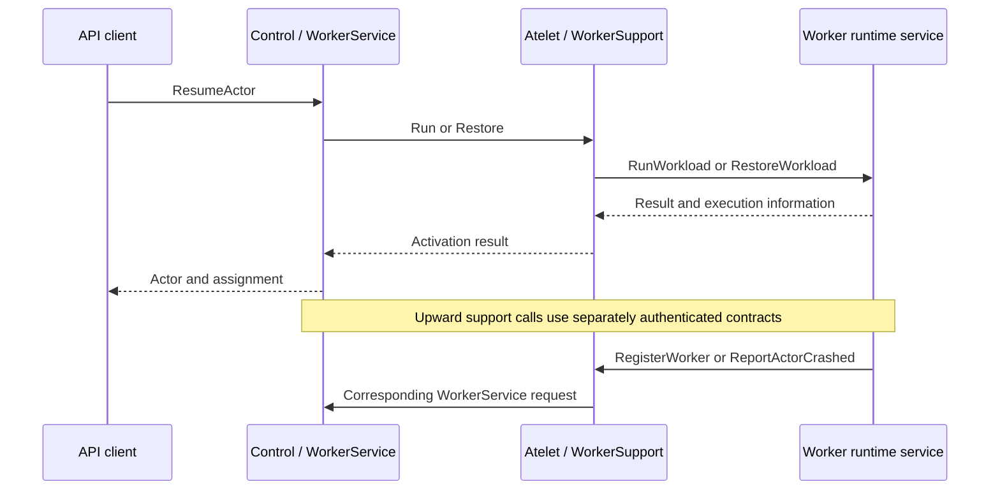

Object storage uses a public plugin API rather than the internal worker protocol. `NodeProvider` fetches and uploads snapshots. `ControlProvider` copies and cleans up snapshots. `AssetProvider` fetches runtime assets. The operations reflect ownership: atelet needs files on a node, whereas ateapi needs to manipulate whole snapshot objects without interpreting every runtime file. Both provider roles can be implemented by the in-tree object-store plugin, but their separation makes the allowed operation surface explicit.

The credential-provider API is narrower still. `CredentialProvider.FetchSecret` allows the egress service to acquire a secret for an authorized use. It does not give the sandbox a general secret-store client. The public proto is the integration contract; provider-specific deployment and authentication live in implementations. A review of an egress feature should therefore trace both the policy reference and the provider call, rather than assuming that a configured secret name means the actor receives that secret directly.

The repository includes other protos that are not interchangeable with these contracts. `pkg/proto/ateconfigpb/apiconfig.proto` describes API server configuration. `internal/proto/objectstoreexchangepb/exchange.proto` supports an internal credential-exchange path. `internal/proto/ateenv/v1alpha/guest.proto` is a pinned copy of another repository's guest process and filesystem API used by benchmarks. Kata agent definitions are vendored under the microVM worker's third-party directory. Their presence in the clone does not make them all public Substrate extension APIs.

Schema duplication across boundaries can be justified when it protects independent ownership, but it requires conversion code. The control plane converts public workload descriptions into atelet requests; atelet converts its protocol to worker requests. Runtime identity and resource fields must survive those conversions with their intended units and defaults. A new public field that is validated but omitted from a conversion can be silently ineffective. A new internal field that assumes a particular runtime can violate the common-worker boundary. Chapter 12 treats those propagation obligations as part of extension design.

Error semantics are also part of the contract. Resource exhaustion indicates that placement or another bounded resource cannot currently admit the request. Failed precondition indicates that the requested operation is not valid for the observed state or configuration. Aborted can indicate a conflict requiring a fresh attempt. Not found can mean either absence or an intentional nondisclosure under component authorization. A caller should not retry all non-success codes blindly. The worker suspend helper, for example, distinguishes transient availability/backpressure/conflict from decisions that another attempt will not resolve.

Deadlines and cancellation cross process boundaries but do not create distributed rollback. If a client times out after a worker started the sandbox, the side effect may exist even though the caller received no result. Internal requests therefore need identity keys and repeatable semantics, and workflows need persisted postconditions. Protocol review should ask what a repeated request means after each possible lost response. That question is more useful than treating gRPC delivery as exactly once or assuming that a canceled context proves the remote process did nothing.

## 2.5 Validation, generation, and client behavior

Substrate reuses Kubernetes declarative validation tooling for protobuf-backed APIs. Comments in the proto are copied into generated Go code, and validation-gen reads those annotations to emit validators. [apivalidation/doc.go](../cmd/ateapi/internal/apivalidation/doc.go) points the generator at `api/ateapi/v1` and request types. The arrangement lets the public schema carry requiredness, bounds, immutability, list semantics, and feature-gate conditions while producing Go validation used by the API handlers.

This is not Kubernetes admission for actor records. The server invokes the generated and custom validation itself. Invalid requests must be rejected before they reach storage or side effects. The API validation guide emphasizes validating every field because relaxing a contract later is usually easier than rejecting values that users already stored. The same concern applies to server-generated status: an internal bug can persist an invalid state even when every user input was valid, so internal update validation and store preconditions remain important.

Protobuf zero values require particular attention. An integer zero or empty string generally represents unspecified unless the field's contract says otherwise. Wire presence is not the same as an accepted nonzero value. Defaults can turn an unspecified enum into a valid choice before validation. Required resource limits receive additional custom checks because their nested structure and operational meaning go beyond a single scalar bound. A client generator faithfully producing a zero-valued struct does not establish that the server will accept it.

Custom validation covers relationships that are awkward or inappropriate to encode as simple annotations. Examples include matching a policy's singleton name, validating timestamp ordering, checking IP addresses, preventing ambiguous egress-rule precedence, and validating storage URIs. The rule for a storage prefix is especially architectural: owner-specific snapshot paths are derived beneath it, so the accepted prefix must not collide with reserved path structure. Validation is protecting later authorization and cleanup assumptions, not merely improving error messages.

The public API also has a linting tool. [tools/apitool](../tools/apitool/README.md) parses the embedded schema and checks naming, documentation, resource declarations, fields, and standard-method shapes. Its exemptions file is strict: an unnecessary exemption fails just as a new unexempted violation does. This makes deviations visible in review and prevents the exemptions list from becoming an unchecked historical accumulation. Lint rules do not prove lifecycle correctness, but they make the public surface consistent enough that clients and reviewers can reason about it.

The generation order matters. [codegen.sh](../hack/update/codegen.sh) first runs Go generation, then protobuf generation, then validation generation. The latter depends on comments and types produced by the protobuf step. CRD generation and Kubernetes clients are driven by the infrastructure package's `go:generate` directives. Generated files should be inspected as outputs and regenerated from their source rather than edited directly. A handwritten repair in generated validation can disappear on the next update and leave the actual schema unchanged.

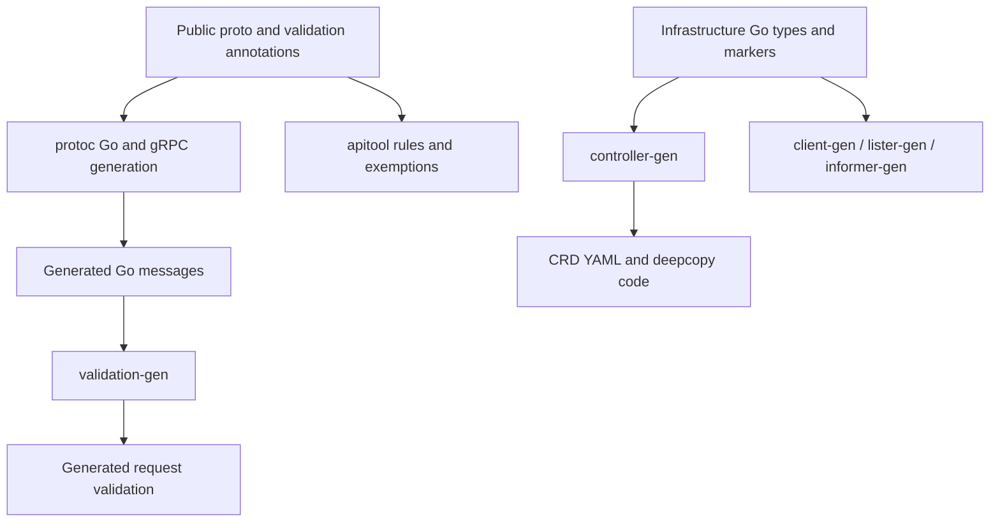

Preview gating adds another dimension to accepted input. The current gates are ExternalVolumes, GoldenEgressPolicy, and PerTemplateSnapshotLocation. Both the server-side gate and the caller's opt-in metadata must permit use. `kubectl ate --preview` supplies the client indication. Internal lifecycle operations deliberately opt in where necessary so that disabling a gate does not strand existing resources during cleanup. A preview gate is not authorization: enabling a feature does not grant a caller permission to use another actor or atespace.

Feature removal or gate disablement needs a lifecycle analysis. If a user created an actor with external volumes while the gate was enabled, later suspend or deletion still needs to handle those volumes. Gating every read of the field would make cleanup impossible after an operator changed configuration. Conversely, accepting a new gated field merely because an older object contains it could permit new use after disablement. The validation operation context and ratcheting rules distinguish new requests from preserving existing state. The preview guide documents this as a design obligation, not an optional UI behavior.

List methods use bounded pagination. The control layer defaults or clamps page size to 1000 and maps invalid token or size errors to InvalidArgument. A client should treat tokens as opaque and use them only with the corresponding list operation and scope. Enumerating workers or actors is not a transactionally frozen view unless the API explicitly establishes such a guarantee. Controllers must tolerate changes while paging and rederive work from current state when they act. Worker-assignment cleanup, for example, uses a key-based cursor so deleting rows during the scan does not produce offset-based skipping.

There is no public Kubernetes-style watch of every workload resource merely because the implementation has an internal worker watch. `store.Interface.WatchWorkers` exists to feed the API replica's worker cache and recovery controller. Clients use the exposed gRPC surface. Assuming a public watch stream from internal method names can produce an integration design that the API cannot support. A future watch API would need event ordering, retention, recovery, and authorization semantics of its own; it cannot be safely exposed by forwarding an internal channel without those decisions.

The CLI is a client of these contracts rather than an alternate source of truth. It handles resource references, validation-friendly input, output formatting, and lifecycle verbs. The Kubernetes-looking command name does not mean that `kubectl ate create actor` submits a Kubernetes Actor object. Code examples should use the current command structure and atespace conventions. When a conceptual example omits authentication or deployment setup, it should be labeled as pseudocode rather than presented as a directly executable installation recipe.

Client retries should preserve intent. Retrying a create after a lost response may encounter AlreadyExists; the client must decide whether the existing resource is the one it intended to create. Retrying an update after a version conflict requires a fresh read and reconsideration of the desired mutation, not simply resending the same stale object forever. Retrying a lifecycle operation relies on its server-side re-entry contract. These cases differ, and a generic retry interceptor that ignores method semantics can turn temporary failure into persistent contention or accidental action on a replacement resource.

### What an opaque pagination token does and does not promise

The current PostgreSQL token implementation is small enough to inspect directly in [pagetoken.go](../cmd/ateapi/internal/store/atepg/pagetoken.go). A token carries a format version, resource kind, scope, and the last ordering-key values. It is serialized as JSON and encoded with base64. Decoding checks the format version, expected list kind, expected scope, and key count. The token contains no database topology and is not a transaction snapshot identifier.

Those checks prevent accidental use of a Worker token with an Actor list or reuse of a scoped token in another atespace. They do not make the token an authorization credential. Authorization still applies to the request being made. Nor does base64 provide secrecy or tamper resistance; clients are instructed to treat the representation as opaque because its meaning is an implementation contract, not because the encoding conceals it. An integration should never infer access rights from possession of a token.

Keyset pagination behaves differently from offset pagination while records are inserted or deleted. Continuing after the last observed key can avoid skipping a later row merely because an earlier row was deleted. It can also omit a newly inserted row whose key sorts before the cursor. That is a normal consequence of enumerating a changing collection without a fixed snapshot. A controller performing reconciliation should repeat its sweep or use an appropriate event source, and it should re-read a resource before a consequential mutation when its correctness requires current state.

The distinction becomes important in fleet recovery. A worker-assignment scan releases entries as it processes them. An offset-based scan could move past entries when preceding rows disappear. The key-based cursor is suitable for that pattern, but the scan still needs incarnation checks and leases when acting on each actor. Pagination only controls traversal. It does not serialize lifecycle operations, establish ownership, or guarantee that every returned object remains unchanged until the caller acts.

A schema review should finally distinguish boundedness from business correctness. A maximum list length limits parser, validation, and storage work; it does not prove that every admitted combination can be executed. A valid runtime URL and digest can still name an unavailable object. A valid worker selector can match no workers. A valid container image reference can fail authentication during preparation. These cases belong to asynchronous status or lifecycle errors after admission. Rejecting syntactically invalid intent early improves the contract, but admission cannot guarantee the future availability of every external dependency.

The reverse distinction matters too. Runtime failure is not a reason to accept an unbounded or ambiguous schema. If two egress rules can tie under the defined precedence, the server rejects the ambiguity before a gateway must choose. If a field carries an unsupported enum value, the server should not persist it and hope a later component interprets it consistently. Validation defines the set of states the rest of the implementation is entitled to assume. Operational failures occur within that set and require separate recovery logic.

This separation guides tests. Schema tests should demonstrate rejection and normalization at the API boundary, including update and preview contexts. Workflow tests should demonstrate behavior after valid input meets a changing fleet, failed storage, or a restarted worker. Testing only generated validators leaves the distributed contract unexamined; testing only successful end-to-end execution leaves malformed and concurrent client behavior unexamined.

## 2.6 Roadmap and engineering improvements

Several future directions are recorded directly in the schema and implementation. Actor currently references ActorTemplate; the proto asks whether an actor should eventually contain a full specification. That choice would change more than serialization. It would affect template deletion, actor provenance, update semantics, defaulting, snapshot compatibility, and the amount of information copied into every actor record. A self-contained actor can reduce dependency on a template lookup, but it creates a separate specification lifecycle that must be reconciled with shared golden snapshots.

The CSI configuration identifies unfinished endpoint hardening and manual-certificate support. Those are concrete contract gaps. A stronger endpoint validator should reflect the transports the client actually supports and the trust model of administrators permitted to configure them. Adding manual certificates would require secret-reference ownership, reload behavior, and server-name validation, not merely a byte field. The existing pod-identity path provides one supported mechanism; it should remain distinct from proposed alternatives in examples and compatibility claims.

The schema's sandbox-class list is another deliberate future-facing shape with a current restriction. Allowing multiple classes per WorkerPool would require decisions about which image and device requirements apply, how capacity is reported, and whether one worker can host more than one runtime family. Removing `MaxItems=1` alone would not implement that behavior. The controller currently branches on a class when building Pod requirements, and the workers are separate binaries. Any expansion must align API cardinality with executable topology.

Preview features need graduation criteria grounded in failure behavior. External volumes should be evaluated across create, attach, resume, suspend, revert, deletion, and node loss. GoldenEgressPolicy must preserve the distinction between the temporary initialization actor's permissions and those of actors later created from its snapshot. PerTemplateSnapshotLocation must preserve ownership and cleanup boundaries when actors change templates. The existence of a feature flag is a release mechanism; evidence from these lifecycle cases is what supports a stronger stability claim.

Several engineering proposals follow from this contract beyond the explicit TODOs. One is a generated contract matrix linking each public field to its validator, defaulting rule, conversion into internal RPCs, storage representation, and runtime consumer. Such a matrix would expose fields that are accepted but not propagated and fields whose runtime-specific interpretation is undocumented. The repository already has embedded schema text and API linting that could support this analysis. This proposal is not an existing generator output.

Another proposal is a clearer client-facing account of continuity. The API records snapshot fidelity and runtime information, but application integrations need to know whether a resumed actor preserved process memory or cold-started with preserved files. Exposing that distinction consistently in lifecycle responses and operational tools would help clients that maintain long-lived sessions or external transactions. Any change should avoid promising that a process checkpoint reproduces external systems' state. Network peers, credentials, clocks, and remote services continue evolving while the actor is suspended.

A future workload watch API would require explicit consistency and retention semantics. The internal worker outbox already demonstrates that event delivery needs recovery after trimming, crashes, and missed polls. A public API would additionally need tenant filtering and stable resume tokens. It should state whether a list followed by a watch can avoid gaps, how clients recover after retention loss, and whether events carry complete resources or deltas. Those are design questions suggested by the implementation, not a claim that such a watch is currently planned or served.

Finally, compatibility should be read in release context. The repository states that pre-1.0 interfaces can change without compatibility guarantees, while also documenting a future version-skew contract. Public package placement signals intended external use, but it does not override that explicit maturity policy. Chapter 12 examines how protobuf, database, runtime, and node-sharing contracts interact during upgrades. For the present API model, the discipline is simpler: use the current schema, distinguish server state from caller intent, preserve resource incarnation in writes, and validate assumptions at every API boundary.

## Source map

- [Public control-plane schema](../api/ateapi/v1/ateapi.proto): resources, lifecycle verbs, metadata, status, preview annotations, and component RPCs.
- [Resource hierarchy](../docs/reference/resource-model.md): scopes, singleton subresources, and cross-resource relationships.
- [WorkerPool types](../api/infra/k8s/ate/v1/workerpool_types.go), [SandboxConfig types](../api/infra/k8s/ate/v1/sandboxconfig_types.go), and [CSI configuration](../api/infra/k8s/ate/v1/csidriverconfig_types.go): Kubernetes infrastructure contracts.
- [Defaulting](../cmd/ateapi/internal/defaults/defaults.go) and [input scrubbing](../cmd/ateapi/internal/controlapi/validate.go): normalization and server-owned fields.
- [Validation guide](../docs/api-validation.md), [preview guide](../docs/dev/preview-gates.md), and [API lint tool](../tools/apitool/README.md): how input contracts are generated and checked.
- [Atelet protocol](../internal/proto/ateletpb/atelet.proto) and [worker protocol](../internal/proto/ateworkerpb/ateworker.proto): internal lifecycle and support boundaries.
- [Object-store API](../api/objectstore/v1/objectstore.proto) and [credential-provider API](../api/credprovider/v1/credprovider.proto): public plugin surfaces.


# 3. Placement and Consistency in ateapi

## 3.1 The control plane's authoritative state

The actor activation path is a distributed state transition coordinated by ateapi. It changes PostgreSQL records, obtains capacity in a worker, prepares state on a node, and starts an execution environment in another process. No transaction spans all of those actions. The implementation instead combines several narrower mechanisms: resource versions, renewable leases, a unique assignment table, row-locked capacity admission, worker-process epochs, and workflows that derive progress from persisted state. Each mechanism protects a different invariant.

The main abstractions are `RPCService`, `ServiceImpl`, `ActorWorkflow`, and `WorkerWorkflow` in `cmd/ateapi/internal/controlapi`, the `Scheduler` interface in `internal/scheduling`, and `Persistence` in `internal/store/atepg`. Handlers validate and authorize requests, then invoke service methods or workflows. The scheduler proposes placement. The store decides whether a proposed reservation is still admissible. Atelet and the worker execute external side effects. Keeping those responsibilities separate is what permits a cached scheduling view without making the cache the authority for resource consumption.

[atepg.go](../cmd/ateapi/internal/store/atepg/atepg.go) explains the storage representation: SQL columns hold values needed for keys, versions, pagination, and preconditions, while a BYTEA column contains the complete protobuf resource. The [initial migration](../cmd/ateapi/internal/store/atepg/migrations/000001_initial.sql) defines atespaces, actors, actor templates, tags, workers, worker assignments, leases, policy storage, and the worker outbox. SQL relationships enforce some ownership constraints directly, such as actor-to-atespace references and assignment-to-worker references.

An actor is addressed by atespace and name, with a separate UID for incarnation. A Worker is globally named by the worker Pod UID. `worker_assignments` is keyed by actor UID, giving an actor at most one recorded worker reservation. Keeping assignments separate from the Worker protobuf prevents worker reads and watch events from growing linearly with the number of hosted actors. Worker allocation is an aggregate, while assignment rows retain the per-actor amounts needed to release that aggregate correctly.

That representation creates an intentional distinction between a reservation and a finalized actor state. `BindActorToWorker` can commit a worker reservation before the actor's record becomes RESUMING with its assignment. If the second write fails or the API process disappears, the reservation still exists. The next attempt must discover and reconcile that claim. A design that simply selects another worker after every error would leak capacity or conflict with the unique actor key. The recovery path is therefore part of the placement algorithm, not an optional cleanup detail.

The store's update methods apply UID and version preconditions. An update reads the resource, checks the caller's conditions, applies the mutation, and writes with a predicate that still names the expected incarnation and version. If another writer wins, the operation reports a conflict instead of overwriting the newer state. A mutation closure can be retried, so it must not itself emit an irreversible external side effect or a misleading success log. [workflow.go](../cmd/ateapi/internal/controlapi/workflow.go) explicitly logs actor state changes from the committed record after the update returns.

The database also stores authorization data used by the embedded OpenFGA integration. Resource policy mutations and authorization tuple updates can share a PostgreSQL transaction through the transaction-aware datastore adapter. This avoids treating authorization policy as an unrelated eventually updated side database. The details belong to Chapter 10, but the consistency implication is relevant here: the store's transaction boundary can include both a resource mutation and the access relationships that make it visible to callers.

Database connections are partitioned by purpose. `Persistence` has the main read/write pool, a watch pool, an owner pool for migrations and outbox maintenance, and a separate readiness-probe pool. The configured watch pool has capacity for polling, maintenance, and headroom; the owner pool accounts for migration locking and work. Separating a probe connection prevents ordinary request traffic from consuming every connection the readiness check needs. It does not make the database independent of request load, but it removes one avoidable queueing dependency.

This is a user-space and database consistency system. PostgreSQL row locks, advisory locks, and MVCC snapshots are not Linux syscalls exposed by Substrate. They ultimately execute in processes scheduled by Linux and communicate over sockets, but their semantic role is a database contract. The host-kernel boundaries enter later, when atelet and workers perform filesystem, network, process, cgroup, and virtualization work. Mixing SQL locks into a syscall inventory would conceal the actual layer at which placement correctness is established.

A compact invariant set helps organize the chapter. A resource write must apply to the intended incarnation. One actor must not hold simultaneous reservations on different workers. A worker must not admit more booked capacity than its fresh record permits. A completed activation must refer to the process epoch that executed it. A replayed workflow must preserve already committed progress and avoid duplicating external effects. A cache may lag, but lag must not invalidate any of those authoritative checks.

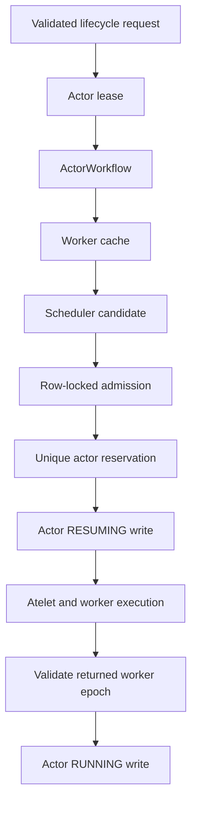

The arrows identify dependency, not one atomic transaction. Failure between any two boxes leaves a particular recoverable state. The implementation's quality depends on whether that state is understood by the next request or reconciliation pass. The following sections examine those interruptions in the order that an activation encounters them.

## 3.2 Renewable leases and re-entered workflows

An actor lease serializes lifecycle operations for one logical actor address. `actorLeaseKey` constructs the key from atespace and name. `AcquireLease` in [lease.go](../cmd/ateapi/internal/store/atepg/lease.go) generates an ownership token and inserts a lease row with an expiration calculated by PostgreSQL's `clock_timestamp()`. On conflict, it can replace the owner only if the previous lease is expired. If no row is returned, the caller receives `ErrLeaseConflict` rather than assuming it may proceed.

The use of the database clock is important. Expiration and reclamation are evaluated by the authority that owns the row. API replicas do not compare independently skewed wall clocks to decide whether another replica's lease has expired. The client still uses local timers to schedule renewal and cancellation, but the decisive condition is in the SQL predicate. This avoids one class of clock-skew error without making the entire operation independent of timeouts, network delay, or process pauses.

The default lease TTL is thirty seconds. Renewal normally occurs at one third of that interval. The renewal attempt has an earlier deadline than the full expiration period, and transient errors are retried within that budget. Renewal succeeds only if the key and token still match and the lease remains unexpired. If renewal cannot be established, the lease context is canceled. Workflow code uses that context for subsequent operations, so losing ownership becomes a signal to stop making progress.

Closing the lease cancels the renewal loop, waits for it to finish, and then attempts a token-checked DELETE using a bounded background context. The release path cannot delete a successor's lease because it includes the original token. If the release fails, expiration remains the recovery mechanism. Cleanup of old rows is separate: a maintenance pass removes expired leases in bounded batches using `FOR UPDATE SKIP LOCKED`. Reclaiming an expired key does not depend on that cleanup pass having run.

A lease is not a universal fencing token for every remote side effect. The token protects the lease row, and context cancellation stops cooperative work. An RPC that already reached another process may still complete. That is why actor UID, worker Pod UID, worker epoch, resource version, and reentrant node operations remain necessary. It would be unsafe to infer exactly-once execution from the existence of the lease. The lease reduces concurrent workflow activity; other contracts protect the state when ownership changes or responses are lost.

`ActorWorkflow.ResumeActor` begins with an optimization for the common routing case. It reads the actor before taking the lease. If the actor is already RUNNING, it returns the current record immediately. The router can ask for the actor on each request without inserting and deleting a lease row each time. Any state that requires actual activation is read again under the acquired lease. The optimization therefore avoids unnecessary serialization for a read-only fast path while retaining fresh validation for transitions.

The main resume sequence is explicit in [workflow_resume.go](../cmd/ateapi/internal/controlapi/workflow_resume.go): load the actor and template, ensure volumes exist, ensure a worker assignment, attach volumes, call atelet to run or restore, and finalize RUNNING. Each ensure step validates its precondition and records progress. A RESUMING actor with a still-valid assignment can skip new placement. A persisted postcondition is the evidence for skipping; an in-memory variable from a previous API process is not.

The step wrapper opens trace spans and marks skipped work when the postcondition already holds. This makes a retried workflow inspectable: a trace can show that assignment was reused but restore was repeated, rather than presenting the whole request as a fresh activation. Error wrapping retains the step name. The observability design follows the workflow structure, which is useful when distinguishing database conflict time from node preparation or runtime execution time.

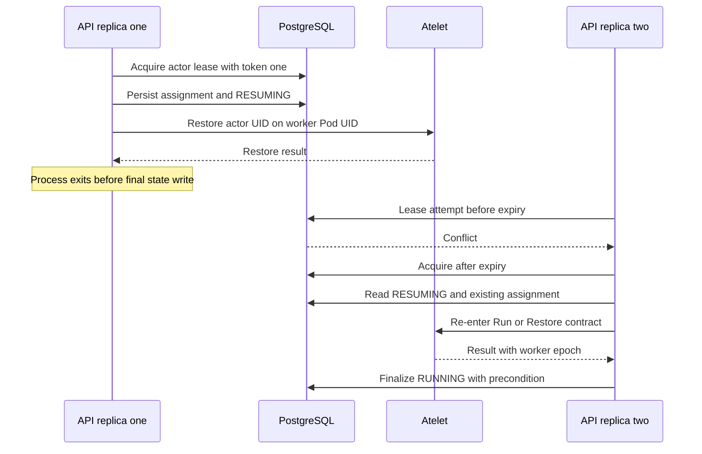

The diagram exposes a requirement rather than granting an unconditional guarantee: the repeated atelet request must have safe semantics for the same actor and worker identities. The comment on `ensureAteletRestored` calls this the reentrancy seam and references continuing work on node-side idempotency. A reader should inspect both ends of that contract before declaring the workflow exactly once. Persisted ensure steps make recovery possible, but an external operation that is not repeatable remains a material limitation.

Suspend follows the same general method. It acquires the actor lease, reads current state, marks SUSPENDING, asks atelet to checkpoint, detaches external volumes, and finalizes SUSPENDED. An actor already SUSPENDED returns as it is. The synchronous versus asynchronous durability choice changes when upload completes, not the need to serialize the execution transition. Snapshot state and retention are covered in Chapter 8; here the important point is that releasing execution capacity follows a successful sequence of recorded and external steps.

Delete and revert introduce different cleanup obligations. Delete must terminate execution and detach volumes before releasing a reservation that could otherwise still represent a live sandbox. The workflow can collect errors and continue safe cleanup where possible, but it deliberately avoids releasing capacity if required termination or detachment failed. Revert preserves a completed durable recovery point while abandoning active or local progress. These are not equivalent to clearing ActorStatus and relying on a future controller to discover the orphaned processes.

External volume operations show where re-entry is still imperfect. The source contains TODOs to replace repeated attach/detach execution with checks against proper recorded attachment state. An operation may currently depend on the CSI driver's own idempotent semantics. That dependency should be named in a production analysis. “The workflow is reentrant” is a useful design pattern, but it must be verified per side effect, especially when calling a plugin with its own persistence and retry behavior.

The upward worker-requested suspend path is similarly instructive. WorkerService first verifies that the caller's atelet is on the worker's node and that the actor incarnation is hosted there, then invokes the ordinary suspend workflow. A TODO in [workerservice/suspend.go](../cmd/ateapi/internal/workerservice/suspend.go) identifies a race because those hosting checks occur before the actor lease. The actor can move or be recreated in that interval. The existence of a later lease does not retroactively protect an earlier authorization observation. Moving or repeating the check inside the protected operation is a concrete future improvement.

Finally, cancellation must be interpreted operationally. A deadline ending can stop lease renewal and cause the caller to receive an error while a node is still completing a checkpoint. A retry should re-read state and use the appropriate lifecycle method; it should not assume the actor remained untouched. Logs should be tied to committed records and remote operation identities, allowing an operator to reconstruct what actually completed. This is why the source avoids logging a state transition from inside a mutation closure that might be retried or rejected.

### Separating serialization, admission, and execution evidence

Three superficially similar conflicts reveal why the control plane needs more than one mechanism. First, two API replicas receive ResumeActor for the same suspended actor. They are competing to perform one actor transition. The actor lease serializes the work at the logical resource address. The losing request can report contention and retry according to its caller's policy. It must not select a different worker and proceed independently merely because another worker has capacity.

Second, two different actors compete for the last place on one worker. Their actor leases do not conflict, because both lifecycle operations are legitimate. The worker row lock serializes the capacity decision, and the second admission sees the first booking. A global actor lease would be unnecessarily restrictive, while only per-actor leases would permit overbooking. The separation allows unrelated activations to proceed concurrently until they contend for the same physical resource.

Third, one actor's restore result comes from a worker process that has already been replaced. Neither a successfully acquired actor lease nor a valid capacity reservation proves that the returned process is still the worker's registered incarnation. The epoch comparison supplies that evidence. Resource version and actor UID still matter when recording the result, but they do not describe worker-process continuity. Each conflict is resolved at the layer that can authoritatively observe the relevant fact.

Now examine a lost database response. A transaction can commit even when the client connection fails before the caller learns the result. Retrying a bind must therefore discover whether the actor UID already has an assignment. The `ON CONFLICT` insertion and same-worker rebind logic handle that ambiguity without incrementing allocation twice. Requiring a preliminary read before insertion would not solve it: another transaction could commit after the read. The unique key is the decisive concurrency boundary, and the existing row supplies the information needed to interpret a retry.

A lost actor-update response is a different ambiguity. The workflow may have persisted RESUMING but received an error. A later attempt reads the actor and validates the recorded assignment rather than assuming no progress occurred. A resource version is evidence that a particular write applied to a particular prior state; it is not a client request identifier. The workflow uses state and identity to recover intent. Adding a retry loop without rereading those values would repeatedly collide with the very update that may already have succeeded.

A lost node response is harder because the side effect exists outside PostgreSQL. The store can establish that the actor was assigned and that the request named a worker, but it cannot infer from a timeout whether the sandbox was created. That uncertainty must be resolved by the node/worker contract. The API can repeat the same semantic request or query state where supported, but it must not treat a transport timeout as an instruction to allocate a second independent execution. This is the point at which idempotency keys and cleanup behavior become part of isolation as well as availability.

These cases also explain why a retry budget belongs to a particular operation. Assignment contention can be retried quickly with jitter because a fresh candidate may be available. A five-minute runtime operation that exceeded its deadline should not automatically be multiplied into another five-minute attempt without understanding its outcome. An authorization refusal should not be retried as if it were a connection failure. The repository's distinct retry loops encode some of these differences; integrations should preserve them instead of wrapping every call in the same policy.

The most useful review artifact is an operation ledger with one row per side effect. For a resume, it records volume creation, assignment reservation, actor-state persistence, volume attachment, runtime activation, and finalization. For each row, identify the durable key, the success evidence, the repeated-call behavior, and the compensating or recovery action. Such a ledger can be derived directly from the ensure methods. It makes unanswered questions visible before they become production incidents and keeps tests focused on the distributed boundaries rather than the number of helper functions.

A ledger also distinguishes safe over-retention from unsafe early release. Retaining an uncertain assignment can temporarily reduce capacity but prevents that capacity from being allocated while execution might still exist. Releasing it early can admit another actor into resources still in use. The implementation often favors conservative retention until termination or reconciliation supplies evidence. That choice requires eventual cleanup to preserve liveness. A system that never releases uncertain state is safe against one class of overlap but can exhaust itself after repeated failures; recovery must complete the argument.

## 3.3 Candidate selection and authoritative admission

The scheduler has a deliberately small interface: `Schedule`, `Applies`, and `HasRoom`. `Schedule` chooses a worker from a `WorkerSource`. `Applies` checks non-capacity constraints, allowing an existing assignment to be assessed without counting itself as a reason for ineligibility. `HasRoom` evaluates the resources needed for one more actor. This split permits the workflow to reuse an existing claim and to repeat admission against a fresh database record without duplicating policy in the store.

`Constraints` includes sandbox class, required runtime, snapshot runtime, template and actor selectors, required nodes, and declared limits. Sandbox class is never relaxed when restoring a snapshot, including lower-fidelity state, because the worker implementations write and interpret different formats. Required runtime can be relaxed under the supported memory-fidelity fallback. Snapshot runtime remains relevant to determining the runtime actually used and its overhead. These fields are similar enough that conflating them would produce incorrect capacity accounting during fallback.

A worker must have registered a process epoch and reported its sandbox class and runtimes. It must be ACTIVE. Node constraints must match when local state pins an actor. Both label selectors must match. The required runtime must be supported. Only then does capacity admission make sense. A worker with ample free memory but an unavailable runtime is not an eligible destination, and a newly recreated worker that has not reported runtime information cannot inherit the prior process's eligibility.

`Booking` calculates the resource reservation. CPU comes from the actor's requested limit. Memory includes that limit plus runtime fixed overhead and an additional amount scaled per GiB of actor memory. The proportional calculation uses a 128-bit intermediate through `bits.Mul64`, and sum checks reject overflow. These checks matter because resource arithmetic is an admission boundary. Integer overflow must not turn an enormous requested actor into a small apparent booking that fits the worker.

Actor slots are independent of compute dimensions. `checkRoom` first ensures allocated actor count is below capacity. It then checks whether free compute capacity covers the booking. A workload can fail admission because no slots remain even when its resource request is small. Conversely, a worker can have unused slots while lacking enough memory for the next actor. Capacity is therefore a vector with a discrete count dimension, not a single occupancy boolean or a CPU-only load score.

For eligible candidates, the scheduler uses power of two choices. It samples two distinct candidates and prefers the lower load, where load is the maximum of actor-slot utilization and dominant compute-resource utilization. A tie falls back to exact slot-utilization comparison using cross multiplication, then remaining slots. The policy spreads demand across warm capacity. It is not a best-fit bin packer and does not itself consolidate actors to shut down workers. A future autoscaler must be evaluated together with that spreading behavior.

As an illustrative comparison, suppose two eligible workers have equal slot capacity. One has consumed most of its memory but few slots; the other has moderate memory use and more slots. A slot-only policy can keep choosing the memory-heavy worker until it rejects large actors. The dominant-utilization score recognizes pressure in either dimension. This does not solve every fragmentation case: heterogeneous actor sizes can still leave gaps that none of the queued actors fit. The algorithm is a low-cost placement heuristic with an authoritative admission check behind it.

The scheduler enumerates the fleet returned by the cache and builds an eligible candidate list before sampling. That work is linear in the worker count, not constant time. `Cache.Workers` itself copies map values into a slice. A package comment describing fast O(1) reads should not be repeated as an algorithmic guarantee. Caching avoids a database query for every candidate, but fleet scanning and allocation remain measurable costs as the worker population grows.

The workflow then calls `BindActorToWorker` with an admission callback. The store obtains the Worker row with `SELECT ... FOR UPDATE`, inserts an assignment keyed by actor UID, and evaluates the callback while holding the row. The callback re-runs eligibility and room checks against the fresh Worker. It also checks that runtime overhead still produces the same booking. If a worker re-registered with different overhead after the cache observation, the attempt fails and retries rather than booking an amount derived from stale metadata.

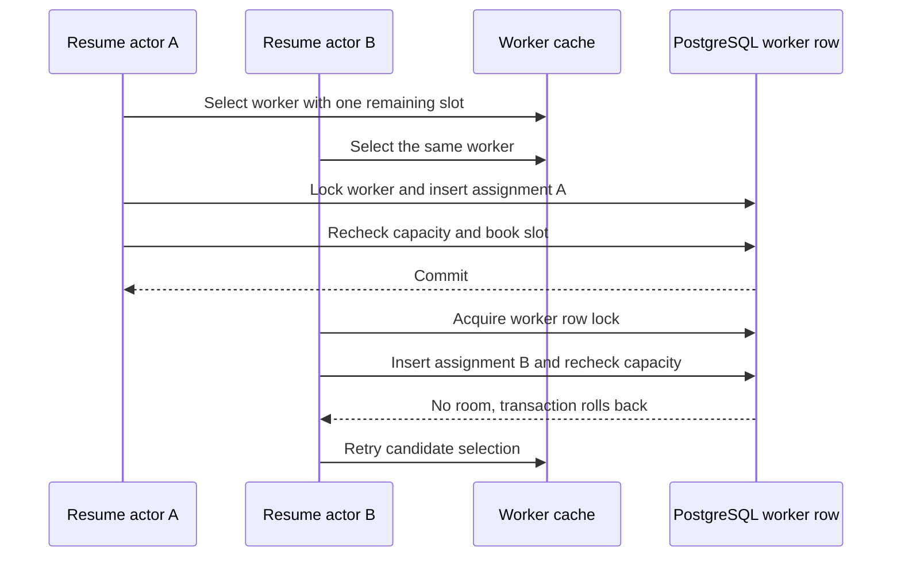

The cache can be arbitrarily stale with respect to this particular race without permitting both claims to consume the final slot. Staleness causes retries or poor choices, not an authoritative overbooking. This is the central correctness property of the two-stage design. It also explains why improving cache freshness is a performance optimization rather than a substitute for the row lock.

If an assignment already exists, the store checks whether it belongs to the same worker. A claim on another worker is refused. For a repeated claim on the same worker, it subtracts the previous booking before admitting and adding the replacement, preserving the assignment identity. That pattern avoids double-counting a retried operation and supports an adjusted reservation where allowed. Release similarly deletes the assignment row, subtracts the stored amount, and writes the Worker with an outbox event in the same transaction.

After reservation, the actor update records RESUMING and a denormalized WorkerAssignment. A failure at this point leaves a stale claim that `workerHoldingStaleClaim` can recover. Assignment retries are bounded by exponential backoff with jitter and a cap; they are not an unbounded tight loop against a contested worker. A disappeared worker can be forgotten from the local cache after the authoritative store proves it absent. A merely full worker is not forgotten, because it may still fit smaller actors and should remain visible when a later release arrives.

Locality can further constrain this process. A suspended actor whose latest snapshot is attached to one node first searches that node's workers. If no room exists and another suitable destination is available, `detachFromFullNode` coordinates releasing the node binding and retries. It does not reserve the remote destination before detaching, so a competing activation can take that capacity. The result may be a durable-only actor that still needs a later placement attempt. That tradeoff belongs in performance and availability analysis rather than being hidden behind the phrase locality-aware scheduling.

Runtime fallback is also a policy decision in the workflow, not a relaxation of all constraints. A memory image captured under an unavailable runtime may be restored at ROOTFS fidelity under the worker's default runtime. A changed template can force VOLUMES fidelity. Sandbox class remains fixed for snapshot interpretation. These decisions preserve supported state while changing process continuity. The scheduler supplies feasible destinations; the workflow determines what can be restored there and stamps the assignment accordingly.

## 3.4 The transactional worker outbox and cache recovery

The scheduler needs a fleet view without reading every Worker from PostgreSQL for every placement. `workercache.Cache` maintains that view from `store.Interface.WatchWorkers`. The implementation is neither Kubernetes watch storage nor PostgreSQL LISTEN/NOTIFY. It is an application outbox whose events are written in the same transaction as the Worker mutation and then polled by each API replica. This choice gives the cache a recoverable change stream while keeping the primary Worker rows authoritative.

`writeAndAppendEvent` in [outbox.go](../cmd/ateapi/internal/store/atepg/outbox.go) begins a transaction, executes the worker mutation, serializes a complete Worker with an event-type byte, appends it to the outbox, and commits. If the mutation returns no Worker worth publishing, it can skip the event. After a successful commit, the process publishes the event directly to its local watchers as an optimization. A local watcher with a full channel does not block the write; it will receive the event through polling later.

The event stream therefore permits duplicates and out-of-order local delivery. A replica can see its own committed update before an older transaction becomes eligible for polling. It later sees the same event again from the outbox. `Cache.applyEvent` compares Worker versions for create and update events, preventing an older resource version from replacing a newer one. Consumers must reconcile state rather than treating every delivery as a unique command. The outbox is a propagation mechanism for resource observations, not an exactly-once operation queue.

Ordering uses PostgreSQL transaction IDs. Each worker write appends one event in its transaction, and the schema assigns the transaction's xid. The poll query selects events after the cursor but below `pg_snapshot_xmin(pg_current_snapshot())`, ordered by xid. The xmin fence prevents a watcher from advancing beyond a transaction that has an earlier ID but has not committed yet. Without that fence, a later committed transaction could move the cursor past an earlier transaction that becomes visible only afterward.

Consider transactions T100 and T101. T100 obtains its transaction ID and remains open; T101 writes a Worker and commits. If the watcher simply selects committed rows above its cursor, it can deliver T101 and set its cursor to 101. When T100 later commits, its event would sort behind the cursor and be lost. The xmin rule withholds the later event until older in-flight transactions can no longer appear behind it. That is the correctness benefit, and it has a direct performance cost: a long-running transaction anywhere in the database can stall remote event delivery.

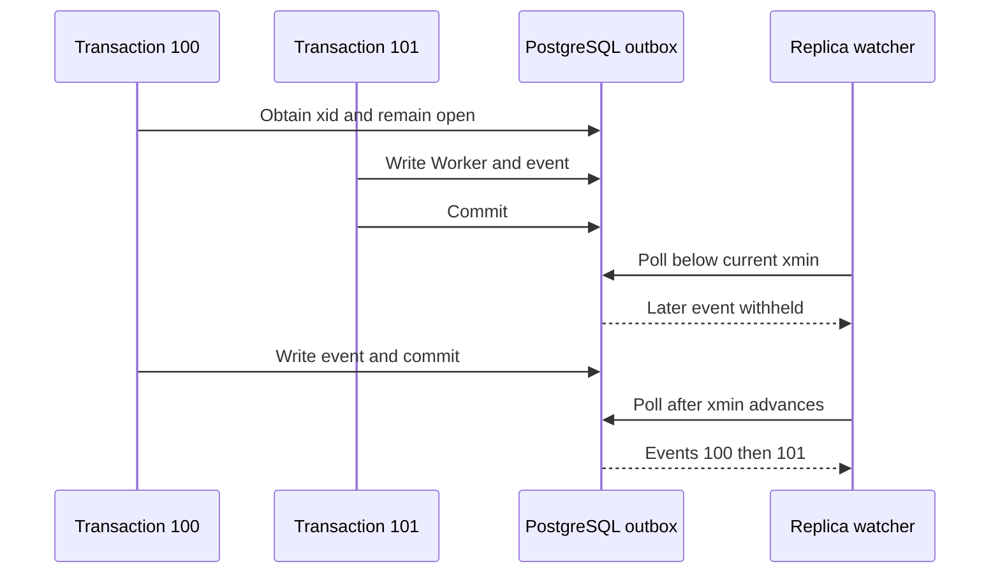

The implementation polls every fifty milliseconds in the absence of other work and fetches up to 1024 rows per batch. When a batch is full, it continues draining without waiting for another poll interval. That prevents the timer from becoming a fixed throughput ceiling during bursts. These constants bound ordinary batching behavior, not end-to-end propagation latency: transaction fences, database load, connection failures, and a slow consumer can all add delay. Local immediate publication improves the originating replica's view but does not remove the need for remote replicas to catch up.

Outbox partitions are UNLOGGED and retained for a bounded interval. This avoids paying the full durable-WAL cost for a stream whose state can be reconstructed from Worker rows. It also means database crash recovery can remove committed but undelivered events. The primary Worker table remains the recovery source. The watch protocol detects database restart by comparing `pg_postmaster_start_time()` with the value recorded at subscription and closes the channel so the consumer must rebuild its view.

Retention uses fifteen-minute partition ranges and a minimum retention age. Maintenance pre-creates future partitions and drops expired ones rather than deleting every old event row individually. The partition strategy reduces ongoing row-deletion and vacuum work. A DEFAULT partition catches writes if partition creation falls behind. Its existence is a backstop, not a reason to ignore maintenance: accumulated rows can conflict with creation of the intended range partition and require a recovery path.

A logged `worker_outbox_trim` row records the highest transaction ID discarded by retention or DEFAULT cleanup. A watcher checks whether trimming has passed both its cursor and its subscription baseline. If so, it closes before delivering beyond the missing interval. The logged trim mark survives the same crash class that can erase UNLOGGED event rows. Restart detection and trim detection protect different failure cases; neither alone is enough to identify every lost-event condition.

Subscription itself records a cursor at xmin minus one, a baseline for pre-subscription history, and the database start time. The baseline prevents an old trim mark from making a new watcher believe it already lost events, while avoiding an artificially advanced starting point that could hide a slow in-flight transaction. `Cache.sync` creates the watch before performing a full list. Events that occur around the list can then be replayed, with resource versions handling overlap. The list and watch need not be one monolithic SQL transaction to provide a recoverable cache construction procedure.

Maintenance has its own lock-order concerns. Partition drops can take an ACCESS EXCLUSIVE lock on the outbox parent and block writers. DEFAULT cleanup can lock the child. The implementation separates some cleanup transactions and takes parent-before-child locks during partition rescue to avoid inversion against writer lock order. It uses PostgreSQL advisory transaction locks to coordinate maintenance among replicas. These details matter because an event-delivery optimization can otherwise become a source of write latency or deadlock in the actor control plane.

When a range partition cannot be created because DEFAULT contains rows in that range, the rescue path locks the parent, records the trim mark, truncates the strays, and creates the partitions in the same transaction. That operation deliberately sacrifices events while preserving recoverability through relist. It does not silently pretend that every event was retained. The cache's correctness contract is therefore “detect loss and reconstruct current state,” not “retain all worker history forever.” Audit history belongs to a different facility.

Persistent polling failure also closes the watch after a bounded interval, thirty seconds by default. This limits how long consumers continue treating a frozen fleet view as ready during an outage. On channel closure, `workercache` marks itself not ready, closes the old watch, and retries subscription and relist with backoff. Scheduling then fails rather than continuing indefinitely from an unchanging view. Authoritative row admission already protects capacity, but failing the cache explicitly prevents repeated misleading candidate choices and makes the outage visible.

Periodic relists provide another repair mechanism. The main process configures a five-minute interval. A relist replaces the map with a fresh set and notifies handlers about new or changed Worker versions. That handler behavior matters for worker-epoch recovery: an update missed during an event failure must still reach the assignment reconciler after a relist. Merely restoring the map without notifying dependent controllers would repair scheduling while leaving recovery work undiscovered.

The cache's handlers run on the goroutine applying changes and must not block. The worker-assignment controller responds by enqueueing keys rather than performing full recovery inline. This preserves the separation between observing fleet changes and carrying out potentially slow actor cleanup. A slow external operation in a cache handler could stall event consumption, cause retention loss, and affect unrelated scheduling. The shared client-go workqueue is the boundary that turns observed changes into independently retried work.

Operationally, outbox health should be evaluated with database transaction age, poll failures, cache readiness, relist activity, and maintenance latency. A high rate of authoritative admission conflicts can indicate cache lag, but it can also reflect legitimate contention for a small feasible pool. A low event rate can mean a quiet fleet or a stalled xmin fence. Diagnosis requires distinguishing those cases. The source has an explicit TODO for cache metrics, so some of this visibility remains an improvement rather than a complete existing dashboard contract.

## 3.5 Worker epochs, crashes, and interrupted activation

Kubernetes Pod identity does not identify a worker process incarnation. A container process can restart inside the same Pod, retaining its Pod UID and network identity while losing all sandboxes it managed. Substrate uses worker epochs to distinguish those executions. `issued_epoch` counts epochs handed out, `registered_epoch` identifies the process whose registration is active, and `observed_epoch` records how far assignment recovery has reconciled the consequences of replacement.

`AcquireWorkerEpoch` in [register.go](../cmd/ateapi/internal/workerservice/register.go) authenticates the calling atelet, verifies the worker belongs to that node, and increments the issued epoch with a version precondition. Registration then activates an issued epoch and records IPs and capacity. An epoch greater than the issued value is refused. An epoch older than the registered value is superseded. Repeating the same registered epoch succeeds only when the registration's IPs and capacity match; a retry cannot rewrite an established process identity with different values.

Registration clears the previous process's sandbox-class information. The replacement process must report its own runtime set before the worker becomes eligible for new actors. This is a critical coupling between execution incarnation and scheduling. Without it, a worker could temporarily advertise the restore capabilities of an executable that no longer exists. Runtime updates are accepted only for the registered epoch, preventing a delayed report from an older process from reintroducing stale compatibility information.

The actor's embedded WorkerAssignment records a worker epoch when activation becomes RUNNING. `finalizeRunning` reads the current Worker and compares the epoch returned by Run or Restore with its registered epoch. A lower returned epoch means the process that performed activation has already been replaced, so the workflow asks for retry. A higher returned epoch is an internal inconsistency because it exceeds the recorded registration. A matching epoch is written into ActorStatus along with the current worker IPs.

This final comparison is important but is not the entire recovery system. Worker registration can occur independently of actor operations. The `WorkerAssignmentReconciler` observes worker changes through the cache and queues workers whose registered epoch exceeds their observed epoch. It acquires a per-worker assignment lease, then calls `WorkerWorkflow.ReconcileAssignments`. This controller runs inside every ateapi replica; the lease prevents simultaneous sweeps of the same worker, while the queue and retries provide eventual progress.

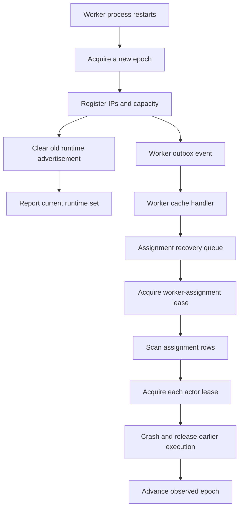

`releaseAssignmentsBefore` pages through assignments. Each actor is considered under its own lease, so recovery does not casually interleave with a resume, suspend, or delete. Busy actors are counted and left for a retry after other assignments have been processed. This prevents one contested actor from blocking all cleanup immediately, while preserving a signal that the sweep is incomplete. The worker's observed epoch advances only after the pass has completed the required work.

The per-assignment logic checks identity and state rather than releasing every row indiscriminately. If the actor is gone or its UID no longer matches the assignment, the old reservation can be removed. If the actor no longer points at this worker, the row may be a claim whose actor update has not yet completed, so it is left for the resume path to reconcile. If the actor's recorded worker epoch is current or later, it is not a victim of the restart being processed. A RESUMING actor is left to its resume because it has not yet finalized the epoch under which it runs.

For an actor that was RUNNING under an earlier worker epoch, recovery records the crash before releasing the assignment. That order preserves evidence if a failure occurs between the two writes: the next pass finds an already-crashed actor and an outstanding reservation that still needs release. Reversing the order could make capacity available while leaving the actor recorded as successfully executing under a process that no longer exists. The sequence embodies a conservative bias toward retaining a claim until loss of execution has been recorded.

`recordObservedEpoch` uses worker UID and version preconditions and retries conflicts against a fresh record. A later write to the Worker does not invalidate the fact that an earlier epoch's assignments were examined, but a replacement Worker incarnation must not inherit the old observation. Advancing the observed epoch with `max` preserves monotonic progress. This is different from setting it blindly to the latest registered value read after the sweep; that could acknowledge an epoch whose consequences were never processed.

A useful failure matrix separates four interruption points. Before reservation, a failed resume holds no worker capacity. After reservation but before actor assignment persistence, it leaves a stale claim to recover. After the actor is RESUMING but before node activation, it leaves a repeatable activation request. After node activation but before RUNNING persistence, it leaves a potentially executing sandbox whose result must be reconciled through the node contract and epoch check. Each state is different even if the client receives the same transport error.

| Interruption point | Durable observation | Required next behavior |
|---|---|---|
| Before worker claim | Actor remains unassigned | Select and admit normally |
| After claim, before actor write | Unique assignment exists | Recover the existing claim |
| After RESUMING is stored | Actor names its worker | Validate assignment and re-enter activation |
| After runtime result, before final write | Sandbox may already execute | Repeat safely and validate process epoch |
| After worker replacement | Higher registered epoch | Reconcile earlier assignments and record lost execution |

This matrix is also a test design. A test that kills an API replica at an arbitrary time may repeatedly hit only one row. To exercise the contract, failure injection must identify the specific committed boundary and assert both actor state and worker allocation afterward. Tests should check for leaked assignments as well as duplicate execution, because a system can avoid duplication by conservatively retaining every failed reservation and still become unusable over time.

Node loss introduces snapshot questions beyond worker epoch recovery. A worker process restart loses active execution; a node loss can also remove local checkpoints. The actor's assigned node and snapshot locality determine whether the newest state can be recovered elsewhere. A durable older snapshot may support revert, while a missing newest checkpoint can cause crash handling. Chapter 8 traces those state choices. Here the key distinction is that worker epoch is evidence about process replacement, not a proof of snapshot durability.

The actor lease and worker-assignment lease form a hierarchy of operation scopes rather than a single global mutex. Recovery holds the worker-scoped lease while attempting actor-scoped leases; ordinary actor operations hold their actor lease while changing assignments. Correctness depends on avoiding indefinite waits and on using conflict/retry behavior where operations meet. The implementation treats a busy actor as retryable work instead of blocking the whole sweep while holding the worker lease indefinitely. This makes the lock structure visible in the control flow.

Crash records are public operational evidence. They preserve a reason and time in ActorStatus and are cleared when revert returns the actor to a suspended recovery point. An operator must distinguish a sandbox that deliberately exited, a worker process replacement, a lost local snapshot, and a failed activation. These may share a CRASHED state but require different remediation. The source's structured lifecycle events and phase spans are the route to that distinction; a generic Kubernetes restart count cannot reconstruct it.

## 3.6 Roadmap and engineering improvements

The first repository-backed improvement is the placement of recovery controllers. `worker_assignment_reconciler.go` explicitly notes that every API replica queues every worker and relies on a per-worker lease to avoid duplicate sweeps. It suggests a single elected leader or moving controller loops into their own Deployment. Such a change could reduce duplicate database traffic, but it would also create a leadership and availability contract. The current design trades redundant enqueueing for simple replica-local operation and lease-based serialization.

Template reconciliation has a related sharding TODO. Its periodic list of ActorTemplates is an event source independent of the worker outbox. As the template population grows, list frequency, page size, worker count, and per-template leases determine the cost of golden snapshot progress. A future controller service could share operational patterns with assignment recovery while retaining separate queues and failure semantics. Combining them under one process should not imply that a long golden-image build may block worker crash recovery.

The worker cache proposes indices by node and label and lacks some desired metrics. Indexing can reduce repeated full-fleet scans, particularly when locality or selectors sharply narrow the feasible set. It must preserve the same authoritative admission callback and runtime-overhead checks. An index is another derived view that can lag or be rebuilt; it should not become a second source of allocation truth. Measurements should show whether candidate scanning, database admission, or runtime work actually dominates before adding index complexity.

Outbox delivery has a concrete coupling to long database transactions through the xmin fence. One improvement proposal is to expose oldest relevant transaction age and event-cursor lag alongside cache readiness. Another is to benchmark retention DDL under representative write load, because partition drops briefly block writers. A replacement propagation mechanism would need to preserve gap detection, restart recovery, version reconciliation, and bounded retention. Lower nominal polling latency is not sufficient if it loses those properties.

The code also records unfinished lifecycle reentrancy work. Atelet Run and Restore semantics are the external seam for replayed activation. Volume attach/detach steps still call out the need for proper persisted state checks. Delete contains a TODO for garbage collection after cleanup failures. These are concrete areas for failure-injection tests: lose replies, restart participants, repeat requests, and inspect the resulting assignment, process, mount, and snapshot ownership state. Successful steady-state benchmarks cannot establish those recovery guarantees.

The worker-requested suspend race deserves a narrowly scoped correction. Authorization of the hosted actor currently precedes acquisition of the actor lease, as documented in the source. A future implementation should bind the hosting and UID observation to the serialized operation or repeat it under the lease. The change must preserve nondisclosure behavior for actors outside the caller's hosting scope and avoid introducing a lock cycle with the downward checkpoint RPC. Automatic idle detection, if later wired in, would increase the practical importance of this path.

A broader proposal is to publish a small set of executable invariants with the control-plane tests. For every committed assignment, the worker allocation should include the recorded booking exactly once. Every released assignment should subtract that same booking. A RUNNING actor should name a meaningful worker process incarnation, and replacement should eventually produce the appropriate crash or recovery observation. A completed sweep should not acknowledge unseen epochs. These invariants can be checked after randomized sequences of conflicts and failures without mirroring every helper function in a unit test.

Another proposal concerns scheduling policy and autoscaling. Power-of-two choices spreads demand, while scale-down benefits from consolidation. Local snapshots favor retaining capacity near state, while cross-node redistribution can improve utilization. A future policy should state its objective and the cost of changing locality rather than layering an unrelated bin-packing heuristic onto the existing selector. Experiments should include heterogeneous actor sizes, runtime-version fragmentation, burst correlation, and background snapshot I/O. Uniform tiny actors in a permanently warm fleet exercise only a narrow part of the problem.

Finally, database evolution is part of production consistency. Goose migrations use a PostgreSQL session advisory lock, and repository verification requires sequential, transactional Up migrations without editing already merged files. The schema policy and future version-skew contract constrain how fields and tables can evolve while old binaries still run. The database may retain serialized protobuf data longer than any individual API process. Changes to validation, defaults, and stored messages must therefore be evaluated together with migration and rollback behavior. Chapter 12 returns to that cross-version contract.

## Source map

- [Workflow types and step instrumentation](../cmd/ateapi/internal/controlapi/workflow.go): ensure-style progress, actor leases, and committed-state logging.
- [Resume](../cmd/ateapi/internal/controlapi/workflow_resume.go), [suspend](../cmd/ateapi/internal/controlapi/workflow_suspend.go), and [node detachment](../cmd/ateapi/internal/controlapi/workflow_resume_detach.go): lifecycle ordering and fallback behavior.
- [Scheduler](../cmd/ateapi/internal/scheduling/scheduling.go): eligibility, resource booking, dominant utilization, and power of two choices.
- [Assignment persistence](../cmd/ateapi/internal/store/atepg/worker_assignment.go): row-locked admission, uniqueness, rebind, and release.
- [Leases](../cmd/ateapi/internal/store/atepg/lease.go): database-clock expiry, token ownership, renewal, and cleanup.
- [Outbox](../cmd/ateapi/internal/store/atepg/outbox.go) and [worker cache](../cmd/ateapi/internal/workercache/workercache.go): event ordering, retention, loss detection, and relist.
- [Worker registration](../cmd/ateapi/internal/workerservice/register.go) and [assignment recovery](../cmd/ateapi/internal/controlapi/workflow_reconcile_assignments.go): process epochs and crash reconciliation.
- [PostgreSQL schema evolution](../docs/dev/postgresql-schema-evolution.md): migrations and compatibility constraints.


# 4. Reconciling Kubernetes Infrastructure

## 4.1 What atecontroller owns

`atecontroller` maintains the Kubernetes infrastructure that makes actor execution possible. Its principal objects are WorkerPool and SandboxConfig, with generated Deployments, worker ServiceAccounts, NetworkPolicies, and an egress trust bundle. It also synchronizes worker Pod observations into the Substrate API. It does not implement the actor scheduler, does not store Actor records in Kubernetes, and does not own every reconciliation loop in the repository. Golden snapshot creation and worker-epoch recovery run inside ateapi.

The executable entry point is [cmd/atecontroller/main.go](../cmd/atecontroller/main.go). It creates a controller-runtime manager and registers `WorkerPoolReconciler`, `SandboxConfigProtectionReconciler`, `NetworkPolicyReconciler`, and `EgressMITMTrustReconciler`. The manager supplies the shared client, cache, scheme, event recorder, and direct API reader used by those controllers. The code then starts a separate worker synchronizer with independent client-go informers. This split is intentional and affects startup, resync behavior, and failure recovery.

WorkerPool reconciliation establishes a Kubernetes ownership chain: WorkerPool controls a Deployment, the Deployment controls ReplicaSets, and ReplicaSets control Pods. That chain governs infrastructure garbage collection. The Substrate Worker registry is outside the Kubernetes object graph, so owner references cannot delete its records. Worker Pod synchronization must observe or reconstruct the disappearance of a Pod and call the Substrate API to clean up the corresponding Worker. The architecture thus has two ownership systems connected by explicit reconciliation.

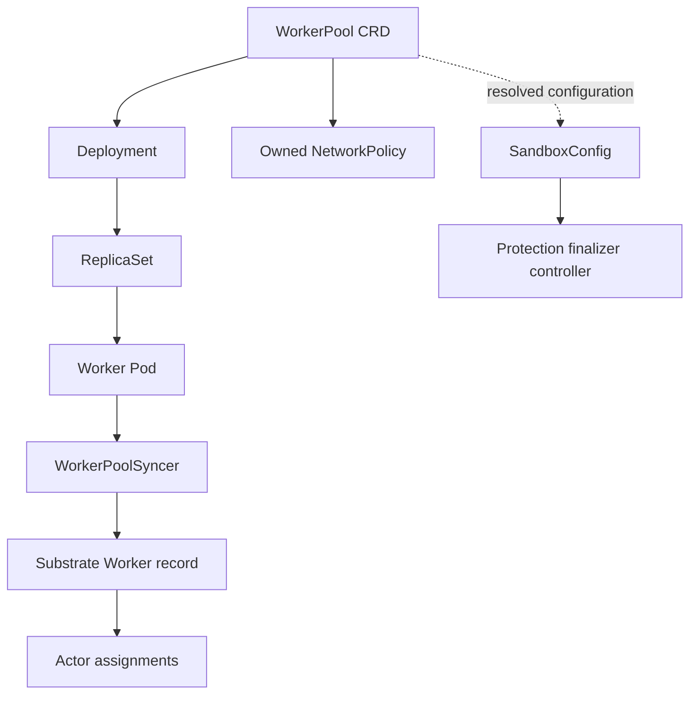

The dotted SandboxConfig edge is not a Kubernetes owner reference. A cluster-scoped configuration can be referenced by several namespaced pools and needs an explicit protection protocol. Likewise, the Worker record is not a child Kubernetes object hidden behind a custom client. It is a PostgreSQL-backed resource reached over gRPC. These distinctions explain why familiar garbage-collection assumptions are insufficient when a pool is deleted or a configuration is replaced.

The main controller-runtime watches are narrowly related to the desired objects. WorkerPoolReconciler watches WorkerPool, owns Deployment, and maps SandboxConfig changes back to potentially affected pools. NetworkPolicyReconciler watches WorkerPool and owns NetworkPolicy. SandboxConfigProtectionReconciler watches configs and maps pool status changes to the configs they use. The trust controller watches one configured Secret and the managed trust-bundle object. A controller event is a prompt to re-read state, not an instruction that can safely be replayed without checking current ownership.

The manager restricts its Secret cache to the egress MITM CA-pool Secret in the configured namespace. This is a concrete reduction in the secrets the process needs to observe through that cache. It does not eliminate the sensitivity of the selected Secret or replace RBAC, but it avoids an unrestricted Secret informer merely to reconcile one trust bundle. The exact cache setup is in `managerOptions`, which constructs per-object namespace and field selectors.

The worker synchronizer cannot share every manager behavior. Its Pod informer has a five-minute resync period so registry drift can be repaired even when there is no new Pod event. An informer's resync period is a property of that informer; imposing it through the manager's shared cache would affect unrelated controllers. The separate factory lets this cross-API synchronizer have its own repair cadence and indexes. It watches Pods carrying the worker-pool label, rather than every application Pod in the cluster.

Startup ordering is part of correctness. The synchronizer registers event handlers before starting its informer factories. The initial list then synthesizes Add events for existing Pods. It waits for caches before beginning decisions that depend on their contents. A separate startup scan lists registered Workers from the Substrate API to find records whose Pods disappeared while the controller was down. Initial Kubernetes events can reconstruct live Pods, but they cannot replay historical deletion events for objects absent from the new cache.

The controller's output also determines host-level privileges indirectly. The Deployment builder selects worker capabilities, device resources, projected certificates, hostPath mounts, mount propagation, probes, and shutdown grace. Reconciliation does not itself call KVM ioctls or create an actor veth. It declares the environment in which workers later perform those operations. The builder establishes capability and device grants; node and runtime code perform the actual host interface operations.

Controller-runtime does not automatically make all operations transactional. Applying a Deployment, protecting a SandboxConfig, writing WorkerPool status, and updating the Substrate registry are separate requests. The implementation chooses ordering and optimistic concurrency checks to preserve invariants across them. The most interesting parts of this controller are consequently the boundaries between otherwise familiar API calls: when a cached observation is sufficient, when a live read is required, and which intermediate status makes a race recoverable.

For a Kubernetes core contributor, the productive reading strategy is to follow those intermediate states. A pool can have an existing Deployment while its newly requested config is unresolved. A terminating config can remain valid because a pool still holds it. A Pod can be Ready while its worker process has not yet reported runtime information. A worker can be DRAINING while the Pod still exists. None of those combinations is necessarily a bug; each expresses progress at a different layer.

## 4.2 Building and maintaining worker Deployments

`WorkerPoolReconciler.Reconcile` reads the pool, treats NotFound as completed deletion, and stops ordinary reconciliation when deletion has begun. The main work is in `reconcileWorkerPool`. It first discovers whether a Deployment already exists. An existing Deployment is applied before SandboxConfig resolution, because the Pod template does not embed the SandboxConfig's runtime asset contents. A configuration error must not prevent an operator from scaling existing capacity down or otherwise applying the pool's current infrastructure shape.

Initial creation is more conservative. A pool without a Deployment receives one only after every declared sandbox class has a usable resolved configuration. The schema currently allows exactly one class, but the controller expresses the check across the list. This prevents launching a first fleet whose runtime configuration has never resolved. The asymmetry is useful: configuration mistakes do not freeze lifecycle changes to established infrastructure, while an entirely new pool does not create apparently usable capacity without a runtime source.

`applyDeployment` builds an apply configuration and uses server-side apply with a controller field owner and forced ownership. The controller therefore actively maintains the fields it declares rather than preserving arbitrary manual edits to those fields. The desired Deployment has a controller owner reference to the WorkerPool, a stable pool label in its selector and Pod template, configured replica count, rollout strategy, progress deadline, and worker container. Optional pool template metadata is merged with controller-reserved identity labels.

The default worker ServiceAccount is shared by pools in a namespace. The controller creates it when the pool does not specify another service account, but does not assign it an owner reference to one pool. If it did, deleting that pool could remove identity used by unrelated pools. This small ownership choice illustrates a broader rule in the implementation: shared infrastructure cannot be modeled as the exclusive child of whichever resource first caused its creation.

The worker container receives its Pod UID and IPs through the downward API, listens for atunnel HTTPS and CONNECT traffic, and exposes a readiness endpoint. The builder passes the expected router identity and, where needed, the atelet broker identity. Those identities are derived from the configured system namespace and service-account names rather than assuming the workers run in the installation namespace. A WorkerPool in another namespace still needs to authenticate the actual central router and node supervisor.

Certificate material is projected into the Pod. The identity volume combines a PodCertificate projection with a ClusterTrustBundle projection for the pod-identity signer. A separate trust projection supplies the service-DNS trust used for egress connections. The worker receives file paths, not embedded private keys in command-line arguments. Runtime code must still reload or consume those files correctly; the Deployment's responsibility is to request the identity material and mount it at the agreed paths.

The `ate-base` hostPath supplies the node-sharing area described by `internal/nodepath`. Its mount uses HostToContainer propagation so mounts prepared on the host side can appear inside the worker. Worker capacity files are projected through a downward-API volume with CPU expressed in millicores and memory in bytes. The worker's reported capacity derives from this enclosing allocation, while individual actor limits arrive through the actor lifecycle protocol. Confusing those two resource sources would size every actor as if it owned the entire worker Pod.

Preview flags are propagated from the controller to generated workers. The builder sorts the enabled gate names before constructing the flag. Map iteration order is otherwise unstable, and a different order in the Pod template would trigger a needless Deployment rollout even though the enabled feature set had not changed. This is a concrete case where deterministic rendering protects execution availability: an incidental formatting change can restart capacity that hosts several actors.

The worker security context is class-specific but follows the same outer pattern for both backends. It runs as root without privileged mode, drops all capabilities, and adds the explicit set needed for runtime operations. AppArmor and seccomp are set to Unconfined because the nested runtime processes perform operations, including `pivot_root`, that the default profiles can deny. Runtime self-confinement remains separate. This is a deliberate privileged-work boundary in the system, despite the Kubernetes `privileged` boolean being false.

The gVisor capability set covers network administration, mounts and root changes, process tracing, user/group mapping, ownership changes, device-node creation, and related runtime preparation. MicroVM adds capabilities required by virtiofsd's child sandbox. The builder requests KVM through an extended resource advertised by atelet and bind-mounts `/dev/net/tun`. KVM resource advertisement doubles as a placement signal: a node lacking the advertised device cannot satisfy the Pod's request. A manually applied sandbox-class node label is not the authority for device presence.

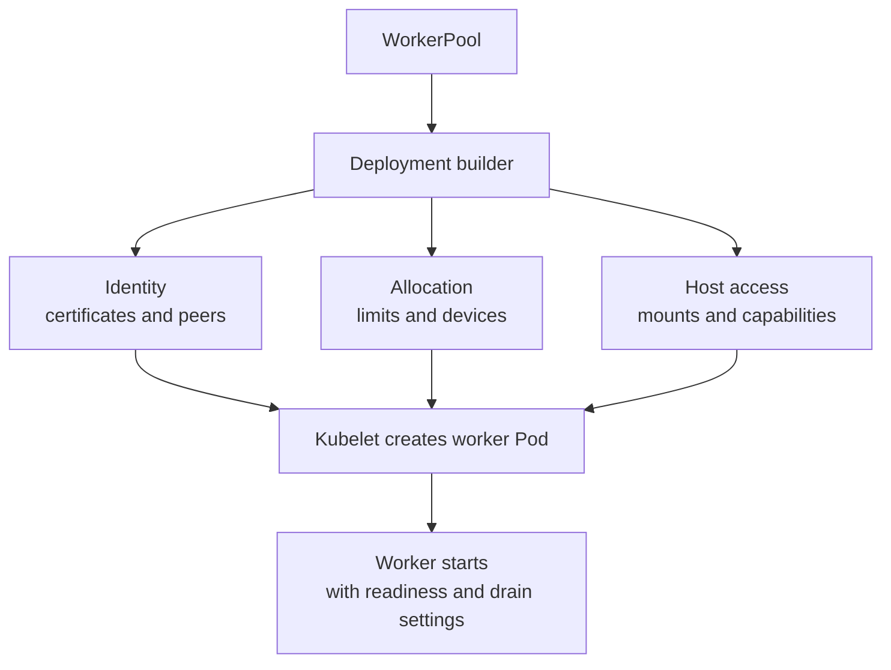

The generated toleration for a sandbox-class taint allows pools to use nodes reserved for that class. It is additive to user-supplied tolerations. The device request constrains where a microVM worker can fit; the toleration controls whether it may enter a tainted node. Those mechanisms are complementary. Neither causes the actor scheduler to select a worker directly; they shape the fleet that later reports capacity to ateapi.

WorkerPool status copies Deployment replica and ready-replica counts and selector information, together with sandbox-class resolution state. The controller avoids a status update when the desired status is semantically equal. Replica readiness remains a Kubernetes observation. Actor-placement readiness additionally requires the worker's registered epoch and runtime report, as Chapter 3 describes. A ready-replica gauge is therefore useful for infrastructure health but cannot alone prove that a particular snapshot has a feasible restore destination.

Rollouts change more than container binaries in a multiplexed system. One worker can host several actors, so terminating it can affect multiple application executions. The generated termination grace and worker drain behavior give the runtime an opportunity to shut down, while WorkerPoolSyncer marks terminating Pods DRAINING to stop new assignments. The controller does not perform a live migration of every actor simply because Deployment rolling update exists. Operators must combine rollout settings with actor recovery and snapshot durability requirements.

## 4.3 Resolving and protecting SandboxConfig

SandboxConfig selection is a stateful protocol because configuration deletion can race pool adoption. A pool can specify a config name explicitly. Otherwise, `resolveLatestSandboxConfig` chooses the newest nondeleting config of the required class marked as the class default. Equal creation timestamps are broken deterministically by name. An explicit reference is checked for existence, class match, and deletion state. Failure produces a condition explaining whether the config is missing, mismatched, or being deleted.

When a desired reference does not resolve, `keepSandboxConfig` can retain the configuration already recorded in status. It preserves a deleting config only if that config still carries the protection finalizer. A deleting object without protection can disappear immediately and is not a safe retained dependency. Status can therefore report `Resolved=False` while still naming a usable prior config. That is intentional degradation reporting, not an instruction to strip the runtime configuration from a running fleet.

The protection finalizer is added only when a pool resolves a config for use. An unused config need not remain terminating behind a finalizer that serves no purpose. Adding the finalizer uses an optimistic-lock merge patch carrying resourceVersion. If the config changed concurrently, the reconcile fails and retries. Kubernetes does not allow adding a new finalizer after deletion has begun, so the code leaves deleting objects alone and relies on later confirmation to determine whether a switch remains safe.

A naive adoption sequence would add a finalizer, read the config, then write `configRef` into pool status. That sequence still races a protection controller that previously listed no users and is about to remove the finalizer. A cached read can also miss deletion. The implementation closes the gap with a two-stage status protocol: record a pending claim before the live confirmation that permits promotion to the active reference.

The actual ordering is: resolve from cache; protect candidate configs; write the new reference into `pendingConfigRef` while retaining the previous `configRef`; read the candidate directly from the API server; and write final status with either the confirmed new config or the retained old one. Both active and pending references count as use for protection. The direct read must occur after the pending status write. Moving it earlier would reopen the race that the protocol is designed to prevent.

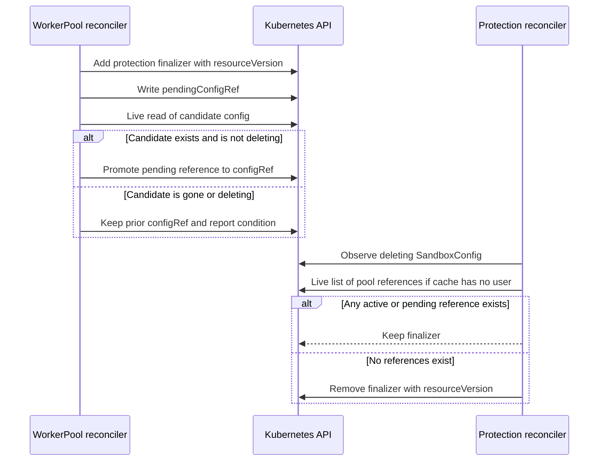

The safety argument depends on the ordering of the two controllers. Suppose the protection controller already concluded there were no users and removed the finalizer before the pool's pending claim appeared. The config must already have been deleting for that controller to release it. The later live read sees deletion or absence, and the pool refuses to switch. If the pending claim appeared before the protection controller's live list, that list sees a user and preserves protection. The pending status is the synchronization evidence connecting two independent reconciliations.

`SandboxConfigProtectionReconciler.usedByWorkerPool` first uses a cache index from config name to pools whose status names it. A positive cached result is sufficient to retain the finalizer conservatively. A negative result is not sufficient to remove it, because the cache might lag a newly written pending claim. Only then does the controller perform a live list from the API server. This asymmetric use of cache freshness is a useful pattern: stale positive evidence can delay deletion, while stale negative evidence could violate safety.

The index includes both `configRef` and `pendingConfigRef`. The watch mapping handles old and new pool objects so a config being switched away from is reconciled as well as the new one. A deleting config still in use is not periodically requeued solely to poll for release. Changes to its users enqueue it, and startup reconciliation covers users that disappeared while the controller was down. The protocol uses event-driven progress with a conservative live check at the irreversible boundary.

Finalizer removal is another optimistic-lock patch. A concurrent change to the config causes conflict rather than an unconditional overwrite of its metadata. Other finalizers are preserved. The controller is responsible only for the protection token it owns, not for forcing deletion past unrelated cleanup obligations. An operator manually removing that finalizer bypasses the protocol and can invalidate the guarantee that a pool's confirmed reference names retained configuration.

The pool controller emits events after successful status writes. A changed reference produces a normal event naming the transition. An unresolved condition produces a warning unless the same failure was already recorded. This avoids emitting identical warnings on every reconcile while still recording meaningful changes. Events have retention limits in Kubernetes, so durable audit history requires an external event collection path. The source explicitly distinguishes transient event history from a permanent record of every runtime configuration used.

Status writes themselves can conflict if a reconcile started from an older pool version. That conflict is part of the protocol rather than an exceptional corruption case. The controller requeues and reevaluates current desired and observed state. It does not continue to emit a switch event after a failed status write. This preserves the relation between reported transitions and committed state, analogous to the actor workflow's practice of logging only after a successful store update.

A config's protection concerns WorkerPool references, not every snapshot ever captured under one of its runtime versions. Snapshot runtime compatibility and runtime-asset retention have additional mechanisms in atelet and the workers. Deleting or disabling a runtime version can therefore affect restoration even if a pool has moved to a new default. The finalizer protocol should not be overinterpreted as a universal retention system for all historical runtime binaries. Chapter 5 covers asset retention, and Chapter 12 covers runtime upgrade compatibility.

The practical diagnostic sequence follows the protocol's records. Inspect the desired pool reference, the active and pending status references, the Resolved condition, the config's deletion timestamp and finalizers, and the controller's recent events. A pool that retains an older config while warning about a missing new one may be behaving correctly. A config stuck Terminating may still be referenced by a pending claim. Deleting either field manually can hide the evidence needed to understand the state and should not be treated as a routine repair.

## 4.4 Synchronizing worker Pods with the Substrate registry

`WorkerPoolSyncer` maintains a cross-API projection from Kubernetes worker Pods to Substrate Worker records. Its queue key contains namespace, Pod name, and Pod UID. Namespace/name locates the current object in the informer; UID identifies the incarnation being reconciled. The Worker name is the UID. This lets one queue contain cleanup for a deleted Pod and registration for a same-named replacement without confusing the two.

The reconcile method first reads the Pod from the informer. If it is absent, it calls `DeleteWorker` for the recorded incarnation. If a Pod exists under the name but has a different UID, it also cleans up the old Worker; the new Pod was queued under its own key. This is why a queue key containing only namespace/name would be insufficient. A delayed delete observation must not deregister the replacement or leave the old assignment state attached to a reused name.

A Pod entering deletion is marked DRAINING in the Substrate API. The scheduler then stops admitting new actors to that Worker. The synchronizer deliberately leaves active actor cleanup to the worker's shutdown path and later Pod deletion handling, rather than immediately declaring every actor gone when deletionTimestamp first appears. There is an interval in which graceful shutdown is in progress and the Pod still exists. DRAINING represents that interval more accurately than deleting the registry record at once.

A terminal Pod phase is handled differently from ordinary temporary unreadiness. Succeeded or Failed will not return to serving execution. The synchronizer marks the Worker draining and requests Pod deletion with a UID precondition, allowing the eventual absence to drive registry cleanup. A NotFound or conflict indicating replacement is treated as success for that deletion request, because the intended old Pod is already gone. The precondition prevents cleanup from deleting a new Pod that reused the same name.

For a live Pod, `createOrUpdateWorker` finds the owning pool through the worker-pool label and the pool informer. A new Worker is created only after the Pod has a node name, because node identity is required and immutable. The record includes Kubernetes namespace, pool name, Pod name and UID, node name, worker SPIFFE ID, and the pool's labels. It starts UNAVAILABLE. Process epochs, IPs, capacity, and runtime sets are not fabricated by this controller; the worker process reports them through WorkerService.

The label source is worth noticing. Actor placement matches the labels on the Worker record, and the synchronizer copies the WorkerPool's labels. Pod-template labels serve Kubernetes selection and metadata purposes, but they are not automatically the same configuration surface as pool labels used for Substrate placement. A user debugging a selector mismatch should inspect the registered Worker labels and the pool metadata rather than assuming every label visible on the Pod is a scheduling label in ateapi.

Availability requires a Pod IP and a true PodReady condition. If the Pod becomes unready while its Worker is ACTIVE, the synchronizer marks it unavailable before applying other mutable metadata. If the Pod is ready and the Worker is UNAVAILABLE, it marks it available. A DRAINING Worker is left draining even if a later readiness observation is true, because it is on the way out. This prevents a stale or reordered readiness event from re-admitting work during termination.

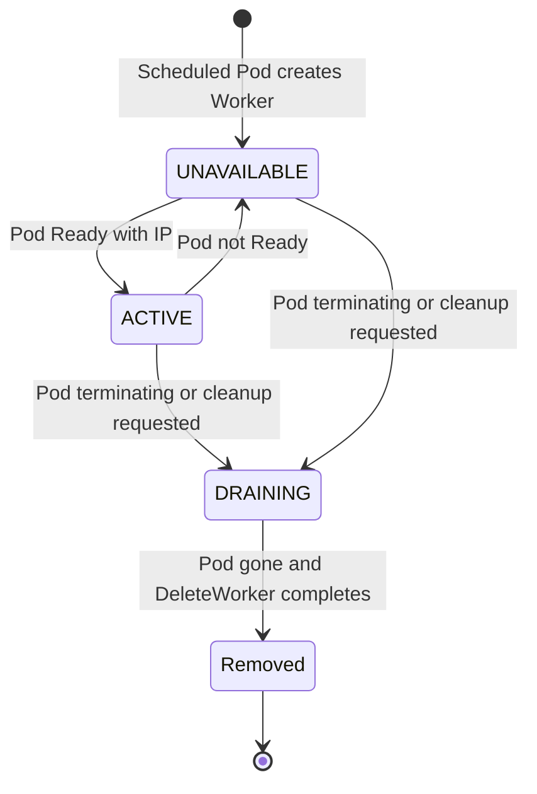

The diagram describes the synchronizer's infrastructure view. Actual scheduling also requires registered runtime information. An ACTIVE record with no current sandbox-class report is still ineligible under the scheduler. Splitting availability from registration avoids giving the Pod watcher authority over process-internal facts it cannot observe. The worker can know which binaries and runtime compatibility it has established; Kubernetes readiness alone cannot infer that information from the container image name.

Worker updates use whole-object replacement semantics. The synchronizer edits mutable labels on the Worker it read and sends the rest back unchanged, carrying the returned version from one write into the next. It does not construct a sparse replacement that accidentally clears immutable infrastructure fields. If a concurrent writer causes Aborted, the queue retries and fetches a fresh record. A field that is immutable after create cannot be repaired by rewriting the Worker; a new Pod incarnation must establish a new record.

Missing pools require careful cleanup because informer absence can reflect a deletion whose garbage collection is still progressing. The synchronizer walks the controller chain Pod → ReplicaSet → Deployment → WorkerPool using live owner reads and UID checks. If an owner is gone or deleting, cascading cleanup is pending and the Pod is left to it. If the chain is cut, the Pod is orphaned and can be deleted gracefully. Immediately deleting the Worker registry record would crash actors before the Pod had a chance to shut them down.

A replacement Pod created by an orphaned ReplicaSet may have no registered Worker. In that case the synchronizer leaves it alone rather than turning a missing pool into an endless create/delete cycle. The source's behavior is specific to the observed registry and owner chain, not a blanket rule that every Pod with an unknown pool label must be destroyed. Ownership evidence determines the action, and transient read failures are propagated instead of treated as proof of orphaning.

After cache startup, `enqueueRegisteredWorkers` pages through the Substrate registry. Every Worker yields a key reconstructed from its recorded Pod namespace, name, and UID. Live matching Pods converge to no-op or metadata repair; missing and replaced Pods drive cleanup. Each failed list page is retried with capped backoff until it succeeds or the controller context ends. Pages already read are enqueued immediately, so one late failure does not discard earlier progress or require holding the entire registry in memory.

This startup scan repairs a gap that ordinary informer resync cannot fill. Resync redelivers objects that exist in the cache. A Pod deleted while the controller was down is absent and produces no new delete event. Without the registry-side enumeration, its Worker could remain indefinitely as a ghost record. Cross-system reconciliation needs a way to enumerate both sides of the relation, not merely a watch on the currently live Kubernetes side.

The queue distinguishes permanent invalid input from transient failure. If the Substrate API returns InvalidArgument for a request derived from current Pod and pool state, replaying that same request immediately will not help. The synchronizer forgets the key and waits for a future relevant event. Other errors are rate-limited and retried. Successful reconciliation also forgets failure history. This keeps malformed infrastructure state from consuming an unbounded hot retry loop while preserving recovery from transport errors and concurrent-write conflicts.

### A rollout observed from both APIs

Consider an established pool with three worker Pods and several active actors on each. An operator changes the worker image while also selecting a newer SandboxConfig. There are at least three distinct changes to follow: the Deployment's Pod template, the pool's resolved configuration, and each running worker's advertised runtime set. They do not advance as one transaction. A successful WorkerPool update proves only that Kubernetes accepted the desired specification. The Deployment controller, config protection protocol, atelet, worker registration, and registry synchronizer each have further work.

The existing Deployment can be applied before the desired configuration resolves. If the new reference is misspelled, infrastructure reconciliation still applies the image or replica change, while config status explains the failure and may retain the prior protected configuration. This behavior prevents a broken config reference from blocking an urgent scale-down, but it also means an operator must inspect both the rollout and the config condition. The mere appearance of new Pods does not establish that they use the newly requested runtime version. The confirmed status reference and the workers' reported versions provide that evidence.

Now suppose one old Pod receives a deletion timestamp. Its synchronization key still names its own UID. The synchronizer marks its Worker DRAINING, so subsequent admission rejects that destination even if the Pod remains Ready briefly. Existing actors have a separate shutdown path; the synchronizer does not make their execution disappear by changing an availability enum. If readiness later changes or a delayed Ready observation reaches the queue, the DRAINING check prevents accidental reactivation. This is a monotonic retirement decision for that Worker incarnation, not a readiness fluctuation that can be undone automatically.

Meanwhile a replacement Pod can be scheduled and become visible before its runtime is useful. Creation of its Worker record waits for a node name and starts the record as UNAVAILABLE. Pod readiness can move the infrastructure state to ACTIVE, but actor placement still requires the runtime report that belongs to the process's registered epoch. The apparent ordering of the two observations does not confer authority on the wrong writer. Pod observation supplies infrastructure availability; the worker supplies execution facts. An ACTIVE record with no matching runtime remains an unsuccessful placement candidate rather than inheriting capabilities from the Pod it replaced.

If atecontroller restarts at this point, several events may have occurred while it was absent: the old Pod may have vanished, the new Pod may already be Ready, and the config switch may have reached pending status without final confirmation. The initial Pod list reconstructs the new infrastructure objects. The registry scan reconstructs work for the old Worker even though its Pod cannot produce a deletion event in the new informer session. WorkerPool reconciliation resumes from status, rechecks configuration, and completes or rejects the switch using current evidence. Recovery works because the durable states contain incarnation and adoption information, rather than depending on replaying every intermediate watch notification.

A temporary ateapi outage changes timing without making Kubernetes ownership authoritative over the registry. Deployment rollout and Kubernetes garbage collection can continue, while registry updates fail and enter rate-limited retry. The system therefore has intervals in which a Worker record outlives its Pod. A scheduler using that stale availability may select a candidate, but later lifecycle execution cannot successfully turn a missing process into a running actor. This is a reason to monitor the age and failure rate of registry synchronization, not a reason to claim that all cross-store transitions are atomic. Startup enumeration and retry establish eventual repair after the API becomes reachable.

During diagnosis, collect identities before comparing timestamps. Match Worker name to Pod UID, then inspect the Pod's namespace, node, owner chain, deletion timestamp, and readiness. Inspect the Worker availability, registered epoch, reported runtime versions, and assignment state separately. Match the pool's desired config to its active and pending status references. These observations distinguish a failed new config from a missing runtime report, a retiring old process from an unready replacement, and a ghost registry record from a live worker whose Pod happens to share a historical name.

The rollout is complete at different layers under different definitions. Deployment availability answers whether the desired worker infrastructure is established. Configuration resolution answers which protected runtime source the pool has adopted. Runtime reports answer which versions the current processes can execute. Actor state and snapshots answer what happened to the workloads affected by retirement. Treating one of those conditions as proof of all the others hides precisely the boundaries where recovery is required. A production rollout procedure can wait for each relevant condition while preserving this separation of authority.

## 4.5 Policy, trust, and controllers outside atecontroller

The per-pool NetworkPolicy controller constructs an ingress policy selecting worker Pods by the pool label. It permits traffic from router Pods in the configured system namespace. The generated rule allows the router across ports; actor-specific transport and authorization remain in the tunnel and gateway layers. The controller does not currently manage pool egress through Kubernetes NetworkPolicy. Egress policy can require application-aware decisions that are enforced elsewhere in the stack.

Before applying with forced field ownership, the controller checks the existing NetworkPolicy's owner. A policy controlled by this WorkerPool is accepted even if its label was edited, allowing reconciliation to restore it. A policy controlled by another object is refused. A policy without a controller is accepted only when its pool label matches. This prevents a deterministic generated name from becoming permission to seize an unrelated policy created by an operator or another pool.

When a pool is deleted, the policy's owner reference delegates cleanup to Kubernetes garbage collection. That works because both objects have compatible scope and the policy is exclusively owned by the pool. The controller emits a warning when ownership conflicts prevent application. A force-apply call is therefore preceded by an ownership decision; server-side apply does not itself establish that taking over an object is semantically authorized.

The egress MITM trust controller has a different ownership problem. Its source is a namespaced Secret containing a serialized CA pool, while its output is a cluster-scoped ClusterTrustBundle. A cluster-scoped object cannot use a namespaced owner reference for this relationship. The controller must explicitly delete the bundle when the source Secret disappears or enters deletion. Otherwise consumers could continue trusting a CA whose configuration owner is gone while its private key still exists elsewhere.

`egressMITMTrustBundlePEM` requires the Secret's `pool` key, parses the local CA pool, verifies that it contains roots, and emits their certificates as PEM. It does not publish private keys in the trust bundle. The controller applies the signer name and live-canarying label used by projections. It supports the cluster's available trust-bundle API version through the selected object type. Invalid pool data returns an error rather than replacing trust with an empty or malformed bundle.

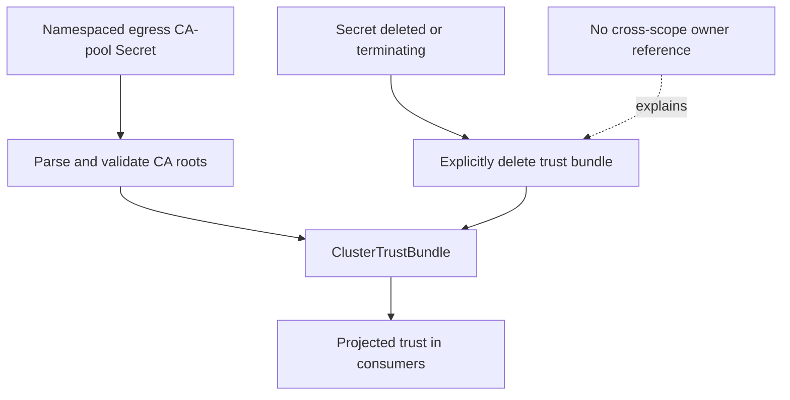

The manager's restricted Secret cache and the controller's exact watch predicate keep this loop focused on its configured source. A trust-bundle edit triggers reconciliation so owned fields can be restored. As with worker configuration, a successful apply is a declaration of desired state; downstream projection and process reload have their own timing. Certificate rotation analysis must include those later steps rather than declaring rotation complete when the controller's API call succeeds.

Two important controllers live outside this binary. `ActorTemplateReconciler` in ateapi drives golden snapshot construction from PostgreSQL ActorTemplate records. It uses a periodic list as its event source, a typed rate-limiting workqueue, and per-template SQL leases. `WorkerAssignmentReconciler` consumes worker-cache changes and repairs assignments after process epochs advance. Both use controller techniques familiar from Kubernetes, but neither is a controller-runtime reconcile of a CRD.

Golden construction is particularly useful for comparing the systems. The temporary golden actor is named using the template UID and lives in the template's atespace. A template recreated under the same name gets a different temporary actor identity. The reconciler checks for an already completed tag before recreating work, allowing recovery after a crash during cleanup or status persistence. A conflicting tag or egress policy produces a terminal error instead of silently adopting content belonging to another template.

The controller observes the golden actor's current state and takes the next required action. A suspended actor without a completed checkpoint is resumed. A running actor waits until its recorded snapshot deadline. If the process died after resume but before recording the deadline, the reconciler restarts the warmup clock because elapsed warmup is unknowable. A SUSPENDING actor re-enters suspend. A completed durable snapshot can be tagged even if the earlier pass failed before recording that progress in template status.

Golden suspend explicitly requests synchronous durability and verifies that a completed external snapshot exists. The controller creates a published tag, deletes the temporary actor, and only then records the golden tag as terminal success. This ordering means a retry can rediscover the durable tag if actor deletion or the final status write failed. It also avoids declaring success while leaving an untracked temporary actor consuming resources. The exact snapshot-copy and retention mechanics belong to Chapter 8; the reconciliation pattern is level-triggered observation of durable facts.

A crashed golden actor or an unexpected deleting/reverting state can produce a terminal error with a bounded message. Invalid template input is not retried forever. Temporary transport or lifecycle errors go back through the queue. The distinction between terminal specification failure and retryable infrastructure failure appears in both the Kubernetes worker synchronizer and this SQL-backed controller, even though their object stores and event sources differ.

The shared client-go workqueue supplies per-key processing and rate limiting. Its dirty and processing sets avoid concurrently processing the same key within one queue while ensuring a change observed during processing can cause another pass. The default typed controller limiter combines exponential per-item delay with an overall token bucket. These are in-process coordination tools; SQL leases or Kubernetes optimistic concurrency still protect work across replicas. A queue's single-key behavior cannot be used as evidence that only one process in the cluster is reconciling a resource.

## 4.6 Roadmap and engineering improvements

The Deployment builder contains an explicit TODO about hardcoded sandbox-class Pod requirements. Today microVM device access and placement are selected by branching on the class. A future generic mechanism could allow a sandbox class to declare devices, mounts, and placement requirements. That change would affect the administrative trust boundary: admitting a new runtime description could become equivalent to granting host device and filesystem access. Any declarative extension would need validation and authority constraints at least as explicit as the current compiled builder.

The same source identifies tailored AppArmor profiles as future work. Both classes currently request Unconfined because nested runtime mounts and root changes conflict with the default profile. A replacement profile must be derived from the actual worker and runtime operations and tested across the supported distributions and architectures. Tightening the profile without exercising checkpoint, restore, cleanup, and CSI paths can produce a worker that boots successfully but fails during a later lifecycle transition. The target is a verified boundary, not a more reassuring YAML value.

Worker autoscaling remains an architectural area for further work. WorkerPool reconciliation faithfully applies a replica count, but that is not an actor-demand-driven autoscaler. A future controller needs to interpret ready registered capacity, runtime-version compatibility, actor resource shapes, parked demand, and local snapshot retention. It also needs a scale-down protocol that stops new assignments and accounts for active actors before deleting capacity. The existing DRAINING path and Pod ownership chain provide building blocks, not a complete policy.

There are opportunities to improve observation without changing those semantics. WorkerPool desired and ready counts should be presented beside Substrate's eligible capacity, registration state, and runtime availability. A pool can have ready Pods while no worker can restore a particular snapshot. A config can be unresolved while an older confirmed config remains in service. Dashboards that flatten those states into one green or red condition make troubleshooting harder and can encourage unnecessary disruptive rollouts.

The cross-API worker synchronizer merits targeted failure testing. Useful cases include a Pod name reused before an old queue key runs, a controller outage spanning Pod deletion, a missing pool with garbage collection still in progress, a cut owner chain, and a version conflict between availability and label updates. These tests should assert both the surviving Kubernetes object and the Substrate registry result. Observing only that the queue eventually drains can miss deletion of the wrong incarnation or a leaked Worker record.

SandboxConfig protection should retain a race-oriented test matrix as it evolves. The important interleavings place deletion and finalizer removal before and after the pending status write and live confirmation. Cache lag should be simulated explicitly because the safety proof relies on using a live list for a negative-use decision and a live read after adoption intent. Replacing those reads with cached clients for apparent efficiency would change the proof, not merely the performance profile.

Controller placement is another repository-backed discussion. Assignment recovery currently runs on every API replica, and template reconciliation has a sharding TODO. Moving those loops into a separate deployment could give their concurrency and resource use independent control, but it must preserve startup repair, per-resource serialization, and access to internal lifecycle methods. The current in-process golden controller invokes a narrow Control interface directly; separating it would turn that call into an authenticated network boundary with corresponding availability and compatibility concerns.

A final proposal is to make generated-infrastructure changes easier to review as behavioral changes. Tests can compare selected semantic properties of the desired Pod, such as required identities, device grants, mount propagation, and stable preview ordering, without snapshotting every incidental field. Review descriptions should identify which host boundary a changed field enables and which lifecycle operation depends on it. This keeps controller code connected to runtime consequences and prevents a small template edit from being treated as harmless solely because it contains no direct syscall.

## Source map

- [Controller entry point](../cmd/atecontroller/main.go): manager setup, registered controllers, independent informer startup, and cache scope.
- [WorkerPool reconciliation](../cmd/atecontroller/internal/controllers/workerpool_controller.go): Deployment application, config adoption ordering, status, and events.
- [Worker Pod builder](../cmd/atecontroller/internal/controllers/workerpool_apply.go): identities, resources, devices, capabilities, mounts, and rollout behavior.
- [Config resolution](../cmd/atecontroller/internal/controllers/workerpool_sandboxconfig.go) and [protection controller](../cmd/atecontroller/internal/controllers/sandboxconfig_protection_controller.go): current/pending references and deletion-race safety.
- [Worker synchronizer](../cmd/atecontroller/internal/workersync/syncer.go) and [Pod informer](../cmd/atecontroller/internal/workersync/informer.go): registry projection, Pod incarnations, drain, orphan handling, and startup repair.
- [NetworkPolicy controller](../cmd/atecontroller/internal/controllers/networkpolicy_controller.go) and [MITM trust controller](../cmd/atecontroller/internal/controllers/egressmitmtrust_controller.go): policy ownership and cross-scope trust cleanup.
- [Golden-template controller](../cmd/ateapi/internal/controlapi/template_reconciler.go): the SQL-backed reconciliation loop that runs inside ateapi.


# 5. Node Supervision and Shared Worker Machinery

## 5.1 The node supervisor is an execution boundary

The control plane assigns an actor to physical capacity, but it does not construct the actor's execution environment. That work crosses a second boundary: `atelet` prepares node-local resources and asks a worker to perform a runtime operation. The distinction is visible in the two internal protocols, [atelet.proto](../internal/proto/ateletpb/atelet.proto) and [ateworker.proto](../internal/proto/ateworkerpb/ateworker.proto). The first describes operations on a node. The second describes operations supported by an already running worker process. Neither protocol is CRI. Substrate is deliberately operating beneath the lifetime of a Kubernetes workload object while continuing to use pods as its physical allocation units.

`Atelet` in [cmd/atelet/main.go](../cmd/atelet/main.go) contains a worker dialer, an OCI image cache, a runtime asset cache, a snapshot cache, a runtime index, volume plugins, an actor-lock collection, and a snapshot tracker. These fields describe the supervisor's obligations more accurately than the label “node agent.” It must ensure that the worker sees a coherent set of files, that a runtime request names an advertised runtime, that lifecycle operations do not interfere within an actor's directories, and that storage work remains attributable to the correct actor. It does not implement the Sentry or the VMM. It also does not directly hold the object-store credentials used to move external snapshots.

The worker interface carries concrete resource paths rather than making the worker discover atelet's directory layout. `ActorDirs` is part of the protobuf boundary. The runtime receives locations for bundles, checkpoint data, restore data, and volume trees, together with the workload specification and runtime asset paths. Shared path conventions that genuinely belong on both sides live under [internal/nodepath](../internal/nodepath). The repository's contributor contract explicitly keeps atelet and worker implementations opaque to one another outside the protocol and these common paths. That constraint is valuable even before version skew is guaranteed: it makes an accidental dependency on a particular runtime's private directory structure easier to identify.

The lifecycle of the pod remains separate from that of its hosted actors. A worker process can execute several actors concurrently, and an actor's suspension does not require the worker pod to terminate. The Kubernetes scheduler has already paid the cost of assigning the pod to a node; kubelet and the pod runtime have already established its outer namespaces, resource limit, mounts, and identity. Within that allocation, Substrate creates additional actor-specific execution environments. Density therefore depends on both the control-plane admission calculation and the implementation's ability to reclaim one actor without disrupting another.

```mermaid
flowchart TB
    API[ateapi] --> A[atelet]
    A --> Prep["Images, assets, volumes"]
    Prep --> W["Worker RPC + ActorDirs"]
    W --> Actors["Actor sandboxes"]
    Actors --> T[atunnel]
    A --> P["Object-store plugin"]
    P --> O[Object storage]
    K["Pod allocation"] -. bounds .-> W
```

The deployment in [atelet.yaml](../manifests/ate-install/atelet.yaml) is consequently part of the implementation, not merely packaging. It gives atelet access to the node paths it prepares, the local plugin socket, the kubelet device-plugin directory, and projected credentials. It also mounts the node's device directory for detection. That mount does not grant atelet arbitrary device access: device visibility and device-controller permission are separate properties. The distinction reappears when the supervisor advertises KVM to kubelet.

Atelet's own privilege requirements differ from the workers'. The image-cache store can pull and unpack files without mounting them. The workers perform overlay and namespace mounts in their own mount namespaces. Separating those activities avoids requiring atelet to adopt the full capability set of every sandbox backend. It also means that observing atelet's mount table cannot establish which image layers are in use by workers. The cache's garbage collector needs an explicit, shared representation of references, which the bundle specifications provide.

The `Run` method shows the ordering discipline. It validates the request and resolves its runtime through `advertisedRuntime` before beginning local lifecycle work. It then acquires the actor lock and enters the snapshot tracker's start operation. Runtime assets are fetched into a staging directory before existing actor directories are reset. A failed download should not destroy a live activation merely because a new request arrived. Only after reset does the method commit the staged asset set and record the runtime describing it. The resulting invariant is that the record and the installed paths advance together through an intentional transition.

This is a useful distinction between idempotence and harmless repetition. Calling `Run` twice is not equivalent to checking whether a process exists. The request may need to replace partially prepared state, and some state, especially external volume publication, must survive retries. `ResetActorDirsKeepingVolumes` leaves external volume mountpoints in place because an earlier attempt may have published a volume successfully. Repeating publication can then be a no-op at the driver boundary. Blindly deleting the entire actor tree would turn a retry into data destruction or invalidate a still-mounted path.

The actor lock in `Atelet` is local serialization, implemented through [internal/actorlock](../internal/actorlock). It answers a narrower question than the renewable SQL lease described in Chapter 3: may two goroutines in this atelet manipulate this actor's node-local state at once? The lock cannot prove that another node is not acting on stale control-plane state. Conversely, a database lease cannot make two local filesystem operations atomic. Both mechanisms are required because they protect different resources and have different failure domains.

After assets and volumes are ready, `prepareOCIBundles` creates the application bundles. The worker workload specification includes the actor identity, template attribution, resource requirements, and egress gateway configuration. `RunWorkload` is the point at which the supervisor hands execution responsibility to the selected backend. The response includes the worker epoch, linking this successful local operation to the particular worker process incarnation. The returned value is not merely an address: it is evidence about which process accepted the operation.

Consider an illustrative activation interrupted after volume publication but before `RunWorkload`. The actor lock is released when the failed call returns, but the volume may remain published. A retry resolves the runtime again, reconstructs the bundles, and republishes the same volume through the existing interface. The preserved mountpoint prevents the retry from erasing published contents. If the interruption occurs after a sandbox starts but before the response reaches atelet, the worker's actor-specific replacement and teardown paths become relevant. Correctness requires each layer to tolerate uncertainty at its own boundary; no single “retry” switch solves the entire sequence.

Node supervision also includes shutdown. The main process uses signal-aware contexts and readiness handling so that service withdrawal and completion of existing operations can be coordinated. Checkpoint work has a separate bounded lifetime once it detaches from the caller's cancellation. In the audited code, `defaultCheckpointTimeout` is five minutes. That value bounds a stuck worker or storage operation holding the actor lock; it is not a latency objective for a healthy checkpoint. Treating timeout values as performance expectations would obscure exactly the failures they are intended to contain.

The ordering also limits the damage of invalid input. Resolving the requested runtime before resetting directories keeps a stale or unsupported runtime name from destroying reusable local state. Staging assets before publication keeps a partial download from masquerading as an installed runtime. Recording the installed asset set lets later operations identify the concrete binaries used for that activation. These checks move inexpensive validation ahead of mutation and give recovery a stable description of completed preparation. The same pattern should govern future node-local resources added to `ActorDirs`: validate authority and compatibility, stage incomplete work separately, then publish only the paths the worker may consume.

## 5.2 Registration, epochs, and runtime advertisement

A worker's pod identity is necessary but insufficient for scheduling. The control plane also needs to know that a particular worker process has initialized, what capacity it offers, and which sandbox runtimes it can restore. [internal/ateworker/register/register.go](../internal/ateworker/register/register.go) implements this shared registration machinery. `Epoch` represents the process incarnation admitted by the control plane. `Report` coordinates registration and runtime reporting. `ReportConfig` provides the class, runtime metadata location, reserved memory, and other information that makes the protocol backend-independent.

The registration flow passes through atelet's `workerSupportServer` in [workersupport.go](../cmd/atelet/workersupport.go). That service derives the worker identity from its mTLS certificate rather than accepting a worker name from the request. `AcquireWorkerEpoch` forwards a request for the caller's own worker record. `RegisterWorker` forwards the same identity together with the acquired epoch, pod IPs, and capacity. The control plane can therefore reject stale process reports without trusting a self-selected identifier supplied by an arbitrary client.

The same-node check is more specific than comparing a hostname string. `verifyClientOnSameNode` checks both the node name and node UID carried in the pod certificate. Kubernetes can reuse a node name after deletion; a node incarnation identifier prevents a worker certificate from an earlier object from satisfying the comparison solely because its name matches. This check belongs at the connection boundary because all the worker-support RPCs rely on the resulting identity. Individual methods still validate their requests after authentication before forwarding them.

```mermaid
sequenceDiagram
    participant W as Worker process
    participant A as atelet WorkerSupport
    participant C as ateapi WorkerService
    participant F as Runtime metadata file
    W->>A: AcquireWorkerEpoch over mTLS
    A->>A: Derive pod and node identity
    A->>C: Acquire epoch for authenticated pod UID
    C-->>W: New epoch through atelet
    W->>W: Read capacity files and reserve overhead
    W->>A: RegisterWorker(epoch, IPs, capacity)
    A->>C: Register authenticated worker incarnation
    C-->>W: Registration accepted
    W->>F: Read advertised sandbox runtimes
    W->>A: SetWorkerSandboxRuntimes(epoch, runtimes)
    A->>C: Update runtime compatibility advertisement
```

`FromFiles` reads worker resource limits from the downward-API directory defined by [internal/workercapacity](../internal/workercapacity). Memory capacity is reduced by the amount reserved for the worker itself. If a finite pod memory limit is no greater than that reservation, startup fails instead of advertising a negative or fictitious actor capacity. CPU and actor-slot capacity are separate fields. The distinction matters because an apparently empty worker can be constrained by any one of these dimensions.

The reported capacity is not a live estimate of free pages. It is the capacity from which the placement system accounts for actor bookings. Actual usage can differ from bookings due to page cache, sandbox overhead, guest behavior, and delayed writeback. Runtime-specific memory guards and snapshot borrowing address some of those differences, but they do not redefine the registration contract. The worker reads capacity at startup; the source explicitly does not claim support for updating that capacity through in-place pod vertical scaling. An operator changing pod limits must not assume that all internal accounting immediately follows a changed cgroup file.

Runtime advertisement has its own asynchronous path. `workerSandboxSyncer` in [worker_sandbox_syncer.go](../cmd/atelet/worker_sandbox_syncer.go) watches local pods, WorkerPools, and SandboxConfigs through client-go informers. It resolves the configurations applicable to a worker and writes the runtime metadata that the worker reports. This is a reconciliation loop, but it is not implemented as a controller-runtime `Reconcile` method. Understanding the event source, queue, and retry behavior is more useful than forcing every repository controller into one framework vocabulary.

The syncer must handle two kinds of lag. Kubernetes object caches may not yet reflect a new WorkerPool or SandboxConfig. Separately, the runtime assets needed to validate and prewarm a version may not yet be local. Scheduling a version before the worker can use it would move an administrative update into the activation failure path. The runtime index and prewarming machinery therefore connect declared configurations to concrete assets before the worker's capability report can be treated as useful execution capacity.

`runtimePrewarmer` in [runtime_prewarm.go](../cmd/atelet/runtime_prewarm.go) stages default runtime assets under worker-owned paths. Those paths retain references into the shared asset cache even when no actor is currently using that runtime. An empty but ready worker can consequently keep its default runtime warm. This is an explicit memory-and-disk retention decision: prewarming reduces activation work, while its references make the corresponding cache entries ineligible for eviction. “Unused by actors” and “safe to evict” are not equivalent.

Compatibility metadata should be read as a restore constraint. A runtime name is an administrative label; a compatibility version captures the properties relevant to reusing memory state. `worker_sandbox_versions.go` includes runtime probing, including `runsc cpu-features`, and conversion into advertised attributes. A snapshot made with one runtime cannot be assumed to restore merely because a newer executable carries the same backend name. The control plane's compatibility selection and atelet's runtime resolution need to agree on the runtime whose assets will actually be staged.

The metadata file is watched through [register/watch.go](../internal/ateworker/register/watch.go). It watches the parent directory rather than only the current inode, because configuration publication can replace a file by rename. An inode-specific watch would otherwise continue observing an obsolete object. Events are coalesced into a buffered signal channel: they mean “reread current state,” not “apply this event as a state transition.” Queue overflow also triggers a reread. This design treats the file as authoritative and notifications as hints, matching the same pattern that makes informer resynchronization useful.

When fsnotify cannot establish a watch, the helper logs the failure and falls back to periodic signals. In the audited implementation the polling interval is five seconds. The fallback keeps a resource shortage, such as exhausted inotify instances, from permanently freezing runtime advertisement. It also changes convergence time, which should be visible in operational diagnosis. A worker whose metadata is correct on disk but whose advertised runtime is stale may be experiencing notification or registration convergence rather than an asset-download problem.

Epochs and runtime reports also separate failure cases that look similar from outside. If a worker process restarts in the same pod, its pod UID does not change, but its epoch must. If a SandboxConfig changes while the process remains alive, its epoch need not change, while its offered runtime set can. If the node is replaced with a new node UID, the connection's node-identity check changes. Treating all three as “worker changed” loses the information required to reject stale assignments without discarding valid capacity unnecessarily.

For a concrete review, follow one field through all three layers. The pod's IP list is parsed by `ParsePodIPs`, sent during registration, forwarded under certificate-derived worker identity, and stored by the control plane. The worker cannot select another worker's record by changing that list. Nevertheless, the list itself is data that the service validates, and its usefulness depends on the network being ready. A successful authenticated registration is therefore one prerequisite for routing, not a replacement for sandbox activation and wakeup-probe success.

## 5.3 Admission and resource enforcement inside a worker

The placement transaction in Chapter 3 establishes an authoritative actor assignment. The worker still maintains local hosted-actor state. [gVisor hosted.go](../cmd/ateworker-gvisor/hosted.go) and [microVM hosted.go](../cmd/ateworker-microvm/hosted.go) implement `admitActor`, `hostActor`, and `unhostActor`. These methods protect actor-slot capacity during execution and teardown. The local map is not a second independent scheduler; it is the runtime's record of resources that have been claimed or are still draining.

`admitActor` takes the actor map lock before creating networking. If the actor already exists, the old activation is canceled and its network is returned for explicit cleanup. If it is a new actor, the method checks hosted actors plus draining actors against the maximum. Reserving before setup avoids a race in which several requests all observe a free slot and then each build namespaces and processes. Retaining a draining count prevents the reverse race: a slot cannot become available merely because an actor was removed from the lookup map while its resources remain in teardown.

The hosted actor object carries activation attribution and cancellation. In the gVisor implementation, it also carries a pinned sandbox-process reference and a `MemoryGuard`. `stopping` distinguishes a process exit caused by an intentional lifecycle action from an unexpected crash. That distinction affects reporting. A checkpoint that deliberately terminates the Sentry should not race a process watcher into reporting the actor as crashed. State must be marked before triggering the exit, not reconstructed afterward from an exit status that cannot encode intent.

Resource enforcement begins by preparing the pod's cgroup subtree. [cgroup.Delegate](../internal/ateworker/cgroup/cgroup.go) requires a private cgroup namespace whose visible root corresponds to the pod's own scope. It reads `/proc/self/cgroup` and refuses to proceed if the path is not the expected namespace root. This check prevents an implementation intended to organize one pod's descendants from attempting to reorganize the host cgroup hierarchy. Privileged pods can expose a different cgroup namespace arrangement, which is one reason that “more privilege” is not automatically compatible with this worker design.

The worker moves its own processes into a `worker` leaf and enables the controllers delegated by its parent. The no-internal-process rule then permits actor leaves beneath the scope. If the cgroup mount was presented read-only, the worker bind-remounts its own view writable. The operation relies on the capabilities deliberately granted to the worker pod. Controller availability is still determined by the parent and kernel configuration; enabling one unavailable controller does not justify treating all others as absent.

```mermaid
flowchart TB
    P[Worker pod cgroup: memory.max and CPU budget]
    P --> W[worker leaf: supervisor and tunnel]
    P --> A[Actor A leaf]
    P --> B[Actor B leaf]
    P --> C[Temporary checkpoint leaf]
    A --> AP[Actor host processes]
    B --> BP[Actor host processes]
    A -. gVisor checkpoint moves sentry .-> C
    L[Memory borrowing ledger] -. bounds writeback loans .-> C
    L -. delays conflicting activations .-> B
```

For microVMs, `OpenActorLeaf` creates a cgroup for the VMM and virtiofsd. `cpu.max` derives from the actor's millicore limit; the period is fixed and the quota is bounded to the kernel's minimum accepted value. The opened cgroup descriptor is passed through `syscall.SysProcAttr{UseCgroupFD: true, CgroupFD: ...}` so that children start in the leaf. The important property is atomic placement at process creation. Starting outside the leaf and moving afterward would leave a period in which memory and CPU work are charged to the wrong scope.

The gVisor backend applies cgroup settings through its shaped OCI specification and runsc, then adjusts memory handling around runtime creation and checkpoint. Its host resource usage is principally the Sentry backing the actor. A container's cgroup inside the Sentry's model is not automatically equivalent to a host process cgroup for that container. Chapter 6 examines that consequence for per-container limits and usage attribution. Shared machinery should expose these differences instead of pretending both backends have identical accounting inputs.

Memory isolation requires more care than setting a hard limit on each leaf. The implementation uses `memory.high` with a userspace `MemoryGuard` when cgroup PSI is available. The kernel applies reclaim and allocation throttling at `memory.high` rather than directly invoking the OOM killer there. The guard observes whether an actor remains stuck near its booking and can terminate that actor's cgroup deliberately. This reduces the chance that the pod-wide hard limit turns one actor's allocation burst into a worker restart affecting all hosted actors.

`MemoryWatch.Check` in [memwatch.go](../internal/ateworker/cgroup/memwatch.go) reads `memory.current`, a breakdown from `memory.stat`, `memory.pressure`, and `memory.events.local`. It uses the `some` PSI total because another runnable thread can hide an allocation stall from a `full` measure. It also requires evidence that this cgroup has encountered its own `memory.high`, avoiding attribution of node-wide reclaim pressure to an actor that has not exceeded its local threshold. This is a causal check, not merely a comparison between one byte counter and one limit.

The current algorithm keeps a short observation window. It can act when non-page-cache usage substantially overshoots the booking, or when usage remains near the limit and a sufficient part of the observed interval is spent stalled. The exact constants in the source, including the two-second window and one-second minimum observation, are implementation choices rather than a universal resource-control theorem. They should be evaluated against workloads with different allocation parallelism and reclaim behavior. The useful invariant is that the guard considers both inability to make progress and the resource boundary being enforced.

Page cache is handled separately because snapshot writes can temporarily make a healthy actor look memory-heavy. Dirty pages cannot be dropped until writeback completes. Counting those pages as unreclaimable application growth would punish an actor for Substrate's own persistence work. Conversely, ignoring them at the pod level would be unsafe because they still consume memory. The combination of memory-stat interpretation, checkpoint-specific accounting, and borrowing addresses this tension. No single RSS value captures the worker's true transient cost.

[memborrow.Ledger](../internal/ateworker/memborrow/memborrow.go) lends snapshot writers memory that is both unbooked and currently free in the pod, leaving an explicit margin. Its loan is bounded by the requested amount, unbooked capacity minus outstanding loans, and the difference between the pod hard limit and current usage. The borrower returns the amount when the associated pages have been written back. New hosted actors wait if their bookings would overlap an outstanding loan. The ledger therefore ties accounting to writeback completion instead of assuming that returning from a snapshot RPC releases dirty memory immediately.

This is a second form of multiplexing. Actors multiplex execution capacity over time, while checkpoint writes temporarily borrow spare memory from actors that have not yet been admitted. The protocol only works if loan return is attached to the actual lifetime of dirty cache. Returning early makes the admission calculation optimistic; failing to return makes capacity appear unavailable indefinitely. Reviewing the asynchronous completion callback is consequently as important as reviewing `Take` itself.

When PSI is unavailable, the runtime logs the weaker behavior and uses its fallback. Actor-local memory enforcement therefore does not provide identical failure isolation on every kernel. Likewise, `cgroup.kill` support and delegated controllers are environmental requirements that influence cleanup. The kernel audit in the appendix distinguishes features the code probes from features a configured backend requires. Operators should use the startup and phase logs to determine which branch is active on their nodes.

An illustrative resource-pressure sequence makes the distinction between booking and consumption concrete. Two actors may each reserve enough memory for their ordinary working sets while consuming less at the instant a checkpoint begins. The checkpointing actor then creates filesystem page cache while writing its state. That cache belongs to a real cgroup and consumes the pod's finite memory even if the application heap did not grow. Charging it as permanent actor demand would overstate the actor's stable requirement; ignoring it would expose the pod to an out-of-memory event. The borrowing ledger exists to make this temporary phase visible and bounded.

The ledger has to consider two limits simultaneously. Unbooked capacity says how much memory has not already been promised to actors. Actual pod headroom says how much additional charge can currently fit below the parent limit. Neither alone is sufficient. A lightly consuming pod can have nearly all capacity booked, so lending all observed free memory would compete with legitimate future growth. A lightly booked pod can already contain substantial page cache or runtime overhead, so lending all unbooked capacity could exceed its physical allowance. `memborrow.Ledger` takes the minimum and retains safety headroom.

Returning a loan before the kernel releases its writeback charge would create fictitious capacity. Another checkpoint could borrow the same bytes while the first still occupies them. The runtime therefore couples the return to its writeback and cache-release sequence, not merely to the end of a Go function that initiated I/O. This is a distributed accounting problem within one kernel: the ledger tracks promises, cgroup files expose charges, and filesystem writeback determines when the temporary cost actually ends.

New actor placement can wait behind outstanding loans because admitting another long-lived workload during that transient interval could invalidate the headroom calculation. This does not make the worker a general preemptive scheduler. It is a local admission barrier around an identified source of temporary memory growth. The control plane still owns assignment, and the runtime still owns the concrete sandbox. Separating these roles prevents a local optimization from silently becoming a second authority over actor placement.

## 5.4 OCI images and sandbox assets are different caches

Two node-local caches appear on the activation path before any snapshot bytes are considered. The OCI image cache holds unpacked application-image layers. The sandbox asset cache holds executable and boot artifacts such as runsc, Cloud Hypervisor, virtiofsd, the Kata kernel, and its guest image. They share a desire to avoid repeated downloads but have different keys, publication rules, consumers, and retention roots. Conflating them under “image cache” hides both correctness and performance questions.

[internal/imagecache](../internal/imagecache) stores content-addressed unpacked layers and manifest records. `Store.EnsureImage` resolves mutable tags to immutable digests before caching. A tag cannot safely be the permanent content key because its registry binding can change. Digest references avoid that resolution step when the necessary local records and layers are already present. A manifest record identifies the ordered layer diffIDs and image configuration; multiple image manifests can share a layer tree without extracting another copy.

The cache distinguishes the compressed blob digest from the uncompressed diffID. The manifest authenticates the downloaded blob, while the configuration describes the expected uncompressed layer. The implementation hashes the uncompressed stream during extraction and consumes the download through EOF so the underlying registry library can finish its own digest validation. Publishing a layer before both checks complete would permit one image to seed shared content that another image later trusts. Singleflight keys include the relevant blob and diffID identities so an invalid mapping in one pull does not contaminate another flight merely because the claimed diffID matches.

Extraction is streamed. That property bounds memory use by working buffers rather than the size of a flattened image. Completed layers are published independently, so an interrupted pull can retain useful progress. Temporary directories are renamed into the content-addressed tree only after successful extraction and verification. The atomic publication boundary prevents another actor from observing a partially unpacked layer simply because its destination directory already exists.

The extraction code in [unpack.go](../internal/imagecache/unpack.go) also has to preserve Linux filesystem semantics that matter to arbitrary agent images. Numeric ownership, permission modes, setuid/setgid/sticky bits, symlinks, hardlinks, and implied parent directories all affect behavior. Path confinement is enforced through `os.Root`-based operations rather than by trusting archive names. Device nodes are not created by atelet. Overlay whiteouts are recorded for the worker-side consumer to materialize, matching the capability split between store and mount operations.

At bundle preparation, atelet writes an `OverlaySpec` describing the layers and required extra directories. [bundle_linux.go](../internal/imagecache/bundle_linux.go) is the worker-side consumer. It finalizes recorded whiteouts using `mknodat` and opaque-directory xattrs, then mounts the overlay in the worker's mount namespace. The new mount API uses `fsopen`, repeated `fsconfig` operations, `fsmount`, and `move_mount`. Repeated `lowerdir+` configuration avoids packing an arbitrarily deep digest-derived path list into the legacy `mount` option string. The documented kernel requirement for this mechanism is a real compatibility boundary, not an incidental optimization.

An image may list the same layer more than once. OverlayFS cannot simply receive duplicate lower directories, so composition collapses duplicates to the topmost occurrence. The layer order still determines the visible filesystem. A cache is not correct merely because every input tree exists; it must produce the same merge semantics as applying the image's layers in order. This is why the bundle specification and composition algorithm deserve attention alongside registry download code.

Implicit directory metadata is another subtle case. A layer can contain a file below a directory whose explicit metadata exists only in a lower layer. Extraction must create a parent directory to write the file, but a fabricated root-owned `0755` parent must not accidentally override a lower layer's `/tmp` sticky bit or private `/root` mode. [implicitdirs.go](../internal/imagecache/implicitdirs.go) tracks these cases and repairs the composed view through the actor's private upper. The shared layer pool is not rewritten to fit one image's particular layer chain. Directory timestamps and extended attributes have documented residual limits; exact image fidelity should be stated at the level the code provides.

```mermaid
flowchart TB
    Registry[OCI registry] -->|digest-verified streams| Layers[Shared unpacked layers]
    Manifest[Image manifest and config] --> Spec[Per-actor OverlaySpec]
    Layers --> Mount[Worker overlay composition]
    Spec --> Mount
    Mount --> Root[Actor-specific rootfs view]
    Assets[SandboxConfig assets] --> Verify[Plugin fetch and hash verification]
    Verify --> Cache[Shared immutable asset cache]
    Cache -->|hard links| Worker[Worker default-runtime directory]
    Cache -->|hard links| Actor[Actor runtime directory]
```

Garbage collection cannot inspect only the cache's own files. Atelet cannot see overlay mounts in worker mount namespaces, so [gc.go](../internal/imagecache/gc.go) derives its root set from per-actor bundle specifications. Those specifications are written before asking a worker to mount and removed after teardown. Image records and layer references then define which content is reachable. If a directory or record cannot be enumerated reliably, the pass retains content rather than guessing from a partial root set.

The collector also accounts for in-flight pulls and freshness. Cache-hit and final eviction checks synchronize so that a recently used image is not retired between checking its presence and handing it to a consumer. A layer is retired through its image records, not by an independent sweep that could remove shared content while a record still describes it. When a record cannot safely release all its associated layers, the record is restored. This relationship keeps the persistent cache understandable after failures rather than leaving unexplained orphan content as normal operation.

[cmd/atelet/imagegc.go](../cmd/atelet/imagegc.go) measures filesystem pressure with `statfs` and combines volume thresholds with a cache-size budget. The reclaim target is capped by the cache's own size because the cache may share a volume with unrelated data. Even with that cap, foreign disk pressure can repeatedly evict all eligible cache entries without solving the volume's shortage. An operator must distinguish “cache exceeds its budget” from “another tenant filled the disk.” The dry-run path is useful for understanding the policy's decisions before changing retention in a production fleet.

Sandbox assets follow a simpler content model but a more security-sensitive supply chain. A `SandboxConfig` names an asset URL and SHA-256. Atelet first asks `AssetProvider` in the object-store sidecar to fetch it. The plugin stages bytes where atelet cannot read them and only releases verified contents. Atelet verifies the digest again before use. Anonymous GCS fallback exists for eligible public `gs://` artifacts; it does not give atelet ambient snapshot credentials. Chapter 8 explains why the plugin refuses asset URLs under snapshot locations.

The generic [filecache.Store](../cmd/atelet/internal/filecache/getfileto.go) publishes immutable files or trees and serves consumers with hard links. A file consumer keeps a valid inode even if the cache later removes its own directory entry. Link counts therefore become retention evidence. Fetches are singleflight by key, detached from individual callers but bounded by a fetch timeout. One canceled actor must not abort a shared runtime download still needed by several other actors. Failed fetches are not negatively cached, allowing a later retry to recover after a transient registry or storage failure.

Hard links impose a concrete filesystem constraint. The destination must be on the same mounted filesystem as the cache; being on the same physical disk is insufficient. The cache reports `EXDEV` rather than silently changing an immutable shared-file contract into a copy contract. Some higher-level consumers choose explicit copy behavior where needed, but that choice belongs to the caller. The distinction becomes especially important for writable microVM restore staging in Chapter 8.

Read-only file mode protects ordinary consumers from accidental writes to shared bytes, but it is not a complete adversarial boundary against a sufficiently privileged process. The worker's capabilities and mounted paths still determine what a compromised runtime could modify. For production reasoning, distinguish immutable-by-contract, read-only mounts, and cryptographic revalidation. Each protects a different stage of the asset lifetime, and a cache hit may intentionally avoid repeating an expensive whole-file hash.

## 5.5 Process lifetime, filesystem lifetime, and hardware devices

The binary starts through `RunIfPID1`, which turns the PID 1 invocation into a small init shim and re-executes the real worker as its child. [internal/ateworker/pid1/pid1.go](../internal/ateworker/pid1/pid1.go) keeps orphan reaping separate from the worker's ordinary `os/exec` waits. A `wait4(-1)` loop inside the real worker could otherwise consume the exit status of a child that `os/exec` was waiting for. The shim forwards selected signals, reaps adopted descendants, and exits with the real worker's status. It also calls `PR_SET_CHILD_SUBREAPER`, which is redundant at PID 1 but allows the same supervision behavior in tests outside that position. Without reaping, repeated actor activations could accumulate zombies; without signal forwarding, the worker would not receive the shutdown sequence expected by its backend.

The code does not use one context lifetime for every child. A command such as a bounded runsc operation can follow the request context. A newly launched Cloud Hypervisor process must outlive the request that booted it. `LaunchVMM` therefore starts it without `exec.CommandContext`, while readiness waits still honor the request's context and failure cleanup explicitly stops the child. This separation avoids a common error: canceling an HTTP or gRPC request must not automatically kill a successfully admitted long-lived actor.

Stable process identity is equally important. Linux can recycle a PID after exit. A goroutine that stores only a numeric PID and later signals or probes it risks acting on a different process. [internal/pidfd](../internal/pidfd/pidfd.go) uses `pidfd_open`, descriptor duplication, nonblocking behavior, and polling to observe exit through a stable kernel reference. The gVisor `sandboxProcess` in [sandboxexit.go](../cmd/ateworker-gvisor/sandboxexit.go) pins the Sentry and uses `pidfd_send_signal` probing where appropriate. Closing a stale activation's handle is part of replacement, not an optional housekeeping detail.

Filesystem references have a similar distinction between names and live objects. Unlinking a path does not destroy an inode held open, and lazily unmounting a filesystem detaches its name while references can remain. That behavior is useful during teardown but dangerous when followed by recursive deletion through the wrong mount. The image and Kata cleanup code inspects mount topology and detaches mounts before removing actor directories. Cleanup must fail visibly if it cannot establish that removing a directory will not traverse a still-mounted source.

[actordirs.go](../cmd/atelet/internal/actordirs/actordirs.go) makes this caution explicit for external volumes. `removeEmptyVolumeDirs` uses removal of empty mountpoint directories rather than `RemoveAll`. If unpublication failed and the target remains populated, cleanup stops. The symptom may be a leaked directory or an unavailable actor slot; the alternative could be deleting user data through a volume mount. A production operator should recognize the retained path as evidence of a failed safety precondition, not immediately “repair” it with recursive deletion.

The same code distinguishes reset from removal. A reset leaves the actor's roots ready for another activation and can preserve volume mountpoints. Final removal deletes actor state only after the relevant tracker state has been forgotten and volumes are safe. Runsc logs are intentionally left alone by the ordinary reset path. These choices determine what evidence survives a failed activation and which resources must be rediscovered after an atelet restart.

Hardware advertisement is another shared responsibility. [cmd/atelet/deviceplugin.go](../cmd/atelet/deviceplugin.go) starts a device plugin for supported host devices found under the read-only detection root. [internal/deviceplugin/deviceplugin.go](../internal/deviceplugin/deviceplugin.go) currently defines the KVM resource `ate.dev/kvm`. The plugin registers with kubelet through its Unix socket and returns a `DeviceSpec` granting read/write access to `/dev/kvm`. Kubelet translates that request into both device exposure and the matching device-access permission for the container runtime.

HostPath alone is insufficient for KVM. Mounting `/dev/kvm` gives a process a pathname but does not bypass its device controller. The WorkerPool controller therefore requests the extended resource for microVM workers. This also constrains placement to nodes where atelet advertised the device. A label asserting that a node supports microVMs is weaker evidence than the detected device resource, although taints and tolerations can still reserve those nodes for particular workload classes.

The plugin's allocation is not a CPU scheduler for virtual machines. The resource expresses access to a shared host facility under the repository's advertised capacity model. Actual actor CPU and memory admission still occur through worker resources and cgroups. Confusing KVM device allocation with exclusive virtualization capacity would lead to an incorrect density model. A microVM can be feasible from the device perspective and still be rejected because no compatible worker has enough booked memory.

`/dev/net/tun` follows a different path. The controller mounts it into microVM workers and grants network-administration capability for TAP creation. The implementation comments rely on the container runtime's default TUN device allowance. It does not advertise TUN as another scarce extended resource. The backend then uses netlink's TUN/TAP support, which invokes the relevant ioctls under the hood. These distinctions belong in the host-boundary diagram: KVM device access, TAP creation, network namespace management, and guest virtio-net are separate layers.

Kubelet restarts invalidate device-plugin registration. The plugin watches the kubelet socket directory using fsnotify and re-registers when the socket is recreated. It compares file identity and modification time to avoid interpreting a stale creation event as a new kubelet instance. Otherwise, a premature duplicate registration can race kubelet closing the old stream. The device list is static for a running plugin; `ListAndWatch` sends it and holds the stream. Dynamic hardware health is not implied merely because the API method contains “Watch.”

This chapter's mechanisms also explain why node recovery needs more than pod readiness. A worker may have a valid pod IP while its runtime metadata has not converged. Atelet may be serving while the device plugin is retrying registration. A sandbox may have exited while namespace references still keep networking alive. An image layer may be present while its manifest record is missing or invalid. Each subsystem has a distinct observable state, and an effective readiness or diagnosis procedure must follow the dependency relevant to the failed operation.

The node supervisor has several independently recoverable identities, and operational diagnosis benefits from keeping them separate. The Kubernetes node UID identifies the node object incarnation. The boot ID identifies the current host boot. The pod UID identifies the outer worker allocation. The worker epoch identifies the process registered inside that allocation. The actor UID identifies the logical resource whose local directories and snapshots are being manipulated. A failure report containing only an actor name and hostname cannot distinguish all of these cases.

For example, a worker process restart can leave the pod UID and node boot ID unchanged while replacing the epoch. A kubelet-driven pod replacement changes the pod UID without necessarily invalidating every node-local cache entry. A host reboot changes the boot ID and invalidates unsynchronized local checkpoint assumptions even when persistent paths still exist. Recreating an actor under its old name changes the actor UID and must not adopt the predecessor's private files. These are concrete reasons to carry incarnation identifiers through logs and state rather than infer them from path existence.

The source's startup checks also provide a useful order for failure analysis. A worker unable to delegate its cgroup subtree has not reached actor execution. A worker registered with no compatible runtime has capacity but cannot satisfy a particular snapshot. A correctly advertised runtime whose asset path cannot be materialized is a node preparation failure. A worker that starts a sandbox but fails probes has crossed into runtime and application readiness. These conditions can all present as a failed activation at the public API, but their remediation differs substantially.

Cache state should be interpreted with the same care. An OCI blob present on disk does not prove that its unpacked layer is valid; the content checks and publication step establish that. A published immutable layer does not prove that an overlay is mounted; the worker owns that operation. A runtime asset in cache does not prove that a worker advertises its compatibility version. Each transition produces a different piece of evidence. Exposing those phases in traces gives an operator a causal explanation instead of a list of coincidental filesystem observations.

## 5.6 Roadmap and engineering improvements

Several future directions follow directly from constraints recorded in the source. The first is runtime independence. The repository explicitly wants atelet and worker runtimes to remain opaque to one another so they can eventually roll independently. The shared protobuf and path contracts are the basis for that goal, but the pre-1.0 compatibility policy does not establish an existing guarantee. A version-skew promise must cover the wire schema, on-disk metadata, resource advertisement, runtime assets, and the order in which those contracts can change. Chapter 12 treats the compatibility rules in detail.

The second direction is generic sandbox requirements. `maybeApplyMicroVMPodShape` in [workerpool_apply.go](../cmd/atecontroller/internal/controllers/workerpool_apply.go) contains a TODO about declaring devices, mounts, and placement requirements through sandbox configuration rather than branching on one backend in the controller. That would reduce the changes required to add another runtime. It also introduces an authorization problem: allowing a runtime definition to request arbitrary host devices or capabilities effectively gives that configuration authority over worker privileges. A generic schema should therefore be reviewed as a security API, not only as code reuse.

The existing security context is a documented improvement area. Both worker classes run nonprivileged with explicit capabilities, but AppArmor and seccomp are Unconfined because their runtime children perform operations denied by default profiles. Runtime self-confinement remains important, yet it does not substitute for constraining the trusted worker process. The source identifies tailored profiles as follow-up work. A profile must permit the exact mount, namespace, process, and device operations used by a backend while remaining compatible with its supported runtime versions. Generating a profile from one successful trace would miss error cleanup and upgrade paths.

Image-cache retention has a repository-backed extension point. The cache documentation discusses sustained pressure from other users of the same filesystem and a possible retention floor. A floor could preserve a useful warm set when evicting more image content cannot solve external pressure. It would also need a clear interaction with emergency disk exhaustion and pinned layers. The existing fail-toward-retention behavior is a correctness policy; a floor would be a performance policy. They should remain independently understandable in code and metrics.

Resource control offers several editorial proposals. First, expose enough information to distinguish actor application growth from runtime overhead, snapshot dirty cache, and immutable shared page cache. The existing cgroup statistics and activation attribution provide a starting point, but the two backends observe different quantities. A cross-runtime utilization metric should document those differences rather than flatten them into a number named “memory used.” Second, evaluate the PSI guard under correlated resume and checkpoint waves. The window constants are sensible implementation choices to test, not assumptions that every node's storage latency and reclaim behavior satisfy.

Capacity refresh is another proposal, separate from current behavior. The registration code reads downward-API capacity once and explicitly excludes in-place pod resize support. Supporting resize would require coordinating a changed pod limit with worker reservation accounting and in-flight memory loans. Shrinking capacity below current bookings cannot be handled by merely publishing a smaller integer. A design would need a refusal, drain, or eviction policy and a definition of when the control plane stops placing new actors during the transition.

Automatic idle suspension is not a shipped feature in this checkout. [internal/ateworker/suspend](../internal/ateworker/suspend) contains request machinery, but there is no production constructor wiring that makes it an inactivity detector. A future detector would have to account for in-flight ingress, egress, DNS, application background work, checkpoint eligibility, and races with newly arriving requests. The worker machinery described here provides cancellation, identity, and lifecycle hooks that such a design could use. It does not establish that a quiet connection graph means an actor is safe to suspend.

Finally, node-local correctness should be tested through interruption matrices. This is an engineering proposal for maintaining the implementation, not a claim that the manuscript ran those tests. Useful cut points include asset download before publication, volume publication before bundle creation, sandbox start before response delivery, runtime-file replacement during watcher failure, and cgroup teardown before capacity release. Each cut should assert both the next successful operation and the absence of cross-actor effects. The highest-value tests are those that demonstrate a preserved invariant after partial progress, rather than duplicating the sequence of helper calls.

## Source map

- [cmd/atelet/main.go](../cmd/atelet/main.go): node lifecycle sequencing, actor locks, caches, runtime resolution, and worker RPC construction.
- [worker_sandbox_syncer.go](../cmd/atelet/worker_sandbox_syncer.go), [runtime_prewarm.go](../cmd/atelet/runtime_prewarm.go), and [workersupport.go](../cmd/atelet/workersupport.go): runtime convergence and authenticated registration.
- [internal/ateworker/register](../internal/ateworker/register), [cgroup](../internal/ateworker/cgroup), [memborrow](../internal/ateworker/memborrow), and [pid1](../internal/ateworker/pid1): shared worker process and resource machinery.
- [internal/imagecache](../internal/imagecache) and [cmd/atelet/internal/filecache](../cmd/atelet/internal/filecache): unpacked OCI layers, mount composition, immutable assets, and retention.
- [internal/deviceplugin/deviceplugin.go](../internal/deviceplugin/deviceplugin.go), [actordirs.go](../cmd/atelet/internal/actordirs/actordirs.go), and [atelet.yaml](../manifests/ate-install/atelet.yaml): device grants, safe filesystem cleanup, and actual node permissions.


# 6. gVisor Execution and Checkpoint Internals

## 6.1 The worker controls a user-space kernel

The gVisor backend is a long-lived Go service that drives a versioned runsc executable. It does not embed gVisor's Sentry in its address space, implement CRI, or ask kubelet to create an actor container. [AteWorkerService](../cmd/ateworker-gvisor/main.go) implements the worker protobuf service and invokes runsc for creation, start, checkpoint, filesystem checkpoint, restore, wait, state, kill, and deletion. Its unit of lifecycle management is an actor sandbox containing one or more application containers. Kubernetes continues to manage the outer worker pod.

This boundary determines what “kernel” means throughout the chapter. Application system calls are handled by gVisor's user-space kernel. The Sentry and its supporting processes are themselves Linux processes confined and scheduled by the host. Host cgroups account for their actual resource consumption. Host namespaces and mounts establish the environment from which runsc creates the sandbox. A gVisor checkpoint serializes state understood by the Sentry; it is not a host-kernel process checkpoint obtained by asking Linux to serialize an ordinary container.

Substrate's source contains the integration code, the required runtime flags, and a digest-pinned asset definition. It does not contain the complete source of the pinned gVisor binary. Consequently, a claim about a runsc-internal syscall must be distinguished from a direct call made by the worker. For example, the worker directly probes Linux core-scheduling support with `prctl`, while its invocation of `runsc checkpoint` is an external-runtime operation. Namespaces, seccomp, and root pivoting inside runsc belong to the latter boundary. This distinction prevents a kernel audit from mistakenly attributing every runtime implementation detail to a Go function in Substrate.

The audited default asset is recorded in [sandboxconfig-gvisor.yaml](../manifests/ate-install/sandboxconfig-gvisor.yaml). It selects gVisor release `20261026.0` with architecture-specific SHA-256 values. Its comments identify the filesystem-checkpoint and no-root-container fixes needed by this integration. Those details are operationally relevant: replacing runsc with another release is not equivalent to updating a generic command-line utility. Memory snapshots and filesystem bundles encode runtime behavior and compatibility assumptions, and the worker's flags require features that an older binary may not understand.

```mermaid
flowchart TB
    W[ateworker-gvisor] --> CLI[runsc commands]
    CLI --> S["Sentry\nuser-space kernel"]
    Apps["Actor containers"] -->|syscall ABI| S
    S --> G[Filesystem helpers]
    G --> F[Host OCI base]
    C[Host cgroup] -. accounts .-> S
    N["netns + veth"] --> S
```

The sandbox has a reserved runsc identifier, `_sandbox`, defined by [internal/ocispec/gvisor.go](../internal/ocispec/gvisor.go). It is created with `-no-root-container`, so the sandbox itself has no application process or root filesystem. Application containers are separate runsc objects associated with that sandbox. The underscore also keeps the identifier outside the permitted application-container naming space, preventing a template from colliding with the internal object. A reader familiar with pause containers should avoid assuming that `_sandbox` is simply another process that receives ordinary application signals.

`ShapeGVisor` writes CRI-style annotations into the OCI specification even though the worker is not using a CRI service. The annotations identify sandbox versus application container and associate application containers with `_sandbox`. It also creates the per-actor cgroup path and declares durable-volume hints on the sandbox specification. This is a practical example of reusing a runtime's established interpretation of OCI annotations while changing the orchestration layer around it. The annotation semantics must be reviewed against the pinned runsc version, not inferred solely from their `io.kubernetes.cri` prefix.

The `runsc` wrapper in [runsc.go](../cmd/ateworker-gvisor/runsc.go) carries the executable path, actor UID, actor directories, sizing, durable-volume names, container definitions, and active flag store. `buildArgs` combines global flags, command-specific global flags, the actor's runsc state directory, subcommand flags, and the operation's arguments. Every command is therefore parameterized by actor-local state. A shared worker does not use a single undifferentiated runsc root for all actors and then rely on container names alone to separate them.

Flags are configuration with execution consequences. [internal_flags.json](../cmd/ateworker-gvisor/kodata/internal_flags.json) enables background detached restore, forced deletion, quiet listing, CPU-count derivation from quota, and the connected-socket save allowance. [flags.go](../cmd/ateworker-gvisor/flags.go) parses the JSON strictly, keeps an immutable active configuration behind a lock, and watches the backing file asynchronously. A malformed replacement is logged and rejected while the previous configuration remains active. Reads on the command path do not perform file I/O.

That reload behavior provides availability but introduces a versioning question: the effective runtime behavior is a function of both the executable and its flags. The current wrapper reads configuration when building each command. A reviewer considering a new flag should ask whether changing it between create and checkpoint, or between checkpoint and restore, is meaningful. Not every option can safely be treated as an independent operational tuning knob. The repository's runtime compatibility machinery captures selected runtime attributes, while a future compatibility policy must also account for options that change snapshot semantics.

Core scheduling is one explicit host feature probe. At startup the worker queries support with `prctl(PR_SCHED_CORE, PR_SCHED_CORE_GET, ...)` and enables runsc's core tags when supported. This is a host scheduling defense across SMT siblings, separate from the actor's CPU bandwidth quota. Failure to support the feature is handled according to the probe's recognized error cases; it is not evidence that the worker has switched to a different sandbox implementation. CPU placement defenses and cgroup resource ceilings remain distinct parts of the host boundary.

The outer worker security context remains significant. [workerpool_apply.go](../cmd/atecontroller/internal/controllers/workerpool_apply.go) supplies explicit capabilities, root identity, and Unconfined AppArmor and seccomp settings while leaving `privileged` false. These permissions allow runsc and the worker to perform required mounts, root transitions, and networking setup. They do not imply that application containers receive the same capabilities. The actor OCI specification and the runtime's own confinement are additional boundaries, each with its own semantics and failure modes.

`parseFlagConfig` rejects unknown JSON fields and trailing tokens. That behavior catches misspelled configuration keys instead of silently dropping an intended runtime option. Initial configuration failure prevents a valid store from being constructed, whereas a later failed reload preserves the previously accepted configuration. The distinction avoids booting with an unknowable initial policy while allowing an already functioning worker to survive an invalid update. The parser validates the configuration structure; runsc still determines whether the selected flag strings are meaningful for its executable version.

Global and subcommand flags occupy different positions in `buildArgs`. A per-command global option is placed before the command name, while subcommand options follow it. Treating the JSON as an unordered collection of interchangeable switches would therefore change command interpretation. The wrapper preserves both ordering and command scope explicitly. This is a consequential integration contract when a runtime feature is enabled only for checkpoint or restore: moving the option into a top-level list could affect every runsc invocation, including probes and cleanup. Configuration review must consider those additional commands because a change that succeeds during activation may still break deletion or recovery.

## 6.2 Building and starting a multi-container actor

`RunWorkload` begins with validation, registration-epoch availability, and validation of the runsc path for the supplied actor directories. It then takes the actor lifecycle lock and registers the operation with the worker's in-flight machinery. The order matters. A request naming an invalid executable path should fail before creating network namespaces or deleting stale state. A worker that has not completed registration should not accept an activation and only later discover that it cannot report the relevant epoch.

The method resets runsc state and PID-file directories and removes a stale sandbox cgroup before creating the replacement. [memlimit.go](../cmd/ateworker-gvisor/memlimit.go) explains why the cgroup cleanup is more than tidiness. During normal operation the worker may replace the sandbox's `memory.max` with `memory.high`. If a later runsc create reuses that leftover leaf unchanged, runsc can infer an inappropriate total memory value from an unlimited hard limit. A stale control file can therefore change the application-visible machine size, not merely leave an unused directory behind.

Networking is deactivated before a new activation is prepared. The worker asks atunnel to prepare egress state, reserves the actor locally, and creates its sandbox network. The gVisor path requests a veth pair between runtime and gateway namespaces. The runtime-side address and route are what gVisor imports into its own network stack; the gateway namespace hosts the actor-specific forwarding path through atunnel. Chapter 9 covers those transport details. Here, the key lifecycle rule is that no old forwarding state should survive into the new actor activation merely because its UID is unchanged.

The actor is published to local attribution machinery before boot so resource samples can include startup cost. That does not immediately make it reachable by ingress. The worker waits for any outstanding snapshot-memory loans that conflict with the new booking, then enables egress before starting the sandbox. An application may need outbound service calls during initialization. Ingress activation waits until the enabled wakeup probes have succeeded. Separating these gates lets startup dependencies work without routing arbitrary user requests to an incompletely initialized application.

```mermaid
sequenceDiagram
    participant A as atelet
    participant W as gVisor worker
    participant T as atunnel
    participant R as runsc
    participant P as Application containers
    A->>W: RunWorkload(spec, assets, directories)
    W->>W: Validate, lock actor, clear stale runtime state
    W->>T: Prepare egress and private network
    W->>W: Wait for conflicting snapshot loans
    W->>T: Activate egress
    W->>R: create _sandbox with no root container
    W->>W: Pin Sentry and install memory guard
    W->>R: start _sandbox
    loop Each application container
      W->>W: Compose cached OCI rootfs
      W->>R: create and start container
      R->>P: Begin application execution
    end
    W->>P: Wait for configured wakeup probes
    W->>T: Activate ingress
    W-->>A: Worker epoch
```

`cmdCreate` builds an OCI specification immediately before invoking runsc. For `_sandbox`, it uses `BuildSandbox`; for an application container, it builds the container spec from the common OCI options and then applies `ShapeGVisor`. The wrapper writes the resulting specification into the corresponding bundle. This keeps the backend-specific shaping near the point of execution, while atelet remains responsible for preparing application-image content and shared paths.

The application rootfs is composed by `setupAppRootfs` in [rootfs.go](../cmd/ateworker-gvisor/rootfs.go). It invokes the image-cache consumer to mount the OCI layer view and writes the actor's `/etc` files into that view. The mount occurs in the worker's namespace, where runsc's filesystem helper resolves it. The bundle is therefore both a static declaration from atelet and a worker-local mounted view. A path listing from atelet alone cannot show the complete filesystem the runtime will use.

After creating `_sandbox`, the worker pins the Sentry process through its PID reference and adjusts memory enforcement. Only then does it start the sandbox and create application containers. Each application container receives a separate log pipe, preserving the container name in actor log attribution. Container creation and start occur in the source's explicit loop. There is no basis for treating a multi-container actor's startup latency as identical to a single-container actor's latency; per-container specification, rootfs, command, logging, and probe work all contribute.

The reserved sandbox object is especially important during failure cleanup. `containersToDelete` records objects whose creation has been attempted so the deferred cleanup can remove partially constructed state. The failure path uses a bounded context detached from the original request's cancellation. It deactivates networking, deletes created runsc objects, detaches mounted bundle overlays, and releases hosted-actor state. If cleanup were driven by an already-canceled request context, it could abort immediately and leave the resources that make the next activation fail.

Cleanup is not equivalent to rolling back every external side effect. An application may already have made an egress request before its wakeup probe failed. The worker can terminate the sandbox and restore local capacity, but it cannot undo that request at a remote service. This is a general consequence of enabling outbound dependencies before ingress readiness. The lifecycle API's success boundary tells a caller whether the actor became available through Substrate; it does not create a distributed transaction encompassing the actor's startup behavior.

Waking a container is also an application contract rather than a process-existence check. `wakeupprobe.WaitAll` waits for the configured containers to report the expected success response through the actor network. An application can be executing but not ready to answer requests. Conversely, a probe that reports success before reconstructing application-level state can make activation appear complete too early. Substrate provides the gating mechanism; the template author defines whether that signal corresponds to useful readiness for the workload.

Once ingress is activated, the worker stores a `workloadSession` containing the runtime wrapper and container names, records initial usage, and starts watching the sandbox. The response includes the epoch required earlier. Storing the session gives graceful shutdown and later lifecycle operations a concrete list of containers and runtime state to act on. It also avoids reconstructing the actor's process relationships by scanning arbitrary host processes, which would be unreliable in a multiplexed worker.

There are three distinct views of success in this trace. Runsc can successfully create a Sentry. All application containers can successfully start. The actor can successfully pass its wakeup probes and become routable. A latency investigation must select which boundary it is measuring. Reporting only the runsc command duration as “resume time” omits network preparation, image composition, per-container work, and readiness. Reporting the outer API latency without phase data loses the information needed to explain why it grew.

## 6.3 Checkpoint fidelity and the filesystem split

The gVisor worker supports three cumulative snapshot fidelities: `VOLUMES`, `ROOTFS`, and `MEMORY`. Their implementation is visible in the switch inside `CheckpointWorkload`, not only in the public API description. `VOLUMES` saves declared durable-directory filesystems. `ROOTFS` adds the application containers' writable rootfs state. `MEMORY` adds the process and user-space kernel state. These are different recovery contracts. Only the last attempts to continue the previously executing process tree.

[fscheckpoint.go](../cmd/ateworker-gvisor/fscheckpoint.go) constructs the filesystem checkpoint targets. Rootfs targets are grouped under `rootfs/`, while durable-directory volumes are grouped under `fs/`. Each target identifies the container and mounted path from which runsc should capture state. A durable volume shared by multiple mounts can appear in several target specifications; runsc deduplicates the underlying shared filesystem. Substrate preserves the explicit mount relationships instead of assuming that one volume name maps to exactly one container path.

`ShapeGVisor` declares durable volumes as shared tmpfs mounts in the sandbox's runtime model. The resulting contents are not simply files in an ordinary host directory that atelet can archive to obtain equivalent state. The Sentry owns the filesystem objects and their runtime representation. `runsc fscheckpoint` is therefore the mechanism used for volume-only and rootfs snapshots. This differs fundamentally from the microVM host-backed upper and tar path in Chapter 7, even though the public fidelity enum is shared.

For `MEMORY`, the worker invokes `runsc checkpoint` once for `_sandbox`, supplying filesystem checkpoint paths so the rootfs and durable-volume bundles are split from the process checkpoint. The sandbox is the state-sharing unit: its application containers execute under one Sentry, and their state belongs in one coherent checkpoint operation. There is no loop that independently checkpoints each application container and then declares the resulting collection atomic.

For `VOLUMES`, the worker rejects the request if there are no durable-directory targets. For `ROOTFS`, it checkpoints the rootfs and durable targets without saving memory. In each case, successful capture is followed by workload termination and cleanup so the physical worker capacity can be reused. A filesystem-only snapshot is not a request to freeze a running application while keeping its process state in RAM indefinitely. A later restore creates new processes against the preserved filesystem state.

```mermaid
flowchart TB
    A[Actor in Sentry] --> Choice{Requested fidelity}
    Choice -->|VOLUMES| V[runsc fscheckpoint durable targets]
    Choice -->|ROOTFS| F[runsc fscheckpoint rootfs and durable targets]
    Choice -->|MEMORY| M[runsc checkpoint sandbox plus split filesystem targets]
    V --> VD[fs bundle]
    F --> FD[rootfs and fs bundles]
    M --> MD[Process checkpoint plus rootfs and fs bundles]
    VD --> T[Terminate runtime and detach mounts]
    FD --> T
    MD --> T
    T --> L[List actual output files]
    L --> R[Return manifest inputs to atelet]
```

Checkpoint starts by taking the actor lock and checking whether a completed checkpoint can be reused. [internal/ateworker/checkpoint.go](../internal/ateworker/checkpoint.go) records a completion marker that includes the node boot ID and fidelity. If the actor is no longer hosted and the marker establishes that a previous attempt completed, the worker can return the existing result. This handles an uncertain response without attempting to checkpoint a process tree that has already exited. Merely finding a directory named `checkpoint-state` would not provide equivalent evidence; it might contain partial output.

The checkpoint context is treated differently from an ordinary canceled request because it is saving state. In-flight tracking records the operation as noncancelable by the worker's normal cancellation mechanism, while the shared checkpoint context still provides a bounded lifetime. The distinction is not “ignore all deadlines.” It is that a caller abandoning a request must not automatically interrupt the only current attempt to preserve an actor's state halfway through destructive lifecycle progress.

Before capture, the worker deactivates actor networking and reads final usage while the sandbox cgroup still exists. The timing record is installed early and emitted on failure as well as success. A checkpoint that fails after spending substantial time in preparation or capture remains visible in phase telemetry. Otherwise, a dashboard containing only successful operations would systematically hide the slow or broken path an operator most needs to diagnose.

For a memory checkpoint, the worker marks the hosted activation as stopping before invoking runsc. A sandbox watcher observing the resulting exit can then distinguish intentional termination from a crash. If checkpoint fails, the flag is reset because the actor may remain running and a subsequent exit must again be treated as unexpected. The worker also waits for the pinned sandbox process to disappear before operations such as runsc deletion that require it to have been reaped. PID existence and runtime-record existence are related but different conditions.

The filesystem output list is discovered after successful capture rather than hardcoded to a small assumed set. `listSnapshotFiles` enumerates regular files at the checkpoint root and in the `fs` and `rootfs` subdirectories, then sorts the result. Atelet ships precisely those files. This allows runsc to produce the relevant page or bundle files without requiring the storage layer to encode every runtime filename. The separate `DataSnapshotFiles` list identifies the durable-volume portion used by fidelity transitions elsewhere in the system.

That separation is essential when a template changes. A memory image is tied to the template and runtime context that created it. Durable-volume data can remain useful across a cold boot under a new template. The storage and control-plane layers choose the allowed fidelity and supply the corresponding files; the worker implements the backend-specific reconstruction. No layer should silently treat a process checkpoint as portable application data merely because both are stored below one snapshot prefix.

The checkpoint directory is cleared before a new capture to avoid mixing partial files from a failed attempt with fresh output. After success, the completion marker is recorded. Failure to write that marker is logged rather than retroactively invalidating a checkpoint response whose files were already produced, but it removes an optimization for a later uncertain retry. This is an example of separating correctness-critical payload creation from local recovery metadata that improves repeatability.

External durability is not established by the worker's return. The worker has produced local files and a list of them. Atelet decides whether upload must finish synchronously or can proceed in the background, and the control plane tracks the durable snapshot. The gVisor source contains comments naming GCS in this handoff, but the actual object-store plugin supports more than one backend. The runtime should be understood as producing files for the node supervisor, not as possessing GCS-specific persistence semantics.

A two-container actor illustrates why filesystem targets and process targets must remain distinct. Suppose the main container and a helper both mount the same durable directory, while each has its own writable root filesystem. A volume-only checkpoint emits both mount relationships so runsc can identify the shared filesystem, but it should not create two independently diverging copies of that directory. A rootfs checkpoint additionally captures each container's overlay. A memory checkpoint captures the common Sentry state that includes the two process groups and the shared filesystem relationships. The number of containers is therefore neither the number of independent sandboxes nor necessarily the number of independently stored volume filesystems.

Restore waiting follows that same ownership relationship. For volume-only restoration, the first container that establishes the shared volume owns its master mount and its corresponding filesystem-restore wait entry. Calling `wait -fsrestore` for a container that registered no entry would not prove useful progress; it would ask the runtime about a condition that does not exist. `fsRestoreContainers` derives the appropriate set from the ordered mount declarations. For rootfs or memory fidelity, every container has its own restored root overlay and therefore participates in the wait set.

The presence checks in `fsRestoreArgs` also encode a failure policy. A missing rootfs manifest is fatal when the requested fidelity requires rootfs state. Falling back to the pristine image would silently violate the restore contract: a process could resume with memory referring to files or directory entries that no longer exist. The durable-volume bundle is optional when no such filesystems were captured. These are semantic checks, not merely helpful diagnostics about missing files. The runtime should reject an incomplete snapshot before presenting an apparently healthy but inconsistent application.

Image reconstruction remains part of this contract even when writable state was captured. The immutable lower filesystem is supplied through the OCI image machinery, while the checkpoint carries the mutable view and runtime state. A snapshot is not a standalone container image that can be launched with an unrelated lower. Template and runtime compatibility selection must provide the same logical base expected by the saved state. A successful download of every checkpoint object cannot compensate for using an incompatible image layout.

The distinction also clarifies rollback behavior. A memory snapshot can preserve a process that has already read configuration, loaded a library, or opened a deleted file. A rootfs-only restore starts new processes against the preserved filesystem and may observe different external services or time. A volume-only restore starts from the template's root filesystem with retained application data. Choosing among them changes application semantics, not just checkpoint size. The common public fidelity model is meaningful only because each backend implements these boundaries explicitly.

Finally, the connected-socket save flag should not be read as an end-to-end network-session guarantee. It permits a runtime checkpoint operation that would otherwise reject connected sockets under the relevant conditions. Remote peers, proxies, timeout policies, and reconstructed networking have their own state. The worker's transparent-resume path is designed to make an actor available for traffic after activation; it does not prove that every arbitrary connection initiated before suspension remains valid forever. Applications that rely on remote sessions still need to tolerate the recovery semantics of those external systems.

## 6.4 Checkpoint memory pressure and restore page lifetime

A checkpoint writes memory that was previously represented by the live sandbox into a host file. During that transition, the old memory and the newly dirtied page cache can coexist. At high density, that overlap can be as important as the time spent serializing state. A system that frees actor capacity immediately but ignores dirty snapshot cache can admit new actors into memory that has not actually become available.

[ckptcgroup.go](../cmd/ateworker-gvisor/ckptcgroup.go) addresses one part of the problem by moving the Sentry from its sandbox leaf into a sibling checkpoint cgroup for the capture operation. Newly written snapshot pages are charged there rather than competing with the live sandbox's existing memory.high boundary in the same way. The checkpoint leaf preserves the CPU quota and receives an appropriate memory.high setting for its cache growth. The operation must verify that the PID it intends to move really belongs to the expected sandbox cgroup before moving it.

Moving the process is not a resource exemption. The parent pod remains bounded, the checkpoint leaf can be throttled, and the worker limits the number of concurrent checkpoint writers. [memory.go](../cmd/ateworker-gvisor/memory.go) defines checkpoint write slots and reserved headroom. It calculates a cache allowance using the actor's booking, current sandbox usage, and any memory borrowed from the shared ledger. The goal is to use genuinely available memory to make writeback progress without allowing many simultaneous checkpoint writers to consume the pod's entire reserve.

`checkpointIsolated` must also restore a valid state on failure. If capture fails while the Sentry remains alive, the code attempts to return it to its sandbox leaf. If safe restoration cannot be established, termination is preferable to leaving a live actor outside its expected resource boundary. On successful capture, teardown removes the process and the temporary cgroup. The failure paths are part of the isolation design; a happy-path diagram showing only “move, write, delete” omits the most dangerous state.

After output files are listed, `StartWriteback` in [internal/snapshotcache](../internal/snapshotcache/snapshotcache.go) starts asynchronous writeback and returns borrowed memory when the pages are clean and reclaimable. Returning the loan at the end of the runsc command would be too early because dirty pages can remain charged after the writer exits. The explicit callback ties the accounting lifetime to the kernel's data lifetime. If writeback initiation itself fails, the code returns the loan and records a warning rather than retaining an accounting reservation with no completion path.

Restore has the inverse overlap. The snapshot file can occupy page cache while the Sentry loads the same logical data into restored memory. Background restore allows execution to begin before all page loading completes, but it extends the interval during which the source file must remain available. Deleting or evicting the wrong file too early can break restore; keeping everything indefinitely can erase the memory savings of suspension.

The configured `runsc restore` flags are `-background` and `-detach`. After the actor passes wakeup probes and ingress becomes active, `RestoreWorkload` launches asynchronous cache cleanup tied to the hosted activation's context. For memory fidelity, it waits for `runsc wait -restore _sandbox`. For filesystem bundles, it also waits for `runsc wait -fsrestore` on the containers that registered corresponding restore entries. Only when those conditions complete can the worker safely drop temporary snapshot files or evict preserved files' page cache.

```mermaid
sequenceDiagram
    participant W as gVisor worker
    participant R as runsc and Sentry
    participant F as Restore files and page cache
    participant T as atunnel
    W->>R: restore with background page loading
    R->>F: Load required checkpoint pages
    R-->>W: Restore command returns
    W->>R: Application wakeup probes
    W->>T: Activate ingress after probes
    par Actor executes
      R->>R: Handle application work
    and Restore finishes
      R->>F: Continue background loading
      W->>R: wait -restore and applicable -fsrestore
      R-->>W: Source page loading complete
      W->>F: Unlink temporary files or evict preserved cache
    end
```

The `PreserveRestoreDir` flag changes file ownership semantics. A temporary per-activation source can be removed when the runtime no longer needs it. A preserved source, for example one retained for reuse through the cache, must keep its files while allowing their resident cache pages to be reclaimed. The shared snapshot-cache helpers use `cachestat` where available, `fdatasync`, and `posix_fadvise(DONTNEED)` to manage that distinction. An advisory eviction call is not a guarantee that the filesystem or kernel instantly releases every page, so the implementation can retry rather than assuming a single call proves reclamation.

The gVisor path does not establish that its background restoration is implemented with the same host `userfaultfd` mechanism as Cloud Hypervisor's conditional OnDemand mode. The integration visible here is a runsc command and completion protocol. Conflating the two because both defer some memory work would produce an inaccurate syscall map. The relevant production contract is that runsc can execute while loading state, tells the worker when source use is complete, and must be paired with the correct runtime version and filesystem bundles.

Restore reconstructs more than memory. The worker resets stale runtime state, prepares egress, recreates actor networking, shapes specifications, creates the sandbox, and composes each application's OCI base rootfs. For `MEMORY`, it creates and restores the sandbox, then creates and restores each application container using the same checkpoint. For `ROOTFS` and `VOLUMES`, it creates and starts new processes with filesystem restore arguments. The outer method resembles a single RPC, but the internal trace deliberately distinguishes sandbox create, sandbox restore/start, per-container rootfs work, per-container create, per-container restore/start, probes, and activation.

`fsRestoreArgs` requires the rootfs bundle for `ROOTFS` and `MEMORY`. It includes the durable bundle when present. `fsRestoreContainers` identifies which containers have corresponding filesystem-restore wait entries. For volume-only restore, this depends on the first container that owns the shared volume's master mount; waiting on every container indiscriminately would be incorrect. The metadata relationship between shared mounts and runtime wait maps is a concrete example of why multi-container checkpointing cannot be reduced to a loop over filenames.

A useful analytical model separates the latency boundary from the memory-release boundary. Let the actor become routable at time `t_ready`, background source loading complete at `t_loaded`, and cache reclamation converge at `t_reclaimed`. The implementation permits `t_ready < t_loaded <= t_reclaimed`. The intervals are not interchangeable. A benchmark reporting only request readiness can miss a long memory overlap that limits sustainable activation rate, while a benchmark waiting for complete cache reclamation can overstate user-visible latency. Chapter 11 discusses measuring both without calling one a substitute for the other.

No constant in this code proves a sub-100ms activation distribution. A cache hit can remove downloads and extraction, but host scheduling, per-container command startup, page faults, probe behavior, and concurrent checkpoint writeback remain. The correct way to evaluate a proposed optimization is to identify which phase and resource overlap it changes, then measure under a representative distribution of actor sizes and resume locality. The phase log gives the necessary decomposition; it does not itself provide the benchmark result.

## 6.5 Accounting, crash detection, and termination

The gVisor worker's statistics deliberately measure the sandbox. [stats.go](../cmd/ateworker-gvisor/stats.go) reads the sandbox leaf identified by `GVisorCgroupLeaf(actorUID, SandboxID)`. One Sentry backs the actor's application containers, so their host cgroup markers do not each contain an independent application process tree. Summing those empty marker leaves would undercount the actual actor cost. The relevant host resource consumption includes the Sentry's own heap, page tables, networking state, and supporting filesystem processes.

This means a sandbox memory sample is not directly comparable to the memory figure for one application container under a conventional runc-based deployment. A mostly idle actor retains a nonzero runtime floor. That overhead is real capacity consumed by hosting the actor and therefore belongs in density and chargeback analysis, even if it is not all application heap. Conversely, an application-internal heap metric cannot replace the cgroup measurement because it omits the machinery required to run that application safely.

The public API can express per-container resource limits, but the gVisor backend's host enforcement is at sandbox scope. [sandbox-classes.md](../docs/reference/sandbox-classes.md) documents that the per-container leaves are discovery markers and the per-container limits are accepted without the same enforcement available in the microVM guest. A template containing a tightly bounded helper container and a larger main container must not rely on gVisor to enforce that division as separate host quotas.

Memory setup has an ordering requirement. Runsc reads `memory.max` while creating the Sentry to determine its total memory view. Only afterward does `throttleSandboxMemory` switch enforcement to `memory.high` and arm the userspace guard when PSI is available. It writes high before removing the hard cap, so the leaf is not briefly unconstrained. If the switch fails, the leaf retains the hard limit and the worker warns about the less isolated OOM behavior. This preserves a meaningful bound even when the preferred enforcement mechanism cannot be installed.

CPU sizing likewise has both a host and an application-visible effect. The OCI quota limits host CPU time, while `--cpu-num-from-quota` controls the count exposed through runsc's sizing behavior. The documented runtime behavior rounds quota-derived CPU count and retains a minimum. An actor limited to a fractional core can therefore observe more than one logical CPU while receiving only its quota of host execution time. Thread-pool sizing and throttling analysis should distinguish those two quantities instead of treating the reported CPU count as an entitlement.

Statistics collection avoids the actor lifecycle lock. `GetWorkloadStats` must not wait behind a slow boot or checkpoint, and checkpoint must not wait for telemetry to release a lock. The method takes a pointer to the current hosted activation, reads cgroup data without the lifecycle lock, and then verifies that the same hosted object remains current. If a checkpoint and new activation replaced it while the read was in progress, the sample is rejected. Pointer identity is being used as an activation identity check, not as a substitute for actor identity in the API.

The errors communicate useful distinctions. If the actor is not hosted, `NotFound` tells the caller to resolve its current assignment rather than retrying the same worker indefinitely. If the actor has been accepted but its cgroup does not yet exist, `FailedPrecondition` can mean that measurement landed during startup. Other filesystem errors are actual read failures. A monitoring client that collapses all three into zero usage would create misleading utilization and could conceal failed activation.

Periodic sampling and direct reads share activation accounting. Initial and final samples bound the activation's resource history, while cached samples serve discovery reads without forcing every scrape to open cgroup files. The code reads final counters before checkpoint destroys the sandbox leaf and emits the final record after teardown. That ordering prevents the disappearance of a cgroup from erasing the usage accrued immediately before suspension. Resource accounting has to follow the physical execution lifetime, not merely the control-plane state's transition timestamp.

Crash detection uses the pinned Sentry and the hosted activation's stopping state. An intentional checkpoint or terminate path marks stopping before triggering exit. Unexpected exit can be reported through shared worker-support machinery. The source's crash handling should be understood together with the control plane's epoch checks: a late report from an old activation or worker process must not overwrite the state of a new one. The local watcher identifies what happened on this worker, while the control plane decides whether that observation still applies to the authoritative assignment.

Termination itself stops application containers before deleting their runsc records and deletes the sandbox last. A no-root-container sandbox cannot be treated as an ordinary application process receiving `runsc kill`. The helper `stopContainers` iterates application containers; `cleanupContainers` checks runtime state, handles objects already absent, and then deletes the present objects in the required order. The code uses `runsc state` and, when needed, `runsc list` to distinguish an already-destroyed container from a different runtime error.

The deletion context is detached from caller cancellation because a deadline in the middle of runtime record deletion can leave a live container without the metadata needed to manage it. The cleanup remains time-bounded. Afterwards, runsc state/PID directories are reset, overlay mounts are detached, and the actor is unhosted. Errors are joined so that a failure in one cleanup stage does not prevent attempting other necessary stages. This does not mean every failure is harmless; it means the worker makes the remaining cleanup progress visible rather than stopping after the first error.

An important operational distinction is whether a failed checkpoint preserved a running actor, left a reusable completed local checkpoint, or ended the actor without a valid new checkpoint. The runtime path, node snapshot tracker, and control-plane workflow together determine the answer. The worker cannot simply return “failed” and let the caller assume no state changed. Phase logs, completion markers, actor stopping state, and durable snapshot references provide the evidence needed for recovery. Chapter 8 follows that evidence across the storage boundary.

For engineering review, consider a three-container actor whose second application restore fails. The sandbox and first application may already exist, the second creation may be partial, and the third has not begun. The deferred failure path must remove every attempted object, including the sandbox, detach overlays already mounted, and release the network reservation only after cleanup. At the same time, the immutable source snapshot must remain available for a retry or revert. The code's explicit attempted-container list and `PreserveRestoreDir` handling make those obligations inspectable.

Several failure cases are distinguishable without adding another runtime abstraction. If `create` fails before a Sentry exists, cleanup primarily removes prepared mounts, networking, and runtime metadata. If an application container fails to start after sandbox creation, the Sentry can remain alive while the actor is unusable, so cleanup must delete the entire actor sandbox rather than only the failed application entry. If probes fail after all containers start, the processes may already have produced local or external effects even though ingress never became active. Those cases warrant different diagnostic attribution despite sharing the same outer activation RPC.

Process pinning is particularly important for the last two cases. A numeric PID can be reused after a process exits; a pidfd continues to identify the originally opened process. The worker's watcher and termination paths can therefore reason about the Sentry they launched, not whichever process later occupies the same number. The runtime's state directory supplies another view of identity, but filesystem state may outlive the process. Comparing both prevents a stale runsc record from being treated as proof of a living sandbox and prevents an unrelated reused PID from receiving a lifecycle signal.

The `stopping` flag answers a different question: whether the expected process exit is intentional. A pidfd can identify the correct process but cannot explain why it exited. Checkpoint and termination set intent before triggering exit, while unexpected death remains eligible for crash reporting. The map entry's activation identity then prevents a late watcher from an old activation from removing or reporting a newer replacement. These are three separate protections—process identity, lifecycle intent, and activation identity—and none is redundant with the others.

Statistics deliberately avoid taking the full actor lifecycle lock. A slow measurement must not prevent checkpoint or termination from progressing. The implementation samples the hosted activation and verifies that the entry still refers to it before accepting the result. If the actor changes during collection, returning an error is preferable to labeling the old sandbox's usage as the new activation's consumption. This is a common optimistic-read pattern, but its consequence here is specific: resource telemetry must remain attributable across rapid suspend and resume cycles.

The distinction between `NotFound` and a leaf that is not yet ready is useful to callers. Absence of an actor in hosted state means there is no current activation to sample. A hosted entry whose resource leaf is still being prepared is a transient lifecycle condition. Collapsing both into zero usage would make an activating actor look free and could distort capacity or autoscaling decisions. Resource observation should represent uncertainty explicitly rather than infer successful zero consumption from a failed read.

Termination must similarly preserve evidence until the relevant layer is gone. Runsc application deletion, sandbox deletion, process reaping, cgroup removal, network teardown, and overlay cleanup are separate operations with possible partial failure. The worker joins errors and uses bounded cleanup contexts so the first failed step does not prevent every remaining independent cleanup attempt. That does not make cleanup infallible; it makes leftover state diagnosable and subsequent recovery more likely to converge. A response that reported only the first error while abandoning the rest would leave more ambiguity for the next activation.

## 6.6 Roadmap and engineering improvements

Runtime compatibility is the most immediate repository-backed concern. [version-skew-policy.md](../docs/reference/version-skew-policy.md) explains that a memory restore stays on a compatible runtime, while a cold restore of filesystem state may use the worker's default runsc. It also records that Substrate does not currently check whether one runsc version can read filesystem checkpoint bundles written by another. A failed restore can crash the actor. This gap is narrower and more actionable than saying “snapshots are not portable”: it identifies the artifact type, version transition, and failure consequence that need a contract.

An engineering proposal is to add explicit filesystem-bundle compatibility evidence to runtime advertisement. That could be a supported-format identifier, a compatibility matrix maintained with pinned releases, or a tested capability negotiated during runtime validation. The design must avoid falsely implying that a matching string proves every semantic detail. Representative multi-container, shared-volume, rootfs, and ownership cases would be needed. Compatibility should include restored behavior, not only whether runsc accepts the bundle without returning an error.

Per-container accounting is a second area where the repository documents a real limitation. Host cgroup discovery markers cannot provide enforcement for application processes that share one Sentry. A future solution would need runtime-level accounting or resource controls that operate within the Sentry's model. Creating more empty host cgroups would not solve the problem. Until such support exists, templates and policy systems should avoid promising container-specific hard isolation on the basis of fields that this backend does not enforce.

The worker's outer confinement is also unfinished. The implementation uses explicit capabilities with nonprivileged pods, but its seccomp and AppArmor profiles remain Unconfined. The controller comments identify tailored profiles as future work. For gVisor, such a profile must account for runsc create/restore, helper process creation, namespace operations, mount composition, PID observation, checkpoint cleanup, and supported execution-platform behavior. The profile belongs to the integration of a particular runtime family and version, rather than to a generic “agent workload” category.

Checkpoint memory borrowing and background cleanup deserve sustained-load evaluation. This is a proposed validation direction, not a report of measurements performed for this book. A useful experiment varies actor working set, snapshot size, storage writeback rate, and simultaneous checkpoints while tracking both readiness latency and pod memory overlap. It should include slow or failed writeback and cancellations during restore. An optimization that improves the median runsc duration but produces long-lived page-cache pressure can reduce the fleet's sustainable wake rate.

The phase breakdown already provides a basis for attributing cost. Further instrumentation should preserve the distinction between time spent waiting for a checkpoint slot, time in serialization, time in teardown, and time until borrowed memory returns. Those are different queues with different remedies. Increasing writer concurrency can reduce queue wait while increasing dirty-memory pressure. Reducing a cache budget can improve memory headroom while increasing subsequent storage reads. The engineering task is to make those tradeoffs measurable, not to select one tuning value from a single small demonstration.

Flags deserve stronger compatibility treatment as the project approaches stable upgrades. The live-reload mechanism is implemented, but arbitrary mid-activation changes to snapshot-affecting options should not be assumed safe. A future design could classify options by whether they affect logging, future activations, or snapshot format/semantics, then bind the latter to the recorded runtime compatibility identity. That is an editorial proposal. The current code should be described as reading the active flag configuration for each command, with malformed reloads rejected.

Finally, the architecture's performance target remains a target. The pinned runsc supports the mechanisms needed for filesystem separation and background restore, and the node cache avoids repeated image extraction on a warm node. Those facts explain where activation work can be reduced. They do not establish a p95 bound for every actor size, container count, kernel, or storage topology. Production validation must report the workload distribution, runtime asset digest, kernel features, cache state, and concurrency along with its latency result.

## Source map

- [main.go](../cmd/ateworker-gvisor/main.go), [runsc.go](../cmd/ateworker-gvisor/runsc.go), and [internal_flags.json](../cmd/ateworker-gvisor/kodata/internal_flags.json): lifecycle ordering, external runtime commands, and configured restore behavior.
- [internal/ocispec/gvisor.go](../internal/ocispec/gvisor.go), [rootfs.go](../cmd/ateworker-gvisor/rootfs.go), and [fscheckpoint.go](../cmd/ateworker-gvisor/fscheckpoint.go): no-root sandbox, OCI shaping, application base filesystems, and fidelity bundles.
- [ckptcgroup.go](../cmd/ateworker-gvisor/ckptcgroup.go), [memory.go](../cmd/ateworker-gvisor/memory.go), and [memlimit.go](../cmd/ateworker-gvisor/memlimit.go): checkpoint charging, write concurrency, borrowing, and actor memory enforcement.
- [stats.go](../cmd/ateworker-gvisor/stats.go), [sandboxexit.go](../cmd/ateworker-gvisor/sandboxexit.go), and [hosted.go](../cmd/ateworker-gvisor/hosted.go): sandbox accounting, stable process observation, and activation lifetime.
- [sandboxconfig-gvisor.yaml](../manifests/ate-install/sandboxconfig-gvisor.yaml) and [version-skew-policy.md](../docs/reference/version-skew-policy.md): pinned assets and the limits of cross-version restore guarantees.


# 7. MicroVM Execution with Kata and Cloud Hypervisor

## 7.1 One actor, one guest kernel, several application containers

The microVM backend runs each actor in a Cloud Hypervisor virtual machine containing a Kata guest kernel and agent. All application containers belonging to that actor share the VM. The worker starts and owns the VMM and virtiofsd processes directly, constructs Cloud Hypervisor's configuration, and calls the Kata agent through ttrpc. This is a narrower integration than running a complete Kata containerd shim stack inside the worker. The implementation is visible in [run.go](../cmd/ateworker-microvm/run.go), [internal/ch](../cmd/ateworker-microvm/internal/ch), and [internal/kata](../cmd/ateworker-microvm/internal/kata).

The host-versus-guest boundary is the central difference from Chapter 6. Application system calls execute against a guest Linux kernel. KVM provides hardware-assisted execution through the host's `/dev/kvm`, and Cloud Hypervisor implements the VM's userspace device and control model. The worker itself remains a trusted host process inside a Kubernetes pod. Virtiofsd is another host process exposed to guest filesystem requests. A guest boundary does not remove the need to inspect those host-side attack surfaces or the worker's outer capabilities.

`runningActor` records the physical state of one activation: the Cloud Hypervisor child process, virtiofsd child process, API socket, stopping state, resource booking, memory guard, retained Kata-agent connection, and guest workload IDs. It also records the restore lineage and memory-source lifetime. Those last fields are essential for snapshots: `baseID`, `restoreSourceDir`, `preserveRestoreSource`, and `snapshotIsSelfContained` distinguish the identities and files that must survive different restore modes.

The runtime assets are supplied through the worker protocol rather than baked into the worker image. The required names are `cloud-hypervisor`, `virtiofsd`, `kata-kernel`, and `kata-image`. [microvm.go](../cmd/ate-setup/internal/steps/microvm.go) stages the default asset set, while [sandboxconfig-microvm.yaml.tmpl](../manifests/ate-install/sandboxconfig-microvm.yaml.tmpl) records digest-addressed objects for each architecture. In the audited checkout, setup pins Kata `4.3.1` and Cloud Hypervisor `v53.0`. These exact defaults determine which restore workarounds execute.

The Kata protocol bindings have separate provenance. [PROVENANCE.md](../cmd/ateworker-microvm/internal/third_party/kata/PROVENANCE.md) records the copied `.proto` definitions and their equivalence to the later runtime asset version. Only message types are generated in-tree. `AgentClient` calls named methods on `grpc.AgentService` through `ttrpc.Client.Call`. A reader looking for generated gRPC server/client stubs for the guest lifecycle will therefore not find the path that actually executes these calls.

```mermaid
flowchart TB
    W[ateworker-microvm] -->|Unix REST| CH[Cloud Hypervisor]
    CH --> K["Host /dev/kvm"]
    K --> GK[Guest kernel]
    GK --> Apps["Actor containers"]
    W -->|hybrid vsock| AG[Kata agent]
    AG --> Apps
    W --> VF[virtiofsd]
    VF --> O[Host overlay]
    VF <-->|virtio-fs| GK
```

The guest agent is booted as PID 1 from the Kata image. `buildVMConfig` supplies the kernel and command line, including the guest cgroup-v2 configuration from [internal/kata/config.go](../cmd/ateworker-microvm/internal/kata/config.go). The host does not run the actor's application binary directly. It creates the VM, establishes its devices and shared filesystem, then asks the agent to create and start the actor's containers. Guest process and mount operations are thus mediated through the agent's protocol and guest kernel.

Cloud Hypervisor's `VmConfig` is modeled explicitly in [createvm.go](../cmd/ateworker-microvm/internal/ch/createvm.go). It contains vCPU sizing, memory sizing, kernel payload, persistent-memory image, virtio-fs, vsock, and other device configuration used by the backend. Shared memory is enabled so guest RAM is backed in a way that permits sparse snapshot files. The guest image's persistent-memory mapping is configured to discard writes rather than mutate the immutable boot asset. These fields define a reproducible VM shape; they are not a generic pass-through of arbitrary hypervisor options from the actor.

Actor memory limits size guest RAM. The implementation rejects a guest below its configured minimum, currently 128 MiB. CPU limits determine the rounded-up vCPU count while the host cgroup still limits actual CPU time to the requested millicores. Additional runtime overhead is booked outside guest RAM, including VMM/virtiofsd cost and memory structures whose size grows with guest RAM. This separates the actor's virtual machine capacity from the host's complete cost of running it.

The same distinction matters during resize. A cold boot can construct a VM with a new requested size. A memory restore reuses the shape embedded in the snapshot. Updating a template field does not rewrite a snapshotted guest's memory layout or vCPU state. A fidelity downgrade or another cold-boot path may be required for changed sizing to take effect. The control-plane compatibility and template rules must therefore be read together with the runtime's physical restore behavior.

Hardware access is established before any of these operations. The WorkerPool controller requests `ate.dev/kvm`, which atelet advertises through its device plugin, and mounts `/dev/net/tun`. The worker can see and use the device only when both the container runtime's device exposure and access controls permit it. Cloud Hypervisor, not Substrate's Go code, executes the KVM ioctls that create and run the VM. Keeping that attribution correct makes it possible to audit which host features the worker requires and which belong to the external VMM binary.

The advertised overhead is concrete code, not a measurement discovered dynamically for each guest. `actorOverhead` in [run.go](../cmd/ateworker-microvm/run.go) currently reserves four MiB plus eight MiB per GiB of guest memory. The size-dependent term accounts for host-side costs that grow with the memory mapping. This reservation is separate from the worker's own fixed memory reservation and from the guest RAM requested for the actor. It is an admission model whose adequacy can be measured under different workloads and VMM versions; it does not assert that every activation consumes precisely that amount.

Likewise, the 128-MiB minimum is an implementation admission threshold for the shipped guest setup. It is not a recommended memory size for arbitrary agent software. A workload can satisfy that minimum and still fail because its application, guest kernel, or initialization sequence needs more memory. Conversely, lowering the constant without verifying agent startup, filesystem behavior, and restore pressure would make the API accept a VM shape that may never become usable. The source connects the minimum to observations about this guest image, so changing the image or its boot services warrants reevaluating the threshold rather than treating it as a universal microVM property.

Host backing remains important even at these small sizes. Shared guest memory and the immutable pmem boot image serve different purposes: one holds mutable guest RAM, while the other supplies boot filesystem content whose writes are discarded. A memory checkpoint must capture the former and retain compatible identity for the latter. Treating both as interchangeable files would obscure why snapshot compatibility depends on the selected Kata image as well as the VMM executable.

## 7.2 Cold boot and the host-backed filesystem

`RunWorkload` validates the request, requires a registered worker epoch, takes the actor lifecycle lock, and reserves the actor's hosted state. It passes an `actorBootParams` value into the cold-boot machinery. That structure contains the actor/template identity, directories, containers, runtime assets, egress gateway, sandbox size, and an optional source for restored rootfs uppers. The same boot path can therefore start a pristine actor or cold-boot an actor whose filesystem state came from a `ROOTFS` snapshot.

`coldBootActor` first resolves the runtime assets and prepares egress. It cleans stale sandbox state before touching the writable rootfs upper, because an old overlay mount could still reference that upper. The method begins upper-directory preparation in a goroutine and overlaps it with OCI bundle preparation. Every return before the explicit join drains the goroutine. This detail prevents a retry from clearing or reconstructing the same directory while work from the previous attempt is still running.

The current rootfs design is host-backed. For each application container, the worker composes the OCI image base and constructs a host OverlayFS mount with an actor-specific upper and work directory. Virtiofsd exposes the merged tree through the VM's single shared filesystem. The guest runs the container against that tree; it does not build the current writable upper in guest tmpfs. Some older documentation comments still describe the retired arrangement, so [rootfsupper.go](../cmd/ateworker-microvm/rootfsupper.go) and [overlay_linux.go](../cmd/ateworker-microvm/internal/kata/overlay_linux.go) are the authoritative implementation sources.

The density consequence is substantial even without assigning it a benchmark number. Files written to the actor's rootfs consume host-backed filesystem storage and reclaimable host page cache. They do not require every written byte to remain in guest RAM merely because the upper is tmpfs. The guest still uses memory for application and kernel caches, and virtio-fs has its own cost, but rootfs growth no longer has the same direct dependence on a guest-memory-backed upper. An actor that installs packages or writes build artifacts benefits from this separation of storage and guest memory.

The snapshot consequence is equally important. Guest memory alone no longer contains the writable rootfs. `ROOTFS` and `MEMORY` snapshots must ship a tar of each container's host upper. The archive preserves whiteouts, opaque directory markers, ownership, modes, and relevant extended attributes so that recreating the overlay reproduces deletion and replacement semantics. A `VOLUMES` snapshot deliberately excludes those uppers and cold-boots on a pristine rootfs. Public fidelity remains consistent across backends even though the representation differs.

```mermaid
flowchart TB
    L[OCI lower] --> M[Host overlay]
    U[Actor upper] --> M
    WK[Scratch workdir] --> M
    M --> S[Shared tree]
    D["Durable + CSI volumes"] --> S
    I["Read-only image + sysinfo"] --> S
    S --> V[virtiofsd]
    V --> G[Guest mount]
    G --> R[Container binds]
    U -->|checkpoint| TAR[Upper tar]
```

`StageMergedRootfs` creates the overlay with explicit options and recreates the work directory rather than archiving it. The work directory is scratch space, not user state. The mount uses volatile behavior because local upper durability is not the persistence contract; the upper is captured into the snapshot when appropriate. That choice removes unnecessary filesystem writeback obligations from ordinary overlay operations, but it also means local storage surviving a crash cannot be treated as a guaranteed checkpoint. Chapter 8 distinguishes retained local files from durable external snapshots.

Host mounts receive `nosuid` and `nodev` attributes where appropriate. These attributes protect the host's interpretation of the exposed tree; the guest sees filesystem contents through virtio-fs under its own mount and execution rules. The backend must not execute an actor-provided setuid file on the host merely because the guest needs to preserve its mode for container semantics. Recursive read-only handling is used for image and system-information paths that should not be writable through the share.

All volume classes are organized beneath one shared tree. Durable-directory volumes appear under their dedicated subtree; external CSI volumes are bind-mounted into another; image volumes and system-information volumes are mapped to their guest paths by [ShapeMicroVM](../internal/ocispec/microvm.go). This avoids adding another virtual filesystem device for every volume. It also means the path mapping is part of the restore contract: the guest's references must resolve to the same logical content after reconstruction on another worker.

Virtiofsd is launched with the shared directory and the options chosen in `virtiofsdArgs`. The implementation does not enable its writeback mode. The checkpoint code relies on this write-through behavior: once the guest is paused, completed guest writes have reached the host tree and can be archived coherently. This does not mean every application transaction is complete; an application may have had higher-level operations in progress. It establishes the filesystem visibility boundary needed for the runtime's snapshot mechanism.

The worker creates an actor cgroup before launching the VMM and virtiofsd. Both children start with the cgroup descriptor passed through `SysProcAttr`, so their allocations are charged to the actor from birth. The host CPU quota bounds their combined execution. The memory guard observes the combined host cost associated with the actor, including guest RAM backing and filesystem service behavior, while guest per-container cgroups can enforce the container-level limits passed through the Kata OCI conversion.

Networking uses a TAP interface in the actor's namespace. [net.go](../cmd/ateworker-microvm/net.go) supplies fixed gateway and guest MAC addresses. A snapshot freezes the guest's ARP cache; changing the host TAP's gateway MAC on restore would leave the guest sending traffic toward an obsolete layer-2 identity until its cache changed. The constant MAC is safe in this context because each actor has its own isolated namespace. It is a state-reconstruction requirement, not a shortcut that assumes all actors share one Ethernet segment.

Cloud Hypervisor receives TAP file descriptors through its Unix API socket. The worker creates the VM, supplies network devices, and boots it, then connects to the guest agent through hybrid vsock. [agentclient.go](../cmd/ateworker-microvm/internal/kata/agentclient.go) first sends a textual `CONNECT` request to the VMM's host Unix socket and then runs ttrpc over the resulting stream. The host-side connection is not a direct `AF_VSOCK` call in this package. The VMM bridges it to the guest's virtual socket transport.

The agent configures guest interfaces, routes, ARP neighbors, sandbox state, and application containers. Each application gets its own rootfs and `CreateContainer`/`StartContainer` calls while sharing the VM. Guest stdout and stderr are read through agent RPCs and forwarded with actor/container attribution. The connection remains open after boot because logging and statistics continue using it. Closing it when `RunWorkload` returns would silently break essential ongoing services even though the application processes might remain alive.

Cold-boot retry is deliberately narrow. `coldBootActorRetrying` retries when the guest stops before the agent answers, after cleanup of the failed attempt. At that point no actor application container has run, so repeating boot does not repeat application side effects. The implementation limits the attempt count. It does not retry an arbitrary later failure after containers may have called external services. This restriction is an important example of placing retries at a boundary where their safety can be explained from execution order.

After application containers start, wakeup probes gate ingress activation. Egress is available during cold boot so initialization can contact dependencies. The worker records the running VM, retained agent connection, workload IDs, and runtime state for later statistics and shutdown. A successful response means the current worker epoch accepted and prepared the actor through this sequence. It does not mean the Kubernetes pod was recreated or that a generic VM-management controller observed a desired-state object.

## 7.3 Capturing a complete snapshot from several state domains

MicroVM state spans guest RAM, virtual device state, host rootfs uppers, durable directories, external volumes, and runtime-local sockets and mounts. A correct snapshot cannot simply copy the VMM's memory file and assume those other domains are represented. `CheckpointWorkload` in [checkpoint.go](../cmd/ateworker-microvm/checkpoint.go) coordinates capture around a paused guest, then tears down the live execution resources. The returned snapshot file list is the boundary handed to atelet for locality and external persistence.

The method validates fidelity and actor state, takes the actor lifecycle lock, and can reuse a completed checkpoint from a previous attempt through the shared completion-marker mechanism. It deactivates actor traffic and records the state needed for capture. The VMM is paused before archiving host-backed files so the guest cannot continue changing them while the tar walk proceeds. A filesystem snapshot assembled while the guest writes would contain an uncontrolled mixture of times, even if every individual file read succeeded.

For `VOLUMES`, only the declared durable-directory contents are preserved, and the workload will cold-start later. For `ROOTFS`, each rootfs upper is added. For `MEMORY`, the VMM's configuration/state/memory output is captured as well. The host OCI lower is reconstructed from the image at restore and is not shipped as a duplicate part of every actor snapshot. External CSI volumes have their own persistence lifecycle; the snapshot does not magically convert an arbitrary external volume into a tarred durable-directory volume.

[durable.go](../cmd/ateworker-microvm/durable.go) generates one archive per durable volume and validates the volume name used in its filename. The destination volume directory is created by atelet, not taken from an archive entry that might be a symlink. This protects the later guest bind operation from being redirected by a malicious snapshot layout. The archive includes the root directory's metadata while extraction remains confined to the directory the supervisor created.

[rootfsupper.go](../cmd/ateworker-microvm/rootfsupper.go) similarly owns the layout above each per-container upper. A snapshot contains the upper's content, not arbitrary path names that tell the worker where to mount or delete. The worker recreates its directory structure, extracts into it, and creates a fresh work directory. This distinction between restoring content and trusting topology should be preserved in any extension to the snapshot format. A path derived from actor-controlled archive metadata must not become a host cleanup target without validation.

Memory capture records a `base-id` file. This identifier is the frozen filesystem lineage identity the guest's virtio-fs references were originally built against. A clone made from a golden actor has a new actor UID, and its current VMM socket paths are rewritten for that UID, but the restored guest still contains references associated with the original shared layout. `runningActor.baseID` propagates that invariant across repeated suspend/restore cycles. Deriving it from the current `config.json` socket path would work for an initial case and fail after the first restored actor is checkpointed again.

```mermaid
flowchart TB
    Live[Running guest and host shares] --> Pause[Pause VM]
    Pause --> VM[Cloud Hypervisor snapshot]
    Pause --> FS[Archive durable directories and rootfs uppers]
    VM --> Mode{Previous restore mode}
    Mode -->|Cold or eager Copy| Complete[Self-contained memory image]
    Mode -->|OnDemand| Delta[Faulted-page sparse image]
    Base[Retained restore source] --> Merge[Overlay populated delta extents]
    Delta --> Merge
    Merge --> Complete
    Complete --> Files[Complete file set plus base-id]
    FS --> Files
    Files --> End[Teardown VM, virtiofsd, mounts, network]
    End --> Node[atelet locality and persistence]
```

Snapshot writing can temporarily double part of the actor's memory footprint through dirty page cache. `writeSnapshot` limits concurrent writes and uses the shared borrowing ledger. It can lift or adjust the actor's memory.high threshold while the guest is paused, but the amount is bounded by booking, current usage, available headroom, and borrowed memory. The memory guard is paused for the capture interval so it does not classify Substrate's own snapshot cache growth as a runaway application. Afterward, normal enforcement resumes.

The writeback callback returns borrowed memory once the generated files are clean and reclaimable. This is analogous to the gVisor mechanism but the accounting location differs: Cloud Hypervisor writes from the actor's VMM cgroup rather than moving a Sentry into a sibling checkpoint group. These backend differences affect how a memory-pressure trace should be interpreted. A shared metric named “checkpoint memory” should not imply that identical cgroup movement occurs in both implementations.

The most subtle correctness branch follows an OnDemand restore. Cloud Hypervisor has only materialized pages the guest touched since restoration. Its subsequent sparse memory snapshot can therefore omit pages still represented by the old restore source. Those holes mean “unchanged data remains in the base,” not necessarily “the logical contents are zero.” Substrate must combine the new populated extents with the old source before publishing a self-contained snapshot.

[MergeSparseOverlay](../cmd/ateworker-microvm/internal/ch/merge.go) makes a sparse copy of the base and overlays every data extent from the delta at the same offset. `SEEK_DATA` and `SEEK_HOLE` identify the extents to copy. File sizes must match because the algorithm assumes identical flat memory layout for the same guest and runtime. A mismatched layout is rejected rather than producing an image whose byte offsets silently refer to different guest addresses.

`MergeDeltaIntoBase` optimizes the case where the restore source is private, on the same filesystem, and no longer needed as an immutable shared base. It overlays delta data into that staging file and links the complete result into the checkpoint location. If the file is shared by another hard link or crosses a filesystem boundary, the code falls back to copying. `PreserveRestoreSource` forces the safe copying merge. This branch is a direct connection between filesystem ownership and snapshot algorithm: an optimization is valid only when mutation cannot corrupt another actor's source.

The merge is not a general object-store incremental snapshot chain. The output handed to atelet is complete and can be restored without retaining a sequence of earlier external deltas. The implementation uses differential information locally to avoid losing untouched pages and, when safe, to reduce copying. A future native incremental storage design would need reference tracking, garbage collection, chain compaction, corruption handling, and failure semantics not supplied by this local merge alone.

The code also attends to filesystem behavior during publication. Comments in the merge path explain why replacing an existing destination through rename can force unwanted writeback on some filesystems, and why the algorithm removes an old name before publishing its private result in the relevant case. Those comments describe the motivation for the current sequence, not a portable latency guarantee. The safety argument depends on which file is authoritative at each step and on the retry's ability to find its base if a sibling checkpoint step later fails.

An eager `Copy` restore has a simpler subsequent snapshot. It has read every populated source extent into guest memory, so the next VMM snapshot is self-contained. `snapshotIsSelfContained` records that fact, and `snapshotVMState` skips the merge. A cold-booted actor likewise has no OnDemand restore source to merge. Avoiding an unnecessary merge is not only a speed optimization; it simplifies source-file lifetime and reduces accidental dependence on an already discarded staging image.

Consider an illustrative memory image divided into four equal regions. The base contains application data in regions zero and three, while regions one and two are holes. After OnDemand restore, the guest touches only region zero and changes part of it. The next VMM snapshot can contain populated data for region zero while leaving region three absent because it was never faulted into the restored guest's backing memory. Interpreting every delta hole as zero would erase region three, even though the application never changed it. Overlaying the delta's populated regions on the base preserves it.

The same reasoning explains why the merge algorithm requires identical logical size and layout. An offset is meaningful only relative to the memory mapping represented by the files. If a runtime upgrade changes that layout, copying bytes at matching offsets can place valid data at the wrong guest address. Equality of file length is a necessary defensive check, not a universal proof of compatibility across VMM versions. Runtime compatibility policy must prevent combinations whose layouts differ even when their total sizes happen to match.

There is also a distinction between a populated extent containing zeros and an absent extent. The merge copies all data extents, including zeros, because those bytes can represent an intentional change from nonzero base data. A hole in the delta is interpreted according to the VMM's on-demand snapshot semantics as retaining base content. The integration depends on that semantic agreement. An optimization that punched holes for all-zero modified pages without additional metadata could destroy the information needed to distinguish “unchanged” from “changed to zero.”

The private-base optimization preserves retryability by leaving the base addressable under its restore directory while constructing the checkpoint result. If a sibling operation, such as rootfs archiving, fails and the checkpoint directory is cleared for retry, the merge source still exists. Linking the completed image into the checkpoint path establishes a second name only after the data overlay succeeds. This is why link count and mount identity participate in the optimization decision: they reveal whether mutation is private and whether a hardlink publication is possible.

A preserved or shared source follows the copying path. That extra I/O is the cost of maintaining another consumer's immutable view. A hardlink is not a copy-on-write clone; writing through one name changes the same inode observed through every other name. The snapshot cache therefore materializes private microVM copies, and the merge still checks its preconditions rather than trusting how the file was supposedly obtained. Defense at both the staging and merge layers protects against future callers that use a different materialization strategy.

These operations can leave partial local files after a host failure because they intentionally avoid forcing the full image to stable storage on the checkpoint critical path. Chapter 8's boot-ID rule closes that recovery boundary by invalidating uncertain local snapshots after reboot. Within the same boot, completion markers and tracker state distinguish a published capture from scratch output. Across boots, external durability is the authoritative recovery tier. The sparse merge algorithm and the node tracker are therefore parts of one correctness story even though they reside in different processes.

## 7.4 Restore mode, namespace reconstruction, and page demand

The microVM restore path must be described conditionally. [restoreMemMode](../cmd/ateworker-microvm/restore.go) asks the VMM what version it is and selects a memory mode using [PrefaultsUnconditionally](../cmd/ateworker-microvm/internal/ch/prefault.go). The audited default Cloud Hypervisor version is `v53.0`, which the implementation treats as affected by unconditional background prefaulting. For that version, and for an unrecognized version, it selects eager `Copy`. The existence of `userfaultfd` support does not mean the default deployment currently uses demand paging.

The source records the reason for the workaround: affected VMM behavior can prefault registered pages in the background and gate a subsequent snapshot until that work finishes. Under contention, the resulting activity can prevent the guest's wakeup probe from making progress. The code prefers the larger eager footprint over an actor that cannot reliably activate. This is a version-specific tradeoff visible in the implementation. It must not be rewritten into a universal claim that eager restore is inherently better or that demand paging is unsupported.

For an unaffected VMM, `OnDemand` uses Cloud Hypervisor's `userfaultfd` restore machinery. The host kernel reports missing-page faults to the VMM's userspace handler, which supplies data from the snapshot memory file. Substrate does not issue `userfaultfd` or its registration ioctls directly. It sends `memory_restore_mode` in the VMM REST request. The source snapshot remains needed for the VM's lifetime, and the next checkpoint must merge its faulted-page image against that source.

For eager `Copy`, the VMM reads the populated source extents during restore. Once that step finishes, the source is no longer needed for paging or later merge. The worker can drop temporary staged memory data and evict its page cache before resuming the guest, reducing overlap between guest RAM and snapshot cache. A preserved cache-backed source keeps its file identity but can shed resident pages. This source-lifetime branch is one of the main reasons memory mode is stored in `runningActor` rather than treated as a one-shot REST option.

```mermaid
flowchart TB
    Ping[VMM version from ping] --> Check{Affected prefault range or unknown?}
    Check -->|Yes, including default v53| Copy[Eager Copy]
    Check -->|No| Demand[OnDemand]
    Copy --> Read[Read populated extents before resume]
    Read --> Drop[Drop or evict staged source]
    Drop --> Full[Next snapshot self-contained]
    Demand --> UFFD[External VMM userfaultfd handler]
    UFFD --> Keep[Keep source for activation lifetime]
    Keep --> Diff[Next snapshot requires base merge]
```

Before memory restore, the worker reconstructs all host resources the guest expects. It rewrites snapshot configuration paths to point to the current actor's kernel, image, API-related sockets, and filesystem service locations. It reads the frozen base ID separately. Rootfs uppers and durable volumes are restored before the corresponding overlays and shared tree become visible. OCI bundle construction can overlap archive extraction, but the code joins the extraction before mounting the merged rootfs, preventing the guest from observing a partially materialized upper.

The network descriptor transfer deserves a closer reading because it crosses both a namespace boundary and a process boundary. `SnapshotNetDevices` reads the saved device identifiers, queue counts, and MAC addresses from the VMM configuration. The worker opens fresh TAP descriptors for those devices in the newly constructed actor network namespace. It cannot reuse an integer recorded by the old process: descriptor numbers are local to a process table, and the original TAP objects belonged to an earlier physical activation.

`RestoreWithNetFDs` pairs each saved network-device identifier with a count of fresh descriptors and appends those descriptors in matching order to the ancillary data. It sends an HTTP request over the Unix API connection using `WriteMsgUnix` and `unix.UnixRights`. Linux transfers references to the open file descriptions through `SCM_RIGHTS`; Cloud Hypervisor receives usable descriptors in its own process table. The JSON body supplies their logical association with the saved virtual devices. Neither the JSON nor a pathname alone can carry that kernel object reference.

The implementation uses raw HTTP construction for this particular operation because the ordinary `net/http` transport does not attach the required ancillary descriptor data. It still parses the response as HTTP and bounds the error body it reads. The socket gets a request deadline, including a default when the context provides none. This is a specialized local control protocol, not an unauthenticated network service exposed to actors. Its authority comes from the worker's access to the VMM socket and the descriptors it created.

The restored VM remains paused when the request succeeds. That pause is a useful synchronization point: the VMM has accepted the memory and device state, but guest execution has not yet resumed against a partly reconstructed host environment. The worker can finish the mode-dependent source handling and then invoke `Resume`. After resume it must establish guest-agent communication, refresh entropy, pass probes, and activate traffic. A successful `vm.restore` response is therefore an intermediate milestone, not the actor's final readiness signal.

The VMM process itself intentionally outlives the RPC context that launched it. `LaunchVMM` uses `exec.Command`, and the returned child process becomes the caller's owned resource. Readiness waiting honors cancellation, and failure stops the process. After successful handoff, canceling the original client request must not kill a healthy actor merely because the request's scope ended. That ownership transfer mirrors the retained guest-agent connection: process and connection lifetimes follow the activation, while individual management calls remain bounded.

Virtiofsd must be running before the restored VM reconnects to its filesystem device. The worker stages the shared tree and launches virtiofsd inside the actor cgroup, then waits for its socket. A socket path alone is not evidence that it belongs to the intended live service; stale state is cleaned before launch. Failure cleanup stops the child and detaches mounts so a retry starts from a coherent topology rather than inheriting a half-reconstructed share.

Fixed MAC addresses prevent a subtler failure after the descriptors are accepted. The guest's restored ARP entry for its gateway must still identify the host endpoint. Recreating a TAP with a fresh random MAC could leave the VM apparently running, agent communication functional over vsock, and outbound TCP blackholed. The worker therefore reconstructs both the control-plane device identity and the layer-2 identity that lives inside guest memory. A successful `vm.restore` response alone does not prove application networking works.

The runtime's guest-visible filesystem paths have the same shape of requirement. Changing only the current VMM socket paths cannot rewrite every path embedded in guest memory. The frozen `base-id` ensures that the reconstructed share presents content at the location the guest's restored handles expect. This is why a snapshot must be tested through repeated clone, checkpoint, and restore sequences, not only a single restore of the original actor. The second generation exercises the difference between current actor identity and preserved lineage identity.

The final phase includes agent connection, entropy reseeding, wakeup probes, and ingress activation. These steps can dominate a small VM's user-visible activation after the memory image is restored. The phase log records them separately from VM restore and from host filesystem reconstruction. A measurement comparing cold and warm resumes should identify whether the difference came from object-store fetch, cached image composition, upper extraction, VMM startup, memory mode, or readiness. “VM restore took X” is not a complete explanation of the request's delay.

The density model also depends on mode. With OnDemand, an idle restored VM can initially occupy a smaller working set but retains the base file and may fault later. With Copy, activation reads the populated image eagerly and memory residency rises earlier, while the later source lifetime and checkpoint algorithm simplify. The implementation's version workaround chooses between those actual costs. A production capacity model should use the active mode reported by the worker, not a product-level description that assumes all microVM snapshots are lazy.

## 7.5 Entropy, clocks, statistics, and failure cleanup

A memory snapshot includes guest kernel state beyond application pages. Randomness and time are two examples where restoring bytes is not sufficient to restore correct behavior in a new activation. Cloning the same frozen kernel random-number generator state can make different actors emit correlated or identical values before fresh entropy is mixed in. A restored guest clock can lag wall time and affect TLS, token expiry, timers, and application logic. These are semantic restore requirements, not optional polish after a successful VMM operation.

The worker generates fresh entropy with the host's cryptographic random source and calls the Kata agent's `ReseedRandomDev`. [restore.go](../cmd/ateworker-microvm/restore.go) performs this after resuming the VM and connecting to the agent, and before enabling egress. Failure to reseed fails the restore. The egress gate prevents the normal outbound path from exposing values generated under the shared frozen random state before reseeding completes. Ingress remains gated by the later wakeup probes.

The implementation explicitly acknowledges a remaining race. Guest instructions run after `Resume` and before the agent completes reseeding, so code reading randomness in those first instants can still observe the old state. The source proposes a VMM generation-ID mechanism or keeping the workload frozen across reseeding to close that interval. The reseed RPC therefore reduces repeated-randomness exposure without closing the first-instruction timing boundary identified by the source.

[guestclock.go](../cmd/ateworker-microvm/internal/ch/guestclock.go) records the VMM version at which guest clock restoration is repaired automatically. The comments distinguish the architecture-specific mechanisms, including KVM clock handling on x86. This is external-VMM behavior that Substrate recognizes, not a direct Go `KVM_SET_CLOCK` call. Unknown versions are treated conservatively by the capability predicate. A reader auditing a new VMM release should check both the prefault workaround and the clock predicate; the same version transition can improve one restore property while requiring a workaround for another.

The guest agent connection remains part of the running activation. Logging pumps `ReadStdout` and `ReadStderr` through ttrpc, and statistics use the same retained connection. The protocol multiplexes concurrent requests, so separate application streams do not require a new guest agent for each operation. Teardown closes the connection after its useful lifetime, causing pending reads to terminate. A stuck or failed agent therefore affects observability as well as control, even if the VMM process has not exited.

Statistics distinguish host cost from guest container observations. The host cgroup measures the VMM and virtiofsd boundary, while Kata's container statistics provide guest-side information through [internal/agentstats](../cmd/ateworker-microvm/internal/agentstats). Neither is an interchangeable replacement for the other. Guest application limits may be enforced inside the VM, but the host still pays for guest kernel memory, VMM structures, device handling, and host-backed filesystem work. Capacity accounting must retain that overhead.

The `runningActor.memoryBytes` field records the booking relevant to host enforcement. The worker creates the actor leaf with CPU and memory.high settings, and its guard watches for sustained pressure. During snapshot writing, the guard is paused and the memory limit can be temporarily adjusted to account for the controlled writeback load. If a runtime process exits unexpectedly, the watcher distinguishes it from an intentional stop through the `stopping` flag. Virtiofsd may exit after its sole VMM client disappears; that secondary exit must not be misreported as a new independent actor crash.

Graceful shutdown propagates signals into the guest by invoking Kata's `SignalProcess` for the recorded workload IDs. It waits for application exit within the shutdown policy and can escalate. Host process termination is a different operation from signaling the guest's application process. Killing Cloud Hypervisor immediately discards the guest's opportunity to handle SIGTERM and may leave host filesystem or runtime cleanup to recovery. The code keeps the guest process list precisely so it can attempt application-level shutdown before removing the VM boundary.

`teardownActor` stops the VMM, stops virtiofsd, closes the agent connection, and removes sandbox mounts and runtime state in a controlled order. The filesystem service should not be removed while the VMM still relies on it. Likewise, upper directories must not be deleted while overlay mounts or shared binds still reference them. [cleanup_linux.go](../cmd/ateworker-microvm/internal/kata/cleanup_linux.go) inspects mountinfo and detaches mounts before directory removal. Failure to detach must not become recursive deletion of content reached through a still-live bind.

The worker also controls when an activation is safe to retry. A cold boot that dies before the agent answers has not run actor containers and can be retried under the narrow rule described earlier. A restore failing before egress and ingress activation is handled through `restoreGuestReadyError` and atelet's bounded restore-failure accounting. The relevant safety argument is that the restored workload has not been made externally reachable through the controlled paths. It is not a claim that the guest executed zero instructions or that every possible local computation is reversible.

The source deliberately bounds repeated retryable failures at the node layer. An intrinsically incompatible snapshot or a consistently broken runtime should not produce an infinite loop of expensive VMM launches. The error classification must therefore preserve enough information for atelet to distinguish transient readiness failures from invalid requests or unrecoverable state. Flattening all runtime errors into an opaque string would make that policy less reliable and make operational diagnosis harder.

An illustrative failure demonstrates several boundaries at once. Suppose upper extraction succeeds, virtiofsd starts, TAP descriptors are created, and `vm.restore` fails because the snapshot's device configuration is incompatible. The worker must stop any launched VMM process, stop virtiofsd, close TAP descriptors, detach reconstructed mounts, and release the actor's hosted reservation. It must preserve the original immutable snapshot so the control plane can retry elsewhere or revert according to policy. Cleanup of the failed physical activation must not mutate the recovery source merely because both reside on the same node filesystem.

Another case occurs after a successful OnDemand restore but before the next checkpoint completes. The running VM may still fault from its retained source. A partially written delta is not independently restorable. If the worker removes the base too early, both continued execution and checkpoint retry can fail. `restoreSourceDir` and the merge helpers make that dependency explicit. The implementation's correctness relies on treating that source as live state until teardown and complete snapshot construction have established the next recovery point.

The backend's failure domain remains the worker pod for some host-level failures. Actor-specific cgroups and namespaces limit many effects, but the worker process, pod memory ceiling, node filesystem, and VMM binaries are shared dependencies. A pod restart affects all actors hosted there. A corrupted shared runtime asset can affect multiple future activations. The node cache and identity boundaries reduce exposure, while durable snapshots provide recovery state. None of these mechanisms makes a multiplexed worker equivalent to a dedicated node for every actor.

A useful resource-accounting comparison follows from these boundaries. The guest container can report a small resident set while the host cgroup still carries guest kernel memory, shared-memory backing, virtiofsd allocations, and file cache caused by its workload. Conversely, a host usage sample may include reclaimable cache that does not represent irreplaceable guest state. Treating either sample as the complete definition of actor memory would lose information. The host guard must protect the pod, while guest statistics help explain what the application is doing inside that protected allocation.

The CPU model has a similar two-level interpretation. Rounding a fractional CPU request into an integer vCPU count determines the virtual topology visible to the guest. The host cgroup quota limits how much CPU time the VMM and its associated processes can consume. An actor can therefore see more virtual CPUs than its sustained host entitlement. That is deliberate: virtual CPU count and bandwidth are different dimensions. Workloads that size thread pools from the visible CPU count may produce contention even while the host enforces the correct overall quota.

Filesystem limits cross another pair of boundaries. A guest process can dirty its root filesystem through virtio-fs, causing host-backed storage and host page-cache growth. Increasing guest RAM does not create additional disk capacity for that upper. Increasing the node volume does not make the guest immune to memory pressure caused by application allocation. Snapshot upload introduces still another cost in the plugin process. Operational capacity models need separate allowances for guest execution, host filesystem state, checkpoint writeback, and transfer buffers; combining them into one nominal actor memory number hides the mechanism that actually fails first.

The source's phase records make these distinctions testable without assuming a particular performance result. A restore that spends most time extracting an upper needs a different investigation from one stalled in VMM readiness, guest-agent connection, or probes. A checkpoint delayed by write-slot admission differs from one delayed by sparse merge or tar creation. Recording the active memory mode and runtime asset identity alongside those phases is essential because a version change can deliberately switch the whole source-lifetime strategy. Comparing traces without those attributes can mistake a compatibility workaround for an unexplained regression.

## 7.6 Roadmap and engineering improvements

The most immediate repository-backed improvement is removing the eager-restore workaround when Cloud Hypervisor exposes suitable behavior. `prefaultingUntil` is intentionally open-ended in [prefault.go](../cmd/ateworker-microvm/internal/ch/prefault.go). A future release that stops unconditional prefaulting or lets the caller decline it can close that range and restore OnDemand selection. The correct change is tied to verified VMM behavior and tests of repeated restore/snapshot cycles. Merely increasing a version constant because a new release exists would risk reintroducing the stalled-probe failure.

Validation must include the second snapshot after an OnDemand restore. A first restore can appear correct while the next sparse snapshot silently omits pages that were never faulted. The existing merge code addresses that case, but future VMM changes may alter memory-file layout, sparse extent behavior, or snapshot completeness. A compatibility test should place data in pages that remain untouched during the resumed interval, checkpoint again, and verify them after another restore. This tests the base dependency rather than only the workload's active working set.

The entropy race is another explicit upstream dependency. The source proposes switching to a VMM generation-ID mechanism when available so the guest kernel can refresh randomness before workload execution resumes. That would remove an agent round trip and close the post-Resume window. Until then, the implemented reseed and egress gate should remain documented with their exact scope. An application that requires proof that no instruction observes duplicated random state needs a stronger mechanism than the current sequence provides.

A proposed improvement is to make restore capabilities explicit rather than infer every property from a version range. Version predicates are practical when integrating external binaries, but vendor builds, backports, or patched releases can differ. A capability report that covers memory mode, prefault behavior, clock correction, and snapshot format could make compatibility more precise if the upstream APIs support it. Such a report must be authenticated by the runtime asset identity and tested, not accepted as an arbitrary user-supplied assertion.

Host-backed rootfs persistence has its own future work. The current per-container tar captures writable state completely, which is simple to reason about but can make checkpoint time proportional to accumulated rootfs changes. Native filesystem snapshots or incremental archive strategies could reduce that cost. They would need to preserve whiteouts, ownership, xattrs, sparse files, and actor isolation while supporting cross-node reconstruction. They would also introduce cleanup and retention obligations beyond the current independent tar files. This is an editorial proposal, not an implemented storage feature.

The frozen path identity deserves a formal format contract as upgrades stabilize. `base-id` currently carries an important lineage invariant that is easy to misunderstand as a convenient name. A future snapshot manifest could describe the guest's expected shared-tree layout and its version explicitly, allowing validation before the VMM starts. The goal would be earlier rejection of incompatible state and easier migration tooling. It would not eliminate the need to reconstruct files deterministically at paths the restored guest can use.

Performance work should separate host reconstruction, VMM launch, memory restore, reseeding, and application readiness. The implementation already emits phase logs that support this analysis. Proposed experiments should include cold versus warm OCI caches, shared versus private snapshot sources, large rootfs uppers, multiple containers, and concurrent resume waves. They should measure peak host memory and source-file lifetime alongside request latency. A low single-actor restore time does not establish how many actors a node can wake concurrently without reclaim or writeback contention.

Finally, runtime extension should retain the shared worker contract without forcing backend internals to look identical. A new VMM may expose different descriptor-transfer APIs, device snapshot semantics, or memory restoration modes. It can still implement `RunWorkload`, `CheckpointWorkload`, `RestoreWorkload`, termination, and statistics while documenting those differences. The microVM backend demonstrates the right level of commonality: shared actor lifecycle and resource contracts, with explicit backend code for guest boot, filesystem reconstruction, and snapshot correctness.

## Source map

- [run.go](../cmd/ateworker-microvm/run.go), [restore.go](../cmd/ateworker-microvm/restore.go), and [checkpoint.go](../cmd/ateworker-microvm/checkpoint.go): activation state, boot/restore sequencing, fidelity, and complete snapshot construction.
- [internal/ch/createvm.go](../cmd/ateworker-microvm/internal/ch/createvm.go), [restorefds.go](../cmd/ateworker-microvm/internal/ch/restorefds.go), [prefault.go](../cmd/ateworker-microvm/internal/ch/prefault.go), and [merge.go](../cmd/ateworker-microvm/internal/ch/merge.go): VMM configuration, FD transfer, mode selection, and sparse memory merging.
- [internal/kata/overlay_linux.go](../cmd/ateworker-microvm/internal/kata/overlay_linux.go), [rootfsupper.go](../cmd/ateworker-microvm/rootfsupper.go), and [durable.go](../cmd/ateworker-microvm/durable.go): host-backed filesystems and archive boundaries.
- [internal/kata/agentclient.go](../cmd/ateworker-microvm/internal/kata/agentclient.go), [net.go](../cmd/ateworker-microvm/net.go), and [internal/ch/guestclock.go](../cmd/ateworker-microvm/internal/ch/guestclock.go): guest control, stable network identity, entropy, and clock behavior.
- [microvm.go](../cmd/ate-setup/internal/steps/microvm.go), [sandboxconfig-microvm.yaml.tmpl](../manifests/ate-install/sandboxconfig-microvm.yaml.tmpl), and [PROVENANCE.md](../cmd/ateworker-microvm/internal/third_party/kata/PROVENANCE.md): runtime asset pins and protocol provenance.


# 8. Snapshot Persistence, Locality, and Storage Backends

## 8.1 A snapshot has an owner, a fidelity, and several locations

A worker checkpoint does not by itself make an actor recoverable on another node. It produces a collection of local files with a particular fidelity. Atelet must associate those files with an actor generation, retain them while they remain useful, transfer them to object storage when required, and tell the control plane which locations are valid. Those are separate transitions. Collapsing them into a single suspended flag would lose the distinction between an actor whose latest memory image exists only on one node and an actor that can be restored after that node disappears.

The split is visible in [snapshottracker/tracker.go](../cmd/atelet/internal/snapshottracker/tracker.go). `Tracker` keeps both `LatestLocal` and `LatestDurable`; its comments define how the two advance across checkpoint, upload, promotion, restore, and detach. A newer local checkpoint can coexist with an older durable checkpoint. Upload success does not delete the local checkpoint. A local checkpoint can therefore provide the next same-node activation while the durable copy provides a different recovery option. Neither field alone describes the actor's complete recovery position.

Fidelity belongs to another axis. The worker implementations distinguish volume, root filesystem, and memory checkpoint behavior. A volume checkpoint preserves the selected durable filesystem contents while application processes restart. A root filesystem checkpoint adds the container's writable filesystem state, still without preserving its process execution. A memory checkpoint captures the runtime's process or VM state together with the filesystem state required to interpret it. Chapters 6 and 7 explain how the two runtimes materialize those promises differently. The storage layer transfers the resulting file set; it does not manufacture a higher fidelity from a lower one.

This yields a useful four-part identity: owner, snapshot identifier, fidelity, and generation. Ownership answers who may collect the objects. The snapshot identifier distinguishes immutable captures. Fidelity answers what execution state a restore can reconstruct. Generation determines whether a result may advance the actor's current state. Locality then describes where that particular capture is available. A generation check cannot substitute for ownership, and an object-store URI cannot substitute for a statement about fidelity.

```mermaid
flowchart TB
  Capture["Worker capture"] --> Local["LatestLocal\nnode files"]
  Local --> Upload["Upload data files"]
  Upload --> Manifest["Commit manifest"]
  Manifest --> Durable["LatestDurable\nobject-store prefix"]
  Local --> SameNode["Same-node restore"]
  Durable --> OtherNode["Remote restore"]
  Durable --> Tag["Server-side copy\nto tag owner"]
  Durable --> Detach["Detach local files"]
```

The naming rules live in [resources/snapshot.go](../internal/resources/snapshot.go). `ActorSnapshotOwner` and `TagSnapshotOwner` encode distinct owner kinds. Actor snapshot paths have the form `atespaces/<atespace>/actors/<actorUID>/snapshots/<snapshotID>` below the configured storage location. A tag owns its copy beneath `atespaces/<atespace>/tags/<tagUID>`. The names use resource UIDs so that deleting and recreating a resource under the same human-readable name does not adopt the predecessor's objects.

Those paths are also a garbage-collection contract. The owner may collect its own prefix. An actor initialized from a tag borrows objects owned by that tag; deleting the actor must not remove the tag's snapshot. Ownership is recoverable from the URI instead of being a second mutable Boolean that can disagree with it. The URI structure makes deletion scope explicit without requiring the collector to inspect the memory image or understand a runtime-specific checkpoint format.

`ParseStoragePrefix` rejects a bare bucket and rejects URI components that do not belong in an ownership prefix. A deletion request must name a path beneath a bucket, not the entire bucket by accident. The control storage adapter adds the separator needed to keep one prefix from matching a sibling with a longer name. These checks protect an administrative operation whose effect is much larger than an individual data download. Object names remain an authorization boundary even when the storage service exposes a flat key space.

Tag creation is consequently more than a convenient alias. The control-plane workflow in [workflow_tag.go](../cmd/ateapi/internal/controlapi/workflow_tag.go) arranges an independently owned copy. A tag can remain valid after its source actor is removed because its data does not live solely under that actor's collection prefix. Publishing a tag changes the resource's availability through API policy; it does not require rewriting the storage address into a public bucket URL. The control-plane database records the resource and its relationship to the copied snapshot, while storage owns the large immutable payloads.

The copy operation stays out of the API server's data path. [internal/objectstore/objectstore.go](../internal/objectstore/objectstore.go) defines a small `Store` with `List`, `Delete`, and `Copy`, all addressing objects by name. `CopyPrefix` lists the source and copies objects server-side to deterministic destination names. Repeating a copy can overwrite the same destination object, which allows a partially completed operation to retry. An empty source is an error for copying: silently creating a tag with no snapshot would turn a missing source into apparent success.

Deletion has a different idempotency rule. An object or bucket that has already disappeared is successfully collected, but permission failures and other storage errors do not count as absence. That distinction is essential when reconciling an actor deletion. Treating a 403 response as a missing object would erase the control-plane obligation while leaving inaccessible garbage behind. Treating an already missing object as a permanent failure would prevent cleanup from converging after a partial attempt.

The S3 adapter in [internal/objectstore/s3.go](../internal/objectstore/s3.go) also handles objects too large for one ordinary copy request. It uses object metadata to choose a single copy or multipart copy, with one-GiB parts and bounded parallelism for the latter. Failure aborts the multipart operation under a separate bounded cleanup context and preserves cleanup errors alongside the original error. The API server orchestrates names and outcomes; snapshot bytes do not flow through its heap simply because a user creates a tag.

An external snapshot is therefore a small distributed commit built from ordinary objects. Data files are written before the manifest that identifies the completed file set. The manifest is the observable completion point used by the transfer protocol, rather than the mere existence of any one large memory object. This does not create an object-store transaction across arbitrary keys. It gives the application a recognizable terminal record and a retryable naming scheme, which are the mechanisms the code actually uses.

## 8.2 Local durability is a node state machine

The tracker separates fast lifecycle calls from slower persistence work without allowing the latter to race through an actor's active filesystem. Its lifecycle methods are called under atelet's per-actor serialization. `BeginCheckpoint`, `BeginPromote`, `BeginStart`, and the corresponding commit operations establish points at which background work can safely inspect or change state. [lifecycle.go](../cmd/atelet/internal/snapshottracker/lifecycle.go) implements these transitions; [background.go](../cmd/atelet/internal/snapshottracker/background.go) supplies the work queues.

A checkpoint can return after local commit or wait for durable upload, according to the requested behavior. The asynchronous path lowers the work required before the checkpoint RPC completes, but it exposes a period during which the latest state depends on that node. The synchronous path includes object-store transfer in completion. Both paths can retain a local copy afterward. Thus synchronous versus asynchronous persistence is not the same decision as whether a subsequent restore benefits from local files.

`CommitLocal` advances `LatestLocal` monotonically by generation and records that the actor is no longer started. It also preserves the beginning of the outstanding durability interval in `UndurableSince`. This is a subtle scheduling choice. If an actor checkpoints repeatedly before the delayed upload runs, resetting the delay on every checkpoint could postpone durability indefinitely. Measuring from the oldest outstanding undurable state lets the upload become due even while newer local generations replace earlier ones.

The upload queue contains actor UIDs rather than immutable commands to upload a particular file set. A worker rereads current state when it takes the actor. If generations 41, 42, and 43 arrive while the actor waits, and none has begun uploading, the worker can upload 43 directly. There is no reason to spend storage bandwidth on superseded checkpoints solely because they once occupied a queue. The selected snapshot becomes `Uploading` only when work actually begins.

An upload already in progress follows a more careful rule. It may continue across a newer checkpoint and even across atelet restart until it succeeds, a newer durable snapshot supersedes it, or a failure permits replacement by a newer local snapshot. Canceling every transfer whenever another checkpoint appears could waste almost-complete uploads and repeatedly restart expensive compression. Retaining `Uploading` also pins the local files that the transfer still needs. [upload.go](../cmd/atelet/internal/snapshottracker/upload.go) and [localcheckpoints.go](../cmd/atelet/internal/snapshottracker/localcheckpoints.go) make that lifetime explicit.

There are separate delaying queues and worker pools for uploads and detaches. A slow upload for one actor must not occupy the only execution slot for all due detaches; a slow detach must not stall every upload. Within one actor, however, an `actorOp` permits only one of these background operations at a time. When a queue finds an operation already running, it leaves the next scheduling decision to that operation's completion. The design combines parallelism across actors with serialization of destructive work within one actor.

```mermaid
sequenceDiagram
  participant API as ateapi
  participant N as atelet
  participant T as Tracker
  participant W as Worker
  participant O as Object store
  API->>N: Checkpoint generation g
  N->>T: BeginCheckpoint(g)
  N->>W: Capture files
  W-->>N: Completed file set
  N->>T: CommitLocal(g)
  N-->>API: Local snapshot state
  T->>O: Delayed upload of latest eligible state
  O-->>T: Manifest committed
  T->>T: Commit durable state and report due
  T-->>API: ReportSnapshotState
```

Detach means making the latest state independent of this node before removing its local working set. It first ensures the required snapshot is durable, then removes local snapshots and actor files while preserving `snapshot-state.json` long enough to report the result. Upload alone leaves the local copy intact. Confusing the two would either discard locality too early or retain node resources forever after a successful external transfer.

`BeginStart` is the transition that protects a resumed actor from a previously scheduled detach. It waits for an active detach, marks the actor started, clears the detach deadline, and persists that state before the runtime is allowed to start. If the save fails, the start cannot proceed safely: after an atelet restart, the old detach schedule could otherwise be replayed against a running actor. A failed runtime start does not automatically reschedule detach because the supervisor may not have sufficient evidence that no execution survived. A later checkpoint or explicit termination establishes the next safe cleanup decision.

This is a case where conservative state can cost disk space while preserving correctness. Keeping a failed-start actor's files longer than necessary is recoverable. Deleting files beneath a partially started runtime may corrupt the actor or remove the only recent snapshot. The same principle appears in the external-volume removal code described in Chapter 5: filesystem cleanup must prove that it is operating on disposable local state before recursively deleting anything.

Durability reports are another independent queue. A background upload can finish after the original API request has gone away, so its new `LatestDurable` cannot depend on that request returning a response. State changes save `ReportDueSince`; report workers spread saved work across startup and retry with actor-specific and queue-wide backoff. If another relevant state change occurs while a report is in flight, the tracker schedules another report. Reporting an older state once does not clear a newer obligation.

The acknowledgment rules also determine when the last local state file may disappear. After a detached actor's state is acknowledged, or the control plane responds that the actor no longer exists, the tracker can remove the retained state and directory, provided the actor has not started again. Other refusals or exhaustion of the reporting window leave the state file in place. That retained record allows a later explicit detach request to return the known durable snapshot instead of presenting an empty local history. [report.go](../cmd/atelet/internal/snapshottracker/report.go) encodes these recovery choices.

An explicit detach does not wait behind unrelated actors in the background queue. It runs under the tracker's context, so disappearance of the caller does not interrupt the cleanup halfway through. This is different from indiscriminately ignoring cancellation everywhere: normal data transfers and queue waits still have bounds, while a state-changing operation already accepted by the supervisor is allowed to reach a coherent stopping point. Callers must use the returned or subsequently reported state to learn the result after an interrupted connection.

Upload timeouts account for data volume. The tracker derives a deadline from a base duration and the allocated bytes to transfer at an estimated throughput; repeated failures can increase the allowance up to a bounded multiplier. A zero setting disables that timeout. This is an operational policy, not a storage latency guarantee. A congested or unavailable backend can still fail, and increasing deadlines does not add bandwidth. The useful invariant is that the task is sized from the work it expects to perform instead of giving a tiny descriptor and a large memory image identical deadlines.

Process restart and node reboot are deliberately different recovery events. Local checkpoints may have been published without forcing every data block to stable storage. An atelet restart on the same boot can reuse files whose process owner disappeared. A reboot can expose torn or unwritten local data. The tracker compares local checkpoint metadata with the host boot ID from `/proc/sys/kernel/random/boot_id`; a previous-boot or missing boot marker makes that local checkpoint unusable. The manifest and tracker state are not evidence that all checkpoint payload blocks survived a power loss.

This policy narrows the meaning of local durability. It is a fast recovery tier within the current node boot, with explicit lifetime tracking. Object-store completion is the tier used for independence from that node. A deployment that wants stronger local persistence could add synchronization and validate its crash behavior, but that would change the latency and writeback tradeoff. The implementation must be read as it stands: it chooses to invalidate uncertain local files instead of silently treating them as sound after reboot.

## 8.3 The transfer pipeline preserves sparsity and bounds upload memory

The object-store plugin is a process boundary between the node supervisor and cloud-specific storage behavior. [api/objectstore/v1/objectstore.proto](../api/objectstore/v1/objectstore.proto) defines node, control, and asset services; [cmd/objectstore-plugin/main.go](../cmd/objectstore-plugin/main.go) wires the implementations. Node-side transfer runs beside atelet, while control-side name operations run beside ateapi. Unix-domain RPC carries requests and local paths. Large snapshot payloads move between the plugin and object storage, not through ateapi's ordinary API handlers.

Two similarly named Go packages serve different purposes. `pkg/objectstorage.ObjectStorage`, defined in [objects.go](../pkg/objectstorage/objects.go), contains only `GetObject` and `PutObject`. It streams snapshot content. `internal/objectstore.Store` contains `List`, `Delete`, and server-side `Copy`, as described in Section 8.1. Treating the former as a generic CRUD interface would obscure the architectural decision to keep byte movement away from the control plane. Some helper names still contain GCS even when their selected client is S3; the interface and URI parsing determine the behavior, not the historical helper name.

The node provider validates a snapshot URI, the allowed local write root, and every requested filename before transferring data. [internal/objectstoreplugin/node.go](../internal/objectstoreplugin/node.go) uses `os.Root` to confine filesystem operations beneath an approved tree and checks that upload sources are regular files. Those checks matter because the plugin possesses storage credentials and can write files on behalf of a privileged node component. A malformed relative filename must not turn a snapshot download into an arbitrary host-path write.

Uploads compress individual payload files into objects with a `.zstd` suffix. The manifest remains a separately readable uncompressed JSON object. Payload files can upload concurrently, but the manifest is sent only after they all complete. The implementation deliberately uses the original operation context for the final manifest upload: the context returned by `errgroup.WithContext` is canceled when `Wait` returns, even on success. Reusing it for publication would turn a successfully uploaded file set into a reliably canceled final commit.

Downloads reverse the process with responsibilities split across the RPC boundary. Atelet fetches the manifest through the provider, parses and validates it, and names the selected files in later fetch requests. The provider's `fetchManifest` copies the uncompressed manifest bytes without interpreting their schema; `FetchSnapshot` validates and transfers the requested filenames, streaming their content into reconstructed local files. A retry must rewind and truncate its destination rather than append another decompressed image to partial output. Errors remain associated with the file and transfer phase. Manifest interpretation belongs to atelet, while the plugin enforces its own URI and filesystem-path constraints before writing the requested content.

Most memory images are sparse enough that logical file size is a poor estimate of useful I/O. A two-GiB file may contain far fewer allocated data extents. Reading every hole as zeros and feeding those zeros to a compressor still consumes CPU and memory bandwidth, even if the resulting object is small. The encoder in [sparsezstd.go](../pkg/objectstorage/sparsezstd.go) discovers populated ranges with `SEEK_DATA` and `SEEK_HOLE` and serializes only those ranges.

The on-wire representation begins with the eight-byte `ATESPRSE` magic and a little-endian version number, currently 2. The remaining stream describes total logical size followed by extent offset, extent length, and extent bytes, ending with an offset of minus one. The version is outside the compressed data so readers can reject incompatible layouts before interpreting the body. A plain zstd stream remains distinguishable from this sparse representation. The code's format is a Substrate encoding wrapped around compression, not an S3-native sparse-object feature.

```mermaid
flowchart TB
  File["Sparse local file"] --> Extents["SEEK_DATA / SEEK_HOLE"]
  Extents --> Encode["Logical size + extents"]
  Encode --> Zstd["Ordered zstd frames"]
  Zstd --> Put["Streaming upload"]
  Put --> Object["Object bytes"]
  Object --> Get["Parallel range fetch"]
  Get --> Decode["Ordered decode"]
  Decode --> Sparse["Seek and truncate\nlocal sparse file"]
```

Four byte counts should remain separate in measurements: logical file length, populated bytes read from data extents, compressed bytes transferred, and allocated blocks in the reconstructed file. They answer different questions. Logical bytes describe the address space represented. Populated bytes drive compression work. Compressed bytes consume network and object-store capacity. Allocated blocks consume local filesystem space. Reporting only the compression ratio against logical size can make an optimization appear much larger than its reduction in actual host reads.

The parallel zstd implementation in [parzstd.go](../pkg/objectstorage/parzstd.go) processes chunks concurrently while preserving output order. That allows the reader to consume a valid ordered stream without learning the encoder's worker schedule. The sparse metadata does not require the encoder to know the final extent count in advance; the terminal marker keeps the format streamable. Backend-specific sparse upload support can further divide work by file ranges, while the ordinary streaming path remains available when a file is too small to justify that planning overhead.

Streaming alone does not imply small memory use. Compression workers retain input and output buffers, backend multipart uploads retain part buffers, and several actor uploads can overlap. [upload.go](../pkg/objectstorage/upload.go) therefore introduces a shared weighted semaphore budget, defaulting to 512 MiB for an uploader. It reserves the expected pipeline memory before allocating the work and holds the reservation until both compression and backend transfer have stopped. Waiting callers can cancel without allocating the reserved buffers first.

The planner accounts for backend differences. The S3 uploader uses 32-MiB parts with four upload workers. A casual multiplication suggests 128 MiB, but the budget also accounts for a producer part, making the multipart reservation larger. Compression input, output queues, and encoder state add further costs. Reducing concurrency or chunk planning lets a large file proceed within the budget; the entire logical memory image does not have to fit in process memory. Per-actor GCS clients created through `WithClient` share the same uploader budget rather than each receiving a fresh independent allowance.

That budget is specifically an upload-pipeline bound. It is not a promise that the plugin's total RSS stays below 512 MiB. Download buffers, SDK connections, Go garbage awaiting collection, asset transfers, and other process state exist outside the reservation. Nor does it bound the worker's checkpoint page cache, which is handled by the runtime mechanisms in Chapters 5 through 7. Capacity planning must include those simultaneous domains instead of assigning the same bytes to a single all-purpose memory limit.

Large downloads use range requests in [rangedget.go](../pkg/objectstorage/rangedget.go), [s3ranged.go](../pkg/objectstorage/s3ranged.go), and [gcsranged.go](../pkg/objectstorage/gcsranged.go). The default planning uses 16-MiB chunks and eight concurrent reads, a substantial buffer allowance for each large object. Completed ranges are reassembled in order before decompression, so the persistent format does not change when parallel download is enabled. The first range response supplies the whole-object size through response metadata; a separate metadata request is not required merely to discover the length.

The implementation also considers services that ignore a range request and return a full object. It must recognize that response rather than concatenate full copies as if they were distinct chunks. This is particularly relevant when using compatible storage implementations or proxies whose behavior differs from the primary cloud service. Compatibility here includes response semantics, cancellation, and retry behavior, not merely accepting a familiar URL scheme.

Storage errors retain a useful distinction between missing data and inaccessible data. `ErrObjectNotFound` represents absence, while `ServiceError` exposes only status details the backend considers safe to log. The S3 path does not indiscriminately print arbitrary SDK error content containing request URIs or credentials. The transfer layer must produce enough evidence to diagnose a failed snapshot without turning telemetry into a second copy of credential-bearing requests.

## 8.4 Shared snapshots need cache policy and credential policy

The snapshot cache is separate from both the OCI layer cache and the runtime asset cache. OCI layers share container image content; runtime assets share a selected runsc binary or VM boot bundle; snapshot files share a captured actor state. Those populations have different mutability and lifetime rules. [cmd/atelet/snapshotcache.go](../cmd/atelet/snapshotcache.go) makes the snapshot cache conditional on an explicit control-plane declaration that the snapshot is shared. Atelet does not infer immutability merely because two requests contain the same URI.

This is an important division of authority. The control plane understands whether a snapshot belongs to a stable shared tag or a private changing lifecycle. The node knows how its chosen runtime consumes files. `snapshotCacheMode` combines the sharing declaration with `cacheModeFor`, producing hardlink, copy, or bypass behavior. Unknown sandbox classes default to bypass. A new runtime cannot accidentally receive shared writable inodes just because its class name was added elsewhere.

The gVisor mode stages hardlinks to cached files. Runsc reads those files during restore, and the worker eventually drops restore images from page cache and removes its links after background restoration completes. A hardlink keeps the cached inode available through the period in which the consumer needs it. Once unlinked, open descriptors still preserve the inode until their readers finish. The cache and runtime use ordinary Linux inode lifetime rather than a distributed reference counter for every page.

The microVM mode makes a private hole-preserving copy. This choice is not based solely on fear that Cloud Hypervisor rewrites the cached file: configuration replacement uses rename, and delta merging already checks for shared inodes. The cost model is more specific. An on-demand VM can keep its memory source open for its entire lifetime; a hardlink would pin the cache entry for that duration. A later delta merge would require copying a shared base, and page-cache eviction on a shared inode could disrupt other simultaneous restores. A private copy trades local I/O for independent mutation, eviction, and lifetime.

Both modes still avoid repeated object-store downloads on one node. Concurrent requests for a shared file converge through the file cache's singleflight behavior. Once content is present, later consumers link or copy it locally. The manifest is cached too, so a complete hit need not contact object storage merely to rediscover an unchanged file list. This is a locality improvement, not evidence that every activation avoids disk reads: microVM copies, page faults, and cold filesystem cache can still contribute latency.

Cache configuration is validated even when caching is disabled. A negative minimum age could make newly fetched files immediately evictable, and a nonpositive fetch timeout would remove the bound on detached cache population. The cache directory must remain beneath the node state path because the plugin confines writes there. These are cross-component invariants checked at startup rather than deferred until the first restore fails.

Population outlives individual waiters but remains bounded by its own timeout. If one of many simultaneous restorers disconnects, canceling the shared download would penalize all of the others. Conversely, a hanging backend request cannot keep every future requester blocked forever. Minimum age protects the brief interval between file publication and consumer linking. A startup debris sweep removes incomplete temporary state where possible; debris that cannot be removed is logged without making valid published cache entries unusable.

File materialization also avoids following destination symlinks. The helper uses `Lstat` and rejects anything already occupying a required directory path unless it is an actual directory. Cross-filesystem hardlink failure falls back to copying cached content instead of downloading it again. Cache keys remove query components so credentials carried in a URI cannot become persistent metadata. These details preserve the distinction between immutable content identity and the temporary authorization used to retrieve it.

Credential isolation sits beside cache policy, not inside it. The GCS plugin can obtain credentials scoped to the actor whose snapshot is being accessed. Atelet provides a worker-for-actor JWT; the exchange path verifies the signature, expected worker token kind, audience, and actor identity, then consults the current actor record. The actor UID matters because a recreated actor must not inherit an old token's authority solely by reusing a name. [actorauthz](../internal/objectstoreplugin/actorauthz/actorauthz.go), [actorlookup](../internal/objectstoreplugin/actorlookup/lookup.go), and [actorscope](../internal/objectstoreplugin/actorscope/actorscope.go) separate these responsibilities.

The resulting GCS authorization includes access to the actor's own snapshot prefix and read access to a borrowed source when appropriate. [gcsboundary/boundary.go](../internal/objectstoreplugin/gcsboundary/boundary.go) builds the credential access boundary, while [gcsissuer/issuer.go](../internal/objectstoreplugin/gcsissuer/issuer.go) obtains the downscoped token. Node-side credential caches reuse valid credentials and clients with sufficient remaining lifetime; an authentication failure can trigger a bounded refresh retry. Repeated failure remains a permission error rather than an infinite credential refresh loop.

This credential design does not mean that every storage backend provides identical per-actor isolation. In the S3 branch, the plugin uses its ambient AWS SDK credentials and does not apply the actor JWT as a storage credential boundary. The exchange service reports the S3 path as unimplemented. The plugin still validates local paths, snapshot URIs, and RPC inputs, and network policy still limits access to its service. Those controls do not transform a broad S3 access key into an actor-scoped credential.

The asset provider has another deliberately separate policy. Runtime assets can live outside actor snapshot ownership prefixes; they are immutable boot inputs selected by runtime configuration. The plugin refuses asset requests that point into protected snapshot locations, preventing the asset API from becoming a credential shortcut around snapshot authorization. It serves the configured backend's supported scheme. Atelet retains an anonymous GCS client for eligible public-asset fallback, not an ambient cloud credential capable of accessing every actor's private snapshot. [asset.go](../internal/objectstoreplugin/asset.go) and the atelet asset setup show that separation.

When diagnosing a restore, these layers provide distinct questions. Was the snapshot declared shared? Did the node find a published cached entry? Did the runtime receive an independent or shared inode as intended? Did a cache miss reach the node plugin? Did its credentials authorize the snapshot owner and any borrowed source? Did the storage backend return an absent object or a permission error? Answering them separately avoids treating all failed restores as generic object-store unavailability.

## 8.5 RustFS as the repository's S3-compatible alternate

The local kind installation already contains a concrete alternate to GCS. [manifests/ate-install/kind/rustfs.yaml](../manifests/ate-install/kind/rustfs.yaml) deploys RustFS and initializes an `ate-snapshots` bucket. This is integrated with the same object-store plugin interfaces used by the cloud backend. RustFS does not introduce a separate checkpoint format, a new worker runtime, or a second snapshot tracker. It changes the service implementing object get, put, list, delete, range reads, and copy operations beneath the existing S3 adapters.

The manifest pins `rustfs/rustfs:1.0.3` by image digest, runs one replica, and mounts a one-GiB `ReadWriteOnce` PVC at `/data`. The pod runs with UID, GID, and filesystem group 10001. A ClusterIP service exposes the S3 API on port 9000 and the console on port 9001. The server enables the console and binds both addresses explicitly. These details describe the checked-in development topology; they do not imply a distributed deployment or a storage durability level beyond that supplied by its volume and environment.

Both plugin locations must point at the same service. The kind overlays in [atelet/kustomization.yaml](../manifests/ate-install/kind/atelet/kustomization.yaml) and [ate-api-server/kustomization.yaml](../manifests/ate-install/kind/ate-api-server/kustomization.yaml) set the backend environment on the `objectstore-plugin` native sidecar, represented in `initContainers`. Setting these values only on the main atelet or API container would not configure the process that makes storage requests. This is a practical consequence of moving credentials and provider behavior behind the plugin boundary.

The checked-in settings select `ATE_STORAGE_BACKEND=s3`, `AWS_REGION=us-east-1`, `AWS_ENDPOINT_URL=http://rustfs.ate-system.svc:9000`, and `AWS_S3_USE_PATH_STYLE=true`, together with the development access and secret keys. [pkg/objectstorage/env.go](../pkg/objectstorage/env.go) selects S3 only when the backend string is exactly `s3`; every other value takes the GCS branch. Path-style addressing is similarly enabled only by the exact string `true`. An unnoticed spelling error can therefore select an entirely different backend instead of producing a clear unknown-backend error.

`NewS3ClientFromEnv` delegates ordinary AWS configuration loading to the AWS SDK. The endpoint variable directs requests to RustFS rather than the AWS service endpoint, while the path-style option keeps the bucket in the request path. These are separate settings. The stored snapshot URI still identifies a bucket and object prefix, for example an `s3://ate-snapshots/...` location. It is not rewritten to contain the Kubernetes service URL. The URI names the data; SDK configuration selects the service that resolves that name.

```mermaid
flowchart TB
  Actor["Actor checkpoint"] --> Worker["Runtime files"]
  Worker --> Node["atelet"]
  Node --> NP["Node plugin\nS3 client"]
  API["ateapi tag / delete"] --> CP["Control plugin\nS3 client"]
  NP --> Svc["rustfs service\nAPI :9000"]
  CP --> Svc
  Init["Bucket-init Job"] --> Svc
  Svc --> Rust["RustFS pod\n1 replica"]
  Rust --> PVC["rustfs-data PVC\n1 GiB"]
```

The bucket-init Job is part of the dependency chain. It uses a pinned AWS CLI image and the same endpoint, region, and credentials. Its loop first checks for `ate-snapshots`, then attempts creation, retrying while the service becomes available. This makes repeat installation tolerate an existing bucket and avoids assuming that a ready Kubernetes Service implies that the bucket already exists. The Job has its own retry limit and pod restart policy; repeated failures eventually remain observable instead of being hidden by an unbounded installer wait.

The networking policy is narrower than the Service port list. The kind base denies ingress to pods in `ate-system`; the RustFS policy admits its API port from pods labeled as atelet or ate-api-server and from the bucket-init Job. It does not admit the console merely because port 9001 appears on the Service. The manifest directs console access through port forwarding. Actor sandboxes are not direct storage clients; the allowlist selects the atelet and API infrastructure pods and the initialization Job. Workers provide snapshot files to the node machinery and the plugin reaches RustFS on their behalf.

That restriction reduces direct exposure but does not create per-actor S3 credentials. The checked-in server and clients use the static `rustfsadmin` development credentials. The S3 plugin path described in Section 8.4 uses those ambient credentials for its requests. A compromise of that plugin identity therefore has the storage authority granted to the key, not the narrower GCS exchange authority of one actor. Replacing literal keys with a secret delivery mechanism would improve credential handling, but it would not by itself implement actor-scoped authorization. The two changes solve different problems.

The same distinction applies to transport. The manifest uses HTTP inside the cluster. NetworkPolicy restricts which selected pods can initiate admitted traffic, but it does not encrypt that traffic or authenticate an object-store server certificate. A production deployment choosing a different endpoint and TLS policy must configure and validate that path independently. The source does not demonstrate a production TLS termination topology for RustFS, and the development configuration should not be presented as proof that one exists.

Runtime asset staging uses this backend too. [cmd/ate-setup/internal/steps/microvm.go](../cmd/ate-setup/internal/steps/microvm.go) stages microVM artifacts under a `microvm-assets` prefix organized by architecture and content hash. In kind, those assets can occupy the same `ate-snapshots` bucket, outside the actor snapshot ownership subtree. GKE staging uses a distinct asset bucket convention. The installer waits for RustFS rollout and bucket initialization before uploading assets, so the first worker does not encounter a runtime manifest whose payloads were never staged.

The installer also handles a custom bucket and uses a Docker-based AWS CLI path in the RustFS node's network namespace for kind staging. This is a concrete environment accommodation: the uploader must have a route and policy-permitted access to the internal object-store service. It is not evidence that arbitrary external clients can resolve the Kubernetes service name. When reproducing the setup outside kind, endpoint reachability, DNS, and credentials have to be considered from the process that performs staging, separately from the plugin pods that later download the assets.

A complete persistence trace through RustFS uses existing algorithms without modification. The worker completes a local checkpoint. Atelet records its generation and asks the node plugin to upload. The shared upload budget limits compression and multipart buffers. The S3 adapter sends each compressed data object to the configured endpoint, then the plugin commits `manifest.json`. The tracker advances durable state and reports it. A restore on another node fetches the manifest, performs range reads where applicable, reconstructs sparse files, and invokes the runtime. Tag creation uses the control plugin's server-side copy path; actor deletion uses its ownership prefix deletion path.

This trace exposes why configuring only the node plugin is insufficient. Upload and restore might work while tag creation or garbage collection fail because the control plugin still addresses GCS or a different S3 endpoint. Conversely, a working bucket-init Job proves only that its own environment and network path can create a bucket. It does not prove that both plugin deployments received the same settings. Operational checks should trace each process boundary instead of treating one successful CLI request as validation of the complete storage architecture.

S3 compatibility must be assessed against the operations actually used. The RustFS documentation describes a tested compatibility subset, including relevant object, range, and multipart behaviors; it does not claim that every S3 feature is interchangeable. The application-specific surface includes streaming multipart upload, ordered range download, object metadata for large server-side copies, multipart copy completion and abort, listing, idempotent deletion, and error classification. [RustFS S3 compatibility reference](https://docs.rustfs.com/en/reference/s3-compatibility) supplies product context, while the local adapters define the requirements of this checkout.

The one-GiB PVC is especially consequential for a snapshot system. The compressed size of a memory checkpoint may be small relative to its logical size, but repeated actors, retained tags, asset bundles, partial multipart work, and object metadata all consume capacity. Sparsity and compression reduce some costs; they do not turn a finite local volume into an elastic backend. A storage-full condition can block new durable commits while actors continue to hold local checkpoints. At that point the system has a growing durability backlog, not simply a transient slow upload.

The failure domain is equally concrete. A single RustFS pod backed by one PVC is in the same cluster that hosts the actor infrastructure. Pod restart with the volume intact is different from loss of the volume, loss of the node hosting an unsuitable local volume, or loss of the cluster. A successful object-store PUT means the service accepted its persistence operation under that service's deployment assumptions. It does not establish independence from every failure affecting the compute tier. Production recovery objectives must choose storage and backup arrangements that survive the failures they claim to cover.

The checked-in manifest is therefore useful for development, CI, and controlled integration testing. It exercises the S3 path without requiring GCS credentials and makes endpoint behavior inspectable within kind. It supplies no evidence of high availability, replication, cross-site recovery, or a validated capacity envelope. Those would require a deliberately selected RustFS topology, durable-volume behavior, operational procedures, and failure testing. They should be recorded as deployment requirements or proposed validation work, not attributed to the single-replica example.

Failure diagnosis can proceed along the same chain as a successful upload. If the bucket-init Job fails, inspect its endpoint reachability and the server's readiness before investigating actor checkpoints. If the Job succeeds but the node plugin cannot upload, compare the sidecar's effective environment and selected backend, then its network-policy identity and local source-path validation. If uploads succeed but tags fail, follow the control plugin's copy path and permissions. If restoration fails after data download, move outward from object storage to sparse decoding, manifest file selection, runtime compatibility, and guest readiness. These are separate observations, not interchangeable tests of whether RustFS is “up.”

A partially completed upload requires equally careful interpretation. Large data objects can exist while the manifest is absent because compression, a sibling upload, or final publication failed. The tracker must not call that snapshot durable merely because a bucket listing shows substantial transferred bytes. Conversely, the manifest may have been committed successfully while the response was lost. `UploadLocalSnapshot` can recognize an already committed external snapshot even if the local copy later disappears. The retry protocol uses the completion record to distinguish uncertainty in the RPC from absence of durable state.

Control-plane cleanup is designed to converge after partial progress. Suppose deletion lists several objects, removes some, and then encounters a transient backend error. Retrying the same ownership prefix should treat already removed objects as success and continue with those remaining. A permission error must keep the obligation pending. The S3-compatible service must return errors that the adapter can classify correctly; a service that translates every failure into a generic not-found response would violate the assumptions of this cleanup protocol even if ordinary get and put appeared functional.

Large server-side copies create another compatibility edge. Tag creation may use multipart copy when an object exceeds the single-copy threshold. The control adapter must obtain metadata, copy ranges, complete the destination upload, and abort on failure. Testing a tiny snapshot exercises only the simple copy branch. A realistic backend validation plan therefore includes at least one sufficiently large object and an interrupted multipart operation, as well as ordinary checkpoint/restore traffic. The repository's adapter logic identifies those requirements without claiming that this manuscript ran that experiment against RustFS.

Endpoint migration also needs an ownership-aware plan. Changing `AWS_ENDPOINT_URL` while keeping the same `s3://` snapshot URIs changes where the plugins look for every existing object. The URIs do not automatically carry the old service endpoint. If data has not been transferred, previously durable snapshots become unreachable through the new client configuration. Moving both plugin roles together is necessary but insufficient: the bucket contents, manifests, ownership prefixes, and compatibility of stored runtime state must remain available. This is a consequence of separating logical object identity from client endpoint configuration.

The same reasoning applies to restoring the development cluster from backup. Recreating the RustFS Deployment and an empty bucket restores the service shape, not actor state. Restoring the PVC without the API database can leave objects whose owners are unknown to the new control plane. Restoring the database without its referenced snapshot objects can leave apparently durable actors that cannot activate. Recovery procedures must account for both metadata and payloads, including tags that deliberately outlive their source actors. The repository's local manifest does not automate a coordinated disaster-recovery protocol for those stores.

The development endpoint is consequently a useful integration boundary to test explicitly. A service health check establishes process availability; a complete actor checkpoint, detach, cross-node restore, tag copy, and owner deletion exercise progressively more of Substrate's storage contract. Each should report its own failure instead of collapsing the sequence into one backend-health Boolean.

## 8.6 Roadmap and engineering improvements

The repository's architecture goals describe faster activation, greater density, and richer storage tiers. The current implementation already has distinct local checkpoint retention, durable object storage, a shared snapshot file cache, and runtime-specific demand-loading behavior. These are real tiers with different lifetimes, but they do not yet constitute an arbitrary distributed memory hierarchy. A remote object store is not directly mapped into guest memory by the Go transfer code; it first reconstructs files used by the runtime.

Incremental snapshots also require precise terminology. The microVM worker can merge an on-demand restore base with a new sparse delta, as Chapter 7 explains. The result is a complete snapshot suitable for independent persistence. The object-store layer does not maintain a long parent chain of dirty-page deltas and resolve it during every restore. Sparse transfer avoids reading holes; compression reduces bytes; delta merging preserves a complete state. Each is useful, but none alone proves a distributed incremental snapshot protocol.

A future incremental object format would need ownership and garbage-collection rules for shared ancestors, atomic publication of dependency graphs, bounded chain depth, corruption detection, and compatibility across runtime upgrades. Tag copy would need either to copy the transitive closure or explicitly retain shared parents. Actor deletion could no longer collect an apparently private prefix without checking references from other snapshots. These are editorial design requirements derived from the existing ownership model, not features implemented by the current `Store` interface.

Tiered memory storage would also change the fault path. Today's node plugin reconstructs sparse files and hands them to the runtime, while conditional on-demand microVM loading occurs through Cloud Hypervisor. Pulling individual pages from a remote tier would introduce authorization, timeout, retry, and backpressure into a path that can stall guest execution. The engineering question is not only whether a remote page can be retrieved quickly. It is what happens when the service is unavailable, a credential expires, the actor is deleted, or hundreds of actors fault simultaneously after a node restart.

The most immediate storage security difference is the S3 ambient-credential path. The GCS exchange code provides a concrete pattern: validate a worker-for-actor assertion, derive scope from the current resource, and issue a bounded credential. An S3-compatible implementation would need an equivalent provider-supported mechanism or a proxy enforcing the same object-prefix authority. Merely passing the actor JWT through an otherwise unchanged S3 request would not cause RustFS or AWS to enforce that scope. The current unimplemented exchange branch should remain visible until the storage service and plugin agree on a real authorization mechanism.

Backend selection could also be stricter. `UsesS3` currently treats any non-`s3` value as GCS. Rejecting an unknown explicit value would convert a deployment typo into an early configuration error. That is an editorial proposal, not the present contract. Similar early validation could verify that both plugin roles agree on the intended backend and endpoint, without logging secrets. Such validation should test the control and data paths independently because their interfaces deliberately differ.

Memory accounting remains a promising operational improvement. Upload budgeting is shared and explicit, whereas large range downloads can reserve substantial buffers per object outside that budget. A unified transfer admission policy could account for concurrent restore bursts as well as checkpoint uploads, while preserving priority for latency-sensitive restores. It would need to avoid a deadlock in which an upload holds resources required to complete the detach that would free capacity for a restore. The existing separate work queues offer scheduling isolation, but not a universal byte budget across every subsystem.

Observability should preserve the implementation's distinct byte counts and state transitions. Useful measurements include logical and populated checkpoint bytes, compressed transfer bytes, allocated local blocks, cache-hit materialization mode, pending undurable age, upload queue delay, backend transfer duration, and report lag. The difference between local commit and durable commit should be visible to users who select asynchronous persistence. Reporting one aggregate checkpoint latency would hide whether a faster result came from better transfer efficiency or simply from returning before upload.

Failure validation should follow the commit boundaries. A targeted test matrix would interrupt a node plugin before and after manifest publication, restart atelet with an active upload, reboot a node containing only local state, lose report responses after a durable commit, fill the RustFS volume, and deny control-plugin copy while leaving node-plugin get and put available. Existing unit tests cover many local state and transfer behaviors, but this manuscript does not claim to have executed a cluster fault campaign. Such experiments are the evidence needed to turn the source's intended recovery rules into deployment-specific operational guarantees.

Format evolution deserves the same discipline as API evolution. The sparse encoding has an explicit version; runtime snapshots carry additional compatibility constraints described in Chapters 6 and 7. A storage backend migration must preserve those bytes and manifests, not merely copy a convenient subset of objects. A successful list operation says little about whether restored state remains compatible with the selected runsc or Cloud Hypervisor assets. Storage migration, runtime rollout, and tag retention therefore intersect at snapshot compatibility and should be validated together.

Finally, a production RustFS deployment must define the recovery domain it intends to provide. The repository contributes an operationally useful S3 integration and a reproducible development manifest. Capacity, redundancy, credential management, transport security, backup, restore testing, and endpoint availability remain properties of the chosen deployment. Keeping those responsibilities explicit allows the same Substrate snapshot protocol to serve local development and a more resilient installation without pretending that the two configurations provide identical guarantees.

## Source map

- [snapshottracker](../cmd/atelet/internal/snapshottracker/tracker.go), [lifecycle transitions](../cmd/atelet/internal/snapshottracker/lifecycle.go), and [reporting](../cmd/atelet/internal/snapshottracker/report.go): local and durable generations, background work, restart recovery, and detach acknowledgment.
- [snapshot ownership](../internal/resources/snapshot.go) and [tag workflow](../cmd/ateapi/internal/controlapi/workflow_tag.go): object prefixes, independent tag ownership, and lifecycle integration.
- [node provider](../internal/objectstoreplugin/node.go), [control provider](../internal/objectstoreplugin/control.go), and [protocol](../api/objectstore/v1/objectstore.proto): process boundaries and transfer versus name operations.
- [content interface](../pkg/objectstorage/objects.go), [upload budget](../pkg/objectstorage/upload.go), [sparse format](../pkg/objectstorage/sparsezstd.go), and [range reader](../pkg/objectstorage/rangedget.go): byte movement, compression, memory, and sparse reconstruction.
- [snapshot cache](../cmd/atelet/snapshotcache.go) and [GCS credential boundary](../internal/objectstoreplugin/gcsboundary/boundary.go): sharing policy, runtime-specific inode handling, and actor-scoped storage authority.
- [RustFS manifest](../manifests/ate-install/kind/rustfs.yaml), [backend environment](../pkg/objectstorage/env.go), and [microVM asset staging](../cmd/ate-setup/internal/steps/microvm.go): the S3-compatible alternate and its concrete development deployment.


# 9. Actor Networking, Transparent Resume, and Backpressure

A request to an actor is a request to a logical identity whose execution location can change between successive HTTP messages. A worker Pod IP is an implementation detail of the current assignment. It is not the actor's address, and retaining it beyond the assignment's lifetime is unsafe. Substrate therefore resolves placement at a transport boundary, waits for a usable execution environment when necessary, and forwards through a worker endpoint that verifies the actor is currently active.

This chapter follows that path from the external listener to the actor's network stack and back out through the egress gateway. It covers the mechanisms that make multiplexing observable to the infrastructure while keeping ordinary application HTTP usable: explicit actor addressing, request-level resolution, private network namespaces, bounded parking, and authenticated tunnels. Authorization policy is developed in Chapter 10. The distinction matters because a transport that reaches the correct worker can still carry an unauthorized request, while a correctly authorized request can still exhaust a queue or arrive after its assignment has disappeared.

## 9.1 Routing a logical actor to a current execution location

The production networking topology has fewer binaries than its deployment names suggest. The source command is [cmd/atenet](../cmd/atenet/main.go). Its router implementation is shared by ingress and egress roles, with configuration selecting the listeners and processing behavior. The deployments named `atenet-router` and `atenet-egress` combine this control logic with a dataplane. Envoy is the default dataplane. AgentGateway is an alternative with a materially different ingress integration. The worker-side `atunnel` is a library linked into the worker process, under [internal/atunnel](../internal/atunnel/tunnel.go). There is no separate production atunnel Pod for each actor.

The Envoy ingress path begins with an HTTP request carrying `ate-target-actor: <atespace>/<actor>`. The actor reference is independent of `Host` or HTTP/2 `:authority`. [Handler.HandleRequestHeaders](../cmd/atenet/internal/router/ingress/ingress.go) parses that reference through the shared `internal/atenet` helpers, calls `ActorResumer.ResumeActor`, and obtains the current worker assignment. The returned actor record includes worker Pod IPs and the worker SPIFFE identity. Both are needed: an IP selects a route, while a certificate identity constrains which process may answer at that route.

Keeping `Host` separate is a substantial compatibility decision. An application can use virtual hosts, origin checks, absolute redirects, or a host-specific authentication scheme without having to treat a Substrate actor identifier as its application authority. Conversely, the router cannot accidentally select an actor because a request supplies an application hostname that happens to resemble one. The two values serve different trust and routing purposes. The ingress handler validates the actor reference, performs resolution, and then overwrites the actor header sent downstream so the resolved actor and the carried actor identity agree.

`ResumeActor` is invoked for already-running actors as well as suspended ones. In the former case it resolves the current assignment without a restore. In the latter it may initiate placement, node coordination, storage retrieval, runtime startup, and readiness checks. A successful transport-level resolution therefore depends on a control-plane operation whose cost varies considerably with actor state and snapshot locality. The router does not implement the actor lifecycle itself; it waits for the API's authoritative answer.

```mermaid
sequenceDiagram
    participant C as Client
    participant E as Envoy ingress
    participant X as Ingress ext_proc
    participant A as ate-api-server
    participant L as atelet
    participant W as Worker atunnel
    participant P as Actor process
    C->>E: HTTP request + ate-target-actor
    E->>X: RequestHeaders
    X->>A: ResumeActor(actor reference)
    alt Actor requires activation
        A->>L: Execute assigned resume
        L->>W: Worker lifecycle operation
        Note over W,P: Runtime restores or cold boots and probes readiness
        L-->>A: Assignment usable
    end
    A-->>X: Actor + worker address + worker identity
    X-->>E: Trusted routing metadata
    E->>W: mTLS CONNECT for actor and port
    W->>P: Connection through actor namespace
    P-->>C: Application response through tunnel
```

The exact metadata and tunnel configuration are in [xds.go](../cmd/atenet/internal/router/xds.go). The ingress processor produces dynamic metadata containing a destination address, actor port, and expected worker identity. In the regular HTTPS mode, that address targets worker port 443. With upstream CONNECT enabled, which is the default, Envoy uses the resolved information to establish a tunnel to the worker's CONNECT listener on port 8443. The metadata is infrastructure state inside the proxy; it is not accepted as an arbitrary client-provided destination header.

The handler chooses the first worker Pod IP returned by the assignment. Its source includes a TODO to select the IP family matching the dataplane. That detail limits claims of fully general dual-stack routing. Kubernetes may publish several addresses, but the current selection algorithm does not perform a sophisticated family preference or reachability race. An address list alone therefore does not establish complete dual-stack behavior; reachability must be tested for the selected family.

An assignment can change after the API answers. A worker can crash, a lifecycle operation can deactivate the actor, or an existing connection can overlap the end of an activation. Substrate therefore checks activity again at the worker boundary. [ingress.Server](../internal/atunnel/ingress/ingress.go) maintains an activation map keyed by actor reference, with the actor UID and a namespace-specific dialer. The worker accepts only the expected router certificate identity, then resolves the named actor against its own active state. The API lookup and worker admission are complementary checks at different times, not a single atomic transaction spanning the network.

The activation map also determines connection-pool ownership. An HTTP reverse proxy belongs to one activation. A pool shared across actor activations could retain a connection into a previous sandbox or route the next occupant of a worker through stale transport state. The source explicitly prevents pool sharing across activations. This is a recurring multiplexing rule: anything that can retain a reference to execution state needs a lifetime no longer than the state it references, unless it carries an explicit generation or identity check.

The worker's reverse-proxy path removes infrastructure routing headers before delivering the request to the application. It also strips the stale-assignment response header from actor responses. Without that stripping, a hostile actor could imitate an infrastructure rejection and influence router recovery behavior. A header that is useful for control between trusted proxies becomes a capability when an untrusted application can emit it. The code treats that response boundary explicitly rather than assuming all downstream headers have equal authority.

### The control plane remains on the route-resolution path

The architecture removes Kubernetes object creation and scheduling from per-activation work. It does not remove every control-plane dependency from the request path. In the Envoy implementation, an incoming request reaches ext_proc and the resumer, and a shared flight calls `ResumeActor`. Existing workers and cached fleet state make this much cheaper than creating a Pod, but API service availability, database behavior, and admission contention still affect routing.

This observation changes how to interpret a latency target. A 100ms activation target cannot be evaluated solely by timing `runsc restore` or a hypervisor API request. The client-visible path also contains TLS, proxy dispatch, RPC handling, assignment, node transport, readiness, and possibly parking. Some components overlap; some serialize. A runtime-only benchmark is useful for identifying one cost, but it does not demonstrate an end-to-end percentile.

The direction mux in [extproc/dispatch.go](../cmd/atenet/internal/router/extproc/dispatch.go) keeps ingress and egress handlers separate. Direction comes from the dataplane's configured filter-chain attributes, not a request header selected by the caller. Ingress treats incoming headers as untrusted request input. Egress obtains actor identity from the authenticated transport and uses trusted metadata on inner legs. Combining those trust models into a generic handler with a caller-selectable direction would undermine the boundary the package layout currently makes visible.

## 9.2 Network namespaces, interception, and worker tunnel lifetimes

The worker Pod has a Kubernetes network identity, but actors do not simply share that identity's network stack. [SetupSandboxNetwork](../internal/ateworker/actornet/sandbox.go) creates actor-specific namespaces and connects the runtime to a private gateway. The network design differs between runtime backends because gVisor takes ownership of the interfaces in its runtime namespace, whereas a microVM uses a host TAP interface associated with its guest network device.

For gVisor, `SandboxNetwork` carries separate `RuntimeNetNS` and `GatewayNetNS` handles. A veth pair crosses those namespaces. The actor side has a fixed private address and a route to its gateway; the gateway side hosts atunnel's egress listener and DNS relay. For microVM, the runtime and gateway can share one host namespace because the guest attaches through TAP rather than claiming all host interfaces. The fixed addressing is safe because each actor has its own network namespace. Reusing addresses across namespaces avoids consuming a cluster-wide unique Pod address for every suspended or active actor.

```mermaid
flowchart TB
    T[Worker process with atunnel]
    I[mTLS ingress socket]
    T --- I
    subgraph GVG[gVisor gateway netns]
        G1[DNS and TCP redirect sockets]
        V1[Gateway veth]
        G1 --- V1
    end
    subgraph GVR[gVisor runtime netns]
        V2[Actor veth]
        S[Sentry network stack]
        V2 --- S
    end
    T --> G1
    V1 --- V2
    I --> S
```

The microVM path uses a different host namespace arrangement:

```mermaid
flowchart TB
    T[Worker process with atunnel]
    I[mTLS ingress socket]
    T --- I
    subgraph VMN[MicroVM host netns]
        G[DNS and TCP redirect sockets]
        TAP[TAP device]
        G --- TAP
    end
    K[Guest kernel network stack]
    T --> G
    TAP --- K
    I --> K
```

The diagram represents socket and namespace relationships, not a claim that atunnel continuously executes on one thread inside each namespace. Namespace membership is per operating-system thread. [internal/netns](../internal/netns/netns.go) locks the goroutine to a thread before switching namespaces and restores the original namespace before unlocking. The namespace wrapper ultimately calls `unshare(CLONE_NEWNET)` and `setns` through the vendored `vishvananda/netns` implementation. Named namespaces are held under `/run/netns` with bind mounts, and teardown uses a detached, no-follow unmount before unlinking the name.

A socket retains the namespace in which it was created. That property lets the worker open an egress listener or actor-facing connection inside a namespace and then serve or use it from ordinary Go goroutines. [netns.Dialer](../internal/netns/dial.go) narrows the thread-pinned interval further: it restores the original namespace in `ControlContext` after socket creation, before waiting for connection establishment. The dialer accepts IP literals, preventing a hostname lookup from unexpectedly introducing resolution in the wrong namespace. If restoring the original namespace fails, its helper avoids returning a contaminated operating-system thread to ordinary scheduling.

The private gateway does not route packets directly onto the worker Pod network. Its namespace sysctls disable forwarding. nftables adds a default-drop forwarding chain as another enforcement layer. Outbound TCP is intercepted by a prerouting NAT `REDIRECT` rule and delivered to atunnel's local listener. Link-local destinations are rejected before that redirect, and non-TCP traffic leaving the private subnet is rejected. DNS is served inside the private gateway rather than being allowed to bypass the egress path as arbitrary UDP.

This is NAT REDIRECT, not TPROXY. The distinction is visible in the source's `expr.Redir` and matters when reasoning about the destination that the socket reports. The accepted socket's local endpoint is the interception listener, so atunnel needs the pre-NAT destination. [TCPOriginalDestination](../internal/linuxsys/original_dst_linux.go) performs `getsockopt` using `SO_ORIGINAL_DST`, with an IPv6 counterpart, through a direct `unix.Syscall6`. That kernel query retrieves the connection's original destination recorded by the NAT path. Atunnel uses the recovered IP and port as the authority of an outbound CONNECT request to the egress gateway.

The actor cannot use a string in an HTTP header to change the kernel destination that atunnel reports for that connection. It can choose what to dial and what bytes to send, but the proxy derives the original address from the accepted socket. This does not complete authorization: the remote gateway still needs to decide whether the authenticated actor may use that destination and, for HTTP or intercepted TLS, whether the request authority is permitted. It does establish a trustworthy transport fact to feed that decision.

The [sandbox sysctl list](../internal/ateworker/actornet/sandbox.go) also closes less obvious namespace inheritance problems. A newly created namespace can inherit defaults influenced by host CNI or kube-proxy configuration. Substrate explicitly disables source-route acceptance, ICMP redirects, and routing of loopback destinations received from the actor side. It enables reverse-path filtering and prevents actor packets from claiming a local gateway source. The order of writes matters because disabling forwarding can change redirect settings. The code writes them in a defined sequence before adding interfaces so link-specific defaults are copied from the desired values.

`net.ipv4.ip_unprivileged_port_start` is set to zero within the private namespace so atunnel can bind DNS port 53 without retaining `CAP_NET_BIND_SERVICE`. This setting does not grant a privilege outside that namespace. Conversely, the worker needs privileges to create namespaces, configure links, and install nftables rules. The worker's outer container policy is part of Chapter 10's isolation analysis; the network path should not be described as an unprivileged application simply opening a proxy socket.

### Activating and deactivating a tunnel endpoint

The worker starts common atunnel infrastructure once. Per actor, [PrepareEgress](../internal/atunnel/tunnel.go) obtains a certificate and prepares an authenticated gateway client before workload startup. Egress activation occurs before the workload needs to contact dependencies. Ingress activation occurs after the workload is ready to serve. These are intentionally different moments. Requiring ingress readiness before enabling egress could deadlock an application whose initialization depends on outbound traffic. Admitting ingress before readiness would expose requests to a partially started actor.

Deactivation stops admission and drains active streams before the network namespace is torn down. `Tunnel.Deactivate` attempts both ingress and egress cleanup even if one direction fails. The runtime cannot assume that stopping the actor process alone releases every host-side proxy goroutine, connection, certificate renewal timer, or namespace reference. A namespace survives while something holds it open, even after its name is unmounted. File-descriptor ownership is therefore part of lifecycle correctness, not merely resource hygiene.

Consider actor A and actor B sharing one physical worker at different times. A has an idle HTTP keep-alive connection held by a proxy. If worker reuse only replaced the actor record and left that transport alive, a subsequent request might traverse a socket into A's old network environment. The per-activation proxy and deactivation drain prevent that transport from becoming a reusable worker-wide resource. The same principle applies when several actors execute concurrently in one worker: the outer process is shared, but its actor-specific transports remain separate.

The network lifecycle must also tolerate failed startup. A namespace can be created before asset preparation, runtime execution, or readiness fails. Setup functions use cleanup on error, and actor UID-derived names allow a later incarnation to remove leftover namespace names. Removing a stale name does not destroy a still-referenced namespace immediately, which is why name cleanup and reference cleanup are distinct. When debugging leaks, listing names alone is insufficient evidence that all actor network resources have disappeared.

## 9.3 HTTP CONNECT, protocol preservation, and egress transport

Substrate uses CONNECT in two different places. At the external ingress boundary, a client can request a non-default actor port by sending CONNECT to the router's dedicated listener. At the worker boundary, the router can use CONNECT to carry ordinary actor traffic to atunnel. Both create tunnels, but they have different responsibilities and should not be collapsed into one box labelled TCP proxy.

External arbitrary-port ingress terminates the client's CONNECT at the router and feeds the tunneled traffic back into the HTTP processing path. The outer request establishes actor and target-port context. Each inner HTTP request still goes through resolution and can be routed independently if the actor changes workers. This behavior preserves transparent resume across a long-lived client tunnel. It also means the supported payload is HTTP(S), not an arbitrary non-HTTP byte stream to any actor port.

The outer actor target is retained in filter state. [routingValue](../cmd/atenet/internal/router/ingress/ingress.go) prefers that trusted attribute and refuses to fall back to an inner actor header when it recognizes CONNECT reentry. Otherwise a client could establish a tunnel for one actor and send an inner header naming another. Application `Host` remains the inner request's authority, while the target port is derived from the retained CONNECT authority. A complete diagram must label these three pieces separately: actor identity, application authority, and transport port.

The upstream worker CONNECT path is more opaque. Atunnel authenticates the router, looks up the current activation, parses the requested port, and connects through that actor's dialer. It does not use the authority's hostname as a general destination to dial. That restriction prevents a CONNECT authority from turning atunnel into a proxy to arbitrary worker-local services. The selected activation determines the actor network, and the authority contributes the port within that network.

Envoy's connection-pool keys need to include actor and port. [xds.go](../cmd/atenet/internal/router/xds.go) defines a single hashable tunnel key and separately propagates worker, actor, port, and expected upstream SAN state. A pooled internal connection must not carry one actor's retained filter state into another actor's tunnel. The code comments make the single-key requirement explicit because adding several independently hashable values can change Envoy pool partitioning in surprising ways. The application-facing consequence of a pooling error would be much more serious than a cache miss: it could select the wrong execution environment.

Ordinary HTTP and gRPC need different protocol handling. The regular reverse-proxy path mirrors supported downstream protocol behavior and includes a gRPC-specific HTTP/2 decision. The CONNECT path carries bytes without doing that same request parsing in atunnel; protocol decisions move into router configuration. Long-lived WebSocket and gRPC streams also interact with timeout and drain semantics differently from short request-response traffic. The repository has dedicated end-to-end suites for these combinations rather than assuming that passing an HTTP GET proves all protocols work.

The route timeout and stream idle timeout are separate clocks. `defaultRouteTimeout` is five minutes in the audited source, sized to avoid terminating a normal model response too aggressively. The idle timeout bounds intervals without encode/decode activity, and the builder keeps it beyond the route timeout when necessary. A request can be computationally active while producing no network bytes, so transport idleness is not evidence that the actor is semantically idle. It must not be used as a substitute for an application-level suspension decision.

CONNECT routes disable the ordinary route timeout over the lifetime of the outer tunnel. Leaving Envoy's short route default on that route would make a healthy long-lived tunnel expire simply because it remained open. Idle timeout, peer closure, and drain still constrain it. These choices demonstrate why one global timeout cannot represent all the system's waits. Resume, parked retry, workload response, stream idleness, and shutdown have different cancellation consequences.

### Outbound transport from actor to gateway

The outbound path begins with a TCP socket in the actor environment. The private gateway redirects it to atunnel, which recovers the original IP and port and opens an authenticated CONNECT toward `atenet-egress`. The [egress.Client](../internal/atunnel/egress/client.go) implements HTTP/2 transport and maps streams into `net.Conn`-like objects. A single gateway connection can carry several actor outbound streams, but identity and activation lifetimes still constrain reuse.

```mermaid
sequenceDiagram
    participant A as Actor
    participant N as Namespace nftables
    participant T as atunnel egress
    participant G as Egress gateway
    participant P as Egress processor
    participant D as Destination
    A->>N: TCP connect to destination IP:port
    N->>T: REDIRECT accepted socket
    T->>N: getsockopt SO_ORIGINAL_DST
    N-->>T: Original IP:port
    T->>G: mTLS CONNECT with actor certificate
    G->>P: Authenticate and obtain policy
    P-->>G: Actor context and allowed processing rules
    Note over G: Inspect cleartext or TLS ClientHello
    alt HTTP or intercepted TLS
        G->>P: Evaluate each HTTP request
        P-->>G: Allow/deny and header effects
    else Allowed TLS passthrough
        Note over G: Authorize using visible TLS metadata
    end
    G->>D: Upstream connection
    D-->>A: Response through tunnel
```

The gateway has an outer CONNECT filter chain and inner chains for cleartext HTTP, TLS interception, and TLS passthrough. The outer chain establishes actor identity and basic policy presence. The inner HTTP chains evaluate each request because a connection can carry multiple requests with different authorities or effects. TLS passthrough has a different visibility boundary: the gateway can inspect ClientHello metadata but cannot apply per-request HTTP header injection inside encrypted traffic it does not terminate.

The Envoy dynamic module participates at this inner listener transition. `EgressPolicyStoreFilter` parses policy metadata from the trusted ext_proc response, computes a hash, and stores a shared `Rc<EgressPolicy>` in a thread-local store. The listener filter receives the hash through filter state, retrieves the policy, and selects a transport verdict. This keeps each CONNECT's carried state small while sharing identical policies on a worker thread. The lifetime is tied to active CONNECT filters so an inner connection can retrieve the policy for as long as the outer connection keeps it alive.

The hash is an indexing optimization, not an authorization proof. [policy_store_filter.rs](../cmd/dataplane/envoy/dynamic-modules/egress-policy/src/policy_store_filter.rs) compares an existing policy with the newly parsed policy and rejects a mismatch on collision. The equality check prevents a hash collision from silently reusing a different policy; collision probability alone is not the correctness argument.

DNS completes the outbound path. [dns.Relay](../internal/atunnel/dns/relay.go) obtains upstream resolver information outside the actor namespace and serves actor queries through sockets inside its gateway namespace. The implementation supports UDP and TCP, pending-request tracking, bounded admission, and failover. The policy evaluator decides which names may be queried; Chapter 10 examines that decision. Operationally, a DNS denial and an egress connection denial can look similar to an application, but they occur before and after different pieces of infrastructure. Their traces should be distinguished.

There is no direct actor-to-actor flat network hidden underneath these tunnels. Actor addresses are private, reused, and isolated. Applications that need to reach another actor must use an authenticated higher-level path that identifies that actor and causes resolution. A future actor-to-actor feature must therefore integrate addressing, policy, and activation rather than merely expose the private subnet through CNI.

### DNS is a per-actor transport service

DNS does not share the same admission budget as parked ingress. Each actor has a `dns.Server`, created from the worker's `Relay`, with its own UDP pending-request table and TCP connection count. [limiter.go](../internal/atunnel/dns/limiter.go) allows 64 outstanding UDP queries and 16 open TCP connections per server. These are different units: the UDP limit counts exchanges, while the TCP limit counts streams that can carry several pipelined messages. They constrain one actor's resource use without pretending to impose a worker-wide DNS quota. A worker with many actors still pays the sum of their permitted activity.

UDP multiplexing is explicit. The relay forwards queries through a worker-namespace socket, so the actor's original transaction ID is not sufficient to identify the client endpoint. Two actor sockets can simultaneously choose the same 16-bit value. [pendingRequests.record](../internal/atunnel/dns/pendingreq.go) allocates a currently unused upstream ID, probing a bitmap from a cryptographically random starting value. It retains the original client address, original ID, normalized question, upstream list, and a copy of the rewritten query. The response path validates the upstream source and the question's name, type, and class before restoring the original ID and delivering the packet. A matching transaction number alone is deliberately insufficient.

The pending entry owns a concurrency slot after insertion. Removing the entry frees both the bitmap ID and that slot. Timeout, normal completion, send failure, and shutdown must converge on that accounting rule; otherwise an actor can permanently exhaust DNS capacity without keeping any useful query in flight. The limiter uses atomic accounting, while the pending map and bitmap share a mutex. Their scopes differ: the limiter bounds entry admission, and the map lock protects ownership transitions. The code's panic on over-release makes a bookkeeping error visible instead of allowing a negative occupancy count to silently raise effective capacity.

UDP failover retains the same logical query while moving through configured upstream resolvers. `SERVFAIL`, `NOTIMP`, and `REFUSED` can trigger another attempt. A held error response can be returned if later resolvers time out, preserving useful information from the earlier attempt. A periodic sweep advances expired entries and eventually releases them. Synchronous send errors carry the attempted upstream index back into the state transition, so an error from an obsolete attempt cannot advance a query that has already moved on.

Timeout names require careful reading here. `dnsExchangeTimeout` is five seconds, but `timeoutForAttempt` gives intermediate resolvers a share capped by the upstream-attempt limit and gives the final resolver the full exchange timeout. Consequently, the name does not establish a strict five-second wall-clock bound across a multi-upstream exchange. Scheduling delay in the sweep adds another source of elapsed time. When diagnosing a resolver outage, inspect the configured resolver count and the per-attempt transition instead of treating one constant as the entire lookup deadline. The actor's own resolver may also retry the logical query independently.

TCP uses a different design in [tcphandler.go](../internal/atunnel/dns/tcphandler.go). Each accepted actor connection receives a dedicated upstream stream. The handler tries the configured upstreams in order until one connects, then uses that stream for the connection's lifetime. This is connection-establishment failover, not transparent replay of already-delivered DNS messages after an upstream connection breaks. Each frame carries the standard two-byte length prefix. Separate request and response goroutines permit pipelining and out-of-order replies without serializing every query into a request-response round trip.

Locally synthesized errors and upstream replies can both write to the actor stream, so `tcpClientConn` serializes frame writes with a mutex. Without that lock, two valid messages could interleave their length prefix and body, corrupting a stream even though policy decisions were correct. The default connection idle deadline is thirty seconds and is refreshed by successful protocol progress. If the actor half-closes its sending side, the relay half-closes the upstream write side and allows outstanding responses to drain. Socket lifetime, protocol framing, and policy decisions therefore each have their own correctness obligation.

DNS lifetime is detached from the activation RPC but explicitly owned by the actor's running tunnel. `newServer` derives a cancelable context from `context.WithoutCancel`; successful activation must not lose DNS when the initiating RPC ends. `Server.Stop` cancels that context before closing sockets and waiting for serving goroutines. Cancellation matters because a policy fetch may be in progress without currently blocking on those sockets. Merely closing the listener would stop new work while leaving that fetch and its goroutine alive. The shutdown ordering is the DNS analogue of the broader tunnel lifecycle: detach from the initiating request, then attach to an explicit resource owner.

## 9.4 Parking, shared resume flights, and overload control

Oversubscription means there can be more runnable demand than available worker capacity. Failing every request at the first `ResourceExhausted` response would turn a brief capacity overlap into immediate user-visible failure. Waiting without a bound would move the resource-exhaustion problem from workers into the router. Request parking is the implementation between those outcomes.

The relevant structures are `ActorResumer`, `resumeActorFlight`, and `parkingLot`. A flight is keyed by actor reference. The first request creates it and starts a shared resume operation. Later requests for the same actor join the flight rather than sending duplicate `ResumeActor` calls. They retain their own caller contexts and result accounting, while the actual resume has a separate lifetime. This separation is essential because one disconnected client must not cancel a restore needed by other clients.

The retry classification is narrow. `Aborted` is retryable for concurrent lifecycle conflicts. With parking enabled, `ResourceExhausted` and `Unavailable` are also retryable. Permanent or state-dependent failures such as `NotFound`, `PermissionDenied`, and `FailedPrecondition` are returned rather than held in the hope that something changes. This is a capacity and transient-availability mechanism, not a generic queue for every unsuccessful request. Setting `--parked-request-max=0` disables capacity parking. The resumer still retries concurrent-update `Aborted` conflicts under its separate fifteen-second fail-fast-mode budget, while capacity and availability errors return immediately. Disabling parking therefore does not mean every unsuccessful resume is attempted exactly once. It changes which failures can wait and which request-admission accounting applies.

With default parking enabled, the shared flight has a five-second retry budget, an initial retry interval of 100ms, a 1.1 multiplier, and jitter. The budget starts with the first caller. A request that joins four seconds later shares the remaining budget; it does not acquire a fresh five seconds. This explains why a parking-duration histogram can contain budget-exhausted samples much shorter than the configured budget. The timer belongs to the shared attempt sequence, while the metric measures an individual request's wait.

```mermaid
stateDiagram-v2
    [*] --> Resolving: Join or create actor flight
    Resolving --> Served: First attempt succeeds
    Resolving --> Failed: Non-retryable result
    Resolving --> Admission: Retryable result
    Admission --> Shed: Parking lot full
    Admission --> Parked: Acquire request slot
    Parked --> Served: Shared flight succeeds
    Parked --> Failed: Permanent error
    Parked --> CapacityError: Retry budget exhausted
    Parked --> CallerGone: Client cancels or times out
    note right of CallerGone
      Shared resume can continue
      after this caller leaves
    end note
```

A request does not consume a parking slot merely because its actor is being resolved. It acquires a slot only after the flight produces a retryable failure. This prevents a saturated parking lot from rejecting requests to actors that can be served immediately. A hot actor with many callers consumes one flight but can consume many parking slots: deduplicating control-plane work does not eliminate the memory and stream cost of holding separate client requests.

The default maximum is 1024 parked requests. The lot provides admission and release accounting; it is not a FIFO scheduling queue that assigns worker capacity itself. Worker selection remains in ateapi. Requests observe the outcome of their actor's flight and may compete with other flights through retry timing. The jitter reduces synchronization, but it does not constitute a fairness guarantee between actors or tenants. A bounded queue alone provides no tenant fairness guarantee.

Each parked request holds an ext_proc stream. Envoy's ext_proc cluster circuit breaker can therefore become a tighter limit than the Go parking lot. The xDS builder derives a request limit of twice the configured parking maximum, with a minimum of 1024, unless explicitly overridden. That leaves headroom for short header exchanges while parked streams occupy their share. Startup validates an explicit limit against the parking capacity. Without this coupling, Envoy could reject requests before the Go lot observed them, creating invisible capacity loss in parking metrics.

### Cancellation is not rollback

`runFlight` creates a budget context but derives each actual API attempt through `context.WithoutCancel`. When the retry budget ends, it prevents starting another attempt. It does not cancel an attempt already running. By that time the API may have acquired a lease, committed an assignment, or started restoring a sandbox. Abandoning the client-side RPC is not equivalent to undoing those actions. The router waits for the attempt's real result, bounded elsewhere by server-side limits and the dataplane stream timeout.

This behavior can serve a request after the nominal parking budget. It is deliberate: the budget is a retry-start bound rather than a hard activation deadline. A late successful restore remains useful. A late retryable error becomes capacity exhaustion. The external ext_proc message timeout, configured with additional time beyond the parking budget, still limits how long the client stream remains open. The flight can outlive every original caller, and new callers join it while it exists rather than creating another restore.

A practical failure analysis must track three populations: waiting requests, active flights, and executing control-plane attempts. They are not equal. One flight can have many requests. A flight can have zero current callers while its attempt continues. A request can leave the lot while the actor still progresses toward RUNNING. Measuring only parked-request count misses detached work; measuring only API call count misses client memory occupancy.

For a rough capacity estimate, let the average arrival rate of requests that actually park be λ and their average waiting time be W. Stable average occupancy is approximately λW. This is an accounting relationship, not a guarantee for bursts or heavy-tailed waits. A five-second window with a large fan-in to one actor can fill the lot even though it creates only one API flight. Conversely, many distinct actors can create substantial API and database work while few requests remain parked because they fail quickly. Benchmark both patterns.

The error mapping also matters to callers. Missing actors map to 404; authentication and permission failures remain distinct; deadline exhaustion maps differently from worker saturation. A caller deciding whether to retry should not treat every 503 as equivalent. A failed state transition, a full parking lot, and an unavailable API can all manifest as unavailability while requiring different operational action. The router's outcome attributes and structured errors preserve more information than the HTTP status alone.

### Comparing fan-in and fan-out under saturation

Consider two constructed load cases, each with 800 requests waiting after a retryable placement failure. In the first, every request targets one actor. The router holds one resume flight, 800 caller waits, and up to 800 occupied parking slots. In the second, every request targets a different actor. The same request occupancy can coexist with 800 flights competing for API and scheduling work. These numbers illustrate the accounting model; they are not measured capacity results. Equal parked-request graphs can therefore describe very different control-plane pressure.

For fan-in, completing one activation releases many requests together. That release can immediately create a burst of application work against a newly restored process. The router's deduplication prevented duplicate resumes, but it did not coalesce application requests or add an actor-specific request limiter. An application that cannot absorb the release burst needs admission at an appropriate higher layer. Placing such admission before the gateway changes which requests can trigger activation; placing it in the actor changes what resources are already committed when rejection occurs. Either design must state its intended queue owner.

For fan-out, increasing the parking limit can increase retained demand without increasing the rate at which workers become available. If there is a sustained shortage, longer waits consume more ext_proc streams and eventually end with the same capacity result. A useful experiment increases available worker capacity separately from parking capacity. If success rate improves only when workers increase, parking was smoothing timing rather than resolving the bottleneck. If short bursts succeed with a modest parking increase and stable worker utilization, the extra queue may be serving its intended purpose. The experiment should retain failures in its results, since reporting latency only for accepted requests can make an overloaded configuration appear faster.

Now consider one request that leaves after a short client deadline. Its flight has already entered an API attempt that continues independently. When the actor becomes ready, no original client may remain. A later request can nevertheless benefit from that activation. Charging all activation cost to successful original requests would undercount this work; charging every disconnected caller a separate activation would overcount fan-in. Attribution needs an activation identifier or equivalent trace linkage, plus separate records for each caller's outcome. This is why application request rate alone is not a reliable estimate of restore rate.

The timeout chain should be reviewed as a set of nested purposes, not a collection of values to make uniformly large. The caller deadline expresses willingness to wait. The parking budget bounds when another shared attempt may start. The ext_proc timeout bounds the proxy's wait for the routing decision. The route timeout bounds application service after routing. The drain budget bounds how long an old gateway can survive a rollout. A longer inner budget is useless if an earlier outer boundary closes the stream, while an excessively long outer boundary retains resources after useful progress has stopped. The current code couples some values, including parking and ext_proc configuration, but application and deployment budgets still require deliberate alignment.

Cancellation tests should assert both the departing caller's result and the surviving system state. A test that only sees a canceled HTTP request cannot establish that the shared resume continued, that another waiter received its result, or that the parking slot was released. Conversely, an actor that eventually reaches RUNNING does not prove that every abandoned waiter released its stream. These are separate assertions because the implementation intentionally gives callers and flights different lifetimes. The same principle applies when the gateway itself terminates: observe caller cleanup, in-flight API behavior, and actor state independently.

## 9.5 Draining, failure cases, and evidence for the dataplane

A router rollout is a transport lifecycle operation. Kubernetes removes endpoints eventually, but it does not coordinate Envoy's active streams with a Go ext_proc server that is about to stop. [drain.go](../cmd/atenet/internal/router/drain.go) and [envoydrain.go](../cmd/atenet/internal/router/envoydrain.go) implement an ordered shutdown: withdraw readiness, allow endpoint changes to propagate, ask Envoy to drain, allow ext_proc streams to finish, and signal the sidecar through a shared marker. The Pod's termination grace period must accommodate that sequence.

The default drain allowance is intentionally shorter than the maximum workload route timeout. Otherwise a five-minute application timeout could force every routine rollout to wait five minutes. The tradeoff is explicit: a sufficiently long in-flight request can be cut during shutdown. Operators who need longer turns to survive must increase the relevant drain and Pod termination budgets together. Increasing only the HTTP route timeout changes request handling but does not extend kubelet's termination deadline.

```mermaid
sequenceDiagram
    participant K as Kubelet
    participant R as Router process
    participant E as Envoy
    participant S as Service endpoints
    K->>R: SIGTERM
    R->>R: Mark readiness false
    R-->>S: Readiness propagation
    Note over R,S: Drain delay
    R->>E: Admin drain request
    Note over R,E: Existing streams complete within budget
    R->>R: Gracefully stop ext_proc
    R->>E: Write drain-complete marker
    E-->>K: Sidecar preStop released
```

The marker is a coordination mechanism inside one Pod. It does not make endpoint propagation instantaneous or guarantee that every upstream load balancer stops sending new connections at the same moment. The readiness delay covers a deployment assumption about that propagation. If the delay is shorter than the actual path, the old Pod can still receive work during its drain. Diagnose such resets by correlating readiness changes, endpoint updates, and proxy access logs rather than treating every termination reset as an actor failure.

The code exposes component health and a local status page. `/statusz` is diagnostic and binds to loopback by default; it is not a public actor listener. Health and readiness use a separate listener. Binding diagnostics to a non-loopback interface changes their exposure, and publishing that port through a Service is an independent decision. The status page can help inspect parking and recent requests, but it is not an authorization layer for workload traffic.

The optional AgentGateway dataplane requires reading rendered manifests. The base configuration under `components/agentgateway` still contains plaintext ingress entries, while the installer composes `components/agentgateway-static-mtls`, adds a trust root, removes plaintext listeners, and injects the SPIFFE allowlist. A direct reading of one base fragment can therefore produce the wrong conclusion about a normal installation. Conversely, manually applying a fragment does not inherit safeguards supplied by `ate-setup`. The deployment procedure is part of the effective configuration.

The AgentGateway path also does not inherit every implementation property of Go `ActorResumer`. Its native `substrateIngress` integration calls the API and manages its dataplane behavior. Shared API semantics do not prove identical retry, parking, drain, or metric behavior. The CI workflow currently marks AgentGateway end-to-end jobs as allowed to fail, and ordinarily runs them after merge or on a schedule outside release branches. That is evidence of a supported alternative under development, not evidence of parity for every operational property.

### Three failures that look similar from an application

First, an actor can be absent. The router's lookup fails before a worker tunnel exists. Retrying the same reference does not create the actor. Second, an actor can exist but lack available worker capacity. The router may park and retry, then return capacity failure. Third, the actor can have a ready assignment but fail to answer the application request. The first two belong to resolution; the third belongs to the route or application. Combining their latency distributions hides which mechanism needs attention.

A fourth case is stale transport. The API resolved a worker, but the actor deactivated before the worker admitted the request. Worker-side validation must reject that request rather than reach another actor. Recovery can involve resolving again, but replaying application bytes is constrained by whether any bytes already reached the actor. An HTTP method label alone does not establish that replay is harmless. The correct observability question is where the failure happened relative to application delivery.

For egress, distinguish DNS policy refusal, intercepted TCP admission, actor-certificate validation, HTTP policy rejection, upstream DNS, upstream TLS, and destination response. An actor may report a generic connection or TLS error for several of these stages. Gateway logs and the atunnel path identify which boundary failed. A successful outer CONNECT also does not prove every inner HTTP request will be allowed: request-level enforcement intentionally continues after tunnel establishment.

The repository provides several complementary evidence sources. [networking e2e tests](../internal/e2e/suites/networking/networking_test.go) exercise direct-access denial, egress, multiplexing, and non-standard ports; separate files cover gRPC and WebSocket behavior. [networkpolicy tests](../internal/e2e/suites/networkpolicy/networkpolicy_test.go) validate controller lifecycle and dataplane enforcement. [atunnel benchmarks](../benchmarking/atunnel/README.md) isolate CPU and memory cost with real namespaces and redirects but fake surrounding services. Nighthawk ingress measures router capacity. None substitutes for the others, and their presence in source is not a statement that they were executed for this manuscript.

A useful packet-path investigation records the last boundary known to have accepted the request. An accepted client TLS handshake establishes component authentication at ingress, but it says nothing about actor resolution. A completed resume establishes a placement result, but it does not establish worker admission. A successful worker tunnel admission establishes that the selected actor endpoint was active, but it does not prove the actor returned an application response. These distinctions prevent a failure at the next boundary from being misattributed to an earlier successful one.

The same reasoning guides packet capture. A capture in the worker Pod namespace sees outer tunnel traffic and worker DNS egress; it does not show every actor-side packet as if all namespaces shared one interface. A capture in the private gateway namespace sees redirected connections before their content is encapsulated and can identify original destination handling. A capture inside the microVM guest observes the guest's own stack. Capture placement must therefore follow the boundary under investigation, with appropriate care for application payloads and credentials. One host-wide trace is not automatically a complete semantic account of the request.

For repeatable debugging, pair transport observations with actor attribution and lifecycle timing. If the actor stopped between route resolution and worker admission, a stale-assignment rejection is evidence that the boundary held. If a request reached the actor before a connection reset, replay policy becomes an application concern. If no tunnel attempt occurred because parking exhausted, packet inspection at the worker will correctly show nothing. Starting with these hypotheses narrows the required evidence and avoids generating large captures that cannot answer the actual question.

## 9.6 Roadmap and engineering improvements

Repository-backed work includes the TODO to choose the worker IP family that matches the dataplane, the desire to let gVisor use the same single-namespace shape as microVM once runsc can consume a selected interface, and timeout consolidation referenced in `xds.go`. Gateway extensibility documents planned ingress augmentation and replacement. Actor-to-actor authorization is explicitly future work in the security documentation. These capabilities remain unfinished in the audited implementation.

The 100ms p95 activation objective remains a target. The networking path demonstrates mechanisms designed to reduce latency: preexisting workers, direct API assignment, request-triggered activation, and tunnel routing. It does not enforce a fixed elapsed-time guarantee. Remote snapshot retrieval, overloaded nodes, credential minting, and parking can exceed that target. A future performance claim should state runtime, snapshot locality and size, warm-cache conditions, concurrency, success criteria, and the boundary at which timing starts and ends.

Several engineering proposals follow from the implementation but are not commitments in the repository. First, expose active flights and detached attempts separately from parked requests. This would reveal committed work that has no remaining caller. Second, measure tenant and actor fairness under a saturated pool instead of inferring fairness from jitter. Third, maintain explicit dataplane conformance tests for the same identity, stale-assignment, protocol, and cancellation semantics across Envoy and AgentGateway. Such tests would make differences visible before operators rely on parity.

A further proposal is to record assignment identity and activation generation in a compact trace event at both routing and worker admission. The current actor and worker attribution already support much diagnosis, but a paired event would make races around relocation easier to reconstruct. The event must avoid becoming a high-cardinality metric label; it belongs in sampled traces or structured logs. The purpose is to distinguish a correct stale rejection from an incorrect cross-activation delivery without turning the telemetry backend into another scaling bottleneck.

Finally, transport-specific idle state should remain separate from suspension policy. An empty HTTP/2 connection, an open WebSocket, and an application waiting for a tool response have different meanings. This checkout does not wire automatic idle suspension into production runtime execution. Networking can provide observations, but an automatic suspension controller would need an explicit contract for in-flight requests, outbound streams, checkpointable socket state, and wakeup behavior. The current feature is resume-on-demand; the router does not autonomously decide when every actor should sleep.

## Source map

- [Ingress handler](../cmd/atenet/internal/router/ingress/ingress.go), [resumer](../cmd/atenet/internal/router/ingress/resumer.go), [parking lot](../cmd/atenet/internal/router/ingress/parking.go), and [flight state](../cmd/atenet/internal/router/ingress/flight.go): addressing, admission, retries, cancellation, and shared work.
- [Envoy xDS](../cmd/atenet/internal/router/xds.go), [drain](../cmd/atenet/internal/router/drain.go), and [Envoy drain](../cmd/atenet/internal/router/envoydrain.go): transport topology, timeouts, pool keys, and rollout behavior.
- [Actor network setup](../internal/ateworker/actornet/sandbox.go), [namespace helpers](../internal/netns/netns.go), [namespace dialer](../internal/netns/dial.go), and [original destination syscall](../internal/linuxsys/original_dst_linux.go): host-kernel mechanisms and lifetimes.
- [Tunnel lifecycle](../internal/atunnel/tunnel.go), [ingress server](../internal/atunnel/ingress/ingress.go), [egress client](../internal/atunnel/egress/client.go), and [DNS relay](../internal/atunnel/dns/relay.go): worker-side transport.
- [Rust policy store filter](../cmd/dataplane/envoy/dynamic-modules/egress-policy/src/policy_store_filter.rs), [listener filter](../cmd/dataplane/envoy/dynamic-modules/egress-policy/src/listener_filter.rs), and [shared store](../cmd/dataplane/envoy/dynamic-modules/egress-policy/src/egress_policy_store.rs): policy metadata ownership inside Envoy.
- [Installer overlay composition](../cmd/ate-setup/internal/steps/overlay.go), [AgentGateway mTLS configuration](../manifests/ate-install/components/agentgateway-static-mtls/configmap.yaml), [request-parking guide](../docs/concepts/request-parking.md), and [dataplane benchmark](../benchmarking/atunnel/README.md): effective deployment and validation context.


# 10. Identity, Authorization, and Credential Brokering

Substrate shares infrastructure processes among actors that need not trust one another. The security question is therefore not simply whether a container has a certificate or a namespace. It is whether every operation that crosses a shared boundary carries the right authority for the current actor, whether that authority survives relocation correctly, and whether its lifetime ends when the assignment ends.

The implementation uses several identities for different purposes. Kubernetes component identities authenticate supervisors, workers, and gateways. Actor identities identify the logical workload independently of a Pod. Worker-for-actor identities authorize infrastructure acting on an actor's behalf. API access policies authorize people and automation to manage records. Egress policies authorize network behavior, and credential providers impose their own rules on secret retrieval. Treating these as one universal identity would conceal differences in issuer, audience, attestation, and enforcement.

This chapter follows those differences through the source. It also distinguishes containment from policy. A sandbox boundary limits what hostile code can execute against the host. A policy boundary limits what a correctly identified caller is allowed to request. Both can be necessary for one operation, but neither proves the other is correct.

## 10.1 Trust boundaries and the actual containment model

The actor is the unit of untrusted execution. The worker process, atelet, runtime, network gateway, database, and object-store plugin are infrastructure with access that actors do not receive directly. A worker can host several actors, and a node can retain local snapshots for actors that are no longer executing. The trust model must cover live process memory, persistent files, reusable transport state, and infrastructure credentials, not only the currently running application.

The two runtime classes provide different containment boundaries. gVisor runs a userspace kernel that implements the actor-visible system-call environment and mediates host access. A microVM runs a guest kernel behind Cloud Hypervisor and KVM. The ordinary outer Linux container is not the actor security boundary for either runtime. The surrounding worker Pod is an infrastructure envelope whose security settings permit the runtime to establish its own sandbox.

[workerpool_apply.go](../cmd/atecontroller/internal/controllers/workerpool_apply.go) renders nonprivileged worker containers with explicit capabilities, but sets both AppArmor and seccomp to Unconfined for the worker classes in this checkout. The reason includes runtime child operations such as `pivot_root` and virtiofsd sandbox setup that a default outer profile can reject. Runtime self-confinement is a separate layer. Calling the Pod nonprivileged does not mean it has no sensitive capabilities, and calling the outer seccomp profile Unconfined does not mean the runtime installs no filters of its own.

```mermaid
flowchart TB
    U[Untrusted actor application]
    GV[gVisor Sentry boundary]
    VM[Guest kernel and VMM boundary]
    W[Shared ateworker process and atunnel]
    L[Node atelet]
    API[ate-api-server and authorization]
    PL[Object-store plugin]
    EG[Egress gateway and credential provider]
    U --> GV
    U --> VM
    GV --> W
    VM --> W
    W --> L
    L --> API
    L --> PL
    W --> EG
    classDef untrusted fill:#f8d7da,stroke:#8a1c2c
    class U untrusted
```

This trust-boundary diagram is deliberately not a privilege lattice. A gateway may hold credential-provider access that a worker lacks, while a worker holds host-facing runtime privileges that the gateway lacks. A compromise of one component must be evaluated against its own capabilities and credentials. The phrase zero trust describes an architectural direction, not proof that all component compromises have the same bounded effect.

The private network setup from Chapter 9 removes ordinary lateral connectivity between actors. It also prevents an actor from reaching metadata and control-plane services by taking the worker Pod's normal network path. Outbound TCP reaches atunnel and then a gateway that authenticates an actor certificate. DNS is filtered, and unsupported outbound protocols are rejected. Those controls are meaningful only if the actor cannot bypass the sandbox and reconfigure the host namespace; that is where runtime containment and network policy meet.

Kubernetes NetworkPolicy provides an additional boundary around system Pods and worker pools. [ate-system-networkpolicies.yaml](../manifests/ate-install/ate-system-networkpolicies.yaml) defaults system ingress to deny and admits required flows. The WorkerPool controller reconciles per-pool policies. These are Kubernetes network identities and deployment relationships, not a replacement for actor-level policy inside shared workers. A policy allowing a worker Pod to reach the egress service says nothing by itself about which actor may call which external hostname.

Storage isolation requires similar layering. Actor directories are separate, paths are tied to actor identity, and atelet resets local directories across lifecycle transitions. Snapshot manifests and runtime metadata constrain how state is restored. The object-store plugin holds external storage access. None of those facts alone establishes per-actor encryption. The repository's security document explicitly leaves per-actor encryption and stronger restore authorization as future work. Filesystem segregation and cryptographic isolation must remain separate claims.

The boundary also ends at the actor. Substrate does not provide mutually distrustful sub-tenants inside one actor's process tree. If an application multiplexes several human users inside an actor, application code must protect their state. The repository places user-to-actor authentication, agent registry management, and delegated lineage in the higher-level system that creates actors. That scope decision is important for framework integrations: an actor's infrastructure identity is not automatically a human user's identity or a signed proof of every tool call's ancestry.

### Snapshot reuse changes the security review

A golden snapshot can be restored into many actor instances. Any identity material captured inside it risks being duplicated. Substrate's worker-side credential preparation occurs for the current activation outside the guest's persistent state. The end-to-end identity test [identity_test.go](../internal/e2e/suites/identity/identity_test.go) specifically checks that a restored actor uses its own identity rather than the golden source's identity. This is the right invariant to test because successful TLS alone would not reveal identity reuse.

Tags add another persistence boundary. A tag is a durable copy of an actor's state and can outlive that actor. Memory or filesystem state may contain application secrets even when Substrate itself injects external credentials out of band. Granting an editor permission to create, publish, and clone tags therefore grants a data-copy capability. Deleting the original actor does not retract a tag's independent copy. The authorization model documents this limitation rather than pretending lifecycle deletion is universal erasure.

An authoritative threat analysis must name these residual capabilities. It should also distinguish an untrusted actor from a malicious installation administrator. A person able to replace the worker image, rewrite the signer trust roots, or grant broad Kubernetes access can change the trusted computing base. The useful production question is which administrative roles are intentionally trusted and which routine application roles can operate without that power.

## 10.2 Component certificates, actor certificates, and JWTs

`podcertificate-controller` implements component certificate issuance through Kubernetes PodCertificateRequests and ClusterTrustBundles. The [main program](../cmd/podcertcontroller/main.go) instantiates separate signers for pod identity, service DNS, and PostgreSQL usage. The shared [signer controller](../cmd/podcertcontroller/internal/signercontroller/signercontroller.go) uses an informer and workqueue, with a `SignerImpl` interface for certificate creation and desired trust bundles. It is a controller, but it is not a controller-runtime reconciler.

The pod-identity signer constructs a SPIFFE URI from the request's namespace and ServiceAccount. It also embeds Substrate-specific Pod identity information, including Pod, ServiceAccount, and node identifiers. The source of those values matters. [podidentitysigner.MakeCert](../cmd/podcertcontroller/internal/podidentitysigner/podidentitysigner.go) takes them from the PodCertificateRequest specification. For kubelet-created requests, kube-apiserver attests the relationship among the requesting node, Pod, and ServiceAccount. Other principals with permission to create requests can name identities themselves.

This makes Kubernetes RBAC for PodCertificateRequests a sensitive delegation boundary. The CLI's proxy support and tests can request certificates without creating the named Pod and node because that path is not a kubelet-attested request. An administrator granting that permission must trust the principal with the identities it can name in the namespace. Node fields in the resulting certificate do not establish that every issuance path supplied the same node attestation.

The signer's certificate lifetime is capped and its status includes a refresh time. Kubelet projections and ClusterTrustBundle projections deliver updated material to components. Consumers must reload it correctly. Atunnel's ingress server loads credentials at startup to fail promptly on broken configuration, then reloads serving material and trust roots for new connections. This lets a long-running worker follow rotation without needing a Pod restart. Existing TLS connections have their own lifetime; replacing a file does not retroactively redo an established handshake.

Service-DNS identity answers a different question from Pod identity. A client reaching `api.ate-system.svc` can verify the service name through its service certificate, while a peer-specific mTLS policy can verify a SPIFFE URI representing the calling component. The egress gateway has yet another actor-identity trust root. Using the right root for the right handshake prevents a certificate valid for one infrastructure purpose from being accepted as an actor credential by accident.

```mermaid
sequenceDiagram
    participant K as Kubelet or authorized requester
    participant KA as kube-apiserver
    participant PC as Pod certificate controller
    participant P as Component Pod
    participant W as atunnel
    participant L as atelet WorkerSupport
    participant A as ateapi WorkerService
    K->>KA: PodCertificateRequest
    PC->>KA: Watch and validate request form
    PC->>KA: Signed chain and refresh status
    KA-->>P: Projected credential and trust bundle
    W->>W: Generate actor activation key and CSR
    W->>L: mTLS Unix RPC with actor UID and CSR
    L->>A: Node-authenticated mint request
    A->>A: Validate actor, node, worker assignment
    A-->>W: Worker-for-actor certificate chain via atelet
    Note over W: Private key never leaves atunnel
```

Actor egress uses a worker-for-actor certificate. [BrokerCertificateSource](../internal/atunnel/egress/credential.go) generates an ECDSA key for an activation, retains it inside atunnel, and sends only a CSR through the node-local WorkerSupport socket. The worker authenticates to atelet with its Pod certificate. Atelet forwards the request to the API's WorkerService, which verifies the current actor and assignment relationship before issuing the certificate. A failed mint prevents configured tunneled egress from starting; it does not silently create an unauthenticated fallback path.

The mint request includes actor name, atespace, and UID, and the API checks the requested incarnation. The current assignment also matters: a worker released from an actor must not continue minting fresh credentials for it. [workerservice/certificate.go](../cmd/ateapi/internal/workerservice/certificate.go), [workerservice/jwt.go](../cmd/ateapi/internal/workerservice/jwt.go), and the associated after-release tests enforce these relationships. A name alone is insufficient at this issuance boundary because deletion and recreation can reuse a name.

The egress gateway's acceptance path is a separate check. It re-verifies the actor certificate chain against the actor-identity roots, requires the expected usage and worker-for-actor SPIFFE form, extracts the actor reference, and asks the API for that actor. The current code permits `RUNNING` and `RESUMING`, allowing an application to use egress during initialization before its wakeup probe passes. Other lifecycle states are denied. This is more precise than the README statement that egress requires a running actor.

Do not assume every verification stage checks the same fields. The egress certificate parser returns an actor reference from the SPIFFE URI, and `validateActor` performs an atespace/name lookup and state check. Issuance validates the requested UID and placement, while the shown gateway check has its own narrower inputs. If a security requirement needs incarnation binding at every use, it must be demonstrated in the relevant verifier rather than inferred from a richer issuance request elsewhere.

### JWT identities and key discovery

Substrate also issues JWTs. [internal/actoridjwt](../internal/actoridjwt/actoridjwt.go) defines the actor and worker-for-actor claim forms. [internal/localjwtauthority](../internal/localjwtauthority/localjwtauthority.go) owns signing pools and verification keys. [ate-idp-server](../cmd/ate-idp-server/internal/server/server.go) publishes the discovery document and JWKS; it does not become a general-purpose interactive identity provider or login portal.

A JWT's audience narrows where it may be presented. Storage-transfer tokens use the object-store plugin audience, while external actor JWT injection uses audiences configured for the destination. A verifier must check audience, issuer, time, signature, and the expected claim kind. Merely decoding a signed token and reading its actor name is not sufficient. The implementation centralizes verification in `internal/oidcjwt` and related helpers to avoid distributing slightly different validation rules throughout the codebase.

Key rotation has at least two moments: begin signing with a new key and stop publishing an old verification key. Removing an old key too soon invalidates tokens that have not expired. Keeping a compromised key too long extends exposure. The local key-pool abstractions distinguish active signing from the set of published verification keys, giving operators a mechanism for overlap. The operational rollout of that mechanism must also account for discovery caches held by relying parties.

The actor private key held by atunnel is reused across its certificate renewals within the activation. The source currently establishes a fresh broker gRPC connection for minting, which picks up rotated worker credentials and verifies the current atelet identity. A TODO suggests connection reuse for efficiency. That optimization cannot simply cache TLS forever without preserving rotation and node-verification behavior. This is a good example of a performance change whose correctness depends on an identity lifecycle, not only on reducing handshakes.

### Following one identity through issuance and use

A concrete issuance trace reveals why the identity chain has several checks. Atunnel knows the actor reference and UID from activation state, creates its key, and authenticates to the node's WorkerSupport endpoint. Atelet derives the requesting worker's identity from the peer certificate rather than accepting a worker name supplied by application data. The forwarded request identifies that worker to WorkerService. WorkerService authenticates the atelet, retrieves the actor, verifies the actor's node relationship, requires the actor's recorded worker assignment to match the requesting worker, and only then compares the requested actor UID. These checks serve distinct purposes: node scope prevents one node from minting for arbitrary placements; worker scope prevents a released worker from minting through its former supervisor; UID scope rejects deletion-and-recreation races.

The order also affects information disclosure. `MintWorkerActorCertificate` returns `NotFound` for a caller without the required assignment before exposing an incarnation conflict. A legitimate assigned caller whose UID is stale gets `Aborted`. Those responses are not interchangeable debugging details: they decide how much a caller can learn about another actor and whether a client should refresh its own state. A successful request parses and verifies the CSR signature before signing its public key, preventing a malformed or unsigned CSR from being treated as proof of possession.

The minted certificate has a one-hour validity period, a five-minute allowance before current time, and an actor-identity extension containing atespace, actor name, and actor UID. Its SPIFFE URI identifies the worker-for-actor role through atespace and name. The extension and URI therefore carry different amounts of information. Atunnel verifies the returned key matches its own private key and that the certificate is currently usable for client authentication. The gateway independently verifies the chain, rejects a CA certificate used as a leaf, requires client-auth usage, and requires exactly one URI SAN with the worker-for-actor form. Repeating chain verification in the Go handler protects that handler from treating forwarded certificate text as already trustworthy merely because an Envoy configuration is expected to validate it.

The current gateway does not use every field available in the certificate extension. That is a review boundary, not proof of an exploit by itself: exploitability also depends on key exposure, credential lifetime, actor lifecycle, and connection admission. It does mean an incarnation-sensitive security argument cannot stop at the issuer. The relying party must actually compare the incarnation it intends to authorize. This distinction generalizes to every attested field in the system: cryptographic integrity says a value was signed; only verifier code determines whether that value constrains an operation.

Certificate rotation has similar boundaries. Issuer availability is needed for new credentials and renewals, while an already established TLS connection can continue without repeating the handshake. Trust-bundle projection, file reload, minting, and handshake happen on different schedules. A rotation exercise should therefore examine a newly activated actor, an actor opening a new outbound connection, and an actor using an existing connection. Successful traffic in the third case cannot prove the first two work. Conversely, a mint outage during a restore wave can prevent new activations even while existing actors continue communicating, producing an availability pattern that resembles exhausted worker capacity unless mint failures are observed separately.

## 10.3 API authentication and relationship-based authorization

The public API authenticates requests before applying resource permissions. [apiauthn](../cmd/ateapi/internal/apiauthn/apiauthn.go) uses transport mTLS identity when a client presents a certificate; otherwise it requires a bearer JWT from configured providers. A request with no usable credentials is rejected. The actor egress identity and a human or automation principal managing actor records are different categories, even when both eventually appear as strings in an authorization system.

The embedded [OpenFGA model](../cmd/ateapi/internal/authz/model.fga) defines global scope, atespaces, actors, templates, tags, workers, nodes, and users. Human-facing roles are owner, editor, and viewer, with inheritance. A global owner inherits ownership into atespaces; an atespace editor can perform actor lifecycle and creation operations; a viewer can read. Infrastructure roles such as ingress router, egress gateway, controller, atelet, and API sidecar are supplied through contextual tuples associated with authenticated component identities. AccessPolicy cannot grant those system roles to an arbitrary user.

The model is useful only if every served RPC selects the correct check. [registry.go](../cmd/ateapi/internal/authz/registry.go) is the declarative method-to-permission map. Missing entries are denied. Extractors validate resource identifiers before constructing graph objects and return all checks a request must satisfy. Some operations authorize in their handler because their checks depend on specialized node or assignment state; the registry records that choice rather than silently omitting them.

Creating an actor illustrates why a single permission is often insufficient. The request needs permission to create in the target atespace. It also needs permission to use the referenced template, which may be in another atespace. If it names a source tag, that tag has its own use check, followed by handler validation of scope and compatibility. Authorization to create an empty record in one scope must not imply authority to read state from every possible template or snapshot source.

```mermaid
flowchart TB
    P[Authenticated principal] --> R[RPC permission registry]
    R --> C1[Create actor in target atespace]
    R --> C2[Use referenced template]
    R --> C3[Use source tag if supplied]
    C1 --> ALL[All required checks pass]
    C2 --> ALL
    C3 --> ALL
    ALL --> H[Handler validates state and compatibility]
    H --> T[Transactional lifecycle work]
```

AccessPolicy updates carry UID and version information so a stale editor cannot overwrite a policy that changed or was recreated. The global policy cannot simply be deleted; an update can remove bindings. At the atespace level, policy deletion follows the scope lifecycle. The authorization guide describes a bootstrap owner used at installation and a recovery procedure for administrators able to redeploy the API. That recovery ability is intentionally powerful and belongs in the installation-administrator trust boundary.

The current grant granularity stops at atespace. The model contains actor objects because operations refer to actors and because placement relationships matter, but it does not expose general per-actor user grants through AccessPolicy. A tenant requiring different readers for individual actors cannot obtain that isolation by assuming the graph's object types imply a user-facing policy feature. The graph's internal representation is broader than the grants administrators can express through the current policy API.

JWT principals are not qualified by issuer in the documented current limitation. If several trusted providers can issue the same subject string, they can resolve to the same principal. System roles still require component certificates, but ordinary owner/editor/viewer grants can be affected. A deployment trusting several identity providers must review their subject namespaces and administrative authority. The limitation is documented in [authorization.md](../docs/guides/authorization.md).

Node-scoped minting is more restrictive than a shared ServiceAccount identity alone. Atelet authentication extracts and validates node-related Pod identity, and WorkerService checks that the actor is on the caller's node. The model's actor-to-worker-to-node relation expresses that purpose. However, not every atelet API has the same restriction: the model explicitly documents that any atelet can currently read any actor's egress policy because the role is shared and the read path lacks the equivalent hosting check. The TODO proposes moving that read to an appropriately node-authorized service.

### Authorization at request time and state changes after it

An authorization check observes state at a moment. A lifecycle workflow may continue after the initiating client disconnects or after a policy is changed. Substrate separates request authorization from durable workflow correctness; Chapter 3 covers the latter. An operator should not assume that revoking a user's editor role cancels all work that was already authorized and committed. Similarly, deleting an actor record, deactivating a worker endpoint, and invalidating every already-issued credential are separate operations with different propagation.

This distinction affects incident response. Revoking the principal prevents future management calls. Changing egress policy affects network decisions after caches refresh. Suspending or terminating the actor changes execution and tunnel admission. Rotating an issuer key affects token verification. These mechanisms overlap but do not have identical latency or blast radius. A response procedure should select the boundary that matches the unwanted behavior and then verify that boundary's observable state.

The static ingress SPIFFE allowlist is also separate from API permissions. A caller on that allowlist can reach actors through the gateway; it does not gain arbitrary API editing rights. Conversely, a user able to create an actor through the API does not automatically have a usable ingress client certificate. The higher-level application is expected to decide which human may invoke which actor. Until per-actor ingress authorization exists, the allowlist should be understood as trust in an upstream application or gateway, not as fine-grained tenant policy.

## 10.4 Egress policy, TLS interception, and credential injection

The egress gateway authenticates the worker-for-actor certificate before accepting a CONNECT. It then verifies that the referenced actor exists in a placement-compatible state and obtains the actor's EgressPolicy. An actor with no policy or no effective rules is denied. The [policy cache](../cmd/atenet/internal/router/egress/policycache.go) caches both valid policy and absence, with a default ten-second TTL. A newly created allow rule may therefore take time to replace a cached denial, and a removed allow rule may remain usable until the relevant cached view expires.

[egresspolicy.Compile](../internal/egresspolicy/egresspolicy.go) converts API rules into the gateway's internal representation. Matching considers hostname or IP and port specificity. `EvaluateRequest` distinguishes cleartext from decrypted traffic, while `SNIRules` selects the transport rules for a dialed port. Invalid entries are ignored so they cannot match, and compile errors are reported. This keeps a malformed rule from becoming an accidental wildcard, but operators still need visibility into policies whose intended entries were unusable.

Rule precedence also selects credentials. Exact hostname matches outrank a one-label wildcard, which outranks the universal wildcard. Within the hostname rank, an explicit port list outranks an all-port rule. Equal-ranked matches preserve source order: `EvaluateRequest` replaces the current decision only when a candidate has a strictly better rank, and `SNIRules` uses stable ordering. Only the deciding rule's `Effects` apply; effects from other matching rules are not merged. A broad rule with one credential and a narrow rule with another therefore requires reviewing both match specificity and order. Reordering equal-ranked entries can change the credential attached to an otherwise permitted request. Policy review must evaluate the resulting decision, not merely confirm that each individual rule looks reasonable.

The outer CONNECT does not authorize every future request carried inside it. Cleartext HTTP and TLS-intercepted HTTP invoke request-level processing. The handler derives the request destination from authority and the port actually dialed; it checks disagreement between `Host` and `:authority`. On the MITM path it also considers the connection's SNI. A reusable connection must not let a permitted initial destination authorize unrelated later requests through an alternate authority.

TLS passthrough has less visibility. The listener can decide based on SNI and transport characteristics, but it cannot inspect encrypted headers or inject an HTTP credential. A policy requiring header effects therefore needs an HTTP-visible path. The distinction is architectural: adding an ext_proc service cannot reveal plaintext that the gateway never terminates. Operators choosing passthrough accept a different enforcement surface, often to preserve end-to-end TLS semantics required by the application.

TLS interception requires the actor to trust the gateway's MITM authority. Substrate distributes that trust bundle through its workload setup and controller support. The [sdsmint service](../cmd/atenet/internal/sdsmint/minter.go) issues destination certificates on demand, and delta SDS delivers them to Envoy. Trusting this authority gives the gateway the ability to impersonate permitted HTTPS destinations to the actor within that execution environment. The authority is therefore a sensitive infrastructure asset, distinct from the Pod identity CA and actor egress CA.

Credential injection occurs after a request is authorized for its destination. The effect can fetch material from a provider or mint an actor JWT. The actor sends a placeholder header rather than the real credential. `applyEffects` selects only configured replacement headers already present in the request; an absent header does not trigger a credential fetch. This supports the zero-ambient-credential goal: the sandbox can identify the desired operation without holding the reusable secret that grants it. The gateway applies the credential at the final HTTP-visible boundary before forwarding.

[applyEffects](../cmd/atenet/internal/router/egress/credentials.go) validates injection headers and fails the request if a required credential cannot be obtained. It does not send the request without the effect. Header names that would alter HTTP routing or pseudo-header semantics are rejected, and secret values are sanitized before being placed in headers. The resulting guarantee is bounded: Substrate avoids provisioning that credential into the actor, but an external service could still echo sensitive request data in a response. Application behavior and destination trust remain relevant.

The plugin API is intentionally small. [CredentialProvider.FetchSecret](../api/credprovider/v1/credprovider.proto) receives a provider-interpreted URI and the actor SPIFFE identity attested by the gateway, then returns opaque bytes. The provider owns authorization appropriate to its backend. The gateway's identity field is trustworthy only because the provider authenticates or locally constrains the gateway caller. An arbitrary network client sending the same field must not be accepted as proof of actor identity.

```mermaid
sequenceDiagram
    participant A as Actor
    participant E as Egress gateway
    participant P as Policy evaluator
    participant C as Credential provider
    participant K as Kubernetes Secrets
    participant D as Destination
    A->>E: Request without reusable secret
    E->>P: Actor identity + destination + request
    P-->>E: Allow with credential-header effect
    E->>C: FetchSecret(uri, attested actor SPIFFE ID)
    C->>C: Check atespace and namespace grant
    C->>K: Read named Secret
    C->>C: Check Secret labels and selected key
    C-->>E: Opaque credential bytes
    E->>D: Authorized request with injected header
    D-->>A: Response through gateway
```

The in-tree Kubernetes Secrets provider makes this second authorization layer concrete. `ParseURI` resolves the namespace, Secret, and key. `NamespaceAuthorizer` maps atespaces to allowed Kubernetes namespaces and optionally narrows grants by Secret labels. The server first validates the actor identity and namespace grant, reads the Secret, then evaluates label constraints. With authorization enabled, an absent Secret and a label-denied Secret return equivalent denial behavior so a caller cannot enumerate names through that distinction.

Kubernetes RBAC on the provider's ServiceAccount still limits what the process can read. Provider policy determines which of those readable secrets a given actor may use. These two controls should be reviewed together: a narrow RBAC grant protects against a provider compromise, while per-actor provider policy protects against an overbroad request from an otherwise authenticated gateway. Making one broad does not make the other redundant.

The server constructor permits a nil authorizer for tests, but [the executable](../cmd/credential-provider/kubernetes-secrets/main.go) requires `--namespace-policy-file` and fails startup when it is absent. The production path therefore loads an explicit namespace policy. Its contents still matter: a broad namespace grant authorizes more secrets than a label-restricted grant. A credential URI's provider name routes the request to a configured backend; it is not itself authorization. A policy editor able to select a URI should only obtain secrets the provider independently permits.

DNS enforcement uses the same policy intent at an earlier boundary. The DNS evaluator compiles permitted hostname patterns from HTTP, HTTPS, and passthrough rules. Nil or empty policy permits no queries. The relay refuses unsupported or malformed requests and bounds outstanding work. This reduces the ability to use arbitrary DNS as an ungoverned external channel. It does not mean every response IP is permanently trusted: HTTP and TLS processing still evaluate the subsequent connection and request.

### Policy change during a long-lived connection

A long-lived CONNECT can outlive a policy update. The outer transport rule and inner request policy have different evaluation times. HTTP-visible requests can be checked again as they arrive, subject to the policy cache. TLS passthrough has less opportunity to re-evaluate semantic requests inside the stream. A claim of immediate revocation must therefore specify whether it means refusing new tunnels, denying new HTTP requests, or terminating existing opaque streams.

The source's policy refresh tests are useful because they exercise more than initial admission. They do not establish an unbounded universal revocation guarantee. An operator responding to a compromised actor may need to stop the actor or deactivate its transport in addition to modifying policy. The correct choice depends on how quickly existing connections must end and whether preserving application state matters.

### Policy composition and the authority to select a secret

The Kubernetes Secrets authorizer uses OR between grants and AND within one grant's labels. Suppose an atespace has one grant for namespace `tools` restricted to `purpose=search`, and a second grant for the same namespace restricted to `environment=test`. A Secret satisfying either grant is admitted. The implementation retains those grants separately rather than merging their labels into an accidental AND. Conversely, adding a broad grant for `tools` makes the narrower labels irrelevant for admission: one matching grant is enough. These names are illustrative configuration values, but the composition rule is the actual `NamespaceAuthorizer.AllowedSecret` algorithm.

An empty selector matches all Secrets in an already granted namespace. It does not represent deny-all. To grant nothing, omit the grant. This rule matters when generating configuration because an omitted or misspelled label field can change apparent intent drastically. `LoadNamespaceAuthorizer` uses strict YAML parsing, rejecting unknown fields such as an unsupported selector expression instead of silently loading them as an empty selector. Label keys and values are validated at startup. The control is small but important: a configuration typo must become an explicit deployment failure rather than a broader secret grant.

Secret retrieval still requires a valid actor SPIFFE identity and an allowed namespace before contacting Kubernetes. Label selection occurs after the Secret is retrieved because the labels are backend data. With authorization enabled, missing and label-denied Secrets return the same denial code and message. The selected data key is checked only after the Secret passes authorization. This establishes a useful boundary for information disclosure without claiming that all timing differences or all backend errors are indistinguishable. For example, Kubernetes RBAC denial and temporary API unavailability remain operationally different failures, and the provider preserves that difference.

The provider's mTLS configuration also makes the actor identity field meaningful. Its executable requires a serving credential bundle and client trust roots, and `verifyClientSAN` accepts only the expected injector identity among the peer's URI SANs. Backend authorization is consequently evaluating a claim from a trusted gateway, not a self-asserted field from any actor that can open a socket. Moving this provider to another host or introducing a proxy must preserve that caller trust relationship. Merely forwarding the protobuf unchanged does not preserve the original transport authentication.

A credential-header replacement is a requested effect, not unrestricted secret delivery. The actor chooses to include the header that triggers replacement, but its supplied value is overwritten. The matched policy chooses the provider URI or JWT source and optional prefix. The provider then authorizes that actor's access to the named secret. These decisions are deliberately distributed: the actor cannot select an arbitrary provider URI through the placeholder value, and the policy's choice does not bypass provider authorization. A missing configured provider, a denied fetch, or an unusable secret value causes denial when that replacement is required. Omitting the placeholder instead sends no injected credential; the destination's authentication semantics determine whether such a request is useful.

This model supports libraries that insist on receiving an API-key-shaped configuration value: they can emit a placeholder while the gateway supplies the actual secret. It does not protect a secret that the application independently loaded from another source, nor does it prevent an authorized destination from reflecting the injected value into a response. A destination permitted to receive a powerful credential is part of that credential's trust boundary. Restricting destination matching and using appropriately scoped backend credentials are therefore still necessary even when the actor never receives the normal provisioning copy.

### DNS revocation follows its own cache contract

The DNS policy source is [actorEgressPolicy](../internal/atunnel/egresspolicy.go), separate from the gateway's policy cache. It refreshes through atelet and retains a previously fetched policy if the refresh fails. This is fail-static behavior: the last known decision set remains available during a supervisor outage. An initial fetch failure has no such prior policy and cannot authorize names. A successful refresh returning no policy replaces the cached view with deny-all. These cases differ materially from treating every failed refresh as either permanent allow or immediate deny.

The DNS evaluator compiles hostname patterns from HTTP, HTTPS, and TLS-passthrough rules, discards invalid patterns, normalizes the query name, and checks whether at least one pattern matches. It does not grant authority based on a response address alone, and it does not turn a permitted hostname into permission for all protocols and ports at that address. Transport and request enforcement still occur later. DNS policy is a necessary gate on name resolution, while egress policy at the gateway remains necessary for the actual operation.

The DNS protocol handler returns policy denial as `NXDOMAIN` with a zero-duration negative-cache hint, enabling resolver search-suffix behavior without intentionally extending denial beyond a subsequent policy change. That response is an application-visible protocol choice, not a statement that the external name truly does not exist. An operator debugging a name that resolves normally outside the actor must therefore inspect actor policy before changing cluster DNS. A restored actor can have working transport and still receive synthetic nonexistence because its new policy differs from the source snapshot's policy.

A security test for revocation should separate successful refresh from refresh outage. Remove a hostname grant while atelet remains reachable and observe when new queries stop. Repeat with refresh unavailable and confirm that the previous policy remains in use as designed. Then restore the supervisor path and confirm convergence to the removed grant. These are proposed test scenarios derived from the implemented cache behavior, not measurements from a running cluster. They make the availability-versus-revocation tradeoff explicit and avoid asserting a fixed revocation deadline that the stale-cache path cannot provide.

## 10.5 Storage authority, RustFS, and the limits of zero ambient credentials

Snapshot storage is outside the actor sandbox. Atelet calls a node-side object-store plugin over a Unix socket to fetch or upload named files. The API server calls a control-side plugin to copy or delete snapshots. The plugin processes hold the backend configuration and credentials. This arrangement keeps object-store credentials out of the main atelet and API processes for snapshot I/O and out of actor execution, but it does not imply that every backend uses the same credential scope.

The [object-store API](../api/objectstore/v1/objectstore.proto) carries an `actor_jwt` on node transfers. The token is a worker-for-actor JWT with audience `objectstore-plugin.ate.dev`, minted for the node hosting the actor. A plugin supporting per-actor authorization validates it and binds storage access to the relevant actor and node. The protocol explicitly allows a plugin without per-actor authorization to ignore it. That is an extension point and a security distinction, not a field whose mere presence proves enforcement.

The in-tree GCS path implements credential exchange. [exchange.go](../cmd/objectstore-plugin/exchange.go) and the corresponding internal exchange API coordinate short-lived storage access based on actor context. The S3 path currently uses the plugin's ambient AWS credentials. RustFS is reached through that S3-compatible implementation, so it inherits the same current credential model. It must not be described as having GCS-style per-actor token exchange unless an implementation is added and verified.

```mermaid
flowchart TB
    A[Actor sandbox] -. no storage credentials .-> L[atelet]
    L -->|Unix RPC plus actor JWT| N[Node object-store plugin]
    API[ate-api-server] -->|Copy or cleanup RPC| C[Control object-store plugin]
    N -->|GCS per-actor exchange path| G[GCS]
    N -->|Ambient plugin AWS credentials| S[S3-compatible service]
    C --> G
    C --> S
    S --> R[RustFS in kind example]
```

[NewFromEnv](../pkg/objectstorage/env.go) selects S3 only when `ATE_STORAGE_BACKEND` equals `s3`; other values select the default GCS path. `NewS3ClientFromEnv` uses standard AWS SDK configuration and enables path-style addressing when `AWS_S3_USE_PATH_STYLE=true`. The kind overlays point the plugin sidecars at `http://rustfs.ate-system.svc:9000`, configure a region and credentials, and use the `ate-snapshots` bucket. The actor and the main supervisor do not need to know that this bucket is served by RustFS rather than another compatible backend.

The [RustFS manifest](../manifests/ate-install/kind/rustfs.yaml) is explicit development infrastructure: one replica, a 1Gi ReadWriteOnce PVC mounted at `/data`, static example credentials, API port 9000, and console port 9001. A bucket-init Job creates or detects `ate-snapshots`. NetworkPolicy permits the API from the API-server and atelet Pods' sidecars and the initializer, while leaving the console outside that ingress grant. These choices make the example reproducible; they do not establish a production HA or backup design.

The distinction between actor credentials and plugin credentials becomes especially visible here. The RustFS access key belongs to infrastructure with access to stored snapshots, not to one actor. Compromising that plugin or obtaining the development credentials can expose a broader storage namespace than compromising an actor's short-lived identity. Moving credentials into Kubernetes Secrets improves distribution and rotation practices but does not by itself narrow their authorization. Backend policy and plugin behavior determine scope.

Asset fetching has a different contract from snapshot fetching. A SandboxConfig names content-addressed runtime assets. `AssetProvider.FetchAsset` must verify SHA-256 before replacing the caller's target file and must refuse paths under snapshot or tag locations. Without that restriction, a caller could abuse the asset endpoint to retrieve private snapshot data through a path intended for binaries. The protocol also requires the target to remain unchanged on error. Integrity and path-domain separation are both part of the asset trust boundary.

The snapshot API does not impose universal file checksums; its documentation assigns integrity verification to the plugin. The caller owns manifest-last commit ordering so a visible manifest identifies a completed set of data files. That ordering protects against treating partial upload as a committed snapshot, but it is not a substitute for detecting corrupted or maliciously altered bytes. An encryption or authenticated-manifest design would need to define key ownership, replay protection, tag copying, and restore verification as an explicit extension.

### Auditing a restore as a privileged data import

A restore imports saved process and filesystem state into a fresh execution environment. The state may have been produced by an older runtime and may contain attacker-controlled files. Runtime compatibility checks, actor directory segregation, archive extraction rules, and worker cleanup therefore belong in the security review. A successful object-store download only establishes that bytes arrived; it does not establish that they are appropriate for the selected actor, runtime, or template.

Tags and golden snapshots make that import reusable. The API validates source references and fidelity compatibility, but policy decisions about who may publish or clone state remain broad at atespace granularity. An administrator should review templates and tags as executable and data-bearing artifacts, not merely configuration metadata. A memory snapshot can retain application tokens that were never issued by Substrate, and a rootfs snapshot can retain credentials written by the application itself.

The phrase zero ambient credentials is consequently a default provisioning property. It means actors do not automatically receive the platform's reusable infrastructure credentials and can use out-of-band injection for supported requests. It cannot promise that an application never receives or stores any secret, that a response never returns sensitive data, or that every snapshot is secret-free. Those stronger properties require application constraints and data handling rules outside the current substrate boundary.

### Selecting the revocation boundary

The following matrix separates controls that are often collapsed into one instruction to revoke access. Each row names the operation it directly constrains; other effects require their own enforcement path.

| Control | Directly constrained operation | Remaining question |
|---|---|---|
| Remove an API role binding | Future management requests evaluated under that binding | Which already committed workflows continue? |
| Remove an ingress client SPIFFE identity | New gateway admissions using that component identity | Which established streams remain, and who authorizes individual actors? |
| Change an actor's egress policy | Network decisions made with the updated policy view | Which caches and opaque connections still use earlier decisions? |
| Remove a credential-provider grant | Future secret resolutions under that provider policy | Which previously issued external credentials remain valid? |
| Rotate an actor-signing root or JWT key | New verifications after consumers adopt the new trust set | Which caches and established connections retain prior trust? |
| Stop an actor's execution and tunnel | That activation's local application and network activity | Which tags, snapshots, and external side effects remain? |

This matrix is an incident-analysis aid, not a claim that Substrate supplies one atomic revocation transaction across all rows. The repository deliberately distributes these authorities among API authorization, gateways, providers, runtime lifecycle, and external services. A response procedure should verify the chosen boundary directly. For example, removing an editor binding should be checked with a management call from that principal; it should not be judged solely by whether an actor's existing network request stops.

A cloned tag makes the distinction especially concrete. Revoking the source actor's egress policy does not rewrite application data already copied into the tag. Revoking the source user's API role does not delete a clone created earlier by a different authorized user. Rotating the external service credential may invalidate copies of that credential wherever they exist, but only if the external service enforces the rotation. Data retention, execution termination, and authority revocation are related operations with different owners.

Logs used during such a response must preserve the same distinctions without exposing sensitive material. Record actor attribution, the relevant operation, destination, provider identity, and denial category where the implementation supplies them. Avoid treating a token string as a convenient correlation key. The credential protobuf marks returned bytes for redaction, and storage-transfer JWTs are also redacted fields. Custom log statements, application echoes, and external collectors remain separate exposure paths. Useful incident evidence identifies which authority was exercised without turning the evidence store into another repository of reusable credentials.

## 10.6 Roadmap and engineering improvements

The repository identifies several security capabilities as unfinished. Per-actor encryption and stronger restore authorization remain future work. Node blast-radius containment is in progress. Atespace network policies and quotas are not completed simply because API ReBAC exists. Actor-to-actor authorization and comprehensive anti-DoS controls are explicitly future capabilities. Snapshot tainting is also future work. These classifications in [security.md](../docs/security/security.md) should be read alongside code rather than flattened into a single claim that the security architecture is complete.

The authorization model documents concrete improvements: restrict atelet policy reads to actors on the appropriate node, refine tag create/publish/clone permissions, and consider a stronger distinction between reading and using a template. The current guide also lists issuer-unqualified JWT principals and the absence of groups, login flow, and per-actor grants. These are useful roadmap subjects because they affect deployable trust boundaries today.

For storage, adding S3 per-actor authorization would require more than forwarding an existing JWT. The plugin must validate issuer, audience, claim kind, actor incarnation, node placement, and allowed object prefixes, then obtain or enforce appropriately scoped backend access. A RustFS deployment could participate through a compatible backend policy or a plugin-enforced model; that per-actor implementation is absent from the audited S3 path. The current path uses ambient plugin credentials and should be operated accordingly.

Editorial proposals include a uniform identity-verification matrix that states which fields each boundary validates, and conformance tests covering deletion/recreation, assignment release, certificate renewal, and key rotation. Such a matrix would prevent rich issuance metadata from being mistaken for equally rich verification everywhere. Tests should include negative cases at the actual consuming service, not only checks that the signer produced the desired claims.

Another proposal is to give policy revocation a documented contract per transport. The contract should distinguish new CONNECT admission, per-request HTTP enforcement, opaque passthrough streams, cache TTL, and explicit actor termination. A single adjective such as dynamic is insufficient for operators deciding whether a compromised workload can continue transmitting for milliseconds or for the lifetime of a stream. The existing implementation contains the necessary stages to describe that behavior precisely, even before stronger revocation mechanisms are added.

Finally, production security evidence should preserve the difference between code inspection, unit tests, cluster tests, and adversarial review. This chapter identifies mechanisms and their visible limits at the audited commit. It does not certify absence of sandbox escapes, prove every policy combination safe, or claim a fresh security test run. The useful engineering outcome is a set of concrete boundaries, ownership rules, and failure cases that can be tested as the system evolves.

## Source map

- [Worker security context](../cmd/atecontroller/internal/controllers/workerpool_apply.go), [system NetworkPolicies](../manifests/ate-install/ate-system-networkpolicies.yaml), and [security model](../docs/security/security.md): containment and deployment assumptions.
- [Pod identity signer](../cmd/podcertcontroller/internal/podidentitysigner/podidentitysigner.go), [signer controller](../cmd/podcertcontroller/internal/signercontroller/signercontroller.go), and [certificate request client](../internal/podidentity/podidentity.go): identity issuance and Kubernetes attestation.
- [Worker certificate minting](../cmd/ateapi/internal/workerservice/certificate.go), [worker JWT minting](../cmd/ateapi/internal/workerservice/jwt.go), and [atunnel broker client](../internal/atunnel/egress/credential.go): assignment-bound credentials.
- [API authentication](../cmd/ateapi/internal/apiauthn/apiauthn.go), [authorization model](../cmd/ateapi/internal/authz/model.fga), [RPC registry](../cmd/ateapi/internal/authz/registry.go), and [authorization guide](../docs/guides/authorization.md): principal and permission semantics.
- [Egress handler](../cmd/atenet/internal/router/egress/egress.go), [policy evaluator](../internal/egresspolicy/egresspolicy.go), [credential effects](../cmd/atenet/internal/router/egress/credentials.go), and [Kubernetes provider](../cmd/credential-provider/kubernetes-secrets/kubeprovider.go): network authorization and secret injection.
- [Object-store protocol](../api/objectstore/v1/objectstore.proto), [exchange implementation](../cmd/objectstore-plugin/exchange.go), [backend selection](../pkg/objectstorage/env.go), and [RustFS example](../manifests/ate-install/kind/rustfs.yaml): storage authority and backend differences.


# 11. Operating and Measuring a Multiplexed Fleet

A healthy Kubernetes Deployment is necessary but insufficient evidence that a Substrate fleet is healthy. Workers can be Ready while the API cannot assign them. Actors can be RUNNING while their gateway cannot reach them. A successful asynchronous suspend can leave the newest checkpoint only on one node. A metric can improve because failed requests were excluded from its latency distribution. Operating the system requires following logical actor state, physical capacity, storage durability, and request delivery as separate but connected surfaces.

The repository contains installation tooling, deployment manifests, telemetry contracts, functional tests, end-to-end suites, and several benchmark rigs. These are not peripheral to the implementation. They define how the system is assembled, which failure modes are visible, and what a performance claim can actually establish. This chapter turns those artifacts into an operating model while preserving their limits. No benchmark or cluster test was run to produce this manuscript.

## 11.1 Establishing the effective installation and its failure domains

The installation entry point is [ate-setup](../cmd/ate-setup/README.md). Its configuration, rendering, image resolution, and deployment steps live under `cmd/ate-setup/internal`. Kubernetes YAML lives in [manifests/ate-install](../manifests/ate-install/base/kustomization.yaml). The rendered result depends on the selected environment, dataplane, storage backend, preview gates, and optional components. Reading one base YAML file is therefore not enough to establish the effective deployment.

The installer records its non-secret configuration for later inspection and reuse. The upgrade guide describes platform-specific record locations and the `ATE_RECORD_DIR` override. The record is valuable evidence of intended installation settings, but it is not a live inventory of every mutation made since deployment. An operator should compare the record with current Kubernetes objects, image digests, API configuration, and externally managed services before using it as the basis for an upgrade.

Source builds and prebuilt images have different provenance. A source deployment builds from the selected checkout. A prebuilt deployment resolves configured component images. In both cases, the relevant operational identity is the exact image digest and configuration, not simply a release-looking tag. Runtime assets are separately selected through SandboxConfig and fetched by digest, so worker image identity alone does not fully describe the sandbox that produced a snapshot.

The fleet has at least four capacity domains: API/database infrastructure, network gateways, node supervisors, and worker execution capacity. Snapshot storage and external CSI volumes add further dependencies. Putting all of them on the same nodes can make a burst of actors consume the resources needed to recover from that burst. The installer supports isolating system infrastructure and PostgreSQL through dedicated labels and taints. This creates resource separation, but it also introduces capacity requirements for those pools; a missing or undersized infrastructure pool can leave system Pods Pending.

```mermaid
flowchart TB
    subgraph Infra[System infrastructure capacity]
        API[ate-api-server]
        CT[ate-controller]
        RT[Ingress and egress gateways]
        ID[Certificate and identity services]
    end
    subgraph DB[Database failure domain]
        PG[PostgreSQL]
    end
    subgraph Nodes[Execution nodes]
        L[atelet per node]
        W[Worker Pods]
        LC[Local snapshots and caches]
    end
    OS[External object storage or RustFS]
    CSI[CSI storage]
    API --> PG
    API --> L
    CT --> W
    RT --> W
    L --> LC
    L --> OS
    W --> CSI
```

The diagram is an operational dependency map. It does not assert that the default install places each box in an independent physical failure domain. The bundled database and kind RustFS example can share the same cluster and underlying host. A cluster-wide outage can therefore remove both execution and its supposed durable storage service. Durability is a property of the storage deployment and recovery procedure, not of the fact that an endpoint speaks an object-store API.

Node-local layout has explicit filesystem constraints. [node-storage.md](../docs/guides/node-storage.md) places state under `/var/lib/ate` and allows a dedicated mount for `/var/lib/ate/snapshots`. The mount must be established before actors use that path; mounting over populated storage hides existing snapshots. The actor directory must remain on the expected filesystem, and the worker's mounted view does not make an arbitrary symlink a substitute for a real mount. Hard-link behavior and cache copies also change when snapshots and caches live on different filesystems.

These details affect a common operational temptation: moving a busy snapshot directory to another disk after latency rises. The correct procedure must account for stopped or quiesced actor activity, visible localities in the API, in-progress uploads, and mount propagation into workers. A filesystem change that appears local can invalidate assumptions used by restore and cleanup. Plan the storage layout before load and use the documented boundary rather than depending on every internal directory name.

PostgreSQL is authoritative for actor records, assignments, leases, and other API state. [postgres.md](../docs/guides/postgres.md) separates schema-owner and ordinary read/write connections. Startup migrations use owner access, while normal operations use the application role. This reduces routine privilege but makes deployment configuration more exacting: a missing external database setting can select the bundled database in a deployment command. Before rolling the API, verify the effective connection destination and preserve secret configuration separately from the non-secret install record.

The control plane's database pool is shared with embedded authorization work. Increasing API replicas multiplies available connections and can increase database pressure even if each replica's setting is unchanged. The repository's scaling guide accounts for fixed auxiliary pools in addition to the shared read/write pool. A capacity plan should use the configured values and current database limits rather than maximize connection count. Waiting for a connection is often preferable to creating enough active database backends to collapse throughput, but the wait must be visible in diagnosis.

### Readiness should answer the component's real question

Kubernetes readiness is a component-local statement. For an API server it includes ability to serve its role after migrations and initialization. For a router it includes dependencies and drain state. For a worker it indicates infrastructure readiness, while an individual actor still has its own readiness probe and assignment state. A dashboard showing green Pods can conceal a failure in the relationship between them.

Operational checks should follow a representative actor journey: create or locate an actor, resume it, reach its application through the real router, exercise permitted egress if required, suspend it with the intended durability mode, and restore it from the intended locality. That journey should use a disposable test actor and explicit expected behavior. It is stronger than a liveness probe, but it is also more expensive and can consume capacity or storage; it belongs in a deliberately sized synthetic check, not an unbounded health loop.

## 11.2 Telemetry contracts, attribution, and missing evidence

[internal/serverboot](../internal/serverboot/serverboot.go) centralizes logging, metrics, tracing, health endpoints, and exporter configuration. The implementation can export OpenTelemetry signals, expose Prometheus metrics, and bridge controller-runtime's registry into the telemetry pipeline. Worker signals can traverse a relay rather than requiring every worker to hold direct external telemetry configuration. Shared initialization keeps component behavior consistent, but operators still need to inspect enabled exporters and destinations.

The schema for Substrate's signals lives in [docs/metrics/registry](../docs/metrics/registry/metrics.yaml), with events in a companion file. This registry defines instruments and attributes; [substrate.yaml](../docs/metrics/substrate.yaml) records rules and exceptions that the registry format does not express. One central rule is that actor identity does not become an unrestricted metric label. At large actor counts, adding UID to every series would make the monitoring system scale with the logical population rather than with a bounded set of operational dimensions.

Actor identity belongs in structured logs and traces where it can be sampled, indexed, and retained under an explicit cost policy. [internal/ateattr](../internal/ateattr/ateattr.go) defines shared attribution names so an actor's container output and component events can be joined. A container's log stream is associated with the actor activation that produced it, rather than relying only on worker Pod identity. That matters because one Pod can host many actors over its lifetime and several concurrently.

```mermaid
flowchart TB
    A[Actor stdout and stderr] --> W[Worker log handling]
    W --> L[Attributed structured records]
    CP[Component slog and OTel] --> L
    CP --> M[Bounded metric dimensions]
    CP --> T[Sampled request traces]
    L --> C[Collector or logging backend]
    M --> C
    T --> C
    C --> O[Operator queries and alerts]
    R[Weaver registry and local rules] -. schema .-> M
    R -. schema .-> L
```

An actor's own output cannot automatically receive the trace identity of the request that caused each line. A forwarder sees a container-wide byte stream, not the application's request context. If the application emits trace fields, they can pass through; infrastructure-generated events can use their own known context. The observability guide explicitly identifies actor telemetry relay work as the path toward stronger per-line correlation. Inferring a trace from whichever request happened to be active would produce misleading evidence under concurrency.

Tracing is head-sampled. The documented defaults include a smaller root sampling ratio at the router than in other system components. The resumer preserves the leader request's span context when it detaches shared work from caller cancellation. That avoids fragmenting a restore into unrelated traces, but joined callers still share one underlying flight. A trace shows one causally useful execution, not necessarily one independent restore per incoming request.

For per-actor restore distributions, the unsampled timing breakdown logs are more appropriate than sampled traces or aggregate histograms. Atelet emits `Restore timing breakdown` and `Checkpoint timing breakdown`; workers emit nested runtime phases with the same actor attribution. Durations are seconds. A phase that did not execute is absent, not zero. Failed operations carry `error.type`, allowing a report to separate successful latency from failures rather than silently mixing them.

The phase names are developer-facing implementation details. The public histogram stops at coarser boundaries such as download, persistence, worker restore, and worker checkpoint. This avoids turning every runtime refactor into a metrics compatibility change. The [phase analysis tool](../benchmarking/analysis/phase_report.py) consumes the finer logs and computes distributions and waterfalls. Operators should preserve the source commit with a report because phase definitions can evolve even when the top-level metric remains stable.

### Missing metrics are part of the operating model

`docs/metrics/substrate.yaml` explicitly lists blind spots. The store lacks its own comprehensive metrics; worker-cache staleness is not fully instrumented; actor population counts are absent from the described metric set; image-cache eviction and preparation cost are not fully covered. Certificate issuance, IDP behavior, golden-template work, and drain outcomes also have gaps. These omissions are unusually valuable documentation because they prevent an investigator from assigning all unexplained latency to the component that happens to emit a histogram.

Suppose lifecycle duration and scheduler assignment duration rise while the measured runtime phases remain stable. The unmeasured remainder can include database work, connection-pool wait, cache behavior, or coordination. It is not evidence that the runtime is slow. Conversely, a stable API latency histogram can coexist with growing failure rate if failed operations are counted separately or excluded from a success-only view. Every panel should state its population and outcome filter.

Atelet's actor statistics poller introduces another limit. It samples workers while actors are hosted and aggregates by bounded dimensions such as template. Short activations can complete between samples or lose their final CPU interval. The registry's companion document explains that sampled usage records preserve information that the aggregate counter can miss, and references work to move accounting closer to workers. A billing or efficiency calculation must not treat the sampled CPU counter as exact resource consumption for arbitrarily short activations.

The collector can also be the bottleneck. [benchmarking/telemetry](../benchmarking/telemetry/README.md) provides a tee-based measurement arrangement for exporter traffic and cost. A growing telemetry queue, dropped records, or exporter retries can distort both application performance and observed evidence. Increasing trace sampling to diagnose a problem can worsen the system under investigation. Measure collector and exporter health alongside the fleet rather than assuming observability is free.

The registry check validates the registry, not every instrument emitted by Go code. The observability guide proposes generation and live checking to close that gap. Until such checks exist, a successful schema validation does not prove all emitted telemetry matches the documented contract. The end-to-end metric suite is a separate evidence source, and it still needs to be run against the relevant configuration.

## 11.3 Benchmark design and interpreting latency without hiding work

The repository has several benchmark layers because no single rig isolates every cost. The Locust suite drives actor lifecycle and workload scenarios. Go boomer workers supply workloads where Python client overhead would otherwise dominate. Nighthawk measures network dataplane capacity. Fake atelet and worker-sync components isolate API/database behavior. The atunnel rig measures the embedded worker tunnel with real namespaces and nftables but simplified surrounding services. Each answers a different question.

[benchmarking/automation](../benchmarking/automation/README.md) orchestrates deployment and execution for selected tests, associates runs with commits, and uploads results. Its configuration includes runtime class and control-plane tuning. Reproducibility requires retaining that configuration, image identities, cluster shape, dataset size, workload distribution, and whether preview gates were enabled. A result labelled only with requests per second is incomplete because the same rate can represent already-running lookups, local memory restores, or remote cold activation.

A useful benchmark separates fill from steady turnover. Filling a fleet creates records and warms caches; steady turnover resumes and suspends a population whose size is stable. [turnover_window.py](../benchmarking/locust/turnover_window.py) and [server_telemetry.py](../benchmarking/locust/server_telemetry.py) identify appropriate windows and correlate server-side evidence. Including the fill phase in a steady-state average can make a cache-warm workload look slower, while excluding warmup without reporting it can hide an operationally important cold-start cost.

The lifecycle state distribution is part of the input. If most requests address RUNNING actors, measured router latency says little about restore capacity. If every actor is detached from local snapshots before resume, the test stresses remote storage and download. If the same template golden snapshot is reused across many actors, caches can change both memory and I/O behavior. Report these modes explicitly. They are workload choices, not noise to be averaged away.

```mermaid
flowchart TB
    SPEC[Commit + configuration + workload population] --> RIG[Choose benchmark layer]
    RIG --> API[Fake dataplane: API and database]
    RIG --> RT[Real runtime lifecycle]
    RIG --> NET[Nighthawk router or egress]
    RIG --> TUN[Isolated atunnel]
    API --> WIN[Select valid measurement window]
    RT --> WIN
    NET --> WIN
    TUN --> WIN
    WIN --> JOIN[Join outcomes, phase logs, resources]
    JOIN --> CLAIM[Bounded claim with exclusions]
```

The atunnel benchmark uses an open-loop generator: work is scheduled at a fixed rate and latency is measured from when work was due. This makes generator-side queuing visible rather than letting a slower system automatically reduce offered load. It runs atunnel in its own cgroup and keeps actor stand-ins outside that measured cgroup. The harness can therefore estimate tunnel CPU and memory under connection patterns, but it does not measure gVisor, the real gateway, the real router, or actor activation churn.

Its scenarios distinguish reused HTTP connections, new TLS/CONNECT handshakes, idle connection populations, and bulk TCP throughput. These are different resource regimes. A proxy that handles many requests on a few reused connections can still consume excessive memory when thousands of idle connections remain open. A handshaking benchmark can be CPU-bound even when byte throughput is low. Use the scenario that matches the production question instead of selecting the largest headline number.

Nighthawk ingress uses an adaptive load controller to find a rate satisfying configured criteria. The [README](../benchmarking/nighthawk-ingress/README.md) explicitly says its tail-latency threshold uses mean plus twice standard deviation, not a true percentile. For a non-Gaussian or heavy-tailed distribution, that statistic is not interchangeable with p95. The tool also reports actual percentiles, but the adaptive pass/fail criterion must be described accurately. A 100ms mean-plus-two-sigma threshold does not prove the architecture's 100ms-p95 activation target.

### Phase joins and overlap

Atelet restore phases can overlap: snapshot download, runtime asset acquisition, and OCI preparation need not be sequential. Worker checkpoint can capture several state components concurrently while the guest is paused. Adding every phase duration therefore overstates elapsed time. [phase_report.unattributed](../benchmarking/analysis/phase_report.py) accounts for known overlap and identifies time not explained by the recorded phases. The residual is a diagnostic category, not automatically a bug or a particular component's fault.

Joining requires actor identity and operation timing. The analysis tool pairs worker records with their enclosing atelet operation and separates runtime class, snapshot kind, fidelity, and local versus durable scope. A golden-template restore and an actor's durable restore may share a scope label while differing in cache behavior; include surrounding workload metadata when interpreting them. The script also excludes failed operations from successful latency percentiles, so a complete report must retain failure counts beside the percentiles.

Consider a run where successful restore p95 improves while timeouts double. A naïve success-only graph suggests an optimization. The real change may have pushed the slowest operations out of the successful population. A production comparison should report offered rate, completed successful rate, failure rate by code, in-flight work at the end, and latency of the relevant population. If the run stops while detached resumes continue, the apparent throughput can omit work already committed by the system.

Capacity is likewise more than the highest attempted rate. The cold-resume isolation guide defines capacity using a step whose achieved resume rate keeps up with target and has no failures. That is a useful bounded criterion for the fake dataplane. It does not include real checkpoint restore, certificate handshake, node memory pressure, or object-store download unless the selected fake behavior models them. The rig is designed to isolate ateapi and PostgreSQL, so its result should be named accordingly.

Server telemetry helps identify saturation. The Locust harvesting code collects working-set memory, OOM events, snapshot activity, CPU and memory pressure information, and cluster packing. PSI can reveal time lost to resource contention even when average utilization looks moderate. However, the granularity and availability of those measurements depend on the cluster's exporters. Missing series should be represented as missing evidence, not converted into zero pressure.

Historical reports under `benchmarking/atunnel/runs` demonstrate how earlier investigators recorded measurements. They are useful methodological examples but are tied to their source and hardware. Their values do not establish general fleet capacity. The same restraint applies to comments in `s3.go` describing prior throughput observations: those comments motivate defaults, while a current deployment needs its own measurements.

### A measurement acceptance record

For each proposed production capacity, preserve a short record describing the exact claim. It should name the client-visible operation, population, runtime and asset version, snapshot locality, object-store backend, concurrency model, latency population, and failure threshold. It should also list what the rig faked. This is not paperwork detached from engineering; it prevents later readers from using an API-only result to size a runtime fleet or using a cache-hot result to estimate disaster recovery.

Log retention is part of this acceptance record. State whether evidence came from current-container logs, previous-container logs, or a durable logging backend, and preserve the collection summary with the result. A run with incomplete timing coverage may still establish a client-visible success rate, but it cannot support the same phase-level attribution as a complete run. Mark those claims separately instead of discarding the whole experiment or silently accepting every derived table.

Readiness and recovery checks should also record cache provenance. “Remote restore succeeded” requires evidence that the selected snapshot bytes were fetched from the backend; deleting a client-side variable or restarting the load generator does not invalidate a node cache. Conversely, deliberately clearing shared caches can disrupt unrelated workloads. Use isolated test actors and nodes when the experiment needs cold-cache conditions, and retain the source and configuration that define what was cleared. This makes the test reproducible without turning a diagnostic exercise into an undocumented fleet mutation.

Repeated runs should vary a controlled parameter. Changing worker count, database size, runtime assets, and storage backend together prevents attribution. A rate ladder identifies a saturation region, after which focused experiments can vary one resource limit or one lifecycle mode. The repository's separate rigs support this progression: isolate a suspected layer, change it, then return to the end-to-end workload to confirm that the user-visible outcome improves.

### Preserving the measurement population

The phase collector has an operational deadline: it must obtain node and worker logs before teardown or log rotation removes them. [benchmarking/analysis/README.md](../benchmarking/analysis/README.md) explains the manual collection path and the Locust runner's automatic collection at the end of a headless run. The automation orchestrator can delete workload and system Pods immediately after the test finishes. Waiting until an investigator notices an interesting percentile can therefore be too late. Collection belongs to the test execution path, with its own success criteria, rather than to an optional retrospective debugging step.

The runner writes a phase-breakdown summary alongside the request results. It records which Pods were read, failed reads, and the number of matching timing records. Compare those counts with successful lifecycle requests before interpreting the percentile table. Fewer records can mean lost logs, not a faster runtime. More records can be legitimate because shutdown cleanup performs additional suspends. The correct population is reconstructed from operation identity and run boundaries; it is not obtained by forcing every log count to equal the client request count.

One operation can appear in both a Kubernetes log dump and a cloud logging export. Feeding both copies to an analysis tool without deduplication doubles its contribution. Likewise, a container restart can require collecting previous-container logs as well as current logs. The collector and report must distinguish duplication from missing history. A polished waterfall built from the wrong population remains misleading even if every individual duration was correctly emitted by the source process.

A controlled latency investigation can start with a matrix of three paths: resume from a node-local snapshot, resume from object storage with cached runtime assets, and resume with cold runtime assets. Keep actor content, runtime version, requested resources, concurrency, and readiness probe fixed. The first comparison isolates remote snapshot work; the second exposes asset preparation and related cache effects. Then repeat at a higher arrival rate to determine whether the dominant phase changes under contention. This is an experimental design derived from the implementation, not a claim that the repository has executed this exact matrix on every backend.

The ready boundary must include useful application behavior. A wakeup probe can establish that the actor's configured readiness condition passed while later requests still trigger memory faults, lazy file access, connection setup, or model initialization. Measuring both activation-to-ready and first useful response exposes displaced work. This is particularly important when comparing eager microVM restore with conditional on-demand restore: lower initial latency can coexist with higher first-request latency. The default Cloud Hypervisor path uses eager copy in this checkout, so a result must identify the actual selected restore mode rather than infer it from the presence of userfaultfd code.

A rate experiment also needs a stop rule. Once the client, collector, or backend reaches sustained overload, additional offered load can mostly measure queue growth and rejection. Record offered requests, completed requests, errors, timeouts, and outstanding work together. If a run ends with a large backlog, include the drain period or state clearly that work remained. A throughput number measured only during submission can count work that never completed. The separate API, tunnel, and end-to-end rigs help locate the limiting layer, but all need the same accounting discipline.

Finally, compare the host's resource evidence with phase movement. Increasing restore time alongside memory pressure and page faults suggests a different cause from increasing restore time with idle workers and rising database wait. PSI and cgroup working-set observations in the Locust server telemetry provide useful context, but they are correlated evidence rather than proof of causality. Vary one resource constraint or workload property and repeat. A targeted perturbation is stronger evidence than assigning blame to whichever graph rose first.

## 11.4 Storage operations with GCS, S3, and RustFS

Object storage sits on the durability path, but local snapshot retention can keep it off some immediate resume paths. An asynchronous suspend returns after a local checkpoint and schedules upload later. A synchronous suspend waits for durable upload. Locality allows a later resume on the same node to use local files; detachment requires ensuring the checkpoint is durable before removing the local copy. Operators must distinguish completion of the API request from completion of remote durability.

A dashboard showing many successful asynchronous suspends can coexist with a failing object store. For a time, local resumes may continue working and hide the backend outage. The risk appears when the node fails, a checkpoint must detach, or the actor needs placement elsewhere. Alerting should therefore consider pending durable snapshots, upload failures, and age, not just suspend success. The precise data model and ordering are covered in Chapter 8; here the operational consequence is that storage failure can be deferred rather than absent.

The S3 implementation streams compressed data through the AWS upload manager. [s3.go](../pkg/objectstorage/s3.go) configures 32MiB parts and concurrency four. Its comment describes 128MiB for active parts, but the reservation calculation in [upload.go](../pkg/objectstorage/upload.go) includes a fifth producer buffer: 160MiB before compression buffers. The uploader shares a 512MiB default reservation budget across concurrent uploads, so another transfer can wait for memory instead of allocating its full pipeline immediately. That budget does not cap total plugin RSS; downloads, other process state, and memory awaiting garbage collection remain outside it. An operator increasing throughput must account for these distinct charges as well as runtime memory. Network saturation is not the only possible limit.

RustFS is an existing alternate backend in the kind deployment. It is reached through the same S3 client, using `ATE_STORAGE_BACKEND=s3`, standard AWS credentials and endpoint configuration, and path-style addressing. The endpoint in the example is `http://rustfs.ate-system.svc:9000`. Path-style addressing is important for a cluster service name because bucket selection is carried in the request path rather than requiring a bucket-specific DNS hostname. A changed endpoint or omitted path-style setting can therefore produce failures that look like missing objects while actually being addressing failures.

The example's data path is concrete. RustFS stores under `/data` on the `rustfs-data` PVC. The Service exposes API and console ports. The initialization Job checks for and creates `ate-snapshots`; it retries service startup. The node and control object-store sidecars use the same backend configuration so uploads, restores, copies, and cleanup refer to one storage namespace. Configuring only the node plugin would leave control-plane tag copies or cleanup pointed at a different backend.

```mermaid
flowchart TB
    L[atelet node plugin] -->|S3 API :9000| S[rustfs Service]
    C[API control plugin] -->|S3 API :9000| S
    J[Bucket init Job] -->|Create or detect ate-snapshots| S
    S --> R[One RustFS Pod]
    R --> P[ReadWriteOnce PVC 1Gi]
    P --> D["/data"]
    N[NetworkPolicy] -. admits API callers .-> S
    O[Operator port-forward] -. console :9001 .-> R
```

The manifest is a development and CI topology. It has one replica and a small volume, and contains static example credentials. It does not prove that RustFS is deployed with replication, erasure coding, automatic failover, independent backups, or a production-supported disk layout. The [official RustFS compatibility reference](https://docs.rustfs.com/en/reference/s3-compatibility) describes a tested subset of S3 behavior, so “S3-compatible” should not be read as complete equivalence for every S3 feature. Substrate's required operations must be tested against the selected backend version and configuration.

A production adaptation needs an explicit failure-domain decision. If the RustFS data volume and PostgreSQL both depend on the same cluster storage or host, a cluster failure can remove the records and the snapshots together. If the object store is external to the execution cluster, connectivity and credentials become additional dependencies, but the storage can survive loss of worker nodes. Neither arrangement is universally correct; the recovery objective determines which failures must be independent.

Back up PostgreSQL and snapshot storage as a coordinated system. A database backup can contain references to snapshots that a later cleanup removed, while a bucket copy can contain data whose owning records are absent in the database backup. A recovery procedure must define how it chooses a consistent point or tolerates such mismatch. Merely taking a PVC snapshot of RustFS and a `pg_dump` at unrelated times is not evidence that every actor can restore. Validate recovery with representative actors and tags, including snapshots that were pending at the backup boundary.

For the in-tree RustFS example, treat the static access key and secret as disposable development values. A production deployment should distribute credentials through an appropriate secret mechanism, scope backend permissions, and define rotation. This is an operational proposal, not a statement that changing two environment references supplies per-actor authorization. As Chapter 10 explains, the S3 plugin currently uses ambient infrastructure credentials. Rotating them requires both RustFS and every relevant plugin client to converge on accepted credentials without stranding transfers.

The example uses HTTP inside the cluster. If a production endpoint requires TLS, configure the endpoint, certificate trust, and network path consistently with the AWS client. Do not assume the actor mTLS tunnel also protects plugin-to-object-store traffic; they are separate connections. Similarly, NetworkPolicy admitting the S3 API limits which Pods can connect but does not authenticate an S3 request. Backend credentials and transport security retain their own roles.

### Failure diagnosis for a RustFS-backed snapshot

Start by identifying which operation failed: upload data files, upload manifest, fetch manifest, fetch data, copy tag state, cleanup, or asset fetch. The object-store protocol returns distinct errors, and callers rely on them. A missing manifest can represent a snapshot that was never committed; missing data named by a visible manifest indicates a different invariant failure. Avoid “repairing” the situation by manually writing a manifest or deleting metadata without understanding which operation completed.

Then verify the effective backend selection in both plugin deployments. `UsesS3` checks for the exact `s3` value. An unexpected value selects GCS, so a typo is not a generic unknown-backend error in this implementation. Check endpoint, bucket, region, credentials, and path-style configuration as a set. The bucket initializer's success proves initial bucket availability, not that current plugin credentials can upload multipart objects or perform copies and deletes.

Next inspect service endpoints, Pod readiness, PVC attachment and capacity, and the RustFS process logs. The 1Gi development PVC can fill quickly under realistic snapshots. A volume full condition can surface as upload failure, which leaves already-uploaded files or partial work according to the plugin contract. Retrying is expected to be idempotent, but cleanup still matters for failed attempts. Capacity alarms should cover the backend volume and the node staging path separately.

Finally, test the required operation through the plugin boundary rather than only with a generic S3 client. A CLI successfully listing a bucket does not establish Substrate's manifest ordering, streaming upload, copy behavior, or path validation. A disposable actor lifecycle exercises the actual contract. Keep the test data isolated and record whether the restore used local files or truly fetched from RustFS; otherwise a local cache can make a broken backend appear healthy.

### A storage outage across two suspend modes

Consider an actor that has a durable checkpoint A, then performs more work and creates checkpoint B through asynchronous suspend. B exists locally while its upload is pending. A RustFS outage at that moment can leave ordinary same-node resumes functional, because they do not need to fetch B remotely. That success says nothing about recovery after loss of the node. The operator needs to know both the newest local state and the newest durable state, along with the age and failure history of pending persistence. Treating a single SUSPENDED label as sufficient durability evidence erases precisely the distinction asynchronous suspension introduces.

The corresponding synchronous suspend has a different caller-visible boundary: persistence failure prevents successful completion of the durable operation. This makes the problem more immediately visible but also puts backend latency into the request path. Neither mode is inherently more reliable under every workload; they offer different latency and failure exposure. Applications choosing asynchronous behavior accept a period in which the newest state depends on the local node. Applications choosing synchronous behavior pay for remote durability before receiving success. The operating policy must match that choice to the application's recoverable work interval.

During an incident, preserve the surviving local state while diagnosing upload failure. Deleting a Pending worker Pod, draining a node, or replacing storage mounts can remove the copy needed to finish persistence. The API and atelet own the recovery transitions; manual file deletion bypasses their bookkeeping. If the backend is simply unavailable, restoring its endpoint or credentials may allow normal reconciliation to progress. If the local disk is also failing, the situation has a different recovery limit. The existence of an older durable checkpoint does not justify reporting that no application work was lost.

For RustFS, distinguish service recovery from data recovery. Restarting the single example Pod against its surviving PVC can restore the API endpoint. Recreating an empty PVC and successfully rerunning the bucket initializer creates a reachable but empty bucket. Both installations can pass a basic readiness probe, while only the first preserves prior snapshots. Backup verification must restore actual objects and exercise a remote actor restore; recreating the bucket name is not recovery of its contents.

### Coordinating backup evidence

A useful backup record ties together the database recovery point, object-store data capture, runtime asset identities, and installation configuration needed to read them. Actor records identify snapshots and templates; objects carry checkpoint bytes; SandboxConfig identifies runtime assets; credentials and trust configuration let the restored services reach their dependencies. These artifacts have different confidentiality and retention requirements, but recovery needs their relationship. A database dump without usable decryption or storage credentials, or a bucket backup without compatible runtime assets, can leave an apparently complete archive operationally unusable.

The repository does not supply a universal atomic backup protocol spanning PostgreSQL and every possible object store. A production procedure must therefore define its consistency strategy. One approach is a maintenance window that stops relevant mutations and waits for persistence before capturing both sides. Another is a backend-specific point-in-time design with retention long enough to preserve every object referenced by the selected database point. These are engineering options, not shipped Substrate features. Their correctness must account for cleanup, tag copies, and snapshots that were still pending when the backup began.

A restore drill should include a durable actor snapshot, a tag cloned into another actor, an asynchronous checkpoint whose upload was pending at the boundary, and an actor requiring a nondefault retained runtime version. For each, record whether recovery preserves memory, files only, or neither, and whether that outcome matches the declared recovery objective. Test from nodes without the original local cache. Otherwise the drill can quietly consume surviving local files and never prove that the backup contains the state needed after a real execution-cluster loss.

Credential rotation belongs in the same operational evidence set. The S3 plugins read ambient AWS configuration, while the development RustFS manifest embeds static values. Replacing the development values with Secret references changes distribution but still requires a coordinated acceptance window at the backend and rollout of node and control plugins. A successful node upload after rotation does not prove that API-side copies or cleanup use the new key. Verify each role's required operations and remove old credentials only after that evidence exists. This procedure also tests whether the chosen backend policy grants the intended minimum operations rather than unrestricted bucket administration.

## 11.5 Rollouts, recovery, and validation discipline

The upgrade runbook is a dependency-ordered procedure, not a single apply of the entire installation. Its compatibility policy applies from version 1.0.0; the audited repository explicitly makes no pre-1.0 general compatibility promise. Before adopting a runbook between releases, confirm that the release pair is supported. A patch example in documentation is not permission to skip an incompatible minor or carry an old snapshot through an unsupported schema transition.

The documented forward order begins with the certificate controller, then atelet, then workers, then API and IDP, CRDs and controller, networking, SandboxConfig, and the remaining system bundle. The reason is directional skew. A newer worker must not run under an older atelet, and a newer API may rely on behavior that workers must already understand. Chapter 12 examines the contract; operationally, the order means an all-at-once deployment can create unsupported intermediate combinations even if its final state is correct.

Worker image changes belong on WorkerPool. The controller reconciles the Deployment, so editing the Deployment image directly is temporary and can be reverted. The source-of-truth manifest in Git or another deployment system must change as well, or its next reconciliation can roll workers back unexpectedly. A paused Deployment is a documented special case the controller leaves in place; it should be tracked as an explicit operational state, not forgotten after an incident.

The worker drain behavior is consequential for applications. The runbook says actors receive SIGTERM and have a bounded window in which to be suspended. Substrate does not automatically suspend them during that window. An actor not suspended before forced termination loses work since its last recoverable snapshot and becomes crashed. This is why a production integration needs an application or orchestrator response to eviction. Pod termination grace is an opportunity to preserve state, not proof that state preservation happened.

```mermaid
sequenceDiagram
    participant O as Operator
    participant WP as WorkerPool controller
    participant W as Old worker
    participant A as Actor owner or orchestrator
    participant API as ateapi
    O->>WP: Change WorkerPool workerImage
    WP->>W: Deployment replacement begins
    W-->>A: Actor receives termination signal
    A->>API: Suspend actor before deadline
    API->>W: Checkpoint and release
    alt Suspension completes
        W-->>WP: Worker exits after draining
    else Actor remains active
        Note over W: Forced termination after allowed window
        W-->>API: Actor requires recovery from prior snapshot
    end
```

The API rollout can migrate the shared database before all old replicas exit. Migrations must therefore remain compatible with the old binary at every committed prefix. A binary rollback does not undo those migrations. Back up the database before the migration step and retain the prior release/configuration for the supported rollback path. Editing the migration ledger or applying a down migration is outside the repository's contract.

SandboxConfig changes do not necessarily roll worker Pods. They can add a runtime version, select a new default, and preserve older versions for existing memory snapshots. If a needed runtime version disappears, an actor can fall back to a lower-fidelity cold boot retaining files while losing memory state. Operators should make that behavior visible to actor owners before removing versions. Keeping the worker image unchanged is not evidence that actor restore semantics remain unchanged.

Network rollouts can cut sufficiently long requests and outbound connections after drain budgets expire. An application must treat a broken connection carefully because the operation may already have executed. Blindly replaying a tool invocation after a reset can duplicate external effects. The platform's retryable infrastructure errors and the application's idempotency strategy need to be connected; neither Kubernetes readiness nor HTTP status alone determines whether an application operation happened.

Recovery from CRASHED uses the available durable state rather than pretending the last in-memory operation can be reconstructed. The documented `kubectl ate revert actor <name> -a <atespace>` returns the actor to its recoverable snapshot state. Before invoking it in a real incident, establish which checkpoint is durable and what work can be lost. A local latest checkpoint and a durable older checkpoint have different failure exposure. Reverting is an explicit data-loss boundary relative to uncheckpointed work.

### Tests and what they establish

The repository's normal checks include Go unit tests, root-gated Linux tests, generated-code and style verification, PostgreSQL integration tests, and cluster end-to-end suites. Root-gated tests cover mechanisms such as mounts, xattrs, and namespaces that ordinary unprivileged tests cannot exercise. CI reruns packages importing `internal/roottest` under elevated privileges. It also verifies that expected JUnit output exists and that tests actually ran, avoiding a successful exit caused by every relevant test skipping.

The end-to-end workflow uses kind with both gVisor and microVM on KVM-capable runners. It varies preview features and dataplane selection. AgentGateway is currently allowed to fail and has different scheduling in the workflow, so a green required check does not imply every optional lane passed. Inspect the actual matrix result and artifacts for the configuration being deployed. A production microVM environment may differ from the runner in kernel, CPU architecture, nested virtualization, storage, and runtime assets.

For an operational change, select validation that reaches the changed boundary. A credential-provider configuration change needs an allowed and denied retrieval through the gateway. A runtime version change needs checkpoint/restore and filesystem-fidelity tests. A RustFS endpoint change needs durable upload, detach, remote restore, tag copy, and cleanup. A router timeout change needs long-running and idle-stream cases as well as a short GET. Broad test counts are less informative than evidence that the affected invariant was exercised.

The demos provide useful fixtures but are not production workload specifications. Counter demonstrates preserved state; parking demonstrates oversubscription behavior; egress demonstrates policies and protocols; Jupyter and sandbox demos exercise interactive applications. Some README notes describe historical workarounds. Use the current implementation and tests to establish behavior, and keep any demo-specific assumptions out of general capacity or security claims.

## 11.6 Roadmap and engineering improvements

The repository already identifies observability work that would improve operations: store and worker-cache instrumentation, actor population metrics, image-cache eviction cost, certificate and IDP visibility, golden-template timing, drain outcomes, and short-activation CPU accounting. Weaver code generation and live telemetry checking are proposed in the observability guide. These are concrete gaps in evidence, not simply requests for more dashboards.

The SLO document describes goals whose demonstration details remain incomplete. A production deployment should define its own successful-operation populations, latency objectives, durability objectives, and acceptable failure budget. The architecture's 100ms activation target and large-scale population targets are useful directions, but they do not replace measurements under the deployment's workload. In particular, a system can meet a resume percentile for local checkpoints while missing it for detached snapshots; publish separate objectives if the two classes have different costs.

Editorial proposals include a repeatable recovery exercise covering database and object-store backup together, and a backend conformance suite that runs the actual object-store plugin against the selected RustFS version. The suite should cover multipart streaming, interrupted upload, manifest ordering, missing files, copy, cleanup idempotency, and credentials rotating during a transfer. It should deliberately force a remote restore so node locality cannot conceal a storage problem.

Another proposal is to preserve one machine-readable installation evidence bundle per rollout: resolved image digests, SandboxConfig asset digests, rendered manifests with secrets removed, database schema version, active preview gates, and validation results. The existing installer records and benchmark metadata provide parts of this. Combining them would make a later incident easier to reproduce without assuming the original workstation still has the same environment.

Capacity planning should also include recovery capacity. A fleet sized exactly for steady active demand may lack workers, network bandwidth, or object-store throughput to resume actors after a node loss. A controlled loss of one failure domain can reveal how locality disappears, uploads accumulate, and parking behaves. Such an experiment requires explicit operational planning; it is proposed here as validation methodology, not claimed as a test performed for the book.

Finally, improve runbooks by naming the authority for every action. WorkerPool controls worker images; SandboxConfig controls runtime assets; the API controls logical actor state; the plugin controls object-store representation; Kubernetes and the storage platform control their own recovery. An incident becomes harder when an operator changes a derived object and another controller immediately restores it. Following the ownership map makes interventions durable and keeps the resulting state understandable to the next engineer.

## Source map

- [Installer](../cmd/ate-setup/README.md), [overlay composition](../cmd/ate-setup/internal/steps/overlay.go), [node storage](../docs/guides/node-storage.md), and [database configuration](../docs/guides/postgres.md): effective deployment and resource ownership.
- [Telemetry initialization](../internal/serverboot/serverboot.go), [attribute vocabulary](../internal/ateattr/ateattr.go), [metric registry](../docs/metrics/registry/metrics.yaml), [events](../docs/metrics/registry/events.yaml), and [blind spots](../docs/metrics/substrate.yaml): what can and cannot be observed.
- [Phase analysis](../benchmarking/analysis/phase_report.py), [Locust server telemetry](../benchmarking/locust/server_telemetry.py), [turnover windows](../benchmarking/locust/turnover_window.py), [Nighthawk ingress](../benchmarking/nighthawk-ingress/README.md), and [atunnel rig](../benchmarking/atunnel/README.md): measurement boundaries.
- [RustFS example](../manifests/ate-install/kind/rustfs.yaml), [kind overlay](../manifests/ate-install/kind/kustomization.yaml), [S3 client configuration](../pkg/objectstorage/env.go), and [streaming upload](../pkg/objectstorage/s3.go): concrete alternate object-store operation.
- [Upgrade runbook](../docs/guides/upgrade.md), [version-skew policy](../docs/reference/version-skew-policy.md), [migration contract](../docs/dev/postgresql-schema-evolution.md), and [CI workflow](../.github/workflows/pr-workflow.yaml): rollout and validation constraints.


# 12. Extension Contracts and Upgrade Compatibility

An extension is useful only if it preserves the invariants on both sides of its boundary. A storage plugin that uploads bytes but changes commit ordering can make snapshots appear complete before they are restorable. A credential provider that returns the right secret without authenticating its caller can turn an identity field into an impersonation interface. A new runtime that boots an application but cannot clean up a failed restore can leak resources across actors. The extension surface is therefore a set of behavioral contracts, not merely a collection of protobuf methods.

Substrate exposes public control and plugin APIs while retaining internal protocols between its supervisors and workers. It also has extension mechanisms through Envoy processing, Kubernetes infrastructure resources, and separately versioned runtime assets. This chapter explains where those boundaries are deliberate, where they remain provisional, and how an implementation change can cross several compatibility domains at once. The audited checkout is before the general version-1 compatibility promise; the documented post-1.0 rules are requirements for future compatible releases, not a retroactive guarantee for every earlier revision.

## 12.1 Choosing the correct boundary for an extension

The repository layout encodes intended consumers. [api/ateapi/v1](../api/ateapi/v1/ateapi.proto) is the public control-plane protocol. [api/credprovider/v1](../api/credprovider/v1/credprovider.proto) and [api/objectstore/v1](../api/objectstore/v1/objectstore.proto) are public plugin protocols. Kubernetes infrastructure types live under [api/infra/k8s/ate/v1](../api/infra/k8s/ate/v1/workerpool_types.go). Shared externally importable helpers live under `pkg`; shared implementation libraries live under `internal`; binary-specific code lives under `cmd/<binary>/internal`.

This organization gives an extension author an initial test: can the integration be implemented using public `api` and `pkg` packages, or does it require importing internal supervisor logic? The latter is a core change or an intentionally coupled component, not an ordinary stable plugin. Go's internal-package restriction reinforces that distinction. Copying internal code into another repository does not remove the compatibility problem; it merely turns changes into downstream synchronization work.

A credential backend is a natural plugin because the platform needs a narrow operation: resolve a URI under an attested actor context. An object-store backend is another because the platform needs transfer, copy, cleanup, and asset-fetch behavior while the backend owns representation and credentials. A scheduler replacement is not exposed through an equivalent public plugin interface in this checkout. A new runtime integrates through an internal worker protocol and controller/runtime configuration, so it requires a broader compatibility and lifecycle review.

```mermaid
flowchart LR
    Q{Integration} -->|Actor APIs| A[ateapi client]
    Q -->|Secrets| C[CredentialProvider]
    Q -->|Snapshots and assets| S[Object-store plugin]
    Q -->|Egress headers| P[Experimental ext_proc]
    Q -->|New runtime| R[Worker integration]
    Q -->|Placement or lifecycle| I[Control-plane change]
    A --> PUB[Public API compatibility]
    C --> PUB
    S --> PUB
    P --> SEC[Gateway security and rollout]
    R --> INT[Worker RPC and node ABI]
    I --> DB[Transactions and recovery]
```

The [code-layout guide](../docs/dev/code-layout.md) recommends keeping backend plugin implementations in their own repositories while retaining reference implementations in core. The Kubernetes Secrets provider and object-store plugin give development and kind environments concrete implementations. External plugins should import only public APIs and helpers. This lets backend dependencies and release cadence vary without making the core repository a collection of every provider SDK and policy model.

Application integrations belong at a different layer. The [integration-repository guide](../docs/project/integration-repos.md) distinguishes small in-tree demos from substantial applications built on Substrate. A code-execution service, an always-on conversational gateway, or a framework adapter can use actor lifecycle APIs without changing the substrate's execution boundary. If the integration requires a missing capability, the project's convention is to land that capability in core and then depend on a released version rather than carry a private core patch indefinitely.

The distinction also prevents an API-design mistake: adding a platform field solely to encode one framework's current implementation detail. A field should express a substrate capability with stable semantics, such as a supported volume or runtime selection, rather than a special case for one application's naming scheme. Existing interfaces already provide actor references, templates, tags, resource requirements, and policies. An extension should first map its requirements onto those concepts before widening the core contract.

There is no need to expose every internal helper as a public package. Once a helper becomes part of `pkg`, external consumers can depend on its types and behavior. A later refactor then has compatibility cost. The source guide treats this as a deliberate commitment after GA. Keeping implementation detail internal is not an obstacle to extensibility; it preserves freedom to improve coordination and caching without forcing every plugin to track those changes.

### An extension changes failure ownership

A new component adds a place where requests can wait, fail, or return ambiguous results. Before implementing it, identify who retries, who cancels, who owns partial state, and who decides an operation is committed. The existing object-store protocol answers those questions explicitly. The credential protocol delegates backend authorization but requires the gateway to fail closed when an effect cannot be applied. Runtime RPCs interact with actor lifecycle and cleanup. A generic “plugin succeeded” status is inadequate unless success has a precise durable meaning.

Consider a remote credential service that times out after reading a secret. Retrying the read may be harmless, but a provider that mints single-use credentials or creates external sessions has different side effects. The public protocol returns bytes and does not supply a generic transaction identifier for arbitrary external mutations. Such a provider must either make its implementation safe under the caller's retries or expose a separate workflow outside this interface. The narrow contract protects core from having to understand every backend's transaction model.

## 12.2 Implementing credential and object-store plugins

`CredentialProvider` has one RPC, `FetchSecret`. Its request contains the URI and actor SPIFFE identity asserted by the gateway; its response contains redacted opaque bytes. The URI's provider tail is backend-defined. This is deliberately smaller than a general secret-management API: Substrate does not create, rotate, enumerate, or administer every backend secret through the plugin protocol.

The plugin must establish that the caller is authorized to assert the actor identity. For a local socket, filesystem and Pod composition constrain the caller; for a remote service, transport authentication and peer policy must do so. Parsing a valid SPIFFE string in the request proves only syntax. The reference provider's namespace and label grants demonstrate authorization based on that attested identity, while Kubernetes RBAC constrains the provider's backend access.

A backend implementation should preserve useful error distinctions. Invalid URI syntax is a client error. A denied actor is a permission error. An unavailable backend is operational unavailability. Returning an empty successful credential for a denied request is unsafe because the gateway might forward a request that the policy required to be authenticated. Returning all failures as “not found” can also hide outages and complicate incident response. The reference implementation deliberately equalizes some errors only where it avoids leaking Secret existence under an enforced policy.

Credential bytes must not enter ordinary logs, traces, or status pages. The protobuf response has a redaction annotation, and the gateway validates header placement and sanitizes values. A plugin still controls its own logging, SDK debug output, and errors. A provider error containing the secret would bypass the intended response-field redaction. Tests should include representative backend errors and assert that diagnostic output identifies the operation without returning the material.

Object storage exposes three services with distinct authority. `NodeProvider` transfers named snapshot files between a local directory and a snapshot URI. `ControlProvider` copies or removes whole snapshot prefixes. `AssetProvider` retrieves a content-addressed runtime asset after verifying its hash. Combining them in one binary is convenient, but the protocol separation allows deployment and credentials to differ by role.

The central node-transfer invariant is byte fidelity: fetch must return the bytes upload received. Compression, object naming, chunking, and physical backend layout are private to the plugin. The caller supplies the list of files and controls commit ordering. It uploads data first and uploads the manifest in a separate call only after the data upload succeeds. A reader finding the manifest can then rely on the listed file set according to the plugin's durability contract.

```mermaid
sequenceDiagram
    participant L as atelet
    participant N as NodeProvider
    participant B as Backend
    L->>N: UploadSnapshot(data files)
    N->>B: Store every named data file
    B-->>N: Durable completion
    N-->>L: Success
    L->>N: UploadSnapshot(manifest only)
    N->>B: Publish manifest
    N-->>L: Success
    Note over L,B: Manifest visibility is the caller's commit boundary
    L->>N: FetchSnapshot(manifest)
    N-->>L: Manifest bytes
    L->>N: FetchSnapshot(listed files)
    N-->>L: Exact original bytes
```

An upload may fail after storing some files. The contract allows those files to remain, and control cleanup can remove the partial snapshot. All node RPCs are idempotent: a retry overwrites the relevant files or local output. This does not mean every backend SDK call is intrinsically idempotent; the plugin must implement the protocol's observable behavior despite multipart state, temporary objects, and interrupted connections. If it changes file names or adds internal metadata, cleanup must still remove the whole representation it owns.

`FetchSnapshot` returns `NOT_FOUND` when a requested file is absent. It should not silently synthesize an empty file or return success for an incomplete set. `UploadSnapshot` returns success only after every named file is durably stored. A backend with asynchronous acknowledgment must either wait for its actual durability condition or document that it cannot meet the interface as deployed. The word durable refers to the backend's real failure model, not merely to an SDK returning without an error.

`CopySnapshot` permits different source and destination buckets and overwrites existing destination files. An empty source is a failed precondition. `CleanupSnapshot` can remove one snapshot or all snapshots below an owner's prefix, but rejects a bare bucket. This boundary prevents a malformed cleanup request from becoming an unrestricted bucket deletion. A replacement plugin must preserve the prefix validation and missing-object behavior even if its physical representation is not one object per input file.

The actor JWT on node transfers supports per-actor backend authorization. Its audience is fixed by the public plugin API. A plugin implementing that mode must validate the token and bind it to the URI and node context. A plugin without that feature may ignore it, which is how the current S3 path differs from GCS. An external implementation should state its authorization mode explicitly so operators do not infer security from the common request shape.

`AssetProvider` has stricter output semantics. The destination must already be a regular file. The plugin stages and verifies the asset, checks the maximum size and SHA-256, and replaces the target only on success while preserving its mode. A descriptor opened before replacement still sees the old file. This lets atelet control the visible target and prevents partially downloaded binaries from becoming executable assets. The plugin must also reject snapshot and tag locations as assets before reading them.

The fallback behavior is part of this contract. Atelet may try anonymous `gs://` access after particular plugin errors, including unavailable or unimplemented service behavior. Other errors are final. A plugin should therefore classify failures deliberately: returning a generic internal error can trigger an alternate retrieval path for a public asset. The hash still constrains content, but source selection and audit expectations change. Error codes are executable control flow, not decorative diagnostics.

### RustFS as a backend, not a new core storage protocol

The in-tree RustFS integration demonstrates the benefit of the plugin boundary. It uses the S3 implementation selected by environment, while actor and snapshot APIs remain unchanged. The kind installer stages microVM assets into the RustFS-backed bucket and records `s3://` asset locations. [microvm.go](../cmd/ate-setup/internal/steps/microvm.go) waits for the deployment and bucket initializer, uploads pinned assets, and builds the SandboxConfig using the resulting locations. The node plugin then serves those assets through `AssetProvider`.

The integration does not imply complete S3 feature equivalence. Substrate needs a particular set of operations and semantics. A backend conformance test should exercise those operations through the plugin, including streaming multipart upload, interruption, copy, cleanup, and hash-verified asset fetch. Features the backend does not implement and Substrate does not call are irrelevant to that contract, while a subtle difference in an operation Substrate does call can break restores.

A different S3-compatible backend can often use the same client path, but endpoint, addressing mode, credential source, TLS trust, and supported API behavior must be verified. Adding a backend selector to the control plane for every compatible service would duplicate responsibilities the plugin already owns. A distinct plugin becomes appropriate when representation, authorization, or transport requirements cannot be expressed safely through the existing implementation.

### A conformance exercise for partial transfers

An object-store implementation needs tests that force ambiguity at its public boundary. Begin an upload of two data files, let one become durable, then inject a failure before the second completes. The call must fail, and the caller must not publish the manifest afterward. Repeating the same upload must converge on the exact original bytes even if the first object already exists. Fetching a committed snapshot must return `NotFound` when any requested file is absent, rather than returning success with a shortened result. These scenarios follow the protocol's idempotence and completeness requirements; they do not prescribe the backend's internal object naming or compression format.

Next lose the response after all data files have become durable. The caller cannot distinguish that case from an incomplete upload and can retry. The plugin must tolerate that uncertainty without appending a duplicate logical file, producing a different decoded representation, or requiring a new identifier unknown to the caller. The same principle applies to cleanup: deleting an already-absent snapshot is success. Such semantics let infrastructure recover from lost RPC responses without needing a distributed transaction between atelet and the storage system.

The manifest belongs to a separate caller-controlled upload. A plugin that buffers successful data calls locally and postpones durable storage until it later sees a manifest violates the contract, even if its happy-path end-to-end restore succeeds. The caller may crash after the data call and before the manifest call, or may use another plugin process for the next operation. Success must mean that the files named in that call are already durable under the backend's declared durability model. The public protocol deliberately makes that boundary observable.

Control-plane copy has its own cases. Copy an actor snapshot to a tag prefix, retry after losing the response, and verify the destination remains equivalent. Include a source and destination in different buckets because the protocol permits that combination. An empty source must return `FailedPrecondition`; treating it as a successful empty tag would move the failure into a later restore. Cleanup must reject a bare bucket while permitting the documented owner prefix. A backend that supports only one of these scopes must reject the unsupported operation clearly rather than guessing a broader deletion target.

Asset conformance is stricter about local replacement. Create the target regular file with known content and mode, then request an asset with the wrong hash, an excessive size, or a forbidden snapshot-domain URI. Each failed operation must leave the target unchanged. A successful operation may replace the path after verification, preserving its mode; a descriptor opened before replacement still observes the old file. Test callers must therefore reopen after success, just as the contract specifies. This file-replacement behavior is a concurrency contract as well as an integrity rule.

Credential-provider conformance must test authority independently from lookup correctness. A successful fetch by the expected gateway identity does not prove that another trusted certificate is refused. A syntactically valid actor SPIFFE string from an unauthorized transport peer must not authorize a read. A permitted actor with a denied namespace, denied Secret labels, malformed URI, or missing backend key exercises different checks. Error responses must avoid returning secret bytes or accidental debug representations. The protobuf's redaction annotation is useful, but it cannot prevent a provider from explicitly logging the returned value in custom code.

These tests can live outside core while targeting the published plugin protocols. That separation lets a backend implementation evolve its storage SDK, authentication integration, or compression without coupling a conformance test to private helpers. They also make claimed compatibility reviewable: the result describes behavior at the contract boundary, including failures, rather than merely proving that a generated gRPC client can call the service. The shared suite remains an engineering proposal in this checkout; the contract obligations it tests are already present in the API comments. A plugin's health endpoint is a separate contract from these behavioral tests. A responsive gRPC health check can establish that the process is serving while its backend denies all uploads or its configured bucket has disappeared. Operators need both process health and a deliberately scoped backend exercise. The latter must use disposable data and account for cleanup, because repeatedly testing upload and copy against production prefixes would itself create retention and authorization risks. Backend validation should preserve the same public-path semantics used by real callers.

## 12.3 Runtime integration and the supervisor-worker boundary

The worker protocol under [internal/proto/ateworkerpb](../internal/proto/ateworkerpb/ateworker.proto) is an internal contract between atelet and runtime-specific worker processes. It includes run, checkpoint, restore, termination, and statistics operations. The repository's contributor rules require atelet and workers to remain opaque to one another except for this protocol and the paths in [internal/nodepath](../internal/nodepath/nodepath.go). Shared libraries are allowed; reaching into the other side's implementation is not.

This boundary lets atelet own scheduling-facing node coordination, snapshot movement, asset staging, and shared directory preparation while the worker owns runtime execution. A new runtime should not make atelet invoke its private monitor API or parse its proprietary snapshot files. Instead, the worker translates the common workload and lifecycle requests into backend-specific operations. This is already the relationship between the gVisor worker and the microVM worker.

Some comments near the top of the protocol still describe a single guest and microVM as future work. The implementations support both runtimes and multiple hosted actors. Interface review must therefore read message fields and server implementations, not preserve outdated narrative comments as semantics. The actor identity and directories on each request identify the specific workload; a worker-wide available/executing binary state is not an adequate model for current concurrent hosting.

`ActorDirs` is a concrete part of the boundary. Atelet supplies paths rather than making the worker reconstruct all directories from UID. Checkpoint and restore directories may live on a different filesystem from the actor root, so the worker must not assume cross-directory rename or hard-link operations are possible. Runtime asset paths are constrained to the staged actor asset directory. These rules protect both portability of node storage layout and the integrity of executable assets.

```mermaid
flowchart TB
    API[Actor lifecycle and placement] --> L[atelet]
    L -->|Run / checkpoint / restore / terminate| RPC[ateworker internal RPC]
    L -->|Prepared directories and assets| FS[Shared node paths]
    RPC --> G[gVisor worker]
    RPC --> M[MicroVM worker]
    RPC -. proposed implementation .-> X[Additional worker runtime]
    FS --> G
    FS --> M
    FS -.-> X
    G --> R[runsc]
    M --> K[Kata agent + Cloud Hypervisor + virtiofsd]
    X --> Y[Backend-specific execution boundary]
```

A runtime implementation must cover failure transitions, not only the successful boot path. If network setup succeeds and runtime startup fails, it must close namespace references and listeners. If checkpoint captures memory but filesystem capture fails, it must report failure without advertising a complete snapshot. If restore fails after creating a VMM process, termination must remove it and its mounts. The existing workers' hosted-actor machinery, shutdown paths, crash handling, and root-gated tests are more useful templates than a minimal `RunWorkload` handler.

Fidelity is a shared semantic contract. `VOLUMES`, `ROOTFS`, and `MEMORY` identify cumulative state preservation levels. A backend may serialize them differently, but it must return and restore what the declared fidelity means. A runtime that can preserve a writable rootfs but not process memory should not label its snapshot MEMORY for API convenience. Runtime version compatibility also matters: saved process state can require the exact runtime assets, while filesystem-only recovery may cold boot under a default runtime with its own compatibility constraints.

Resource requirements reach the worker through the protocol. gVisor and microVM enforce them through different mechanisms, such as cgroup/OCI limits or VM sizing. A new backend must define what its reported usage and admission size mean. A VM's configured memory, host resident memory, shared page cache, and guest-reported memory are not interchangeable. The API's placement accounting relies on declared resource semantics, while observability may report sampled physical usage. An extension must not silently change one into the other.

Statistics methods deliberately avoid blocking behind the lifecycle mutex. `GetWorkloadStats` distinguishes an actor not hosted here from an actor accepted but not yet measured. `GetActiveWorkloadStats` returns attribution with each sample, including an unspecified source when measurement is not available. Consumers must attribute from the returned identity rather than a stale worker-to-actor map. A new runtime that blocks its stats handler for the whole restore would hide exactly the resource spike operators need to observe.

The node-to-worker protocol is not a public third-party runtime SDK with a guaranteed independent release cycle in this checkout. It is an internal seam designed to support controlled skew. Shipping an external worker image against arbitrary core versions requires a compatibility promise that the current project has not made generally before v1.0. The practical path is to integrate and test the backend with the core release, then follow the documented skew rules as they become applicable.

### Host-kernel prerequisites belong in the runtime contract

A runtime extension can require KVM, TAP, userfaultfd, namespaces, cgroups, or mount support. Those prerequisites affect the device plugin, WorkerPool rendering, node setup, and CI. They cannot be hidden in an image and discovered only after placement. The current microVM path illustrates this: `/dev/kvm` availability, asset architecture, virtio-fs, and kernel behavior constrain whether a worker can execute the assigned workload.

The outer worker security context also needs review. Adding a capability or changing seccomp behavior affects the shared infrastructure boundary, not just one application. A backend's own sandbox can fail to initialize if the outer profile rejects required syscalls, but disabling all outer restrictions without understanding the backend is not a compatibility design. The current code makes explicit choices for gVisor and microVM; a new class needs equally explicit rationale and tests.

## 12.4 Gateway augmentation, policy boundaries, and preview features

Gateway augmentation and gateway replacement have different obligations. An additional egress ext_proc service runs after Substrate authenticates the actor and applies its EgressPolicy. It receives headers and actor context and can deny or add headers. The current mechanism is experimental and header-only. It does not receive arbitrary body content merely because Envoy's general ext_proc API can support body processing.

A service using this extension must preserve the trust of the actor metadata it receives. The metadata is meaningful because the preceding gateway path authenticated it. If the extension is reachable independently, it must authenticate its callers or otherwise constrain access. It should also define failure behavior: a policy enforcement point that becomes unavailable must not silently turn a required inspection into permission. The installer and dataplane configuration determine the actual callout behavior, so review the rendered filter chain as well as the service implementation.

Replacing the egress gateway transfers more responsibility. The replacement must validate actor certificates and attribute traffic to an actor in an appropriate current state. The network egress contract describes the tunnel protocol and identity expectations. It is encouraged to honor Substrate EgressPolicy, but a custom PEP may use its own policy system. Operators must know which policy is authoritative; leaving an EgressPolicy object in the API while the replacement ignores it can create a false sense of enforcement.

Ingress replacement is broader still. The router does more than inspect requests: it parses actor targets, resumes suspended actors, handles overload, resolves assignment, and routes with the correct worker identity. The security extensibility document marks generalized ingress augmentation and replacement as planned. AgentGateway is a concrete alternate dataplane integration, but it is not evidence that every arbitrary gateway can be substituted without implementing the same lifecycle and identity behavior.

The extension must preserve the distinction between caller identity and actor identity. An upstream human-facing gateway authenticates a user and chooses an actor. Substrate's ingress allowlist trusts that gateway as a component; it does not currently enforce per-actor user grants. A vendor adding richer ingress policy needs a defined representation for the original caller, a trustworthy propagation path, and a decision before activation if unauthorized requests must not consume restore capacity. That is a new authorization contract, not just another header.

Preview gates provide a mechanism for exposing incomplete capabilities deliberately. [internal/preview](../internal/preview/preview.go) currently lists ExternalVolumes, GoldenEgressPolicy, and PerTemplateSnapshotLocation. Gates are process-wide, but user requests must also opt in through a metadata header. `kubectl ate --preview` supplies that opt-in. Substrate components use dial options that opt in for system work so they can maintain and clean up enabled resources.

```mermaid
flowchart TB
    F[Process enables preview gate] --> BOTH{Gate enabled and request opted in?}
    H[Client preview metadata] --> BOTH
    BOTH -->|Yes| V[Validate gated user fields]
    BOTH -->|No| REJ[Reject newly requested gated fields]
    V --> WF[Workflow starts system-owned work]
    WF --> SYS[Context opts in for maintenance]
    SYS --> CLEAN[Delete, suspend, detach remain possible]
```

Declarative validation connects gates to API fields. Proto comments carry preview documentation and Kubernetes validation tags; generated Go validation evaluates the operation context. The guide requires wrappers to build create/update operations through the preview-aware helpers. A bare operation value could omit gate state and defeat the intended field restriction. This is why adding a comment alone does not implement a gate: the generated validation and its call site must both participate.

Cleanup paths should remain available when a gate is turned off. Gating server-written status or every system operation can strand resources created while the feature was enabled. The workflow entry points explicitly opt into system work, and tests enforce that pattern. A preview feature needs a disablement story as much as an enablement story. For an external volume, for example, refusing a new attachment is compatible with continuing to detach an existing one.

Preview is not equivalent to version negotiation. It expresses operator and client consent to use a feature in the current implementation. It does not prove an older worker understands a newly added field, and it does not override the component skew rules. A release can enable a gate on the API while still needing workers upgraded first. The compatibility review must consider both dimensions independently.

Testing must include gates off and on, and requests with and without opt-in. The CI matrix does this for end-to-end lanes. A feature test that skips when its gate is disabled is appropriate only if another lane deliberately enables it and the test runner proves that lane ran. The repository's fail-closed CI conventions exist to prevent a configuration mistake from turning every test into a successful skip.

## 12.5 Compatibility across RPCs, database state, node files, and snapshots

Compatibility is not one binary property. The [version-skew policy](../docs/reference/version-skew-policy.md) defines a directed order: certificate controller, atelet, workers, API server, Kubernetes controller, networking, then clients. A component can be one compatible release ahead of components later in that order, but not ahead of dependencies earlier in it. API and IDP move together. Within a rollout, replicas of one component can be split across two adjacent releases.

That order creates specific message directions. A new atelet can drive old workers and call an old API. An old controller can render Pods for new workers. Old clients can call a new API. The reverse combinations are not all supported. These facts determine when a caller may begin sending a new field and whether a new worker can assume a new Pod template. A final-state compatibility test does not cover the mixed state that exists during a rollout.

The worker Pod template is particularly restrictive. From v1.0, the policy requires the same template for the same WorkerPool within a major release, so upgrading the controller after workers does not unexpectedly roll them again. New behavior must arrive through the image or an explicit new WorkerPool field, and new workers must accept the flags and environment produced by the old controller. An apparently harmless default flag change can therefore violate the rollout contract even if the new controller and worker agree with each other.

Unknown protobuf fields have deliberately different handling by role. API servers reject unknown request fields, preventing a client from assuming a field was honored when it was ignored. When reading stored objects written by a newer replica, an older API server drops fields it cannot validate and serves the reduced object. Read-modify-write clients preserve unknown fields so an old client does not erase fields the server still understands. The CLI rejects unknown manifest fields. These choices are contextual rather than a universal rule to always keep or always discard unknown data.

Atelet and workers reject fields they do not know. Because a newer atelet can call an older worker, introducing an internal request field requires two releases: the worker learns to accept it first; the caller begins sending it in a later minor release. This is compatibility through staged behavior, not through silently accepting arbitrary fields. Patch releases cannot be used for such staged API additions under the documented policy because patch skipping would invalidate the sequencing assumption.

```mermaid
sequenceDiagram
    participant WN as Worker release N
    participant W1 as Worker release N+1
    participant L1 as Atelet release N+1
    participant L2 as Atelet release N+2
    Note over WN,L1: First compatible rollout
    L1->>WN: Old request shape
    L1->>W1: Old request shape
    Note over W1: Learns new field but caller does not send it yet
    Note over W1,L2: Next compatible rollout
    L2->>W1: May send new field
    Note over W1: Field already understood
```

CRD changes have their own timing. New CRDs are applied with the controller, after components such as atelet have already upgraded. Those components must therefore work against the old CRD shape until that step. Compatible changes add optional fields; the served CRD version has no conversion machinery that magically preserves every removed field during rollback. Reapplying old schemas can prune fields unknown to the old version, and users must stop using new fields when rolling back.

Database migrations are shared across replicas. The first new API instance can apply a migration while old instances still serve. [postgresql-schema-evolution.md](../docs/dev/postgresql-schema-evolution.md) requires every committed migration prefix to remain readable and writable by the previous binary. A sequence that becomes compatible only after its final migration is unsafe because a failure can leave the database at any intermediate prefix. Goose's per-migration commits make those boundaries durable states.

The expand-and-contract pattern therefore spans releases. Add the new structure while preserving old behavior, transition readers and writers while keeping both representations consistent, and remove the old structure only after the supported previous binary no longer needs it. New columns need compatible nullability or defaults. New constraints must allow values an old binary can still write. Large backfills do not belong in startup migrations that hold readiness hostage. There are no down migrations in the contract; binary rollback retains the newer schema.

Node files are another protocol. Atelet and workers share directories, sockets, and selected files such as runtime metadata. Their layout must remain readable in both upgrade and rollback directions within supported skew. A layout change can require a first release that reads old and new forms while writing the old form, followed by a later release that writes the new form. Renaming an internal directory is not merely a refactor when another process or an older binary can still hold a path to it.

Snapshot manifests live longer than node-local coordination files. Within a major, a release must read earlier snapshots, and new manifest fields must be safe for older readers to ignore on rollback. The runtime's own checkpoint representation follows separate rules. A runsc memory image or hypervisor state cannot be assumed portable simply because the Substrate manifest parses. SandboxConfig records available runtime versions so memory restore can select the version that produced the state.

Filesystem-only recovery has its own caveats. MicroVM rootfs and durable-directory archives are Substrate-managed representations. gVisor uses `fscheckpoint` bundles written by runsc. The version-skew policy explicitly notes that Substrate does not prove a new default runsc can read every bundle an older version wrote; a failure can crash the actor. “Files survive runtime replacement” is an intended recovery path with a concrete compatibility dependency, not an unconditional theorem.

### Reviewing one change across all domains

Suppose a new runtime option affects checkpoint compression and adds a request field, a manifest field, and a SandboxConfig asset. The request field needs caller/callee skew staging. The manifest field must be safe for older readers. The runtime asset must remain fetchable for saved memory state. The controller must render a compatible worker envelope. The object-store plugin must still preserve exact bytes and commit ordering. Tests need old/new combinations and rollback, not just a new-version round trip.

Now suppose the change is only a credential-provider URI extension. It may avoid core database changes, but it still affects parser validation, authorization, error handling, secret redaction, and old plugin behavior. If the gateway begins emitting the new URI while an older provider remains deployed, the provider should reject it clearly rather than interpret it as a different secret. The rollout order and feature enablement must be documented even when protobuf wire fields do not change.

This is the practical value of an explicit boundary map. It lets a reviewer enumerate which readers and writers persist beyond the current process lifetime. Compatibility defects often arise from a reader the author forgot: an old CLI, a draining worker, a stored tag, an earlier API replica, or a node directory reused after restart. The schema compiler cannot find all of those relationships; the architecture and tests must make them visible.

A mixed-version exercise should preserve objects written at each stage of the rollout, not only test the final pair of binaries. For example, retain a snapshot from before the upgrade, one written while API replicas are mixed, and one written after completion, then perform the supported rollback and attempt the documented recovery paths. Keep node files produced by the newer supervisor when restarting the older supported supervisor. This exposes compatibility obligations that a clean reinstall erases. A test environment rebuilt from scratch for every binary combination cannot demonstrate that persisted state survives those transitions.

The same discipline applies to generated clients. A read-modify-write test should retain a field unknown to the older client when the newer server still accepts it. A create test using that unknown field against an older server should be rejected according to the policy. Those outcomes can appear contradictory until their ownership is explicit: the client preserves data it does not own, while the server refuses new requests it cannot validate. Testing both directions prevents an apparently helpful normalizer from stripping newer state during routine updates.

## 12.6 Roadmap and engineering improvements

The repository's documented extension roadmap includes generalized ingress augmentation and replacement, stronger egress replacement support in the installer, and additional backend plugins outside core. Runtime independence is a design objective reflected in the atelet-worker boundary and future skew policy. It is not yet a universal promise that arbitrary worker releases or external runtimes can mix with any API version.

Several architectural targets remain broader than current extension contracts. Actor-to-actor routing needs addressing, activation, and authorization semantics. More advanced memory storage or incremental snapshots need clear ownership of bytes, dirty-state tracking, commit, and recovery. Current microVM sparse-delta merging produces complete snapshots for the applicable restore mode; it is not a generic object-store chain of incremental snapshots. An extension claiming incremental persistence must define how chains are retained, compacted, authorized, and recovered after partial failure.

The current default microVM memory-restore choice also constrains future runtime work. Cloud Hypervisor version and prefault behavior determine whether the worker uses eager copy or on-demand handling. A new backend or optimized path must expose measured behavior rather than assuming userfaultfd always reduces end-to-end latency. Demand paging moves work after initial restore and can increase later fault latency; the correct objective is application readiness and useful work under the expected access pattern.

Editorial proposals include reusable conformance suites for public plugins, explicit mixed-version integration tests, and contract documentation generated alongside protobufs. A credential suite can verify caller trust, URI rejection, denial semantics, redaction, and backend outage behavior. An object-store suite can verify byte fidelity, manifest-last ordering, idempotent retry, copy, cleanup, and asset isolation. A runtime suite can verify attribution, cleanup after each failure point, resource limits, fidelity, and network activation ordering.

A second proposal is to require each new extension point to state its authority and cancellation model before implementation. The statement should answer who may call it, what identity is attested, what success commits, what partial work may remain, and what a retry does. This small amount of design information is more valuable than a generic interface that leaves every implementer to invent those answers. Existing object-store comments show how much correctness can be captured directly at the protocol boundary.

Finally, compatibility evidence should become an artifact of a release. The version-skew policy defines the intended combinations; tests should demonstrate them with the old and new binaries, database schema prefixes, node files, and representative snapshots. The release can then distinguish tested compatibility from a plausible design. Until that evidence exists for a particular pair, operators and extension authors should follow the stated support boundary and avoid treating a successful same-version test as proof of upgrade safety.

## Source map

- [Code layout](../docs/dev/code-layout.md), [public control API](../api/ateapi/v1/ateapi.proto), [credential API](../api/credprovider/v1/credprovider.proto), and [object-store API](../api/objectstore/v1/objectstore.proto): supported external seams.
- [Object-store plugin command](../cmd/objectstore-plugin/main.go), [storage configuration](../pkg/objectstorage/env.go), [S3 uploader](../pkg/objectstorage/s3.go), and [microVM asset staging](../cmd/ate-setup/internal/steps/microvm.go): backend integration and RustFS reuse.
- [Worker protocol](../internal/proto/ateworkerpb/ateworker.proto), [shared node paths](../internal/nodepath/nodepath.go), [gVisor worker](../cmd/ateworker-gvisor/main.go), and [microVM worker](../cmd/ateworker-microvm/main.go): internal runtime contract.
- [Gateway extension guide](../docs/security/extensibility.md), [egress contract](../docs/guides/network-egress.md), [preview mechanism](../internal/preview/preview.go), and [preview guide](../docs/dev/preview-gates.md): policy integration and controlled feature exposure.
- [Version-skew policy](../docs/reference/version-skew-policy.md), [database evolution](../docs/dev/postgresql-schema-evolution.md), [API validation](../docs/api-validation.md), and [integration repository conventions](../docs/project/integration-repos.md): evolution across releases and repositories.


# Appendix A. Linux Primitive and Kernel-Interface Audit

This audit distinguishes a syscall issued by Substrate from a kernel mechanism reached through a library or an external runtime. **Direct** means first-party code invokes the Linux interface or writes its control filesystem. **Library** means a checked wrapper performs the syscall. **Runtime** means runsc, Cloud Hypervisor, virtiofsd, the outer container runtime, or a CSI driver owns the operation. **Tooling** marks benchmark/test behavior rather than production execution.

The source column gives exact paths in the audited clone. A source file for a runtime-mediated mechanism is the Substrate integration point, not a claim that the external runtime's implementation is vendored there. Ordinary Go file and network operations also use Linux syscalls; the table groups those by their architectural role instead of pretending that a static inventory determines every syscall a compiled binary will issue.

| Linux Primitive / Syscall / Kernel Mechanism | Substrate Package & File | Kernel-Level Function | Substrate Purpose |
|---|---|---|---|
| Process creation and `execve` through `os/exec` — library | [/Users/daman/github.com/aroradaman/substrate/cmd/ateworker-gvisor/runsc.go](../cmd/ateworker-gvisor/runsc.go); [/Users/daman/github.com/aroradaman/substrate/cmd/ateworker-microvm/internal/ch/restorefds.go](../cmd/ateworker-microvm/internal/ch/restorefds.go) | Creates a process and replaces its image while arranging inherited descriptors and process attributes. | Starts sandbox helpers independently of the worker Pod's lifecycle; runtime exit and RPC completion remain separate events. |
| `runsc checkpoint`, `fscheckpoint`, and `restore -background -detach` — runtime API | [/Users/daman/github.com/aroradaman/substrate/cmd/ateworker-gvisor/runsc.go](../cmd/ateworker-gvisor/runsc.go); [/Users/daman/github.com/aroradaman/substrate/cmd/ateworker-gvisor/fscheckpoint.go](../cmd/ateworker-gvisor/fscheckpoint.go) | These are userspace runtime commands, not Linux syscalls. The host supplies memory, process, and file services while runsc serializes its own kernel state. | Captures process, filesystem, and rootfs state at different fidelities. Restore-completion waits control when backing snapshot files can be reclaimed. |
| `prctl(PR_SCHED_CORE, PR_SCHED_CORE_GET)` — direct | [/Users/daman/github.com/aroradaman/substrate/cmd/ateworker-gvisor/main.go](../cmd/ateworker-gvisor/main.go) | Queries support for Linux core scheduling. | Allows the runsc wrapper to enable core tags when the host supports them; this is distinct from ordinary CPU quotas. |
| cgroup v2 mount/delegation, `cgroup.procs`, `cgroup.subtree_control` — direct | [/Users/daman/github.com/aroradaman/substrate/internal/ateworker/cgroup/cgroup.go](../internal/ateworker/cgroup/cgroup.go) | Builds a controller hierarchy under the container's delegated cgroup namespace and moves processes into leaves. | Gives each concurrently hosted actor an accounting domain while checking that setup is not manipulating the host cgroup root. |
| `cpu.max`, `memory.high`, `memory.max`, `memory.current`, `memory.stat` — direct/runtime | [/Users/daman/github.com/aroradaman/substrate/internal/ateworker/cgroup/actor.go](../internal/ateworker/cgroup/actor.go); [/Users/daman/github.com/aroradaman/substrate/internal/ocispec/gvisor.go](../internal/ocispec/gvisor.go) | Enforces CPU bandwidth, memory throttling or hard limits, and usage accounting. | Separates admission bookings from host enforcement. Actor memory throttling, Pod limits, guest limits, and Sentry-reported memory have different scopes. |
| PSI `memory.pressure` and `memory.events.local` — direct | [/Users/daman/github.com/aroradaman/substrate/internal/ateworker/cgroup/memwatch.go](../internal/ateworker/cgroup/memwatch.go) | Reports time stalled on memory pressure and cgroup-local memory events. | Distinguishes a persistently stuck actor from transient allocation activity before the guard intervenes. |
| `cgroup.kill` and `cgroup.events` — direct | [/Users/daman/github.com/aroradaman/substrate/internal/ateworker/cgroup/memguard.go](../internal/ateworker/cgroup/memguard.go); [/Users/daman/github.com/aroradaman/substrate/internal/ateworker/cgroup/actor.go](../internal/ateworker/cgroup/actor.go) | Kills the processes in a cgroup and exposes whether it remains populated. | Reclaims an offending actor without intentionally invoking the worker Pod's kernel OOM path. Successful request submission is not the same as completed teardown. |
| `clone3(CLONE_INTO_CGROUP)` through Go `UseCgroupFD` — library | [/Users/daman/github.com/aroradaman/substrate/internal/ateworker/cgroup/actor.go](../internal/ateworker/cgroup/actor.go) | Places a new child into the selected cgroup as part of creation. | Starts actor host processes in the correct accounting domain. Substrate sets `SysProcAttr`; the Go runtime owns the syscall implementation. |
| Checkpoint page-cache charging and temporary memory borrowing — direct | [/Users/daman/github.com/aroradaman/substrate/cmd/ateworker-gvisor/ckptcgroup.go](../cmd/ateworker-gvisor/ckptcgroup.go); [/Users/daman/github.com/aroradaman/substrate/internal/ateworker/memborrow/memborrow.go](../internal/ateworker/memborrow/memborrow.go) | File-cache pages consume cgroup memory; `memory.high` can reclaim and throttle writers. | Moves the Sentry into a checkpoint sibling and lends unused worker memory to checkpoint work without silently promising the same memory to another actor. |
| `prctl(PR_SET_CHILD_SUBREAPER)`, `wait4(WNOHANG)`, process signals — direct | [/Users/daman/github.com/aroradaman/substrate/internal/ateworker/pid1/pid1.go](../internal/ateworker/pid1/pid1.go) | Reparents orphaned descendants, collects exits, and delivers termination requests. | Prevents zombie accumulation and preserves worker shutdown semantics when runtime helpers create descendants. |
| `pidfd_open`, `pidfd_send_signal`, `poll`, descriptor duplication — direct | [/Users/daman/github.com/aroradaman/substrate/internal/pidfd/pidfd.go](../internal/pidfd/pidfd.go); [/Users/daman/github.com/aroradaman/substrate/cmd/ateworker-gvisor/sandboxexit.go](../cmd/ateworker-gvisor/sandboxexit.go) | Supplies a stable process reference, exit readiness, and signaling without relying only on a reusable PID. | Tracks sandbox death and avoids signaling an unrelated process after PID reuse. |
| `unshare(CLONE_NEWNET)`, `setns`, named namespace bind mounts — library | [/Users/daman/github.com/aroradaman/substrate/internal/netns/netns.go](../internal/netns/netns.go); [/Users/daman/github.com/aroradaman/substrate/vendor/github.com/vishvananda/netns/netns_linux.go](../vendor/github.com/vishvananda/netns/netns_linux.go) | Creates and enters independent network stacks; a bind-mounted namespace handle extends lifetime. | Keeps actor network identity separate from the worker Pod. Thread locking and restoration are required because namespace membership is an OS-thread property. |
| Rtnetlink veth, interface, address, and route operations — library | [/Users/daman/github.com/aroradaman/substrate/internal/ateworker/actornet/sandbox.go](../internal/ateworker/actornet/sandbox.go) | Creates virtual links and programs kernel interface/address/route state. | Builds the gVisor actor/gateway network with private addressing, and connects the tunnel to the actor without exposing a direct Pod-port ingress path. |
| `/dev/net/tun`, TAP, `TUNSETIFF`, owner/group ioctls — library | [/Users/daman/github.com/aroradaman/substrate/cmd/ateworker-microvm/net.go](../cmd/ateworker-microvm/net.go); [/Users/daman/github.com/aroradaman/substrate/vendor/github.com/vishvananda/netlink/link_linux.go](../vendor/github.com/vishvananda/netlink/link_linux.go) | Exchanges Ethernet frames between userspace and a kernel TAP device. | Supplies Cloud Hypervisor's virtio-net backend. Fresh TAP descriptors must be supplied during restore. |
| nftables/netfilter netlink, NAT `REDIRECT`, connection tracking — library | [/Users/daman/github.com/aroradaman/substrate/internal/ateworker/actornet/sandbox.go](../internal/ateworker/actornet/sandbox.go) | Filters packets, blocks forwarding, and rewrites destinations while retaining connection state. | Forces allowed TCP traffic through atunnel and blocks bypass paths. This implementation uses REDIRECT, not TPROXY. |
| `getsockopt(SO_ORIGINAL_DST)` and IPv6 equivalent — direct | [/Users/daman/github.com/aroradaman/substrate/internal/linuxsys/original_dst_linux.go](../internal/linuxsys/original_dst_linux.go) | Retrieves the destination tuple recorded before NAT redirection. | Recovers the actor's intended egress endpoint for proxy routing and policy enforcement. |
| Namespaced network sysctls and `/proc/sys` bind-remount — direct | [/Users/daman/github.com/aroradaman/substrate/internal/netns/sysctl.go](../internal/netns/sysctl.go) | Changes namespace-scoped forwarding, redirect, source-route, and port-binding behavior. | Hardens the actor network and supports local DNS listeners. Temporary mount changes are serialized. |
| TCP/UDP sockets, accepted-connection namespace lifetime, Go network polling — library | [/Users/daman/github.com/aroradaman/substrate/internal/netns/dial.go](../internal/netns/dial.go); [/Users/daman/github.com/aroradaman/substrate/internal/atunnel/dns/relay.go](../internal/atunnel/dns/relay.go) | Creates sockets in a network namespace and moves byte streams/datagrams through kernel queues. | Allows actor-specific dialing after the calling thread returns to its original namespace; supports bounded DNS forwarding. Go and Envoy own much of the polling machinery. |
| Unix domain sockets — library | [/Users/daman/github.com/aroradaman/substrate/internal/atunnel/egress/credential.go](../internal/atunnel/egress/credential.go); [/Users/daman/github.com/aroradaman/substrate/cmd/objectstore-plugin/main.go](../cmd/objectstore-plugin/main.go) | Provides local bidirectional IPC with filesystem-addressed endpoints. | Carries worker-support, credential, storage-plugin, and runtime-control protocols. mTLS and SPIFFE on top of a socket are userspace security protocols. |
| `sendmsg(SCM_RIGHTS)` — library | [/Users/daman/github.com/aroradaman/substrate/cmd/ateworker-microvm/internal/ch/restorefds.go](../cmd/ateworker-microvm/internal/ch/restorefds.go) | Transfers open descriptor references between Unix-socket peers. | Supplies TAP descriptors to VM create/restore without converting them into globally accessible device paths. |
| `/dev/kvm` and VM/vCPU/memory ioctls — runtime | [/Users/daman/github.com/aroradaman/substrate/internal/deviceplugin/deviceplugin.go](../internal/deviceplugin/deviceplugin.go); [/Users/daman/github.com/aroradaman/substrate/cmd/ateworker-microvm/internal/ch/createvm.go](../cmd/ateworker-microvm/internal/ch/createvm.go) | Creates virtual machines/vCPUs, registers guest memory, and runs guest execution. | Provides the microVM hardware boundary. The device plugin arranges access; Cloud Hypervisor issues the KVM ioctls. |
| `userfaultfd`, missing-page registration and fault completion — runtime, conditional | [/Users/daman/github.com/aroradaman/substrate/cmd/ateworker-microvm/internal/ch/prefault.go](../cmd/ateworker-microvm/internal/ch/prefault.go); [/Users/daman/github.com/aroradaman/substrate/cmd/ateworker-microvm/restore.go](../cmd/ateworker-microvm/restore.go) | Notifies userspace about registered page faults and lets it populate memory. | Implements the optional OnDemand restore path. The baseline's default Cloud Hypervisor v53.0 selects eager Copy instead because the version policy treats its prefault behavior as unsuitable. |
| `memfd`, memory mappings, sparse guest-memory backing — runtime | [/Users/daman/github.com/aroradaman/substrate/cmd/ateworker-microvm/internal/ch/createvm.go](../cmd/ateworker-microvm/internal/ch/createvm.go) | Backs guest memory with file-like objects and maps memory into the VMM. | Supports shared guest RAM and snapshot I/O; private boot-image mappings discard guest changes. No first-party Go `mmap` or `madvise` implementation was found. |
| virtio-fs/vhost-user and guest vsock — runtime | [/Users/daman/github.com/aroradaman/substrate/cmd/ateworker-microvm/internal/kata/overlay_linux.go](../cmd/ateworker-microvm/internal/kata/overlay_linux.go); [/Users/daman/github.com/aroradaman/substrate/cmd/ateworker-microvm/internal/kata/agentclient.go](../cmd/ateworker-microvm/internal/kata/agentclient.go) | Bridges guest virtual devices to host filesystem and control services. | Exposes host-backed rootfs, durable directories, external volumes, and system information; connects the worker to kata-agent's ttrpc API. |
| New mount API: `fsopen`, `fsconfig`, `fsmount`, `move_mount` — direct | [/Users/daman/github.com/aroradaman/substrate/internal/imagecache/bundle_linux.go](../internal/imagecache/bundle_linux.go) | Constructs a filesystem mount as descriptors/configuration before attaching it to a path. | Builds OverlayFS bundles from many OCI layers without relying on one legacy mount-options string. |
| OverlayFS, bind/rbind, propagation, `mount_setattr` — direct | [/Users/daman/github.com/aroradaman/substrate/cmd/ateworker-microvm/internal/kata/overlay_linux.go](../cmd/ateworker-microvm/internal/kata/overlay_linux.go); [/Users/daman/github.com/aroradaman/substrate/internal/imagecache/bundle_linux.go](../internal/imagecache/bundle_linux.go) | Combines lower/upper trees, shares mount subtrees, and applies recursive mount attributes. | Preserves shared immutable layers while isolating writable state; places microVM writable rootfs data on the host rather than in guest RAM. |
| `umount2(MNT_DETACH)`, `/proc/self/mountinfo` — direct | [/Users/daman/github.com/aroradaman/substrate/internal/imagecache/mountinfo.go](../internal/imagecache/mountinfo.go); [/Users/daman/github.com/aroradaman/substrate/cmd/ateworker-microvm/internal/kata/cleanup_linux.go](../cmd/ateworker-microvm/internal/kata/cleanup_linux.go) | Reports mount relationships and detaches names while references may remain. | Cleans up actor trees without recursively deleting a still-mounted source tree. Namespace and descriptor lifetimes still matter after detachment. |
| `lseek(SEEK_DATA/SEEK_HOLE)`, `copy_file_range` — direct | [/Users/daman/github.com/aroradaman/substrate/cmd/atelet/internal/sparsefile/sparsefile.go](../cmd/atelet/internal/sparsefile/sparsefile.go); [/Users/daman/github.com/aroradaman/substrate/cmd/atelet/internal/sparsefile/copyrange_linux.go](../cmd/atelet/internal/sparsefile/copyrange_linux.go) | Finds populated file extents and copies ranges without a userspace data round trip when supported. | Avoids densifying sparse memory images during local copying. Unsupported operations fall back through explicit code paths. |
| Sparse base/delta overlay — direct filesystem operations | [/Users/daman/github.com/aroradaman/substrate/cmd/ateworker-microvm/internal/ch/merge.go](../cmd/ateworker-microvm/internal/ch/merge.go) | Uses extent discovery, positioned I/O, links, and path publication to reconstruct a file. | Reconstructs a complete checkpoint after an OnDemand-restored VM writes a sparse snapshot. It is not a durable object-store delta chain. |
| Hard links, inode link counts, rename publication — library | [/Users/daman/github.com/aroradaman/substrate/cmd/atelet/internal/filecache/getfileto.go](../cmd/atelet/internal/filecache/getfileto.go); [/Users/daman/github.com/aroradaman/substrate/cmd/atelet/internal/filecache/evict.go](../cmd/atelet/internal/filecache/evict.go) | Gives multiple names to one inode and changes namespace entries. | Pins immutable cached data while actors or workers use it, and avoids copying when filesystem boundaries permit. Link counts are part of eviction safety. |
| `renameat2(RENAME_EXCHANGE)` — direct | [/Users/daman/github.com/aroradaman/substrate/pkg/assetfetch/exchange_linux.go](../pkg/assetfetch/exchange_linux.go) | Atomically exchanges two path entries on supported filesystems. | Publishes replacement asset content without exposing an intermediate missing name. Atomic namespace replacement does not by itself promise power-loss durability. |
| `cachestat`, `fdatasync`, `posix_fadvise(DONTNEED)` — direct | [/Users/daman/github.com/aroradaman/substrate/internal/snapshotcache/snapshotcache.go](../internal/snapshotcache/snapshotcache.go) | Observes cached/dirty pages, writes file data back, and advises removal of clean cached pages. | Reduces coexistence of restored memory and redundant snapshot page cache. Failure to query cache state skips the corresponding eviction optimization. |
| `sync_file_range`, `posix_fadvise(DONTNEED)` — direct | [/Users/daman/github.com/aroradaman/substrate/internal/tarutil/tarutil.go](../internal/tarutil/tarutil.go) | Coordinates range writeback and cache advice. | Bounds the cache impact of rootfs and durable-directory archive work. Range writeback is not a substitute for the end-to-end snapshot commit protocol. |
| xattrs, whiteout device nodes, FIFO creation, file ownership/mode — direct/library | [/Users/daman/github.com/aroradaman/substrate/internal/tarutil/fifo_linux.go](../internal/tarutil/fifo_linux.go); [/Users/daman/github.com/aroradaman/substrate/internal/tarutil/tarutil.go](../internal/tarutil/tarutil.go) | Preserves filesystem metadata and special entries, including overlay opaque/whiteout state. | Makes rootfs snapshot round trips preserve deletions and directory semantics. Extraction restricts accepted special entries and metadata. |
| Directory-relative file access and `os.Root` — library | [/Users/daman/github.com/aroradaman/substrate/internal/objectstoreplugin/node.go](../internal/objectstoreplugin/node.go) | Performs filesystem operations relative to an established directory boundary through the Go filesystem API. | Constrains transfer paths to permitted local trees. It is a filesystem boundary, separate from object-store authorization. |
| inotify through fsnotify — library | [/Users/daman/github.com/aroradaman/substrate/internal/ateworker/register/watch.go](../internal/ateworker/register/watch.go); [/Users/daman/github.com/aroradaman/substrate/internal/deviceplugin/deviceplugin.go](../internal/deviceplugin/deviceplugin.go) | Delivers directory/file change events. | Reloads worker configuration and detects kubelet socket recreation; the worker watcher has a polling fallback for exhausted watcher capacity. |
| `statfs`, inode allocated-block accounting — direct/library | [/Users/daman/github.com/aroradaman/substrate/cmd/atelet/imagegc.go](../cmd/atelet/imagegc.go); [/Users/daman/github.com/aroradaman/substrate/cmd/atelet/internal/sparsefile/sparsefile.go](../cmd/atelet/internal/sparsefile/sparsefile.go) | Reports filesystem capacity and allocated storage. | Drives cache eviction and distinguishes sparse logical size from actual disk consumption. |
| `/proc` CPU features, boot identity and process/cgroup counters — direct | [/Users/daman/github.com/aroradaman/substrate/internal/hardware/cpufeatures.go](../internal/hardware/cpufeatures.go); [/Users/daman/github.com/aroradaman/substrate/internal/bootid/bootid.go](../internal/bootid/bootid.go) | Exposes host capabilities and kernel-instance identity. | Supports runtime compatibility and rejects unsafe assumptions about local checkpoint state surviving a reboot. |
| Guest entropy reseeding and clock repair — runtime/guest | [/Users/daman/github.com/aroradaman/substrate/cmd/ateworker-microvm/restore.go](../cmd/ateworker-microvm/restore.go); [/Users/daman/github.com/aroradaman/substrate/cmd/ateworker-microvm/internal/ch/guestclock.go](../cmd/ateworker-microvm/internal/ch/guestclock.go) | Refreshes guest randomness and corrects virtual clock state through guest/VMM interfaces. | Repairs restored execution assumptions before admitting normal traffic. The source still identifies a race between resumed guest execution and post-resume reseeding. |
| Capabilities, seccomp, AppArmor, namespaces, `pivot_root` — runtime/configuration | [/Users/daman/github.com/aroradaman/substrate/cmd/atecontroller/internal/controllers/workerpool_apply.go](../cmd/atecontroller/internal/controllers/workerpool_apply.go); [/Users/daman/github.com/aroradaman/substrate/internal/ocispec/ocispec.go](../internal/ocispec/ocispec.go) | Controls privileges, syscall access, security labeling and filesystem/namespace views. | Supplies runtime setup privileges and inner sandbox isolation. At this baseline both outer worker classes explicitly use Unconfined seccomp and AppArmor; runtime filters are separate. |
| CDI device metadata and runtime device access — library/runtime | [/Users/daman/github.com/aroradaman/substrate/cmd/ateworker-gvisor/internal/cdiinject/inject.go](../cmd/ateworker-gvisor/internal/cdiinject/inject.go) | Describes device nodes and access requirements later enforced by the runtime/kernel. | Integrates supported device exposure into the OCI specification. CDI metadata is not itself a kernel isolation primitive. |
| CSI publish/stage mounts and block/filesystem operations — driver dependent | [/Users/daman/github.com/aroradaman/substrate/internal/volume/csi/node.go](../internal/volume/csi/node.go); [/Users/daman/github.com/aroradaman/substrate/cmd/ateworker-microvm/csi.go](../cmd/ateworker-microvm/csi.go) | The selected CSI driver mounts or exposes the volume; the worker binds its published path into the actor environment. | Connects external volume lifecycle to placement. CSI RPCs do not identify a universal set of mount or device syscalls. |
| `flock`, `clock_gettime`, `getrusage` — tooling | [/Users/daman/github.com/aroradaman/substrate/internal/testenv/testenv.go](../internal/testenv/testenv.go); [/Users/daman/github.com/aroradaman/substrate/internal/benchmarking/glutton/cpu_load.go](../internal/benchmarking/glutton/cpu_load.go); [/Users/daman/github.com/aroradaman/substrate/benchmarking/atunnel/internal/procstats/rusage_unix.go](../benchmarking/atunnel/internal/procstats/rusage_unix.go) | Coordinates local processes and reads clocks/resource usage. | Serializes test resources, generates controlled CPU work, and measures tunnel benchmarks. These uses must not be confused with production actor scheduling. |

## Reading the indirect mechanisms correctly

The Linux kernel's [userfaultfd documentation](https://docs.kernel.org/admin-guide/mm/userfaultfd.html) defines fault notification and userspace fault resolution. Substrate selects a Cloud Hypervisor restore mode; it does not implement a Go userfaultfd handler. The [KVM API documentation](https://docs.kernel.org/virt/kvm/api.html) defines the descriptor/ioctl model used by the VMM. A device-plugin allocation establishes permission to reach that model; it does not itself create a VM.

The [cgroup v2 documentation](https://docs.kernel.org/admin-guide/cgroup-v2.html) defines hierarchical accounting and control. Substrate layers resource bookings, actor leaves, checkpoint borrowing, and pressure observation above those mechanisms. None of those userspace decisions converts `memory.high` into an unconditional hard allocation limit.

gVisor's [architecture introduction](https://gvisor.dev/docs/architecture_guide/intro/) and [security model](https://gvisor.dev/docs/architecture_guide/security/) explain the userspace-kernel boundary. The exact platform-specific trap, memory and syscall behavior belongs to the pinned runsc build and its flags. Similarly, Envoy's event loops, TLS library behavior, and dynamic-module execution depend on its compiled artifact. This appendix does not infer a complete transitive syscall trace from their presence in the deployment.

## What this audit does not equate

PostgreSQL row locks, SQL leases, OpenFGA relations, gRPC, TLS, SPIFFE, and CSI are not Linux primitives. They rely on operating-system services but define different consistency or authorization contracts. Keeping them outside the syscall classification prevents a common error: attributing an application-level guarantee to the kernel mechanism that merely carries its messages.

A complete runtime trace would need the exact binary hashes, architecture, host kernel and configuration, container runtime, workload, and restore path. It would also need scenarios beyond successful startup: canceled restoration, socket replacement, filesystem fallback, OOM pressure, worker restart, and node loss. The static audit identifies where to instrument those scenarios and which claims require that evidence; it does not replace it.


# Appendix B. Source Inventory and Implementation Status

The inventory is anchored to commit `0ddbf78d54bb6da2ccb01125b7e085aa14d555a6`. It records source ownership, not a deployment inventory collected from a running cluster. Counts were taken before creating `book/`, excluding Git's object database.

## Whole-clone coverage

| Area | Files | Architectural relevance |
|---|---:|---|
| `api/` | 22 | Public gRPC definitions, generated bindings, and infrastructure CRD types. |
| `cmd/` | 777 | Daemons, runtime workers, installer, CLI, plugin implementations, Rust Envoy modules, and benchmark binaries. |
| `internal/` | 559 | Shared runtime/network/storage/identity machinery, internal protocols, test fixtures, and end-to-end suites. |
| `pkg/` | 73 | Public helper packages, CRD clients, asset fetching, object storage, and configuration protocol. |
| `manifests/` | 47 | Deployment, identity, policy, storage, generated CRDs, and alternate dataplane wiring. |
| `docs/` | 58 | Architecture, resource and API contracts, security, operations, metrics, and development guidance. |
| `benchmarking/` | 167 | Load generation, open-loop tunnel tests, isolated-component tests, orchestration, and analysis. |
| `demos/` | 46 | Counter, sandbox, Jupyter, parking, egress, multiple templates, and coding-agent workloads. |
| `hack/` | 96 | Generation, validation, privileged tests, kind setup, and copied CSI deployment examples. |
| `tools/` | 72 | API linting, JUnit verification, cloud provisioning, documentation generation, and image-cache validation. |
| `site/` | 82 | Hugo/Docsy documentation presentation and tests; not a runtime management UI. |
| `.github/` | 11 | CI, release, vulnerability checks, and documentation publication workflows. |
| `vendor/` | 11,794 | Dependency source and generated bindings; relevant syscall/protocol wrappers were traced from integration points. |
| `_LICENSES/` | 300 | Attribution and dependency licensing material. |
| `logo/`, `.agents/`, `.idea/`, root files | 41 | Branding, contributor tooling, local IDE metadata, module/configuration and governance files. |
| **Total** | **14,145** | The inventory crosses every top-level directory; detailed analysis follows execution relevance. |

The module name is `go.ate.dev/substrate`. The main [go.mod](../go.mod) pins Go and library dependencies. Independent tools have their own modules. [`.ko.yaml`](../.ko.yaml) records base images and Linux build architectures. Runtime assets are separately selected by SandboxConfig; they are not implied by the main Go module dependency graph.

## Component ownership

| Component or subsystem | Source entry points | State and responsibility |
|---|---|---|
| API process | [cmd/ateapi/main.go](../cmd/ateapi/main.go), [controlapi](../cmd/ateapi/internal/controlapi) | Registers Control and WorkerService, wires authorization/store/scheduler, and hosts actor workflows and internal reconcilers. |
| Placement | [scheduling.go](../cmd/ateapi/internal/scheduling/scheduling.go), [worker_assignment.go](../cmd/ateapi/internal/store/atepg/worker_assignment.go) | Selects compatible candidates and revalidates bookings transactionally. Candidate preference is not an exclusive reservation. |
| PostgreSQL consistency | [lease.go](../cmd/ateapi/internal/store/atepg/lease.go), [outbox.go](../cmd/ateapi/internal/store/atepg/outbox.go), [migrations](../cmd/ateapi/internal/store/atepg/migrations) | Renewable leases, object writes, unique assignments, worker events, and schema evolution. |
| Kubernetes controllers | [cmd/atecontroller/main.go](../cmd/atecontroller/main.go), [controllers](../cmd/atecontroller/internal/controllers) | WorkerPool Deployments, SandboxConfig protection, per-pool NetworkPolicy, and egress trust distribution. |
| Worker registry synchronization | [workersync/syncer.go](../cmd/atecontroller/internal/workersync/syncer.go) | Independent informer/workqueue path connecting Pods to API Worker records. |
| Golden snapshot and epoch recovery | [template_reconciler.go](../cmd/ateapi/internal/controlapi/template_reconciler.go), [worker_assignment_reconciler.go](../cmd/ateapi/internal/controlapi/worker_assignment_reconciler.go) | Background work inside ateapi; not controller-runtime reconcilers in atecontroller. |
| Node supervisor | [cmd/atelet/main.go](../cmd/atelet/main.go), [workersupport.go](../cmd/atelet/workersupport.go) | Prepares actor state and bundles, invokes workers, brokers support requests, coordinates local snapshot state. |
| gVisor worker | [main.go](../cmd/ateworker-gvisor/main.go), [runsc.go](../cmd/ateworker-gvisor/runsc.go), [hosted.go](../cmd/ateworker-gvisor/hosted.go) | Actor admission and Sentry lifecycle, checkpoint/restore commands, resource enforcement and cleanup. |
| MicroVM worker | [run.go](../cmd/ateworker-microvm/run.go), [restore.go](../cmd/ateworker-microvm/restore.go), [internal/ch](../cmd/ateworker-microvm/internal/ch), [internal/kata](../cmd/ateworker-microvm/internal/kata) | VMM/virtiofsd/guest-agent lifecycle, host overlays, TAP, VM snapshots, restore repair. |
| Shared worker implementation | [internal/ateworker](../internal/ateworker), [internal/ocispec](../internal/ocispec), [internal/hardware](../internal/hardware) | Registration, actor network, cgroups, memory borrowing, PID1 behavior, workload shaping and compatibility data. |
| Node caches | [internal/imagecache](../internal/imagecache), [filecache](../cmd/atelet/internal/filecache), [snapshottracker](../cmd/atelet/internal/snapshottracker) | Image layers, immutable assets/shared snapshot files, local checkpoint/upload/detach bookkeeping. Their eviction rules and ownership differ. |
| Object-store plugin | [cmd/objectstore-plugin](../cmd/objectstore-plugin), [internal/objectstoreplugin](../internal/objectstoreplugin), [pkg/objectstorage](../pkg/objectstorage) | Node transfer/asset services and control-side copy/delete; GCS or S3 clients and bounded upload buffering. |
| RustFS alternative | [kind/rustfs.yaml](../manifests/ate-install/kind/rustfs.yaml), [node overlay](../manifests/ate-install/kind/atelet/kustomization.yaml), [control overlay](../manifests/ate-install/kind/ate-api-server/kustomization.yaml) | In-cluster S3-compatible backend, bucket initialization, API access policy, matching endpoints and path-style addressing on both plugin sides. |
| Network control/proxy | [cmd/atenet](../cmd/atenet), [router](../cmd/atenet/internal/router), [sdsmint](../cmd/atenet/internal/sdsmint) | Shared binary for routing/external processing and certificate minting; separate ingress/egress deployment roles. |
| Worker transport | [internal/atunnel](../internal/atunnel), [internal/netns](../internal/netns) | Embedded ingress/egress tunnel, per-activation transport lifetime and policy-aware DNS. |
| Envoy extension | [Rust dynamic module](../cmd/dataplane/envoy/dynamic-modules/egress-policy/src), [Envoy Dockerfile](../cmd/dataplane/envoy/Dockerfile) | Policy ownership/filter-state behavior implemented outside Go. |
| Alternate dataplane | [AgentGateway component](../manifests/ate-install/components/agentgateway), [static mTLS component](../manifests/ate-install/components/agentgateway-static-mtls) | Native Substrate ingress integration; installer composition establishes the secured listener configuration. |
| Identity and authorization | [podcertcontroller](../cmd/podcertcontroller), [ate-idp-server](../cmd/ate-idp-server), [authz](../cmd/ateapi/internal/authz), [oidcjwt](../internal/oidcjwt) | Component certificates, actor JWT key discovery, API authentication/authorization and token validation. |
| Credential provider | [Kubernetes Secrets provider](../cmd/credential-provider/kubernetes-secrets), [credential API](../api/credprovider/v1/credprovider.proto) | Out-of-sandbox secret lookup with atespace-to-namespace authorization. |
| Operations | [kubectl-ate](../cmd/kubectl-ate), [ate-setup](../cmd/ate-setup), [serverboot](../internal/serverboot), [metrics registry](../docs/metrics/registry) | Human/API access, installation, telemetry plumbing, signal definitions and operational configuration. |

## Protocol map

| Contract | Definition | Consumers |
|---|---|---|
| Actor and control API | [api/ateapi/v1/ateapi.proto](../api/ateapi/v1/ateapi.proto) | CLI, routers, controller, node supervisor, API server; Control and WorkerService. |
| Kubernetes infrastructure API | [api/infra/k8s/ate/v1](../api/infra/k8s/ate/v1) | kube-apiserver, controllers, supervisor, generated clientset/listers/informers. |
| WorkerSupport and Atelet | [internal/proto/ateletpb/atelet.proto](../internal/proto/ateletpb/atelet.proto) | Worker-to-node support and API-to-node execution coordination. |
| Worker execution API | [internal/proto/ateworkerpb/ateworker.proto](../internal/proto/ateworkerpb/ateworker.proto) | Node supervisor and both worker backends. |
| Object storage plugin | [api/objectstore/v1/objectstore.proto](../api/objectstore/v1/objectstore.proto) | NodeProvider, ControlProvider, AssetProvider over local plugin sockets. |
| Credential provider | [api/credprovider/v1/credprovider.proto](../api/credprovider/v1/credprovider.proto) | Egress gateway and credential backend. |
| GCS transfer exchange | [internal/proto/objectstoreexchangepb/exchange.proto](../internal/proto/objectstoreexchangepb/exchange.proto) | In-tree node/control sidecars; a private provider exchange, not a universal external credential protocol. |
| Kata agent messages | [vendored Kata protocol provenance](../cmd/ateworker-microvm/internal/third_party/kata/PROVENANCE.md) | MicroVM worker's ttrpc client to guest kata-agent. |
| Configuration | [pkg/proto/ateconfigpb/apiconfig.proto](../pkg/proto/ateconfigpb/apiconfig.proto) | API configuration, including authentication settings. |
| Benchmark guest API | [internal/proto/ateenv/v1alpha/guest.proto](../internal/proto/ateenv/v1alpha/guest.proto) | Benchmark integration copy; not the core sandbox worker contract. |

`pkg/client` is the generated Kubernetes infrastructure client. The actor API client comes from the generated bindings next to `api/ateapi/v1/ateapi.proto`. Confusing the two leads to incorrect assumptions about watches, resource versions, authentication, and persistence.

## Implementation, target, and unfinished work

| Topic | Baseline status | Evidence and interpretation |
|---|---|---|
| Multiple active actors per worker | Implemented | Scheduler bookings and both runtime admission paths account for slots, CPU and memory. |
| Automatic idle suspension | Not wired into production workers | [suspend requester](../internal/ateworker/suspend/suspend.go) and upward RPCs exist, but no production runtime constructs the requester; [parking demo](../demos/parking/load.sh) explicitly describes the missing automation. |
| Activation latency | Target, not demonstrated by this audit | [architecture](../docs/concepts/architecture.md) sets 100ms at p95. Runtime timings alone omit storage, admission, routing, and probes. |
| Billion actors and 1,000 wakeups/s | North-star targets | The same architecture document names them; they are not acceptance-test results in this manuscript. |
| MicroVM demand paging | Implemented conditionally, not the default staged behavior | [prefault policy](../cmd/ateworker-microvm/internal/ch/prefault.go), [restore selection](../cmd/ateworker-microvm/restore.go), and [asset pins](../cmd/ate-setup/internal/steps/microvm.go) lead to Copy for the default CH v53.0. |
| Incremental snapshot mechanics | Partial implementation | [sparse merge](../cmd/ateworker-microvm/internal/ch/merge.go) completes OnDemand deltas. It does not implement remote incremental snapshot chains. |
| Tiered state storage | Concrete local/durable paths; no general page-tiering contract | [snapshot tracker](../cmd/atelet/internal/snapshottracker) and caches distinguish node-local files and object storage. Host page cache is another resource domain, not proof of a policy-controlled RAM/SSD/object-page hierarchy. |
| Runtime-aware restore and fidelity fallback | Implemented | Scheduler/runtime metadata and resume workflows preserve sandbox class while selecting compatible memory restore or a permitted lower fidelity. |
| Actor-to-actor authorization | Future | [security status](../docs/security/security.md) marks it future; default lateral network access is blocked. |
| Per-actor ingress authorization | Absent | Static SPIFFE client allowlisting does not grant only selected actor targets. |
| External volumes | Preview | [preview gates](../internal/preview/preview.go) gate CSI-backed external volumes. Actor cloning with those volumes is constrained by missing CSI snapshot integration. |
| Per-template storage locations and golden egress policy | Preview | Both are explicit gates in the same source. |
| GCS actor-scoped transfer credentials | Implemented | [objectstore-plugin README](../cmd/objectstore-plugin/README.md) and exchange implementation scope transfers by actor. |
| S3/RustFS actor-scoped transfer credentials | Not implemented in the in-tree S3 path | S3 uses the plugin's configured ambient credentials; supporting S3 does not imply parity with GCS credential exchange. |
| Egress additional ext_proc | Experimental, headers-only | [extensibility guide](../docs/security/extensibility.md) describes the current hook after built-in checks. |
| Ingress augmentation/replacement | Documented future work | The same guide names planned work; existing alternate AgentGateway wiring should be discussed separately. |
| Stable version-skew contract | Applies from 1.0 | [version-skew policy](../docs/reference/version-skew-policy.md) defines the future contract; current pre-1.0 guidance does not promise backward compatibility. |
| Actor-level telemetry correlation | Incomplete | [observability guide](../docs/guides/observability.md) and [metrics gaps](../docs/metrics/substrate.yaml) enumerate missing attribution and instrumentation. |

## Evidence from tests and benchmarks

The repository's CI runs ordinary/race tests, Rust-module checks, privileged Linux tests, and a runtime/dataplane/preview matrix. AgentGateway's lane has different gating semantics from the principal lane. [The workflow](../.github/workflows/pr-workflow.yaml) is evidence of intended validation coverage, not evidence that this checkout passed that coverage while the book was written.

The [tunnel harness](../benchmarking/atunnel/README.md) exercises real atunnel and namespace behavior while replacing other components. The [Nighthawk ingress harness](../benchmarking/nighthawk-ingress/README.md) uses an adaptive mean-plus-two-standard-deviations criterion that must not be relabeled as p95. [Phase analysis](../benchmarking/analysis/phase_report.py) joins node and runtime records; overlapping phases cannot simply be added. These distinctions determine which production claims a measurement can support.

## Runtime provenance

The baseline gVisor [SandboxConfig](../manifests/ate-install/sandboxconfig-gvisor.yaml) pins release `20261026.0` with per-architecture digests. The installer [microVM asset code](../cmd/ate-setup/internal/steps/microvm.go) defaults to Kata `4.3.1` and Cloud Hypervisor `v53.0`. The copied Kata message definitions document their own upstream provenance and compatibility check; they are not a vendored full Kata runtime.

RustFS is pinned to `1.0.3` by digest in the local manifest. The exact storage semantics relevant to Substrate include object writes, reads and ranges, prefix copy/delete, multipart behavior, error handling, and restart persistence. A successful bucket creation proves only one small part of that contract. The book treats the repository integration as evidence of the chosen backend path and calls for workload-specific validation before assigning a production durability objective to it.


# Appendix C. Glossary and Reading Paths

Terms here follow the implementation baseline. Capitalized resource names identify concrete API or Kubernetes types; lower-case process names identify implementations or deployment roles.

| Term | Meaning and boundary | Read next |
|---|---|---|
| Actor | Logical workload identity and lifecycle record in Substrate's API store. It can exist without an active sandbox. | Chapters 1–3 |
| ActorAssignment | Capacity claim relating an actor to a worker, with identity/incarnation information needed by admission and recovery. | Chapter 3 |
| ActorTemplate | Immutable client-facing workload definition stored through the Substrate API. Changing an actor's template reference is different from modifying the template. | Chapters 2, 8 |
| Atespace | Substrate workload/authorization scope. It is not a Kubernetes namespace alias, even when operators use similar names. | Chapters 2, 10 |
| Worker | API record representing a worker Pod and the execution capacity it advertises. Several actors may be active on it. | Chapters 1, 3 |
| WorkerPool | Kubernetes CRD that controls a worker fleet and its sandbox-class/configuration selection. | Chapters 2, 4 |
| SandboxConfig | Cluster-scoped CRD containing runtime versions and digest-addressed assets for a sandbox class. | Chapters 2, 5, 12 |
| CSIDriverConfig | Cluster-scoped configuration connecting Substrate volume handling to a CSI implementation. | Chapters 2, 5, 8 |
| ateapi / ate-api-server | Go command and deployment role implementing the actor control plane, PostgreSQL workflows, scheduling and associated controllers. | Chapter 3 |
| atecontroller | Kubernetes infrastructure reconciliation and Pod-to-Worker synchronization process. | Chapter 4 |
| atelet | Node supervisor that prepares local state and invokes the worker protocol, with support and storage coordination services. | Chapter 5 |
| ateworker | A runtime-specific worker process implementing Run/Checkpoint/Restore/Terminate and statistics. The baseline has gVisor and microVM implementations. | Chapters 5–7 |
| atenet-router | Ingress deployment role that resolves actor destinations and triggers resume, using the selected dataplane. | Chapter 9 |
| atenet-egress | Shared outbound gateway role performing identity, policy and credential handling outside actor sandboxes. | Chapters 9–10 |
| atunnel | Library embedded in the worker for per-actor ingress/egress transport and DNS behavior. | Chapter 9 |
| Lease | Renewable SQL ownership record used to serialize a workflow. It is not interchangeable with a row lock, assignment uniqueness, or worker epoch. | Chapter 3 |
| Worker epoch | Worker process incarnation used to reject/reconcile stale work across restarts. | Chapters 3, 5 |
| Authoritative admission | Capacity revalidation and booking inside the store transaction. Candidate selection alone is advisory. | Chapter 3 |
| Golden snapshot | Prepared starting state associated with a template's golden workflow, when configured. It is not implied for every possible cold start. | Chapters 3, 8 |
| Tag | A named retention/reference construct backed by its own copied external snapshot, with sharing and lifecycle semantics. | Chapters 2, 8, 10 |
| Fidelity | The state layers retained by a snapshot: VOLUMES, ROOTFS, or MEMORY. | Chapter 8 |
| VOLUMES | Snapshot fidelity retaining DurableDir contents, without promising process-memory continuation or all rootfs writes. | Chapter 8 |
| ROOTFS | Fidelity adding container writable-rootfs state to the durable-directory layer; processes cold-boot on restore. | Chapters 6–8 |
| MEMORY | Fidelity adding the execution image. It carries runtime compatibility constraints beyond filesystem recovery. | Chapters 6–8 |
| Locality | Retained node-local state that can constrain placement and avoid remote transfer. It is not itself an object-store durability guarantee. | Chapters 3, 8 |
| Durable snapshot | Completed external snapshot state tracked by the control plane, whose physical resilience depends on the configured storage backend. | Chapter 8 |
| Detach | Locality-release operation that may require upload before removing a local copy and allowing placement elsewhere. | Chapter 8 |
| Revert | Lifecycle operation returning an actor to its completed durable state while discarding current execution/local progress as defined by the workflow. | Chapters 3, 8 |
| OnDemand | Cloud Hypervisor restore mode that faults memory pages as needed. It is conditional in this baseline and not the default staged CH v53 path. | Chapter 7 |
| Copy | Eager guest-memory restoration mode selected by the current version policy for affected or unknown CH versions. | Chapter 7 |
| Sentry | gVisor userspace kernel hosting the actor's application execution abstraction. It is distinct from host Linux. | Chapter 6 |
| virtiofsd | Host process serving a filesystem tree to the guest over virtio-fs. Its memory and permissions are part of the microVM boundary. | Chapter 7 |
| Runtime asset cache | Node-local immutable binary/kernel/image cache, pinned by workers and actors according to use. | Chapter 5 |
| Snapshot file cache | Cache for shared restore files. Its identity, mutability and eviction rules differ from runtime assets and OCI layers. | Chapter 8 |
| RustFS | Existing S3-compatible alternative object-store deployment in the kind manifests. Its backend credentials and failure domains remain explicit operational concerns. | Chapters 8, 11 |
| Request parking | Bounded retention/retry of requests through eligible transient resume failures, with per-actor flight sharing. | Chapter 9 |
| SPIFFE identity | URI-based workload identity carried in certificates and used by specific authentication/authorization checks. It is not by itself an authorization policy. | Chapter 10 |
| EgressPolicy | Actor-related outbound policy evaluated outside the sandbox, including permitted requests and credential effects. | Chapter 10 |
| AccessPolicy | Substrate API authorization configuration using global/atespace scopes and the embedded relation model. | Chapter 10 |
| ext_proc | Envoy's external processing protocol. The operation being delegated and trusted metadata available depend on the filter chain. | Chapters 9–10 |
| Preview gate | Explicit opt-in for behavior whose availability should not be inferred merely from a schema field or implementation package. | Chapters 2, 12 |

## Follow a problem through the book

**A resume is slow.** Start with Chapter 11's end-to-end measurement boundary. Use Chapter 9 to distinguish parking and proxy work, Chapter 3 for admission/lease/store contention, Chapter 8 for locality and download, and Chapter 6 or 7 for the actual restore and readiness path. A runtime phase measurement cannot explain an earlier wait for capacity.

**A worker restarts while hosting actors.** Read Chapter 5's process/registration lifecycle, then Chapter 3's epoch and assignment reconciliation. Chapter 8 explains which local and external snapshot states remain usable. The existence of a checkpoint file is not sufficient evidence that the corresponding actor record should advertise it as durable.

**Memory use grows after many restores.** Separate actor bookings from host charges using Chapter 5. Read the backend-specific cgroup and memory discussion in Chapter 6 or 7, then snapshot cache/writeback behavior in Chapter 8. Include virtiofsd, host page cache, upload buffers, and concurrent checkpoint loans before concluding that the application leaked memory.

**An actor can reach an unexpected endpoint.** Follow the network namespace and NAT path in Chapter 9, then identity/policy/DNS and TLS interception in Chapter 10. Inspect the rendered dataplane configuration and active policy cache rather than reasoning from a single base manifest. An ingress allowlist and an egress allow rule protect different traffic directions.

**A RustFS deployment is unavailable.** Chapter 8 identifies node/control plugin operations that need it and what local locality can still satisfy. Chapter 11 treats object-store recovery, bucket access, credentials, endpoints, PVC persistence and shared infrastructure failure domains. A cache hit may conceal an outage for one actor while another actor cannot resume.

**A new runtime version is introduced.** Start with Chapter 12's compatibility contract and Chapter 4's SandboxConfig selection/protection. Chapter 5 explains asset publication and worker advertisement. Chapter 3 determines compatible placement; Chapters 6–8 determine which state can be reused or downgraded. A new worker image and a new sandbox binary are separate rollout events.
